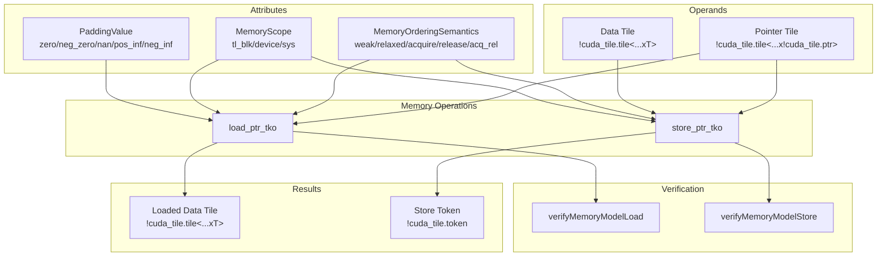
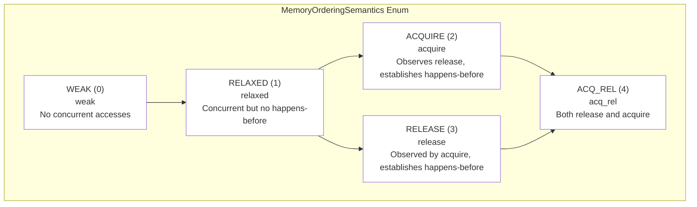
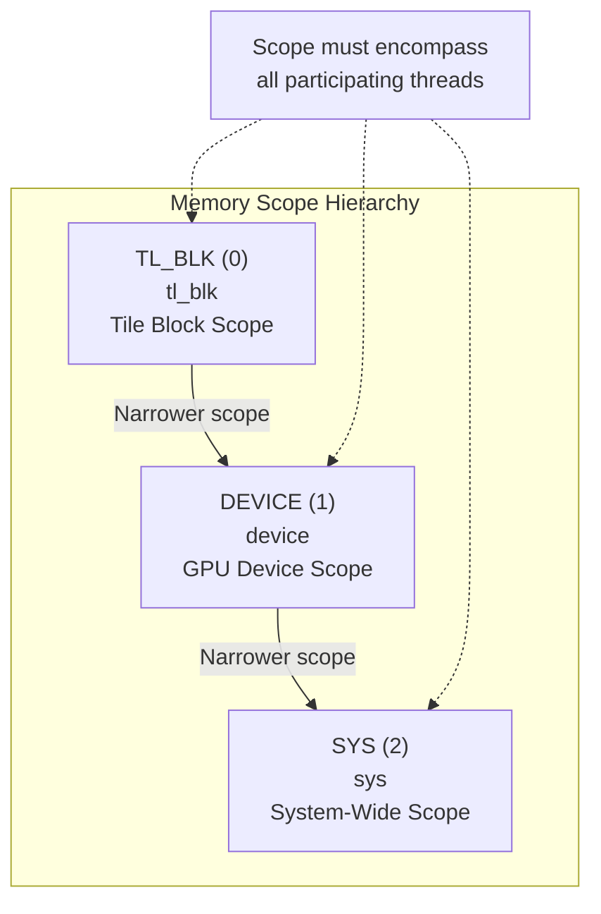
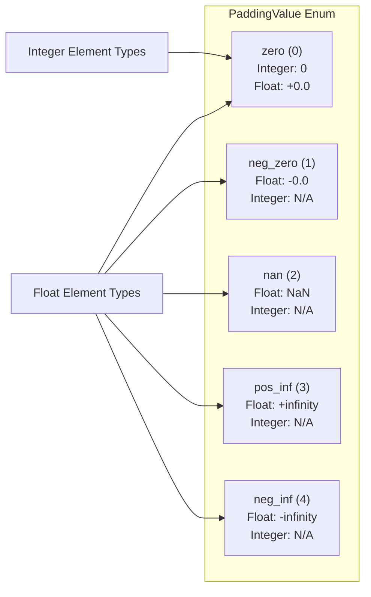
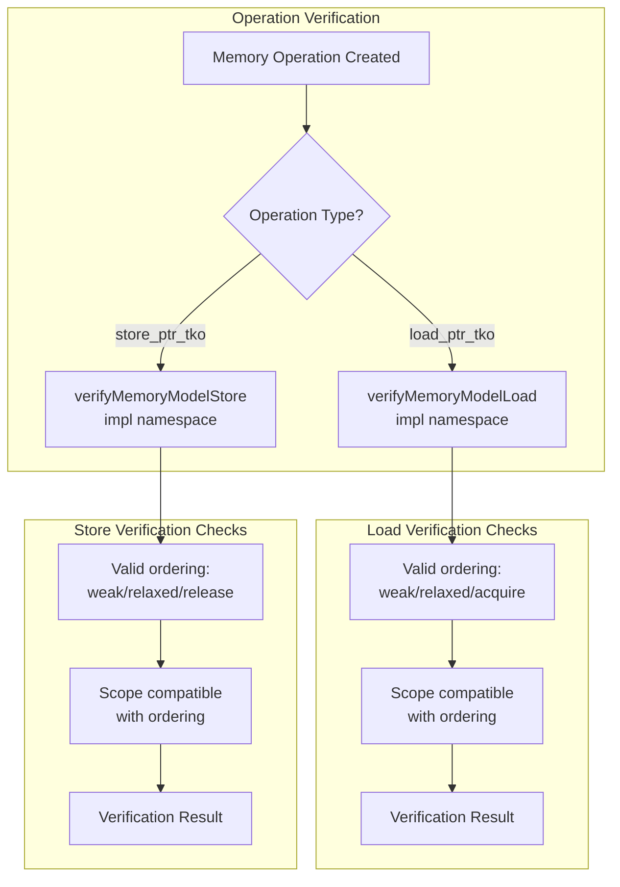
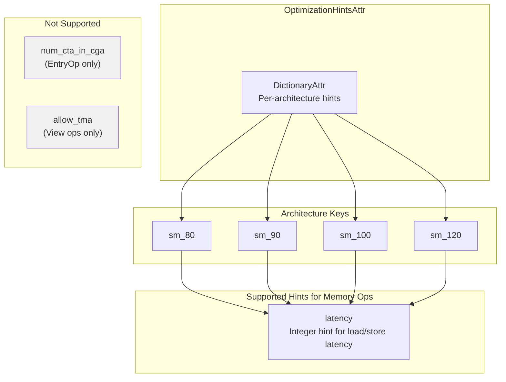

<!-- source: DeepWiki mcp.deepwiki.com · repo NVIDIA/cuda-tile · extra page Memory Operations · fetched 2026-10-26 -->

# Memory Operations

<details>
<summary>Relevant source files</summary>

The following files were used as context for generating this wiki page:

- [lib/Dialect/CudaTile/IR/CudaTile.cpp](lib/Dialect/CudaTile/IR/CudaTile.cpp)
- [python/cuda_tile/dialects/cuda_tile_ops.py](python/cuda_tile/dialects/cuda_tile_ops.py)

</details>


## Purpose and Scope

This document describes the memory operations in the CudaTile dialect, specifically the `load_ptr_tko` and `store_ptr_tko` operations. These operations provide low-level memory access primitives with explicit control over memory ordering semantics, memory scope, and padding behavior for out-of-bounds accesses.

For information about the memory ordering semantics and scope attributes themselves, see [Attribute System](#3.2). For a comprehensive explanation of the memory model and synchronization guarantees, see [Memory Model](#8.1). For memory operations on views (as opposed to raw pointers), refer to [View and Tile Operations](#3.3.4).

## Memory Operation Overview

The CudaTile dialect provides two fundamental pointer-based memory operations:

| Operation | Purpose | Key Operands | Key Attributes |
|-----------|---------|--------------|----------------|
| `load_ptr_tko` | Load data from memory via pointer | Pointer tile | `memory_ordering`, `scope`, `padding_value` |
| `store_ptr_tko` | Store data to memory via pointer | Pointer tile, data tile | `memory_ordering`, `scope` |

Both operations operate on tiles of pointers (`!cuda_tile.tile<...x!cuda_tile.ptr<T>>`) and provide explicit memory ordering guarantees through attributes. The "tko" suffix likely stands for "tile, key, ordering" reflecting the operation's tile-based nature and memory ordering semantics.

**Diagram: Memory Operation Components**



Sources: [include/cuda_tile/Dialect/CudaTile/IR/Ops.h:34-39](), [include/cuda_tile/Dialect/CudaTile/IR/AttrDefs.td:412-466]()

## Memory Ordering Semantics

Memory operations support five levels of memory ordering semantics, defined by the `MemoryOrderingSemantics` enumeration attribute. These semantics control synchronization and visibility guarantees between concurrent threads.

**Diagram: Memory Ordering Hierarchy**



### Memory Ordering Levels

| Ordering | Mnemonic | Concurrent Access? | Synchronization Effect |
|----------|----------|-------------------|------------------------|
| `WEAK` | `weak` | No | Compiler assumes no concurrent accesses; allows aggressive optimization |
| `RELAXED` | `relaxed` | Yes | Allows concurrent access but does not establish happens-before relationship |
| `ACQUIRE` | `acquire` | Yes | If this load observes a release store, happens-before is established |
| `RELEASE` | `release` | Yes | If this store is observed by an acquire load, happens-before is established |
| `ACQ_REL` | `acq_rel` | Yes | Combined effect of both acquire and release |

**Memory Ordering Usage Rules:**

1. **Load operations** can use: `weak`, `relaxed`, or `acquire`
2. **Store operations** can use: `weak`, `relaxed`, or `release`
3. **Atomic operations** (not in memory ops, but related) can use: `weak`, `relaxed`, `acquire`, `release`, or `acq_rel`

The verification functions `verifyMemoryModelLoad` and `verifyMemoryModelStore` enforce these constraints at IR validation time.

Sources: [include/cuda_tile/Dialect/CudaTile/IR/AttrDefs.td:426-440](), [include/cuda_tile/Dialect/CudaTile/IR/Ops.h:34-39]()

## Memory Scope

The `MemoryScope` attribute specifies the communication scope for memory operations. This determines which concurrent threads are considered when reasoning about synchronization and visibility.

**Diagram: Memory Scope Levels**



### Scope Levels

| Scope | Mnemonic | Encompasses | Use Case |
|-------|----------|-------------|----------|
| `TL_BLK` | `tl_blk` | Same tile block | Synchronization within a single CTA/thread block |
| `DEVICE` | `device` | Same GPU device | Synchronization across CTAs on one GPU |
| `SYS` | `sys` | All devices in system | Synchronization across multiple GPUs or with CPU |

**Scope Selection Guidelines:**

- The scope must be **broad enough** to encompass all threads participating in the communication
- Using a narrower scope than necessary can cause **data races**
- Using a broader scope than necessary may reduce **performance** due to stronger synchronization requirements
- The scope is **optional** for memory operations; when omitted, a default scope is inferred based on memory ordering

Sources: [include/cuda_tile/Dialect/CudaTile/IR/AttrDefs.td:412-424]()

## Padding Values for Load Operations

Load operations support a `padding_value` attribute that specifies the value returned when accessing memory out of bounds. This is particularly useful for operations on tiles that may extend beyond allocated memory regions.

**Diagram: Padding Value Options**



### Padding Value Semantics

| Value | Mnemonic | Integer Types | Float Types | Description |
|-------|----------|---------------|-------------|-------------|
| `zero` | `zero` | ✓ | ✓ | Zero value (positive zero for floats) |
| `neg_zero` | `neg_zero` | ✗ | ✓ | Negative zero (-0.0) |
| `nan` | `nan` | ✗ | ✓ | Not-a-Number (NaN) |
| `pos_inf` | `pos_inf` | ✗ | ✓ | Positive infinity (+∞) |
| `neg_inf` | `neg_inf` | ✗ | ✓ | Negative infinity (-∞) |

**Important Constraints:**

- Special padding values (`neg_zero`, `nan`, `pos_inf`, `neg_inf`) **can only be used with floating-point element types**
- Attempting to use special padding values with integer types will cause verification to fail
- The `zero` padding value is valid for both integer and floating-point types

Sources: [include/cuda_tile/Dialect/CudaTile/IR/AttrDefs.td:442-466]()

## Memory Model Verification

The CudaTile dialect enforces memory model constraints through dedicated verification functions. These ensure that memory ordering and scope attributes are used correctly with load and store operations.

**Diagram: Verification Process**



### Verification Functions

The verification functions are implemented in the `mlir::cuda_tile::impl` namespace:

| Function | Purpose | Parameters |
|----------|---------|------------|
| `verifyMemoryModelLoad` | Validates load operation memory model | `Operation*`, `MemoryOrderingSemantics`, `std::optional<MemoryScope>` |
| `verifyMemoryModelStore` | Validates store operation memory model | `Operation*`, `MemoryOrderingSemantics`, `std::optional<MemoryScope>` |

**Verification Rules:**

1. **Ordering Constraints:**
   - Loads cannot use `RELEASE` or `ACQ_REL`
   - Stores cannot use `ACQUIRE` or `ACQ_REL`

2. **Scope Constraints:**
   - If ordering is `WEAK`, scope must be absent or consistent
   - If ordering is `RELAXED`, `ACQUIRE`, or `RELEASE`, scope must be specified and broad enough
   - Scope must be one of: `tl_blk`, `device`, or `sys`

3. **Type Constraints:**
   - Special padding values require floating-point element types
   - Pointer tile element types must match data tile element types for stores

Sources: [include/cuda_tile/Dialect/CudaTile/IR/Ops.h:29-44]()

## Operation Attributes and Optimization Hints

Memory operations can be annotated with architecture-specific optimization hints through the `OptimizationHintsAttr`. For load and store pointer operations, the `latency` hint is supported.

**Diagram: Optimization Hints for Memory Operations**



### Optimization Hints Table

| Hint | LoadPtrTkoOp | StorePtrTkoOp | LoadViewTkoOp | StoreViewTkoOp | EntryOp |
|------|--------------|---------------|---------------|----------------|---------|
| `num_cta_in_cga` | No | No | No | No | Yes |
| `allow_tma` | No | No | Yes | Yes | No |
| `latency` | **Yes** | **Yes** | Yes | Yes | No |

Sources: [include/cuda_tile/Dialect/CudaTile/IR/AttrDefs.td:67-129]()

## Complete Example

The following example demonstrates the use of memory operations with different memory ordering semantics and scopes:

```mlir
// Example: Memory operations with different orderings

// Load with weak ordering (no concurrent access assumed)
%loaded_weak = cuda_tile.load_ptr_tko %ptr_tile, 
    memory_ordering=<weak>, 
    padding_value=<zero>
    : !cuda_tile.tile<16x!cuda_tile.ptr<f32>> 
    -> !cuda_tile.tile<16xf32>

// Load with relaxed ordering at device scope
%loaded_relaxed = cuda_tile.load_ptr_tko %ptr_tile, 
    memory_ordering=<relaxed>, 
    scope=<device>,
    padding_value=<zero>
    : !cuda_tile.tile<16x!cuda_tile.ptr<f32>> 
    -> !cuda_tile.tile<16xf32>

// Load with acquire ordering (establishes happens-before)
%loaded_acquire = cuda_tile.load_ptr_tko %shared_ptr_tile, 
    memory_ordering=<acquire>, 
    scope=<tl_blk>,
    padding_value=<nan>
    : !cuda_tile.tile<32x!cuda_tile.ptr<f32>> 
    -> !cuda_tile.tile<32xf32>

// Store with release ordering (for synchronization)
%store_token = cuda_tile.store_ptr_tko %ptr_tile, %data, 
    memory_ordering=<release>, 
    scope=<device>
    : !cuda_tile.tile<16x!cuda_tile.ptr<f32>>, 
      !cuda_tile.tile<16xf32> 
    -> !cuda_tile.token

// Store with weak ordering and optimization hint
%store_token_opt = cuda_tile.store_ptr_tko %ptr_tile, %data, 
    memory_ordering=<weak>,
    optimization_hints=<sm_100 = {latency = 4}>
    : !cuda_tile.tile<16x!cuda_tile.ptr<f32>>, 
      !cuda_tile.tile<16xf32> 
    -> !cuda_tile.token
```

Sources: [include/cuda_tile/Dialect/CudaTile/IR/AttrDefs.td:412-466](), [include/cuda_tile/Dialect/CudaTile/IR/Ops.h:34-39]()

## Summary Table

| Aspect | Load Operations | Store Operations |
|--------|----------------|------------------|
| **Operation Name** | `load_ptr_tko` | `store_ptr_tko` |
| **Primary Operand** | Pointer tile | Pointer tile + data tile |
| **Result** | Data tile | Token |
| **Memory Ordering** | `weak`, `relaxed`, `acquire` | `weak`, `relaxed`, `release` |
| **Memory Scope** | Optional; `tl_blk`, `device`, `sys` | Optional; `tl_blk`, `device`, `sys` |
| **Padding Values** | `zero`, `neg_zero`, `nan`, `pos_inf`, `neg_inf` | N/A |
| **Optimization Hints** | `latency` | `latency` |
| **Verification** | `verifyMemoryModelLoad` | `verifyMemoryModelStore` |

Sources: [include/cuda_tile/Dialect/CudaTile/IR/AttrDefs.td:412-466](), [include/cuda_tile/Dialect/CudaTile/IR/Ops.h:29-44]()

---

