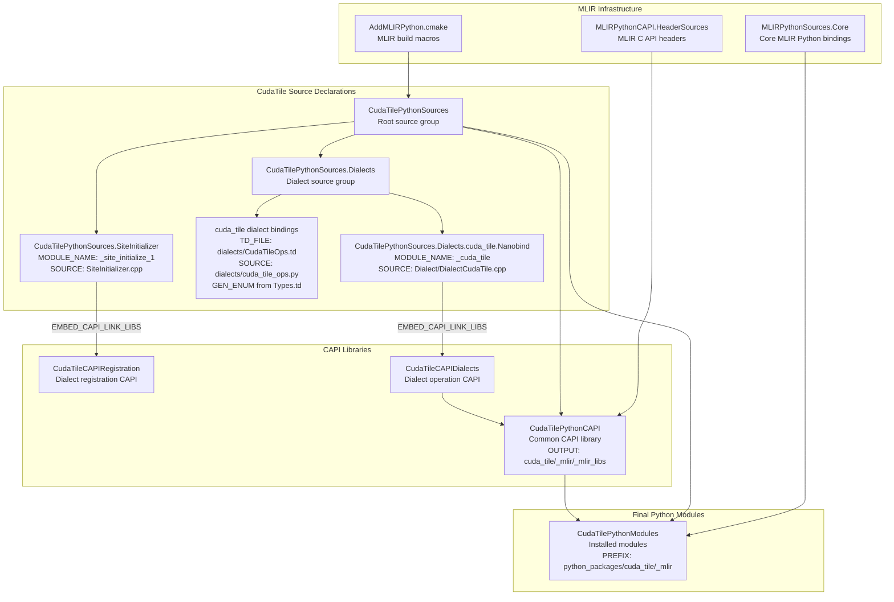
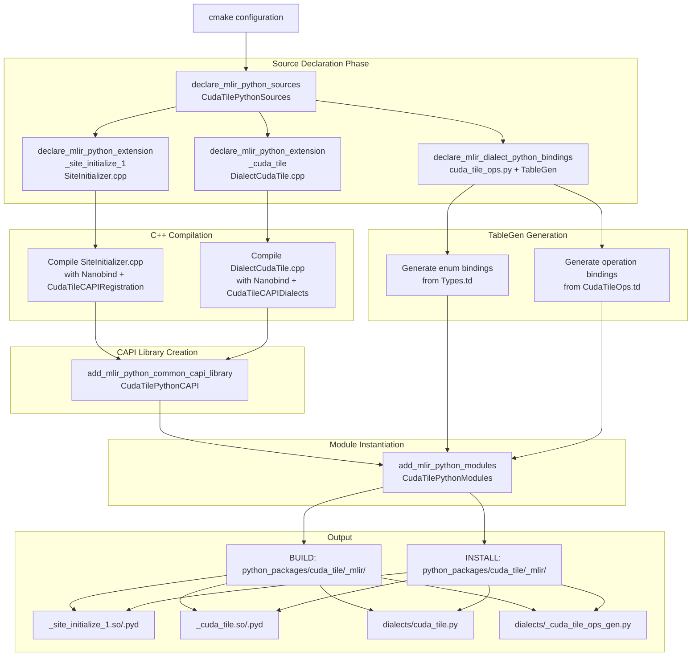
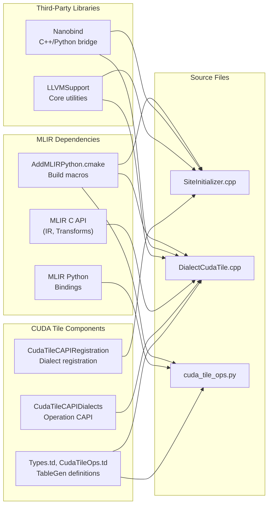

<!-- source: DeepWiki mcp.deepwiki.com · repo NVIDIA/cuda-tile · extra page Python Build System · fetched 2026-10-26 -->

# Python Build System

<details>
<summary>Relevant source files</summary>

The following files were used as context for generating this wiki page:

- [python/CMakeLists.txt](python/CMakeLists.txt)

</details>


This document explains the CMake-based build configuration for CUDA Tile's Python bindings, including Nanobind integration, MLIR Python infrastructure dependencies, and the multi-layered module structure. For details on the C++ wrapper implementation, see [Python C++ Extension Layer](#5.3.2). For the high-level Python API, see [Python Operations API](#5.3.3).

## Overview

The Python build system is implemented in [python/CMakeLists.txt]() and orchestrates the compilation of C++ extension modules using MLIR's Python binding infrastructure. The system produces two primary extension modules (`_site_initialize_1` for dialect registration and `_cuda_tile` for core bindings) plus auto-generated dialect bindings, all integrated under the `cuda_tile._mlir` package namespace.

**Sources:** [python/CMakeLists.txt:1-124]()

## Build System Architecture

The Python build system follows MLIR's layered approach to Python bindings, utilizing several CMake macros from `AddMLIRPython.cmake` to declare sources, extensions, and final module targets.

### Component Hierarchy



**Diagram: Python Build System Component Hierarchy**

The build system declares sources and extensions hierarchically, then combines them into CAPI libraries and final module targets. `CudaTilePythonSources` is the root group containing all Python-related build artifacts.

**Sources:** [python/CMakeLists.txt:21-110]()

## MLIR Python Infrastructure Integration

CUDA Tile's Python bindings are built on top of MLIR's Python infrastructure, requiring specific configuration to ensure co-location and proper dependency management.

### Package Namespace Configuration

The build system embeds all MLIR packages under the `cuda_tile._mlir` namespace using a compile definition:

[python/CMakeLists.txt:10-12]()
```cmake
add_compile_definitions("MLIR_PYTHON_PACKAGE_PREFIX=cuda_tile._mlir.")
```

This ensures that when CUDA Tile imports MLIR Python modules, they are located under `cuda_tile._mlir.ir`, `cuda_tile._mlir.dialects`, etc., rather than the default `mlir.*` namespace. This enables relocatable packaging and avoids conflicts with system-wide MLIR installations.

The MLIR Python package root is configured at:

[python/CMakeLists.txt:14]()
```cmake
set(MLIR_PYTHON_PKG_ROOT ${LLVM_ROOT}/python_packages/mlir_core)
```

**Sources:** [python/CMakeLists.txt:10-14]()

### MLIR Build Macros

The system uses four primary MLIR build macros:

| Macro | Purpose | Example Usage |
|-------|---------|---------------|
| `declare_mlir_python_sources` | Declares a group of Python source files | `CudaTilePythonSources` [python/CMakeLists.txt:21]() |
| `declare_mlir_python_extension` | Declares a C++ extension module with Nanobind | `_site_initialize_1`, `_cuda_tile` [python/CMakeLists.txt:35-71]() |
| `declare_mlir_dialect_python_bindings` | Declares TableGen-generated dialect bindings | `cuda_tile_ops.py` [python/CMakeLists.txt:48-57]() |
| `add_mlir_python_modules` | Instantiates all declared sources into final modules | `CudaTilePythonModules` [python/CMakeLists.txt:100-110]() |

**Sources:** [python/CMakeLists.txt:1-110]()

## Nanobind Integration

CUDA Tile uses Nanobind (not pybind11) as the C++/Python binding library. Nanobind is specified via the `PYTHON_BINDINGS_LIBRARY` parameter:

[python/CMakeLists.txt:40]()
```cmake
PYTHON_BINDINGS_LIBRARY nanobind
```

This is passed to both extension declarations: `_site_initialize_1` [python/CMakeLists.txt:35-47]() and `_cuda_tile` [python/CMakeLists.txt:59-71]().

### Sanitizer Configuration

When building with sanitizers enabled using Clang, the build system configures shared library sanitizers to avoid runtime loading issues:

[python/CMakeLists.txt:3-8]()
```cmake
if(CUDA_TILE_ENABLE_SANITIZER AND CMAKE_CXX_COMPILER_ID STREQUAL "Clang")
  add_compile_options("-shared-libasan")
endif()
```

This addresses the issue described in [google/sanitizers#1086](https://github.com/google/sanitizers/issues/1086) where sanitizer instrumentation in dynamically loaded libraries requires the sanitizer runtime to be in a shared library.

**Sources:** [python/CMakeLists.txt:3-8, 40, 63]()

## Extension Module Declarations

### Site Initializer Extension

The `_site_initialize_1` module is a special Nanobind extension that performs automatic dialect registration during Python site initialization:

[python/CMakeLists.txt:35-47]()

```cmake
declare_mlir_python_extension(CudaTilePythonSources.SiteInitializer
  MODULE_NAME   _site_initialize_1
  ADD_TO_PARENT CudaTilePythonSources
  PYTHON_BINDINGS_LIBRARY nanobind
  SOURCES
    SiteInitializer.cpp
  EMBED_CAPI_LINK_LIBS
    CudaTileCAPIRegistration
  PRIVATE_LINK_LIBS
    LLVMSupport
)
```

**Key Properties:**
- **Module Name:** `_site_initialize_1` (special naming convention for auto-registration)
- **Source File:** `SiteInitializer.cpp` (see [Python C++ Extension Layer](#5.3.2) for implementation details)
- **CAPI Dependencies:** Embeds `CudaTileCAPIRegistration` for dialect registration
- **Auto-Registration:** MLIR's Python infrastructure automatically imports modules matching `_site_initialize_*` pattern

The naming convention is documented in MLIR's `__init__.py` at [llvm-project/mlir/python/mlir/_mlir_libs/__init__.py#L41](https://github.com/llvm/llvm-project/blob/main/mlir/python/mlir/_mlir_libs/__init__.py#L41).

**Sources:** [python/CMakeLists.txt:31-47]()

### Core Dialect Extension

The `_cuda_tile` module provides the core C++ bindings for types, attributes, and operations:

[python/CMakeLists.txt:59-71]()

```cmake
declare_mlir_python_extension(CudaTilePythonSources.Dialects.cuda_tile.Nanobind
  MODULE_NAME _cuda_tile
  ADD_TO_PARENT CudaTilePythonSources.Dialects.cuda_tile
  ROOT_DIR "${CMAKE_CURRENT_SOURCE_DIR}"
  PYTHON_BINDINGS_LIBRARY nanobind
  SOURCES
    Dialect/DialectCudaTile.cpp
  PRIVATE_LINK_LIBS
    LLVMSupport
  EMBED_CAPI_LINK_LIBS
    MLIRCAPIIR
    CudaTileCAPIDialects
)
```

**Key Properties:**
- **Module Name:** `_cuda_tile` (imported as `cuda_tile.dialects._cuda_tile`)
- **Source File:** `Dialect/DialectCudaTile.cpp` (see [Python C++ Extension Layer](#5.3.2))
- **CAPI Dependencies:** Embeds `MLIRCAPIIR` (core MLIR C API) and `CudaTileCAPIDialects` (dialect-specific CAPI)
- **Parent Group:** Added to `CudaTilePythonSources.Dialects.cuda_tile` for proper package nesting

**Sources:** [python/CMakeLists.txt:59-71]()

### TableGen-Generated Dialect Bindings

The `declare_mlir_dialect_python_bindings` macro auto-generates Python bindings for operations and enums using TableGen:

[python/CMakeLists.txt:48-57]()

```cmake
declare_mlir_dialect_python_bindings(
  ADD_TO_PARENT CudaTilePythonSources.Dialects
  ROOT_DIR "${CMAKE_CURRENT_SOURCE_DIR}/cuda_tile"
  TD_FILE dialects/CudaTileOps.td
  SOURCES
    dialects/cuda_tile_ops.py
  DIALECT_NAME cuda_tile
  GEN_ENUM_BINDINGS_TD_FILE
    "../../include/cuda_tile/Dialect/CudaTile/IR/Types.td"
)
```

**Key Properties:**
- **TableGen Input:** `dialects/CudaTileOps.td` defines operation bindings
- **Python Output:** `dialects/cuda_tile_ops.py` contains high-level operation wrappers (see [Python Operations API](#5.3.3))
- **Enum Generation:** `Types.td` generates Python enums for attributes like `RoundingMode`, `MemoryOrderingSemantics`, etc.
- **Dialect Name:** `cuda_tile` used for namespace resolution

This macro generates Python class wrappers for each operation defined in the TableGen files, providing a higher-level API than the raw C API.

**Sources:** [python/CMakeLists.txt:48-57]()

## Build Flow



**Diagram: Python Build Flow**

The build process proceeds through declaration, TableGen generation, C++ compilation, CAPI library creation, and final module instantiation phases.

**Sources:** [python/CMakeLists.txt:21-110]()

## CAPI Library Configuration

The `CudaTilePythonCAPI` library consolidates all C API components needed by the Python bindings:

[python/CMakeLists.txt:78-90]()

```cmake
add_mlir_python_common_capi_library(CudaTilePythonCAPI
  INSTALL_COMPONENT     CudaTilePythonModules
  INSTALL_DESTINATION   python_packages/cuda_tile/_mlir/_mlir_libs
  OUTPUT_DIRECTORY      "${CUDA_TILE_BINARY_DIR}/python_packages/cuda_tile/_mlir/_mlir_libs"
  RELATIVE_INSTALL_ROOT "../../.."
  DECLARED_HEADERS
    MLIRPythonCAPI.HeaderSources
  DECLARED_SOURCES
    MLIRPythonExtension.Core
    CudaTilePythonSources
  EMBED_LIBS
    CudaTileCAPIDialects
)
```

**Configuration Details:**

| Parameter | Value | Purpose |
|-----------|-------|---------|
| `INSTALL_DESTINATION` | `python_packages/cuda_tile/_mlir/_mlir_libs` | Installation path for shared libraries |
| `OUTPUT_DIRECTORY` | `${CUDA_TILE_BINARY_DIR}/python_packages/cuda_tile/_mlir/_mlir_libs` | Build output path |
| `RELATIVE_INSTALL_ROOT` | `../../..` | RPATH configuration for library discovery |
| `DECLARED_HEADERS` | `MLIRPythonCAPI.HeaderSources` | MLIR C API headers |
| `DECLARED_SOURCES` | `MLIRPythonExtension.Core`<br/>`CudaTilePythonSources` | Python extension sources |
| `EMBED_LIBS` | `CudaTileCAPIDialects` | Embedded CAPI libraries |

The `RELATIVE_INSTALL_ROOT` is set to `../../..` to ensure the RPATH points to the directory containing the shared libraries, enabling the dynamic loader to find dependencies without absolute paths.

**Sources:** [python/CMakeLists.txt:78-90, 96-99]()

## Module Instantiation

The final `add_mlir_python_modules` invocation creates the installable Python package:

[python/CMakeLists.txt:100-110]()

```cmake
add_mlir_python_modules(CudaTilePythonModules
  ROOT_PREFIX    "${CUDA_TILE_BINARY_DIR}/python_packages/cuda_tile/_mlir"
  INSTALL_PREFIX "python_packages/cuda_tile/_mlir"
  DECLARED_SOURCES
    MLIRPythonSources.Core
    CudaTilePythonSources
  COMMON_CAPI_LINK_LIBS
    CudaTilePythonCAPI
    MLIRCAPITransforms
  )
```

**Key Configurations:**
- **Build Output:** `${CUDA_TILE_BINARY_DIR}/python_packages/cuda_tile/_mlir`
- **Install Prefix:** `python_packages/cuda_tile/_mlir`
- **Core Dependencies:** `MLIRPythonSources.Core` (MLIR core Python bindings)
- **CUDA Tile Sources:** `CudaTilePythonSources` (all declared extensions and sources)
- **CAPI Libraries:** `CudaTilePythonCAPI`, `MLIRCAPITransforms` (note: `MLIRCAPITransforms` is a workaround for PDL rewrite CAPIs)

The target `CudaTilePythonModules` can be built with `cmake --build . --target CudaTilePythonModules` to compile all Python bindings.

**Sources:** [python/CMakeLists.txt:100-110]()

## Output Directory Structure

The build and installation processes create the following directory structure:

```
python_packages/cuda_tile/
├── _mlir/
│   ├── _mlir_libs/
│   │   ├── _site_initialize_1.so (or .pyd on Windows)
│   │   ├── _cuda_tile.so (or .pyd on Windows)
│   │   └── libCudaTilePythonCAPI.so (common CAPI library)
│   ├── ir/
│   │   └── ... (MLIR core IR bindings)
│   ├── dialects/
│   │   ├── cuda_tile.py
│   │   ├── _cuda_tile_ops_gen.py (TableGen-generated)
│   │   └── _cuda_tile_enum_gen.py (TableGen-generated)
│   └── ... (other MLIR modules)
└── ... (high-level cuda_tile modules)
```

**Module Mapping:**

| Python Import | File Location | Build Source |
|---------------|---------------|--------------|
| `cuda_tile._mlir._mlir_libs._site_initialize_1` | `_mlir/_mlir_libs/_site_initialize_1.so` | `SiteInitializer.cpp` |
| `cuda_tile._mlir._mlir_libs._cuda_tile` | `_mlir/_mlir_libs/_cuda_tile.so` | `Dialect/DialectCudaTile.cpp` |
| `cuda_tile._mlir.dialects.cuda_tile` | `_mlir/dialects/cuda_tile.py` | `dialects/cuda_tile_ops.py` |

**Sources:** [python/CMakeLists.txt:80-81, 101-102]()

## Platform-Specific Configuration

### Windows Debug Builds

On Windows Debug builds, the system creates debug symbol links to ensure proper debugging:

[python/CMakeLists.txt:113-122]()

```cmake
if(WIN32 AND CMAKE_BUILD_TYPE STREQUAL "Debug")
  include(../cmake/WindowsPythonDebugUtils.cmake)

  add_windows_debug_links_installation(
    CudaTilePythonModules
    "${CUDA_TILE_BINARY_DIR}/python_packages/cuda_tile/_mlir/_mlir_libs"
    "${CMAKE_INSTALL_PREFIX}/python_packages/cuda_tile/_mlir/_mlir_libs"
    CudaTilePythonModules
  )
endif()
```

This helper from `WindowsPythonDebugUtils.cmake` creates `.pdb` file links in the installation directory, enabling Visual Studio and other debuggers to locate debug symbols for the Python extension modules.

**Sources:** [python/CMakeLists.txt:113-122]()

### Linux Sanitizer Support

On Linux with Clang and sanitizers enabled, the build adds `-shared-libasan` to ensure the sanitizer runtime is available as a shared library:

[python/CMakeLists.txt:6-7]()

```cmake
add_compile_options("-shared-libasan")
```

This is required because Python dynamically loads extension modules, and the sanitizer instrumentation needs the runtime library to be accessible at module load time.

**Sources:** [python/CMakeLists.txt:3-8]()

## Build Dependencies



**Diagram: Build Dependencies for Python Bindings**

The Python build system depends on MLIR's Python infrastructure, Nanobind for C++ binding generation, LLVM utilities, and CUDA Tile's C API layers.

**Sources:** [python/CMakeLists.txt:1-110]()

## Build Targets

The following CMake targets are created by the Python build system:

| Target Name | Type | Purpose |
|-------------|------|---------|
| `CudaTilePythonSources` | Source Group | Logical grouping of all Python sources |
| `CudaTilePythonSources.SiteInitializer` | Extension Module | `_site_initialize_1` for auto-registration |
| `CudaTilePythonSources.Dialects.cuda_tile.Nanobind` | Extension Module | `_cuda_tile` core bindings |
| `CudaTilePythonCAPI` | CAPI Library | Common C API shared library |
| `CudaTilePythonModules` | Module Group | Installable Python package target |

To build only Python bindings:
```bash
cmake --build . --target CudaTilePythonModules
```

To install Python bindings:
```bash
cmake --install . --component CudaTilePythonModules
```

**Sources:** [python/CMakeLists.txt:21-110]()

---

