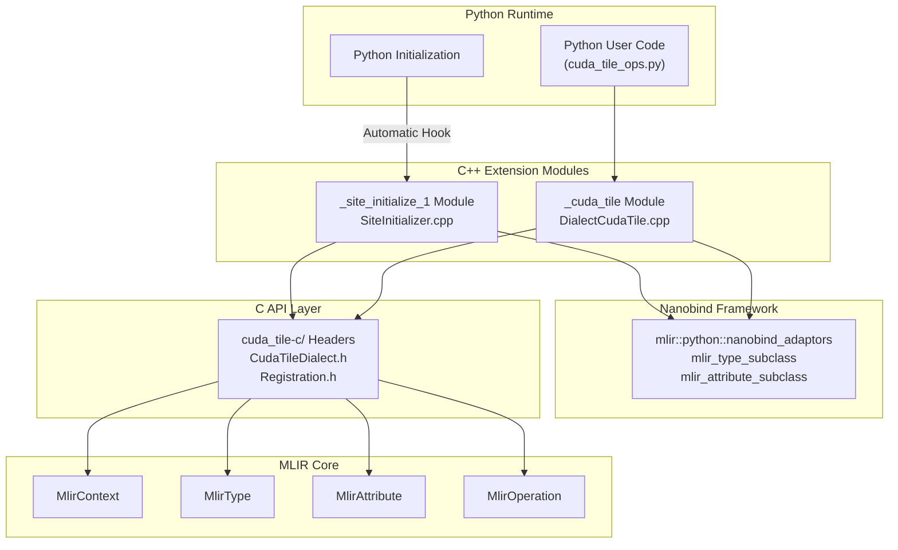
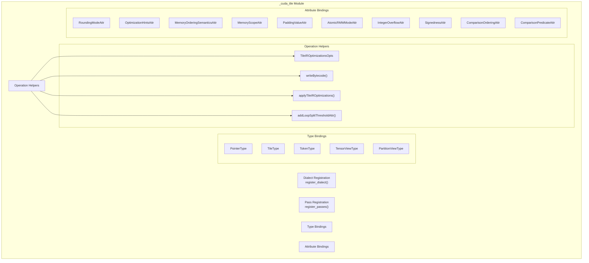
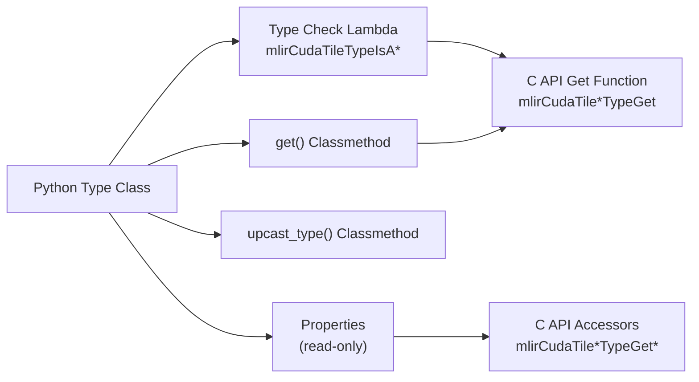
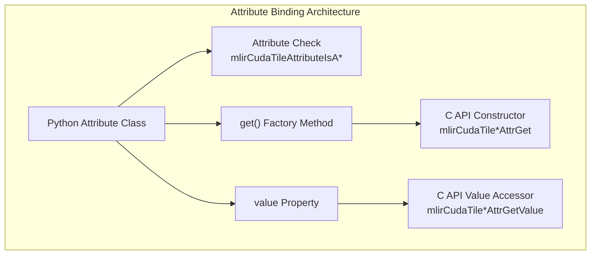
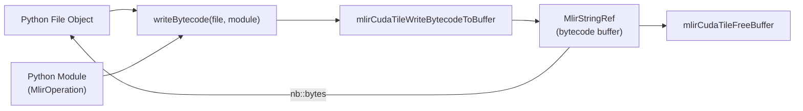
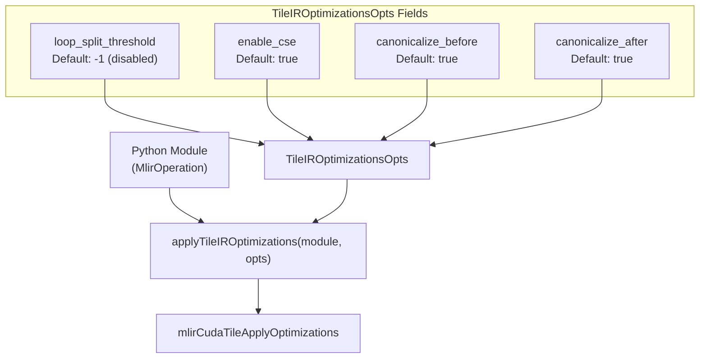
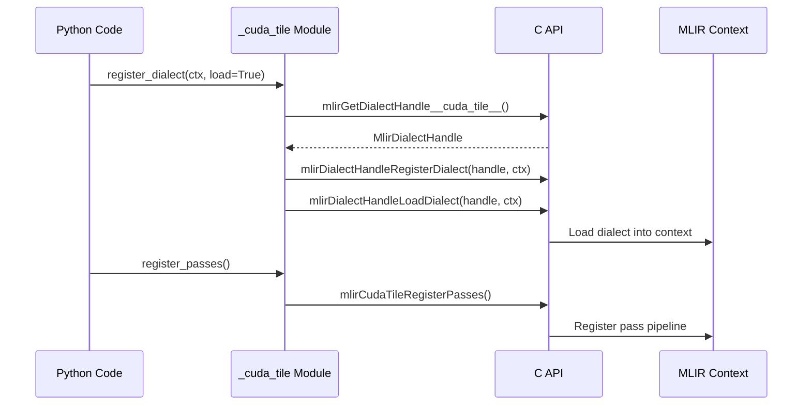

<!-- source: DeepWiki mcp.deepwiki.com · repo NVIDIA/cuda-tile · extra page Python C++ Extension Layer · fetched 2026-10-26 -->

# Python C++ Extension Layer

Relevant source files

The following files were used as context for generating this wiki page:

- [python/Dialect/DialectCudaTile.cpp](python/Dialect/DialectCudaTile.cpp)
- [python/SiteInitializer.cpp](python/SiteInitializer.cpp)

This page documents the C++ extension layer that provides Python bindings for the CudaTile dialect. This layer consists of Nanobind-based C++ modules that wrap C API functions to expose MLIR types, attributes, and operations to Python. For information about the build system configuration, see [Python Build System](#5.3.1). For the high-level Python API built on top of this layer, see [Python Operations API](#5.3.3).

The C++ extension layer serves as the bridge between the C API defined in `cuda_tile-c/` headers and the Python API. It creates two Nanobind modules: `_site_initialize_1` for automatic dialect registration and `_cuda_tile` for core type, attribute, and operation bindings.

## Architecture Overview

The C++ extension layer consists of two Nanobind modules that provide different levels of integration:

**Sources:** [python/SiteInitializer.cpp:1-27](), [python/Dialect/DialectCudaTile.cpp:1-602]()

## Module Structure

### `_site_initialize_1` Module

The `_site_initialize_1` module provides automatic dialect and pass registration through special API hooks that the MLIR Python infrastructure calls during initialization.

| Function | Purpose | Invocation |
|----------|---------|------------|
| `register_dialects` | Registers CudaTile dialect with MLIR context | Automatic hook called by MLIR Python |
| `register_passes` | Registers CudaTile optimization passes | Manual invocation required |

The module uses `mlirCudaTileRegisterAllDialects` and `mlirCudaTileRegisterAllPasses` from the C API to perform registration:

[python/SiteInitializer.cpp:14-26]()

**Key Characteristics:**
- Uses `NB_MODULE(_site_initialize_1, m)` macro
- `register_dialects` is automatically invoked during library initialization
- `register_passes` must be called explicitly by user code
- Accepts `MlirDialectRegistry` parameter for dialect registration

**Sources:** [python/SiteInitializer.cpp:1-27]()

### `_cuda_tile` Module

The `_cuda_tile` module provides the core Python bindings for types, attributes, and operations. It is organized into several functional areas:

**Sources:** [python/Dialect/DialectCudaTile.cpp:18-602]()

## Type Bindings

Type bindings use the `mlir_type_subclass` helper from MLIR's Nanobind adaptors to create Python wrappers for CudaTile types. Each type binding follows a consistent pattern:

**Sources:** [python/Dialect/DialectCudaTile.cpp:114-346]()

### Type Binding Pattern

Each type binding implements:

1. **Type Check Lambda**: Verifies if an `MlirType` is of the specific subtype
2. **`get()` Classmethod**: Factory method to create type instances
3. **`upcast_type()` Classmethod**: Safely casts generic `MlirType` to specific type
4. **Properties**: Read-only accessors for type parameters

### PointerType Binding

| Component | Implementation | C API Function |
|-----------|---------------|----------------|
| Type check | `mlirCudaTileTypeIsAPointerType(type)` | [python/Dialect/DialectCudaTile.cpp:115-117]() |
| Factory | `PointerType.get(pointee_type, context)` | `mlirCudaTilePointerTypeGet` |
| Properties | `pointee_type` | `mlirCudaTilePointerTypeGetPointeeType` |

**Example binding code:** [python/Dialect/DialectCudaTile.cpp:114-138]()

**Sources:** [python/Dialect/DialectCudaTile.cpp:114-138]()

### TileType Binding

| Component | Implementation | C API Function |
|-----------|---------------|----------------|
| Type check | `mlirCudaTileTypeIsATileType(type)` | [python/Dialect/DialectCudaTile.cpp:141-142]() |
| Factory | `TileType.get(shape, element_type, context)` | `mlirCudaTileTileTypeGetChecked` |
| Properties | `shape`, `element_type` | `mlirCudaTileTileTypeGetRank`, `mlirCudaTileTileTypeGetDimSize`, `mlirCudaTileTileTypeGetElementType` |

**Key Features:**
- Uses `mlirCudaTileTileTypeGetChecked` for validation during construction
- Returns `None` if type creation fails verification
- `shape` property iterates through rank to build dimension list

**Example binding code:** [python/Dialect/DialectCudaTile.cpp:140-176]()

**Sources:** [python/Dialect/DialectCudaTile.cpp:140-176]()

### TokenType Binding

| Component | Implementation | C API Function |
|-----------|---------------|----------------|
| Type check | `mlirCudaTileTypeIsATokenType(type)` | [python/Dialect/DialectCudaTile.cpp:179-180]() |
| Factory | `TokenType.get(context)` | `mlirCudaTileTokenTypeGet` |

TokenType is the simplest binding with no parameters or properties beyond creation.

**Sources:** [python/Dialect/DialectCudaTile.cpp:178-186]()

### TensorViewType Binding

TensorViewType supports dynamic shapes and strides represented as `std::optional<int64_t>` in Python:

| Component | Implementation | Special Handling |
|-----------|---------------|------------------|
| Type check | `mlirCudaTileTypeIsATensorViewType(type)` | [python/Dialect/DialectCudaTile.cpp:189-190]() |
| Factory | `TensorViewType.get(element_type, shape, stride, context)` | Transforms `None` to dynamic size marker |
| Properties | `element_type`, `shape`, `strides` | Converts dynamic markers back to `None` |

**Dynamic Size Handling:**
- Python `None` values are converted to `mlirCudaTileTensorViewTypeGetDynamicSize()` marker
- Negative values are rejected with error message
- Properties convert dynamic markers back to `std::optional` with `std::nullopt`

[python/Dialect/DialectCudaTile.cpp:198-212]()

**Sources:** [python/Dialect/DialectCudaTile.cpp:188-257]()

### PartitionViewType Binding

The most complex type binding, PartitionViewType wraps a TensorViewType with grid-based tiling:

| Component | Implementation | Special Handling |
|-----------|---------------|------------------|
| Type check | `mlirCudaTileTypeIsAPartitionViewType(type)` | [python/Dialect/DialectCudaTile.cpp:260-262]() |
| Factory | `PartitionViewType.get(tile_shape, tensor_view_type, dim_map, padding_value, context)` | Validates tensor_view type, creates identity dim_map if not provided |
| Properties | `tile_shape`, `tensor_view`, `dim_map`, `padding_value`, `view_tile_type`, `view_index_rank` | Multiple C API calls to extract components |

**Construction Logic:**
- Verifies `wrappedTensorViewType` is actually a TensorViewType [python/Dialect/DialectCudaTile.cpp:270-272]()
- Generates identity `dim_map` if not provided [python/Dialect/DialectCudaTile.cpp:274-284]()
- Creates `DenseI32ArrayAttr` for tile_shape [python/Dialect/DialectCudaTile.cpp:291-293]()
- Handles optional `paddingValueAttr` [python/Dialect/DialectCudaTile.cpp:286-289]()

**Sources:** [python/Dialect/DialectCudaTile.cpp:259-346]()

## Attribute Bindings

Attribute bindings follow a similar pattern to type bindings, using `mlir_attribute_subclass`:

**Sources:** [python/Dialect/DialectCudaTile.cpp:348-601]()

### Enumeration-Based Attributes

Most attribute bindings represent enumeration values as strings:

| Attribute Class | C API Constructor | Value Range |
|----------------|-------------------|-------------|
| `RoundingModeAttr` | `mlirCudaTileRoundingModeAttrGet` | String values (e.g., "nearest_even") |
| `MemoryOrderingSemanticsAttr` | `mlirCudaTileMemoryOrderingSemanticsAttrGet` | "weak", "relaxed", "acquire", "release", "acq_rel" |
| `MemoryScopeAttr` | `mlirCudaTileMemoryScopeAttrGet` | "TL_BLK", "DEVICE", "SYS" |
| `PaddingValueAttr` | `mlirCudaTilePaddingValueAttrGet` | String representation of padding |
| `AtomicRMWModeAttr` | `mlirCudaTileAtomicRMWModeAttrGet` | Atomic operation modes |
| `IntegerOverflowAttr` | `mlirCudaTileIntegerOverflowAttrGet` | Overflow behavior |
| `SignednessAttr` | `mlirCudaTileSignednessAttrGet` | "signed" or "unsigned" |
| `ComparisonOrderingAttr` | `mlirCudaTileComparisonOrderingAttrGet` | Comparison orderings |
| `ComparisonPredicateAttr` | `mlirCudaTileComparisonPredicateAttrGet` | Comparison predicates |

**Error Handling Patterns:**

1. **Fallback to Default** (RoundingMode, MemoryOrderingSemantics):
   - If invalid value, creates default ("nearest_even" or "weak")
   - [python/Dialect/DialectCudaTile.cpp:361-366](), [python/Dialect/DialectCudaTile.cpp:424-429]()

2. **Exception on Invalid** (Most others):
   - Throws `std::invalid_argument` with descriptive message
   - [python/Dialect/DialectCudaTile.cpp:452-453](), [python/Dialect/DialectCudaTile.cpp:498-500]()

**Sources:** [python/Dialect/DialectCudaTile.cpp:348-601]()

### OptimizationHintsAttr Binding

Unlike enumeration attributes, `OptimizationHintsAttr` has specialized factory methods for different operation types:

| Factory Method | Parameters | Purpose | C API Function |
|---------------|------------|---------|----------------|
| `getEntryOpHint` | `arch`, `num_cta`, `occupancy` | Entry operation optimization | `mlirCudaTileOptimizationHintsAttrGetEntryOpHint` |
| `getLoadStoreOpHint` | `arch`, `allow_tma`, `latency` | Memory operation optimization | `mlirCudaTileOptimizationHintsAttrGetLoadStoreOpHint` |

**Load/Store Hint Encoding:**
- `allow_tma` is `std::optional<bool>` in Python
- Converted to `int8_t`: -1 (unspecified), 0 (false), 1 (true)
- [python/Dialect/DialectCudaTile.cpp:400-402]()

**Sources:** [python/Dialect/DialectCudaTile.cpp:375-409]()

## Operation Helper Functions

The `_cuda_tile` module provides utility functions for IR manipulation and optimization:

### `writeBytecode` Function

Serializes an MLIR module to bytecode format:

**Implementation Details:**
- Accepts Python file-like object and MLIR module operation
- Uses C API to serialize to memory buffer [python/Dialect/DialectCudaTile.cpp:90-91]()
- Returns `False` if serialization fails (empty buffer)
- Wraps buffer as `nb::bytes` and writes to Python file [python/Dialect/DialectCudaTile.cpp:98-101]()
- Flushes file if `flush()` method exists
- Frees C-allocated buffer [python/Dialect/DialectCudaTile.cpp:104]()

**Sources:** [python/Dialect/DialectCudaTile.cpp:82-109]()

### `applyTileIROptimizations` Function

Applies optimization passes to a module using the `TileIROptimizationsOpts` configuration:

**TileIROptimizationsOpts Configuration:**

| Field | Type | Default | Purpose |
|-------|------|---------|---------|
| `loop_split_threshold` | `int` | -1 (disabled) | Threshold for loop splitting optimization |
| `enable_cse` | `bool` | `true` | Enable common subexpression elimination |
| `canonicalize_before` | `bool` | `true` | Run canonicalization before optimizations |
| `canonicalize_after` | `bool` | `true` | Run canonicalization after optimizations |

**Sources:** [python/Dialect/DialectCudaTile.cpp:37-64]()

### `addLoopSplitThresholdAttr` Function

Attaches a loop split threshold hint to an operation:

**Process:**
1. Cast Python operation to `MlirOperation`
2. Get operation's MLIR context
3. Create i32 integer type
4. Create integer attribute with threshold value
5. Set as discardable attribute with name "loop_split_threshold"

[python/Dialect/DialectCudaTile.cpp:67-80]()

**Sources:** [python/Dialect/DialectCudaTile.cpp:66-80]()

## Dialect and Pass Registration

The module provides direct registration functions that wrap the C API:

| Function | Parameters | C API Call | Usage |
|----------|-----------|------------|-------|
| `register_dialect` | `context`, `load` | `mlirGetDialectHandle__cuda_tile__()`, `mlirDialectHandleRegisterDialect`, `mlirDialectHandleLoadDialect` | Register and optionally load CudaTile dialect |
| `register_passes` | None | `mlirCudaTileRegisterPasses()` | Register optimization passes |

**Registration Flow:**

**Sources:** [python/Dialect/DialectCudaTile.cpp:22-33]()

## C API Integration Pattern

All bindings follow a consistent pattern of wrapping C API functions:

### Type Wrapping Pattern

1. **Creation**: Python factory method calls `mlirCudaTile*TypeGet[Checked]`
2. **Validation**: Checked variants return null on validation failure
3. **Properties**: Read-only Python properties call `mlirCudaTile*TypeGet*` accessors
4. **Type checking**: Uses `mlirCudaTileTypeIsA*` predicates

### Attribute Wrapping Pattern

1. **Creation**: Python factory method calls `mlirCudaTile*AttrGet`
2. **String conversion**: `mlirStringRefCreateFromCString` converts Python strings
3. **Value extraction**: `mlirCudaTile*AttrGetValue` returns `MlirStringRef`
4. **Python string**: `std::string(valueRef.data, valueRef.length)` converts back

### Operation Wrapping Pattern

1. **Cast**: `nb::cast<MlirOperation>(moduleOp)` converts Python to C API
2. **Context extraction**: `mlirOperationGetContext(mlirOp)` gets context
3. **Mutation**: C API functions modify operation attributes
4. **Serialization**: Memory buffers bridge C allocation to Python bytes

**Sources:** [python/Dialect/DialectCudaTile.cpp:1-602]()

## Nanobind Adaptors

The bindings leverage MLIR's Nanobind adaptor utilities:

| Adaptor Function | Purpose | Usage Pattern |
|-----------------|---------|---------------|
| `mlir_type_subclass` | Create Python type class wrapping `MlirType` | [python/Dialect/DialectCudaTile.cpp:114-117]() |
| `mlir_attribute_subclass` | Create Python attribute class wrapping `MlirAttribute` | [python/Dialect/DialectCudaTile.cpp:348-352]() |
| `nb::cast<T>` | Convert between Python and C++ types | Used throughout for `MlirOperation`, `MlirAttribute`, etc. |
| `nb::bytes` | Wrap raw memory as Python bytes | [python/Dialect/DialectCudaTile.cpp:98]() |
| `nb::hasattr` | Check if Python object has attribute | [python/Dialect/DialectCudaTile.cpp:100]() |

**Sources:** [python/Dialect/DialectCudaTile.cpp:7-16]()

## Type and Attribute Tables

### Complete Type Bindings

| Python Class | C API Type Check | Factory Parameters | Properties |
|-------------|-----------------|-------------------|------------|
| `PointerType` | `mlirCudaTileTypeIsAPointerType` | `pointee_type`, `context` | `pointee_type` |
| `TileType` | `mlirCudaTileTypeIsATileType` | `shape`, `element_type`, `context` | `shape`, `element_type` |
| `TokenType` | `mlirCudaTileTypeIsATokenType` | `context` | None |
| `TensorViewType` | `mlirCudaTileTypeIsATensorViewType` | `element_type`, `shape`, `stride`, `context` | `element_type`, `shape`, `strides` |
| `PartitionViewType` | `mlirCudaTileTypeIsAPartitionViewType` | `tile_shape`, `tensor_view_type`, `dim_map`, `padding_value`, `context` | `tile_shape`, `tensor_view`, `dim_map`, `padding_value`, `view_tile_type`, `view_index_rank` |

**Sources:** [python/Dialect/DialectCudaTile.cpp:114-346]()

### Complete Attribute Bindings

| Python Class | C API Type Check | Factory Parameters | Properties |
|-------------|-----------------|-------------------|------------|
| `RoundingModeAttr` | `mlirCudaTileAttributeIsARoundingModeAttr` | `value`, `context` | `value` |
| `OptimizationHintsAttr` | `mlirCudaTileAttributeIsAOptimizationHintsAttr` | Multiple specialized factories | None |
| `MemoryOrderingSemanticsAttr` | `mlirCudaTileAttributeIsAMemoryOrderingSemanticsAttr` | `value`, `context` | `value` |
| `MemoryScopeAttr` | `mlirCudaTileAttributeIsAMemoryScopeAttr` | `value`, `context` | `value` |
| `PaddingValueAttr` | `mlirCudaTileAttributeIsAPaddingValueAttr` | `value`, `context` | `value` |
| `AtomicRMWModeAttr` | `mlirCudaTileAttributeIsAAtomicRMWModeAttr` | `value`, `context` | `value` |
| `IntegerOverflowAttr` | `mlirCudaTileAttributeIsAIntegerOverflowAttr` | `value`, `context` | `value` |
| `SignednessAttr` | `mlirCudaTileAttributeIsASignednessAttr` | `value`, `context` | `value` |
| `ComparisonOrderingAttr` | `mlirCudaTileAttributeIsAComparisonOrderingAttr` | `value`, `context` | `value` |
| `ComparisonPredicateAttr` | `mlirCudaTileAttributeIsAComparisonPredicateAttr` | `value`, `context` | `value` |

**Sources:** [python/Dialect/DialectCudaTile.cpp:348-601]()

---

