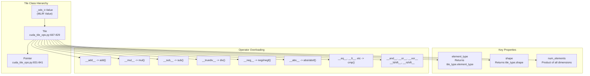
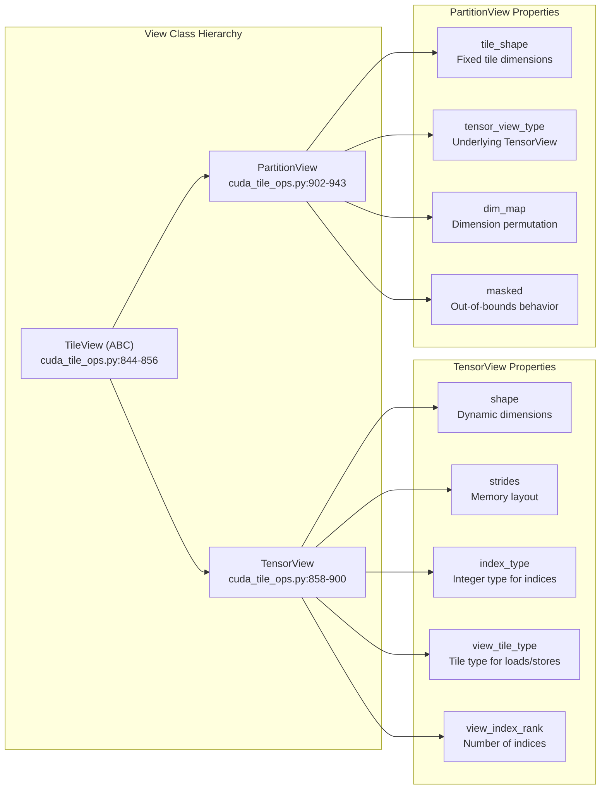
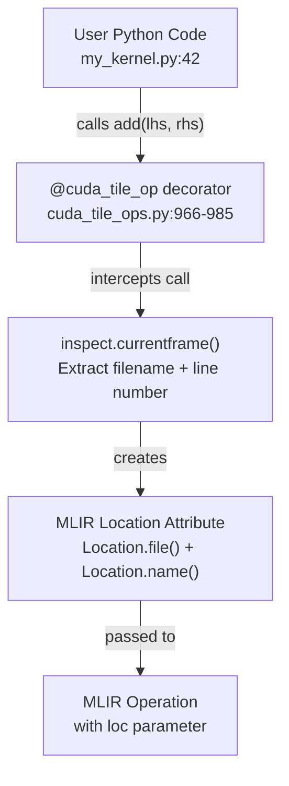
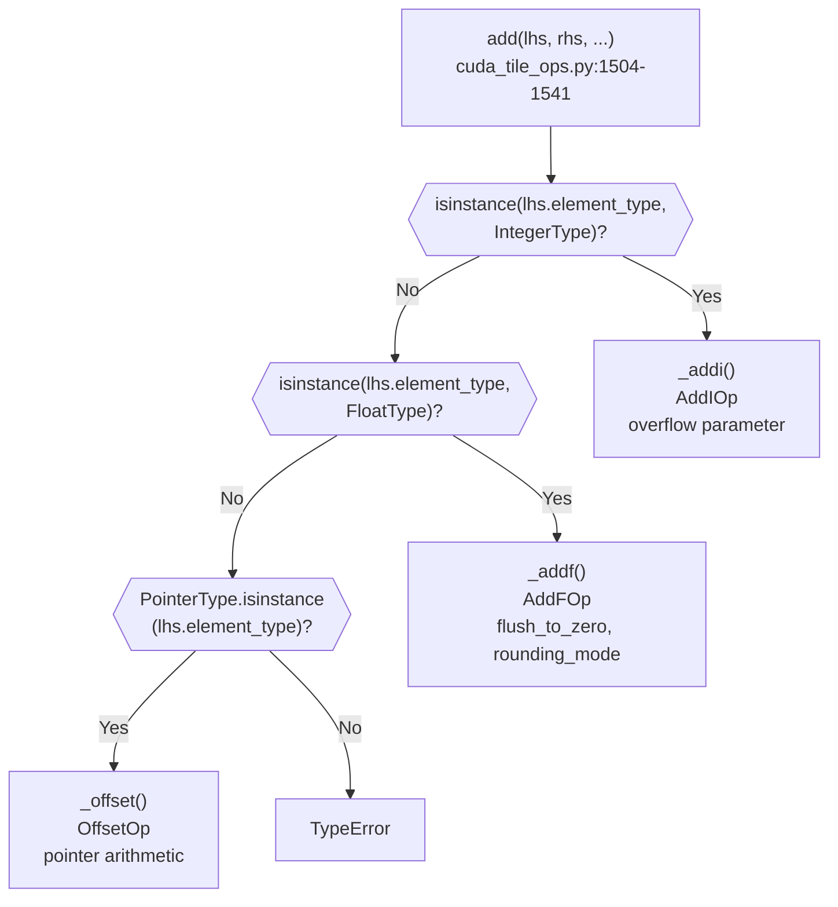
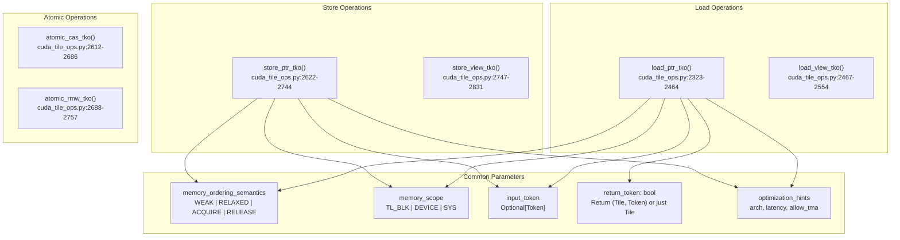
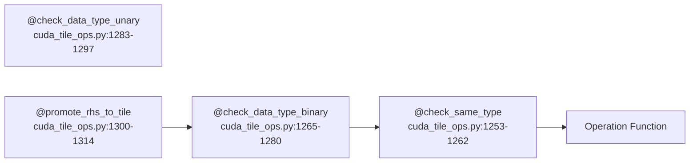
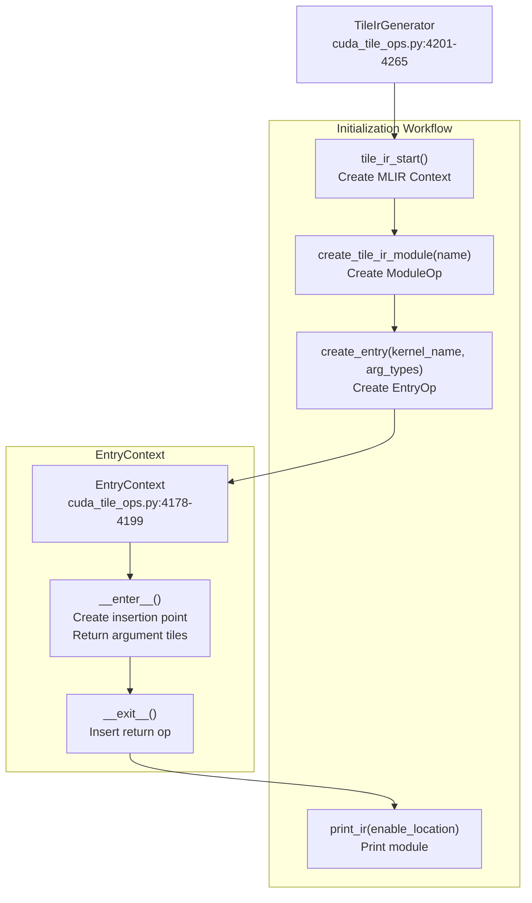

<!-- source: DeepWiki mcp.deepwiki.com · repo NVIDIA/cuda-tile · extra page Python Operations API · fetched 2026-10-26 -->

# Python Operations API

<details>
<summary>Relevant source files</summary>

The following files were used as context for generating this wiki page:

- [python/cuda_tile/dialects/cuda_tile_ops.py](python/cuda_tile/dialects/cuda_tile_ops.py)

</details>


This document describes the high-level Python API for creating CUDA Tile IR operations. The API provides Pythonic wrappers around MLIR operations with automatic type inference, operator overloading, and source location tracking. For information about the underlying C++ extension layer, see [Python C++ Extension Layer](#5.3.2). For build system configuration, see [Python Build System](#5.3.1).

The Python Operations API is implemented in [python/cuda_tile/dialects/cuda_tile_ops.py:1-4267]() and serves as the primary interface for users writing GPU kernels in Python that compile to CUDA Tile IR.

## Element Type System

The API provides Python wrapper classes for MLIR primitive types, enabling type-safe tile creation without directly manipulating MLIR types.

### Element Type Wrappers

Each wrapper class provides a class property `mlir_type` that returns the corresponding MLIR type:

| Python Class | MLIR Type | Purpose |
|-------------|-----------|---------|
| `Int8` | `i8` | 8-bit integer |
| `Int32` | `i32` | 32-bit integer |
| `Int64` | `i64` | 64-bit integer |
| `Float16` | `f16` | 16-bit floating point |
| `BFloat16` | `bf16` | Brain floating point |
| `TFloat32` | `tf32` | TensorFloat-32 |
| `Float32` | `f32` | 32-bit floating point |
| `Float64` | `f64` | 64-bit floating point |
| `Float8E5M2` | `f8e5m2` | 8-bit float (5 exp, 2 mantissa) |
| `Float8E4M3FN` | `f8e4m3fn` | 8-bit float (4 exp, 3 mantissa) |

The metaclass `_ElementTypeMeta` ([python/cuda_tile/dialects/cuda_tile_ops.py:22-31]()) implements the `mlir_type` property, and the base class `_ElementType` ([python/cuda_tile/dialects/cuda_tile_ops.py:34-37]()) provides the common interface.

**Sources:** [python/cuda_tile/dialects/cuda_tile_ops.py:22-78]()

## Core Classes

### Tile Class

The `Tile` class ([python/cuda_tile/dialects/cuda_tile_ops.py:667-829]()) is the primary abstraction representing a multi-dimensional array of values. It wraps an MLIR `Value` with a `TileType` and provides operator overloading for arithmetic operations.



**Key Features:**

- **Automatic RHS Promotion:** Operations automatically convert Python scalars and lists to tiles via `_check_is_rhs_tile()` ([python/cuda_tile/dialects/cuda_tile_ops.py:1341-1384]())
- **Type-Specific Dispatch:** Operators dispatch to integer or float variants based on element type ([python/cuda_tile/dialects/cuda_tile_ops.py:706-714](), [python/cuda_tile/dialects/cuda_tile_ops.py:726-733]())
- **Comparison Operators:** All Python comparison operators map to `cmp()` operations ([python/cuda_tile/dialects/cuda_tile_ops.py:787-822]())

The `Pointer` subclass ([python/cuda_tile/dialects/cuda_tile_ops.py:831-841]()) represents scalar tiles containing pointer values, enforcing shape `[]` and `PointerType` element type.

**Sources:** [python/cuda_tile/dialects/cuda_tile_ops.py:667-841]()

### View Classes

View classes provide abstractions for accessing memory with different indexing semantics:



**TensorView** ([python/cuda_tile/dialects/cuda_tile_ops.py:858-900]()) wraps `TensorViewType` and represents global memory with dynamic shape and strides. Created via `make_tensor_view()` ([python/cuda_tile/dialects/cuda_tile_ops.py:2293-2349]()).

**PartitionView** ([python/cuda_tile/dialects/cuda_tile_ops.py:902-943]()) wraps `PartitionViewType` and represents grid-partitioned views with tile mapping and padding. Created via `make_partition_view()` ([python/cuda_tile/dialects/cuda_tile_ops.py:4083-4143]()).

**Sources:** [python/cuda_tile/dialects/cuda_tile_ops.py:844-943](), [python/cuda_tile/dialects/cuda_tile_ops.py:2293-2349](), [python/cuda_tile/dialects/cuda_tile_ops.py:4083-4143]()

### Token Class

The `Token` class ([python/cuda_tile/dialects/cuda_tile_ops.py:945-958]()) represents synchronization dependencies for memory operations. Tokens are not runtime values but encode ordering constraints.

**Key Operations:**
- `make_token()` ([python/cuda_tile/dialects/cuda_tile_ops.py:2598-2600]()): Create initial token
- `join_tokens()` ([python/cuda_tile/dialects/cuda_tile_ops.py:2603-2619]()): Merge multiple tokens
- Memory operations (`load_ptr_tko`, `store_ptr_tko`, etc.) accept `input_token` and optionally return new tokens

**Sources:** [python/cuda_tile/dialects/cuda_tile_ops.py:945-958](), [python/cuda_tile/dialects/cuda_tile_ops.py:2598-2619]()

## Enumerations and Attributes

The API provides Python enums that map to MLIR attributes:

| Python Enum | MLIR Attribute | Values |
|------------|----------------|--------|
| `AtomicRMWMode` | `AtomicRMWModeAttr` | `AND`, `OR`, `XOR`, `ADD`, `ADDF`, `MAX`, `MIN`, `UMAX`, `UMIN`, `XCHG` |
| `MemoryScope` | `MemoryScopeAttr` | `TL_BLK`, `DEVICE`, `SYS` |
| `PaddingValue` | `PaddingValueAttr` | `ZERO`, `NEG_ZERO`, `NAN`, `POS_INF`, `NEG_INF` |
| `MemoryOrderingSemantics` | `MemoryOrderingSemanticsAttr` | `WEAK`, `RELAXED`, `ACQUIRE`, `RELEASE`, `ACQ_REL` |
| `RoundingMode` | `RoundingModeAttr` | `NEAREST_EVEN`, `ZERO`, `NEGATIVE_INF`, `POSITIVE_INF`, `APPROX`, `FULL`, `NEAREST_INT_TO_ZERO` |
| `IntegerOverflow` | `IntegerOverflowAttr` | `NONE`, `NSW`, `NUW`, `NW` |
| `Signedness` | `SignednessAttr` | `SIGNED`, `UNSIGNED` |
| `ComparisonPredicates` | `ComparisonPredicateAttr` | `EQUAL`, `NOT_EQUAL`, `LESS_THAN`, etc. |
| `ComparisonOrdering` | `ComparisonOrderingAttr` | `ORDERED`, `UNORDERED` |

Helper functions convert enums to attributes ([python/cuda_tile/dialects/cuda_tile_ops.py:265-390]()):
- `get_atomic_rmw_mode_attr()`
- `get_memory_scope_attr()`
- `get_padding_value_attr()`
- `get_memory_ordering_semantics_attr()`
- `get_rounding_mode_attr()`
- etc.

**Sources:** [python/cuda_tile/dialects/cuda_tile_ops.py:157-390]()

## Operation Functions

### Decorator and Source Location Tracking

All operations use the `@cuda_tile_op` decorator ([python/cuda_tile/dialects/cuda_tile_ops.py:966-985]()) which automatically captures source location from the Python call stack:



The decorator extracts the caller's filename and line number using `inspect.currentframe()` ([python/cuda_tile/dialects/cuda_tile_ops.py:977-981]()) and creates an MLIR `Location` attribute that is attached to the generated operation.

**Sources:** [python/cuda_tile/dialects/cuda_tile_ops.py:966-985]()

### Arithmetic Operations

Arithmetic operations dispatch to type-specific implementations based on element type:



**Common Operations:**

| Function | Description | Type-Specific Variants |
|----------|-------------|----------------------|
| `add()` | Element-wise addition | `_addi()`, `_addf()`, `_offset()` |
| `sub()` | Element-wise subtraction | `_subi()`, `_subf()` |
| `mul()` | Element-wise multiplication | `_muli()`, `_mulf()` |
| `div()` | Element-wise division | `divi()`, `divf()` |
| `rem()` | Element-wise remainder | `remi()`, `remf()` |
| `max()` | Element-wise maximum | `maxi()`, `maxf()` |
| `min()` | Element-wise minimum | `mini()`, `minf()` |

All operations support the `@promote_rhs_to_tile` decorator ([python/cuda_tile/dialects/cuda_tile_ops.py:1300-1314]()) which automatically converts Python scalars and lists to tiles.

**Sources:** [python/cuda_tile/dialects/cuda_tile_ops.py:1387-1541](), [python/cuda_tile/dialects/cuda_tile_ops.py:2114-2142](), [python/cuda_tile/dialects/cuda_tile_ops.py:3094-3122]()

### Memory Operations

Memory operations use token-ordered semantics (suffix `_tko`) and support memory ordering control:



**Load/Store Pointer Operations:**

- `load_ptr_tko(result, source, ...)` ([python/cuda_tile/dialects/cuda_tile_ops.py:2323-2464]()): Load from pointer tile
  - `result`: `TileType` specifying shape and element type
  - `source`: Tile of pointers matching result shape
  - `mask`: Optional boolean mask
  - `padding_value`: Value for masked-out elements
  - Returns `Tile` or `(Tile, Token)`

- `store_ptr_tko(destination, value, ...)` ([python/cuda_tile/dialects/cuda_tile_ops.py:2622-2744]()): Store to pointer tile
  - `destination`: Tile of pointers
  - `value`: Tile to store
  - `mask`: Optional boolean mask
  - Returns `Token`

**Load/Store View Operations:**

- `load_view_tko(view, indices, ...)` ([python/cuda_tile/dialects/cuda_tile_ops.py:2467-2554]()): Load from view
  - `view`: `TileView` (TensorView or PartitionView)
  - `indices`: Sequence of `Tile | int` matching `view.view_index_rank`
  - Returns `Tile` or `(Tile, Token)`

- `store_view_tko(tile, view, indices, ...)` ([python/cuda_tile/dialects/cuda_tile_ops.py:2747-2831]()): Store to view
  - `tile`: Tile to store (must match `view.view_tile_type`)
  - Returns `Token`

**Atomic Operations:**

- `atomic_cas_tko(semantics, scope, pointers, cmp, val, ...)` ([python/cuda_tile/dialects/cuda_tile_ops.py:2612-2686]()): Compare-and-swap
- `atomic_rmw_tko(semantics, scope, pointers, mode, arg, ...)` ([python/cuda_tile/dialects/cuda_tile_ops.py:2688-2757]()): Read-modify-write

**Sources:** [python/cuda_tile/dialects/cuda_tile_ops.py:2323-2464](), [python/cuda_tile/dialects/cuda_tile_ops.py:2467-2554](), [python/cuda_tile/dialects/cuda_tile_ops.py:2622-2744](), [python/cuda_tile/dialects/cuda_tile_ops.py:2747-2831](), [python/cuda_tile/dialects/cuda_tile_ops.py:2612-2686](), [python/cuda_tile/dialects/cuda_tile_ops.py:2688-2757]()

### Control Flow Operations

Control flow uses structured region-based operations with Python callable bodies:

```mermaid
graph TB
    subgraph "If Generation"
        IfGen["if_generate(condition, then_body, else_body, ...)<br/>cuda_tile_ops.py:2988-3030"]
        IfOp["IfOp<br/>thenRegion, elseRegion"]
        ThenBody["then_body(*input_args)<br/>Python callable"]
        ElseBody["else_body(*input_args)<br/>Python callable"]
        YieldOp["YieldOp<br/>Terminates regions"]
        
        IfGen --> IfOp
        IfOp --> ThenBody
        IfOp --> ElseBody
        ThenBody --> YieldOp
        ElseBody --> YieldOp
    end
    
    subgraph "For Loop"
        ForLoop["for_loop(body, lb, ub, step, init_values, ...)<br/>cuda_tile_ops.py:3189-3249"]
        ForOp["ForOp<br/>lowerBound, upperBound, step"]
        LoopBody["body(induction_var, *iter_args)<br/>Python callable"]
        
        ForLoop --> ForOp
        ForOp --> LoopBody
    end
    
    subgraph "While Loop"
        LoopGen["loop_generate(inputs, loop_body, ...)<br/>cuda_tile_ops.py:3124-3154"]
        LoopOp["LoopOp<br/>region with block arguments"]
        WhileBody["loop_body(*loop_args)<br/>Python callable"]
        BreakOp["loop_break(operands)<br/>BreakOp"]
        ContinueOp["loop_continue(operands)<br/>ContinueOp"]
        
        LoopGen --> LoopOp
        LoopOp --> WhileBody
        WhileBody --> BreakOp
        WhileBody --> ContinueOp
    end
```



**If Generation:**

`if_generate(condition, then_body, else_body, input_args, return_types, ...)` ([python/cuda_tile/dialects/cuda_tile_ops.py:2988-3030]()):
- `condition`: Boolean tile (i1 element type)
- `then_body`: Callable receiving `*input_args`, returns `Tile` or tuple
- `else_body`: Optional callable with same signature
- `input_args`: List of tiles passed to both bodies
- `return_types`: List of result tile types
- Bodies must call `YieldOp` to return values

**For Loop:**

`for_loop(body, lower_bound, upper_bound, step, init_values, el_type, ...)` ([python/cuda_tile/dialects/cuda_tile_ops.py:3189-3249]()):
- `body`: Callable receiving `(induction_var, *iter_args)`
- `lower_bound`, `upper_bound`, `step`: `int | Tile` (scalar)
- `init_values`: Sequence of initial values for iteration variables
- `el_type`: Element type for induction variable (default `Int32`)
- Returns tuple of final iteration variable values

**While Loop:**

`loop_generate(inputs, loop_body, ...)` ([python/cuda_tile/dialects/cuda_tile_ops.py:3124-3154]()):
- `inputs`: Iterable of `Tile | Token` initial values
- `loop_body`: Callable receiving block arguments, must call `loop_break()` or `loop_continue()`
- `loop_break(operands)` ([python/cuda_tile/dialects/cuda_tile_ops.py:3157-3170]()): Exit loop with values
- `loop_continue(operands)` ([python/cuda_tile/dialects/cuda_tile_ops.py:3173-3186]()): Continue to next iteration

**Sources:** [python/cuda_tile/dialects/cuda_tile_ops.py:2988-3030](), [python/cuda_tile/dialects/cuda_tile_ops.py:3189-3249](), [python/cuda_tile/dialects/cuda_tile_ops.py:3124-3186]()

### Tensor Operations

Tensor manipulation operations include:

| Function | Description | Signature |
|----------|-------------|-----------|
| `broadcast(shape, source, ...)` | Broadcast to new shape | ([python/cuda_tile/dialects/cuda_tile_ops.py:1324-1328]()) |
| `reshape(shape, source, ...)` | Reshape without changing elements | ([python/cuda_tile/dialects/cuda_tile_ops.py:2590-2595]()) |
| `permute(source, permutation, ...)` | Transpose dimensions | ([python/cuda_tile/dialects/cuda_tile_ops.py:2557-2587]()) |
| `cat(lhs, rhs, dim, ...)` | Concatenate along dimension | ([python/cuda_tile/dialects/cuda_tile_ops.py:2144-2178]()) |
| `extract(result, source, indices, ...)` | Extract slice | ([python/cuda_tile/dialects/cuda_tile_ops.py:2277-2287]()) |
| `mma(lhs, rhs, acc, ...)` | Matrix multiply-accumulate | ([python/cuda_tile/dialects/cuda_tile_ops.py:2181-2274]()) |
| `reduce(operand, dim, identities, reduce_body, ...)` | Reduction along dimension | ([python/cuda_tile/dialects/cuda_tile_ops.py:3569-3593]()) |
| `scan(operand, dim, reverse, identities, scan_body, ...)` | Prefix scan | ([python/cuda_tile/dialects/cuda_tile_ops.py:3596-3628]()) |

**MMA Operations:**

The `mma()` function ([python/cuda_tile/dialects/cuda_tile_ops.py:2181-2274]()) performs matrix multiply-accumulate with automatic configuration validation. Supported configurations are defined as `MMAConfig` subclasses ([python/cuda_tile/dialects/cuda_tile_ops.py:398-625]()) and automatically discovered at runtime:

- `MMAConfig_U8_U8_S32`: u8 × u8 → s32
- `MMAConfig_S8_S8_S32`: s8 × s8 → s32
- `MMAConfig_E4M3_E4M3_F32`: e4m3 × e4m3 → f32
- `MMAConfig_F16_F16_F32`: f16 × f16 → f32
- `MMAConfig_BF16_BF16_F32`: bf16 × bf16 → f32
- `MMAConfig_TF32_TF32_F32`: tf32 × tf32 → f32
- `MMAConfig_F64_F64_F64`: f64 × f64 → f64

**Reduce and Scan:**

Both operations accept a callable `body` that defines the reduction/scan operation:

```python
# Example: sum reduction
result = reduce(operand, dim=0, identities=0, 
                reduce_body=lambda acc, val: add(acc, val))

# Example: prefix sum scan
result = scan(operand, dim=0, reverse=False, identities=0,
              scan_body=lambda acc, val: add(acc, val))
```

**Sources:** [python/cuda_tile/dialects/cuda_tile_ops.py:1324-1328](), [python/cuda_tile/dialects/cuda_tile_ops.py:2181-2274](), [python/cuda_tile/dialects/cuda_tile_ops.py:2557-2595](), [python/cuda_tile/dialects/cuda_tile_ops.py:3569-3628]()

### Type Conversion Operations

Type conversions handle casting between different element types:

| Function | Conversion | Notes |
|----------|-----------|-------|
| `ftof(el_type, from_, ...)` | Float to float | ([python/cuda_tile/dialects/cuda_tile_ops.py:2853-2886]()) |
| `ftoi(el_type, from_, ...)` | Float to integer | Truncates towards zero ([python/cuda_tile/dialects/cuda_tile_ops.py:2889-2913]()) |
| `itof(el_type, from_, ...)` | Integer to float | ([python/cuda_tile/dialects/cuda_tile_ops.py:2961-2985]()) |
| `exti(el_type, from_, ...)` | Integer extend | Sign/zero extend ([python/cuda_tile/dialects/cuda_tile_ops.py:2930-2958]()) |
| `trunci(el_type, from_, ...)` | Integer truncate | Narrow bitwidth ([python/cuda_tile/dialects/cuda_tile_ops.py:2302-2320]()) |
| `bitcast(el_type, src, ...)` | Bitwise reinterpret | Same bitwidth required ([python/cuda_tile/dialects/cuda_tile_ops.py:1760-1780]()) |
| `int_to_ptr(el_type, src, ...)` | i64 to pointer | ([python/cuda_tile/dialects/cuda_tile_ops.py:1783-1800]()) |
| `ptr_to_int(src, ...)` | Pointer to i64 | ([python/cuda_tile/dialects/cuda_tile_ops.py:1803-1812]()) |
| `ptr_to_ptr(el_type, src, ...)` | Pointer cast | ([python/cuda_tile/dialects/cuda_tile_ops.py:1815-1821]()) |

All conversions validate source and destination types and automatically compute result tile types.

**Sources:** [python/cuda_tile/dialects/cuda_tile_ops.py:1760-1821](), [python/cuda_tile/dialects/cuda_tile_ops.py:2853-2985]()

## Helper Decorators and Utilities

### Type Checking Decorators

The API provides decorators for validating operation inputs:



- `@check_same_type`: Validates `lhs.tile_type == rhs.tile_type`
- `@check_data_type_binary(tile_name, expected_type)`: Validates element type of lhs or rhs
- `@check_data_type_unary(tile_name, expected_type)`: Validates element type of source
- `@promote_rhs_to_tile`: Converts Python scalars/lists to tiles matching lhs

**Sources:** [python/cuda_tile/dialects/cuda_tile_ops.py:1253-1314]()

### Type Factory Functions

Helper functions create MLIR types from Python descriptions:

- `make_tile_type(el_type, shape)` ([python/cuda_tile/dialects/cuda_tile_ops.py:1140-1161]()): Create `TileType`
- `make_tensor_view_type(el_type, shape, strides)` ([python/cuda_tile/dialects/cuda_tile_ops.py:1164-1198]()): Create `TensorViewType`
- `make_partition_view_type(tensor_view_type, tile_shape, dim_map, padding_value)` ([python/cuda_tile/dialects/cuda_tile_ops.py:1201-1250]()): Create `PartitionViewType`

**Sources:** [python/cuda_tile/dialects/cuda_tile_ops.py:1140-1250]()

### Result Handling

The `return_results()` function ([python/cuda_tile/dialects/cuda_tile_ops.py:1028-1079]()) wraps operation results in appropriate Python classes:

- Single `Token` result → `Token`
- Single `Tile` result → `Tile`
- `(Tile, Token)` results → `(Tile, Token)` tuple
- Multiple `Tile` results → tuple of `Tile`

**Sources:** [python/cuda_tile/dialects/cuda_tile_ops.py:1028-1089]()

## IR Generation Infrastructure

### TileIrGenerator Class

The `TileIrGenerator` class ([python/cuda_tile/dialects/cuda_tile_ops.py:4201-4265]()) orchestrates MLIR module and entry creation:



**Usage Pattern:**

```python
gen = TileIrGenerator()
with gen.tile_ir_start(), gen.create_tile_ir_module("my_module"):
    arg_types = [make_tile_type(Float32, [])]
    with gen.create_entry("kernel", arg_types) as (arg,):
        result = add(arg, constant(1.0))
        ret([result])
    gen.print_ir()
```

**EntryContext** ([python/cuda_tile/dialects/cuda_tile_ops.py:4178-4199]()) is a context manager that:
1. Creates an `EntryOp` with specified function type
2. Sets up insertion point in the entry body
3. Returns argument tiles on entry
4. Inserts `ret([])` on exit if not already present

**Sources:** [python/cuda_tile/dialects/cuda_tile_ops.py:4178-4265]()

### ModuleOp Specialization

The `ModuleOp` class ([python/cuda_tile/dialects/cuda_tile_ops.py:4160-4170]()) wraps `_cuda_tile.ModuleOp` and automatically creates a body block:

```python
module = ModuleOp("module_name")
with InsertionPoint(module.body):
    # Insert operations
```

**Sources:** [python/cuda_tile/dialects/cuda_tile_ops.py:4160-4170]()

### Global Variables

Global constant support uses specialized operations:

- `global_(symbol_name, value, el_type, tile_type, ...)` ([python/cuda_tile/dialects/cuda_tile_ops.py:3895-3930]()): Insert `GlobalOp` in enclosing module
- `get_global(global_op, ...)` ([python/cuda_tile/dialects/cuda_tile_ops.py:3933-3946]()): Insert `GetGlobalOp` at current location
- `create_and_get_global(value, el_type, tile_type, ...)` ([python/cuda_tile/dialects/cuda_tile_ops.py:3949-3964]()): Helper combining both

The `_GlobalOp` specialization ([python/cuda_tile/dialects/cuda_tile_ops.py:1124-1137]()) handles constant flattening similar to `_ConstantOp` ([python/cuda_tile/dialects/cuda_tile_ops.py:1110-1121]()).

**Sources:** [python/cuda_tile/dialects/cuda_tile_ops.py:1110-1137](), [python/cuda_tile/dialects/cuda_tile_ops.py:3895-3964]()

## Constant Creation

The `constant()` function ([python/cuda_tile/dialects/cuda_tile_ops.py:3861-3888]()) creates constant tiles from Python values:

```python
# Scalar constant
c = constant(42)  # Infers i32 type

# Explicit type
c = constant(3.14, el_type=Float32)

# Vector constant
c = constant([1, 2, 3], el_type=Int32)  # Shape [3]

# Matrix constant
c = constant([[1, 2], [3, 4]], el_type=Int32)  # Shape [2, 2]

# Using TileType directly
tile_type = make_tile_type(Float16, [4, 4])
c = constant([[...]], tile_type=tile_type)
```

The helper `_flatten_constants()` ([python/cuda_tile/dialects/cuda_tile_ops.py:3786-3830]()) recursively processes nested lists to determine shape and flatten values.

**Sources:** [python/cuda_tile/dialects/cuda_tile_ops.py:3786-3888]()

---

