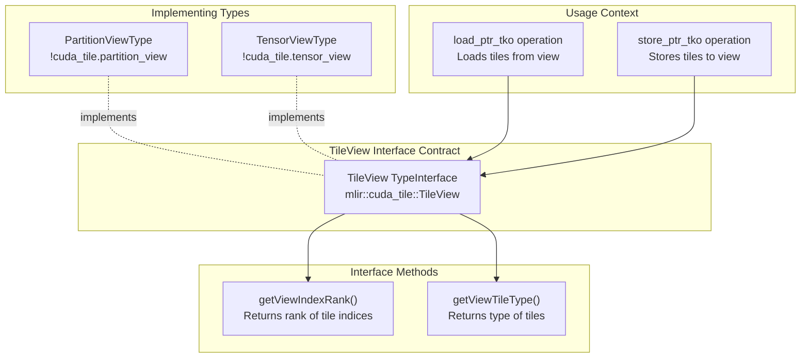
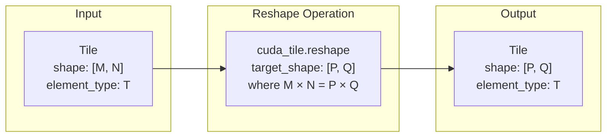
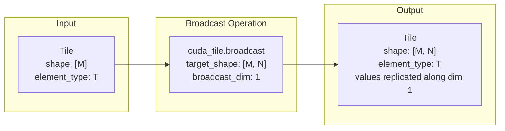
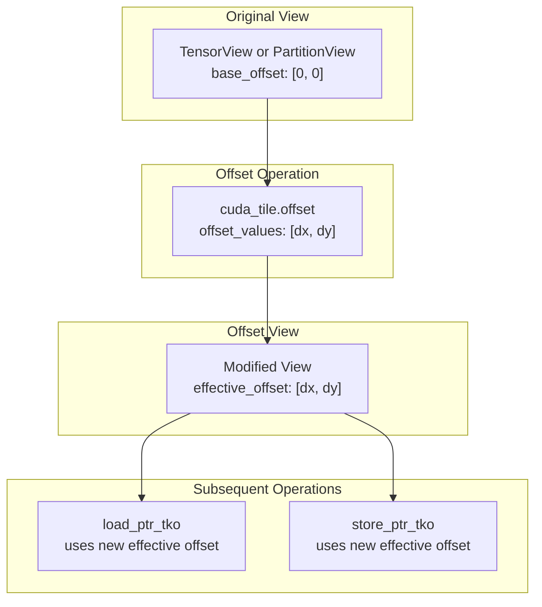
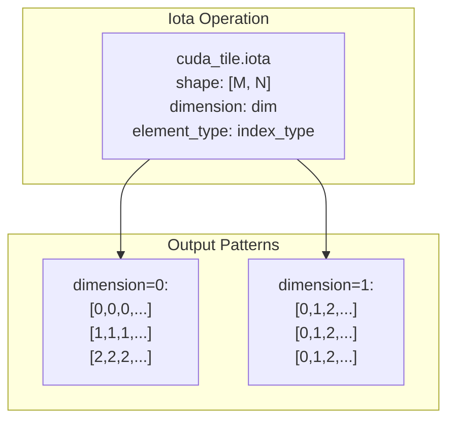
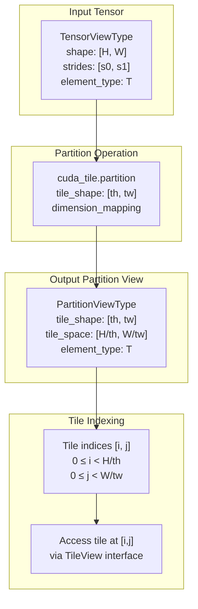
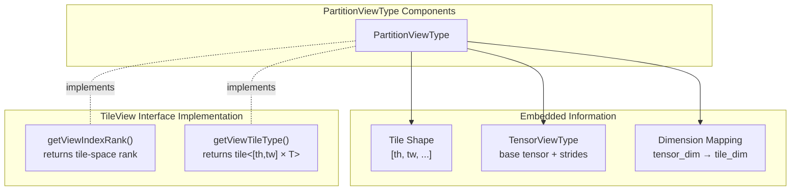
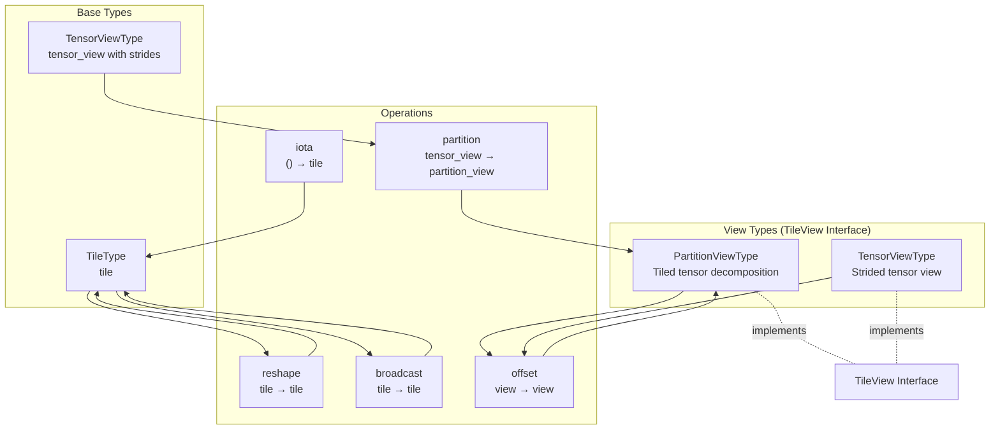
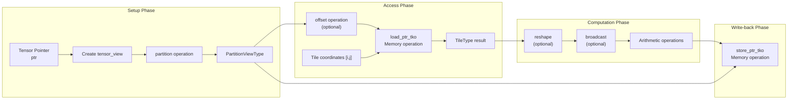

<!-- source: DeepWiki mcp.deepwiki.com · repo NVIDIA/cuda-tile · extra page Tensor and View Operations · fetched 2026-10-26 -->

# View and Tile Operations

Relevant source files

The following files were used as context for generating this wiki page:

- [lib/Dialect/CudaTile/IR/CudaTile.cpp](lib/Dialect/CudaTile/IR/CudaTile.cpp)
- [python/cuda_tile/dialects/cuda_tile_ops.py](python/cuda_tile/dialects/cuda_tile_ops.py)

## Purpose and Scope

This document describes operations in the CudaTile dialect that manipulate views and tiles. These operations enable transformation of tile shapes, broadcasting across dimensions, offsetting views, generating sequential indices, and partitioning tensors into tiled representations. 

View and tile operations work closely with the type system, particularly `TensorViewType`, `PartitionViewType`, and `TileType`. For details on these types, see [Type System](#3.1). For memory operations that load/store using views, see [Memory Operations](#3.3.2).

---

## Overview

View and tile operations provide the foundation for describing tiled tensor computations. They enable:

- **Shape transformation**: Reshaping tiles to different dimensions
- **Broadcasting**: Expanding tiles across dimensions
- **View manipulation**: Applying offsets to tensor views
- **Index generation**: Creating sequential tile indices with iota
- **Partitioning**: Decomposing tensors into tiled partition views

These operations bridge the abstract tile space with concrete memory layout strategies, working through the `TileView` interface to enforce consistent indexing contracts.

**Sources:** [include/cuda_tile/Dialect/CudaTile/IR/Interfaces.td:30-63]()

---

## The TileView Interface

The `TileView` interface is the core abstraction for view operations. It represents a view within a memref from which tiles can be loaded or stored, acting as a converter from abstract tile-space coordinates to tiles.

### Interface Contract

The `TileView` interface defines two key methods:

| Method | Return Type | Purpose |
|--------|-------------|---------|
| `getViewIndexRank()` | `size_t` | Returns the rank of tile indices (tile-space coordinates) |
| `getViewTileType()` | `mlir::Type` | Returns the type of tiles loaded from/stored to the view |

**Key invariant:** Views must always access tiles of the same type regardless of the index used. This ensures type consistency across tile operations.

**Sources:** [include/cuda_tile/Dialect/CudaTile/IR/Interfaces.td:30-63]()

---

## View Manipulation Operations

### Reshape Operation

The `reshape` operation transforms the shape of a tile without changing its element count. It enables reinterpretation of tile dimensions for operations requiring different layouts.

**Constraints:**
- Total element count must remain constant
- Element type is preserved
- Shape transformation is purely layout reinterpretation

### Broadcast Operation

The `broadcast` operation expands a tile across specified dimensions, replicating values to match a target shape.

**Use cases:**
- Expanding scalars or vectors to match matrix dimensions
- Replicating tile values for elementwise operations
- Preparing operands for broadcasting arithmetic

### Offset Operation

The `offset` operation applies a coordinate offset to a view, shifting the tile-space origin for subsequent load/store operations.

**Purpose:**
- Enables sliding window patterns
- Facilitates stencil computations
- Supports relative addressing in tile space

**Sources:** Based on overview diagrams and view operation patterns

---

## Tile Generation Operations

### Iota Operation

The `iota` operation generates a tile containing sequential indices, useful for coordinate-based computations and index generation.

**Generated values:**
- For `dimension=0`: Values increase along rows (first dimension)
- For `dimension=1`: Values increase along columns (second dimension)
- Element type is typically an integer type suitable for indexing

**Common use cases:**
- Generating tile coordinates for index-dependent computations
- Creating masks based on position
- Implementing gather/scatter patterns

**Sources:** Based on architecture overview and tile operation patterns

---

## Partitioning Operations

### Partition Operation

The `partition` operation decomposes a tensor into a tiled representation, creating a `PartitionViewType` that describes how the tensor is divided into tiles. This is a fundamental operation for expressing tiled algorithms.

### PartitionViewType Structure

The `PartitionViewType` combines multiple concepts:

| Component | Description |
|-----------|-------------|
| **Tile Shape** | Dimensions of individual tiles (e.g., `[16, 16]`) |
| **Tensor View** | Underlying tensor with stride information |
| **Dimension Mapping** | How tensor dimensions map to tile space |
| **Tile Space Rank** | Number of dimensions in the tiled coordinate system |

**Key properties:**
- Implements the `TileView` interface for uniform access patterns
- Enables load/store operations in tile-space coordinates
- Encodes tiling strategy as part of the type system

**Sources:** [include/cuda_tile/Dialect/CudaTile/IR/Interfaces.td:30-63](), architecture overview diagrams

---

## Type Relationships

View and tile operations interact with several key types in the CudaTile type system:

### Type Transformation Summary

| Operation | Input Type | Output Type | Transformation |
|-----------|-----------|-------------|----------------|
| `reshape` | `TileType` | `TileType` | Shape reinterpretation |
| `broadcast` | `TileType` | `TileType` | Dimension expansion |
| `offset` | `TileView` | `TileView` | Coordinate translation |
| `iota` | (none) | `TileType` | Index generation |
| `partition` | `TensorViewType` | `PartitionViewType` | Tiling decomposition |

**Sources:** [include/cuda_tile/Dialect/CudaTile/IR/Interfaces.td:30-63](), architecture overview

---

## Integration with Memory Operations

View and tile operations work in conjunction with memory operations to implement tiled memory access patterns:

This pipeline demonstrates how view operations set up the addressing strategy, tile operations transform loaded data, and memory operations perform the actual data movement. The `TileView` interface ensures consistent type contracts throughout the pipeline.

**Sources:** [include/cuda_tile/Dialect/CudaTile/IR/Interfaces.td:30-63](), [include/cuda_tile/Dialect/CudaTile/IR/Ops.h:33-39]()

---

## Implementation Notes

### Interface Verification

The `TileView` interface enforces critical invariants through its contract methods. Types implementing this interface must correctly implement:

- `getViewIndexRank()`: Must return a consistent rank value that matches the dimensionality expected by load/store operations
- `getViewTileType()`: Must return a `TileType` that remains constant regardless of which tile-space coordinate is accessed

These invariants enable the verifier to catch inconsistencies at IR construction time rather than during execution.

### Type System Integration

View and tile operations are deeply integrated with the CudaTile type system:

- The `TileType` captures shape and element type information
- The `TensorViewType` includes stride information for memory layout
- The `PartitionViewType` combines tiling strategy with tensor layout
- The `TileView` interface provides a uniform abstraction over view types

This layered type system enables the dialect to express complex tiled memory access patterns while maintaining strong type safety.

**Sources:** [include/cuda_tile/Dialect/CudaTile/IR/Interfaces.td:30-63](), [include/cuda_tile/Dialect/CudaTile/IR/Ops.h:1-100]()

---

