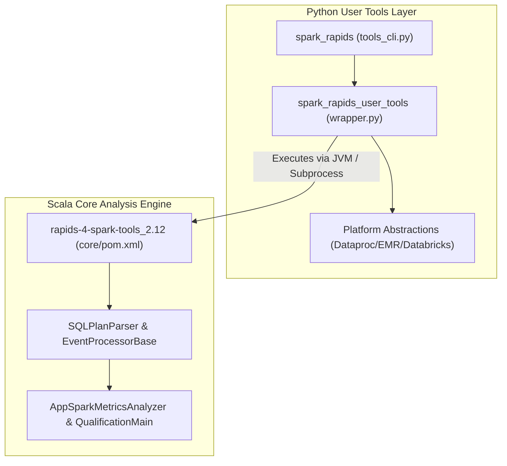
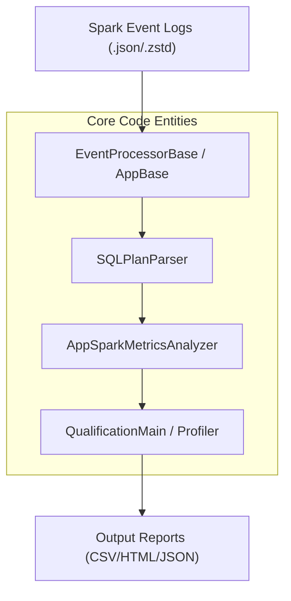

<!-- source: DeepWiki mcp.deepwiki.com · repo NVIDIA/cudf-spark-tools · page 1 Overview · fetched 2026-10-26 -->

# Overview

Relevant source files

The following files were used as context for generating this wiki page:

- [.github/workflows/mvn-verify-check.yml](.github/workflows/mvn-verify-check.yml)
- [.github/workflows/python-unit-test.yml](.github/workflows/python-unit-test.yml)
- [core/README.md](core/README.md)
- [core/pom.xml](core/pom.xml)
- [scripts/prefetch_deps.sh](scripts/prefetch_deps.sh)
- [user_tools/README.md](user_tools/README.md)
- [user_tools/build.sh](user_tools/build.sh)
- [user_tools/docs/index.md](user_tools/docs/index.md)
- [user_tools/docs/user-tools-aws-emr.md](user_tools/docs/user-tools-aws-emr.md)
- [user_tools/docs/user-tools-databricks-aws.md](user_tools/docs/user-tools-databricks-aws.md)
- [user_tools/docs/user-tools-databricks-azure.md](user_tools/docs/user-tools-databricks-azure.md)
- [user_tools/docs/user-tools-dataproc-gke.md](user_tools/docs/user-tools-dataproc-gke.md)
- [user_tools/docs/user-tools-dataproc.md](user_tools/docs/user-tools-dataproc.md)
- [user_tools/docs/user-tools-onprem.md](user_tools/docs/user-tools-onprem.md)
- [user_tools/pyproject.toml](user_tools/pyproject.toml)
- [user_tools/src/spark_rapids_pytools/__init__.py](user_tools/src/spark_rapids_pytools/__init__.py)
- [user_tools/src/spark_rapids_pytools/resources/dev/prepackage_mgr.py](user_tools/src/spark_rapids_pytools/resources/dev/prepackage_mgr.py)
- [user_tools/tests/spark_rapids_tools_e2e/resources/scripts/hdfs/setup_hdfs.sh](user_tools/tests/spark_rapids_tools_e2e/resources/scripts/hdfs/setup_hdfs.sh)
- [user_tools/tox.ini](user_tools/tox.ini)

## Purpose and Scope

`cudf-spark-tools` (`NVIDIA cuDF plugin for Apache Spark tools`) is a comprehensive suite designed to assist users in adopting, evaluating, installing, and tuning the NVIDIA cuDF plugin for Apache Spark [user_tools/README.md:1-3](). The tools bridge the gap between CPU-based Spark deployments and GPU acceleration by offering four main functional pillars:
- **Qualification**: Quantifies expected performance speedups and infrastructure cost savings by analyzing Spark CPU event logs [user_tools/docs/index.md:14-19]().
- **Profiling**: Inspects Spark application execution profiles (CPU or GPU), performs cluster health checks, and generates debugging reports [user_tools/docs/index.md:28-32]().
- **AutoTuner**: Recommends optimized cuDF plugin and Spark configuration properties tailored to specific workloads and cluster topologies [user_tools/README.md:8-9]().
- **QualX**: A machine learning subsystem utilizing XGBoost models to predict application speedups and support training custom performance models [user_tools/README.md:11-14]().

For installation instructions, entrypoint CLIs, and platform-specific guides, see [Getting Started and CLI Usage](#1.1). For repository layout and architectural file maps, see [Repository Layout and Key Concepts](#1.2).

Sources: `user_tools/docs/index.md:1-38`, `user_tools/README.md:1-15`

---

## Two-Layer Architecture

The codebase relies on a decoupled two-layer architecture separating the Scala/Java parsing and analysis engine from the Python wrapper and Cloud Service Provider (CSP) orchestration layer.

### 1. The Scala Core Layer (`core/`)
Packaged as an executable JAR (`rapids-4-spark-tools_2.12`), the core engine ingests raw Spark event logs, parses SQL plans, computes operator support matrices, evaluates performance metrics, and writes comprehensive reports [core/pom.xml:23-26](). It operates independently as a backend analytics library driven by main entrypoints such as `QualificationMain`.

### 2. The Python Wrapper Layer (`user_tools/`)
Distributed via PyPI as `spark-rapids-user-tools`, this layer provides user-friendly command-line interfaces (`spark_rapids`, `spark_rapids_user_tools`, `spark_rapids_dev`) [user_tools/pyproject.toml:20-23](). It manages cluster metadata across Amazon EMR, Google Cloud Dataproc, Databricks, and On-Premise environments, handles cloud storage downloads/uploads, prefetches dependencies, and coordinates execution of the underlying Scala JAR [user_tools/docs/index.md:1-8]().

Sources: `core/pom.xml:23-26`, `user_tools/pyproject.toml:20-104`, `user_tools/docs/index.md:1-11`

---

## Architecture and Event Flow

The end-to-end workflow begins when a user invokes a tool command through the Python CLI. The request is translated into job parameters, environment configuration files are prepared, and event logs are fetched from cloud storage (S3, GCS, ABFS). The Scala core engine processes the logs to generate structured analysis data stores and reports.

For detailed instructions on setting up your environment, installing the Python package, and executing platform-specific CLIs, refer to [Getting Started and CLI Usage](#1.1). To explore the directory structure, build scripts, and how event logs flow through the system, proceed to [Repository Layout and Key Concepts](#1.2).

Sources: `user_tools/docs/index.md:14-38`, `user_tools/README.md:1-15`

---

