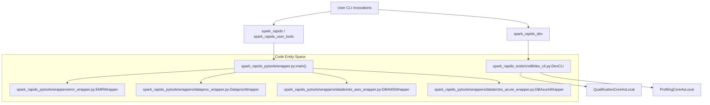
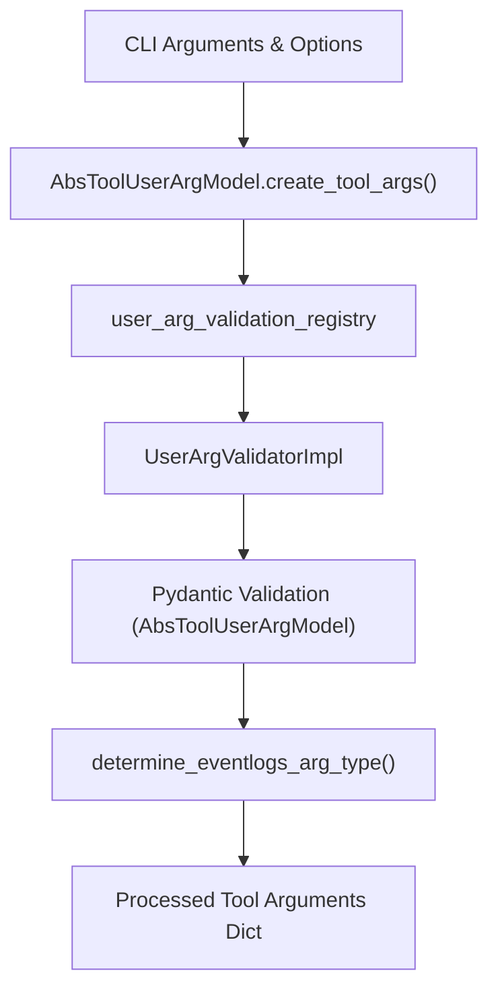

<!-- source: DeepWiki mcp.deepwiki.com · repo NVIDIA/cudf-spark-tools · page 1.1 Getting Started and CLI Usage · fetched 2026-10-26 -->

# Getting Started and CLI Usage

<details>
<summary>Relevant source files</summary>

The following files were used as context for generating this wiki page:

- [user_tools/docs/index.md](user_tools/docs/index.md)
- [user_tools/docs/user-tools-aws-emr.md](user_tools/docs/user-tools-aws-emr.md)
- [user_tools/docs/user-tools-databricks-aws.md](user_tools/docs/user-tools-databricks-aws.md)
- [user_tools/docs/user-tools-databricks-azure.md](user_tools/docs/user-tools-databricks-azure.md)
- [user_tools/docs/user-tools-dataproc-gke.md](user_tools/docs/user-tools-dataproc-gke.md)
- [user_tools/docs/user-tools-dataproc.md](user_tools/docs/user-tools-dataproc.md)
- [user_tools/docs/user-tools-onprem.md](user_tools/docs/user-tools-onprem.md)
- [user_tools/src/spark_rapids_pytools/wrapper.py](user_tools/src/spark_rapids_pytools/wrapper.py)
- [user_tools/src/spark_rapids_tools/cmdli/__init__.py](user_tools/src/spark_rapids_tools/cmdli/__init__.py)
- [user_tools/src/spark_rapids_tools/cmdli/argprocessor.py](user_tools/src/spark_rapids_tools/cmdli/argprocessor.py)
- [user_tools/src/spark_rapids_tools/cmdli/dev_cli.py](user_tools/src/spark_rapids_tools/cmdli/dev_cli.py)
- [user_tools/src/spark_rapids_tools/cmdli/tools_cli.py](user_tools/src/spark_rapids_tools/cmdli/tools_cli.py)
- [user_tools/src/spark_rapids_tools/enums.py](user_tools/src/spark_rapids_tools/enums.py)
- [user_tools/src/spark_rapids_tools/storagelib/s3/s3fs.py](user_tools/src/spark_rapids_tools/storagelib/s3/s3fs.py)
- [user_tools/tests/spark_rapids_tools_ut/test_tool_argprocessor.py](user_tools/tests/spark_rapids_tools_ut/test_tool_argprocessor.py)

</details>


## Purpose and Scope
This page covers the installation, configuration, and execution interfaces for the `spark-rapids-user-tools` Python package. It details how to install the package wheel, configure local and remote environments, utilize the primary CLI entrypoints (`spark_rapids`, `spark_rapids_user_tools`, `spark_rapids_dev`), inspect argument parsing mechanics via `AbsToolUserArgModel`, and operate across various supported Cloud Service Providers (CSPs) and on-premises deployments.

Sources: `user_tools/docs/index.md:1-119` [], `user_tools/src/spark_rapids_tools/cmdli/argprocessor.py:63-142` []

---

## 1. Installation and Package Setup

The Python package `spark-rapids-user-tools` provides a runtime environment that simplifies cost and performance analysis using the NVIDIA cuDF plugin for Apache Spark.

### Installation Methods
The package can be installed using standard Python distribution mechanisms supporting Python versions 3.8 through 3.11:

```bash
# Install via PyPI
pip install spark-rapids-user-tools

# Install from a built wheel file
pip install spark-rapids-user-tools-*.whl

# Install in editable mode from source
pip install -e .
```

### Environment Variables
Before invoking any CLI commands, runtime behavior can be customized using environment variables adhering to the `RAPIDS_USER_TOOLS_*` prefix:

* `RAPIDS_USER_TOOLS_CACHE_FOLDER`: Specifies the local directory used by the CLI to cache downloaded artifacts and dependencies (default: `/var/tmp/spark_rapids_user_tools_cache`).
* `RAPIDS_USER_TOOLS_OUTPUT_DIRECTORY`: Specifies the default local directory where analysis reports are generated.

Sources: `user_tools/docs/user-tools-dataproc.md:30-51` [], `user_tools/docs/user-tools-aws-emr.md:27-51` []

---

## 2. CLI Entrypoints and Architecture

The user tools layer exposes multiple entrypoints built on top of the Python `fire` library. These entrypoints dispatch execution to cloud-specific wrappers or direct core tool runners.

### CLI Entrypoint Mapping
The following diagram illustrates the mapping from natural language user invocations to underlying Python code entities:


Sources: `user_tools/src/spark_rapids_pytools/wrapper.py:25-32` [], `user_tools/src/spark_rapids_tools/cmdli/dev_cli.py:31-33` []

---

## 3. Argument Validation and Processing

User inputs and options passed through the CLI are validated and processed using Pydantic models managed by an argument processing framework.

### Validation Pipeline
The base argument model `AbsToolUserArgModel` coordinates validation across different tools and platforms.


Sources: `user_tools/src/spark_rapids_tools/cmdli/argprocessor.py:63-142` []

The `AbsToolUserArgModel` class defines common parameters such as cluster name, platform target, output folders, and JVM settings:

```python
@dataclass
class AbsToolUserArgModel:
    cluster: Optional[str] = None
    platform: Optional[CspEnv] = None
    output_folder: Optional[str] = None
    tools_jar: Optional[str] = None
    session_uuid: Optional[str] = None
    rejected: dict = dataclasses.field(init=False, default_factory=dict)
    detected: dict = dataclasses.field(init=False, default_factory=dict)
    extra: dict = dataclasses.field(init=False, default_factory=dict)
```
Sources: `user_tools/src/spark_rapids_tools/cmdli/argprocessor.py:91-113` []

---

## 4. Per-Platform User Guides

The tools support multiple Cloud Service Providers and on-premises environments. Each platform requires specific CLI prefixes and cloud SDK configurations.

### Supported Platforms and Commands Matrix

| Platform | Supported Commands | CLI Entrypoint | Version |
| :--- | :--- | :--- | :--- |
| **AWS EMR** | qualification, profiling, diagnostic | `spark_rapids_user_tools emr [ARGS]` | 23.02+ |
| **Google Cloud Dataproc** | qualification, profiling, diagnostic | `spark_rapids_user_tools dataproc [ARGS]` | 23.02.1+ |
| **Dataproc GKE** | qualification | `spark_rapids_user_tools dataproc-gke [ARGS]` | 23.08.2+ |
| **Databricks AWS** | qualification, profiling | `spark_rapids_user_tools databricks-aws [ARGS]` | 23.04+ |
| **Databricks Azure** | qualification, profiling | `spark_rapids_user_tools databricks-azure [ARGS]` | 23.06+ |
| **On-Premises** | qualification | `spark_rapids_user_tools onprem [ARGS]` | 23.06+ |

Sources: `user_tools/docs/index.md:60-108` []

### Platform Enums
Internally, platform targets are mapped to the `CspEnv` enumeration, which handles normalization of user inputs (converting hyphens and case variants):

```python
class CspEnv(EnumeratedType):
    DATABRICKS_AWS = 'databricks_aws'
    DATABRICKS_AZURE = 'databricks_azure'
    DATAPROC = 'dataproc'
    DATAPROC_GKE = 'dataproc_gke'
    EMR = 'emr'
    ONPREM = 'onprem'
    NONE = 'NONE'
```
Sources: `user_tools/src/spark_rapids_tools/enums.py:126-135` []

Sources: `user_tools/docs/index.md:1-119` [], `user_tools/src/spark_rapids_tools/cmdli/argprocessor.py:63-142` [], `user_tools/src/spark_rapids_tools/enums.py:126-174` []

---

