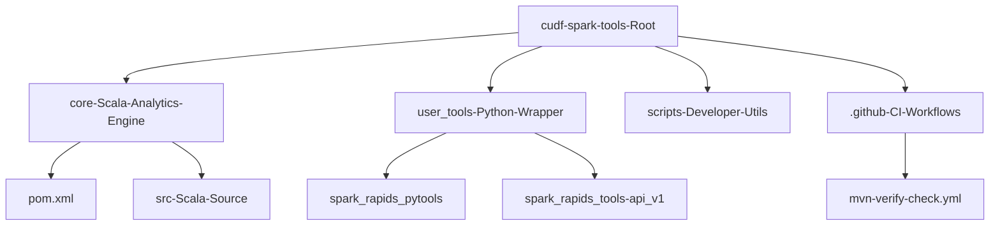
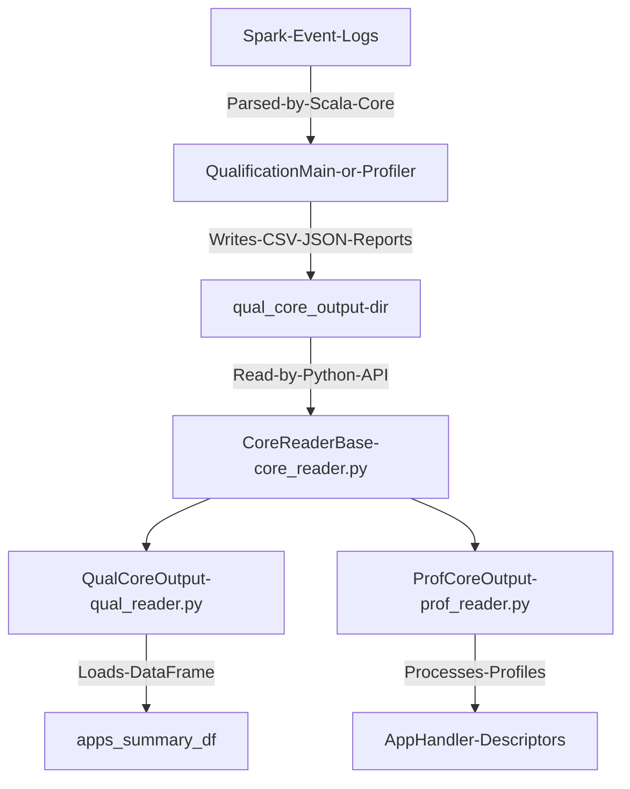

<!-- source: DeepWiki mcp.deepwiki.com · repo NVIDIA/cudf-spark-tools · page 1.2 Repository Layout and Key Concepts · fetched 2026-10-26 -->

# Repository Layout and Key Concepts

Relevant source files

The following files were used as context for generating this wiki page:

- [.github/workflows/mvn-verify-check.yml](.github/workflows/mvn-verify-check.yml)
- [core/README.md](core/README.md)
- [core/docs/qual_core_output.md](core/docs/qual_core_output.md)
- [core/pom.xml](core/pom.xml)
- [user_tools/docs/resources/spark_rapids_user_tools_overview-01.drawio](user_tools/docs/resources/spark_rapids_user_tools_overview-01.drawio)
- [user_tools/docs/resources/spark_rapids_user_tools_overview-01.png](user_tools/docs/resources/spark_rapids_user_tools_overview-01.png)
- [user_tools/src/spark_rapids_pytools/__init__.py](user_tools/src/spark_rapids_pytools/__init__.py)
- [user_tools/src/spark_rapids_tools/api_v1/core/core_reader.py](user_tools/src/spark_rapids_tools/api_v1/core/core_reader.py)
- [user_tools/src/spark_rapids_tools/api_v1/core/prof_reader.py](user_tools/src/spark_rapids_tools/api_v1/core/prof_reader.py)
- [user_tools/src/spark_rapids_tools/api_v1/core/qual_reader.py](user_tools/src/spark_rapids_tools/api_v1/core/qual_reader.py)

## Purpose and Scope
This section details the repository structure of `cudf-spark-tools`, mapping core directories (`core/`, `user_tools/`, `scripts/`, `.github/`) and tracing the complete data flow from Apache Spark event log ingestion through the Scala analysis engine (`core`) up to Python wrapper consumption (`user_tools`) and report generation.

Sources: `core/README.md:1-12`, `core/pom.xml:17-28`

## Top-Level Directory Layout
The repository is organized into distinct subdirectories separating the Scala analytics engine, Python user tools interface, developer scripts, and CI/CD pipelines:
- `core/`: Contains the Scala/Java backend engine (`rapids-4-spark-tools`) responsible for parsing Spark event logs, analyzing SQL plans, executing qualification and profiling metrics, and generating raw CSV/JSON reports [core/pom.xml:17-28]().
- `user_tools/`: Houses the Python package (`spark_rapids_pytools` and `spark_rapids_tools`) implementing CLI entrypoints, job orchestration across cloud platforms (Dataproc, EMR, Databricks), post-processing heuristics, and the `api_v1` report reading layer [user_tools/src/spark_rapids_pytools/__init__.py:1-23]().
- `scripts/`: Contains IDE configurations (e.g., `idea-code-style-settings.xml`), shell utilities, and developer scripts.
- `.github/`: Defines GitHub Actions workflows for continuous integration, verification, and linting (e.g., `mvn-verify-check.yml`) [.github/workflows/mvn-verify-check.yml:1-69]().

Sources: `core/README.md:14-35`, `core/pom.xml:17-28`, `.github/workflows/mvn-verify-check.yml:1-70`, `user_tools/src/spark_rapids_pytools/__init__.py:1-24`

### Directory Layout Diagram

Sources: `core/pom.xml:17-28`, `.github/workflows/mvn-verify-check.yml:1-70`, `core/README.md:1-92`

## Two-Layer Architecture and Data Flow
`cudf-spark-tools` employs a two-layer architecture separating heavy event log parsing and analytics from user-facing orchestration and post-processing. 

1. **Scala Core Layer (`core/`)**: Processes raw Spark event logs directly using Spark internal parsers, extracting stage models, task metrics, operator statistics, and SQL plan trees. It emits structured text artifacts (CSV and JSON) under directories like `qual_core_output/` [core/docs/qual_core_output.md:8-34]().
2. **Python User Layer (`user_tools/`)**: Wraps the core JAR execution through Python subprocesses or cluster job submissions, and reads the resulting core outputs via `CoreReaderBase` implementations (`QualCoreOutput`, `ProfCoreOutput`) to generate higher-level recommendations, cloud pricing estimates, and unified reports [user_tools/src/spark_rapids_tools/api_v1/core/core_reader.py:31-94](), [user_tools/src/spark_rapids_tools/api_v1/core/qual_reader.py:26-46](), [user_tools/src/spark_rapids_tools/api_v1/core/prof_reader.py:23-28]().

Sources: `core/docs/qual_core_output.md:8-34`, `user_tools/src/spark_rapids_tools/api_v1/core/core_reader.py:31-42`, `user_tools/src/spark_rapids_tools/api_v1/core/qual_reader.py:26-47`, `user_tools/src/spark_rapids_tools/api_v1/core/prof_reader.py:23-29`

### Data Flow and Code Entity Mapping Diagram

Sources: `core/docs/qual_core_output.md:11-34`, `user_tools/src/spark_rapids_tools/api_v1/core/core_reader.py:31-80`, `user_tools/src/spark_rapids_tools/api_v1/core/qual_reader.py:26-47`, `user_tools/src/spark_rapids_tools/api_v1/core/prof_reader.py:23-29`

## Event Log Ingestion and Report Flow
Event logs flow through the pipeline starting from raw JSON event streams generated by Apache Spark execution. The Scala backend processes these streams to categorize logs and output status summaries and metrics tables.

- **Status Tracking (`status.csv`)**: Records the outcome of event log processing (`SUCCESS`, `FAILURE`, `SKIPPED`, `UNKNOWN`) alongside application identifiers and failure diagnostics [core/docs/qual_core_output.md:74-89]().
- **Summary Metrics (`apps_summary.csv`)**: Aggregates successful application metrics including wall-clock duration, unsupported read/write data formats, complex types, and stage durations [core/docs/qual_core_output.md:90-112]().
- **Python Integration (`CoreReaderBase`)**: The Python `user_tools` layer consumes these outputs via `CoreReaderBase`, instantiating `AppHandler` instances for successful jobs and exposing cached properties like `apps_status_res` and `apps_summary_df` [user_tools/src/spark_rapids_tools/api_v1/core/core_reader.py:44-80](), [user_tools/src/spark_rapids_tools/api_v1/core/qual_reader.py:33-46]().

Sources: `core/docs/qual_core_output.md:74-112`, `user_tools/src/spark_rapids_tools/api_v1/core/core_reader.py:44-80`, `user_tools/src/spark_rapids_tools/api_v1/core/qual_reader.py:33-47`

---

