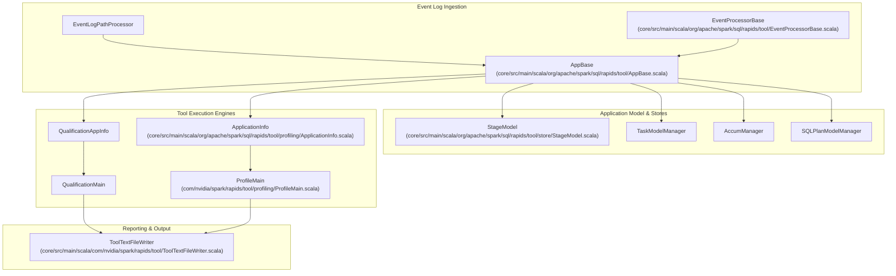

<!-- source: DeepWiki mcp.deepwiki.com · repo NVIDIA/cudf-spark-tools · page 2 Core Scala Tools (rapids-4-spark-tools) · fetched 2026-10-26 -->

# Core Scala Tools (rapids-4-spark-tools)

Relevant source files

The following files were used as context for generating this wiki page:

- [core/scalastyle-config.xml](core/scalastyle-config.xml)
- [core/src/main/scala/com/nvidia/spark/rapids/tool/ToolTextFileWriter.scala](core/src/main/scala/com/nvidia/spark/rapids/tool/ToolTextFileWriter.scala)
- [core/src/main/scala/com/nvidia/spark/rapids/tool/profiling/DriverLogProcessor.scala](core/src/main/scala/com/nvidia/spark/rapids/tool/profiling/DriverLogProcessor.scala)
- [core/src/main/scala/com/nvidia/spark/rapids/tool/profiling/ProfileMain.scala](core/src/main/scala/com/nvidia/spark/rapids/tool/profiling/ProfileMain.scala)
- [core/src/main/scala/org/apache/spark/sql/rapids/tool/AppBase.scala](core/src/main/scala/org/apache/spark/sql/rapids/tool/AppBase.scala)
- [core/src/main/scala/org/apache/spark/sql/rapids/tool/AppFilterImpl.scala](core/src/main/scala/org/apache/spark/sql/rapids/tool/AppFilterImpl.scala)
- [core/src/main/scala/org/apache/spark/sql/rapids/tool/EventProcessorBase.scala](core/src/main/scala/org/apache/spark/sql/rapids/tool/EventProcessorBase.scala)
- [core/src/main/scala/org/apache/spark/sql/rapids/tool/FilterAppInfo.scala](core/src/main/scala/org/apache/spark/sql/rapids/tool/FilterAppInfo.scala)
- [core/src/main/scala/org/apache/spark/sql/rapids/tool/profiling/ApplicationInfo.scala](core/src/main/scala/org/apache/spark/sql/rapids/tool/profiling/ApplicationInfo.scala)
- [core/src/main/scala/org/apache/spark/sql/rapids/tool/profiling/EventsProcessor.scala](core/src/main/scala/org/apache/spark/sql/rapids/tool/profiling/EventsProcessor.scala)
- [core/src/main/scala/org/apache/spark/sql/rapids/tool/qualification/QualificationEventProcessor.scala](core/src/main/scala/org/apache/spark/sql/rapids/tool/qualification/QualificationEventProcessor.scala)
- [core/src/main/scala/org/apache/spark/sql/rapids/tool/store/StageModel.scala](core/src/main/scala/org/apache/spark/sql/rapids/tool/store/StageModel.scala)
- [core/src/main/scala/org/apache/spark/sql/rapids/tool/ui/ConsoleProgressBar.scala](core/src/main/scala/org/apache/spark/sql/rapids/tool/ui/ConsoleProgressBar.scala)
- [core/src/main/scala/org/apache/spark/sql/rapids/tool/util/EventUtils.scala](core/src/main/scala/org/apache/spark/sql/rapids/tool/util/EventUtils.scala)
- [core/src/main/scala/org/apache/spark/sql/rapids/tool/util/RapidsToolsConfUtil.scala](core/src/main/scala/org/apache/spark/sql/rapids/tool/util/RapidsToolsConfUtil.scala)
- [core/src/main/scala/org/apache/spark/sql/rapids/tool/util/RuntimeReporter.scala](core/src/main/scala/org/apache/spark/sql/rapids/tool/util/RuntimeReporter.scala)
- [core/src/test/scala/com/nvidia/spark/rapids/tool/profiling/GenerateDotSuite.scala](core/src/test/scala/com/nvidia/spark/rapids/tool/profiling/GenerateDotSuite.scala)
- [core/src/test/scala/com/nvidia/spark/rapids/tool/profiling/GenerateTimelineSuite.scala](core/src/test/scala/com/nvidia/spark/rapids/tool/profiling/GenerateTimelineSuite.scala)

The core Scala/Java library (`rapids-4-spark-tools`) provides the foundational engine for parsing Spark event logs, reconstructing execution plans, analyzing GPU compatibility, estimating speedups, profiling bottlenecks, and generating comprehensive migration reports. It operates as the backend computation engine invoked either via Spark submit tasks or embedded inside the Python wrapper framework.

*Sources: [core/src/main/scala/org/apache/spark/sql/rapids/tool/AppBase.scala:45-52](), [core/src/main/scala/org/apache/spark/sql/rapids/tool/EventProcessorBase.scala:32-32](), [core/src/main/scala/org/apache/spark/sql/rapids/tool/profiling/ApplicationInfo.scala:28-29](), [core/src/main/scala/org/apache/spark/sql/rapids/tool/store/StageModel.scala:33-33](), [com/nvidia/spark/rapids/tool/profiling/ProfileMain.scala:28-28](), [core/src/main/scala/com/nvidia/spark/rapids/tool/ToolTextFileWriter.scala:32-36]() *

---

## 2.1 Event Log Ingestion and Application Model

Event log ingestion forms the entry point for all analysis tools. The ingestion pipeline discovers event log paths across local or distributed file systems (HDFS, S3, ADLS, GCS), filters them according to user-defined criteria, and streams them into memory models via event processors.

The core abstract class `AppBase` maintains application-level metadata, executor tracking (`maxNumExecutorsRunning`), SQL execution mappings, and container managers like `AccumManager`, `StageModelManager`, and `TaskModelManager` [core/src/main/scala/org/apache/spark/sql/rapids/tool/AppBase.scala:45-130](). Spark listener events are intercepted and processed incrementally by subclasses of `EventProcessorBase`, which updates metrics, stage models (such as `StageModel`), and task summaries [core/src/main/scala/org/apache/spark/sql/rapids/tool/EventProcessorBase.scala:32-115](), [core/src/main/scala/org/apache/spark/sql/rapids/tool/store/StageModel.scala:33-37]().

For detailed information, see [Event Log Ingestion and Application Model](#2.1).

*Sources: [core/src/main/scala/org/apache/spark/sql/rapids/tool/AppBase.scala:45-130](), [core/src/main/scala/org/apache/spark/sql/rapids/tool/EventProcessorBase.scala:32-115](), [core/src/main/scala/org/apache/spark/sql/rapids/tool/store/StageModel.scala:33-37]() *

---

## 2.2 SQL Plan Parsing

SQL plan parsing translates raw Spark physical execution plans (`SparkPlanInfo`) into structured data models (`ExecInfo`, `PlanInfo`) that can be analyzed for RAPIDS Accelerator compatibility. The parser pipeline traverses plan operator trees, handles subqueries, resolves expressions, and builds plan graphs (`ToolsPlanGraph`) used for visualization and rule evaluation.

Sub-components include specialized operator parsers for joins, aggregates, scans, and codegen, as well as plugin architectures for alternate runtimes like Delta Lake, Apache Iceberg, Photon, and Auron. Compatibility matrices (`supportedExprs.csv`, `supportedExecs.csv`) govern operator scoring and vectorization assessment.

For detailed information, see [SQL Plan Parsing](#2.2).

*Sources: [core/src/main/scala/org/apache/spark/sql/rapids/tool/AppBase.scala:38-42](), [core/src/main/scala/org/apache/spark/sql/rapids/tool/profiling/ApplicationInfo.scala:28-39]()*

---

## 2.3 Qualification Tool

The Qualification tool evaluates whether Apache Spark workloads are suitable for acceleration on NVIDIA GPUs. It processes event logs to calculate CPU vs. GPU execution durations, estimates potential speedups, identifies unsupported or fallback operators, and generates summary reports in CSV, text, or HTML formats.

The runner is orchestrated via `QualificationMain` and `QualificationAppInfo`, utilizing specialized event processors like `QualificationEventProcessor` to accumulate execution times, task runtimes, and input data sizes [core/src/main/scala/org/apache/spark/sql/rapids/tool/qualification/QualificationEventProcessor.scala:29-66]().

For detailed information, see [Qualification Tool](#2.3).

*Sources: [core/src/main/scala/org/apache/spark/sql/rapids/tool/qualification/QualificationEventProcessor.scala:29-66]() *

---

## 2.4 Profiling Tool

The Profiling tool extracts detailed operational telemetry from Spark event logs and driver logs to diagnose performance bottlenecks, memory usage patterns, shuffle sizes, and GPU fallback reasons. It is driven by `ProfileMain` and executed through the `Profiler` class [com/nvidia/spark/rapids/tool/profiling/ProfileMain.scala:28-86]().

Additionally, `DriverLogProcessor` parses driver standard output or log files to extract unsupported operator messages (`cannot run on GPU`) and quantify fallback frequencies [core/src/main/scala/com/nvidia/spark/rapids/tool/profiling/DriverLogProcessor.scala:43-89](). It also supports generating DOT-format execution graphs and timeline visualizers.

For detailed information, see [Profiling Tool](#2.4).

*Sources: [com/nvidia/spark/rapids/tool/profiling/ProfileMain.scala:28-86](), [core/src/main/scala/com/nvidia/spark/rapids/tool/profiling/DriverLogProcessor.scala:43-89]() *

---

## 2.5 Metrics Analysis and Report Views

The metrics analysis layer aggregates task metrics, stage metrics, and SQL plan metrics across applications to power reporting views and warehouse results. Classes such as `AppSparkMetricsAnalyzer` and `MetricCatalog` provide the plumbing to compute percentiles, averages, and sums for spills, shuffle reads/writes, and GC times.

Output writers like `ToolTextFileWriter` handle file serialization across distributed storage systems, while runtime reporters (`RuntimeReporter`) manage application execution statuses (`SuccessAppResult`, `FailureAppResult`, `SkippedAppResult`) and output directory tracking [core/src/main/scala/com/nvidia/spark/rapids/tool/ToolTextFileWriter.scala:32-86](), [core/src/main/scala/org/apache/spark/sql/rapids/tool/util/RuntimeReporter.scala:25-74]().

For detailed information, see [Metrics Analysis and Report Views](#2.5).

*Sources: [core/src/main/scala/com/nvidia/spark/rapids/tool/ToolTextFileWriter.scala:32-86](), [core/src/main/scala/org/apache/spark/sql/rapids/tool/util/RuntimeReporter.scala:25-74]() *

---

