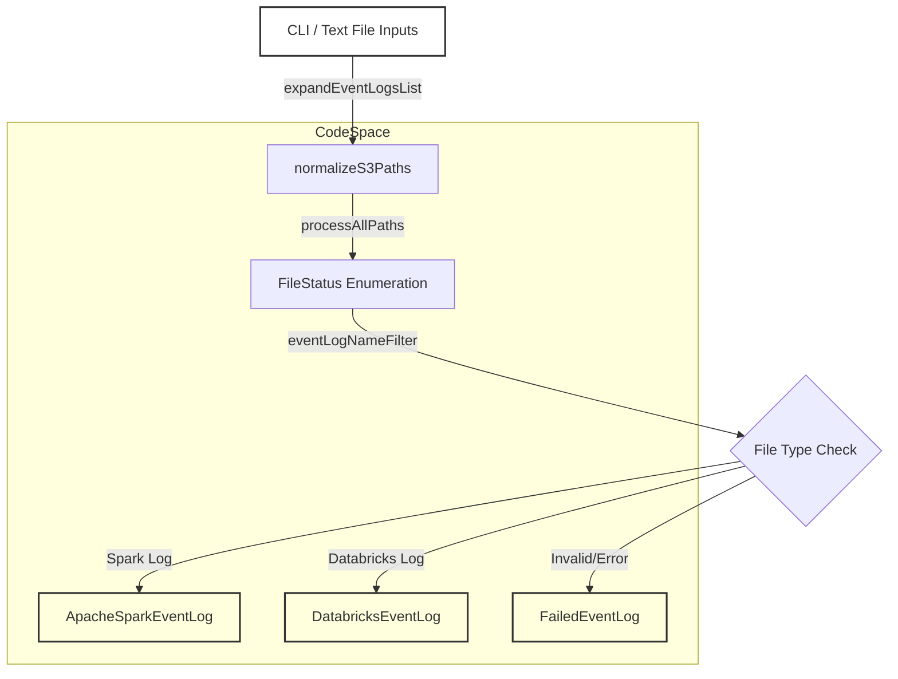
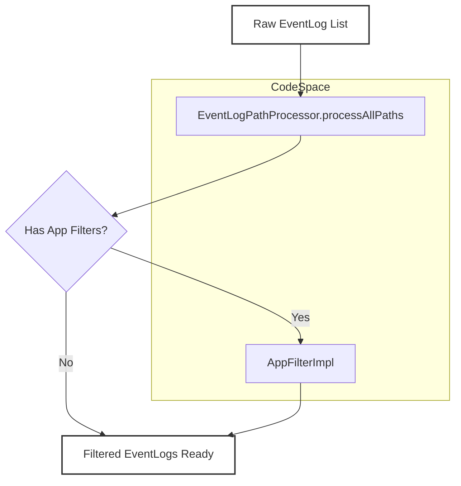
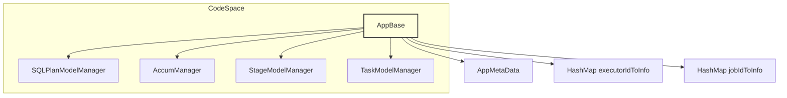
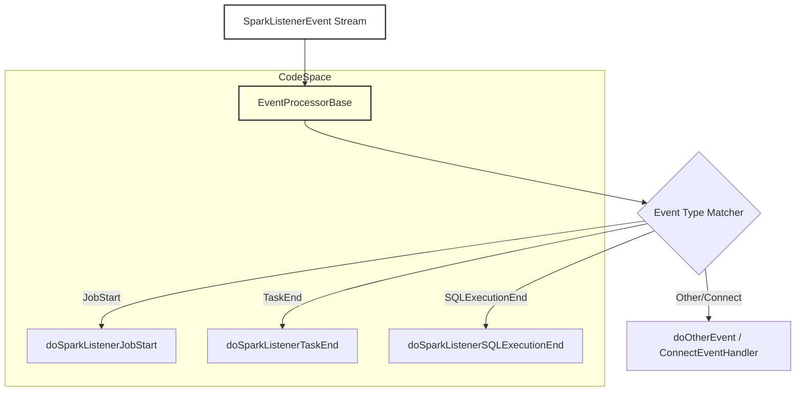

<!-- source: DeepWiki mcp.deepwiki.com · repo NVIDIA/cudf-spark-tools · page 2.1 Event Log Ingestion and Application Model · fetched 2026-10-26 -->

# Event Log Ingestion and Application Model

Relevant source files

The following files were used as context for generating this wiki page:

- [core/src/main/resources/configs/metrics/metricCatalog.yaml](core/src/main/resources/configs/metrics/metricCatalog.yaml)
- [core/src/main/resources/parser/eventlog-parser.yaml](core/src/main/resources/parser/eventlog-parser.yaml)
- [core/src/main/scala/com/nvidia/spark/rapids/tool/EventLogPathProcessor.scala](core/src/main/scala/com/nvidia/spark/rapids/tool/EventLogPathProcessor.scala)
- [core/src/main/scala/com/nvidia/spark/rapids/tool/analysis/MetricDefinition.scala](core/src/main/scala/com/nvidia/spark/rapids/tool/analysis/MetricDefinition.scala)
- [core/src/main/scala/com/nvidia/spark/rapids/tool/profiling/ConnectClassWarehouse.scala](core/src/main/scala/com/nvidia/spark/rapids/tool/profiling/ConnectClassWarehouse.scala)
- [core/src/main/scala/com/nvidia/spark/rapids/tool/profiling/ProfileArgs.scala](core/src/main/scala/com/nvidia/spark/rapids/tool/profiling/ProfileArgs.scala)
- [core/src/main/scala/com/nvidia/spark/rapids/tool/qualification/PluginTypeChecker.scala](core/src/main/scala/com/nvidia/spark/rapids/tool/qualification/PluginTypeChecker.scala)
- [core/src/main/scala/com/nvidia/spark/rapids/tool/qualification/QualificationArgs.scala](core/src/main/scala/com/nvidia/spark/rapids/tool/qualification/QualificationArgs.scala)
- [core/src/main/scala/com/nvidia/spark/rapids/tool/qualification/QualificationMain.scala](core/src/main/scala/com/nvidia/spark/rapids/tool/qualification/QualificationMain.scala)
- [core/src/main/scala/org/apache/spark/sql/rapids/tool/AppBase.scala](core/src/main/scala/org/apache/spark/sql/rapids/tool/AppBase.scala)
- [core/src/main/scala/org/apache/spark/sql/rapids/tool/AppFilterImpl.scala](core/src/main/scala/org/apache/spark/sql/rapids/tool/AppFilterImpl.scala)
- [core/src/main/scala/org/apache/spark/sql/rapids/tool/EventProcessorBase.scala](core/src/main/scala/org/apache/spark/sql/rapids/tool/EventProcessorBase.scala)
- [core/src/main/scala/org/apache/spark/sql/rapids/tool/FilterAppInfo.scala](core/src/main/scala/org/apache/spark/sql/rapids/tool/FilterAppInfo.scala)
- [core/src/main/scala/org/apache/spark/sql/rapids/tool/profiling/ApplicationInfo.scala](core/src/main/scala/org/apache/spark/sql/rapids/tool/profiling/ApplicationInfo.scala)
- [core/src/main/scala/org/apache/spark/sql/rapids/tool/profiling/EventsProcessor.scala](core/src/main/scala/org/apache/spark/sql/rapids/tool/profiling/EventsProcessor.scala)
- [core/src/main/scala/org/apache/spark/sql/rapids/tool/qualification/QualificationEventProcessor.scala](core/src/main/scala/org/apache/spark/sql/rapids/tool/qualification/QualificationEventProcessor.scala)
- [core/src/main/scala/org/apache/spark/sql/rapids/tool/store/AccumManager.scala](core/src/main/scala/org/apache/spark/sql/rapids/tool/store/AccumManager.scala)
- [core/src/main/scala/org/apache/spark/sql/rapids/tool/store/AccumMetaRef.scala](core/src/main/scala/org/apache/spark/sql/rapids/tool/store/AccumMetaRef.scala)
- [core/src/main/scala/org/apache/spark/sql/rapids/tool/store/AccumNameRef.scala](core/src/main/scala/org/apache/spark/sql/rapids/tool/store/AccumNameRef.scala)
- [core/src/main/scala/org/apache/spark/sql/rapids/tool/store/StageModel.scala](core/src/main/scala/org/apache/spark/sql/rapids/tool/store/StageModel.scala)
- [core/src/main/scala/org/apache/spark/sql/rapids/tool/util/ConnectEventHandler.scala](core/src/main/scala/org/apache/spark/sql/rapids/tool/util/ConnectEventHandler.scala)
- [core/src/main/scala/org/apache/spark/sql/rapids/tool/util/EventUtils.scala](core/src/main/scala/org/apache/spark/sql/rapids/tool/util/EventUtils.scala)
- [core/src/test/scala/com/nvidia/spark/rapids/tool/analysis/MetricCatalogSuite.scala](core/src/test/scala/com/nvidia/spark/rapids/tool/analysis/MetricCatalogSuite.scala)
- [core/src/test/scala/com/nvidia/spark/rapids/tool/profiling/ConnectEventSuite.scala](core/src/test/scala/com/nvidia/spark/rapids/tool/profiling/ConnectEventSuite.scala)
- [core/src/test/scala/com/nvidia/spark/rapids/tool/qualification/PluginTypeCheckerSuite.scala](core/src/test/scala/com/nvidia/spark/rapids/tool/qualification/PluginTypeCheckerSuite.scala)

## Purpose and Scope
This document details the event log ingestion, filtering, path discovery, application state modeling (`AppBase`), event dispatching (`EventProcessorBase`), and internal data store structures (`StageModelManager`, `TaskModelManager`, `AccumManager`) within the `rapids-4-spark-tools` core Scala architecture. 

---

## 1. Event Log Discovery and Path Processing
Event log ingestion begins with raw path inputs supplied via CLI arguments or text expansion lists. The `EventLogPathProcessor` utility discovers, normalizes, and filters event log resources across local file systems and cloud object stores (e.g., HDFS, S3, GCS).

Paths are represented through the `EventLogInfo` trait hierarchy:
* `ApacheSparkEventLog`: Standard Apache Spark event log structure.
* `DatabricksEventLog`: Databricks-specific event log format and rolling file structures.
* `FailedEventLog`: Encapsulates paths that failed validation or parsing along with their failure reasons.

*Sources: `[com/nvidia/spark/rapids/tool/EventLogPathProcessor.scala:38-52]`, `[com/nvidia/spark/rapids/tool/EventLogPathProcessor.scala:93-112]`, `[com/nvidia/spark/rapids/tool/EventLogPathProcessor.scala:166-171]()`*

---

## 2. Filtering Mechanics
Once paths are discovered, applications undergo filtering based on criteria such as execution timestamps, filesystem attributes, application names, and minimum/maximum event log sizes. 

Filtering logic is coordinated in `QualificationMain` using `AppFilterImpl` alongside CLI option parsers like `QualificationArgs`:
* **Filesystem Filters**: `--match-event-logs`, `--min-event-log-size`, `--max-event-log-size`, and timestamp boundaries (`--fs-start-time`, `--fs-end-time`).
* **Application Filters**: `--application-name`, `--start-app-time`, and rank-based limits (e.g., `100-newest`, `100-oldest`, `100-newest-per-app-name`).

*Sources: `[com/nvidia/spark/rapids/tool/qualification/QualificationArgs.scala:42-107]`, `[com/nvidia/spark/rapids/tool/qualification/QualificationMain.scala:89-103]()`*

---

## 3. Application Core Model (`AppBase`)
`AppBase` serves as the abstract foundational model for any parsed Spark application. It maintains global execution metadata, job mappings, executors, metrics, and references to specialized managers.

Key state fields managed within `AppBase` include:
* `id` and `appId`: Unique identification parameters retrieved from application metadata or event log paths.
* `executorIdToInfo`: Tracks active executors and high-water marks for active resource usage (`maxNumExecutorsRunning`, `maxNumNodesRunning`).
* `jobIdToInfo` and `sqlIdToInfo`: Map jobs and SQL query executions to their underlying metadata.
* `dataSourceInfo`: Records data reading and writing operations (`DataSourceRecord`).

*Sources: `[core/src/main/scala/org/apache/spark/sql/rapids/tool/AppBase.scala:45-129]()`*

---

## 4. Event Processing Framework (`EventProcessorBase`)
`EventProcessorBase` extends Spark's `SparkListener` interface to ingest streaming listener events and populate the `AppBase` state model.

The `processAnyEvent` method pattern-matches incoming `SparkListenerEvent` instances, delegating them to appropriate lifecycle handlers:
* `SparkListenerApplicationStart` / `SparkListenerApplicationEnd`
* `SparkListenerJobStart` / `SparkListenerJobEnd`
* `SparkListenerStageSubmitted` / `SparkListenerStageCompleted`
* `SparkListenerTaskStart` / `SparkListenerTaskEnd`
* `SparkListenerSQLExecutionStart` / `SparkListenerSQLExecutionEnd`

*Sources: `[core/src/main/scala/org/apache/spark/sql/rapids/tool/EventProcessorBase.scala:32-115]()`*

---

## 5. Data Stores and Managers
To prevent memory bloat and maintain clean separation of concerns, metrics and execution units are organized into specialized sub-managers attached to `AppBase`:
* `AccumManager`: Tracks accumulator registrations, mapping accumulator IDs to stage execution statistics and metric metadata.
* `StageModelManager`: Manages stage-level execution properties and aggregated runtimes.
* `TaskModelManager`: Handles individual task metrics collected at `SparkListenerTaskEnd`.
* `StageExecutorMetricsManager`: Aggregates executor metrics per stage (e.g., peak memory usage, GC time).

*Sources: `[core/src/main/scala/org/apache/spark/sql/rapids/tool/AppBase.scala:101-135]()`*

---

