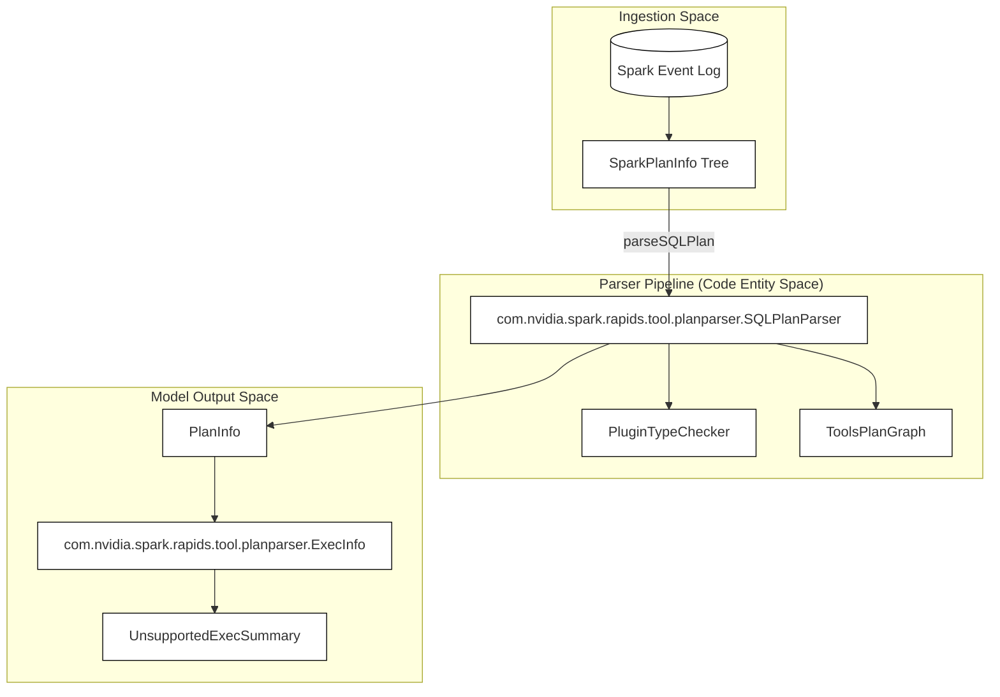
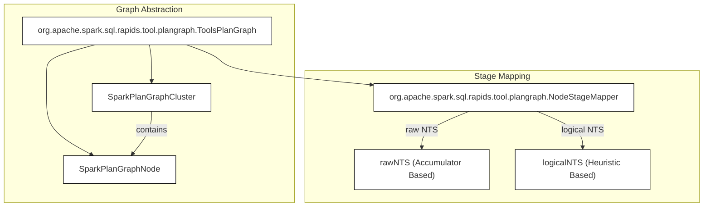

<!-- source: DeepWiki mcp.deepwiki.com · repo NVIDIA/cudf-spark-tools · page 2.2 SQL Plan Parsing · fetched 2026-10-26 -->

# SQL Plan Parsing

Relevant source files

The following files were used as context for generating this wiki page:

- [core/src/main/scala/com/nvidia/spark/rapids/tool/planparser/SQLPlanParser.scala](core/src/main/scala/com/nvidia/spark/rapids/tool/planparser/SQLPlanParser.scala)
- [core/src/main/scala/com/nvidia/spark/rapids/tool/planparser/auron/AuronParseHelper.scala](core/src/main/scala/com/nvidia/spark/rapids/tool/planparser/auron/AuronParseHelper.scala)
- [core/src/main/scala/com/nvidia/spark/rapids/tool/planparser/db/DatabricksParseHelper.scala](core/src/main/scala/com/nvidia/spark/rapids/tool/planparser/db/DatabricksParseHelper.scala)
- [core/src/main/scala/com/nvidia/spark/rapids/tool/plugins/OssOpMapperTrait.scala](core/src/main/scala/com/nvidia/spark/rapids/tool/plugins/OssOpMapperTrait.scala)
- [core/src/main/scala/com/nvidia/spark/rapids/tool/qualification/QualOutputWriter.scala](core/src/main/scala/com/nvidia/spark/rapids/tool/qualification/QualOutputWriter.scala)
- [core/src/main/scala/com/nvidia/spark/rapids/tool/qualification/Qualification.scala](core/src/main/scala/com/nvidia/spark/rapids/tool/qualification/Qualification.scala)
- [core/src/main/scala/org/apache/spark/sql/rapids/tool/ClassWarehouse.scala](core/src/main/scala/org/apache/spark/sql/rapids/tool/ClassWarehouse.scala)
- [core/src/main/scala/org/apache/spark/sql/rapids/tool/ToolUtils.scala](core/src/main/scala/org/apache/spark/sql/rapids/tool/ToolUtils.scala)
- [core/src/main/scala/org/apache/spark/sql/rapids/tool/plangraph/ToolsPlanGraph.scala](core/src/main/scala/org/apache/spark/sql/rapids/tool/plangraph/ToolsPlanGraph.scala)
- [core/src/main/scala/org/apache/spark/sql/rapids/tool/qualification/QualificationAppInfo.scala](core/src/main/scala/org/apache/spark/sql/rapids/tool/qualification/QualificationAppInfo.scala)
- [core/src/main/scala/org/apache/spark/sql/rapids/tool/util/stubs/SparkPlanInfo.scala](core/src/main/scala/org/apache/spark/sql/rapids/tool/util/stubs/SparkPlanInfo.scala)
- [core/src/main/scala/org/apache/spark/sql/rapids/tool/util/stubs/auron/AuronSparkPlanInfo.scala](core/src/main/scala/org/apache/spark/sql/rapids/tool/util/stubs/auron/AuronSparkPlanInfo.scala)
- [core/src/main/scala/org/apache/spark/sql/rapids/tool/util/stubs/db/PhotonSparkPlanInfo.scala](core/src/main/scala/org/apache/spark/sql/rapids/tool/util/stubs/db/PhotonSparkPlanInfo.scala)
- [core/src/main/scala/org/apache/spark/sql/rapids/tool/util/stubs/rapids/RAPIDSSparkPlanInfo.scala](core/src/main/scala/org/apache/spark/sql/rapids/tool/util/stubs/rapids/RAPIDSSparkPlanInfo.scala)
- [core/src/test/resources/QualificationExpectations/photon_db_13_3/app-20240919162642-0000/execs.csv](core/src/test/resources/QualificationExpectations/photon_db_13_3/app-20240919162642-0000/execs.csv)
- [core/src/test/scala/com/nvidia/spark/rapids/tool/planparser/PhotonPlanParserSuite.scala](core/src/test/scala/com/nvidia/spark/rapids/tool/planparser/PhotonPlanParserSuite.scala)
- [core/src/test/scala/com/nvidia/spark/rapids/tool/planparser/SqlPlanParserSuite.scala](core/src/test/scala/com/nvidia/spark/rapids/tool/planparser/SqlPlanParserSuite.scala)
- [core/src/test/scala/com/nvidia/spark/rapids/tool/plugins/OssOpMapperSuite.scala](core/src/test/scala/com/nvidia/spark/rapids/tool/plugins/OssOpMapperSuite.scala)
- [core/src/test/scala/com/nvidia/spark/rapids/tool/qualification/QualificationSuite.scala](core/src/test/scala/com/nvidia/spark/rapids/tool/qualification/QualificationSuite.scala)

## Purpose and Scope

The SQL plan parsing module forms the core analytical engine of `cudf-spark-tools`. It is responsible for ingesting Spark SQL execution plans from event logs, traversing plan node trees via stubs and graph abstractions, evaluating operator support against cuDF accelerator plugin capabilities, estimating potential speedups, and identifying unsupported expressions or bottlenecks. 

This page provides a high-level architectural overview of the `SQLPlanParser` pipeline, core models like `ExecInfo` and `PlanInfo`, and plan graph handling. For detailed technical implementations, refer to the child pages:
- Exec Parsers: see [Exec Parsers](#2.2.1)
- Table Format and Runtime Plugins: see [Table Format and Runtime Plugins (Delta, Iceberg, Photon, Auron)](#2.2.2)
- Operator Support Matrices: see [Operator Support Matrices and Scores](#2.2.3)

---

## 1. SQLPlanParser Pipeline and Core Models

The entry point for analyzing Spark SQL execution plans is `SQLPlanParser.parseSQLPlan`, which takes a `SparkPlanInfo` tree and transforms it into structured domain models (`PlanInfo` containing a collection of `ExecInfo` nodes) [core/src/main/scala/com/nvidia/spark/rapids/tool/planparser/SQLPlanParser.scala](). 

`ExecInfo` represents individual Spark execution operators (e.g., `SortMergeJoin`, `HashAggregate`, `Scan parquet`), tracking metrics such as duration, assigned stages, support status (`isSupported`), speedup factors, and unsupported expression references (`UnsupportedExprOpRef`) [core/src/main/scala/com/nvidia/spark/rapids/tool/planparser/SQLPlanParser.scala]().

Title: Figure 1: SQLPlanParser Dataflow and Core Models

*Sources: `core/src/main/scala/com/nvidia/spark/rapids/tool/planparser/SQLPlanParser.scala`*

---

## 2. Plan Graph Handling and Stage Mapping

To accurately correlate execution plan operators with Spark task and stage metrics, the parsing layer uses `ToolsPlanGraph`, `SparkPlanGraphNode`, and `SparkPlanGraphCluster` [org/apache/spark/sql/rapids/tool/plangraph/ToolsPlanGraph.scala](). These structures mirror Spark's UI execution graph abstractions while adding platform-aware extensions.

The `NodeStageMapper` class manages the binding between SQL plan node IDs and Spark stage IDs, maintaining both raw mappings (`rawNTS`) derived from accumulators and logical mappings (`logicalNTS`) adjusted via heuristics [org/apache/spark/sql/rapids/tool/plangraph/ToolsPlanGraph.scala]().

Title: Figure 2: Plan Graph and Stage Mapping Architecture

*Sources: `core/src/main/scala/org/apache/spark/sql/rapids/tool/plangraph/ToolsPlanGraph.scala`*

---

## 3. Runtime and Table Format Integration

The SQL plan parser abstracts heterogeneous runtime environments and table formats by leveraging plugin mappers and condition checkers. Runtimes such as Databricks Photon and Auron, alongside table formats like Delta Lake and Apache Iceberg, intercept standard `SparkPlanInfo` nodes and map them to OSS Spark equivalents or platform-specific operator wrappers [core/src/main/scala/com/nvidia/spark/rapids/tool/planparser/auron/AuronParseHelper.scala]().

---

## Child Pages

- **2.2.1 Exec Parsers**: Covers individual execution operator parsers, including generic operators, joins, aggregates, whole-stage codegen blocks, file scans, write commands, and window limits.
- **2.2.2 Table Format and Runtime Plugins (Delta, Iceberg, Photon, Auron)**: Details the plugin architecture supporting alternate runtime engines and table formats, SQLPlanModel versioning, and data-source caching.
- **2.2.3 Operator Support Matrices and Scores**: Documents `supportedExprs.csv`, `supportedExecs.csv`, `supportedDataSource.csv`, and `operatorsScore-*.csv` files, and explains how they synchronize from the underlying accelerator plugin repository.

---

