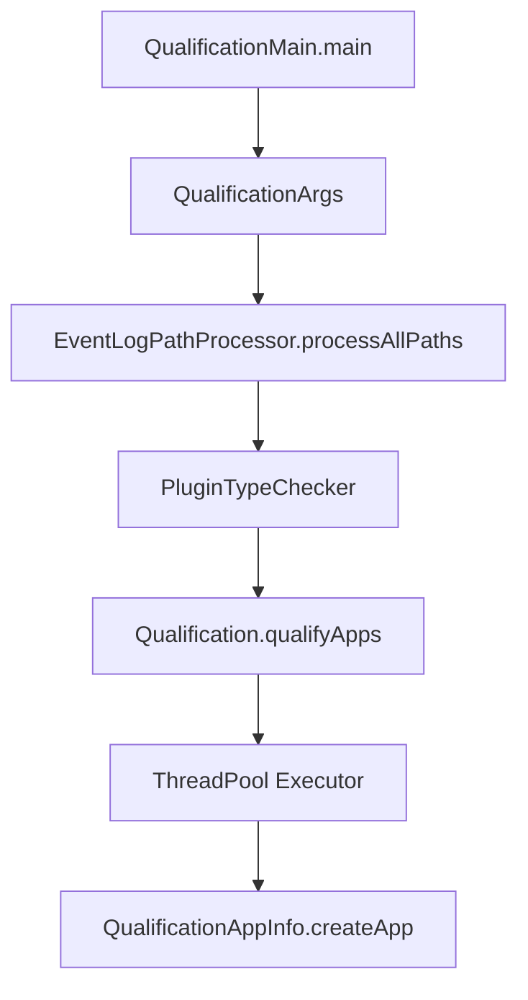
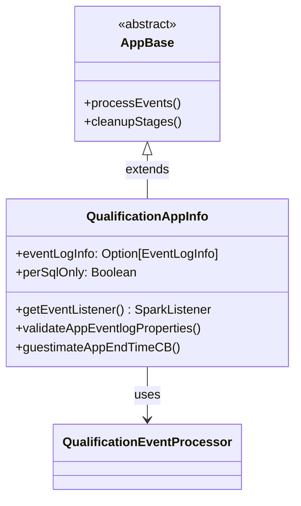
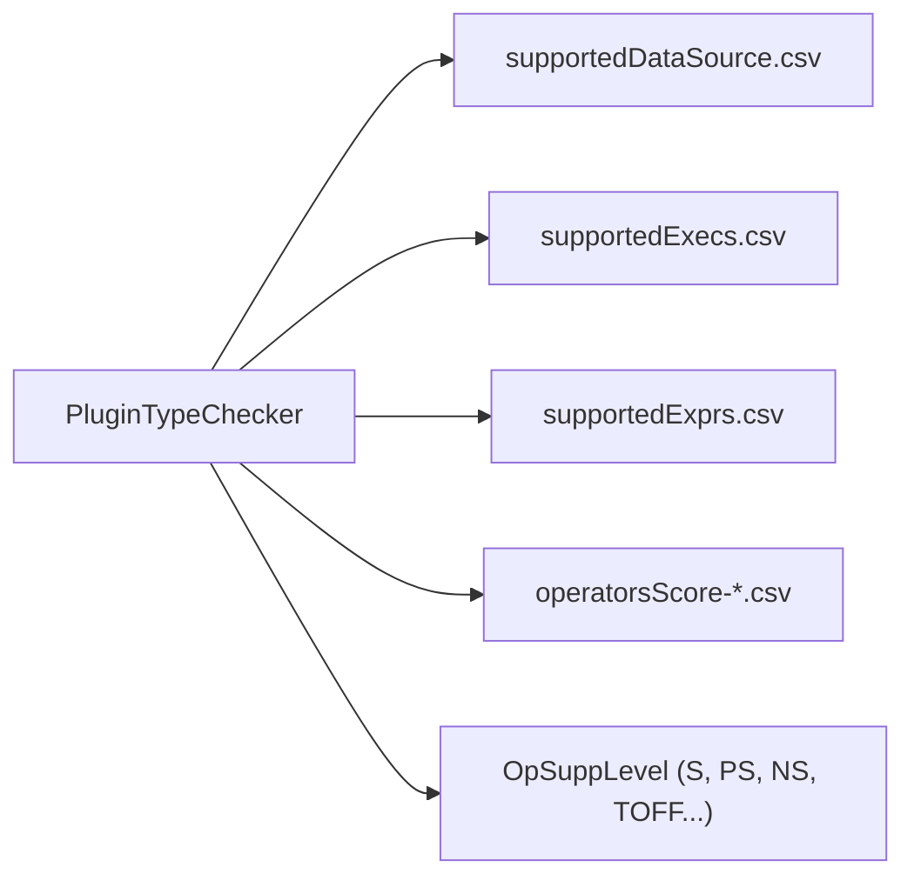

<!-- source: DeepWiki mcp.deepwiki.com · repo NVIDIA/cudf-spark-tools · page 2.3 Qualification Tool · fetched 2026-10-26 -->

# Qualification Tool

<details>
<summary>Relevant source files</summary>

The following files were used as context for generating this wiki page:

- [core/docs/qual_core_output.md](core/docs/qual_core_output.md)
- [core/src/main/resources/configs/reports/profCoreReport.yaml](core/src/main/resources/configs/reports/profCoreReport.yaml)
- [core/src/main/resources/configs/reports/qualCoreReport.yaml](core/src/main/resources/configs/reports/qualCoreReport.yaml)
- [core/src/main/resources/configs/reports/qualOutputTable.yaml](core/src/main/resources/configs/reports/qualOutputTable.yaml)
- [core/src/main/scala/com/nvidia/spark/rapids/tool/EventLogPathProcessor.scala](core/src/main/scala/com/nvidia/spark/rapids/tool/EventLogPathProcessor.scala)
- [core/src/main/scala/com/nvidia/spark/rapids/tool/planparser/SQLPlanParser.scala](core/src/main/scala/com/nvidia/spark/rapids/tool/planparser/SQLPlanParser.scala)
- [core/src/main/scala/com/nvidia/spark/rapids/tool/profiling/ProfileArgs.scala](core/src/main/scala/com/nvidia/spark/rapids/tool/profiling/ProfileArgs.scala)
- [core/src/main/scala/com/nvidia/spark/rapids/tool/qualification/PluginTypeChecker.scala](core/src/main/scala/com/nvidia/spark/rapids/tool/qualification/PluginTypeChecker.scala)
- [core/src/main/scala/com/nvidia/spark/rapids/tool/qualification/QualOutputWriter.scala](core/src/main/scala/com/nvidia/spark/rapids/tool/qualification/QualOutputWriter.scala)
- [core/src/main/scala/com/nvidia/spark/rapids/tool/qualification/Qualification.scala](core/src/main/scala/com/nvidia/spark/rapids/tool/qualification/Qualification.scala)
- [core/src/main/scala/com/nvidia/spark/rapids/tool/qualification/QualificationArgs.scala](core/src/main/scala/com/nvidia/spark/rapids/tool/qualification/QualificationArgs.scala)
- [core/src/main/scala/com/nvidia/spark/rapids/tool/qualification/QualificationMain.scala](core/src/main/scala/com/nvidia/spark/rapids/tool/qualification/QualificationMain.scala)
- [core/src/main/scala/com/nvidia/spark/rapids/tool/tuning/AutoTunerReportGenerator.scala](core/src/main/scala/com/nvidia/spark/rapids/tool/tuning/AutoTunerReportGenerator.scala)
- [core/src/main/scala/com/nvidia/spark/rapids/tool/views/qualification/QualPerAppReportGenerator.scala](core/src/main/scala/com/nvidia/spark/rapids/tool/views/qualification/QualPerAppReportGenerator.scala)
- [core/src/main/scala/com/nvidia/spark/rapids/tool/views/qualification/QualReportGenConfProvider.scala](core/src/main/scala/com/nvidia/spark/rapids/tool/views/qualification/QualReportGenConfProvider.scala)
- [core/src/main/scala/com/nvidia/spark/rapids/tool/views/qualification/QualToolReportGenerator.scala](core/src/main/scala/com/nvidia/spark/rapids/tool/views/qualification/QualToolReportGenerator.scala)
- [core/src/main/scala/com/nvidia/spark/rapids/tool/views/qualification/UdfReportBuilder.scala](core/src/main/scala/com/nvidia/spark/rapids/tool/views/qualification/UdfReportBuilder.scala)
- [core/src/main/scala/org/apache/spark/sql/rapids/tool/ClassWarehouse.scala](core/src/main/scala/org/apache/spark/sql/rapids/tool/ClassWarehouse.scala)
- [core/src/main/scala/org/apache/spark/sql/rapids/tool/ToolUtils.scala](core/src/main/scala/org/apache/spark/sql/rapids/tool/ToolUtils.scala)
- [core/src/main/scala/org/apache/spark/sql/rapids/tool/qualification/QualificationAppInfo.scala](core/src/main/scala/org/apache/spark/sql/rapids/tool/qualification/QualificationAppInfo.scala)
- [core/src/test/resources/QualificationExpectations/photon_db_17_3/app-20260929185104-0000/execs.csv](core/src/test/resources/QualificationExpectations/photon_db_17_3/app-20260929185104-0000/execs.csv)
- [core/src/test/resources/QualificationExpectations/photon_db_17_3/app-20260929185104-0000/persql.csv](core/src/test/resources/QualificationExpectations/photon_db_17_3/app-20260929185104-0000/persql.csv)
- [core/src/test/resources/QualificationExpectations/photon_db_17_3/app-20260929185104-0000/stages.csv](core/src/test/resources/QualificationExpectations/photon_db_17_3/app-20260929185104-0000/stages.csv)
- [core/src/test/resources/QualificationExpectations/photon_db_17_3/apps_summary.csv](core/src/test/resources/QualificationExpectations/photon_db_17_3/apps_summary.csv)
- [core/src/test/resources/spark-events-profiling/nds_q88_gpu_db_17_3.zstd](core/src/test/resources/spark-events-profiling/nds_q88_gpu_db_17_3.zstd)
- [core/src/test/resources/spark-events-qualification/java_udf_eventlog](core/src/test/resources/spark-events-qualification/java_udf_eventlog)
- [core/src/test/resources/spark-events-qualification/nds_merge_q4_photon_db_17_3.zstd](core/src/test/resources/spark-events-qualification/nds_merge_q4_photon_db_17_3.zstd)
- [core/src/test/resources/spark-events-qualification/python_udf_eventlog](core/src/test/resources/spark-events-qualification/python_udf_eventlog)
- [core/src/test/scala/com/nvidia/spark/rapids/tool/planparser/SqlPlanParserSuite.scala](core/src/test/scala/com/nvidia/spark/rapids/tool/planparser/SqlPlanParserSuite.scala)
- [core/src/test/scala/com/nvidia/spark/rapids/tool/qualification/PluginTypeCheckerSuite.scala](core/src/test/scala/com/nvidia/spark/rapids/tool/qualification/PluginTypeCheckerSuite.scala)
- [core/src/test/scala/com/nvidia/spark/rapids/tool/qualification/QualificationNoSparkSuite.scala](core/src/test/scala/com/nvidia/spark/rapids/tool/qualification/QualificationNoSparkSuite.scala)
- [core/src/test/scala/com/nvidia/spark/rapids/tool/qualification/QualificationSuite.scala](core/src/test/scala/com/nvidia/spark/rapids/tool/qualification/QualificationSuite.scala)
- [core/src/test/scala/com/nvidia/spark/rapids/tool/qualification/checkers/QToolCSVFileContainer.scala](core/src/test/scala/com/nvidia/spark/rapids/tool/qualification/checkers/QToolCSVFileContainer.scala)
- [core/src/test/scala/com/nvidia/spark/rapids/tool/qualification/checkers/QToolOutFileChecker.scala](core/src/test/scala/com/nvidia/spark/rapids/tool/qualification/checkers/QToolOutFileChecker.scala)
- [user_tools/src/spark_rapids_tools/api_v1/core/core_reader.py](user_tools/src/spark_rapids_tools/api_v1/core/core_reader.py)
- [user_tools/src/spark_rapids_tools/api_v1/core/prof_reader.py](user_tools/src/spark_rapids_tools/api_v1/core/prof_reader.py)
- [user_tools/src/spark_rapids_tools/api_v1/core/qual_reader.py](user_tools/src/spark_rapids_tools/api_v1/core/qual_reader.py)

</details>


The Qualification Tool analyzes Apache Spark event logs to assess whether an application is a strong candidate for GPU acceleration using the NVIDIA cuDF plugin. It evaluates SQL plans, data sources, operators, expressions, and task-level execution metrics against operator support matrices and speedup models, generating comprehensive CSV reports, summary logs, and cluster configuration recommendations.

---

## 1. CLI Ingestion and Runner Architecture

The execution of the qualification workflow begins in `QualificationMain`, which parses user-supplied arguments via `QualificationArgs`, discovers and filters event logs using `EventLogPathProcessor`, builds the plugin type checker, and passes execution to the `Qualification` orchestrator class.


*Sources:* `core/src/main/scala/com/nvidia/spark/rapids/tool/qualification/QualificationMain.scala:32-128`, `core/src/main/scala/com/nvidia/spark/rapids/tool/qualification/QualificationArgs.scala:25-33`, `core/src/main/scala/com/nvidia/spark/rapids/tool/qualification/Qualification.scala:34-117`

### Argument Processing and Path Discovery
- **`QualificationArgs`**: Extends Scallop (`org.rogach.scallop.ScallopConf`) to define parameters such as `--output-directory`, `--filter-criteria`, `--application-name`, `--per-sql`, `--ml-functions`, `--auto-tuner`, and trail arguments for event log paths or text files listing paths [core/src/main/scala/com/nvidia/spark/rapids/tool/qualification/QualificationArgs.scala:25-128].
- **`EventLogPathProcessor`**: Resolves local or remote paths (e.g., `s3a://`, `hdfs://`), expands `.txt` file manifests containing path tokens, filters compressed/uncompressed event logs via `eventLogNameFilter`, and applies timestamp or size restrictions [core/src/main/scala/com/nvidia/spark/rapids/tool/EventLogPathProcessor.scala:54-172].

### Thread Pool Orchestration
The `Qualification` class manages concurrent execution of event log analysis across a thread pool configured by `--num-threads`:
```scala
val qual = new Qualification(outputDirectory, hadoopConf, timeout,
  nThreads, pluginTypeChecker, enablePB, reportSqlLevel, maxSQLDescLength, 
  appArgs.connectStatements(), mlOpsEnabled, penalizeTransitions,
  tunerContext, appArgs.clusterReport(), appArgs.platform(),
  appArgs.targetClusterInfo.toOption)
val res = qual.qualifyApps(filteredLogs)
```
*Sources:* `core/src/main/scala/com/nvidia/spark/rapids/tool/qualification/QualificationMain.scala:120-126`, `core/src/main/scala/com/nvidia/spark/rapids/tool/qualification/Qualification.scala:34-117`

---

## 2. Application Ingestion and Processing Model (`QualificationAppInfo`)

`QualificationAppInfo` extends `AppBase` to process Spark listener events for a single application attempt, collecting stage metrics, task summaries, and SQL execution graphs.


*Sources:* `core/src/main/scala/org/apache/spark/sql/rapids/tool/qualification/QualificationAppInfo.scala:36-64`

### Key Responsibilities and Lifecycle Checks
- **Event Processor**: Registers a `QualificationEventProcessor` listener to capture jobs, stages, tasks, SQL executions, and application start/end boundaries [core/src/main/scala/org/apache/spark/sql/rapids/tool/qualification/QualificationAppInfo.scala:63-83].
- **Event Log Validation**: `validateAppEventlogProperties()` ensures that event logs generated by pre-enabled GPU or Photon environments are handled or rejected properly, throwing a `GpuEventLogException` if the log was run under incompatible execution modes [core/src/main/scala/org/apache/spark/sql/rapids/tool/qualification/QualificationAppInfo.scala:111-115].
- **End Time Estimation**: `guestimateAppEndTimeCB()` estimates application completion time when explicit end markers are missing by taking the maximum of last SQL execution end times and last job end times [core/src/main/scala/org/apache/spark/sql/rapids/tool/qualification/QualificationAppInfo.scala:117-130].

*Sources:* `core/src/main/scala/org/apache/spark/sql/rapids/tool/qualification/QualificationAppInfo.scala:36-130`

---

## 3. Operator Support and Speedup Estimation (`PluginTypeChecker`)

`PluginTypeChecker` acts as the core rules engine that determines whether Spark operators, expressions, and data sources are supported by the cuDF plugin, and assigns speedup multipliers.


*Sources:* `core/src/main/scala/com/nvidia/spark/rapids/tool/qualification/PluginTypeChecker.scala:31-153`

### Support Levels (`OpSuppLevel`)
The tool categorizes operator compatibility using `OpSuppLevel` enumeration values:
- `S`: Enabled by the plugin (Supported)
- `TON`: Force-enabled by tools
- `PS`: Partially supported
- `NS`: Not supported by the plugin (requires notes)
- `TOFF`: Force-disabled by tools
- `CO`: Configured off by the plugin

### Operator Scoring and Speedup Factors
`readOperatorsScore()` loads performance multipliers from platform-specific resources (such as `operatorsScore-*.csv`) or custom speedup factor files provided via `--speedup-factor-file`, allowing the qualification tool to estimate potential wall-clock time reductions [core/src/main/scala/com/nvidia/spark/rapids/tool/qualification/PluginTypeChecker.scala:117-153].

*Sources:* `core/src/main/scala/com/nvidia/spark/rapids/tool/qualification/PluginTypeChecker.scala:31-164`

---

## 4. Output Writers and Report Configurations

Once all application event logs are processed, the qualification results are synthesized and written out via the output reporting infrastructure.

### Report Generation and File Layout
- **`QualOutputWriter`**: Manages the serialization of raw CSV metrics, per-SQL breakdowns (`perSql.csv`), stage summaries (`stages.csv`), and unsupported operator lists (`unsupportedOps.csv`) [core/src/main/scala/com/nvidia/spark/rapids/tool/qualification/QualOutputWriter.scala:34-77].
- **Configuration Templates**: Uses YAML configuration providers like `qualCoreReport.yaml` and `qualOutputTable.yaml` to define column schemas, formatting rules, and enabled output views [core/src/main/scala/com/nvidia/spark/rapids/tool/qualification/Qualification.scala:56-63].

*Sources:* `core/src/main/scala/com/nvidia/spark/rapids/tool/qualification/QualOutputWriter.scala:34-77`, `core/src/main/scala/com/nvidia/spark/rapids/tool/qualification/Qualification.scala:52-63`

---

