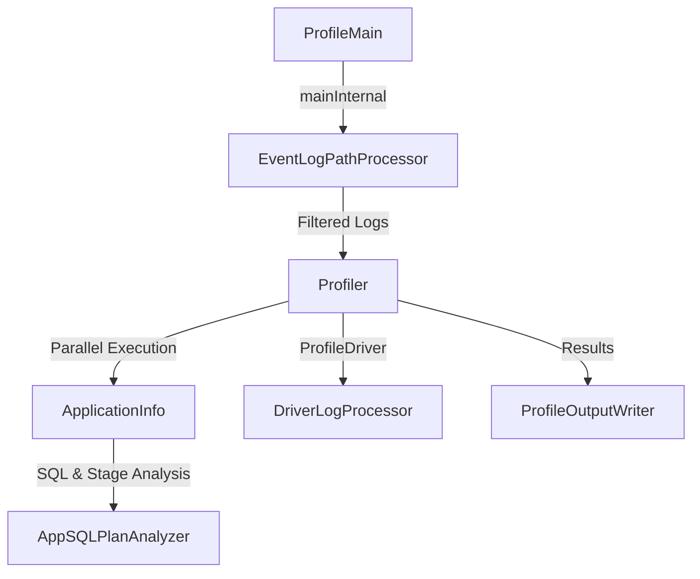
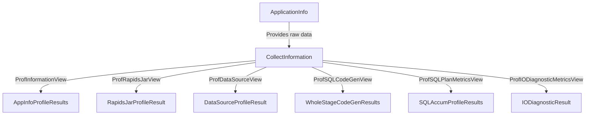

<!-- source: DeepWiki mcp.deepwiki.com · repo NVIDIA/cudf-spark-tools · page 2.4 Profiling Tool · fetched 2026-10-26 -->

# Profiling Tool

Relevant source files

The following files were used as context for generating this wiki page:

- [core/scalastyle-config.xml](core/scalastyle-config.xml)
- [core/src/main/scala/com/nvidia/spark/rapids/tool/ToolTextFileWriter.scala](core/src/main/scala/com/nvidia/spark/rapids/tool/ToolTextFileWriter.scala)
- [core/src/main/scala/com/nvidia/spark/rapids/tool/analysis/AppSQLPlanAnalyzer.scala](core/src/main/scala/com/nvidia/spark/rapids/tool/analysis/AppSQLPlanAnalyzer.scala)
- [core/src/main/scala/com/nvidia/spark/rapids/tool/analysis/SparkSQLPlanInfoVisitor.scala](core/src/main/scala/com/nvidia/spark/rapids/tool/analysis/SparkSQLPlanInfoVisitor.scala)
- [core/src/main/scala/com/nvidia/spark/rapids/tool/profiling/CollectInformation.scala](core/src/main/scala/com/nvidia/spark/rapids/tool/profiling/CollectInformation.scala)
- [core/src/main/scala/com/nvidia/spark/rapids/tool/profiling/DriverLogProcessor.scala](core/src/main/scala/com/nvidia/spark/rapids/tool/profiling/DriverLogProcessor.scala)
- [core/src/main/scala/com/nvidia/spark/rapids/tool/profiling/GenerateDot.scala](core/src/main/scala/com/nvidia/spark/rapids/tool/profiling/GenerateDot.scala)
- [core/src/main/scala/com/nvidia/spark/rapids/tool/profiling/GenerateTimeline.scala](core/src/main/scala/com/nvidia/spark/rapids/tool/profiling/GenerateTimeline.scala)
- [core/src/main/scala/com/nvidia/spark/rapids/tool/profiling/HealthCheck.scala](core/src/main/scala/com/nvidia/spark/rapids/tool/profiling/HealthCheck.scala)
- [core/src/main/scala/com/nvidia/spark/rapids/tool/profiling/ProfSQLPlanClassifier.scala](core/src/main/scala/com/nvidia/spark/rapids/tool/profiling/ProfSQLPlanClassifier.scala)
- [core/src/main/scala/com/nvidia/spark/rapids/tool/profiling/ProfileMain.scala](core/src/main/scala/com/nvidia/spark/rapids/tool/profiling/ProfileMain.scala)
- [core/src/main/scala/com/nvidia/spark/rapids/tool/profiling/ProfileOutputWriter.scala](core/src/main/scala/com/nvidia/spark/rapids/tool/profiling/ProfileOutputWriter.scala)
- [core/src/main/scala/com/nvidia/spark/rapids/tool/profiling/Profiler.scala](core/src/main/scala/com/nvidia/spark/rapids/tool/profiling/Profiler.scala)
- [core/src/main/scala/com/nvidia/spark/rapids/tool/views/JobView.scala](core/src/main/scala/com/nvidia/spark/rapids/tool/views/JobView.scala)
- [core/src/main/scala/com/nvidia/spark/rapids/tool/views/QualRawReportGenerator.scala](core/src/main/scala/com/nvidia/spark/rapids/tool/views/QualRawReportGenerator.scala)
- [core/src/main/scala/com/nvidia/spark/rapids/tool/views/StageView.scala](core/src/main/scala/com/nvidia/spark/rapids/tool/views/StageView.scala)
- [core/src/main/scala/com/nvidia/spark/rapids/tool/views/TaskView.scala](core/src/main/scala/com/nvidia/spark/rapids/tool/views/TaskView.scala)
- [core/src/main/scala/org/apache/spark/sql/rapids/tool/store/StageModelManager.scala](core/src/main/scala/org/apache/spark/sql/rapids/tool/store/StageModelManager.scala)
- [core/src/main/scala/org/apache/spark/sql/rapids/tool/store/TaskModel.scala](core/src/main/scala/org/apache/spark/sql/rapids/tool/store/TaskModel.scala)
- [core/src/main/scala/org/apache/spark/sql/rapids/tool/ui/ConsoleProgressBar.scala](core/src/main/scala/org/apache/spark/sql/rapids/tool/ui/ConsoleProgressBar.scala)
- [core/src/main/scala/org/apache/spark/sql/rapids/tool/util/RapidsToolsConfUtil.scala](core/src/main/scala/org/apache/spark/sql/rapids/tool/util/RapidsToolsConfUtil.scala)
- [core/src/main/scala/org/apache/spark/sql/rapids/tool/util/RuntimeReporter.scala](core/src/main/scala/org/apache/spark/sql/rapids/tool/util/RuntimeReporter.scala)
- [core/src/test/resources/ProfilingExpectations/executors_removed_eventlog_expectation.csv](core/src/test/resources/ProfilingExpectations/executors_removed_eventlog_expectation.csv)
- [core/src/test/resources/ProfilingExpectations/jobs_failure_eventlog_expectation.csv](core/src/test/resources/ProfilingExpectations/jobs_failure_eventlog_expectation.csv)
- [core/src/test/resources/ProfilingExpectations/stages_failure_eventlog_expectation.csv](core/src/test/resources/ProfilingExpectations/stages_failure_eventlog_expectation.csv)
- [core/src/test/resources/ProfilingExpectations/tasks_failure_eventlog_expectation.csv](core/src/test/resources/ProfilingExpectations/tasks_failure_eventlog_expectation.csv)
- [core/src/test/scala/com/nvidia/spark/rapids/tool/profiling/ApplicationInfoSuite.scala](core/src/test/scala/com/nvidia/spark/rapids/tool/profiling/ApplicationInfoSuite.scala)
- [core/src/test/scala/com/nvidia/spark/rapids/tool/profiling/GenerateDotSuite.scala](core/src/test/scala/com/nvidia/spark/rapids/tool/profiling/GenerateDotSuite.scala)
- [core/src/test/scala/com/nvidia/spark/rapids/tool/profiling/GenerateTimelineSuite.scala](core/src/test/scala/com/nvidia/spark/rapids/tool/profiling/GenerateTimelineSuite.scala)
- [core/src/test/scala/com/nvidia/spark/rapids/tool/profiling/HealthCheckSuite.scala](core/src/test/scala/com/nvidia/spark/rapids/tool/profiling/HealthCheckSuite.scala)

## Purpose and Scope

The Profiling Tool (`Profiler`) is a core component of the `rapids-4-spark-tools` Scala library designed to analyze Spark event logs and driver logs in deep technical detail. Its primary responsibilities include multi-threaded event log ingestion, orchestration of application profiling, running cluster health checks, extracting diagnostic stage and I/O metrics, processing driver logs for unsupported GPU operators, and generating visual artifacts such as graphviz `.dot` plan representations and SVG cluster execution timelines.

Sources: 
- `core/src/main/scala/com/nvidia/spark/rapids/tool/profiling/Profiler.scala`
- `core/src/main/scala/com/nvidia/spark/rapids/tool/profiling/ProfileMain.scala`

---

## Profiler Orchestration and Execution Flow

The profiling execution pipeline is initiated by `ProfileMain` [`core/src/main/scala/com/nvidia/spark/rapids/tool/profiling/ProfileMain.scala:32-37`] which parses command-line arguments via `ProfileArgs`, resolves event log paths using `EventLogPathProcessor`, and initializes a `Profiler` instance `[core/src/main/scala/com/nvidia/spark/rapids/tool/profiling/Profiler.scala:50-51]`.

The `Profiler` class extends `ToolBase` and runs tasks in parallel using a managed thread pool (sized via `getNumThreads`) `[core/src/main/scala/com/nvidia/spark/rapids/tool/profiling/Profiler.scala:91-92]`. For each target application log, `Profiler` instantiates an `ApplicationInfo` object, processes SQL plans, executes health checks, evaluates optional auto-tuning passes via `ProfilingAutoTunerHelper` `[core/src/main/scala/com/nvidia/spark/rapids/tool/profiling/Profiler.scala:26]`, and delegates reporting to `ProfileOutputWriter`.

Sources: 
- `core/src/main/scala/com/nvidia/spark/rapids/tool/profiling/Profiler.scala`
- `core/src/main/scala/com/nvidia/spark/rapids/tool/profiling/ProfileMain.scala`

---

## Information Collection and View Generation

The `CollectInformation` class aggregates structured insights across one or more `ApplicationInfo` instances `[core/src/main/scala/com/nvidia/spark/rapids/tool/profiling/CollectInformation.scala:34-124]`. It acts as an abstraction layer bridging raw event log data structures to tabular profiling results (`ProfileResult`) consumed by report writers.

Key extraction methods provided by `CollectInformation`:
- `getAppInfo`: Summarizes application metadata via `ProfInformationView` `[core/src/main/scala/com/nvidia/spark/rapids/tool/profiling/CollectInformation.scala:36-38]`.
- `getRapidsJARInfo`: Inpsects classpath entries for `rapids-4-spark` and `cudf` JARs `[core/src/main/scala/com/nvidia/spark/rapids/tool/profiling/CollectInformation.scala:44-47]`.
- `getDataSourceInfo`: Extracts V1/V2 data source read schemas and formats `[core/src/main/scala/com/nvidia/spark/rapids/tool/profiling/CollectInformation.scala:50-57]`.
- `getWholeStageCodeGenMapping`: Maps SQL plans to whole-stage code generation blocks `[core/src/main/scala/com/nvidia/spark/rapids/tool/profiling/CollectInformation.scala:89-91]`.
- `getSQLPlanMetrics`: Extracts granular SQL plan metrics via `ProfSQLPlanMetricsView` `[core/src/main/scala/com/nvidia/spark/rapids/tool/profiling/CollectInformation.scala:94-96]`.
- `getIODiagnosticMetrics`: Gathers I/O stage diagnostic indicators `[core/src/main/scala/com/nvidia/spark/rapids/tool/profiling/CollectInformation.scala:107-109]`.

Sources: 
- `core/src/main/scala/com/nvidia/spark/rapids/tool/profiling/CollectInformation.scala`

---

## Driver Log Processing

When a Spark driver log is supplied alongside or instead of event logs, `ProfileMain` delegates to `Profiler.profileDriver` `[core/src/main/scala/com/nvidia/spark/rapids/tool/profiling/Profiler.scala:127-152]`. 

The underlying log processor, `DriverLogProcessor` (extending `BaseDriverLogInfoProvider`), scans driver stdout/stderr streams via Hadoop FileSystems `[core/src/main/scala/com/nvidia/spark/rapids/tool/profiling/DriverLogProcessor.scala:43-89]`:
1. It opens an `FSDataInputStream` on the specified log path `[core/src/main/scala/com/nvidia/spark/rapids/tool/profiling/DriverLogProcessor.scala:48-54]`.
2. It filters lines containing `"cannot run on GPU"` while excluding expressions that cannot be replaced `[core/src/main/scala/com/nvidia/spark/rapids/tool/profiling/DriverLogProcessor.scala:57-60]`.
3. It parses operator names and failure reasons into a counted frequency map, returning a sequence of `DriverLogUnsupportedOperators` records `[core/src/main/scala/com/nvidia/spark/rapids/tool/profiling/DriverLogProcessor.scala:61-84]`.

Sources: 
- `core/src/main/scala/com/nvidia/spark/rapids/tool/profiling/Profiler.scala`
- `core/src/main/scala/com/nvidia/spark/rapids/tool/profiling/DriverLogProcessor.scala`

---

## Visualizations: Dot and Timeline Generation

The profiling tool includes specialized generators for visual artifacts:
- **Dot Generation (`GenerateDot`)**: Processes query execution plans to output Graphviz `.dot` files representing physical plan graphs and operator compatibility nodes.
- **Timeline Generation (`GenerateTimeline`)**: Computes cluster scheduling layouts for jobs, stages, and tasks (`calcLayoutSlotsNeeded`, `doLayout`, `computeLayout`) `[core/src/main/scala/com/nvidia/spark/rapids/tool/profiling/GenerateTimeline.scala:96-133]` and serializes them into Scalable Vector Graphics (SVG) timelines via `ToolTextFileWriter`. Timings are categorized into execution intervals, serialization, read/write, and task execution durations.

Sources: 
- `core/src/main/scala/com/nvidia/spark/rapids/tool/profiling/GenerateTimeline.scala`

---

## Output Serialization

The `ProfileOutputWriter` class manages the generation of output reports `[core/src/main/scala/com/nvidia/spark/rapids/tool/profiling/ProfileOutputWriter.scala:29-98]`. It wraps a `ToolTextFileWriter` pointing to `profile.log` while providing structured serialization modes:
- **Text Tables**: Formats `ProfileResult` sequences into aligned fixed-width text blocks written directly to the summary log `[core/src/main/scala/com/nvidia/spark/rapids/tool/profiling/ProfileOutputWriter.scala:41-60]`.
- **CSV Tables**: When `outputCSV` is enabled, individual tables are serialized into dedicated comma-separated value files (`.csv`) under the output directory, sanitizing headers into snake-case filenames `[core/src/main/scala/com/nvidia/spark/rapids/tool/profiling/ProfileOutputWriter.scala:104-138]`.
- **JSON / JSONL**: Supports pretty-printed JSON (`writeJson`) and JSON Lines (`writeJsonL`) outputs for downstream tooling integration `[core/src/main/scala/com/nvidia/spark/rapids/tool/profiling/ProfileOutputWriter.scala:80-93]`.

Sources: 
- `core/src/main/scala/com/nvidia/spark/rapids/tool/profiling/ProfileOutputWriter.scala`

---

