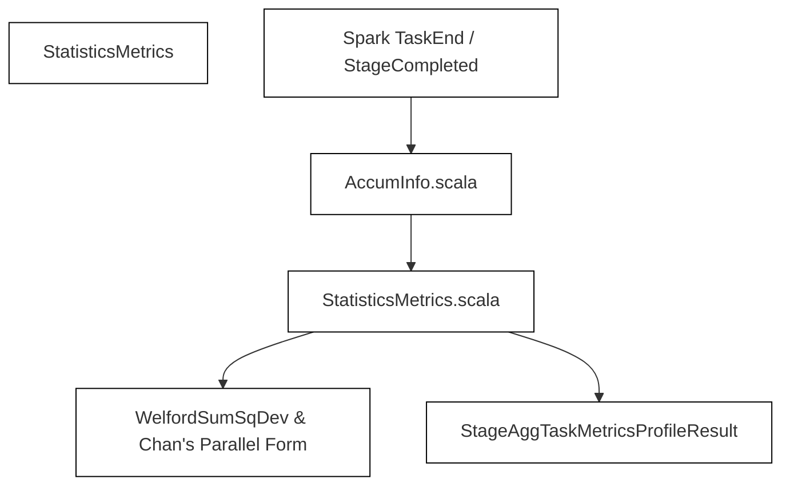
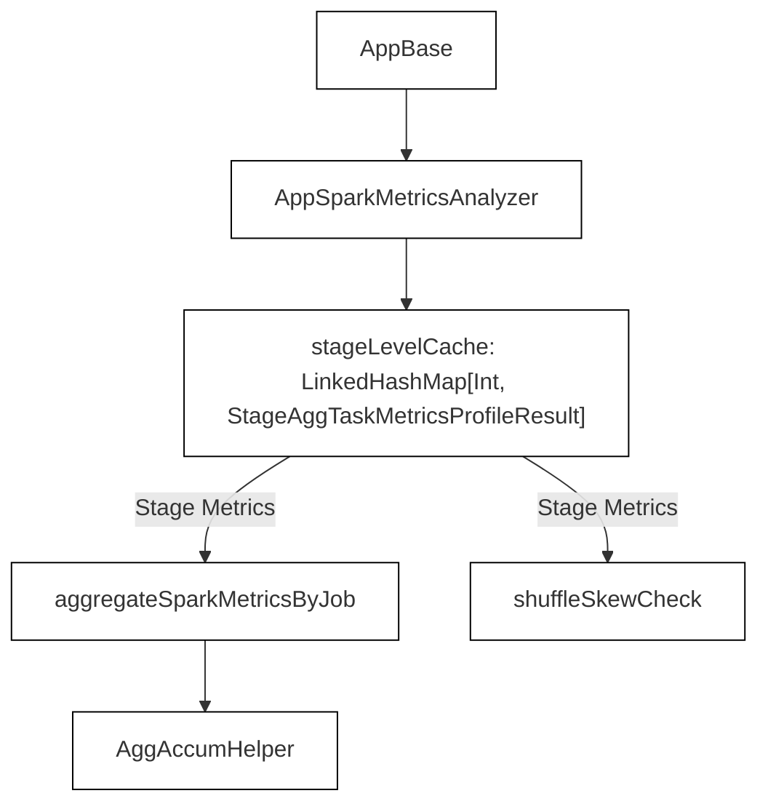
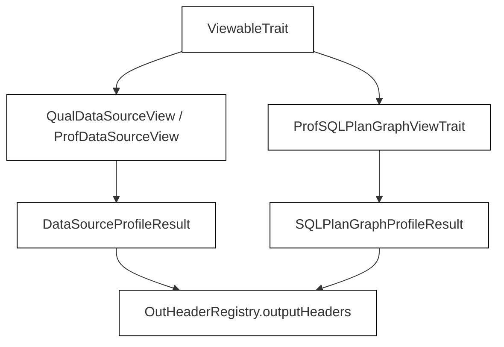

<!-- source: DeepWiki mcp.deepwiki.com · repo NVIDIA/cudf-spark-tools · page 2.5 Metrics Analysis and Report Views · fetched 2026-10-26 -->

# Metrics Analysis and Report Views

<details>
<summary>Relevant source files</summary>

The following files were used as context for generating this wiki page:

- [core/src/main/resources/configs/reports/coreRawMetricsReport.yaml](core/src/main/resources/configs/reports/coreRawMetricsReport.yaml)
- [core/src/main/scala/com/nvidia/spark/rapids/tool/analysis/AggRawMetricsResult.scala](core/src/main/scala/com/nvidia/spark/rapids/tool/analysis/AggRawMetricsResult.scala)
- [core/src/main/scala/com/nvidia/spark/rapids/tool/analysis/AppAnalysisBase.scala](core/src/main/scala/com/nvidia/spark/rapids/tool/analysis/AppAnalysisBase.scala)
- [core/src/main/scala/com/nvidia/spark/rapids/tool/analysis/AppSparkMetricsAggTrait.scala](core/src/main/scala/com/nvidia/spark/rapids/tool/analysis/AppSparkMetricsAggTrait.scala)
- [core/src/main/scala/com/nvidia/spark/rapids/tool/analysis/AppSparkMetricsAnalyzer.scala](core/src/main/scala/com/nvidia/spark/rapids/tool/analysis/AppSparkMetricsAnalyzer.scala)
- [core/src/main/scala/com/nvidia/spark/rapids/tool/analysis/MetricCatalog.scala](core/src/main/scala/com/nvidia/spark/rapids/tool/analysis/MetricCatalog.scala)
- [core/src/main/scala/com/nvidia/spark/rapids/tool/analysis/ProfSparkMetricsAggregator.scala](core/src/main/scala/com/nvidia/spark/rapids/tool/analysis/ProfSparkMetricsAggregator.scala)
- [core/src/main/scala/com/nvidia/spark/rapids/tool/analysis/QualSparkMetricsAggregator.scala](core/src/main/scala/com/nvidia/spark/rapids/tool/analysis/QualSparkMetricsAggregator.scala)
- [core/src/main/scala/com/nvidia/spark/rapids/tool/analysis/StatisticsMetrics.scala](core/src/main/scala/com/nvidia/spark/rapids/tool/analysis/StatisticsMetrics.scala)
- [core/src/main/scala/com/nvidia/spark/rapids/tool/analysis/util/AggAccumHelper.scala](core/src/main/scala/com/nvidia/spark/rapids/tool/analysis/util/AggAccumHelper.scala)
- [core/src/main/scala/com/nvidia/spark/rapids/tool/analysis/util/AggAccumPhotonHelper.scala](core/src/main/scala/com/nvidia/spark/rapids/tool/analysis/util/AggAccumPhotonHelper.scala)
- [core/src/main/scala/com/nvidia/spark/rapids/tool/analysis/util/DiagnosticMetrics.scala](core/src/main/scala/com/nvidia/spark/rapids/tool/analysis/util/DiagnosticMetrics.scala)
- [core/src/main/scala/com/nvidia/spark/rapids/tool/analysis/util/JobAggAccum.scala](core/src/main/scala/com/nvidia/spark/rapids/tool/analysis/util/JobAggAccum.scala)
- [core/src/main/scala/com/nvidia/spark/rapids/tool/analysis/util/SQLAggAccum.scala](core/src/main/scala/com/nvidia/spark/rapids/tool/analysis/util/SQLAggAccum.scala)
- [core/src/main/scala/com/nvidia/spark/rapids/tool/analysis/util/StageAggAccum.scala](core/src/main/scala/com/nvidia/spark/rapids/tool/analysis/util/StageAggAccum.scala)
- [core/src/main/scala/com/nvidia/spark/rapids/tool/analysis/util/StageAggPhoton.scala](core/src/main/scala/com/nvidia/spark/rapids/tool/analysis/util/StageAggPhoton.scala)
- [core/src/main/scala/com/nvidia/spark/rapids/tool/analysis/util/TaskMetricsAccumRec.scala](core/src/main/scala/com/nvidia/spark/rapids/tool/analysis/util/TaskMetricsAccumRec.scala)
- [core/src/main/scala/com/nvidia/spark/rapids/tool/profiling/DiagnosticSummaryInfo.scala](core/src/main/scala/com/nvidia/spark/rapids/tool/profiling/DiagnosticSummaryInfo.scala)
- [core/src/main/scala/com/nvidia/spark/rapids/tool/profiling/ProfileClassWarehouse.scala](core/src/main/scala/com/nvidia/spark/rapids/tool/profiling/ProfileClassWarehouse.scala)
- [core/src/main/scala/com/nvidia/spark/rapids/tool/profiling/ProfileUtils.scala](core/src/main/scala/com/nvidia/spark/rapids/tool/profiling/ProfileUtils.scala)
- [core/src/main/scala/com/nvidia/spark/rapids/tool/views/DataSourceView.scala](core/src/main/scala/com/nvidia/spark/rapids/tool/views/DataSourceView.scala)
- [core/src/main/scala/com/nvidia/spark/rapids/tool/views/InformationView.scala](core/src/main/scala/com/nvidia/spark/rapids/tool/views/InformationView.scala)
- [core/src/main/scala/com/nvidia/spark/rapids/tool/views/OutHeaderRegistry.scala](core/src/main/scala/com/nvidia/spark/rapids/tool/views/OutHeaderRegistry.scala)
- [core/src/main/scala/com/nvidia/spark/rapids/tool/views/RawMetricProfView.scala](core/src/main/scala/com/nvidia/spark/rapids/tool/views/RawMetricProfView.scala)
- [core/src/main/scala/com/nvidia/spark/rapids/tool/views/SQLView.scala](core/src/main/scala/com/nvidia/spark/rapids/tool/views/SQLView.scala)
- [core/src/main/scala/com/nvidia/spark/rapids/tool/views/package.scala](core/src/main/scala/com/nvidia/spark/rapids/tool/views/package.scala)
- [core/src/main/scala/org/apache/spark/sql/rapids/tool/AppMetaData.scala](core/src/main/scala/org/apache/spark/sql/rapids/tool/AppMetaData.scala)
- [core/src/main/scala/org/apache/spark/sql/rapids/tool/store/AccumInfo.scala](core/src/main/scala/org/apache/spark/sql/rapids/tool/store/AccumInfo.scala)
- [core/src/main/scala/org/apache/spark/sql/rapids/tool/util/StringUtils.scala](core/src/main/scala/org/apache/spark/sql/rapids/tool/util/StringUtils.scala)
- [core/src/main/scala/org/apache/spark/sql/rapids/tool/util/WebCrawlerUtil.scala](core/src/main/scala/org/apache/spark/sql/rapids/tool/util/WebCrawlerUtil.scala)
- [core/src/main/scala/org/apache/spark/sql/rapids/tool/util/package.scala](core/src/main/scala/org/apache/spark/sql/rapids/tool/util/package.scala)
- [core/src/test/scala/com/nvidia/spark/rapids/tool/analysis/GpuMetricReportSuite.scala](core/src/test/scala/com/nvidia/spark/rapids/tool/analysis/GpuMetricReportSuite.scala)
- [core/src/test/scala/com/nvidia/spark/rapids/tool/profiling/AnalysisSuite.scala](core/src/test/scala/com/nvidia/spark/rapids/tool/profiling/AnalysisSuite.scala)
- [core/src/test/scala/com/nvidia/spark/rapids/tool/util/ToolUtilsSuite.scala](core/src/test/scala/com/nvidia/spark/rapids/tool/util/ToolUtilsSuite.scala)
- [user_tools/src/spark_rapids_pytools/rapids/qualx/qualx_tool.py](user_tools/src/spark_rapids_pytools/rapids/qualx/qualx_tool.py)

</details>


## Purpose and Scope

Section 2.5 covers the metrics analysis and reporting subsystem of the `cudf-spark-tools` Scala core JAR (`rapids-4-spark-tools`). This subsystem is responsible for post-processing task-level and stage-level execution telemetry extracted from Spark event logs, computing statistical metrics (such as min, median, max, sums, and standard deviations via Welford's algorithm), aggregating metrics across SQL queries, stages, and jobs, storing results in structured profile data structures (`ProfileResult`), and formatting them into tabular views governed by a centralized header registry (`OutHeaderRegistry`).

Sources: `core/src/main/scala/com/nvidia/spark/rapids/tool/analysis/AppSparkMetricsAnalyzer.scala:31-51`, `core/src/main/scala/com/nvidia/spark/rapids/tool/profiling/ProfileClassWarehouse.scala:29-38`, `core/src/main/scala/com/nvidia/spark/rapids/tool/views/OutHeaderRegistry.scala:19-30`

---

## MetricCatalog and Statistics Metrics

The analytics engine processes raw Spark accumulators and translates them into statistical metrics using `StatisticsMetrics`. This structure records minimum, median, maximum, sample count, total, and Welford's moving variance ($M_2$ sum of squared deviations from the mean) to compute standard deviations without retaining individual task measurements [core/src/main/scala/com/nvidia/spark/rapids/tool/analysis/StatisticsMetrics.scala:21-38].


*Figure 1: Accumulator ingestion and statistical aggregation pipeline mapping natural flow to code entities.*

Sources: `core/src/main/scala/com/nvidia/spark/rapids/tool/analysis/StatisticsMetrics.scala:21-113`, `core/src/main/scala/org/apache/spark/sql/rapids/tool/store/AccumInfo.scala:35-119`

---

## AppSparkMetricsAnalyzer and Aggregation Architecture

`AppSparkMetricsAnalyzer` performs high-performance analysis on Spark application dataframes and object stores (`AppBase`). It avoids redundant scans by caching stage-level metrics (`stageLevelCache`) and deriving job-level and SQL-level aggregates from them [core/src/main/scala/com/nvidia/spark/rapids/tool/analysis/AppSparkMetricsAnalyzer.scala:51-66].


*Figure 2: `AppSparkMetricsAnalyzer` execution flow and caching mechanism.*

### Key Aggregation Operations

- **Stage Aggregation (`aggregateSparkMetricsByStage`)**: Computes task-level metrics aggregated per stage ID [core/src/main/scala/com/nvidia/spark/rapids/tool/analysis/AppSparkMetricsAnalyzer.scala:73-75].
- **Job Aggregation (`aggregateSparkMetricsByJob`)**: Combines stage metrics associated with specific job identifiers using `AggAccumHelper` [core/src/main/scala/com/nvidia/spark/rapids/tool/analysis/AppSparkMetricsAnalyzer.scala:82-132].
- **Shuffle Skew Detection (`shuffleSkewCheck`)**: Scans task metrics to detect skew conditions where input size exceeds $3\times$ average shuffle read and $100\text{MB}$ [core/src/main/scala/com/nvidia/spark/rapids/tool/analysis/AppSparkMetricsAnalyzer.scala:142-156].

Sources: `core/src/main/scala/com/nvidia/spark/rapids/tool/analysis/AppSparkMetricsAnalyzer.scala:51-156`, `core/src/main/scala/com/nvidia/spark/rapids/tool/analysis/util/AggAccumHelper.scala`

---

## ProfileResult Warehouse

The `ProfileClassWarehouse.scala` file defines the `ProfileResult` trait and its implementing case classes. These represent individual row schemas for profiling reports, supporting conversion to raw string sequences (`convertToSeq`) and CSV-formatted strings (`convertToCSVSeq`) [core/src/main/scala/com/nvidia/spark/rapids/tool/profiling/ProfileClassWarehouse.scala:29-58].

| ProfileResult Class | Description | Key Fields |
| :--- | :--- | :--- |
| `ExecutorInfoProfileResult` | Executor resource profile metrics | `resourceProfileId`, `numExecutors`, `maxMem`, `taskCpu` [core/src/main/scala/com/nvidia/spark/rapids/tool/profiling/ProfileClassWarehouse.scala:39-43] |
| `JobInfoProfileResult` | Job lifecycle metadata | `jobID`, `stageIds`, `sqlID`, `startTime`, `endTime` [core/src/main/scala/com/nvidia/spark/rapids/tool/profiling/ProfileClassWarehouse.scala:71-76] |
| `SQLPlanGraphProfileResult` | SQL plan graph topological representation | `sqlID`, `planVersion`, `nodeID`, `nodeName`, `sinkNodes` [core/src/main/scala/com/nvidia/spark/rapids/tool/profiling/ProfileClassWarehouse.scala:149-156] |
| `DataSourceProfileResult` | Input/Output data source scan metrics | `sqlID`, `format`, `buffer_time`, `scan_time`, `data_size` [core/src/main/scala/com/nvidia/spark/rapids/tool/views/DataSourceView.scala:90-94] |

Sources: `core/src/main/scala/com/nvidia/spark/rapids/tool/profiling/ProfileClassWarehouse.scala:29-185`

---

## View Layer and OutHeaderRegistry

The view layer (`ViewableTrait`) transforms raw analytics models into reporting output structures. To prevent memory overhead from duplicating header arrays across thousands of profile row objects, `OutHeaderRegistry` maintains a centralized registry of header definitions keyed by literal string identifiers [core/src/main/scala/com/nvidia/spark/rapids/tool/views/OutHeaderRegistry.scala:19-30].


*Figure 3: View extraction and header registry lookup architecture.*

### Header Registry Implementation
String-based map lookups avoid reflection overhead (`classOf[T].getName`) during row serialization:
```scala
object OutHeaderRegistry {
  val outputHeaders: Map[String, Array[String]] = Map(
    "ExecutorInfoProfileResult" -> Array("resourceProfileId", "numExecutors", ...),
    "JobInfoProfileResult" -> Array("jobID", "stageIds", "sqlID", "startTime", "endTime"),
    "DataSourceProfileResult" -> Array("sqlID", "sql_plan_version", "nodeId", "format", ...)
  )
}
```
Sources: `core/src/main/scala/com/nvidia/spark/rapids/tool/views/OutHeaderRegistry.scala:19-54`, `core/src/main/scala/com/nvidia/spark/rapids/tool/views/DataSourceView.scala:27-108`, `core/src/main/scala/com/nvidia/spark/rapids/tool/views/SQLView.scala:41-67`

---

