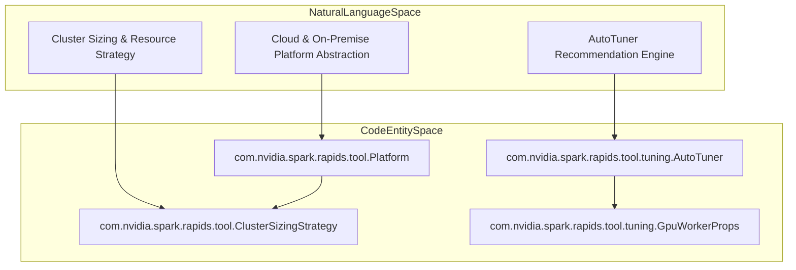
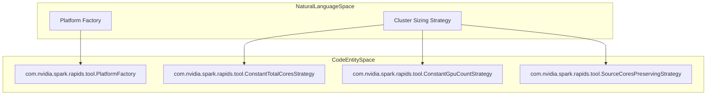

<!-- source: DeepWiki mcp.deepwiki.com · repo NVIDIA/cudf-spark-tools · page 3 AutoTuner and Platform Modeling · fetched 2026-10-26 -->

# AutoTuner and Platform Modeling

Relevant source files

The following files were used as context for generating this wiki page:

- [core/src/main/resources/bootstrap/tuningConfigs.yaml](core/src/main/resources/bootstrap/tuningConfigs.yaml)
- [core/src/main/resources/bootstrap/tuningTable.yaml](core/src/main/resources/bootstrap/tuningTable.yaml)
- [core/src/main/scala/com/nvidia/spark/rapids/tool/ClusterConfigurationStrategy.scala](core/src/main/scala/com/nvidia/spark/rapids/tool/ClusterConfigurationStrategy.scala)
- [core/src/main/scala/com/nvidia/spark/rapids/tool/Platform.scala](core/src/main/scala/com/nvidia/spark/rapids/tool/Platform.scala)
- [core/src/main/scala/com/nvidia/spark/rapids/tool/tuning/AutoTuner.scala](core/src/main/scala/com/nvidia/spark/rapids/tool/tuning/AutoTuner.scala)
- [core/src/test/scala/com/nvidia/spark/rapids/tool/profiling/ClusterRecommendationSuite.scala](core/src/test/scala/com/nvidia/spark/rapids/tool/profiling/ClusterRecommendationSuite.scala)
- [core/src/test/scala/com/nvidia/spark/rapids/tool/tuning/ProfilingAutoTunerSuite.scala](core/src/test/scala/com/nvidia/spark/rapids/tool/tuning/ProfilingAutoTunerSuite.scala)
- [core/src/test/scala/com/nvidia/spark/rapids/tool/tuning/ProfilingAutoTunerSuiteV2.scala](core/src/test/scala/com/nvidia/spark/rapids/tool/tuning/ProfilingAutoTunerSuiteV2.scala)
- [core/src/test/scala/com/nvidia/spark/rapids/tool/tuning/QualificationAutoTunerSuite.scala](core/src/test/scala/com/nvidia/spark/rapids/tool/tuning/QualificationAutoTunerSuite.scala)

This section provides an architectural overview of the configuration recommendation engine (`AutoTuner`) and its associated platform and cluster modeling subsystems within `cudf-spark-tools`. These modules ingest Spark execution histories and system properties to synthesize optimal cuDF plugin configurations, tuning overrides, and target cluster topologies across various Cloud Service Providers (CSPs) and on-premise environments [core/src/main/scala/com/nvidia/spark/rapids/tool/tuning/AutoTuner.scala:170-204]().

As a parent page, this document outlines the high-level responsibilities of the recommendation pipeline. For deep technical implementation details, refer to the following child pages:
- [AutoTuner Engine and Tuning Entries](#3.1)
- [Platforms, GPU Devices and Cluster Sizing](#3.2)
- [Tuning Plugins and Rules](#3.3)

Sources: `core/src/main/scala/com/nvidia/spark/rapids/tool/tuning/AutoTuner.scala`, `core/src/main/scala/com/nvidia/spark/rapids/tool/Platform.scala`

---

## AutoTuner and Platform Architecture

Sources: `core/src/main/scala/com/nvidia/spark/rapids/tool/tuning/AutoTuner.scala`, `core/src/main/scala/com/nvidia/spark/rapids/tool/Platform.scala`, `core/src/main/scala/com/nvidia/spark/rapids/tool/ClusterConfigurationStrategy.scala`

---

## 3.1. AutoTuner Engine and Tuning Entries

The `AutoTuner` engine processes historical event logs and target worker capabilities to generate recommended Spark SQL and cuDF plugin configurations [core/src/main/scala/com/nvidia/spark/rapids/tool/tuning/AutoTuner.scala:170-172](). It relies on declarative YAML metadata files (`tuningTable.yaml` and `tuningConfigs.yaml`) to look up parameter definitions, data types, validation constraints, and calculation rules [core/src/main/resources/bootstrap/tuningTable.yaml:18-30](), [core/src/main/resources/bootstrap/tuningConfigs.yaml:15-22]().

Key aspects covered in the child page include:
- Execution passes for qualification vs. profiling workflows.
- `TuningEntry` and `TuningEntryDefinition` abstractions for tracking configuration states (missing, updated, or persistent) [core/src/test/scala/com/nvidia/spark/rapids/tool/tuning/QualificationAutoTunerSuite.scala:27]().
- Parsing and validation of worker resources via `GpuWorkerProps` [core/src/main/scala/com/nvidia/spark/rapids/tool/tuning/AutoTuner.scala:45-48]().

For details, see [AutoTuner Engine and Tuning Entries](#3.1).

Sources: `core/src/main/scala/com/nvidia/spark/rapids/tool/tuning/AutoTuner.scala`, `core/src/main/resources/bootstrap/tuningTable.yaml`, `core/src/main/resources/bootstrap/tuningConfigs.yaml`

---

## 3.2. Platforms, GPU Devices and Cluster Sizing

The platform subsystem abstracts differences between cloud environments (such as AWS EMR, Databricks, Google Cloud Dataproc) and on-premise deployments [core/src/main/scala/com/nvidia/spark/rapids/tool/Platform.scala:32-40](). It handles instance type resolutions, GPU hardware capabilities (`GpuDevice`), and cluster dimensioning.

Core components include:
- `Platform` trait and its CSP-specific implementations [core/src/main/scala/com/nvidia/spark/rapids/tool/Platform.scala]()
- `TargetClusterProps` and `RecommendedClusterConfig` for target cluster shape planning [core/src/main/scala/com/nvidia/spark/rapids/tool/ClusterConfigurationStrategy.scala:30-36]()
- Cluster sizing strategies (`ConstantTotalCoresStrategy`, `ConstantGpuCountStrategy`, `SourceCoresPreservingStrategy`) that govern core-to-executor ratios [core/src/main/scala/com/nvidia/spark/rapids/tool/ClusterConfigurationStrategy.scala:113-160]()

For details, see [Platforms, GPU Devices and Cluster Sizing](#3.2).

Sources: `core/src/main/scala/com/nvidia/spark/rapids/tool/Platform.scala`, `core/src/main/scala/com/nvidia/spark/rapids/tool/ClusterConfigurationStrategy.scala`

---

## 3.3. Tuning Plugins and Rules

To handle environment-specific and format-specific optimizations, the AutoTuner integrates a modular plugin system managed by `TuningPluginManager` [core/src/main/scala/com/nvidia/spark/rapids/tool/tuning/AutoTuner.scala:32](). Rules and condition predicates evaluate runtime context—such as Delta Lake versions, PySpark memory overhead, or cloud-specific kernel configurations (e.g., EMR Transparent Huge Pages)—to inject targeted configuration recommendations [core/src/main/resources/bootstrap/tuningTable.yaml:98-117]().

Key capabilities detailed in the child page:
- Rule registration, prioritization, and condition evaluation.
- Delta OSS acceleration rules.
- PySpark memory tuning policies and process-tree memory evidence handling [core/src/main/resources/bootstrap/tuningConfigs.yaml:123-152]().

For details, see [Tuning Plugins and Rules](#3.3).

Sources: `core/src/main/scala/com/nvidia/spark/rapids/tool/tuning/AutoTuner.scala`, `core/src/main/resources/bootstrap/tuningTable.yaml`, `core/src/main/resources/bootstrap/tuningConfigs.yaml`

---

