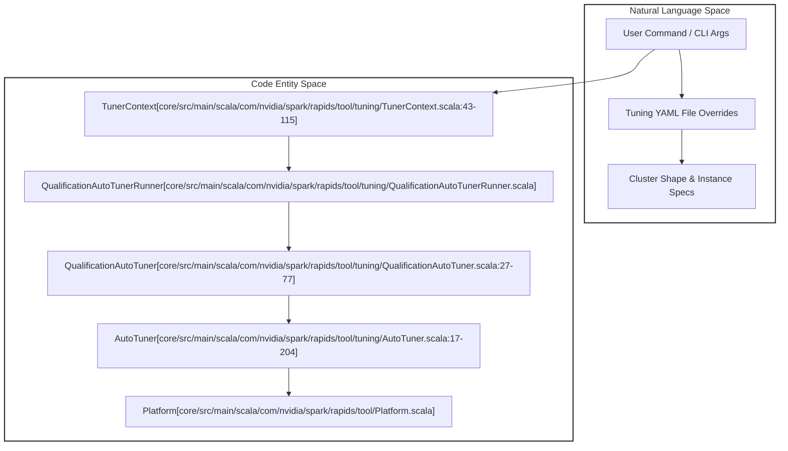
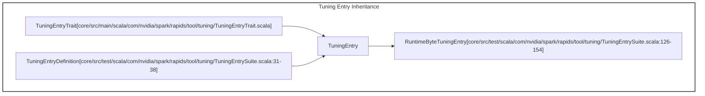

<!-- source: DeepWiki mcp.deepwiki.com · repo NVIDIA/cudf-spark-tools · page 3.1 AutoTuner Engine and Tuning Entries · fetched 2026-10-26 -->

# AutoTuner Engine and Tuning Entries

Relevant source files

The following files were used as context for generating this wiki page:

- [core/docs/autotuner/README.md](core/docs/autotuner/README.md)
- [core/docs/autotuner/gpu-concurrency.md](core/docs/autotuner/gpu-concurrency.md)
- [core/src/main/resources/bootstrap/tuningConfigs.yaml](core/src/main/resources/bootstrap/tuningConfigs.yaml)
- [core/src/main/resources/bootstrap/tuningTable.yaml](core/src/main/resources/bootstrap/tuningTable.yaml)
- [core/src/main/scala/com/nvidia/spark/rapids/tool/ClusterConfigurationStrategy.scala](core/src/main/scala/com/nvidia/spark/rapids/tool/ClusterConfigurationStrategy.scala)
- [core/src/main/scala/com/nvidia/spark/rapids/tool/Platform.scala](core/src/main/scala/com/nvidia/spark/rapids/tool/Platform.scala)
- [core/src/main/scala/com/nvidia/spark/rapids/tool/tuning/AutoTuner.scala](core/src/main/scala/com/nvidia/spark/rapids/tool/tuning/AutoTuner.scala)
- [core/src/main/scala/com/nvidia/spark/rapids/tool/tuning/GpuBatchAndConcurrencyKeys.scala](core/src/main/scala/com/nvidia/spark/rapids/tool/tuning/GpuBatchAndConcurrencyKeys.scala)
- [core/src/main/scala/com/nvidia/spark/rapids/tool/tuning/GpuConcurrencySeed.scala](core/src/main/scala/com/nvidia/spark/rapids/tool/tuning/GpuConcurrencySeed.scala)
- [core/src/main/scala/com/nvidia/spark/rapids/tool/tuning/QualificationAutoTuner.scala](core/src/main/scala/com/nvidia/spark/rapids/tool/tuning/QualificationAutoTuner.scala)
- [core/src/main/scala/com/nvidia/spark/rapids/tool/tuning/QualificationAutoTunerRunner.scala](core/src/main/scala/com/nvidia/spark/rapids/tool/tuning/QualificationAutoTunerRunner.scala)
- [core/src/main/scala/com/nvidia/spark/rapids/tool/tuning/TunerContext.scala](core/src/main/scala/com/nvidia/spark/rapids/tool/tuning/TunerContext.scala)
- [core/src/main/scala/com/nvidia/spark/rapids/tool/tuning/TuningEntry.scala](core/src/main/scala/com/nvidia/spark/rapids/tool/tuning/TuningEntry.scala)
- [core/src/main/scala/com/nvidia/spark/rapids/tool/tuning/TuningEntryTrait.scala](core/src/main/scala/com/nvidia/spark/rapids/tool/tuning/TuningEntryTrait.scala)
- [core/src/main/scala/com/nvidia/spark/rapids/tool/tuning/config/TuningConfigProvider.scala](core/src/main/scala/com/nvidia/spark/rapids/tool/tuning/config/TuningConfigProvider.scala)
- [core/src/main/scala/com/nvidia/spark/rapids/tool/tuning/config/TuningEntryDefinition.scala](core/src/main/scala/com/nvidia/spark/rapids/tool/tuning/config/TuningEntryDefinition.scala)
- [core/src/main/scala/com/nvidia/spark/rapids/tool/tuning/plugins/TuningCondPredicates.scala](core/src/main/scala/com/nvidia/spark/rapids/tool/tuning/plugins/TuningCondPredicates.scala)
- [core/src/main/scala/com/nvidia/spark/rapids/tool/tuning/plugins/emr/EmrRules.scala](core/src/main/scala/com/nvidia/spark/rapids/tool/tuning/plugins/emr/EmrRules.scala)
- [core/src/main/scala/com/nvidia/spark/rapids/tool/tuning/plugins/emr/EmrTuningPlugin.scala](core/src/main/scala/com/nvidia/spark/rapids/tool/tuning/plugins/emr/EmrTuningPlugin.scala)
- [core/src/test/scala/com/nvidia/spark/rapids/tool/profiling/ClusterRecommendationSuite.scala](core/src/test/scala/com/nvidia/spark/rapids/tool/profiling/ClusterRecommendationSuite.scala)
- [core/src/test/scala/com/nvidia/spark/rapids/tool/tuning/AppSummaryInfoProviderSuite.scala](core/src/test/scala/com/nvidia/spark/rapids/tool/tuning/AppSummaryInfoProviderSuite.scala)
- [core/src/test/scala/com/nvidia/spark/rapids/tool/tuning/EmrThpTuningPluginSuite.scala](core/src/test/scala/com/nvidia/spark/rapids/tool/tuning/EmrThpTuningPluginSuite.scala)
- [core/src/test/scala/com/nvidia/spark/rapids/tool/tuning/ProfilingAutoTunerSuite.scala](core/src/test/scala/com/nvidia/spark/rapids/tool/tuning/ProfilingAutoTunerSuite.scala)
- [core/src/test/scala/com/nvidia/spark/rapids/tool/tuning/ProfilingAutoTunerSuiteV2.scala](core/src/test/scala/com/nvidia/spark/rapids/tool/tuning/ProfilingAutoTunerSuiteV2.scala)
- [core/src/test/scala/com/nvidia/spark/rapids/tool/tuning/QualificationAutoTunerSuite.scala](core/src/test/scala/com/nvidia/spark/rapids/tool/tuning/QualificationAutoTunerSuite.scala)
- [core/src/test/scala/com/nvidia/spark/rapids/tool/tuning/TuningEntrySuite.scala](core/src/test/scala/com/nvidia/spark/rapids/tool/tuning/TuningEntrySuite.scala)

The AutoTuner engine is a core recommendation subsystem in `cudf-spark-tools` that inspects Spark event logs, application execution metrics, and hardware profile definitions to automatically recommend optimal Apache Spark configuration properties and cuDF accelerator plugin settings. 

---

## 1. AutoTuner Engine Architecture and Execution Flow

The AutoTuner execution flow starts via `TunerContext` [core/src/main/scala/com/nvidia/spark/rapids/tool/tuning/TunerContext.scala:43-115] which loads user-provided tuning configuration overrides, builds configuration providers, and delegates to runner instances like `QualificationAutoTunerRunner` or profile-mode orchestrators. The base engine logic resides in `AutoTuner` [core/src/main/scala/com/nvidia/spark/rapids/tool/tuning/AutoTuner.scala:17-204], while platform-specific or tool-specific behaviors are handled by subclasses such as `QualificationAutoTuner` [core/src/main/scala/com/nvidia/spark/rapids/tool/tuning/QualificationAutoTuner.scala:27-77].

### AutoTuner Data Flow and Component Bridge

The following diagram bridges natural language configuration workflows with the underlying Scala code entities (`TunerContext`, `QualificationAutoTunerRunner`, `AutoTuner`, and `Platform`).

Sources: `core/src/main/scala/com/nvidia/spark/rapids/tool/tuning/TunerContext.scala:43-115`, `core/src/main/scala/com/nvidia/spark/rapids/tool/tuning/QualificationAutoTuner.scala:27-77`, `core/src/main/scala/com/nvidia/spark/rapids/tool/Platform.scala`

---

## 2. Tuning Metadata Definitions: `tuningTable.yaml` and `tuningConfigs.yaml`

The AutoTuner relies heavily on two primary bootstrap resource files located in the core classpath:
1. `tuningTable.yaml`: Defines metadata for Spark configuration properties that can be tuned, such as labels, descriptions, enabled status, scopes (`cluster` vs `job`), categories (`tuning` vs `functionality`), data types (`confType`), and rule bindings (`modifiedBy`) [core/src/main/resources/bootstrap/tuningTable.yaml:97-154].
2. `tuningConfigs.yaml`: Defines tunable configuration constants, tool-specific defaults (qualification vs profiling sections), plugin descriptors (`tuningPlugins`), and execution rules (`tuningRules`) [core/src/main/resources/bootstrap/tuningConfigs.yaml:74-154].

| File Name | Primary Role | Key Configuration Sections |
| :--- | :--- | :--- |
| `tuningTable.yaml` | Property Metadata Registry | `tuningDefinitions` (labels, types, levels, default Spark values, comments) [core/src/main/resources/bootstrap/tuningTable.yaml:97-154] |
| `tuningConfigs.yaml` | Calculation Constants & Rules | `default`, `qualification`, `profiling`, `pluginConfigs` (`tuningPlugins`, `tuningRules`) [core/src/main/resources/bootstrap/tuningConfigs.yaml:74-154] |

Sources: `core/src/main/resources/bootstrap/tuningTable.yaml:97-154`, `core/src/main/resources/bootstrap/tuningConfigs.yaml:74-154`

---

## 3. `TuningEntry` and Representation Models

Tuning entries represent individual Spark configuration recommendations generated during analysis. 

### Core Representation Classes

* `TuningEntryTrait`: Interface defining the core properties of a tuning recommendation [core/src/main/scala/com/nvidia/spark/rapids/tool/tuning/TuningEntryTrait.scala].
* `TuningEntry`: Standard implementation managing original values, tuned values, validation, and comments.
* `RuntimeByteTuningEntry`: Specializes in byte/memory-unit parsing and formatting (e.g. `spark.sql.adaptive.autoBroadcastJoinThreshold`) [core/src/test/scala/com/nvidia/spark/rapids/tool/tuning/TuningEntrySuite.scala:126-154].
* `TuningEntryDefinition`: Loaded from `tuningTable.yaml`, governing expected data types (`ConfTypeEnum`), unit handling, and special value recognition [core/src/test/scala/com/nvidia/spark/rapids/tool/tuning/TuningEntrySuite.scala:31-38].

Sources: `core/src/main/scala/com/nvidia/spark/rapids/tool/tuning/TuningEntryTrait.scala`, `core/src/test/scala/com/nvidia/spark/rapids/tool/tuning/TuningEntrySuite.scala:31-154`

---

## 4. Qualification vs. Profiling Tuners

The AutoTuner engine supports distinct tool-mode behaviors driven by `QualificationAutoTuner` and the profiling `AutoTuner`:

* **Qualification Mode (`QualificationAutoTuner`)**: 
  * Targets bootstrapping recommendations for migrating workloads.
  * Injects `spark.plugins` with the cuDF plugin class name while handling user-enforced property preservation [core/src/main/scala/com/nvidia/spark/rapids/tool/tuning/QualificationAutoTuner.scala:60-68].
  * Excludes shuffle manager recommendations since shuffle manager changes are typically validated during profiling [core/src/main/scala/com/nvidia/spark/rapids/tool/tuning/QualificationAutoTuner.scala:74-76].
  * Filters recommendations using `shouldIncludeInFinalRecommendations` to ensure entries are bootstrap-enabled and not removed [core/src/main/scala/com/nvidia/spark/rapids/tool/tuning/QualificationAutoTuner.scala:50-53].
  * Uses `ConstantTotalCoresStrategy` for cluster sizing by default [core/src/main/scala/com/nvidia/spark/rapids/tool/tuning/QualificationAutoTuner.scala:87-88].

* **Profiling Mode (`AutoTuner`)**:
  * Utilizes detailed post-execution metrics from event logs.
  * Recommends specialized configurations such as `RapidsShuffleManager` versions, cache serializers (`com.nvidia.spark.ParquetCachedBatchSerializer`), and granular memory limits based on observed execution behavior [core/src/test/scala/com/nvidia/spark/rapids/tool/tuning/QualificationAutoTunerSuite.scala:83-89, core/src/test/scala/com/nvidia/spark/rapids/tool/tuning/ProfilingAutoTunerSuiteV2.scala:54-73].

Sources: `core/src/main/scala/com/nvidia/spark/rapids/tool/tuning/QualificationAutoTuner.scala:27-100`, `core/src/test/scala/com/nvidia/spark/rapids/tool/tuning/QualificationAutoTunerSuite.scala:43-118`, `core/src/test/scala/com/nvidia/spark/rapids/tool/tuning/ProfilingAutoTunerSuiteV2.scala:47-73`

---

