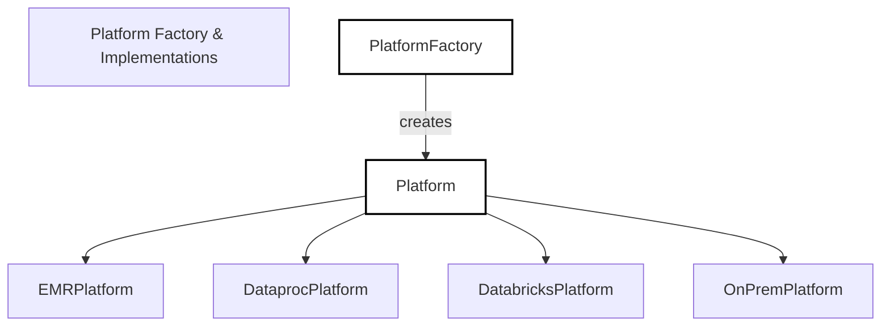
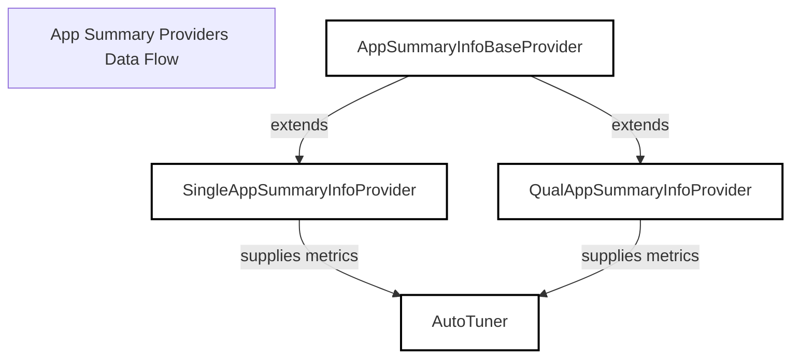

<!-- source: DeepWiki mcp.deepwiki.com · repo NVIDIA/cudf-spark-tools · page 3.2 Platforms, GPU Devices and Cluster Sizing · fetched 2026-10-26 -->

# Platforms, GPU Devices and Cluster Sizing

Relevant source files

The following files were used as context for generating this wiki page:

- [core/src/main/resources/bootstrap/tuningConfigs.yaml](core/src/main/resources/bootstrap/tuningConfigs.yaml)
- [core/src/main/resources/bootstrap/tuningTable.yaml](core/src/main/resources/bootstrap/tuningTable.yaml)
- [core/src/main/scala/com/nvidia/spark/rapids/tool/AppSummaryInfoBaseProvider.scala](core/src/main/scala/com/nvidia/spark/rapids/tool/AppSummaryInfoBaseProvider.scala)
- [core/src/main/scala/com/nvidia/spark/rapids/tool/ClusterConfigurationStrategy.scala](core/src/main/scala/com/nvidia/spark/rapids/tool/ClusterConfigurationStrategy.scala)
- [core/src/main/scala/com/nvidia/spark/rapids/tool/GpuDevice.scala](core/src/main/scala/com/nvidia/spark/rapids/tool/GpuDevice.scala)
- [core/src/main/scala/com/nvidia/spark/rapids/tool/Platform.scala](core/src/main/scala/com/nvidia/spark/rapids/tool/Platform.scala)
- [core/src/main/scala/com/nvidia/spark/rapids/tool/profiling/ApplicationSummaryInfo.scala](core/src/main/scala/com/nvidia/spark/rapids/tool/profiling/ApplicationSummaryInfo.scala)
- [core/src/main/scala/com/nvidia/spark/rapids/tool/tuning/AutoTuner.scala](core/src/main/scala/com/nvidia/spark/rapids/tool/tuning/AutoTuner.scala)
- [core/src/main/scala/com/nvidia/spark/rapids/tool/tuning/FileScanInputMetrics.scala](core/src/main/scala/com/nvidia/spark/rapids/tool/tuning/FileScanInputMetrics.scala)
- [core/src/main/scala/com/nvidia/spark/rapids/tool/tuning/QualAppSummaryInfoProvider.scala](core/src/main/scala/com/nvidia/spark/rapids/tool/tuning/QualAppSummaryInfoProvider.scala)
- [core/src/main/scala/com/nvidia/spark/rapids/tool/tuning/TargetClusterProps.scala](core/src/main/scala/com/nvidia/spark/rapids/tool/tuning/TargetClusterProps.scala)
- [core/src/main/scala/org/apache/spark/sql/rapids/tool/util/EventLogReaderConf.scala](core/src/main/scala/org/apache/spark/sql/rapids/tool/util/EventLogReaderConf.scala)
- [core/src/main/scala/org/apache/spark/sql/rapids/tool/util/PropertiesLoader.scala](core/src/main/scala/org/apache/spark/sql/rapids/tool/util/PropertiesLoader.scala)
- [core/src/test/scala/com/nvidia/spark/rapids/tool/ToolTestUtils.scala](core/src/test/scala/com/nvidia/spark/rapids/tool/ToolTestUtils.scala)
- [core/src/test/scala/com/nvidia/spark/rapids/tool/profiling/ClusterRecommendationSuite.scala](core/src/test/scala/com/nvidia/spark/rapids/tool/profiling/ClusterRecommendationSuite.scala)
- [core/src/test/scala/com/nvidia/spark/rapids/tool/tuning/BaseAutoTunerSuite.scala](core/src/test/scala/com/nvidia/spark/rapids/tool/tuning/BaseAutoTunerSuite.scala)
- [core/src/test/scala/com/nvidia/spark/rapids/tool/tuning/FileScanInputMetricsSuite.scala](core/src/test/scala/com/nvidia/spark/rapids/tool/tuning/FileScanInputMetricsSuite.scala)
- [core/src/test/scala/com/nvidia/spark/rapids/tool/tuning/ProfilingAutoTunerSuite.scala](core/src/test/scala/com/nvidia/spark/rapids/tool/tuning/ProfilingAutoTunerSuite.scala)
- [core/src/test/scala/com/nvidia/spark/rapids/tool/tuning/ProfilingAutoTunerSuiteV2.scala](core/src/test/scala/com/nvidia/spark/rapids/tool/tuning/ProfilingAutoTunerSuiteV2.scala)
- [core/src/test/scala/com/nvidia/spark/rapids/tool/tuning/QualificationAutoTunerSuite.scala](core/src/test/scala/com/nvidia/spark/rapids/tool/tuning/QualificationAutoTunerSuite.scala)

This section details the platform abstraction layers, GPU device definitions, cluster sizing configuration strategies, and application summary telemetry providers used across the `cudf-spark-tools` core analysis and AutoTuner engines. These components allow the tooling to target specific Cloud Service Providers (CSPs), evaluate hardware constraints, and recommend appropriate cluster layouts and Spark configurations for GPU acceleration.

---

## 1. Platform Abstraction Layer per CSP

The platform abstraction layer models different Cloud Service Providers and deployment targets (such as Amazon EMR, Google Cloud Dataproc, Databricks on AWS/Azure, and On-Premise environments). The `Platform` base class and its concrete implementations encapsulate platform-specific defaults, instance metadata, and cluster configuration logic [core/src/main/scala/com/nvidia/spark/rapids/tool/Platform.scala]().

`PlatformNames` defines constants for supported platform strings [core/src/main/scala/com/nvidia/spark/rapids/tool/Platform.scala:32-54](), while `PlatformFactory` instantiates the corresponding platform handler based on CLI arguments or configuration inputs.

*Diagram 1: Platform Abstraction Code Entity Map (`PlatformFactory`, `Platform` implementations).*

Sources: [core/src/main/scala/com/nvidia/spark/rapids/tool/Platform.scala]()

---

## 2. GPU Devices and Worker Properties

Hardware acceleration targets are managed via the `GpuDevice` catalog and `GpuWorkerProps` container classes [core/src/main/scala/com/nvidia/spark/rapids/tool/GpuDevice.scala](), [core/src/main/scala/com/nvidia/spark/rapids/tool/tuning/AutoTuner.scala:45-132](). 

`GpuWorkerProps` parses and validates worker GPU attributes (memory capacity, count, and device name) from configuration inputs or cluster metadata:
- **`validate()`**: Resolves the GPU string to a concrete `GpuDevice` instance via `GpuDevice.createInstance(getName)` [core/src/main/scala/com/nvidia/spark/rapids/tool/tuning/AutoTuner.scala:70-78]().
- **Default Fallbacks**: Automatically populates missing GPU counts, names, and memory sizes using platform defaults (such as NVIDIA T4 or A100 device parameters) [core/src/main/scala/com/nvidia/spark/rapids/tool/tuning/AutoTuner.scala:93-128]().
- **Memory Capacities**: `TargetGpuDeviceMemoryCapacitySpec` tracks the provenance of total memory capacity specifications, distinguishing between explicit target configurations and device catalog fallbacks [core/src/main/scala/com/nvidia/spark/rapids/tool/Platform.scala:85-102]().

Sources: [core/src/main/scala/com/nvidia/spark/rapids/tool/GpuDevice.scala](), [core/src/main/scala/com/nvidia/spark/rapids/tool/tuning/AutoTuner.scala:45-132](), [core/src/main/scala/com/nvidia/spark/rapids/tool/Platform.scala:85-102]()

---

## 3. Cluster Configuration Strategies and Target Properties

To compute optimal sizing and configuration adjustments, the AutoTuner relies on `ClusterConfigurationStrategy` and `TargetClusterProps` [core/src/main/scala/com/nvidia/spark/rapids/tool/ClusterConfigurationStrategy.scala](), [core/src/main/scala/com/nvidia/spark/rapids/tool/tuning/TargetClusterProps.scala]().

- **`ClusterConfigurationStrategy`**: Encapsulates the logic for mapping source application telemetry to target cluster shapes (e.g., matching CPU core counts, executor memory overheads, and GPU-to-CPU ratios).
- **`TargetClusterProps`**: Explicitly separates target cluster shape properties (cores, memory, GPU count and device type) from enforced target Spark configuration properties, preventing overlap between source execution environments and target hardware projections [core/test/scala/com/nvidia/spark/rapids/tool/tuning/ProfilingAutoTunerSuiteV2.scala:35-46]().

Sources: [core/src/main/scala/com/nvidia/spark/rapids/tool/ClusterConfigurationStrategy.scala](), [core/src/main/scala/com/nvidia/spark/rapids/tool/tuning/TargetClusterProps.scala](), [core/test/scala/com/nvidia/spark/rapids/tool/tuning/ProfilingAutoTunerSuiteV2.scala:35-46]()

---

## 4. Application Summary Providers

Application summary providers bridge event log parsers and qualification/profiling analyzers with the AutoTuner engine by exposing standardized telemetry interfaces (`AppSummaryInfoBaseProvider`) [core/src/main/scala/com/nvidia/spark/rapids/tool/AppSummaryInfoBaseProvider.scala]()].

*Diagram 2: Application Summary Providers Data Flow (`AppSummaryInfoBaseProvider`, `QualAppSummaryInfoProvider`, `SingleAppSummaryInfoProvider`, `AutoTuner`).*

- **`SingleAppSummaryInfoProvider`**: Wraps processed single-application profiling telemetry (e.g., `ApplicationSummaryInfo`), data sources, and task execution metrics for the Profiling AutoTuner [core/src/main/scala/com/nvidia/spark/rapids/tool/profiling/ApplicationSummaryInfo.scala:137-140]().
- **`QualAppSummaryInfoProvider`**: Wraps CPU application analysis output from the Qualification tool (`QualificationAppInfo`), aggregating raw Spark properties, JVM GC fractions, shuffle spill metrics, and SQL plan analyzers for pre-acceleration sizing [core/src/main/scala/com/nvidia/spark/rapids/tool/tuning/QualAppSummaryInfoProvider.scala:37-43]().

Sources: [core/src/main/scala/com/nvidia/spark/rapids/tool/AppSummaryInfoBaseProvider.scala](), [core/src/main/scala/com/nvidia/spark/rapids/tool/profiling/ApplicationSummaryInfo.scala:137-176](), [core/src/main/scala/com/nvidia/spark/rapids/tool/tuning/QualAppSummaryInfoProvider.scala:37-171]()

---

