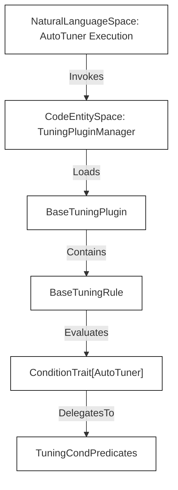
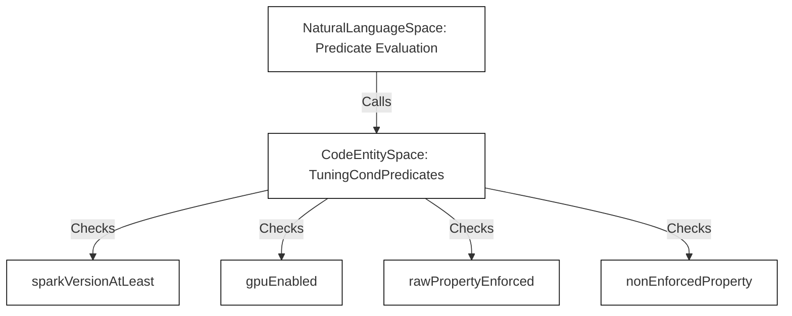

<!-- source: DeepWiki mcp.deepwiki.com · repo NVIDIA/cudf-spark-tools · page 3.3 Tuning Plugins and Rules · fetched 2026-10-26 -->

# Tuning Plugins and Rules

<details>
<summary>Relevant source files</summary>

The following files were used as context for generating this wiki page:

- [core/src/main/scala/com/nvidia/spark/rapids/tool/plugins/ConditionTrait.scala](core/src/main/scala/com/nvidia/spark/rapids/tool/plugins/ConditionTrait.scala)
- [core/src/main/scala/com/nvidia/spark/rapids/tool/plugins/PropConditionTrait.scala](core/src/main/scala/com/nvidia/spark/rapids/tool/plugins/PropConditionTrait.scala)
- [core/src/main/scala/com/nvidia/spark/rapids/tool/profiling/PySparkMemoryEvidence.scala](core/src/main/scala/com/nvidia/spark/rapids/tool/profiling/PySparkMemoryEvidence.scala)
- [core/src/main/scala/com/nvidia/spark/rapids/tool/tuning/TuningEntry.scala](core/src/main/scala/com/nvidia/spark/rapids/tool/tuning/TuningEntry.scala)
- [core/src/main/scala/com/nvidia/spark/rapids/tool/tuning/config/PySparkMemoryTuningPolicy.scala](core/src/main/scala/com/nvidia/spark/rapids/tool/tuning/config/PySparkMemoryTuningPolicy.scala)
- [core/src/main/scala/com/nvidia/spark/rapids/tool/tuning/config/TuningConfigProvider.scala](core/src/main/scala/com/nvidia/spark/rapids/tool/tuning/config/TuningConfigProvider.scala)
- [core/src/main/scala/com/nvidia/spark/rapids/tool/tuning/config/TuningEntryDefinition.scala](core/src/main/scala/com/nvidia/spark/rapids/tool/tuning/config/TuningEntryDefinition.scala)
- [core/src/main/scala/com/nvidia/spark/rapids/tool/tuning/plugins/BaseTuningPlugin.scala](core/src/main/scala/com/nvidia/spark/rapids/tool/tuning/plugins/BaseTuningPlugin.scala)
- [core/src/main/scala/com/nvidia/spark/rapids/tool/tuning/plugins/BaseTuningRule.scala](core/src/main/scala/com/nvidia/spark/rapids/tool/tuning/plugins/BaseTuningRule.scala)
- [core/src/main/scala/com/nvidia/spark/rapids/tool/tuning/plugins/TuningCondPredicates.scala](core/src/main/scala/com/nvidia/spark/rapids/tool/tuning/plugins/TuningCondPredicates.scala)
- [core/src/main/scala/com/nvidia/spark/rapids/tool/tuning/plugins/TuningPluginManager.scala](core/src/main/scala/com/nvidia/spark/rapids/tool/tuning/plugins/TuningPluginManager.scala)
- [core/src/main/scala/com/nvidia/spark/rapids/tool/tuning/plugins/delta/DeltaOSSLakeRules.scala](core/src/main/scala/com/nvidia/spark/rapids/tool/tuning/plugins/delta/DeltaOSSLakeRules.scala)
- [core/src/main/scala/com/nvidia/spark/rapids/tool/tuning/plugins/emr/EmrRules.scala](core/src/main/scala/com/nvidia/spark/rapids/tool/tuning/plugins/emr/EmrRules.scala)
- [core/src/main/scala/com/nvidia/spark/rapids/tool/tuning/plugins/emr/EmrTuningPlugin.scala](core/src/main/scala/com/nvidia/spark/rapids/tool/tuning/plugins/emr/EmrTuningPlugin.scala)
- [core/src/main/scala/org/apache/spark/sql/rapids/tool/store/StageExecutorMetricsManager.scala](core/src/main/scala/org/apache/spark/sql/rapids/tool/store/StageExecutorMetricsManager.scala)
- [core/src/test/scala/com/nvidia/spark/rapids/tool/tuning/AppSummaryInfoProviderSuite.scala](core/src/test/scala/com/nvidia/spark/rapids/tool/tuning/AppSummaryInfoProviderSuite.scala)
- [core/src/test/scala/com/nvidia/spark/rapids/tool/tuning/EmrThpTuningPluginSuite.scala](core/src/test/scala/com/nvidia/spark/rapids/tool/tuning/EmrThpTuningPluginSuite.scala)
- [core/src/test/scala/com/nvidia/spark/rapids/tool/tuning/TuningEntrySuite.scala](core/src/test/scala/com/nvidia/spark/rapids/tool/tuning/TuningEntrySuite.scala)

</details>


## Purpose and Scope
This page details the modular tuning plugin and rule architecture within the `cudf-spark-tools` core Scala library (`com.nvidia.spark.rapids.tool.tuning`). It covers how the `TuningPluginManager` discovers and executes rules, how condition predicates control rule activation, and specific implementations for Amazon EMR Transparent Huge Pages (THP) optimization, Delta OSS lakehouse storage rules, and the PySpark memory policy engine.

---

## 1. Plugin Manager and Architecture

The AutoTuner relies on a pluggable rule architecture defined by `TuningPluginManager`, `BaseTuningPlugin`, and `BaseTuningRule`. Plugins group sets of conditional rules that inspect the `AutoTuner` state, application configuration, and platform properties to emit recommended Spark/cuDF configurations and descriptive comments.



*Sources:*
- `core/src/main/scala/com/nvidia/spark/rapids/tool/tuning/plugins/TuningPluginManager.scala`
- `core/src/main/scala/com/nvidia/spark/rapids/tool/tuning/plugins/BaseTuningPlugin.scala`
- `core/src/main/scala/com/nvidia/spark/rapids/tool/tuning/plugins/BaseTuningRule.scala`

---

## 2. Condition Predicates and Evaluation

Tuning rules are guarded by condition predicates implemented as `ConditionTrait[AutoTuner]`. The `TuningCondPredicates` object acts as a factory and registry for common predicates, such as checking minimum Spark versions, verifying GPU enablement, and inspecting whether a property has been explicitly enforced by a user configuration.



### Key Predicate Functions

| Function Name | Return Type | Description |
| :--- | :--- | :--- |
| `TuningCondPredicates.alwaysTrue` | `ConditionTrait[AutoTuner]` | Unconditionally evaluates to `true` [core/src/main/scala/com/nvidia/spark/rapids/tool/tuning/plugins/TuningCondPredicates.scala:97-97](). |
| `TuningCondPredicates.rawPropertyEnforced` | `Boolean` | Verifies if a configuration key exists in `tuner.platform.userEnforcedRecommendations` [core/src/main/scala/com/nvidia/spark/rapids/tool/tuning/plugins/TuningCondPredicates.scala:110-112](). |
| `TuningCondPredicates.sparkVersionAtLeast` | `Boolean` | Uses Apache Maven `ComparableVersion` to evaluate platform Spark versions (e.g., `-amzn-1`) [core/src/main/scala/com/nvidia/spark/rapids/tool/tuning/plugins/TuningCondPredicates.scala:124-129](). |
| `TuningCondPredicates.gpuEnabled` | `ConditionTrait[AutoTuner]` | Checks that `spark.plugins` includes the SQLPlugin and GPU acceleration is active [core/src/main/scala/com/nvidia/spark/rapids/tool/tuning/plugins/TuningCondPredicates.scala:185-187](). |

*Sources:*
- `core/src/main/scala/com/nvidia/spark/rapids/tool/tuning/plugins/TuningCondPredicates.scala`
- `core/src/main/scala/com/nvidia/spark/rapids/tool/plugins/ConditionTrait.scala`

---

## 3. Platform-Specific and Format Rules (EMR THP & Delta OSS)

### EMR Transparent Huge Pages (THP) Rules
Amazon EMR has Transparent Huge Pages (THP) enabled by default for Spark workloads, which can increase execution time variance. The EMR plugin introduces rules to append `-XX:-UseTransparentHugePages` to both driver and executor Java options if not already present.

*   `EmrThpDriverRule`: Targets `spark.driver.extraJavaOptions` [core/src/main/scala/com/nvidia/spark/rapids/tool/tuning/plugins/emr/EmrRules.scala:92-95]().
*   `EmrThpExecutorRule`: Targets `spark.executor.extraJavaOptions` [core/src/main/scala/com/nvidia/spark/rapids/tool/tuning/plugins/emr/EmrRules.scala:100-103]().

```scala
abstract class BaseEmrThpRule extends BaseTuningRule {
  protected val javaOptionsProp: String
  protected val componentName: String

  override val condition: ConditionTrait[AutoTuner] = (tunerInst: AutoTuner) => {
    if (TuningCondPredicates.rawPropertyEnforced(tunerInst, javaOptionsProp)) {
      false
    } else {
      val disableFlag = tunerInst.configProvider.getEntry("EMR_THP_DISABLE_FLAG").default
      tunerInst.getPropertyValue(javaOptionsProp)
        .forall(value => !value.trim.split("\\s+").exists(_ == disableFlag))
    }
  }
}
```
*(Cited from `core/src/main/scala/com/nvidia/spark/rapids/tool/tuning/plugins/emr/EmrRules.scala:57-74`)*

### Delta OSS Lakehouse Rules
Delta OSS rules inspect table format interactions, validating configurations such as shuffle partitions, file sizes, and optimal reader/writer settings when Delta Lake is detected in the application event logs.

*Sources:*
- `core/src/main/scala/com/nvidia/spark/rapids/tool/tuning/plugins/emr/EmrRules.scala`
- `core/src/main/scala/com/nvidia/spark/rapids/tool/tuning/plugins/delta/DeltaOSSLakeRules.scala`
- `core/src/test/scala/com/nvidia/spark/rapids/tool/tuning/EmrThpTuningPluginSuite.scala`

---

## 4. PySpark Memory Tuning Policy

The `PySparkMemoryTuningPolicy` models memory rebalancing rules, thresholds, and telemetry configurations for PySpark applications running alongside the GPU execution engine.

```scala
case class PySparkMemoryTuningPolicy(
    evidenceHeadroomMultiplier: BigDecimal,
    retryGrowthFactor: BigDecimal,
    recommendTelemetryConfigs: Boolean,
    rebalanceSource: PySparkMemoryRebalanceSource)
```
*(Cited from `core/src/main/scala/com/nvidia/spark/rapids/tool/tuning/config/PySparkMemoryTuningPolicy.scala:41-45`)*

### Policy Configuration Constants

| Configuration Key | Description |
| :--- | :--- |
| `PYSPARK_MEMORY_EVIDENCE_HEADROOM_MULTIPLIER` | Multiplier applied to observed evidence headroom peaks [core/src/main/scala/com/nvidia/spark/rapids/tool/tuning/config/PySparkMemoryTuningPolicy.scala:48-48](). |
| `PYSPARK_MEMORY_RETRY_GROWTH_FACTOR` | Growth factor applied upon PySpark memory limit failures [core/src/main/scala/com/nvidia/spark/rapids/tool/tuning/config/PySparkMemoryTuningPolicy.scala:49-49](). |
| `PYSPARK_MEMORY_REBALANCE_SOURCE` | Rebalance origin source (`HEAP` or `OVERHEAD`) [core/src/main/scala/com/nvidia/spark/rapids/tool/tuning/config/PySparkMemoryTuningPolicy.scala:30-37]() [core/src/main/scala/com/nvidia/spark/rapids/tool/tuning/config/PySparkMemoryTuningPolicy.scala:52-52](). |
| `spark.executor.pyspark.memory` | Target Spark property for managed PySpark worker memory [core/src/main/scala/com/nvidia/spark/rapids/tool/tuning/config/PySparkMemoryTuningPolicy.scala:53-53](). |

*Sources:*
- `core/src/main/scala/com/nvidia/spark/rapids/tool/tuning/config/PySparkMemoryTuningPolicy.scala`
- `core/src/main/scala/com/nvidia/spark/rapids/tool/profiling/PySparkMemoryEvidence.scala`
- `org/apache/spark/sql/rapids/tool/store/StageExecutorMetricsManager.scala`

---

