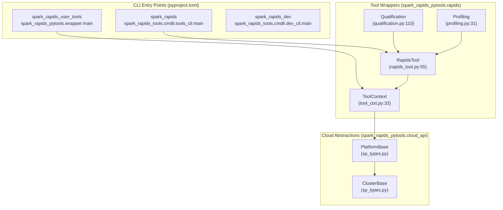
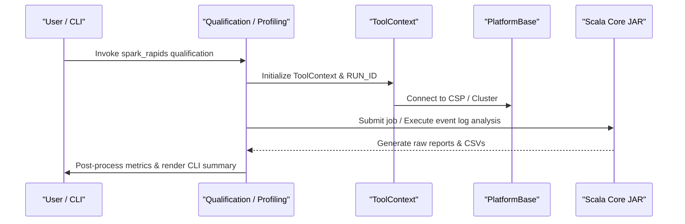

<!-- source: DeepWiki mcp.deepwiki.com · repo NVIDIA/cudf-spark-tools · page 4 Python User Tools · fetched 2026-10-26 -->

# Python User Tools

Relevant source files

The following files were used as context for generating this wiki page:

- [.github/workflows/python-unit-test.yml](.github/workflows/python-unit-test.yml)
- [scripts/prefetch_deps.sh](scripts/prefetch_deps.sh)
- [user_tools/README.md](user_tools/README.md)
- [user_tools/build.sh](user_tools/build.sh)
- [user_tools/pyproject.toml](user_tools/pyproject.toml)
- [user_tools/src/spark_rapids_pytools/common/utilities.py](user_tools/src/spark_rapids_pytools/common/utilities.py)
- [user_tools/src/spark_rapids_pytools/rapids/profiling.py](user_tools/src/spark_rapids_pytools/rapids/profiling.py)
- [user_tools/src/spark_rapids_pytools/rapids/qualification.py](user_tools/src/spark_rapids_pytools/rapids/qualification.py)
- [user_tools/src/spark_rapids_pytools/rapids/rapids_job.py](user_tools/src/spark_rapids_pytools/rapids/rapids_job.py)
- [user_tools/src/spark_rapids_pytools/rapids/rapids_tool.py](user_tools/src/spark_rapids_pytools/rapids/rapids_tool.py)
- [user_tools/src/spark_rapids_pytools/rapids/tool_ctxt.py](user_tools/src/spark_rapids_pytools/rapids/tool_ctxt.py)
- [user_tools/src/spark_rapids_pytools/resources/dev/prepackage_mgr.py](user_tools/src/spark_rapids_pytools/resources/dev/prepackage_mgr.py)
- [user_tools/src/spark_rapids_pytools/resources/profiling-conf.yaml](user_tools/src/spark_rapids_pytools/resources/profiling-conf.yaml)
- [user_tools/src/spark_rapids_pytools/resources/qualification-conf.yaml](user_tools/src/spark_rapids_pytools/resources/qualification-conf.yaml)
- [user_tools/src/spark_rapids_tools/utils/util.py](user_tools/src/spark_rapids_tools/utils/util.py)
- [user_tools/tests/spark_rapids_tools_e2e/resources/scripts/hdfs/setup_hdfs.sh](user_tools/tests/spark_rapids_tools_e2e/resources/scripts/hdfs/setup_hdfs.sh)
- [user_tools/tox.ini](user_tools/tox.ini)

## Purpose and Scope

This page provides a high-level overview of the Python wrapper layer (`spark-rapids-user-tools`) within the cuDF Spark tools ecosystem [user_tools/pyproject.toml:19-24](). The Python layer orchestrates execution across local environments and Cloud Service Providers (CSPs), manages tool lifecycles, processes user inputs via CLI entrypoints, interacts with cloud platforms, and post-processes output reports generated by the Scala core JAR.

For detailed technical specifications, implementation details, and deep dives into each sub-topic, refer to the child pages:
- [Tool Wrappers and Job Submission](#4.1)
- [CLI and Argument Processing](#4.2)
- [Cloud Platform Abstractions](#4.3)
- [Post-Processing: Heuristics, Cluster Inference and Reports API](#4.4)

---

## Architectural Mapping: User Concepts to Code Entities

The following diagram bridges user-facing execution concepts and command-line entry points to their corresponding Python package structures and core classes in the codebase.

*Sources: [user_tools/pyproject.toml:100-104](), [user_tools/src/spark_rapids_pytools/rapids/rapids_tool.py:55](), [user_tools/src/spark_rapids_pytools/rapids/tool_ctxt.py:33](), [user_tools/src/spark_rapids_pytools/rapids/qualification.py:110](), [user_tools/src/spark_rapids_pytools/rapids/profiling.py:31]() *

---

## 4.1 Tool Wrappers and Job Submission

The Python wrapper layer defines abstract and concrete classes to manage tool lifecycles. The base class `RapidsTool` coordinates execution phases, logging, and interactions with the underlying Scala tools JAR [user_tools/src/spark_rapids_pytools/rapids/rapids_tool.py:55-78](). Execution configuration and state are encapsulated inside `ToolContext`, which manages local caching directories, unique session identifiers (`RUN_ID`), and platform settings [user_tools/src/spark_rapids_pytools/rapids/tool_ctxt.py:33-104](). Jobs can be executed in local or distributed submission modes, utilizing tool-specific configuration YAML files such as `qualification-conf.yaml` and `profiling-conf.yaml`.

For detailed information on tool lifecycle management, `ToolContext`, local versus distributed job execution, and bootstrap or diagnostic tools, see [Tool Wrappers and Job Submission](#4.1).

*Sources: [user_tools/src/spark_rapids_pytools/rapids/rapids_tool.py:55-78](), [user_tools/src/spark_rapids_pytools/rapids/tool_ctxt.py:33-104](), [user_tools/src/spark_rapids_pytools/resources/qualification-conf.yaml:15-127]() *

---

## 4.2 CLI and Argument Processing

Command-line interfaces are exposed via standard entry points defined in `pyproject.toml`: `spark_rapids`, `spark_rapids_user_tools`, and `spark_rapids_dev` [user_tools/pyproject.toml:100-104](). Argument parsing and validation are handled by modular processor components (`tools_cli`, `dev_cli`, and `argprocessor`), which validate options against strict configuration models, enums (e.g., `QualFilterApp`, `SubmissionMode`), and schema definitions.

For detailed information on argument processors, CLI command parsing, validation rules, and configuration models, see [CLI and Argument Processing](#4.2).

*Sources: [user_tools/pyproject.toml:100-104](), [user_tools/src/spark_rapids_pytools/rapids/qualification.py:32-35](), [user_tools/src/spark_rapids_pytools/rapids/tool_ctxt.py:28-30]() *

---

## 4.3 Cloud Platform Abstractions

Cloud integrations are structured around abstract base classes (`PlatformBase`, `ClusterBase`, and `CMDDriverBase`) that implement platform-agnostic contracts for resource management and cluster execution [user_tools/src/spark_rapids_pytools/rapids/tool_ctxt.py:24](). Concrete implementations support major Cloud Service Providers (CSP) including Google Cloud Dataproc, Amazon EMR, Databricks (AWS/Azure), and On-Premises environments. These modules manage storage abstractions (`CspFs`, `LocalPath`) and pricing configuration providers.

For detailed information on CSP driver implementations, cluster provisioning strategies, pricing providers, and storage libraries, see [Cloud Platform Abstractions](#4.3).

*Sources: [user_tools/src/spark_rapids_pytools/rapids/tool_ctxt.py:24](), [user_tools/pyproject.toml:70-77]() *

---

## 4.4 Post-Processing: Heuristics, Cluster Inference and Reports API

Once the Scala core JAR completes execution, the Python layer post-processes output artifacts. This includes applying heuristic rules (`AdditionalHeuristics`, `TopCandidates`), categorizing speedups (`SpeedupCategory`), analyzing unsupported operator stage durations (`UnsupportedOpsStageDuration`), and generating target cluster recommendations (`ClusterConfigRecommender`) [user_tools/src/spark_rapids_pytools/rapids/qualification.py:33-40](). Furthermore, the `api_v1` module provides structured report readers and event log detectors for downstream consumption.

For detailed information on heuristic filters, speedup categories, cluster inference, recommendation engines, and the `api_v1` report API, see [Post-Processing: Heuristics, Cluster Inference and Reports API](#4.4).

*Sources: [user_tools/src/spark_rapids_pytools/rapids/qualification.py:33-40](), [user_tools/src/spark_rapids_pytools/rapids/rapids_tool.py:41-42]() *

---

## Execution Workflow Diagram

The sequence below illustrates how user requests flow from the CLI through tool wrappers, cloud platforms, and core execution layers.

*Sources: [user_tools/pyproject.toml:100-104](), [user_tools/src/spark_rapids_pytools/rapids/rapids_tool.py:55](), [user_tools/src/spark_rapids_pytools/rapids/tool_ctxt.py:33](), [user_tools/src/spark_rapids_pytools/rapids/qualification.py:110]() *

---

