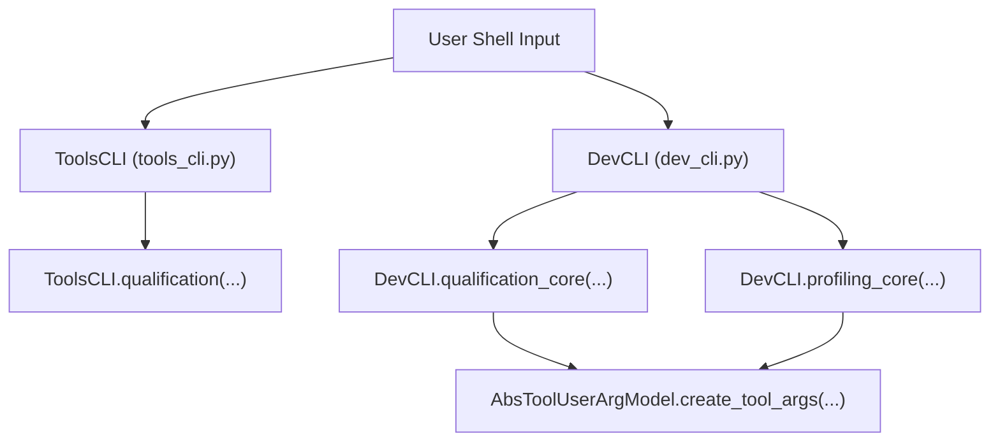
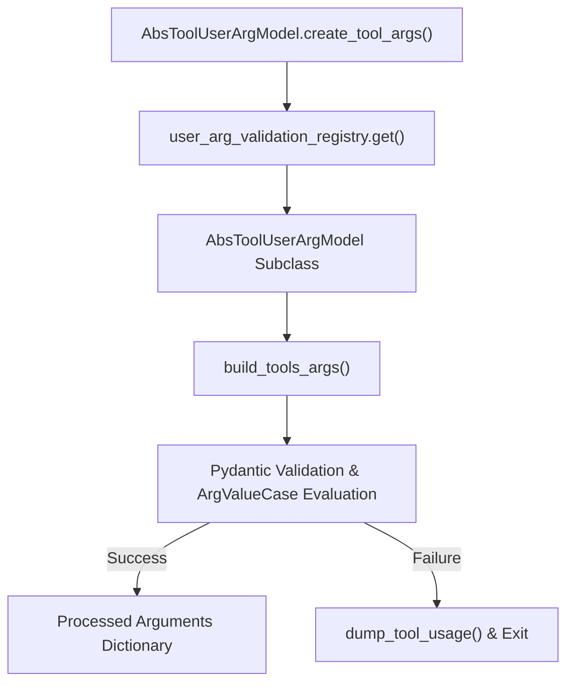

<!-- source: DeepWiki mcp.deepwiki.com · repo NVIDIA/cudf-spark-tools · page 4.2 CLI and Argument Processing · fetched 2026-10-26 -->

# CLI and Argument Processing

Relevant source files

The following files were used as context for generating this wiki page:

- [user_tools/src/spark_rapids_tools/cmdli/__init__.py](user_tools/src/spark_rapids_tools/cmdli/__init__.py)
- [user_tools/src/spark_rapids_tools/cmdli/argprocessor.py](user_tools/src/spark_rapids_tools/cmdli/argprocessor.py)
- [user_tools/src/spark_rapids_tools/cmdli/dev_cli.py](user_tools/src/spark_rapids_tools/cmdli/dev_cli.py)
- [user_tools/src/spark_rapids_tools/cmdli/tools_cli.py](user_tools/src/spark_rapids_tools/cmdli/tools_cli.py)
- [user_tools/src/spark_rapids_tools/configuration/common.py](user_tools/src/spark_rapids_tools/configuration/common.py)
- [user_tools/src/spark_rapids_tools/configuration/tools_config.py](user_tools/src/spark_rapids_tools/configuration/tools_config.py)
- [user_tools/src/spark_rapids_tools/enums.py](user_tools/src/spark_rapids_tools/enums.py)
- [user_tools/src/spark_rapids_tools/storagelib/s3/s3fs.py](user_tools/src/spark_rapids_tools/storagelib/s3/s3fs.py)
- [user_tools/tests/spark_rapids_tools_ut/conftest.py](user_tools/tests/spark_rapids_tools_ut/conftest.py)
- [user_tools/tests/spark_rapids_tools_ut/resources/tools_config/valid/tools_config_03.yaml](user_tools/tests/spark_rapids_tools_ut/resources/tools_config/valid/tools_config_03.yaml)
- [user_tools/tests/spark_rapids_tools_ut/resources/worker_info.yaml](user_tools/tests/spark_rapids_tools_ut/resources/worker_info.yaml)
- [user_tools/tests/spark_rapids_tools_ut/test_tool_argprocessor.py](user_tools/tests/spark_rapids_tools_ut/test_tool_argprocessor.py)
- [user_tools/tests/utils/test_net_utils.py](user_tools/tests/utils/test_net_utils.py)

## Purpose and Scope
This section covers the command-line interface (CLI) entry points, user argument validation frameworks, configuration models, and enumerated types used in the Python wrapper layer (`spark-rapids-tools`). It bridges user inputs from the shell to the internal tool execution flow.

Sources: [user_tools/src/spark_rapids_tools/cmdli/tools_cli.py:15-37](), [user_tools/src/spark_rapids_tools/cmdli/argprocessor.py:15-39]()

---

## CLI Entrypoints (`ToolsCLI` and `DevCLI`)
The user tools expose their capabilities via two primary command-line interfaces built on top of the `fire` library: `ToolsCLI` and `DevCLI`.

- `ToolsCLI` (`user_tools/src/spark_rapids_tools/cmdli/tools_cli.py`): Provides user-facing commands such as `qualification` [user_tools/src/spark_rapids_tools/cmdli/tools_cli.py:32-39](). It accepts parameters such as `eventlogs`, `cluster`, `platform`, `output_folder`, `filter_apps`, `custom_model_file`, `jvm_heap_size`, `jvm_threads`, `verbose`, `tools_config_file`, `submission_mode`, `target_cluster_info`, `tuning_configs`, and `qualx_config` [user_tools/src/spark_rapids_tools/cmdli/tools_cli.py:39-55]().
- `DevCLI` (`user_tools/src/spark_rapids_tools/cmdli/dev_cli.py`): Provides developer-oriented commands and core tool variants like `qualification_core` and `profiling_core` [user_tools/src/spark_rapids_tools/cmdli/dev_cli.py:31-96](). These invoke the core tool JARs directly with minimal wrapper processing [user_tools/src/spark_rapids_tools/cmdli/dev_cli.py:96-100]().

*Figure: CLI Entrypoint Routing to Argument Models.*

Sources: [user_tools/src/spark_rapids_tools/cmdli/tools_cli.py:19-55](), [user_tools/src/spark_rapids_tools/cmdli/dev_cli.py:19-96]()

---

## Argument Processing and Validation Framework (`argprocessor.py`)
Argument validation and normalization are managed by `AbsToolUserArgModel` and its registered validators in `user_tools/src/spark_rapids_tools/cmdli/argprocessor.py`.

- `UserArgValidatorImpl`: A metaclass holder tracking registered validator classes in `user_arg_validation_registry` [user_tools/src/spark_rapids_tools/cmdli/argprocessor.py:63-79]().
- `register_tool_arg_validator`: A decorator used to register custom argument validation implementations [user_tools/src/spark_rapids_tools/cmdli/argprocessor.py:82-88]().
- `AbsToolUserArgModel`: An abstract dataclass collecting properties like `cluster`, `platform`, `output_folder`, `tools_jar`, `session_uuid`, `rejected`, `detected`, and `extra` [user_tools/src/spark_rapids_tools/cmdli/argprocessor.py:91-113]().
- `create_tool_args`: Factory method that looks up `user_arg_validation_registry`, initializes the matching validator class, and builds processed tool arguments [user_tools/src/spark_rapids_tools/cmdli/argprocessor.py:114-142]().
- `ArgValueCase`: An `IntEnum` representing status flags for argument inputs (`UNDEFINED`, `VALUE_A`, `VALUE_B`, `VALUE_C`, `IGNORE`) used during conditional validation checks [user_tools/src/spark_rapids_tools/cmdli/argprocessor.py:41-61]().

*Figure: Argument Processing and Validation Pipeline.*

Sources: [user_tools/src/spark_rapids_tools/cmdli/argprocessor.py:41-142]()

---

## Enums and Constants (`enums.py`)
Enums define standardized domain choices across the python toolkit and are implemented inheriting from `EnumeratedType` [user_tools/src/spark_rapids_tools/enums.py:21-26]().

- `EnumeratedType`: Extends `str` and `Enum`, providing case-insensitive lookups via `_missing_`, string serialization via `tostring`, and reverse lookup via `fromstring` [user_tools/src/spark_rapids_tools/enums.py:21-72]().
- `CspEnv`: Represents cloud service provider environments such as `DATABRICKS_AWS`, `DATABRICKS_AZURE`, `DATAPROC`, `DATAPROC_GKE`, `EMR`, `ONPREM`, and `NONE` [user_tools/src/spark_rapids_tools/enums.py:126-135](). Handles conversions to Java command arguments and pricing map requirements [user_tools/src/spark_rapids_tools/enums.py:159-173]().
- `QualFilterApp`: Defines application filtering modes in qualification reports (`TOP_CANDIDATES`, `ALL`) [user_tools/src/spark_rapids_tools/enums.py:179-186]().
- `HashAlgorithm` and `DependencyType`: Manage file verification algorithms (`MD5`, `SHA1`, `SHA256`, `SHA512`) and dependency types (`JAR`, `ARCHIVE`, `CLASSPATH`) [user_tools/src/spark_rapids_tools/enums.py:79-118]().

Sources: [user_tools/src/spark_rapids_tools/enums.py:21-188]()

---

## Tools Configuration Models (`tools_config.py`, `common.py`)
Custom tools configurations supplied via YAML files are parsed and validated using Pydantic models.

- `BaseConfig`: Inherits from Pydantic `BaseModel` with `extra = 'forbid'` to reject unrecognized keys in configuration schemas [user_tools/src/spark_rapids_tools/configuration/common.py:24-34]().
- `ToolsConfig`: Main container model specifying `api_version` (ge=1.0, le=1.2), optional `runtime` (`ToolsRuntimeConfig`), and `submission` (`SubmissionConfig`) [user_tools/src/spark_rapids_tools/configuration/tools_config.py:29-46](). It provides `load_from_file()` and `get_schema()` methods [user_tools/src/spark_rapids_tools/configuration/tools_config.py:47-62]().
- `RuntimeDependency`: Defines required runtime dependencies with properties `name`, `uri`, `dependency_type`, and `verification` [user_tools/src/spark_rapids_tools/configuration/common.py:66-87](). Includes a model validator (`validate_dependency`) ensuring valid URIs or local file paths [user_tools/src/spark_rapids_tools/configuration/common.py:88-107]().

Sources: [user_tools/src/spark_rapids_tools/configuration/common.py:24-108](), [user_tools/src/spark_rapids_tools/configuration/tools_config.py:29-62]()

---

