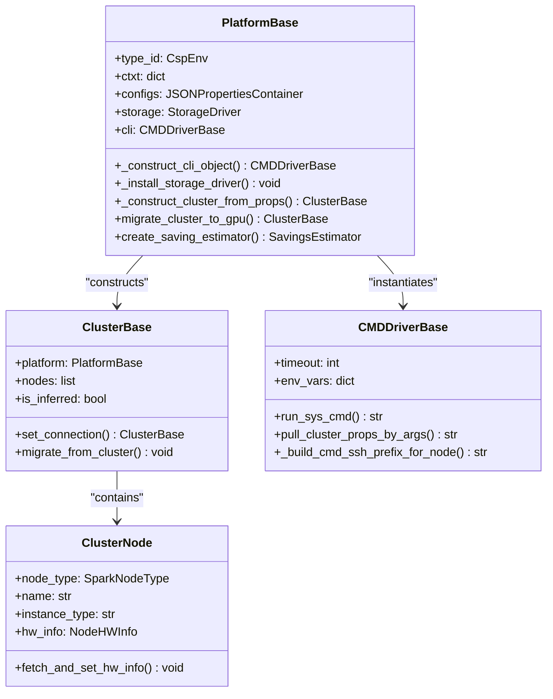
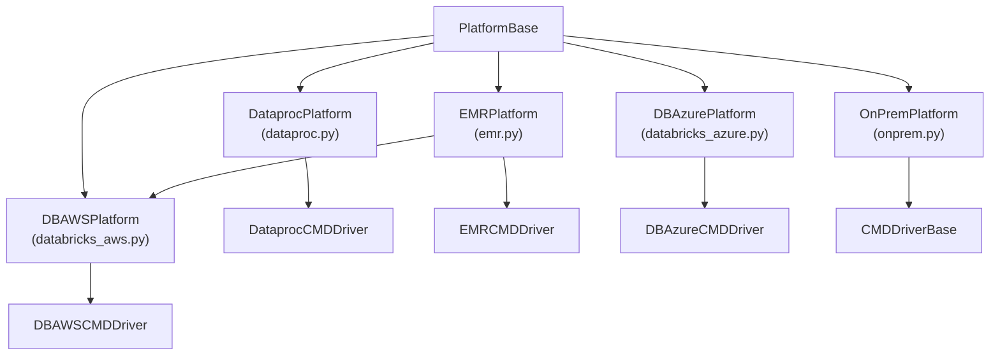

<!-- source: DeepWiki mcp.deepwiki.com · repo NVIDIA/cudf-spark-tools · page 4.3 Cloud Platform Abstractions · fetched 2026-10-26 -->

# Cloud Platform Abstractions

Relevant source files

The following files were used as context for generating this wiki page:

- [user_tools/src/spark_rapids_pytools/cloud_api/azurestorage.py](user_tools/src/spark_rapids_pytools/cloud_api/azurestorage.py)
- [user_tools/src/spark_rapids_pytools/cloud_api/databricks_aws.py](user_tools/src/spark_rapids_pytools/cloud_api/databricks_aws.py)
- [user_tools/src/spark_rapids_pytools/cloud_api/databricks_azure.py](user_tools/src/spark_rapids_pytools/cloud_api/databricks_azure.py)
- [user_tools/src/spark_rapids_pytools/cloud_api/databricks_azure_job.py](user_tools/src/spark_rapids_pytools/cloud_api/databricks_azure_job.py)
- [user_tools/src/spark_rapids_pytools/cloud_api/dataproc.py](user_tools/src/spark_rapids_pytools/cloud_api/dataproc.py)
- [user_tools/src/spark_rapids_pytools/cloud_api/dataproc_gke.py](user_tools/src/spark_rapids_pytools/cloud_api/dataproc_gke.py)
- [user_tools/src/spark_rapids_pytools/cloud_api/dataproc_gke_job.py](user_tools/src/spark_rapids_pytools/cloud_api/dataproc_gke_job.py)
- [user_tools/src/spark_rapids_pytools/cloud_api/emr.py](user_tools/src/spark_rapids_pytools/cloud_api/emr.py)
- [user_tools/src/spark_rapids_pytools/cloud_api/onprem.py](user_tools/src/spark_rapids_pytools/cloud_api/onprem.py)
- [user_tools/src/spark_rapids_pytools/cloud_api/sp_types.py](user_tools/src/spark_rapids_pytools/cloud_api/sp_types.py)
- [user_tools/src/spark_rapids_pytools/common/prop_manager.py](user_tools/src/spark_rapids_pytools/common/prop_manager.py)
- [user_tools/src/spark_rapids_pytools/common/sys_storage.py](user_tools/src/spark_rapids_pytools/common/sys_storage.py)
- [user_tools/src/spark_rapids_pytools/pricing/databricks_azure_pricing.py](user_tools/src/spark_rapids_pytools/pricing/databricks_azure_pricing.py)
- [user_tools/src/spark_rapids_pytools/pricing/dataproc_gke_pricing.py](user_tools/src/spark_rapids_pytools/pricing/dataproc_gke_pricing.py)
- [user_tools/src/spark_rapids_pytools/pricing/dataproc_pricing.py](user_tools/src/spark_rapids_pytools/pricing/dataproc_pricing.py)
- [user_tools/src/spark_rapids_pytools/pricing/emr_pricing.py](user_tools/src/spark_rapids_pytools/pricing/emr_pricing.py)
- [user_tools/src/spark_rapids_pytools/pricing/price_provider.py](user_tools/src/spark_rapids_pytools/pricing/price_provider.py)
- [user_tools/src/spark_rapids_pytools/resources/databricks_aws-configs.json](user_tools/src/spark_rapids_pytools/resources/databricks_aws-configs.json)
- [user_tools/src/spark_rapids_pytools/resources/databricks_azure-configs.json](user_tools/src/spark_rapids_pytools/resources/databricks_azure-configs.json)
- [user_tools/src/spark_rapids_pytools/resources/dataproc-configs.json](user_tools/src/spark_rapids_pytools/resources/dataproc-configs.json)
- [user_tools/src/spark_rapids_pytools/resources/dataproc_gke-configs.json](user_tools/src/spark_rapids_pytools/resources/dataproc_gke-configs.json)
- [user_tools/src/spark_rapids_pytools/resources/emr-configs.json](user_tools/src/spark_rapids_pytools/resources/emr-configs.json)
- [user_tools/src/spark_rapids_pytools/resources/onprem-configs.json](user_tools/src/spark_rapids_pytools/resources/onprem-configs.json)
- [user_tools/src/spark_rapids_pytools/resources/premium-databricks-azure-catalog.json](user_tools/src/spark_rapids_pytools/resources/premium-databricks-azure-catalog.json)
- [user_tools/src/spark_rapids_tools/cloud/__init__.py](user_tools/src/spark_rapids_tools/cloud/__init__.py)
- [user_tools/src/spark_rapids_tools/cloud/dataproc/dataproccluster.py](user_tools/src/spark_rapids_tools/cloud/dataproc/dataproccluster.py)
- [user_tools/src/spark_rapids_tools/storagelib/adls/adlspath.py](user_tools/src/spark_rapids_tools/storagelib/adls/adlspath.py)
- [user_tools/src/spark_rapids_tools/storagelib/cspfs.py](user_tools/src/spark_rapids_tools/storagelib/cspfs.py)
- [user_tools/src/spark_rapids_tools/storagelib/csppath.py](user_tools/src/spark_rapids_tools/storagelib/csppath.py)
- [user_tools/src/spark_rapids_tools/utils/net_utils.py](user_tools/src/spark_rapids_tools/utils/net_utils.py)
- [user_tools/tests/spark_rapids_tools_ut/resources/cluster/dataproc_gke/cpu-00.yaml](user_tools/tests/spark_rapids_tools_ut/resources/cluster/dataproc_gke/cpu-00.yaml)
- [user_tools/tests/spark_rapids_tools_ut/test_cluster.py](user_tools/tests/spark_rapids_tools_ut/test_cluster.py)
- [user_tools/tests/spark_rapids_tools_ut/test_csppath.py](user_tools/tests/spark_rapids_tools_ut/test_csppath.py)
- [user_tools/tests/spark_rapids_tools_ut/test_path_boundary.py](user_tools/tests/spark_rapids_tools_ut/test_path_boundary.py)

## Purpose and Scope

The Cloud Platform Abstractions layer (`spark_rapids_pytools.cloud_api` and `spark_rapids_tools.storagelib`) provides a unified, extensible interface for interacting with different Cloud Service Providers (CSPs), managed Spark services, and on-premises environments [user_tools/src/spark_rapids_pytools/cloud_api/sp_types.py:15-43](). It decouples job submission, cluster configuration inference, hardware discovery, pricing estimation, and object storage operations from the core tool logic.

---

## 1. Core Abstraction Components: `PlatformBase`, `ClusterBase`, and `CMDDriverBase`

The foundation of the cloud platform architecture relies on three primary base classes defined in `sp_types.py` and supporting modules:

* `PlatformBase`: Acts as the central orchestrator for a specific cloud provider or runtime environment (e.g., Dataproc, EMR, Databricks). It manages initialization contexts, loads configuration templates, instantiates CLI drivers, installs storage drivers, and builds saving estimators [user_tools/src/spark_rapids_pytools/cloud_api/dataproc.py:35-138]().
* `ClusterBase`: Models the target Spark cluster topology, including worker/master nodes (`ClusterNode`), hardware configurations (`NodeHWInfo`, `SysInfo`, `GpuHWInfo`), and migration paths from CPU to GPU instance types [user_tools/src/spark_rapids_pytools/cloud_api/sp_types.py:106-201]().
* `CMDDriverBase`: Handles execution of underlying command-line interfaces (e.g., `gcloud`, `aws`, `databricks`), environment validation, SSH/SCP communication prefixes for cluster nodes, and remote property pulling [user_tools/src/spark_rapids_pytools/cloud_api/databricks_aws.py:100-152]().

*Sources: [user_tools/src/spark_rapids_pytools/cloud_api/sp_types.py:33-194](), [user_tools/src/spark_rapids_pytools/cloud_api/dataproc.py:35-96]()*, [user_tools/src/spark_rapids_pytools/cloud_api/databricks_aws.py:34-110]()*

---

## 2. CSP and Runtime Implementations

The framework implements specific subclasses for each supported platform, handling distinct CLI commands, authentication mechanisms, and cluster property structures.

| Platform / CSP | Platform Class | CLI Driver Class | Storage Driver | Pricing Provider |
| :--- | :--- | :--- | :--- | :--- |
| **Google Cloud Dataproc** | `DataprocPlatform` [user_tools/src/spark_rapids_pytools/cloud_api/dataproc.py:35]() | `DataprocCMDDriver` | `GStorageDriver` [user_tools/src/spark_rapids_pytools/cloud_api/dataproc.py:91]() | `DataprocPriceProvider` [user_tools/src/spark_rapids_pytools/cloud_api/dataproc.py:31]() |
| **AWS EMR** | `EMRPlatform` [user_tools/src/spark_rapids_pytools/cloud_api/emr.py:35]() | `EMRCMDDriver` [user_tools/src/spark_rapids_pytools/cloud_api/emr.py:129]() | `S3StorageDriver` [user_tools/src/spark_rapids_pytools/cloud_api/emr.py:70]() | `EMREc2PriceProvider` [user_tools/src/spark_rapids_pytools/cloud_api/emr.py:30]() |
| **Databricks on AWS** | `DBAWSPlatform` [user_tools/src/spark_rapids_pytools/cloud_api/databricks_aws.py:34]() | `DBAWSCMDDriver` [user_tools/src/spark_rapids_pytools/cloud_api/databricks_aws.py:100]() | `S3StorageDriver` [user_tools/src/spark_rapids_pytools/cloud_api/databricks_aws.py:53]() | `DatabricksAWSPriceProvider` [user_tools/src/spark_rapids_pytools/cloud_api/databricks_aws.py:30]() |
| **Databricks on Azure** | `DBAzurePlatform` [user_tools/src/spark_rapids_pytools/cloud_api/databricks_azure.py:33]() | `DBAzureCMDDriver` [user_tools/src/spark_rapids_pytools/cloud_api/databricks_azure.py:110]() | `AzureStorageDriver` [user_tools/src/spark_rapids_pytools/cloud_api/databricks_azure.py:50]() | `DatabricksAzurePriceProvider` [user_tools/src/spark_rapids_pytools/cloud_api/databricks_azure.py:28]() |
| **On-Premises / Generic** | `OnPremPlatform` [user_tools/src/spark_rapids_pytools/cloud_api/onprem.py:33]() | `CMDDriverBase` [user_tools/src/spark_rapids_pytools/cloud_api/onprem.py:44]() | `OnPremStorageDriver` [user_tools/src/spark_rapids_pytools/cloud_api/onprem.py:47]() | `DataprocPriceProvider` (fallback) [user_tools/src/spark_rapids_pytools/cloud_api/onprem.py:99]() |

*Sources: [user_tools/src/spark_rapids_pytools/cloud_api/dataproc.py:35-89](), [user_tools/src/spark_rapids_pytools/cloud_api/emr.py:35-68](), [user_tools/src/spark_rapids_pytools/cloud_api/databricks_aws.py:34-51](), [user_tools/src/spark_rapids_pytools/cloud_api/databricks_azure.py:33-48](), [user_tools/src/spark_rapids_pytools/cloud_api/onprem.py:33-45]()`

---

## 3. Pricing Providers and Cost Estimation

Cost analysis relies on provider-specific pricing modules extending `SavingsEstimator` and price providers [user_tools/src/spark_rapids_pytools/pricing/price_provider.py](). 

* Each platform implementation defines a `create_saving_estimator()` method that pulls regional pricing configurations and maps source instance types against target GPU instance types [user_tools/src/spark_rapids_pytools/cloud_api/dataproc.py:110-128]() [user_tools/src/spark_rapids_pytools/cloud_api/emr.py:96-113]().
* Price providers fetch or look up hourly rates for virtual machines and managed cluster software fees to compute total cost of ownership (TCO) savings when accelerating workloads with RAPIDS.

*Sources: [user_tools/src/spark_rapids_pytools/cloud_api/dataproc.py:31-32](), [user_tools/src/spark_rapids_pytools/cloud_api/emr.py:30-31](), [user_tools/src/spark_rapids_pytools/cloud_api/databricks_aws.py:30-31]()`

---

## 4. Platform Configuration JSONs

Platform behavior, default Spark versions, artifact download URIs, file hashes, and environment variables are driven by JSON configuration files located under `user_tools/src/spark_rapids_pytools/resources/` [user_tools/src/spark_rapids_pytools/resources/emr-configs.json]():

* **Dependency Management**: Maps Spark versions (e.g., `357`, `350`, `333`) to archive URIs, Spark Connect JARs, and cloud storage connectors (e.g., `GCS Connector Hadoop3` in `dataproc-configs.json`, `Hadoop AWS` in `emr-configs.json`, `Hadoop Azure` in `databricks_azure-configs.json`) [user_tools/src/spark_rapids_pytools/resources/emr-configs.json:1-181]() [user_tools/src/spark_rapids_pytools/resources/dataproc-configs.json:1-152]() [user_tools/src/spark_rapids_pytools/resources/databricks_azure-configs.json:1-152]() [user_tools/src/spark_rapids_pytools/resources/dataproc_gke-configs.json:1-114]() [user_tools/src/spark_rapids_pytools/resources/onprem-configs.json:1-126]().
* **Environment Mapping**: Defines CLI environment variables (`GOOGLE_APPLICATION_CREDENTIALS`, `DATABRICKS_CONFIG_FILE`), initial configuration lookup lists, and property sections parsed by `PlatformBase` [user_tools/src/spark_rapids_pytools/resources/dataproc-configs.json:154-176]() [user_tools/src/spark_rapids_pytools/resources/databricks_azure-configs.json:154-172]().
* **GPU Instance Definitions**: Specifies machine families (`n1-standard`, `n1-highmem`), CPU-to-memory ratios, and GPU count criteria (`gpuPerMachine`) for cluster resizing recommendations [user_tools/src/spark_rapids_pytools/resources/onprem-configs.json:127-196]().

*Sources: [user_tools/src/spark_rapids_pytools/resources/emr-configs.json:1-181](), [user_tools/src/spark_rapids_pytools/resources/dataproc-configs.json:1-176](), [user_tools/src/spark_rapids_pytools/resources/databricks_azure-configs.json:1-172](), [user_tools/src/spark_rapids_pytools/resources/dataproc_gke-configs.json:1-184](), [user_tools/src/spark_rapids_pytools/resources/onprem-configs.json:1-196]()`

---

## 5. Storage Libraries and Path Abstractions

The `spark_rapids_tools.storagelib` package handles filesystem and path abstractions across local and cloud object stores (`gs://`, `s3://`, `abfss://`, file system paths).

* `StorageDriver` and cloud-specific drivers (`GStorageDriver`, `S3StorageDriver`, `AzureStorageDriver`, `OnPremStorageDriver`) execute file transfers, staging operations, and event log detection [user_tools/src/spark_rapids_pytools/cloud_api/dataproc.py:90-92]() [user_tools/src/spark_rapids_pytools/cloud_api/emr.py:69-71]() [user_tools/src/spark_rapids_pytools/cloud_api/databricks_aws.py:52-54]() [user_tools/src/spark_rapids_pytools/cloud_api/databricks_azure.py:49-51]() [user_tools/src/spark_rapids_pytools/cloud_api/onprem.py:46-48]().
* `csppath.py` and `cspfs.py` provide URI parsing, path boundary validation, and abstraction wrappers over native filesystem protocols [user_tools/src/spark_rapids_tools/storagelib/cspfs.py] [user_tools/src/spark_rapids_tools/storagelib/csppath.py].

*Sources: [user_tools/src/spark_rapids_pytools/common/sys_storage.py](), [user_tools/src/spark_rapids_tools/storagelib/cspfs.py](), [user_tools/src/spark_rapids_tools/storagelib/csppath.py]()`

---

