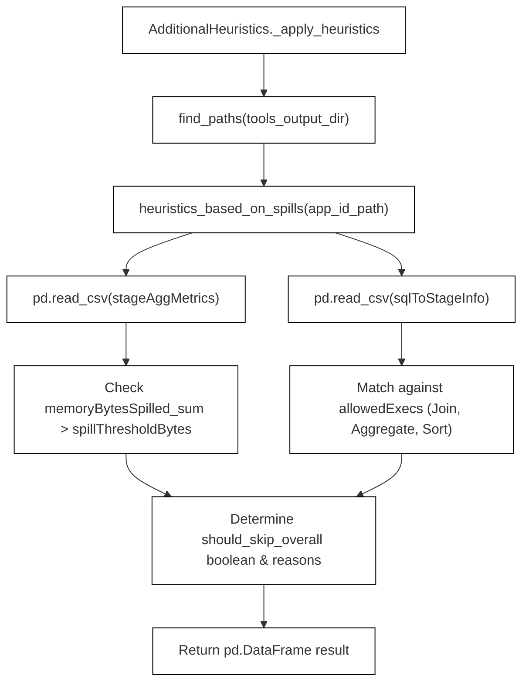
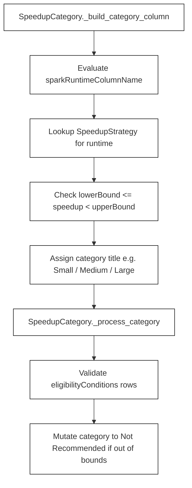
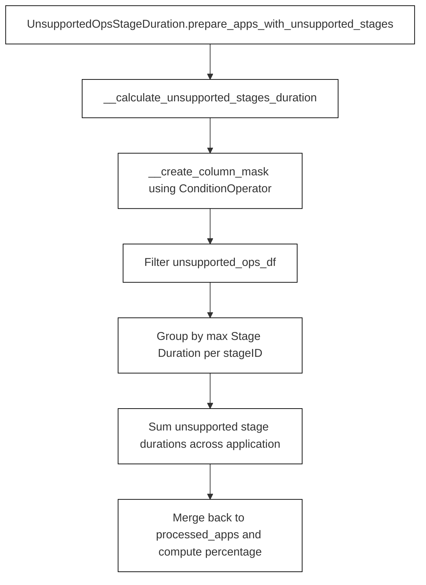
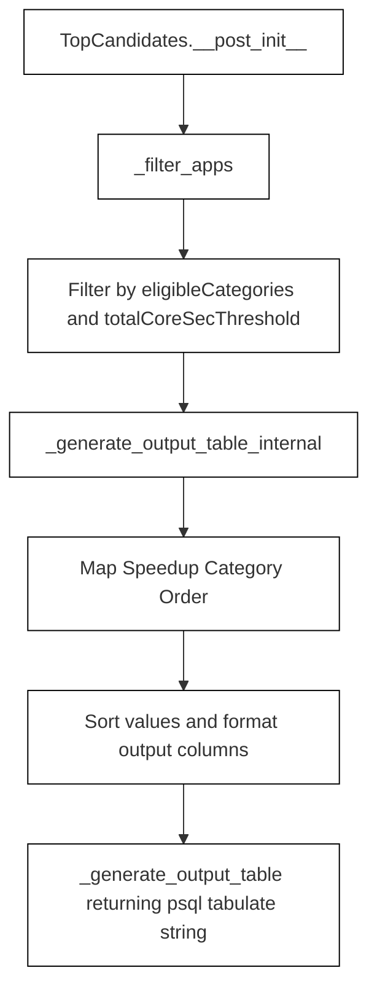
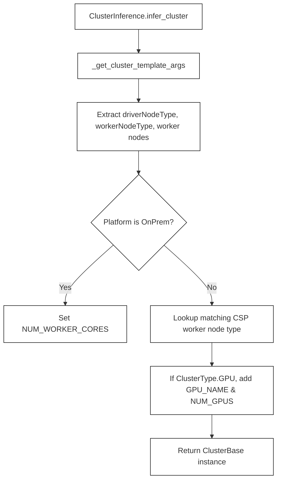
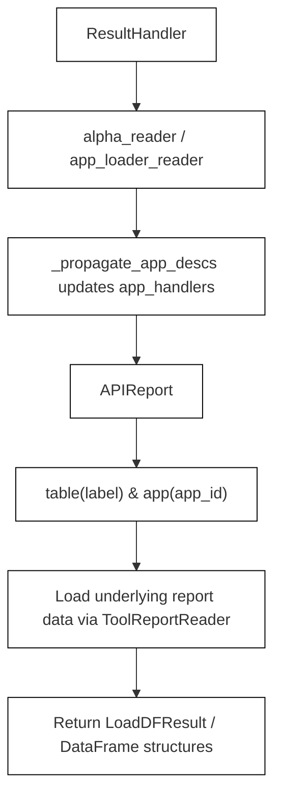

<!-- source: DeepWiki mcp.deepwiki.com · repo NVIDIA/cudf-spark-tools · page 4.4 Post-Processing: Heuristics, Cluster Inference and Reports API · fetched 2026-10-26 -->

# Post-Processing: Heuristics, Cluster Inference and Reports API

Relevant source files

The following files were used as context for generating this wiki page:

- [user_tools/docs/user-tools-reports-api.md](user_tools/docs/user-tools-reports-api.md)
- [user_tools/src/spark_rapids_pytools/common/cluster_inference.py](user_tools/src/spark_rapids_pytools/common/cluster_inference.py)
- [user_tools/src/spark_rapids_pytools/resources/reports/qualWrapperReport.yaml](user_tools/src/spark_rapids_pytools/resources/reports/qualWrapperReport.yaml)
- [user_tools/src/spark_rapids_pytools/resources/templates/cluster_template/databricks_aws.ms](user_tools/src/spark_rapids_pytools/resources/templates/cluster_template/databricks_aws.ms)
- [user_tools/src/spark_rapids_pytools/resources/templates/cluster_template/databricks_azure.ms](user_tools/src/spark_rapids_pytools/resources/templates/cluster_template/databricks_azure.ms)
- [user_tools/src/spark_rapids_pytools/resources/templates/cluster_template/dataproc.ms](user_tools/src/spark_rapids_pytools/resources/templates/cluster_template/dataproc.ms)
- [user_tools/src/spark_rapids_pytools/resources/templates/cluster_template/emr.ms](user_tools/src/spark_rapids_pytools/resources/templates/cluster_template/emr.ms)
- [user_tools/src/spark_rapids_tools/api_v1/__init__.py](user_tools/src/spark_rapids_tools/api_v1/__init__.py)
- [user_tools/src/spark_rapids_tools/api_v1/app_handler.py](user_tools/src/spark_rapids_tools/api_v1/app_handler.py)
- [user_tools/src/spark_rapids_tools/api_v1/builder.py](user_tools/src/spark_rapids_tools/api_v1/builder.py)
- [user_tools/src/spark_rapids_tools/api_v1/common.py](user_tools/src/spark_rapids_tools/api_v1/common.py)
- [user_tools/src/spark_rapids_tools/api_v1/core/prof_handler.py](user_tools/src/spark_rapids_tools/api_v1/core/prof_handler.py)
- [user_tools/src/spark_rapids_tools/api_v1/core/qual_handler.py](user_tools/src/spark_rapids_tools/api_v1/core/qual_handler.py)
- [user_tools/src/spark_rapids_tools/api_v1/report_loader.py](user_tools/src/spark_rapids_tools/api_v1/report_loader.py)
- [user_tools/src/spark_rapids_tools/api_v1/report_reader.py](user_tools/src/spark_rapids_tools/api_v1/report_reader.py)
- [user_tools/src/spark_rapids_tools/api_v1/result_handler.py](user_tools/src/spark_rapids_tools/api_v1/result_handler.py)
- [user_tools/src/spark_rapids_tools/api_v1/table_definition.py](user_tools/src/spark_rapids_tools/api_v1/table_definition.py)
- [user_tools/src/spark_rapids_tools/api_v1/wrapper/prof_handler.py](user_tools/src/spark_rapids_tools/api_v1/wrapper/prof_handler.py)
- [user_tools/src/spark_rapids_tools/api_v1/wrapper/qual_handler.py](user_tools/src/spark_rapids_tools/api_v1/wrapper/qual_handler.py)
- [user_tools/src/spark_rapids_tools/cloud/onprem/onpremcluster.py](user_tools/src/spark_rapids_tools/cloud/onprem/onpremcluster.py)
- [user_tools/src/spark_rapids_tools/configuration/runtime_conf.py](user_tools/src/spark_rapids_tools/configuration/runtime_conf.py)
- [user_tools/src/spark_rapids_tools/tools/additional_heuristics.py](user_tools/src/spark_rapids_tools/tools/additional_heuristics.py)
- [user_tools/src/spark_rapids_tools/tools/cluster_config_recommender.py](user_tools/src/spark_rapids_tools/tools/cluster_config_recommender.py)
- [user_tools/src/spark_rapids_tools/tools/eventlog_detector/README.md](user_tools/src/spark_rapids_tools/tools/eventlog_detector/README.md)
- [user_tools/src/spark_rapids_tools/tools/eventlog_detector/__init__.py](user_tools/src/spark_rapids_tools/tools/eventlog_detector/__init__.py)
- [user_tools/src/spark_rapids_tools/tools/eventlog_detector/classifier.py](user_tools/src/spark_rapids_tools/tools/eventlog_detector/classifier.py)
- [user_tools/src/spark_rapids_tools/tools/eventlog_detector/detector.py](user_tools/src/spark_rapids_tools/tools/eventlog_detector/detector.py)
- [user_tools/src/spark_rapids_tools/tools/eventlog_detector/markers.py](user_tools/src/spark_rapids_tools/tools/eventlog_detector/markers.py)
- [user_tools/src/spark_rapids_tools/tools/eventlog_detector/resolver.py](user_tools/src/spark_rapids_tools/tools/eventlog_detector/resolver.py)
- [user_tools/src/spark_rapids_tools/tools/eventlog_detector/scanner.py](user_tools/src/spark_rapids_tools/tools/eventlog_detector/scanner.py)
- [user_tools/src/spark_rapids_tools/tools/eventlog_detector/stream.py](user_tools/src/spark_rapids_tools/tools/eventlog_detector/stream.py)
- [user_tools/src/spark_rapids_tools/tools/eventlog_detector/types.py](user_tools/src/spark_rapids_tools/tools/eventlog_detector/types.py)
- [user_tools/src/spark_rapids_tools/tools/speedup_category.py](user_tools/src/spark_rapids_tools/tools/speedup_category.py)
- [user_tools/src/spark_rapids_tools/tools/top_candidates.py](user_tools/src/spark_rapids_tools/tools/top_candidates.py)
- [user_tools/src/spark_rapids_tools/tools/unsupported_ops_stage_duration.py](user_tools/src/spark_rapids_tools/tools/unsupported_ops_stage_duration.py)
- [user_tools/src/spark_rapids_tools/utils/data_utils.py](user_tools/src/spark_rapids_tools/utils/data_utils.py)
- [user_tools/src/spark_rapids_tools/utils/propmanager.py](user_tools/src/spark_rapids_tools/utils/propmanager.py)
- [user_tools/tests/spark_rapids_tools_e2e/features/environment.py](user_tools/tests/spark_rapids_tools_e2e/features/environment.py)
- [user_tools/tests/spark_rapids_tools_e2e/features/event_log_processing.feature](user_tools/tests/spark_rapids_tools_e2e/features/event_log_processing.feature)
- [user_tools/tests/spark_rapids_tools_e2e/features/installation_checks.feature](user_tools/tests/spark_rapids_tools_e2e/features/installation_checks.feature)
- [user_tools/tests/spark_rapids_tools_e2e/features/result_handler.feature](user_tools/tests/spark_rapids_tools_e2e/features/result_handler.feature)
- [user_tools/tests/spark_rapids_tools_e2e/features/steps/e2e_utils.py](user_tools/tests/spark_rapids_tools_e2e/features/steps/e2e_utils.py)
- [user_tools/tests/spark_rapids_tools_e2e/features/steps/test_steps.py](user_tools/tests/spark_rapids_tools_e2e/features/steps/test_steps.py)
- [user_tools/tests/spark_rapids_tools_e2e/resources/target_cluster_files/target-cluster-only-spark-props.yaml](user_tools/tests/spark_rapids_tools_e2e/resources/target_cluster_files/target-cluster-only-spark-props.yaml)
- [user_tools/tests/spark_rapids_tools_e2e/resources/target_cluster_files/target-cluster-worker-info-and-spark-props.yaml](user_tools/tests/spark_rapids_tools_e2e/resources/target_cluster_files/target-cluster-worker-info-and-spark-props.yaml)
- [user_tools/tests/spark_rapids_tools_ut/api/__init__.py](user_tools/tests/spark_rapids_tools_ut/api/__init__.py)
- [user_tools/tests/spark_rapids_tools_ut/resources/tools_config/sample-distributed-config-specification.json](user_tools/tests/spark_rapids_tools_ut/resources/tools_config/sample-distributed-config-specification.json)
- [user_tools/tests/spark_rapids_tools_ut/resources/tools_config/sample-local-config-specification.json](user_tools/tests/spark_rapids_tools_ut/resources/tools_config/sample-local-config-specification.json)
- [user_tools/tests/spark_rapids_tools_ut/tools/__init__.py](user_tools/tests/spark_rapids_tools_ut/tools/__init__.py)
- [user_tools/tests/utils/test_data_utils.py](user_tools/tests/utils/test_data_utils.py)

## Purpose and Scope
This section covers the Python user tools post-processing architecture in `cudf-spark-tools`. Once the core Scala tools execute and generate raw CSV/JSON reports and metrics, the Python wrapper layer (`spark_rapids_tools`) executes sophisticated post-processing tasks. These include applying additional heuristics (such as spill-based filtering), calculating speedup categories and unsupported operator stage durations, distilling top candidate applications, inferring cluster configurations across cloud platforms, and exposing structured reports through the `api_v1` reader/handler framework.

---

## 1. Additional Heuristics and Spill-Based Filtering
The Python post-processing layer applies post-run validation and filtering heuristics to weed out applications that appear accelerated on paper but suffer from performance anti-patterns (such as heavy data spills in non-GPU-accelerated operators). 

The primary class orchestrating this is `AdditionalHeuristics` [user_tools/src/spark_rapids_tools/tools/additional_heuristics.py:30-41] located in `spark_rapids_tools.tools.additional_heuristics`. It scans qualification metric directories and invokes configured heuristic functions [user_tools/src/spark_rapids_tools/tools/additional_heuristics.py:48-53].

*Sources: [user_tools/src/spark_rapids_tools/tools/additional_heuristics.py:48-137]*

---

## 2. Speedup Categories and Thresholds
Applications are classified into speedup tiers based on estimated GPU speedup values and spark runtime constraints. The `SpeedupCategory` and `SpeedupStrategy` classes [user_tools/src/spark_rapids_tools/tools/speedup_category.py:23-48] handle this translation.

- **`SpeedupStrategy`**: Wraps configuration parameters (`categories` and `eligibilityConditions`) per Spark runtime (`spark_runtime`) [user_tools/src/spark_rapids_tools/tools/speedup_category.py:23-39].
- **`SpeedupCategory._build_category_column`**: Computes qualitative buckets (e.g., *Small*, *Medium*, *Large*, *Not Recommended*) by checking lower and upper bounds against calculated speedup ratios [user_tools/src/spark_rapids_tools/tools/speedup_category.py:55-88].
- **`SpeedupCategory._process_category`**: Applies secondary eligibility criteria (e.g., minimum execution requirements, memory bounds). If criteria fail, the category falls back to `Not Recommended` and logs a descriptive skipping reason [user_tools/src/spark_rapids_tools/tools/speedup_category.py:89-130].

*Sources: [user_tools/src/spark_rapids_tools/tools/speedup_category.py:23-130]*

---

## 3. Unsupported Operators Stage Duration
To understand the performance impact of operators that cannot run on the GPU, `UnsupportedOpsStageDuration` [user_tools/src/spark_rapids_tools/tools/unsupported_ops_stage_duration.py:26-30] computes aggregate stage durations and percentage overheads.

- **`prepare_apps_with_unsupported_stages`**: Merges processed app DataFrames with unsupported operator calculations [user_tools/src/spark_rapids_tools/tools/unsupported_ops_stage_duration.py:32-58].
- **`__calculate_unsupported_stages_duration`**: Applies a dynamic mask (filtering via `ConditionOperator` rules) [user_tools/src/spark_rapids_tools/tools/unsupported_ops_stage_duration.py:81-99], de-duplicates by stage ID, and aggregates total stage execution durations for unsupported execution blocks [user_tools/src/spark_rapids_tools/tools/unsupported_ops_stage_duration.py:60-80].

*Sources: [user_tools/src/spark_rapids_tools/tools/unsupported_ops_stage_duration.py:26-100]*

---

## 4. Top Candidates Filtering and Summary
The `TopCandidates` class [user_tools/src/spark_rapids_tools/tools/top_candidates.py:28-37] filters qualification results down to high-priority workloads suitable for GPU acceleration.

- **`_filter_apps`**: Filters applications based on eligible categories (e.g., Small, Medium, Large) and total core-seconds thresholds (`totalCoreSecThreshold`) [user_tools/src/spark_rapids_tools/tools/top_candidates.py:60-84].
- **`_generate_output_table_internal`**: Orders rows by speedup category ranking and sorts them by user-configured metrics before rendering summary tables via `tabulate` [user_tools/src/spark_rapids_tools/tools/top_candidates.py:98-116].

*Sources: [user_tools/src/spark_rapids_tools/tools/top_candidates.py:28-116]*

---

## 5. Cluster Inference and Configuration Recommendation
Inferring cluster shapes and recommending target GPU instances is managed jointly by `ClusterInference` [user_tools/src/spark_rapids_pytools/common/cluster_inference.py:42-51] and `ClusterConfigRecommender` [user_tools/src/spark_rapids_tools/tools/cluster_config_recommender.py:83-89].

- **`ClusterInference`**: Inspects CPU and GPU cluster characteristics, validates core counts and worker nodes, and populates template arguments (e.g., for Dataproc JSON templates) [user_tools/src/spark_rapids_pytools/common/cluster_inference.py:71-128].
- **`ClusterConfigRecommender`**: Gathers CPU/GPU cluster conversion summaries and generates tuning recommendations combining full cluster configurations and GPU-specific breakdown reports [user_tools/src/spark_rapids_tools/tools/cluster_config_recommender.py:116-154].

*Sources: [user_tools/src/spark_rapids_pytools/common/cluster_inference.py:42-143], [user_tools/src/spark_rapids_tools/tools/cluster_config_recommender.py:83-154]*

---

## 6. API v1 Reports API (Readers and Handlers)
The `api_v1` package provides a structured, programmatically accessible object-oriented interface for interacting with tool outputs.

- **`APIReport`**: Generic base class [user_tools/src/spark_rapids_tools/api_v1/builder.py:43-69] handling table selection, application filtering, context management (`__enter__` [user_tools/src/spark_rapids_tools/api_v1/builder.py:104-110], `__exit__` [user_tools/src/spark_rapids_tools/api_v1/builder.py:112-129]), and validation checks (`_check_args` [user_tools/src/spark_rapids_tools/api_v1/builder.py:89-94]).
- **`ResultHandler`**: Manages underlying `ToolReportReader` instances and application descriptors (`AppHandler`), tracking path globbing via its `Meta` class [user_tools/src/spark_rapids_tools/api_v1/result_handler.py:34-92].

*Sources: [user_tools/src/spark_rapids_tools/api_v1/builder.py:43-148], [user_tools/src/spark_rapids_tools/api_v1/result_handler.py:34-126]*

---

## 7. Event Log Detector
The event log detector subsystem (`spark_rapids_tools.tools.eventlog_detector`) inspects raw event logs prior to execution. It classifies logs, detects streaming jobs, flags unsupported platform runtimes (such as `PHOTON` on unsupported targets), and raises appropriate exceptions (`GpuEventLogException`, `StreamingEventLogException`, `IncorrectAppStatusException`) to ensure invalid logs are cleanly skipped [user_tools/tests/spark_rapids_tools_e2e/features/event_log_processing.feature:17-36].

*Sources: [user_tools/tests/spark_rapids_tools_e2e/features/event_log_processing.feature:17-36]*

---

