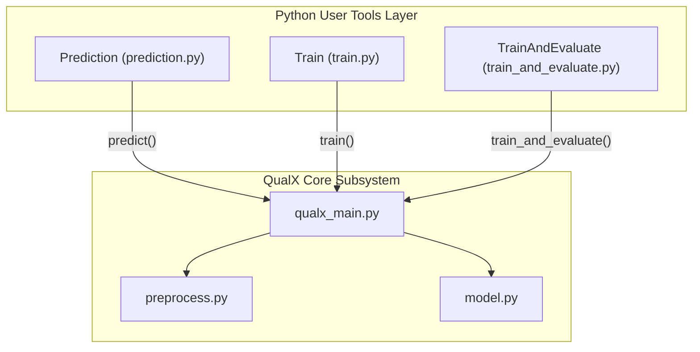
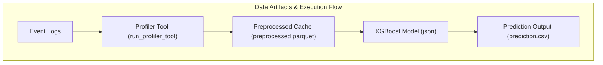

<!-- source: DeepWiki mcp.deepwiki.com · repo NVIDIA/cudf-spark-tools · page 5 QualX Machine Learning Subsystem · fetched 2026-10-26 -->

# QualX Machine Learning Subsystem

Relevant source files

The following files were used as context for generating this wiki page:

- [user_tools/docs/qualx.md](user_tools/docs/qualx.md)
- [user_tools/src/spark_rapids_pytools/rapids/qualx/prediction.py](user_tools/src/spark_rapids_pytools/rapids/qualx/prediction.py)
- [user_tools/src/spark_rapids_pytools/rapids/qualx/train.py](user_tools/src/spark_rapids_pytools/rapids/qualx/train.py)
- [user_tools/src/spark_rapids_pytools/rapids/qualx/train_and_evaluate.py](user_tools/src/spark_rapids_pytools/rapids/qualx/train_and_evaluate.py)
- [user_tools/src/spark_rapids_pytools/resources/qualx-pipeline-conf-example.yaml](user_tools/src/spark_rapids_pytools/resources/qualx-pipeline-conf-example.yaml)
- [user_tools/src/spark_rapids_tools/tools/qualx/model.py](user_tools/src/spark_rapids_tools/tools/qualx/model.py)
- [user_tools/src/spark_rapids_tools/tools/qualx/preprocess.py](user_tools/src/spark_rapids_tools/tools/qualx/preprocess.py)
- [user_tools/src/spark_rapids_tools/tools/qualx/qualx_main.py](user_tools/src/spark_rapids_tools/tools/qualx/qualx_main.py)
- [user_tools/src/spark_rapids_tools/tools/qualx/util.py](user_tools/src/spark_rapids_tools/tools/qualx/util.py)

The QualX subsystem provides an XGBoost-based machine learning pipeline designed to predict speedups for Apache Spark workloads running on NVIDIA GPUs via the cuDF accelerator plugin. By ingesting outputs from the Spark Rapids Qualification and Profiling tools, QualX forecasts application-level and SQL-level performance gains, aiding cluster operators in determining GPU acceleration viability.

Sources: `user_tools/src/spark_rapids_tools/tools/qualx/qualx_main.py:15-69` (), `user_tools/docs/qualx.md:1-24` ()

Sources: `user_tools/src/spark_rapids_tools/tools/qualx/qualx_main.py:28-65` (), `user_tools/src/spark_rapids_pytools/rapids/qualx/prediction.py:27-86` (), `user_tools/src/spark_rapids_pytools/rapids/qualx/train.py:24-65` (), `user_tools/src/spark_rapids_pytools/rapids/qualx/train_and_evaluate.py:24-44` ()

---

## 5.1 Training, Prediction and Evaluation Pipeline

For details, see [Training, Prediction and Evaluation Pipeline](#5.1). 

The pipeline subsystem coordinates data ingestion, feature transformation, hyperparameter optimization, model calibration, and batch inference. Entrypoints like `predict()` and `train()` in `qualx_main.py` handle orchestration, relying on `model.py` for training routines and optimization objectives. CLI wrappers delegate execution from the user-facing CLI to core analytical components.

Sources: `user_tools/src/spark_rapids_tools/tools/qualx/qualx_main.py:72-156` (), `user_tools/src/spark_rapids_pytools/rapids/qualx/prediction.py:27-86` (), `user_tools/src/spark_rapids_pytools/rapids/qualx/train.py:24-65` (), `user_tools/src/spark_rapids_pytools/rapids/qualx/train_and_evaluate.py:24-44` ()

---

## 5.2 Featurizers, Configuration and Hashing

For details, see [Featurizers, Configuration and Hashing](#5.2). 

Feature engineering relies on modular extraction scripts (`default.py` and `hash_plan.py`) defined in configuration files such as `qualx-conf.yaml`. These components ingest raw plan attributes and profiler logs, normalize categorical features, apply hashing strategies for plan structures, and organize datasets into training splits.

Sources: `user_tools/src/spark_rapids_tools/tools/qualx/preprocess.py:45-124` (), `user_tools/src/spark_rapids_pytools/resources/qualx-pipeline-conf-example.yaml:15-45` ()

---

## 5.3 Pretrained Model Artifacts

For details, see [Pretrained Model Artifacts](#5.3). 

QualX includes pre-trained XGBoost models distributed as JSON files, alongside calibration configuration parameters (`_calib.cfg`) and evaluation metrics. The model selection logic identifies matching target platforms (e.g., Databricks AWS/Azure, EMR, Dataproc, On-Premises) and runtime variants (such as Spark SQL or Photon) when executing inference tasks.

Sources: `user_tools/src/spark_rapids_tools/tools/qualx/qualx_main.py:72-122` (), `user_tools/docs/qualx.md:18-32` ()

Sources: `user_tools/src/spark_rapids_tools/tools/qualx/qualx_main.py:72-156` (), `user_tools/src/spark_rapids_tools/tools/qualx/preprocess.py:125-192` (), `user_tools/src/spark_rapids_pytools/rapids/qualx/prediction.py:61-86` ()

---

