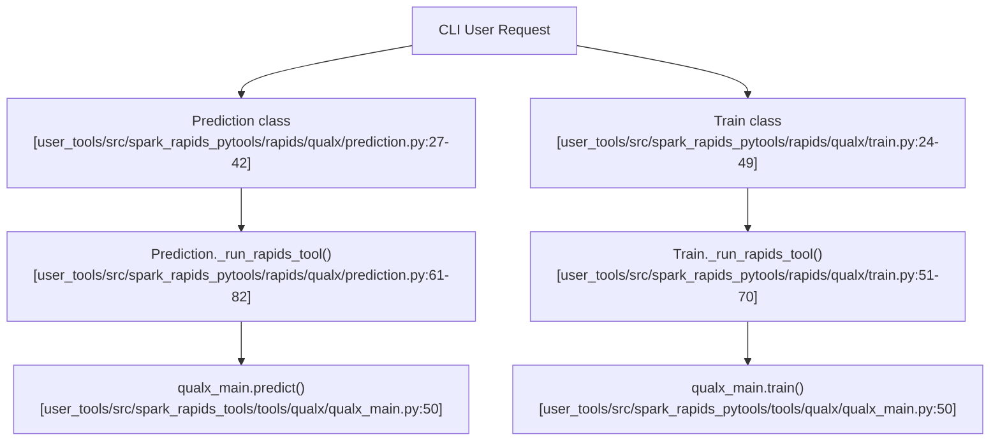
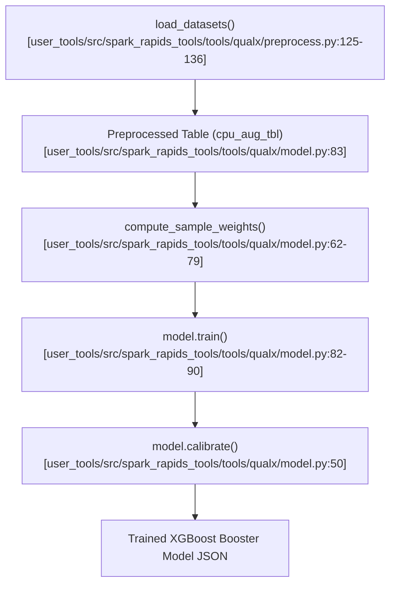

<!-- source: DeepWiki mcp.deepwiki.com · repo NVIDIA/cudf-spark-tools · page 5.1 Training, Prediction and Evaluation Pipeline · fetched 2026-10-26 -->

# Training, Prediction and Evaluation Pipeline

Relevant source files

The following files were used as context for generating this wiki page:

- [user_tools/docs/qualx.md](user_tools/docs/qualx.md)
- [user_tools/src/spark_rapids_pytools/build.py](user_tools/src/spark_rapids_pytools/build.py)
- [user_tools/src/spark_rapids_pytools/rapids/qualx/prediction.py](user_tools/src/spark_rapids_pytools/rapids/qualx/prediction.py)
- [user_tools/src/spark_rapids_pytools/rapids/qualx/train.py](user_tools/src/spark_rapids_pytools/rapids/qualx/train.py)
- [user_tools/src/spark_rapids_pytools/rapids/qualx/train_and_evaluate.py](user_tools/src/spark_rapids_pytools/rapids/qualx/train_and_evaluate.py)
- [user_tools/src/spark_rapids_pytools/resources/qualx-pipeline-conf-example.yaml](user_tools/src/spark_rapids_pytools/resources/qualx-pipeline-conf-example.yaml)
- [user_tools/src/spark_rapids_tools/tools/qualx/model.py](user_tools/src/spark_rapids_tools/tools/qualx/model.py)
- [user_tools/src/spark_rapids_tools/tools/qualx/preprocess.py](user_tools/src/spark_rapids_tools/tools/qualx/preprocess.py)
- [user_tools/src/spark_rapids_tools/tools/qualx/qualx_main.py](user_tools/src/spark_rapids_tools/tools/qualx/qualx_main.py)
- [user_tools/src/spark_rapids_tools/tools/qualx/qualx_pipeline.py](user_tools/src/spark_rapids_tools/tools/qualx/qualx_pipeline.py)
- [user_tools/src/spark_rapids_tools/tools/qualx/split_functions/split_stratified.py](user_tools/src/spark_rapids_tools/tools/qualx/split_functions/split_stratified.py)
- [user_tools/src/spark_rapids_tools/tools/qualx/util.py](user_tools/src/spark_rapids_tools/tools/qualx/util.py)
- [user_tools/tests/spark_rapids_tools_e2e/features/preprocess.feature](user_tools/tests/spark_rapids_tools_e2e/features/preprocess.feature)
- [user_tools/tests/spark_rapids_tools_e2e/features/steps/preprocess_steps.py](user_tools/tests/spark_rapids_tools_e2e/features/steps/preprocess_steps.py)
- [user_tools/tests/spark_rapids_tools_ut/qualx/test_modifiers.py](user_tools/tests/spark_rapids_tools_ut/qualx/test_modifiers.py)
- [user_tools/tests/spark_rapids_tools_ut/qualx/test_preprocess.py](user_tools/tests/spark_rapids_tools_ut/qualx/test_preprocess.py)
- [user_tools/tests/spark_rapids_tools_ut/qualx/test_qualx_config.py](user_tools/tests/spark_rapids_tools_ut/qualx/test_qualx_config.py)
- [user_tools/tests/spark_rapids_tools_ut/qualx/test_split_functions.py](user_tools/tests/spark_rapids_tools_ut/qualx/test_split_functions.py)

## Purpose and Scope
This page details the implementation of the QualX machine learning subsystem pipeline within `cudf-spark-tools`. It covers the software architecture bridging the user-facing Python CLI wrappers (`Prediction`, `Train`, and `TrainAndEvaluate`) to core execution functions in `qualx_main.py`, preprocessing utilities in `preprocess.py`, XGBoost model training and calibration routines in `model.py`, and automated pipeline orchestration in `qualx_pipeline.py`.

---

## 1. Pipeline Architecture and CLI Wrappers

The QualX ML workflow exposes high-level CLI commands through python tool wrappers. When a user runs a command like `spark_rapids prediction` or `spark_rapids train`, the request is routed through specialized wrapper classes inheriting from `QualXTool`.

* `Prediction` [user_tools/src/spark_rapids_pytools/rapids/qualx/prediction.py:27-42]() extracts the qualification output handler (`QualCore`) and invokes `predict()` from `qualx_main.py` [user_tools/src/spark_rapids_tools/tools/qualx/qualx_main.py:50]().
* `Train` [user_tools/src/spark_rapids_pytools/rapids/qualx/train.py:24-49]() manages dataset definitions, base model paths, and trial counts to call `train()` [user_tools/src/spark_rapids_tools/tools/qualx/qualx_main.py:50]().

*Sources: [user_tools/src/spark_rapids_pytools/rapids/qualx/prediction.py:27-82](), [user_tools/src/spark_rapids_pytools/rapids/qualx/train.py:24-70](), [user_tools/src/spark_rapids_tools/tools/qualx/qualx_main.py:50]() *

---

## 2. Data Preprocessing Subsystem (`preprocess.py`)

Raw Spark event logs must be preprocessed into tabular feature representations before training or inference. The preprocessing pipeline is managed by functions in `preprocess.py`.

* `load_datasets()` [user_tools/src/spark_rapids_tools/tools/qualx/preprocess.py:125-136]() loads JSON metadata defining datasets, app metadata, and platforms, caching intermediate Parquet results as `preprocessed.parquet` [user_tools/src/spark_rapids_tools/tools/qualx/preprocess.py:41]().
* `get_alignment()` [user_tools/src/spark_rapids_tools/tools/qualx/preprocess.py:49-84]() scans alignment directories to match historical CPU and GPU `appId` and `sqlID` runs.
* `get_featurizers()` [user_tools/src/spark_rapids_tools/tools/qualx/preprocess.py:87-100]() and `get_modifiers()` [user_tools/src/spark_rapids_tools/tools/qualx/preprocess.py:102-117]() lazily load user-specified feature extraction plugins and modifiers.

*Sources: [user_tools/src/spark_rapids_tools/tools/qualx/preprocess.py:41-136]() *

---

## 3. Training and Calibration Engine (`model.py` & `qualx_main.py`)

Model training utilizes XGBoost (`xgb.Booster`) with hyperparameter optimization and sample weighting.

### Key Functions and Data Flow
* `train()` [user_tools/src/spark_rapids_tools/tools/qualx/model.py:82-90]() splits preprocessed data into training, validation, and test partitions, applies log transformations to labels if enabled [user_tools/src/spark_rapids_tools/tools/qualx/model.py:96-98](), and builds `xgb.DMatrix` objects.
* `compute_sample_weights()` [user_tools/src/spark_rapids_tools/tools/qualx/model.py:62-79]() computes positive and negative sample weights automatically based on target thresholds.
* `calibrate()` [user_tools/src/spark_rapids_tools/tools/qualx/model.py:50]() adjusts model outputs using least-squares optimization against validation datasets.

*Sources: [user_tools/src/spark_rapids_tools/tools/qualx/preprocess.py:125-136](), [user_tools/src/spark_rapids_tools/tools/qualx/model.py:50-90]() *

---

## 4. Prediction and Evaluation Flow (`qualx_main.py`)

The prediction pipeline loads pre-trained or custom XGBoost models to estimate speedup metrics on unseen Spark qualification outputs.

* `_get_model()` [user_tools/src/spark_rapids_tools/tools/qualx/qualx_main.py:125-156]() resolves model paths by checking custom file arguments or locating platform-specific resource JSONs (`qualx/models/xgboost/{platform}.json`).
* `predict()` [user_tools/src/spark_rapids_tools/tools/qualx/qualx_main.py:50]() extracts features from qualification data, executes inference, and generates Shapley values via `compute_shapley_values()` [user_tools/src/spark_rapids_tools/tools/qualx/qualx_main.py:48]().
* `evaluate()` [qualx_main.py] computes evaluation metrics comparing predicted vs. actual speedups.

*Sources: [user_tools/src/spark_rapids_tools/tools/qualx/qualx_main.py:46-156]() *

---

## 5. Automated Pipeline Orchestration (`qualx_pipeline.py`)

Continuous integration of models over incoming customer logs is orchestrated by `qualx_pipeline.py` and `train_and_evaluate.py`.

* `_create_dataset_json()` [user_tools/src/spark_rapids_tools/tools/qualx/qualx_pipeline.py:38-47]() dynamically generates dataset JSON configurations from alignment DataFrames and eventlog paths.
* `_unzip_eventlogs()` [user_tools/src/spark_rapids_tools/tools/qualx/qualx_pipeline.py:124-130]() unpacks archived event logs into the structure expected by `QUALX_DATA_DIR`.

*Sources: [user_tools/src/spark_rapids_tools/tools/qualx/qualx_pipeline.py:38-130](), [user_tools/src/spark_rapids_pytools/rapids/qualx/train_and_evaluate.py]() *

---

