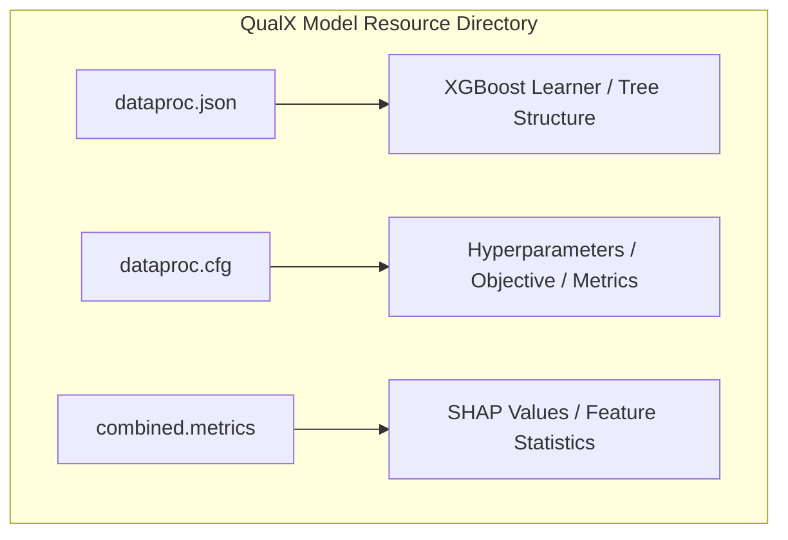
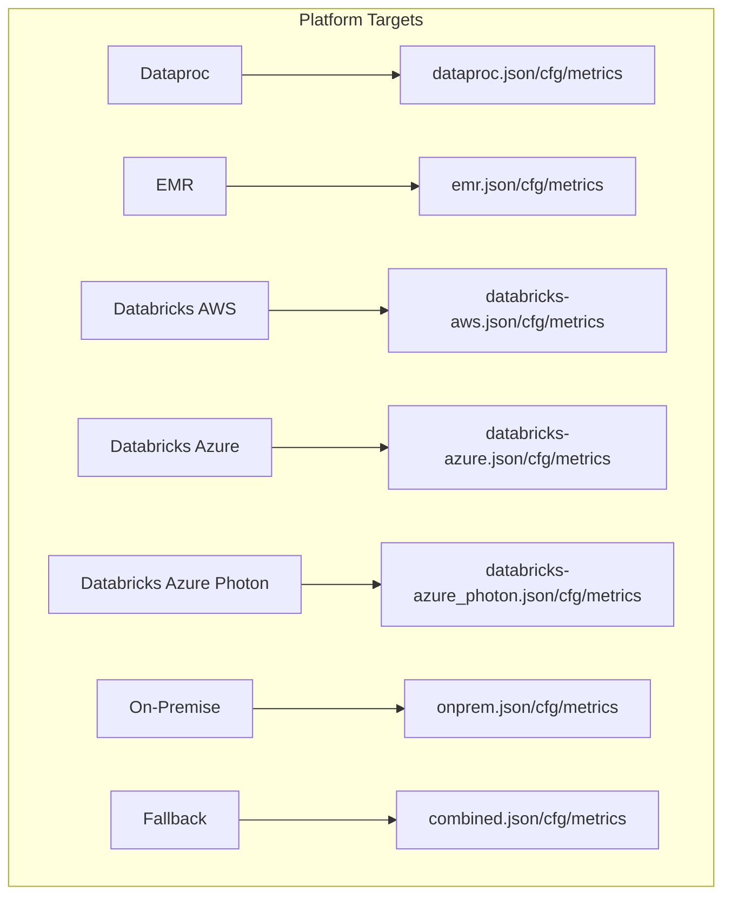
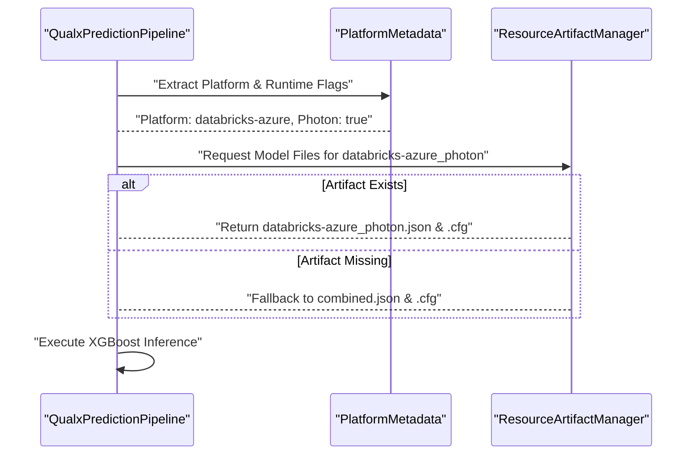

<!-- source: DeepWiki mcp.deepwiki.com · repo NVIDIA/cudf-spark-tools · page 5.3 Pretrained Model Artifacts · fetched 2026-10-26 -->

# Pretrained Model Artifacts

Relevant source files

The following files were used as context for generating this wiki page:

- [user_tools/src/spark_rapids_pytools/resources/qualx/models/xgboost/combined.cfg](user_tools/src/spark_rapids_pytools/resources/qualx/models/xgboost/combined.cfg)
- [user_tools/src/spark_rapids_pytools/resources/qualx/models/xgboost/combined.json](user_tools/src/spark_rapids_pytools/resources/qualx/models/xgboost/combined.json)
- [user_tools/src/spark_rapids_pytools/resources/qualx/models/xgboost/combined.metrics](user_tools/src/spark_rapids_pytools/resources/qualx/models/xgboost/combined.metrics)
- [user_tools/src/spark_rapids_pytools/resources/qualx/models/xgboost/databricks-aws.cfg](user_tools/src/spark_rapids_pytools/resources/qualx/models/xgboost/databricks-aws.cfg)
- [user_tools/src/spark_rapids_pytools/resources/qualx/models/xgboost/databricks-aws.json](user_tools/src/spark_rapids_pytools/resources/qualx/models/xgboost/databricks-aws.json)
- [user_tools/src/spark_rapids_pytools/resources/qualx/models/xgboost/databricks-aws.metrics](user_tools/src/spark_rapids_pytools/resources/qualx/models/xgboost/databricks-aws.metrics)
- [user_tools/src/spark_rapids_pytools/resources/qualx/models/xgboost/databricks-aws_photon.cfg](user_tools/src/spark_rapids_pytools/resources/qualx/models/xgboost/databricks-aws_photon.cfg)
- [user_tools/src/spark_rapids_pytools/resources/qualx/models/xgboost/databricks-aws_photon.json](user_tools/src/spark_rapids_pytools/resources/qualx/models/xgboost/databricks-aws_photon.json)
- [user_tools/src/spark_rapids_pytools/resources/qualx/models/xgboost/databricks-azure.cfg](user_tools/src/spark_rapids_pytools/resources/qualx/models/xgboost/databricks-azure.cfg)
- [user_tools/src/spark_rapids_pytools/resources/qualx/models/xgboost/databricks-azure.json](user_tools/src/spark_rapids_pytools/resources/qualx/models/xgboost/databricks-azure.json)
- [user_tools/src/spark_rapids_pytools/resources/qualx/models/xgboost/databricks-azure.metrics](user_tools/src/spark_rapids_pytools/resources/qualx/models/xgboost/databricks-azure.metrics)
- [user_tools/src/spark_rapids_pytools/resources/qualx/models/xgboost/databricks-azure_photon.cfg](user_tools/src/spark_rapids_pytools/resources/qualx/models/xgboost/databricks-azure_photon.cfg)
- [user_tools/src/spark_rapids_pytools/resources/qualx/models/xgboost/databricks-azure_photon.json](user_tools/src/spark_rapids_pytools/resources/qualx/models/xgboost/databricks-azure_photon.json)
- [user_tools/src/spark_rapids_pytools/resources/qualx/models/xgboost/databricks-azure_photon.metrics](user_tools/src/spark_rapids_pytools/resources/qualx/models/xgboost/databricks-azure_photon.metrics)
- [user_tools/src/spark_rapids_pytools/resources/qualx/models/xgboost/dataproc.cfg](user_tools/src/spark_rapids_pytools/resources/qualx/models/xgboost/dataproc.cfg)
- [user_tools/src/spark_rapids_pytools/resources/qualx/models/xgboost/dataproc.json](user_tools/src/spark_rapids_pytools/resources/qualx/models/xgboost/dataproc.json)
- [user_tools/src/spark_rapids_pytools/resources/qualx/models/xgboost/dataproc.metrics](user_tools/src/spark_rapids_pytools/resources/qualx/models/xgboost/dataproc.metrics)
- [user_tools/src/spark_rapids_pytools/resources/qualx/models/xgboost/emr.cfg](user_tools/src/spark_rapids_pytools/resources/qualx/models/xgboost/emr.cfg)
- [user_tools/src/spark_rapids_pytools/resources/qualx/models/xgboost/emr.json](user_tools/src/spark_rapids_pytools/resources/qualx/models/xgboost/emr.json)
- [user_tools/src/spark_rapids_pytools/resources/qualx/models/xgboost/emr.metrics](user_tools/src/spark_rapids_pytools/resources/qualx/models/xgboost/emr.metrics)
- [user_tools/src/spark_rapids_pytools/resources/qualx/models/xgboost/onprem.cfg](user_tools/src/spark_rapids_pytools/resources/qualx/models/xgboost/onprem.cfg)
- [user_tools/src/spark_rapids_pytools/resources/qualx/models/xgboost/onprem.json](user_tools/src/spark_rapids_pytools/resources/qualx/models/xgboost/onprem.json)
- [user_tools/src/spark_rapids_pytools/resources/qualx/models/xgboost/onprem.metrics](user_tools/src/spark_rapids_pytools/resources/qualx/models/xgboost/onprem.metrics)

## Purpose and Scope

This page details the pretrained machine learning model artifacts utilized by the QualX subsystem within `cudf-spark-tools`. Located under `user_tools/src/spark_rapids_pytools/resources/qualx/models/xgboost/`, these artifacts consist of serialized XGBoost models, configurations, and feature metrics tailored for specific cloud platforms, on-premise environments, and specialized runtime engines (such as Databricks Photon). This documentation explains the file structures (`.json`, `.cfg`, `.metrics`), platform coverage, and the selection mechanisms applied during prediction time.

---

## Artifact File Types and Structure

The QualX subsystem packages pretrained models in triplets for each supported deployment environment:
1. **Model JSON (`.json`)**: Contains the complete XGBoost learner representation, including feature names, feature types, gradient booster parameters, node splits, and tree weights. [user_tools/src/spark_rapids_pytools/resources/qualx/models/xgboost/dataproc.json:1-1]()
2. **Configuration (`.cfg`)**: Encapsulates the learning parameters, objective definitions (`reg:squarederror`), evaluation metrics (`mae`, `mape`), and tree method configurations. [user_tools/src/spark_rapids_pytools/resources/qualx/models/xgboost/dataproc.cfg:1-1]()
3. **Metrics (`.metrics`)**: Provides statistical profiling and SHAP value rankings for features used by the model during training and evaluation. [user_tools/src/spark_rapids_pytools/resources/qualx/models/xgboost/combined.metrics:1-64]()

*Sources: [user_tools/src/spark_rapids_pytools/resources/qualx/models/xgboost/dataproc.json:1-1](), [user_tools/src/spark_rapids_pytools/resources/qualx/models/xgboost/dataproc.cfg:1-1](), [user_tools/src/spark_rapids_pytools/resources/qualx/models/xgboost/combined.metrics:1-64]()*

---

## Platform-Specific Model Coverage

To capture environment-specific performance characteristics (such as IO throughput, shuffle performance, and hardware profile differences), separate models are maintained for major deployment platforms:

| Platform Identifier | Artifact Prefix | Description |
| :--- | :--- | :--- |
| Google Cloud Dataproc | `dataproc` | Optimized for GCP infrastructure patterns [user_tools/src/spark_rapids_pytools/resources/qualx/models/xgboost/dataproc.json:1-1]() |
| AWS EMR | `emr` | Tuned for Amazon EMR cluster execution profiles [user_tools/src/spark_rapids_pytools/resources/qualx/models/xgboost/emr.json:1-1]() |
| Databricks AWS | `databricks-aws` | Targeted at Databricks on AWS [user_tools/src/spark_rapids_pytools/resources/qualx/models/xgboost/databricks-aws.json:1-1]() |
| Databricks Azure | `databricks-azure` | Tailored for Databricks on Microsoft Azure [user_tools/src/spark_rapids_pytools/resources/qualx/models/xgboost/databricks-azure.json:1-1]() |
| Databricks AWS Photon | `databricks-aws_photon` | Specialized for Databricks AWS with the Photon vector engine |
| Databricks Azure Photon | `databricks-azure_photon` | Specialized for Databricks Azure with the Photon vector engine [user_tools/src/spark_rapids_pytools/resources/qualx/models/xgboost/databricks-azure_photon.json:1-1]() |
| On-Premise | `onprem` | General-purpose on-premise cluster configurations [user_tools/src/spark_rapids_pytools/resources/qualx/models/xgboost/onprem.json:1-1]() |
| Fallback Combined | `combined` | Aggregate model used when platform-specific data is absent [user_tools/src/spark_rapids_pytools/resources/qualx/models/xgboost/combined.json:1-1]() |

*Sources: [user_tools/src/spark_rapids_pytools/resources/qualx/models/xgboost/dataproc.json:1-1](), [user_tools/src/spark_rapids_pytools/resources/qualx/models/xgboost/emr.json:1-1](), [user_tools/src/spark_rapids_pytools/resources/qualx/models/xgboost/databricks-aws.json:1-1](), [user_tools/src/spark_rapids_pytools/resources/qualx/models/xgboost/databricks-azure.json:1-1](), [user_tools/src/spark_rapids_pytools/resources/qualx/models/xgboost/onprem.json:1-1](), [user_tools/src/spark_rapids_pytools/resources/qualx/models/xgboost/combined.json:1-1]()*

---

## Selection Mechanism at Prediction Time

During job inference and qualification analysis, the prediction pipeline inspects the target platform metadata and runtime characteristics (such as whether Photon is enabled) to dynamically resolve the appropriate artifact set.

*Sources: [user_tools/src/spark_rapids_pytools/resources/qualx/models/xgboost/databricks-azure_photon.json:1-1](), [user_tools/src/spark_rapids_pytools/resources/qualx/models/xgboost/combined.json:1-1]()*

---

