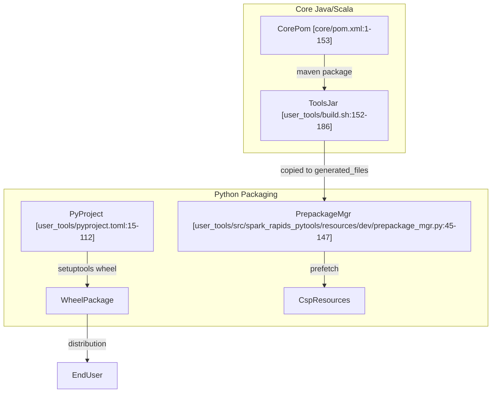
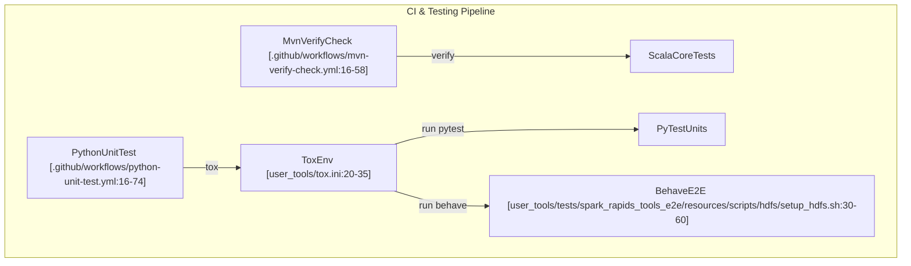

<!-- source: DeepWiki mcp.deepwiki.com · repo NVIDIA/cudf-spark-tools · page 6 Build, Testing and Infrastructure · fetched 2026-10-26 -->

# Build, Testing and Infrastructure

Relevant source files

The following files were used as context for generating this wiki page:

- [.github/workflows/mvn-verify-check.yml](.github/workflows/mvn-verify-check.yml)
- [.github/workflows/python-unit-test.yml](.github/workflows/python-unit-test.yml)
- [core/README.md](core/README.md)
- [core/pom.xml](core/pom.xml)
- [scripts/prefetch_deps.sh](scripts/prefetch_deps.sh)
- [user_tools/README.md](user_tools/README.md)
- [user_tools/build.sh](user_tools/build.sh)
- [user_tools/pyproject.toml](user_tools/pyproject.toml)
- [user_tools/src/spark_rapids_pytools/__init__.py](user_tools/src/spark_rapids_pytools/__init__.py)
- [user_tools/src/spark_rapids_pytools/resources/dev/prepackage_mgr.py](user_tools/src/spark_rapids_pytools/resources/dev/prepackage_mgr.py)
- [user_tools/tests/spark_rapids_tools_e2e/resources/scripts/hdfs/setup_hdfs.sh](user_tools/tests/spark_rapids_tools_e2e/resources/scripts/hdfs/setup_hdfs.sh)
- [user_tools/tox.ini](user_tools/tox.ini)

This page outlines the build infrastructure, packaging mechanics, continuous integration workflows, and test suites supporting `cudf-spark-tools`. The repository combines a Scala core module managed via Apache Maven with a Python wrapper and orchestration layer governed by PyPA standards (`pyproject.toml`) and tox environments.

## Overview of Build and Infrastructure Architecture

Sources: `core/pom.xml:1-153`, `user_tools/pyproject.toml:15-112`, `user_tools/build.sh:152-186`, `user_tools/src/spark_rapids_pytools/resources/dev/prepackage_mgr.py:45-147`

## Maven Build and Spark Shims

The Scala core component (`core/`) relies on Apache Maven to support a matrix of Spark versions, Scala runtimes (2.12 and 2.13), and target shading profiles [core/pom.xml:1-153, core/README.md:26-35]. Dynamic properties via `-Dbuildver` control compatibility shims, allowing developers to target specific Apache Spark releases [core/pom.xml:76-153, core/README.md:37-43].

For details, see [Maven Build and Spark Shims](#6.1).

Sources: `core/pom.xml:1-153`, `core/README.md:26-43`

## Python Packaging and Prepackaging

The Python layer (`user_tools/`) is defined by `pyproject.toml` [user_tools/pyproject.toml:15-112] and built using `build.sh` [user_tools/build.sh:1-197]. It supports both "fat" and "non-fat" modes, bundling prepackaged cloud service provider (CSP) dependencies and core JARs [user_tools/build.sh:69-76, user_tools/src/spark_rapids_pytools/resources/dev/prepackage_mgr.py:45-147]. Prefetch scripts optimize offline cache availability for testing and container environments [scripts/prefetch_deps.sh:30-123].

For details, see [Python Packaging and Prepackaging](#6.2).

Sources: `user_tools/pyproject.toml:15-112`, `user_tools/build.sh:1-197`, `user_tools/src/spark_rapids_pytools/resources/dev/prepackage_mgr.py:45-147`, `scripts/prefetch_deps.sh:30-123`

## CI Workflows and Code Standards

Continuous integration relies on GitHub Actions workflows (`mvn-verify-check.yml`, `python-unit-test.yml`) to validate multi-version Java/Scala builds and Python tox environments [`.github/workflows/mvn-verify-check.yml:16-58`, `.github/workflows/python-unit-test.yml:16-74`]. Code standards are enforced through pylint, flake8, and formatting rules configured in `tox.ini` [user_tools/tox.ini:20-109].

For details, see [CI Workflows and Code Standards](#6.3).

Sources: `.github/workflows/mvn-verify-check.yml:16-58`, `.github/workflows/python-unit-test.yml:16-74`, `user_tools/tox.ini:20-109`

## Test Suites and Fixtures

Testing encompasses Scala suite unit tests, qualification expectation golden sets [core/README.md:65-73], Python pytest units, and behave end-to-end tests featuring HDFS and CSP setup scripts [user_tools/tox.ini:36-53, user_tools/tests/spark_rapids_tools_e2e/resources/scripts/hdfs/setup_hdfs.sh:30-174].

For details, see [Test Suites and Fixtures](#6.4).

Sources: `core/README.md:65-73`, `user_tools/tox.ini:36-53`, `user_tools/tests/spark_rapids_tools_e2e/resources/scripts/hdfs/setup_hdfs.sh:30-174`

Sources: `.github/workflows/mvn-verify-check.yml:16-58`, `.github/workflows/python-unit-test.yml:16-74`, `user_tools/tox.ini:20-35`, `user_tools/tests/spark_rapids_tools_e2e/resources/scripts/hdfs/setup_hdfs.sh:30-60`

---

