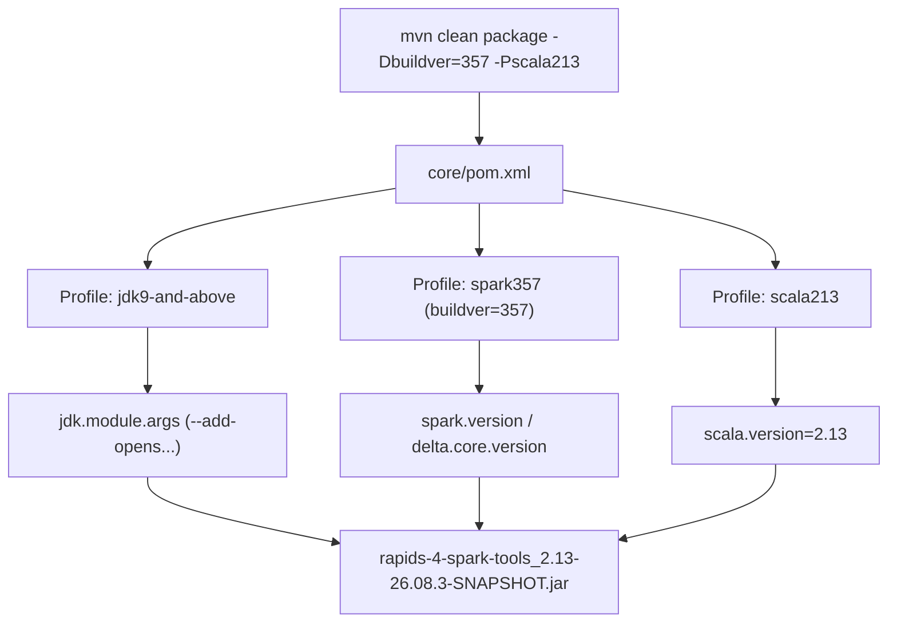
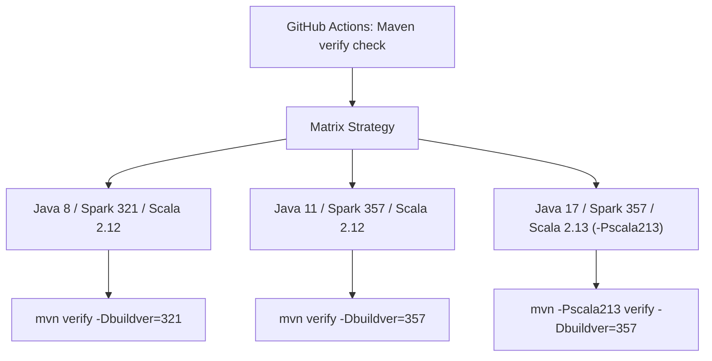
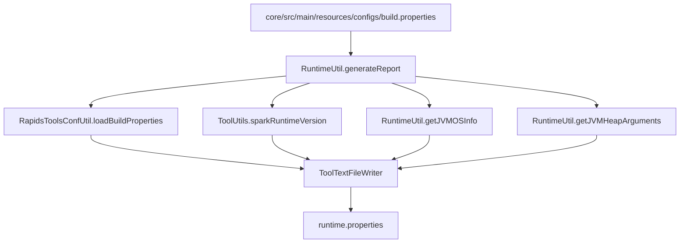

<!-- source: DeepWiki mcp.deepwiki.com · repo NVIDIA/cudf-spark-tools · page 6.1 Maven Build and Spark Shims · fetched 2026-10-26 -->

# Maven Build and Spark Shims

Relevant source files

The following files were used as context for generating this wiki page:

- [.github/workflows/mvn-verify-check.yml](.github/workflows/mvn-verify-check.yml)
- [core/README.md](core/README.md)
- [core/pom.xml](core/pom.xml)
- [core/src/main/resources/configs/build.properties](core/src/main/resources/configs/build.properties)
- [core/src/main/scala/com/nvidia/spark/rapids/SparkRapidsBuildInfoEvent.scala](core/src/main/scala/com/nvidia/spark/rapids/SparkRapidsBuildInfoEvent.scala)
- [core/src/main/scala/org/apache/spark/rapids/tool/benchmarks/DevRuntimeCheckpoint.scala](core/src/main/scala/org/apache/spark/rapids/tool/benchmarks/DevRuntimeCheckpoint.scala)
- [core/src/main/scala/org/apache/spark/rapids/tool/benchmarks/NoOpRuntimeCheckpoint.scala](core/src/main/scala/org/apache/spark/rapids/tool/benchmarks/NoOpRuntimeCheckpoint.scala)
- [core/src/main/scala/org/apache/spark/rapids/tool/benchmarks/RuntimeCheckpointTrait.scala](core/src/main/scala/org/apache/spark/rapids/tool/benchmarks/RuntimeCheckpointTrait.scala)
- [core/src/main/scala/org/apache/spark/rapids/tool/benchmarks/RuntimeInjector.scala](core/src/main/scala/org/apache/spark/rapids/tool/benchmarks/RuntimeInjector.scala)
- [core/src/main/scala/org/apache/spark/scheduler/SparkListenerEvent.scala](core/src/main/scala/org/apache/spark/scheduler/SparkListenerEvent.scala)
- [core/src/main/scala/org/apache/spark/scheduler/ToolsListenerEventExtraAPIs.scala](core/src/main/scala/org/apache/spark/scheduler/ToolsListenerEventExtraAPIs.scala)
- [core/src/main/scala/org/apache/spark/sql/rapids/tool/util/RuntimeUtil.scala](core/src/main/scala/org/apache/spark/sql/rapids/tool/util/RuntimeUtil.scala)
- [core/src/main/scala/org/apache/spark/sql/rapids/tool/util/stubs/GraphReflectionEntry.scala](core/src/main/scala/org/apache/spark/sql/rapids/tool/util/stubs/GraphReflectionEntry.scala)
- [core/src/main/scala/org/apache/spark/sql/rapids/tool/util/stubs/StageInfoStub.scala](core/src/main/scala/org/apache/spark/sql/rapids/tool/util/stubs/StageInfoStub.scala)
- [user_tools/src/spark_rapids_pytools/__init__.py](user_tools/src/spark_rapids_pytools/__init__.py)

## Purpose and Scope
This page details the build architecture, profile configuration, and multi-version Spark shim strategy for the `cudf-spark-tools` core module (`rapids-4-spark-tools`). It covers `core/pom.xml` build profiles [core/pom.xml:1-153](), the `buildver` matrix [core/README.md:37-45](), Scala 2.12 and 2.13 target support [core/README.md:26-28](), CI matrix verification workflows [.github/workflows/mvn-verify-check.yml:22-58](), and runtime/build metadata generation via `RuntimeUtil` [core/src/main/scala/org/apache/spark/sql/rapids/tool/util/RuntimeUtil.scala:37-74]() and `build.properties` [core/src/main/resources/configs/build.properties:1-35]().

---

## 1. Maven Build Configuration and Spark Version Matrix

The core module uses Apache Maven to build artifacts that interface with various Apache Spark versions and Scala runtimes [core/README.md:20-29](). Because Spark internal APIs and binary compatibility shift across minor versions (e.g., Spark 3.2.x through Spark 3.5.x), `core/pom.xml` [core/pom.xml:17-153]() defines an activation matrix driven by the `-Dbuildver=XXX` command-line property [core/README.md:37-45]().

### Build Profiles and Properties
- **`buildver` Profiles**: Activating a specific profile (such as `spark320`, `spark321`, or default Spark 3.5.7) dynamically injects the corresponding Spark artifact versions, Delta Lake core versions, and Iceberg runtime versions into the Maven property scope [core/pom.xml:75-153]().
- **Scala Version Profiles**: By default, builds target Scala 2.12, producing artifacts named `rapids-4-spark-tools_2.12-*.jar` [core/README.md:26-28](). Passing `-Pscala213` switches the Scala dependency and compiler targets to Scala 2.13 (`rapids-4-spark-tools_2.13-*.jar`) [core/README.md:26-28]().
- **JDK 9+ Module System Profile**: The `jdk9-and-above` profile automatically activates on JDK 9 or higher, injecting necessary `--add-opens` JVM arguments into the test and build lifecycle to allow reflection-based access to internal JDK and Spark structures [core/pom.xml:64-74]().

Sources: `core/pom.xml` [core/pom.xml:1-153](), `core/README.md` [core/README.md:20-54]()

---

## 2. CI Verification Matrix and Workflows

Continuous integration uses GitHub Actions to verify compilation and test suites across combinations of Java versions, Spark build versions, and Scala runtimes [.github/workflows/mvn-verify-check.yml:22-58]().

The verification matrix includes:
- **Java Runtimes**: Temurin JDK 8, 11, and 17 [.github/workflows/mvn-verify-check.yml:29-48]().
- **Spark Build Versions**: Spark `321`, `357`, etc [.github/workflows/mvn-verify-check.yml:30-38]().
- **Scala Versions**: Scala 2.12 (default) and Scala 2.13 (via `-Pscala213`) [.github/workflows/mvn-verify-check.yml:31-57]().

Sources: `.github/workflows/mvn-verify-check.yml` [.github/workflows/mvn-verify-check.yml:1-69]()

---

## 3. Build and Runtime Information Utilities

To assist with troubleshooting and environment auditing, the core module captures build-time properties and combines them with runtime JVM and OS metrics [core/src/main/scala/org/apache/spark/sql/rapids/tool/util/RuntimeUtil.scala:30-37]().

### Build Properties Template
Maven filters `core/src/main/resources/configs/build.properties` during packaging to embed version identifiers [core/src/main/resources/configs/build.properties:1-35]():
- `build.version`: `${project.version}` [core/src/main/resources/configs/build.properties:21]()
- `build.spark.version`: `${spark.version}` [core/src/main/resources/configs/build.properties:22]()
- `build.hadoop.version`: `${hadoop.version}` [core/src/main/resources/configs/build.properties:23]()
- `build.java.version`: `${java.version}` [core/src/main/resources/configs/build.properties:24]()
- `build.scala.version`: `${scala.version}` [core/src/main/resources/configs/build.properties:25]()

### `RuntimeUtil` Implementation
`RuntimeUtil` loads these properties, appends the runtime Spark version (`ToolUtils.sparkRuntimeVersion`), and collects JVM/OS attributes and heap arguments [core/src/main/scala/org/apache/spark/sql/rapids/tool/util/RuntimeUtil.scala:37-74]().

- `getJVMOSInfo`: Inspects `System.getProperty` for JVM name/version and OS name/version [core/src/main/scala/org/apache/spark/sql/rapids/tool/util/RuntimeUtil.scala:80-87]().
- `getJVMHeapArguments`: Uses `ManagementFactory.getRuntimeMXBean` to extract `-Xmx`, `-Xms`, and `-XX:` garbage collection flags [core/src/main/scala/org/apache/spark/sql/rapids/tool/util/RuntimeUtil.scala:89-108]().
- `generateReport`: Serializes these properties into `runtime.properties` within the tool output directory via `ToolTextFileWriter` [core/src/main/scala/org/apache/spark/sql/rapids/tool/util/RuntimeUtil.scala:50-74]().

Additionally, `SparkRapidsBuildInfoEvent` represents a Spark listener event used to capture plugin build metadata from event logs [core/src/main/scala/com/nvidia/spark/rapids/SparkRapidsBuildInfoEvent.scala:29-39]().

Sources: `core/src/main/scala/org/apache/spark/sql/rapids/tool/util/RuntimeUtil.scala` [core/src/main/scala/org/apache/spark/sql/rapids/tool/util/RuntimeUtil.scala:1-121](), `core/src/main/resources/configs/build.properties` [core/src/main/resources/configs/build.properties:1-35](), `core/src/main/scala/com/nvidia/spark/rapids/SparkRapidsBuildInfoEvent.scala` [core/src/main/scala/com/nvidia/spark/rapids/SparkRapidsBuildInfoEvent.scala:1-39]()

---

## 4. Benchmark Checkpoints and Runtime Injection

The core build and test framework supports optional runtime benchmarking and memory tracking via `RuntimeInjector` [core/src/main/scala/org/apache/spark/rapids/tool/benchmarks/RuntimeInjector.scala:21-44](). 

- **`RuntimeCheckpointTrait`**: Defines the interface for inserting memory markers and checkpoints during execution [core/src/main/scala/org/apache/spark/rapids/tool/benchmarks/RuntimeCheckpointTrait.scala:23-29]().
- **`NoOpRuntimeCheckpoint`**: The default production implementation that performs no operations when checkpoints are invoked [core/src/main/scala/org/apache/spark/rapids/tool/benchmarks/NoOpRuntimeCheckpoint.scala:21-29]().
- **`DevRuntimeCheckpoint`**: Activated when the build property `build.benchmarks.checkpoints` contains `dev`; logs JVM heap usage statistics via `RuntimeUtil.getJVMHeapInfo` [core/src/main/scala/org/apache/spark/rapids/tool/benchmarks/DevRuntimeCheckpoint.scala:21-37](), [core/src/main/scala/org/apache/spark/rapids/tool/benchmarks/RuntimeInjector.scala:30-38]().

Sources: `core/src/main/scala/org/apache/spark/rapids/tool/benchmarks/RuntimeInjector.scala` [core/src/main/scala/org/apache/spark/rapids/tool/benchmarks/RuntimeInjector.scala:1-44](), `core/src/main/scala/org/apache/spark/rapids/tool/benchmarks/DevRuntimeCheckpoint.scala` [core/src/main/scala/org/apache/spark/rapids/tool/benchmarks/DevRuntimeCheckpoint.scala:1-37](), `core/src/main/scala/org/apache/spark/rapids/tool/benchmarks/NoOpRuntimeCheckpoint.scala` [core/src/main/scala/org/apache/spark/rapids/tool/benchmarks/NoOpRuntimeCheckpoint.scala:1-29]()

---

