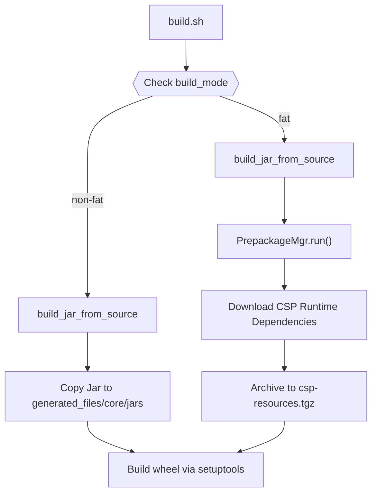
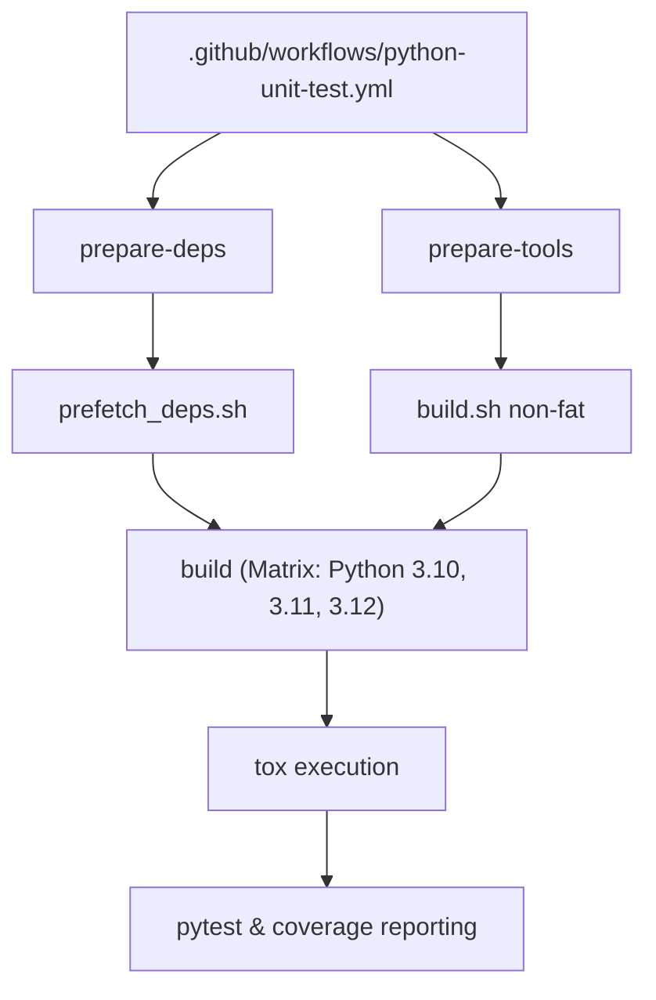

<!-- source: DeepWiki mcp.deepwiki.com · repo NVIDIA/cudf-spark-tools · page 6.2 Python Packaging and Prepackaging · fetched 2026-10-26 -->

# Python Packaging and Prepackaging

Relevant source files

The following files were used as context for generating this wiki page:

- [.github/workflows/python-unit-test.yml](.github/workflows/python-unit-test.yml)
- [scripts/prefetch_deps.sh](scripts/prefetch_deps.sh)
- [user_tools/README.md](user_tools/README.md)
- [user_tools/build.sh](user_tools/build.sh)
- [user_tools/pyproject.toml](user_tools/pyproject.toml)
- [user_tools/src/spark_rapids_pytools/build.py](user_tools/src/spark_rapids_pytools/build.py)
- [user_tools/src/spark_rapids_pytools/resources/dev/prepackage_mgr.py](user_tools/src/spark_rapids_pytools/resources/dev/prepackage_mgr.py)
- [user_tools/src/spark_rapids_tools/tools/qualx/qualx_pipeline.py](user_tools/src/spark_rapids_tools/tools/qualx/qualx_pipeline.py)
- [user_tools/src/spark_rapids_tools/tools/qualx/split_functions/split_stratified.py](user_tools/src/spark_rapids_tools/tools/qualx/split_functions/split_stratified.py)
- [user_tools/tests/spark_rapids_tools_e2e/features/preprocess.feature](user_tools/tests/spark_rapids_tools_e2e/features/preprocess.feature)
- [user_tools/tests/spark_rapids_tools_e2e/features/steps/preprocess_steps.py](user_tools/tests/spark_rapids_tools_e2e/features/steps/preprocess_steps.py)
- [user_tools/tests/spark_rapids_tools_e2e/resources/scripts/hdfs/setup_hdfs.sh](user_tools/tests/spark_rapids_tools_e2e/resources/scripts/hdfs/setup_hdfs.sh)
- [user_tools/tests/spark_rapids_tools_ut/qualx/test_modifiers.py](user_tools/tests/spark_rapids_tools_ut/qualx/test_modifiers.py)
- [user_tools/tests/spark_rapids_tools_ut/qualx/test_preprocess.py](user_tools/tests/spark_rapids_tools_ut/qualx/test_preprocess.py)
- [user_tools/tests/spark_rapids_tools_ut/qualx/test_qualx_config.py](user_tools/tests/spark_rapids_tools_ut/qualx/test_qualx_config.py)
- [user_tools/tests/spark_rapids_tools_ut/qualx/test_split_functions.py](user_tools/tests/spark_rapids_tools_ut/qualx/test_split_functions.py)
- [user_tools/tox.ini](user_tools/tox.ini)

This page documents the Python packaging structure, build pipeline, prepackaging mechanisms, dependency prefetching scripts, and test environment configuration for the `cudf-spark-tools` repository. It focuses on the `spark-rapids-user-tools` Python package (`user_tools/`), its dependency management via `pyproject.toml`, build orchestration through `build.sh`, resource prepackaging via `PrepackageMgr`, and multi-environment testing via `tox` and GitHub Actions.

---

## 1. Project Metadata and Dependencies (`pyproject.toml`)

The Python package `spark-rapids-user-tools` is defined via `user_tools/pyproject.toml` [user_tools/pyproject.toml:19-97](). It uses `setuptools` as the build backend (`[build-system]`) [user_tools/pyproject.toml:15-18]() and targets Python versions `>=3.10,<3.13` [user_tools/pyproject.toml:26]().

### Key Project Components in `pyproject.toml`
- **Dependencies (`[project] dependencies`)**: Includes core runtime libraries required for data processing, cloud interaction, and machine learning prediction, such as `numpy>=2.2.6` [user_tools/pyproject.toml:38](), `pandas==2.3.0` [user_tools/pyproject.toml:46](), `pydantic==2.11.7` [user_tools/pyproject.toml:67](), `pyarrow==23.0.1` [user_tools/pyproject.toml:72](), `xgboost==3.0.2` [user_tools/pyproject.toml:81](), and `pyspark>=3.5.7,<4.0.0` [user_tools/pyproject.toml:91]().
- **Console Entrypoints (`[project.scripts]`)**: Defines CLI wrappers exposed to the user environment [user_tools/pyproject.toml:100-104]():
  - `spark_rapids_user_tools = "spark_rapids_pytools.wrapper:main"` [user_tools/pyproject.toml:101]()
  - `spark_rapids = "spark_rapids_tools.cmdli.tools_cli:main"` [user_tools/pyproject.toml:102]()
  - `spark_rapids_dev = "spark_rapids_tools.cmdli.dev_cli:main"` [user_tools/pyproject.toml:103]()
- **Optional Dependencies (`[project.optional-dependencies]`)**: Modular extras for testing, linting, and model plotting (`test`, `qualx`, `dev-env`) [user_tools/pyproject.toml:115-155]().

Sources: [user_tools/pyproject.toml:1-155]()

---

## 2. Build Script Architecture and Fat vs. Non-Fat Modes (`user_tools/build.sh`)

The shell script `user_tools/build.sh` manages the packaging lifecycle, supporting two distinct compilation modes: **non-fat** and **fat** [user_tools/build.sh:17-25]().

### Build Modes
1. **Non-Fat Mode**: Builds or downloads the Scala tools JAR (`rapids-4-spark-tools_*.jar`) and bundles it inside the wheel package without embedding heavy cloud service provider (CSP) dependencies [user_tools/build.sh:24-25]().
2. **Fat Mode**: Bundles the tools JAR along with pre-downloaded CSP runtime dependencies into a self-contained archive (`csp-resources.tgz`), enabling execution in air-gapped or restricted network environments [user_tools/README.md:69-76](), [user_tools/build.sh:22-23]().

### Build Orchestration Diagram

*Figure 1: Control flow mapping build invocation modes to artifact assembly.*

Sources: [user_tools/build.sh:1-197](), [user_tools/README.md:52-77]()

---

## 3. Prepackaging Management (`PrepackageMgr`)

The class `PrepackageMgr` (located in `user_tools/src/spark_rapids_pytools/resources/dev/prepackage_mgr.py`) automates the discovery, downloading, and archiving of runtime dependencies specified in platform configuration JSON files [user_tools/src/spark_rapids_pytools/resources/dev/prepackage_mgr.py:45-147]().

### Key Methods and Data Flow
- `__init__(resource_dir, dest_dir, tools_jar, archive_enabled, fetch_all_csp)`: Initializes directory pointers, resolving absolute paths via `FSUtil` [user_tools/src/spark_rapids_pytools/resources/dev/prepackage_mgr.py:71-92]().
- `_fetch_resources()`: Inspects platform configuration files (`<platform>-configs.json`) across supported CSPs (`onprem`, `dataproc`, `emr`, `databricks`), extracts dependency lists via `RapidsTool.get_rapids_tools_dependencies()`, and registers target URIs [user_tools/src/spark_rapids_pytools/resources/dev/prepackage_mgr.py:98-140]().
- `_download_resources()`: Iterates through resolved URIs and invokes `DownloadManager` to pull external JARs and resources locally [user_tools/src/spark_rapids_pytools/resources/dev/prepackage_mgr.py:142-147]().

Sources: [user_tools/src/spark_rapids_pytools/resources/dev/prepackage_mgr.py:1-147]()

---

## 4. Dependency Prefetching (`prefetch_deps.sh`)

The script `scripts/prefetch_deps.sh` prefetches heavy runtime artifacts (such as Spark archives, Hadoop distributions, and GCS/Azure connector JARs) into a local cache directory (`RAPIDS_USER_TOOLS_CACHE_FOLDER`) prior to running unit and end-to-end tests [scripts/prefetch_deps.sh:1-122]().

### Prefetch Logic
1. **Config Parsing**: Executes an embedded Python snippet to parse per-platform configuration JSON files (`-configs.json`), identifying the active build version and collecting download URIs [scripts/prefetch_deps.sh:54-95]().
2. **Hadoop Integration**: Automatically appends the Hadoop distribution tarball URL (e.g., Hadoop 3.3.6) to support local HDFS E2E test fixtures [scripts/prefetch_deps.sh:97-101]().
3. **Robust Download**: Iterates through collected URIs, downloading artifacts via `curl` with automatic retries and fallback handling [scripts/prefetch_deps.sh:106-119]().

Sources: [scripts/prefetch_deps.sh:1-122]()

---

## 5. Testing and Isolation Framework (`tox.ini` & CI Workflows)

Python unit tests, static code analysis, and linting are orchestrated using `tox` [user_tools/tox.ini:15-35]() and GitHub Actions workflows [शैand .github/workflows/python-unit-test.yml:1-108]().

### Tox Environments (`tox.ini`)
- `prepare`: Triggers a non-fat build via `build.sh` to compile the Scala tools JAR and stage report configurations into `spark_rapids_pytools/resources/generated_files` [user_tools/tox.ini:113-124]().
- `python3.10`, `python3.11`, `python3.12`: Execute `pytest` with coverage tracking against the built wheel and package resources [user_tools/tox.ini:36-53,125-136]().
- `pylint` / `flake8`: Perform static analysis using custom plugins such as `pylint-pydantic` [user_tools/tox.ini:54-62,84-91]().
- `behave`: Executes behavior-driven end-to-end feature tests [user_tools/tox.ini:100-109]().

### CI Workflow Mapping

*Figure 2: CI workflow dependency graph connecting workflow jobs to build preparation and test execution.*

Sources: [user_tools/tox.ini:1-139](), [.github/workflows/python-unit-test.yml:1-107]()

---

