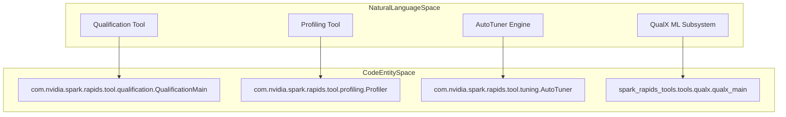
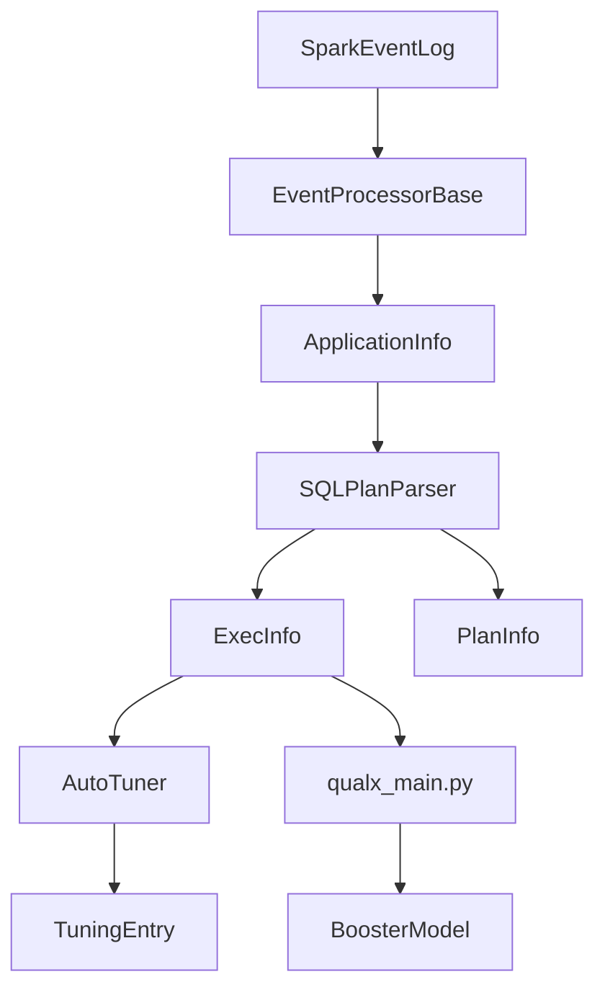

<!-- source: DeepWiki mcp.deepwiki.com · repo NVIDIA/cudf-spark-tools · page 7 Glossary · fetched 2026-10-26 -->

# Glossary

Relevant source files

The following files were used as context for generating this wiki page:

- [core/src/main/resources/bootstrap/tuningConfigs.yaml](core/src/main/resources/bootstrap/tuningConfigs.yaml)
- [core/src/main/resources/bootstrap/tuningTable.yaml](core/src/main/resources/bootstrap/tuningTable.yaml)
- [core/src/main/scala/com/nvidia/spark/rapids/tool/ClusterConfigurationStrategy.scala](core/src/main/scala/com/nvidia/spark/rapids/tool/ClusterConfigurationStrategy.scala)
- [core/src/main/scala/com/nvidia/spark/rapids/tool/Platform.scala](core/src/main/scala/com/nvidia/spark/rapids/tool/Platform.scala)
- [core/src/main/scala/com/nvidia/spark/rapids/tool/planparser/SQLPlanParser.scala](core/src/main/scala/com/nvidia/spark/rapids/tool/planparser/SQLPlanParser.scala)
- [core/src/main/scala/com/nvidia/spark/rapids/tool/qualification/QualOutputWriter.scala](core/src/main/scala/com/nvidia/spark/rapids/tool/qualification/QualOutputWriter.scala)
- [core/src/main/scala/com/nvidia/spark/rapids/tool/qualification/Qualification.scala](core/src/main/scala/com/nvidia/spark/rapids/tool/qualification/Qualification.scala)
- [core/src/main/scala/com/nvidia/spark/rapids/tool/tuning/AutoTuner.scala](core/src/main/scala/com/nvidia/spark/rapids/tool/tuning/AutoTuner.scala)
- [core/src/main/scala/org/apache/spark/sql/rapids/tool/ClassWarehouse.scala](core/src/main/scala/org/apache/spark/sql/rapids/tool/ClassWarehouse.scala)
- [core/src/main/scala/org/apache/spark/sql/rapids/tool/ToolUtils.scala](core/src/main/scala/org/apache/spark/sql/rapids/tool/ToolUtils.scala)
- [core/src/main/scala/org/apache/spark/sql/rapids/tool/qualification/QualificationAppInfo.scala](core/src/main/scala/org/apache/spark/sql/rapids/tool/qualification/QualificationAppInfo.scala)
- [core/src/test/scala/com/nvidia/spark/rapids/tool/planparser/SqlPlanParserSuite.scala](core/src/test/scala/com/nvidia/spark/rapids/tool/planparser/SqlPlanParserSuite.scala)
- [core/src/test/scala/com/nvidia/spark/rapids/tool/profiling/ClusterRecommendationSuite.scala](core/src/test/scala/com/nvidia/spark/rapids/tool/profiling/ClusterRecommendationSuite.scala)
- [core/src/test/scala/com/nvidia/spark/rapids/tool/qualification/QualificationSuite.scala](core/src/test/scala/com/nvidia/spark/rapids/tool/qualification/QualificationSuite.scala)
- [core/src/test/scala/com/nvidia/spark/rapids/tool/tuning/ProfilingAutoTunerSuite.scala](core/src/test/scala/com/nvidia/spark/rapids/tool/tuning/ProfilingAutoTunerSuite.scala)
- [core/src/test/scala/com/nvidia/spark/rapids/tool/tuning/ProfilingAutoTunerSuiteV2.scala](core/src/test/scala/com/nvidia/spark/rapids/tool/tuning/ProfilingAutoTunerSuiteV2.scala)
- [core/src/test/scala/com/nvidia/spark/rapids/tool/tuning/QualificationAutoTunerSuite.scala](core/src/test/scala/com/nvidia/spark/rapids/tool/tuning/QualificationAutoTunerSuite.scala)
- [user_tools/docs/qualx.md](user_tools/docs/qualx.md)
- [user_tools/src/spark_rapids_pytools/cloud_api/databricks_aws.py](user_tools/src/spark_rapids_pytools/cloud_api/databricks_aws.py)
- [user_tools/src/spark_rapids_pytools/cloud_api/databricks_azure.py](user_tools/src/spark_rapids_pytools/cloud_api/databricks_azure.py)
- [user_tools/src/spark_rapids_pytools/cloud_api/dataproc.py](user_tools/src/spark_rapids_pytools/cloud_api/dataproc.py)
- [user_tools/src/spark_rapids_pytools/cloud_api/emr.py](user_tools/src/spark_rapids_pytools/cloud_api/emr.py)
- [user_tools/src/spark_rapids_pytools/cloud_api/onprem.py](user_tools/src/spark_rapids_pytools/cloud_api/onprem.py)
- [user_tools/src/spark_rapids_pytools/cloud_api/sp_types.py](user_tools/src/spark_rapids_pytools/cloud_api/sp_types.py)
- [user_tools/src/spark_rapids_pytools/pricing/price_provider.py](user_tools/src/spark_rapids_pytools/pricing/price_provider.py)
- [user_tools/src/spark_rapids_pytools/rapids/qualx/prediction.py](user_tools/src/spark_rapids_pytools/rapids/qualx/prediction.py)
- [user_tools/src/spark_rapids_pytools/rapids/qualx/train.py](user_tools/src/spark_rapids_pytools/rapids/qualx/train.py)
- [user_tools/src/spark_rapids_pytools/rapids/qualx/train_and_evaluate.py](user_tools/src/spark_rapids_pytools/rapids/qualx/train_and_evaluate.py)
- [user_tools/src/spark_rapids_pytools/resources/qualx-pipeline-conf-example.yaml](user_tools/src/spark_rapids_pytools/resources/qualx-pipeline-conf-example.yaml)
- [user_tools/src/spark_rapids_tools/tools/qualx/model.py](user_tools/src/spark_rapids_tools/tools/qualx/model.py)
- [user_tools/src/spark_rapids_tools/tools/qualx/preprocess.py](user_tools/src/spark_rapids_tools/tools/qualx/preprocess.py)
- [user_tools/src/spark_rapids_tools/tools/qualx/qualx_main.py](user_tools/src/spark_rapids_tools/tools/qualx/qualx_main.py)
- [user_tools/src/spark_rapids_tools/tools/qualx/util.py](user_tools/src/spark_rapids_tools/tools/qualx/util.py)
- [user_tools/tests/spark_rapids_tools_ut/test_cluster.py](user_tools/tests/spark_rapids_tools_ut/test_cluster.py)

## Purpose and Scope
This page defines domain-specific terms, architectural concepts, abbreviations, and configuration markers used across the `cudf-spark-tools` codebase. It serves as a technical reference linking natural language terminology directly to underlying Scala classes, Python modules, configuration keys, and evaluation artifacts.

---

## 1. Core Tooling Concepts

### Qualification
An analysis mode and tool (`QualificationMain`) that inspects Spark event logs without executing workloads on GPUs to evaluate the feasibility, estimated speedup, and potential blockers of migrating Apache Spark jobs to NVIDIA cuDF acceleration.
- Sources: [core/src/main/scala/com/nvidia/spark/rapids/tool/qualification/Qualification.scala](), [core/src/main/scala/org/apache/spark/sql/rapids/tool/qualification/QualificationAppInfo.scala:36-45]()

### Profiling
A deep-dive analysis mode (`Profiler`) that processes event logs and driver logs from a Spark application (often already running on GPUs or executed for benchmarking) to generate runtime metrics, hardware utilization summaries, bottleneck identifications, and timeline visualisations.
- Sources: [core/src/main/scala/com/nvidia/spark/rapids/tool/profiling/Profiler.scala]()

### AutoTuner
A recommendation engine (`AutoTuner`) that analyzes event logs, cluster hardware specs, and tuning tables (`tuningTable.yaml`, `tuningConfigs.yaml`) to output optimized Apache Spark and cuDF plugin configuration properties.
- Sources: [core/src/main/scala/com/nvidia/spark/rapids/tool/tuning/AutoTuner.scala:40-108](), [core/src/main/resources/bootstrap/tuningTable.yaml]()

### QualX
An XGBoost-based machine learning subsystem (`qualx_main.py`) that predicts granular speedup factors for Spark SQL queries and operators based on featurized execution metrics and plan structures.
- Sources: [user_tools/src/spark_rapids_tools/tools/qualx/qualx_main.py:1-68]()

Sources: [core/src/main/scala/com/nvidia/spark/rapids/tool/tuning/AutoTuner.scala:40-108](), [user_tools/src/spark_rapids_tools/tools/qualx/qualx_main.py:1-68]()

---

## 2. Plan Parsing and Data Models

### ExecInfo
A core data case class (`ExecInfo`) representing a parsed Spark SQL physical execution operator (`SparkPlan`), tracking its support status, expression lists, associated stages, speedup factor, and execution duration.
- Sources: [core/src/main/scala/com/nvidia/spark/rapids/tool/planparser/SQLPlanParser.scala:57-76]()

### PlanInfo
A container class (`PlanInfo`) aggregating all `ExecInfo` instances, subqueries, and metadata associated with a single Spark SQL execution ID (`sqlID`).
- Sources: [core/src/main/scala/com/nvidia/spark/rapids/tool/planparser/SQLPlanParser.scala]()

### AccumInfo
A telemetry model tracking accumulator values, stage metrics, shuffle inputs/outputs, and task-level resource consumption across Spark tasks.
- Sources: [core/src/main/scala/com/nvidia/spark/rapids/tool/store/StageModel.scala]()

Sources: [core/src/main/scala/com/nvidia/spark/rapids/tool/planparser/SQLPlanParser.scala:57-76]()

---

## 3. Configuration and Platform Abstractions

### TuningEntry
A configuration model object (`TuningEntry`, `TuningEntryDefinition`) representing a specific Spark configuration property recommendation, its recommended value, and explanatory comments or rules.
- Sources: [core/src/main/scala/com/nvidia/spark/rapids/tool/tuning/AutoTuner.scala]()

### Platform
An abstraction representing the target execution environment or cloud runtime (`Platform`), responsible for providing node instance types, GPU capacities, and platform-specific property overrides.
- Sources: [core/src/main/scala/com/nvidia/spark/rapids/tool/Platform.scala:32-54]()

### CSP (Cloud Service Provider)
Cloud-managed infrastructure targets (such as AWS EMR, Google Cloud Dataproc, Databricks AWS/Azure) supported by Python user tools and cloud API command drivers (`cmd_driver`).
- Sources: [user_tools/src/spark_rapids_pytools/cloud_api/sp_types.py:33-43]()

### Photon / Auron
Alternative runtime engines or specialized plugins encountered during plan parsing. Photon is Databricks' native vectorized execution engine; Auron represents specialized acceleration runtimes handled via parser helpers.
- Sources: [core/src/main/scala/com/nvidia/spark/rapids/tool/planparser/db/DatabricksParseHelper.scala]()

Sources: [core/src/main/scala/com/nvidia/spark/rapids/tool/Platform.scala:32-54](), [user_tools/src/spark_rapids_pytools/cloud_api/sp_types.py:33-43]()

---

## 4. Build, Testing and Evaluation Terms

### QX / QXS
Abbreviations referring to **QualX** (`QX`) and **QualX Speedup** (`QXS`), denoting machine learning prediction pipeline components and generated speedup metrics.
- Sources: [user_tools/src/spark_rapids_tools/tools/qualx/qualx_main.py:15-35]()

### fat mode
A packaging mode in `build.sh` where Python wheels or distribution archives bundle all transitive dependencies and binaries, ensuring offline installation capability.
- Sources: [pyproject.toml]()

### golden sets
Known-good baseline output files and expectation CSVs used by test suites (`QToolResultCoreChecker`, `QualificationSuite`) to verify correctness against historical qualification and profiling runs.
- Sources: [core/src/test/scala/com/nvidia/spark/rapids/tool/qualification/QualificationSuite.scala:25-35]()

### speedup category
Classification buckets (e.g., `< 1x`, `1-2x`, `2-5x`, `> 5x`) assigned to SQL queries or applications based on aggregated estimated execution speedups under GPU acceleration.
- Sources: [core/src/main/scala/org/apache/spark/sql/rapids/tool/qualification/QualificationAppInfo.scala:170-177]()

### buildver
The Spark build version profile specifier (e.g., `spark330`, `spark340`, `spark350`) utilized in Maven builds to compile against specific Spark artifact versions and Scala versions (2.12 / 2.13).
- Sources: [core/pom.xml]()

Sources: [core/src/test/scala/com/nvidia/spark/rapids/tool/qualification/QualificationSuite.scala:25-35](), [core/pom.xml]()

---

## 5. Architecture Mapping Diagrams

### Diagram: Natural Language Concepts to Code Entities
The following diagram maps high-level user-facing terminology and tools to their concrete Scala and Python code representations in the repository.

Sources: [core/src/main/scala/com/nvidia/spark/rapids/tool/qualification/Qualification.scala](), [core/src/main/scala/com/nvidia/spark/rapids/tool/profiling/Profiler.scala](), [core/src/main/scala/com/nvidia/spark/rapids/tool/tuning/AutoTuner.scala:40-108](), [user_tools/src/spark_rapids_tools/tools/qualx/qualx_main.py:1-68]()

### Diagram: Data Flow and Artifact Processing
The following diagram illustrates how event logs flow through parsers into application models and tuning/ml components.

Sources: [core/src/main/scala/com/nvidia/spark/rapids/tool/planparser/SQLPlanParser.scala:57-76](), [core/src/main/scala/com/nvidia/spark/rapids/tool/tuning/AutoTuner.scala:40-108](), [user_tools/src/spark_rapids_tools/tools/qualx/qualx_main.py:125-156]()