# Page: Overview

# Overview

<details>
<summary>Relevant source files</summary>

The following files were used as context for generating this wiki page:

- [.github/workflows/mvn-verify-check.yml](.github/workflows/mvn-verify-check.yml)
- [.github/workflows/python-unit-test.yml](.github/workflows/python-unit-test.yml)
- [core/README.md](core/README.md)
- [core/pom.xml](core/pom.xml)
- [scripts/prefetch_deps.sh](scripts/prefetch_deps.sh)
- [user_tools/README.md](user_tools/README.md)
- [user_tools/build.sh](user_tools/build.sh)
- [user_tools/docs/index.md](user_tools/docs/index.md)
- [user_tools/docs/user-tools-aws-emr.md](user_tools/docs/user-tools-aws-emr.md)
- [user_tools/docs/user-tools-databricks-aws.md](user_tools/docs/user-tools-databricks-aws.md)
- [user_tools/docs/user-tools-databricks-azure.md](user_tools/docs/user-tools-databricks-azure.md)
- [user_tools/docs/user-tools-dataproc-gke.md](user_tools/docs/user-tools-dataproc-gke.md)
- [user_tools/docs/user-tools-dataproc.md](user_tools/docs/user-tools-dataproc.md)
- [user_tools/docs/user-tools-onprem.md](user_tools/docs/user-tools-onprem.md)
- [user_tools/pyproject.toml](user_tools/pyproject.toml)
- [user_tools/src/spark_rapids_pytools/__init__.py](user_tools/src/spark_rapids_pytools/__init__.py)
- [user_tools/src/spark_rapids_pytools/resources/dev/prepackage_mgr.py](user_tools/src/spark_rapids_pytools/resources/dev/prepackage_mgr.py)
- [user_tools/tests/spark_rapids_tools_e2e/resources/scripts/hdfs/setup_hdfs.sh](user_tools/tests/spark_rapids_tools_e2e/resources/scripts/hdfs/setup_hdfs.sh)
- [user_tools/tox.ini](user_tools/tox.ini)

</details>


## Purpose and Scope

`cudf-spark-tools` (`NVIDIA cuDF plugin for Apache Spark tools`) is a comprehensive suite designed to assist users in adopting, evaluating, installing, and tuning the NVIDIA cuDF plugin for Apache Spark [user_tools/README.md:1-3](). The tools bridge the gap between CPU-based Spark deployments and GPU acceleration by offering four main functional pillars:
- **Qualification**: Quantifies expected performance speedups and infrastructure cost savings by analyzing Spark CPU event logs [user_tools/docs/index.md:14-19]().
- **Profiling**: Inspects Spark application execution profiles (CPU or GPU), performs cluster health checks, and generates debugging reports [user_tools/docs/index.md:28-32]().
- **AutoTuner**: Recommends optimized cuDF plugin and Spark configuration properties tailored to specific workloads and cluster topologies [user_tools/README.md:8-9]().
- **QualX**: A machine learning subsystem utilizing XGBoost models to predict application speedups and support training custom performance models [user_tools/README.md:11-14]().

For installation instructions, entrypoint CLIs, and platform-specific guides, see [Getting Started and CLI Usage](#1.1). For repository layout and architectural file maps, see [Repository Layout and Key Concepts](#1.2).

Sources: `user_tools/docs/index.md:1-38`, `user_tools/README.md:1-15`

---

## Two-Layer Architecture

The codebase relies on a decoupled two-layer architecture separating the Scala/Java parsing and analysis engine from the Python wrapper and Cloud Service Provider (CSP) orchestration layer.

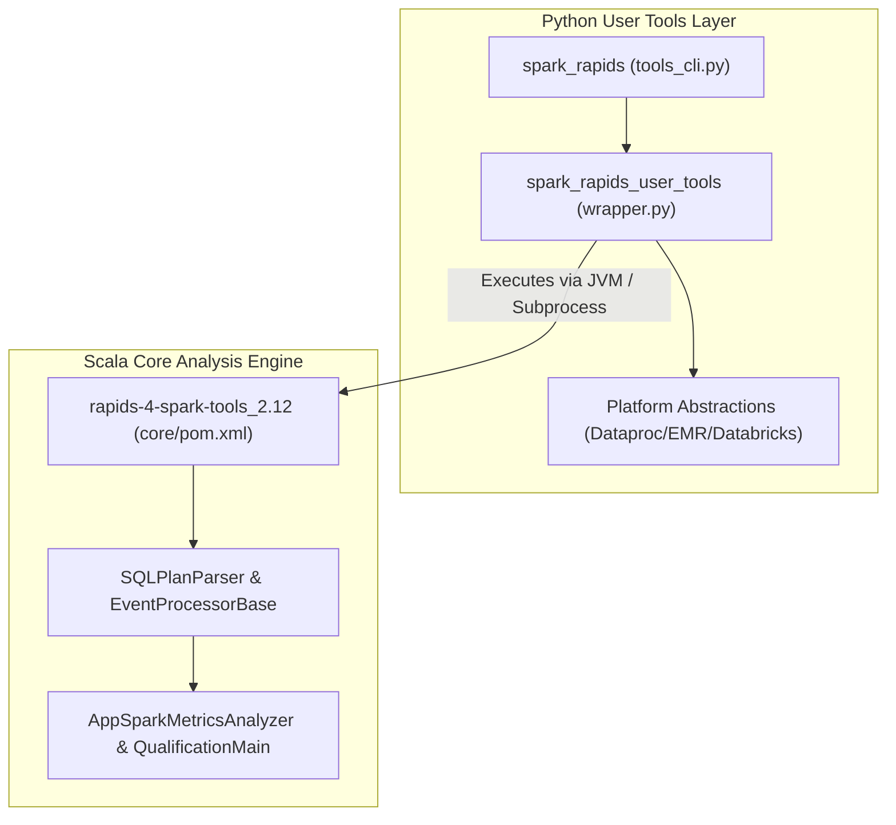

### 1. The Scala Core Layer (`core/`)
Packaged as an executable JAR (`rapids-4-spark-tools_2.12`), the core engine ingests raw Spark event logs, parses SQL plans, computes operator support matrices, evaluates performance metrics, and writes comprehensive reports [core/pom.xml:23-26](). It operates independently as a backend analytics library driven by main entrypoints such as `QualificationMain`.

### 2. The Python Wrapper Layer (`user_tools/`)
Distributed via PyPI as `spark-rapids-user-tools`, this layer provides user-friendly command-line interfaces (`spark_rapids`, `spark_rapids_user_tools`, `spark_rapids_dev`) [user_tools/pyproject.toml:20-23](). It manages cluster metadata across Amazon EMR, Google Cloud Dataproc, Databricks, and On-Premise environments, handles cloud storage downloads/uploads, prefetches dependencies, and coordinates execution of the underlying Scala JAR [user_tools/docs/index.md:1-8]().

Sources: `core/pom.xml:23-26`, `user_tools/pyproject.toml:20-104`, `user_tools/docs/index.md:1-11`

---

## Architecture and Event Flow

The end-to-end workflow begins when a user invokes a tool command through the Python CLI. The request is translated into job parameters, environment configuration files are prepared, and event logs are fetched from cloud storage (S3, GCS, ABFS). The Scala core engine processes the logs to generate structured analysis data stores and reports.

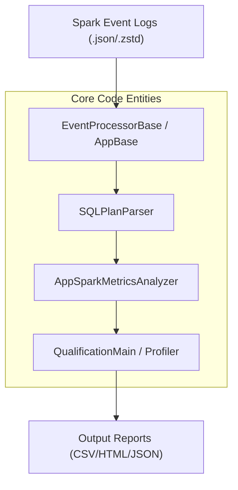

For detailed instructions on setting up your environment, installing the Python package, and executing platform-specific CLIs, refer to [Getting Started and CLI Usage](#1.1). To explore the directory structure, build scripts, and how event logs flow through the system, proceed to [Repository Layout and Key Concepts](#1.2).

Sources: `user_tools/docs/index.md:14-38`, `user_tools/README.md:1-15`

---

# Page: Getting Started and CLI Usage

# Getting Started and CLI Usage

<details>
<summary>Relevant source files</summary>

The following files were used as context for generating this wiki page:

- [user_tools/docs/index.md](user_tools/docs/index.md)
- [user_tools/docs/user-tools-aws-emr.md](user_tools/docs/user-tools-aws-emr.md)
- [user_tools/docs/user-tools-databricks-aws.md](user_tools/docs/user-tools-databricks-aws.md)
- [user_tools/docs/user-tools-databricks-azure.md](user_tools/docs/user-tools-databricks-azure.md)
- [user_tools/docs/user-tools-dataproc-gke.md](user_tools/docs/user-tools-dataproc-gke.md)
- [user_tools/docs/user-tools-dataproc.md](user_tools/docs/user-tools-dataproc.md)
- [user_tools/docs/user-tools-onprem.md](user_tools/docs/user-tools-onprem.md)
- [user_tools/src/spark_rapids_pytools/wrapper.py](user_tools/src/spark_rapids_pytools/wrapper.py)
- [user_tools/src/spark_rapids_tools/cmdli/__init__.py](user_tools/src/spark_rapids_tools/cmdli/__init__.py)
- [user_tools/src/spark_rapids_tools/cmdli/argprocessor.py](user_tools/src/spark_rapids_tools/cmdli/argprocessor.py)
- [user_tools/src/spark_rapids_tools/cmdli/dev_cli.py](user_tools/src/spark_rapids_tools/cmdli/dev_cli.py)
- [user_tools/src/spark_rapids_tools/cmdli/tools_cli.py](user_tools/src/spark_rapids_tools/cmdli/tools_cli.py)
- [user_tools/src/spark_rapids_tools/enums.py](user_tools/src/spark_rapids_tools/enums.py)
- [user_tools/src/spark_rapids_tools/storagelib/s3/s3fs.py](user_tools/src/spark_rapids_tools/storagelib/s3/s3fs.py)
- [user_tools/tests/spark_rapids_tools_ut/test_tool_argprocessor.py](user_tools/tests/spark_rapids_tools_ut/test_tool_argprocessor.py)

</details>


## Purpose and Scope
This page covers the installation, configuration, and execution interfaces for the `spark-rapids-user-tools` Python package. It details how to install the package wheel, configure local and remote environments, utilize the primary CLI entrypoints (`spark_rapids`, `spark_rapids_user_tools`, `spark_rapids_dev`), inspect argument parsing mechanics via `AbsToolUserArgModel`, and operate across various supported Cloud Service Providers (CSPs) and on-premises deployments.

Sources: `user_tools/docs/index.md:1-119` [], `user_tools/src/spark_rapids_tools/cmdli/argprocessor.py:63-142` []

---

## 1. Installation and Package Setup

The Python package `spark-rapids-user-tools` provides a runtime environment that simplifies cost and performance analysis using the NVIDIA cuDF plugin for Apache Spark.

### Installation Methods
The package can be installed using standard Python distribution mechanisms supporting Python versions 3.8 through 3.11:

```bash
# Install via PyPI
pip install spark-rapids-user-tools

# Install from a built wheel file
pip install spark-rapids-user-tools-*.whl

# Install in editable mode from source
pip install -e .
```

### Environment Variables
Before invoking any CLI commands, runtime behavior can be customized using environment variables adhering to the `RAPIDS_USER_TOOLS_*` prefix:

* `RAPIDS_USER_TOOLS_CACHE_FOLDER`: Specifies the local directory used by the CLI to cache downloaded artifacts and dependencies (default: `/var/tmp/spark_rapids_user_tools_cache`).
* `RAPIDS_USER_TOOLS_OUTPUT_DIRECTORY`: Specifies the default local directory where analysis reports are generated.

Sources: `user_tools/docs/user-tools-dataproc.md:30-51` [], `user_tools/docs/user-tools-aws-emr.md:27-51` []

---

## 2. CLI Entrypoints and Architecture

The user tools layer exposes multiple entrypoints built on top of the Python `fire` library. These entrypoints dispatch execution to cloud-specific wrappers or direct core tool runners.

### CLI Entrypoint Mapping
The following diagram illustrates the mapping from natural language user invocations to underlying Python code entities:

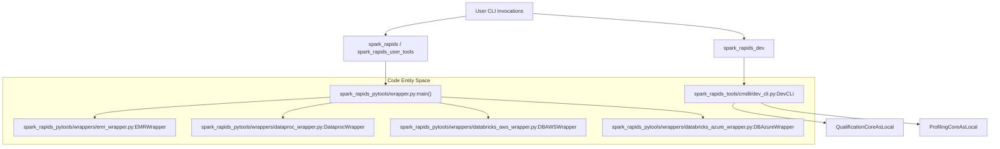
Sources: `user_tools/src/spark_rapids_pytools/wrapper.py:25-32` [], `user_tools/src/spark_rapids_tools/cmdli/dev_cli.py:31-33` []

---

## 3. Argument Validation and Processing

User inputs and options passed through the CLI are validated and processed using Pydantic models managed by an argument processing framework.

### Validation Pipeline
The base argument model `AbsToolUserArgModel` coordinates validation across different tools and platforms.

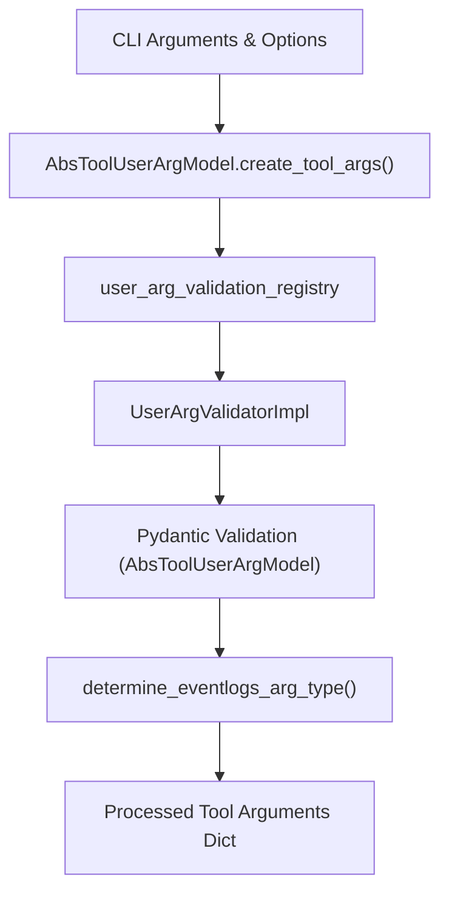
Sources: `user_tools/src/spark_rapids_tools/cmdli/argprocessor.py:63-142` []

The `AbsToolUserArgModel` class defines common parameters such as cluster name, platform target, output folders, and JVM settings:

```python
@dataclass
class AbsToolUserArgModel:
    cluster: Optional[str] = None
    platform: Optional[CspEnv] = None
    output_folder: Optional[str] = None
    tools_jar: Optional[str] = None
    session_uuid: Optional[str] = None
    rejected: dict = dataclasses.field(init=False, default_factory=dict)
    detected: dict = dataclasses.field(init=False, default_factory=dict)
    extra: dict = dataclasses.field(init=False, default_factory=dict)
```
Sources: `user_tools/src/spark_rapids_tools/cmdli/argprocessor.py:91-113` []

---

## 4. Per-Platform User Guides

The tools support multiple Cloud Service Providers and on-premises environments. Each platform requires specific CLI prefixes and cloud SDK configurations.

### Supported Platforms and Commands Matrix

| Platform | Supported Commands | CLI Entrypoint | Version |
| :--- | :--- | :--- | :--- |
| **AWS EMR** | qualification, profiling, diagnostic | `spark_rapids_user_tools emr [ARGS]` | 23.02+ |
| **Google Cloud Dataproc** | qualification, profiling, diagnostic | `spark_rapids_user_tools dataproc [ARGS]` | 23.02.1+ |
| **Dataproc GKE** | qualification | `spark_rapids_user_tools dataproc-gke [ARGS]` | 23.08.2+ |
| **Databricks AWS** | qualification, profiling | `spark_rapids_user_tools databricks-aws [ARGS]` | 23.04+ |
| **Databricks Azure** | qualification, profiling | `spark_rapids_user_tools databricks-azure [ARGS]` | 23.06+ |
| **On-Premises** | qualification | `spark_rapids_user_tools onprem [ARGS]` | 23.06+ |

Sources: `user_tools/docs/index.md:60-108` []

### Platform Enums
Internally, platform targets are mapped to the `CspEnv` enumeration, which handles normalization of user inputs (converting hyphens and case variants):

```python
class CspEnv(EnumeratedType):
    DATABRICKS_AWS = 'databricks_aws'
    DATABRICKS_AZURE = 'databricks_azure'
    DATAPROC = 'dataproc'
    DATAPROC_GKE = 'dataproc_gke'
    EMR = 'emr'
    ONPREM = 'onprem'
    NONE = 'NONE'
```
Sources: `user_tools/src/spark_rapids_tools/enums.py:126-135` []

Sources: `user_tools/docs/index.md:1-119` [], `user_tools/src/spark_rapids_tools/cmdli/argprocessor.py:63-142` [], `user_tools/src/spark_rapids_tools/enums.py:126-174` []

---

# Page: Repository Layout and Key Concepts

# Repository Layout and Key Concepts

<details>
<summary>Relevant source files</summary>

The following files were used as context for generating this wiki page:

- [.github/workflows/mvn-verify-check.yml](.github/workflows/mvn-verify-check.yml)
- [core/README.md](core/README.md)
- [core/docs/qual_core_output.md](core/docs/qual_core_output.md)
- [core/pom.xml](core/pom.xml)
- [user_tools/docs/resources/spark_rapids_user_tools_overview-01.drawio](user_tools/docs/resources/spark_rapids_user_tools_overview-01.drawio)
- [user_tools/docs/resources/spark_rapids_user_tools_overview-01.png](user_tools/docs/resources/spark_rapids_user_tools_overview-01.png)
- [user_tools/src/spark_rapids_pytools/__init__.py](user_tools/src/spark_rapids_pytools/__init__.py)
- [user_tools/src/spark_rapids_tools/api_v1/core/core_reader.py](user_tools/src/spark_rapids_tools/api_v1/core/core_reader.py)
- [user_tools/src/spark_rapids_tools/api_v1/core/prof_reader.py](user_tools/src/spark_rapids_tools/api_v1/core/prof_reader.py)
- [user_tools/src/spark_rapids_tools/api_v1/core/qual_reader.py](user_tools/src/spark_rapids_tools/api_v1/core/qual_reader.py)

</details>


## Purpose and Scope
This section details the repository structure of `cudf-spark-tools`, mapping core directories (`core/`, `user_tools/`, `scripts/`, `.github/`) and tracing the complete data flow from Apache Spark event log ingestion through the Scala analysis engine (`core`) up to Python wrapper consumption (`user_tools`) and report generation.

Sources: `core/README.md:1-12`, `core/pom.xml:17-28`

## Top-Level Directory Layout
The repository is organized into distinct subdirectories separating the Scala analytics engine, Python user tools interface, developer scripts, and CI/CD pipelines:
- `core/`: Contains the Scala/Java backend engine (`rapids-4-spark-tools`) responsible for parsing Spark event logs, analyzing SQL plans, executing qualification and profiling metrics, and generating raw CSV/JSON reports [core/pom.xml:17-28]().
- `user_tools/`: Houses the Python package (`spark_rapids_pytools` and `spark_rapids_tools`) implementing CLI entrypoints, job orchestration across cloud platforms (Dataproc, EMR, Databricks), post-processing heuristics, and the `api_v1` report reading layer [user_tools/src/spark_rapids_pytools/__init__.py:1-23]().
- `scripts/`: Contains IDE configurations (e.g., `idea-code-style-settings.xml`), shell utilities, and developer scripts.
- `.github/`: Defines GitHub Actions workflows for continuous integration, verification, and linting (e.g., `mvn-verify-check.yml`) [.github/workflows/mvn-verify-check.yml:1-69]().

Sources: `core/README.md:14-35`, `core/pom.xml:17-28`, `.github/workflows/mvn-verify-check.yml:1-70`, `user_tools/src/spark_rapids_pytools/__init__.py:1-24`

### Directory Layout Diagram
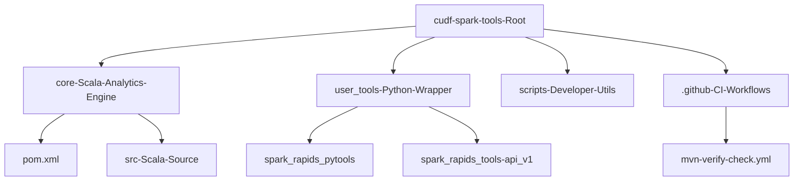
Sources: `core/pom.xml:17-28`, `.github/workflows/mvn-verify-check.yml:1-70`, `core/README.md:1-92`

## Two-Layer Architecture and Data Flow
`cudf-spark-tools` employs a two-layer architecture separating heavy event log parsing and analytics from user-facing orchestration and post-processing. 

1. **Scala Core Layer (`core/`)**: Processes raw Spark event logs directly using Spark internal parsers, extracting stage models, task metrics, operator statistics, and SQL plan trees. It emits structured text artifacts (CSV and JSON) under directories like `qual_core_output/` [core/docs/qual_core_output.md:8-34]().
2. **Python User Layer (`user_tools/`)**: Wraps the core JAR execution through Python subprocesses or cluster job submissions, and reads the resulting core outputs via `CoreReaderBase` implementations (`QualCoreOutput`, `ProfCoreOutput`) to generate higher-level recommendations, cloud pricing estimates, and unified reports [user_tools/src/spark_rapids_tools/api_v1/core/core_reader.py:31-94](), [user_tools/src/spark_rapids_tools/api_v1/core/qual_reader.py:26-46](), [user_tools/src/spark_rapids_tools/api_v1/core/prof_reader.py:23-28]().

Sources: `core/docs/qual_core_output.md:8-34`, `user_tools/src/spark_rapids_tools/api_v1/core/core_reader.py:31-42`, `user_tools/src/spark_rapids_tools/api_v1/core/qual_reader.py:26-47`, `user_tools/src/spark_rapids_tools/api_v1/core/prof_reader.py:23-29`

### Data Flow and Code Entity Mapping Diagram
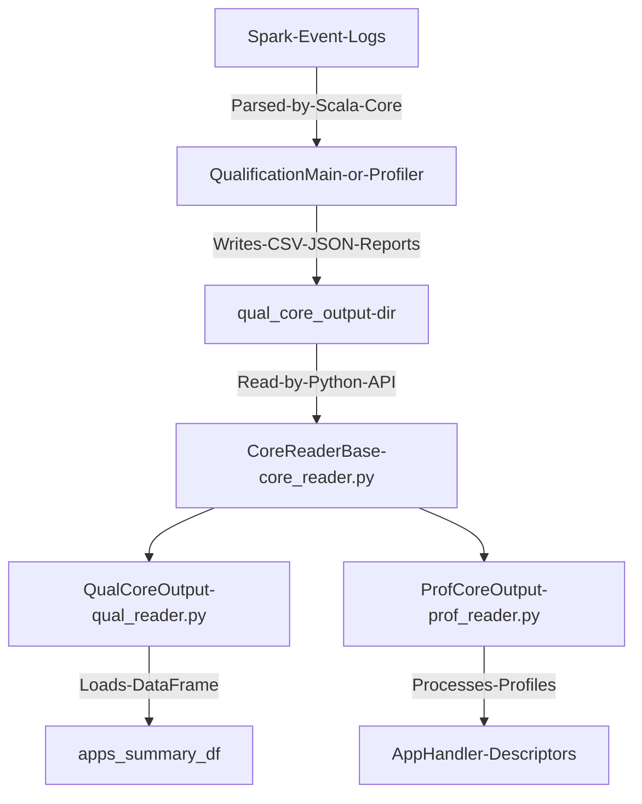
Sources: `core/docs/qual_core_output.md:11-34`, `user_tools/src/spark_rapids_tools/api_v1/core/core_reader.py:31-80`, `user_tools/src/spark_rapids_tools/api_v1/core/qual_reader.py:26-47`, `user_tools/src/spark_rapids_tools/api_v1/core/prof_reader.py:23-29`

## Event Log Ingestion and Report Flow
Event logs flow through the pipeline starting from raw JSON event streams generated by Apache Spark execution. The Scala backend processes these streams to categorize logs and output status summaries and metrics tables.

- **Status Tracking (`status.csv`)**: Records the outcome of event log processing (`SUCCESS`, `FAILURE`, `SKIPPED`, `UNKNOWN`) alongside application identifiers and failure diagnostics [core/docs/qual_core_output.md:74-89]().
- **Summary Metrics (`apps_summary.csv`)**: Aggregates successful application metrics including wall-clock duration, unsupported read/write data formats, complex types, and stage durations [core/docs/qual_core_output.md:90-112]().
- **Python Integration (`CoreReaderBase`)**: The Python `user_tools` layer consumes these outputs via `CoreReaderBase`, instantiating `AppHandler` instances for successful jobs and exposing cached properties like `apps_status_res` and `apps_summary_df` [user_tools/src/spark_rapids_tools/api_v1/core/core_reader.py:44-80](), [user_tools/src/spark_rapids_tools/api_v1/core/qual_reader.py:33-46]().

Sources: `core/docs/qual_core_output.md:74-112`, `user_tools/src/spark_rapids_tools/api_v1/core/core_reader.py:44-80`, `user_tools/src/spark_rapids_tools/api_v1/core/qual_reader.py:33-47`

---

# Page: Core Scala Tools (rapids-4-spark-tools)

# Core Scala Tools (rapids-4-spark-tools)

<details>
<summary>Relevant source files</summary>

The following files were used as context for generating this wiki page:

- [core/scalastyle-config.xml](core/scalastyle-config.xml)
- [core/src/main/scala/com/nvidia/spark/rapids/tool/ToolTextFileWriter.scala](core/src/main/scala/com/nvidia/spark/rapids/tool/ToolTextFileWriter.scala)
- [core/src/main/scala/com/nvidia/spark/rapids/tool/profiling/DriverLogProcessor.scala](core/src/main/scala/com/nvidia/spark/rapids/tool/profiling/DriverLogProcessor.scala)
- [core/src/main/scala/com/nvidia/spark/rapids/tool/profiling/ProfileMain.scala](core/src/main/scala/com/nvidia/spark/rapids/tool/profiling/ProfileMain.scala)
- [core/src/main/scala/org/apache/spark/sql/rapids/tool/AppBase.scala](core/src/main/scala/org/apache/spark/sql/rapids/tool/AppBase.scala)
- [core/src/main/scala/org/apache/spark/sql/rapids/tool/AppFilterImpl.scala](core/src/main/scala/org/apache/spark/sql/rapids/tool/AppFilterImpl.scala)
- [core/src/main/scala/org/apache/spark/sql/rapids/tool/EventProcessorBase.scala](core/src/main/scala/org/apache/spark/sql/rapids/tool/EventProcessorBase.scala)
- [core/src/main/scala/org/apache/spark/sql/rapids/tool/FilterAppInfo.scala](core/src/main/scala/org/apache/spark/sql/rapids/tool/FilterAppInfo.scala)
- [core/src/main/scala/org/apache/spark/sql/rapids/tool/profiling/ApplicationInfo.scala](core/src/main/scala/org/apache/spark/sql/rapids/tool/profiling/ApplicationInfo.scala)
- [core/src/main/scala/org/apache/spark/sql/rapids/tool/profiling/EventsProcessor.scala](core/src/main/scala/org/apache/spark/sql/rapids/tool/profiling/EventsProcessor.scala)
- [core/src/main/scala/org/apache/spark/sql/rapids/tool/qualification/QualificationEventProcessor.scala](core/src/main/scala/org/apache/spark/sql/rapids/tool/qualification/QualificationEventProcessor.scala)
- [core/src/main/scala/org/apache/spark/sql/rapids/tool/store/StageModel.scala](core/src/main/scala/org/apache/spark/sql/rapids/tool/store/StageModel.scala)
- [core/src/main/scala/org/apache/spark/sql/rapids/tool/ui/ConsoleProgressBar.scala](core/src/main/scala/org/apache/spark/sql/rapids/tool/ui/ConsoleProgressBar.scala)
- [core/src/main/scala/org/apache/spark/sql/rapids/tool/util/EventUtils.scala](core/src/main/scala/org/apache/spark/sql/rapids/tool/util/EventUtils.scala)
- [core/src/main/scala/org/apache/spark/sql/rapids/tool/util/RapidsToolsConfUtil.scala](core/src/main/scala/org/apache/spark/sql/rapids/tool/util/RapidsToolsConfUtil.scala)
- [core/src/main/scala/org/apache/spark/sql/rapids/tool/util/RuntimeReporter.scala](core/src/main/scala/org/apache/spark/sql/rapids/tool/util/RuntimeReporter.scala)
- [core/src/test/scala/com/nvidia/spark/rapids/tool/profiling/GenerateDotSuite.scala](core/src/test/scala/com/nvidia/spark/rapids/tool/profiling/GenerateDotSuite.scala)
- [core/src/test/scala/com/nvidia/spark/rapids/tool/profiling/GenerateTimelineSuite.scala](core/src/test/scala/com/nvidia/spark/rapids/tool/profiling/GenerateTimelineSuite.scala)

</details>


The core Scala/Java library (`rapids-4-spark-tools`) provides the foundational engine for parsing Spark event logs, reconstructing execution plans, analyzing GPU compatibility, estimating speedups, profiling bottlenecks, and generating comprehensive migration reports. It operates as the backend computation engine invoked either via Spark submit tasks or embedded inside the Python wrapper framework.

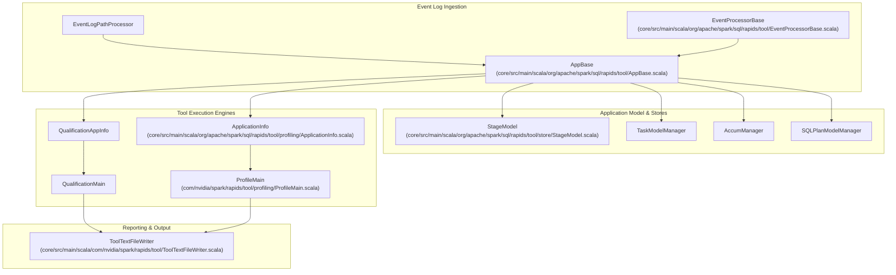
*Sources: [core/src/main/scala/org/apache/spark/sql/rapids/tool/AppBase.scala:45-52](), [core/src/main/scala/org/apache/spark/sql/rapids/tool/EventProcessorBase.scala:32-32](), [core/src/main/scala/org/apache/spark/sql/rapids/tool/profiling/ApplicationInfo.scala:28-29](), [core/src/main/scala/org/apache/spark/sql/rapids/tool/store/StageModel.scala:33-33](), [com/nvidia/spark/rapids/tool/profiling/ProfileMain.scala:28-28](), [core/src/main/scala/com/nvidia/spark/rapids/tool/ToolTextFileWriter.scala:32-36]() *

---

## 2.1 Event Log Ingestion and Application Model

Event log ingestion forms the entry point for all analysis tools. The ingestion pipeline discovers event log paths across local or distributed file systems (HDFS, S3, ADLS, GCS), filters them according to user-defined criteria, and streams them into memory models via event processors.

The core abstract class `AppBase` maintains application-level metadata, executor tracking (`maxNumExecutorsRunning`), SQL execution mappings, and container managers like `AccumManager`, `StageModelManager`, and `TaskModelManager` [core/src/main/scala/org/apache/spark/sql/rapids/tool/AppBase.scala:45-130](). Spark listener events are intercepted and processed incrementally by subclasses of `EventProcessorBase`, which updates metrics, stage models (such as `StageModel`), and task summaries [core/src/main/scala/org/apache/spark/sql/rapids/tool/EventProcessorBase.scala:32-115](), [core/src/main/scala/org/apache/spark/sql/rapids/tool/store/StageModel.scala:33-37]().

For detailed information, see [Event Log Ingestion and Application Model](#2.1).

*Sources: [core/src/main/scala/org/apache/spark/sql/rapids/tool/AppBase.scala:45-130](), [core/src/main/scala/org/apache/spark/sql/rapids/tool/EventProcessorBase.scala:32-115](), [core/src/main/scala/org/apache/spark/sql/rapids/tool/store/StageModel.scala:33-37]() *

---

## 2.2 SQL Plan Parsing

SQL plan parsing translates raw Spark physical execution plans (`SparkPlanInfo`) into structured data models (`ExecInfo`, `PlanInfo`) that can be analyzed for RAPIDS Accelerator compatibility. The parser pipeline traverses plan operator trees, handles subqueries, resolves expressions, and builds plan graphs (`ToolsPlanGraph`) used for visualization and rule evaluation.

Sub-components include specialized operator parsers for joins, aggregates, scans, and codegen, as well as plugin architectures for alternate runtimes like Delta Lake, Apache Iceberg, Photon, and Auron. Compatibility matrices (`supportedExprs.csv`, `supportedExecs.csv`) govern operator scoring and vectorization assessment.

For detailed information, see [SQL Plan Parsing](#2.2).

*Sources: [core/src/main/scala/org/apache/spark/sql/rapids/tool/AppBase.scala:38-42](), [core/src/main/scala/org/apache/spark/sql/rapids/tool/profiling/ApplicationInfo.scala:28-39]()*

---

## 2.3 Qualification Tool

The Qualification tool evaluates whether Apache Spark workloads are suitable for acceleration on NVIDIA GPUs. It processes event logs to calculate CPU vs. GPU execution durations, estimates potential speedups, identifies unsupported or fallback operators, and generates summary reports in CSV, text, or HTML formats.

The runner is orchestrated via `QualificationMain` and `QualificationAppInfo`, utilizing specialized event processors like `QualificationEventProcessor` to accumulate execution times, task runtimes, and input data sizes [core/src/main/scala/org/apache/spark/sql/rapids/tool/qualification/QualificationEventProcessor.scala:29-66]().

For detailed information, see [Qualification Tool](#2.3).

*Sources: [core/src/main/scala/org/apache/spark/sql/rapids/tool/qualification/QualificationEventProcessor.scala:29-66]() *

---

## 2.4 Profiling Tool

The Profiling tool extracts detailed operational telemetry from Spark event logs and driver logs to diagnose performance bottlenecks, memory usage patterns, shuffle sizes, and GPU fallback reasons. It is driven by `ProfileMain` and executed through the `Profiler` class [com/nvidia/spark/rapids/tool/profiling/ProfileMain.scala:28-86]().

Additionally, `DriverLogProcessor` parses driver standard output or log files to extract unsupported operator messages (`cannot run on GPU`) and quantify fallback frequencies [core/src/main/scala/com/nvidia/spark/rapids/tool/profiling/DriverLogProcessor.scala:43-89](). It also supports generating DOT-format execution graphs and timeline visualizers.

For detailed information, see [Profiling Tool](#2.4).

*Sources: [com/nvidia/spark/rapids/tool/profiling/ProfileMain.scala:28-86](), [core/src/main/scala/com/nvidia/spark/rapids/tool/profiling/DriverLogProcessor.scala:43-89]() *

---

## 2.5 Metrics Analysis and Report Views

The metrics analysis layer aggregates task metrics, stage metrics, and SQL plan metrics across applications to power reporting views and warehouse results. Classes such as `AppSparkMetricsAnalyzer` and `MetricCatalog` provide the plumbing to compute percentiles, averages, and sums for spills, shuffle reads/writes, and GC times.

Output writers like `ToolTextFileWriter` handle file serialization across distributed storage systems, while runtime reporters (`RuntimeReporter`) manage application execution statuses (`SuccessAppResult`, `FailureAppResult`, `SkippedAppResult`) and output directory tracking [core/src/main/scala/com/nvidia/spark/rapids/tool/ToolTextFileWriter.scala:32-86](), [core/src/main/scala/org/apache/spark/sql/rapids/tool/util/RuntimeReporter.scala:25-74]().

For detailed information, see [Metrics Analysis and Report Views](#2.5).

*Sources: [core/src/main/scala/com/nvidia/spark/rapids/tool/ToolTextFileWriter.scala:32-86](), [core/src/main/scala/org/apache/spark/sql/rapids/tool/util/RuntimeReporter.scala:25-74]() *

---

# Page: Event Log Ingestion and Application Model

# Event Log Ingestion and Application Model

<details>
<summary>Relevant source files</summary>

The following files were used as context for generating this wiki page:

- [core/src/main/resources/configs/metrics/metricCatalog.yaml](core/src/main/resources/configs/metrics/metricCatalog.yaml)
- [core/src/main/resources/parser/eventlog-parser.yaml](core/src/main/resources/parser/eventlog-parser.yaml)
- [core/src/main/scala/com/nvidia/spark/rapids/tool/EventLogPathProcessor.scala](core/src/main/scala/com/nvidia/spark/rapids/tool/EventLogPathProcessor.scala)
- [core/src/main/scala/com/nvidia/spark/rapids/tool/analysis/MetricDefinition.scala](core/src/main/scala/com/nvidia/spark/rapids/tool/analysis/MetricDefinition.scala)
- [core/src/main/scala/com/nvidia/spark/rapids/tool/profiling/ConnectClassWarehouse.scala](core/src/main/scala/com/nvidia/spark/rapids/tool/profiling/ConnectClassWarehouse.scala)
- [core/src/main/scala/com/nvidia/spark/rapids/tool/profiling/ProfileArgs.scala](core/src/main/scala/com/nvidia/spark/rapids/tool/profiling/ProfileArgs.scala)
- [core/src/main/scala/com/nvidia/spark/rapids/tool/qualification/PluginTypeChecker.scala](core/src/main/scala/com/nvidia/spark/rapids/tool/qualification/PluginTypeChecker.scala)
- [core/src/main/scala/com/nvidia/spark/rapids/tool/qualification/QualificationArgs.scala](core/src/main/scala/com/nvidia/spark/rapids/tool/qualification/QualificationArgs.scala)
- [core/src/main/scala/com/nvidia/spark/rapids/tool/qualification/QualificationMain.scala](core/src/main/scala/com/nvidia/spark/rapids/tool/qualification/QualificationMain.scala)
- [core/src/main/scala/org/apache/spark/sql/rapids/tool/AppBase.scala](core/src/main/scala/org/apache/spark/sql/rapids/tool/AppBase.scala)
- [core/src/main/scala/org/apache/spark/sql/rapids/tool/AppFilterImpl.scala](core/src/main/scala/org/apache/spark/sql/rapids/tool/AppFilterImpl.scala)
- [core/src/main/scala/org/apache/spark/sql/rapids/tool/EventProcessorBase.scala](core/src/main/scala/org/apache/spark/sql/rapids/tool/EventProcessorBase.scala)
- [core/src/main/scala/org/apache/spark/sql/rapids/tool/FilterAppInfo.scala](core/src/main/scala/org/apache/spark/sql/rapids/tool/FilterAppInfo.scala)
- [core/src/main/scala/org/apache/spark/sql/rapids/tool/profiling/ApplicationInfo.scala](core/src/main/scala/org/apache/spark/sql/rapids/tool/profiling/ApplicationInfo.scala)
- [core/src/main/scala/org/apache/spark/sql/rapids/tool/profiling/EventsProcessor.scala](core/src/main/scala/org/apache/spark/sql/rapids/tool/profiling/EventsProcessor.scala)
- [core/src/main/scala/org/apache/spark/sql/rapids/tool/qualification/QualificationEventProcessor.scala](core/src/main/scala/org/apache/spark/sql/rapids/tool/qualification/QualificationEventProcessor.scala)
- [core/src/main/scala/org/apache/spark/sql/rapids/tool/store/AccumManager.scala](core/src/main/scala/org/apache/spark/sql/rapids/tool/store/AccumManager.scala)
- [core/src/main/scala/org/apache/spark/sql/rapids/tool/store/AccumMetaRef.scala](core/src/main/scala/org/apache/spark/sql/rapids/tool/store/AccumMetaRef.scala)
- [core/src/main/scala/org/apache/spark/sql/rapids/tool/store/AccumNameRef.scala](core/src/main/scala/org/apache/spark/sql/rapids/tool/store/AccumNameRef.scala)
- [core/src/main/scala/org/apache/spark/sql/rapids/tool/store/StageModel.scala](core/src/main/scala/org/apache/spark/sql/rapids/tool/store/StageModel.scala)
- [core/src/main/scala/org/apache/spark/sql/rapids/tool/util/ConnectEventHandler.scala](core/src/main/scala/org/apache/spark/sql/rapids/tool/util/ConnectEventHandler.scala)
- [core/src/main/scala/org/apache/spark/sql/rapids/tool/util/EventUtils.scala](core/src/main/scala/org/apache/spark/sql/rapids/tool/util/EventUtils.scala)
- [core/src/test/scala/com/nvidia/spark/rapids/tool/analysis/MetricCatalogSuite.scala](core/src/test/scala/com/nvidia/spark/rapids/tool/analysis/MetricCatalogSuite.scala)
- [core/src/test/scala/com/nvidia/spark/rapids/tool/profiling/ConnectEventSuite.scala](core/src/test/scala/com/nvidia/spark/rapids/tool/profiling/ConnectEventSuite.scala)
- [core/src/test/scala/com/nvidia/spark/rapids/tool/qualification/PluginTypeCheckerSuite.scala](core/src/test/scala/com/nvidia/spark/rapids/tool/qualification/PluginTypeCheckerSuite.scala)

</details>


## Purpose and Scope
This document details the event log ingestion, filtering, path discovery, application state modeling (`AppBase`), event dispatching (`EventProcessorBase`), and internal data store structures (`StageModelManager`, `TaskModelManager`, `AccumManager`) within the `rapids-4-spark-tools` core Scala architecture. 

---

## 1. Event Log Discovery and Path Processing
Event log ingestion begins with raw path inputs supplied via CLI arguments or text expansion lists. The `EventLogPathProcessor` utility discovers, normalizes, and filters event log resources across local file systems and cloud object stores (e.g., HDFS, S3, GCS).

Paths are represented through the `EventLogInfo` trait hierarchy:
* `ApacheSparkEventLog`: Standard Apache Spark event log structure.
* `DatabricksEventLog`: Databricks-specific event log format and rolling file structures.
* `FailedEventLog`: Encapsulates paths that failed validation or parsing along with their failure reasons.

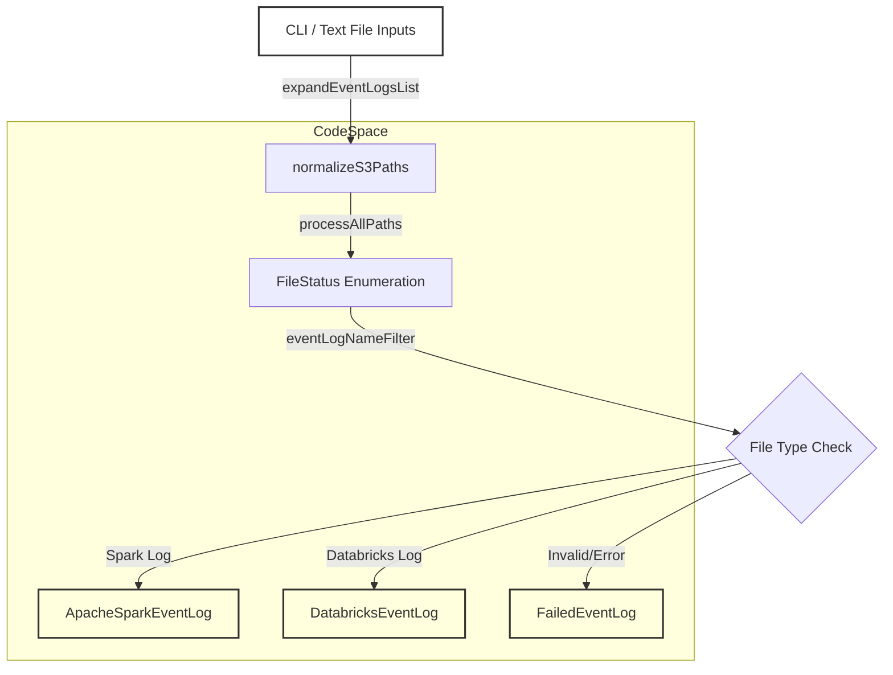
*Sources: `[com/nvidia/spark/rapids/tool/EventLogPathProcessor.scala:38-52]`, `[com/nvidia/spark/rapids/tool/EventLogPathProcessor.scala:93-112]`, `[com/nvidia/spark/rapids/tool/EventLogPathProcessor.scala:166-171]()`*

---

## 2. Filtering Mechanics
Once paths are discovered, applications undergo filtering based on criteria such as execution timestamps, filesystem attributes, application names, and minimum/maximum event log sizes. 

Filtering logic is coordinated in `QualificationMain` using `AppFilterImpl` alongside CLI option parsers like `QualificationArgs`:
* **Filesystem Filters**: `--match-event-logs`, `--min-event-log-size`, `--max-event-log-size`, and timestamp boundaries (`--fs-start-time`, `--fs-end-time`).
* **Application Filters**: `--application-name`, `--start-app-time`, and rank-based limits (e.g., `100-newest`, `100-oldest`, `100-newest-per-app-name`).

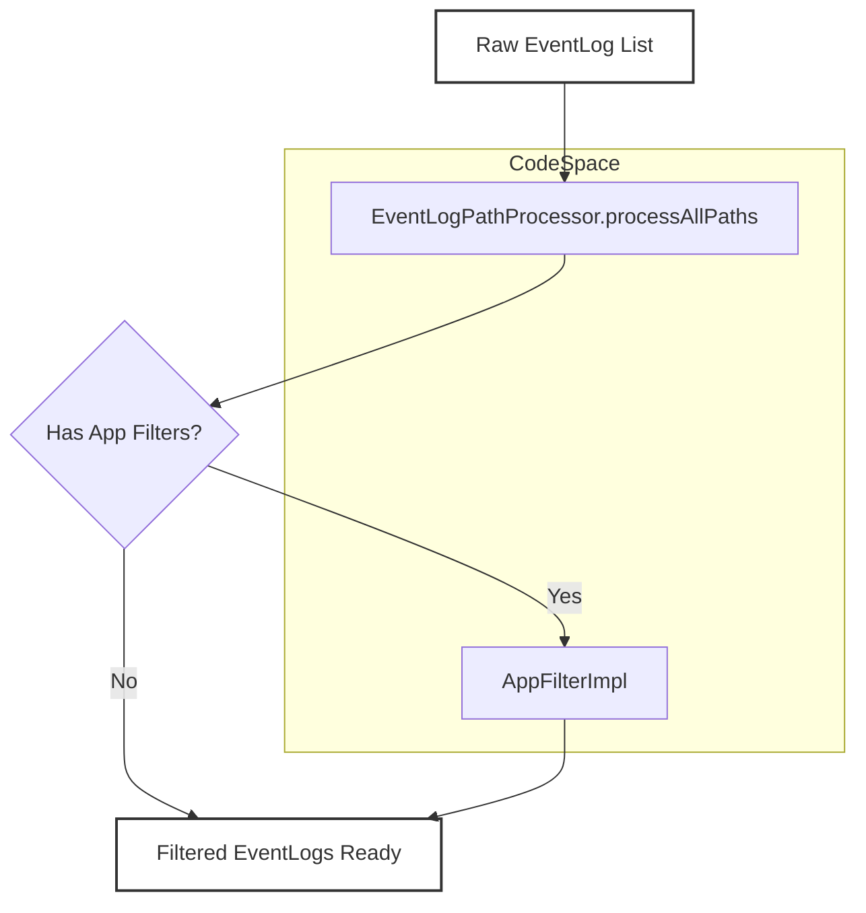
*Sources: `[com/nvidia/spark/rapids/tool/qualification/QualificationArgs.scala:42-107]`, `[com/nvidia/spark/rapids/tool/qualification/QualificationMain.scala:89-103]()`*

---

## 3. Application Core Model (`AppBase`)
`AppBase` serves as the abstract foundational model for any parsed Spark application. It maintains global execution metadata, job mappings, executors, metrics, and references to specialized managers.

Key state fields managed within `AppBase` include:
* `id` and `appId`: Unique identification parameters retrieved from application metadata or event log paths.
* `executorIdToInfo`: Tracks active executors and high-water marks for active resource usage (`maxNumExecutorsRunning`, `maxNumNodesRunning`).
* `jobIdToInfo` and `sqlIdToInfo`: Map jobs and SQL query executions to their underlying metadata.
* `dataSourceInfo`: Records data reading and writing operations (`DataSourceRecord`).

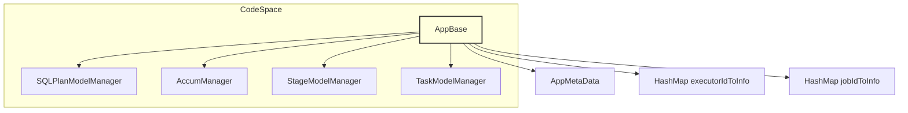
*Sources: `[core/src/main/scala/org/apache/spark/sql/rapids/tool/AppBase.scala:45-129]()`*

---

## 4. Event Processing Framework (`EventProcessorBase`)
`EventProcessorBase` extends Spark's `SparkListener` interface to ingest streaming listener events and populate the `AppBase` state model.

The `processAnyEvent` method pattern-matches incoming `SparkListenerEvent` instances, delegating them to appropriate lifecycle handlers:
* `SparkListenerApplicationStart` / `SparkListenerApplicationEnd`
* `SparkListenerJobStart` / `SparkListenerJobEnd`
* `SparkListenerStageSubmitted` / `SparkListenerStageCompleted`
* `SparkListenerTaskStart` / `SparkListenerTaskEnd`
* `SparkListenerSQLExecutionStart` / `SparkListenerSQLExecutionEnd`

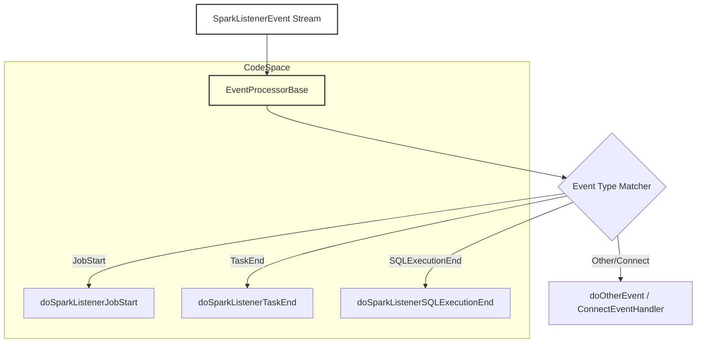
*Sources: `[core/src/main/scala/org/apache/spark/sql/rapids/tool/EventProcessorBase.scala:32-115]()`*

---

## 5. Data Stores and Managers
To prevent memory bloat and maintain clean separation of concerns, metrics and execution units are organized into specialized sub-managers attached to `AppBase`:
* `AccumManager`: Tracks accumulator registrations, mapping accumulator IDs to stage execution statistics and metric metadata.
* `StageModelManager`: Manages stage-level execution properties and aggregated runtimes.
* `TaskModelManager`: Handles individual task metrics collected at `SparkListenerTaskEnd`.
* `StageExecutorMetricsManager`: Aggregates executor metrics per stage (e.g., peak memory usage, GC time).

*Sources: `[core/src/main/scala/org/apache/spark/sql/rapids/tool/AppBase.scala:101-135]()`*

---

# Page: SQL Plan Parsing

# SQL Plan Parsing

<details>
<summary>Relevant source files</summary>

The following files were used as context for generating this wiki page:

- [core/src/main/scala/com/nvidia/spark/rapids/tool/planparser/SQLPlanParser.scala](core/src/main/scala/com/nvidia/spark/rapids/tool/planparser/SQLPlanParser.scala)
- [core/src/main/scala/com/nvidia/spark/rapids/tool/planparser/auron/AuronParseHelper.scala](core/src/main/scala/com/nvidia/spark/rapids/tool/planparser/auron/AuronParseHelper.scala)
- [core/src/main/scala/com/nvidia/spark/rapids/tool/planparser/db/DatabricksParseHelper.scala](core/src/main/scala/com/nvidia/spark/rapids/tool/planparser/db/DatabricksParseHelper.scala)
- [core/src/main/scala/com/nvidia/spark/rapids/tool/plugins/OssOpMapperTrait.scala](core/src/main/scala/com/nvidia/spark/rapids/tool/plugins/OssOpMapperTrait.scala)
- [core/src/main/scala/com/nvidia/spark/rapids/tool/qualification/QualOutputWriter.scala](core/src/main/scala/com/nvidia/spark/rapids/tool/qualification/QualOutputWriter.scala)
- [core/src/main/scala/com/nvidia/spark/rapids/tool/qualification/Qualification.scala](core/src/main/scala/com/nvidia/spark/rapids/tool/qualification/Qualification.scala)
- [core/src/main/scala/org/apache/spark/sql/rapids/tool/ClassWarehouse.scala](core/src/main/scala/org/apache/spark/sql/rapids/tool/ClassWarehouse.scala)
- [core/src/main/scala/org/apache/spark/sql/rapids/tool/ToolUtils.scala](core/src/main/scala/org/apache/spark/sql/rapids/tool/ToolUtils.scala)
- [core/src/main/scala/org/apache/spark/sql/rapids/tool/plangraph/ToolsPlanGraph.scala](core/src/main/scala/org/apache/spark/sql/rapids/tool/plangraph/ToolsPlanGraph.scala)
- [core/src/main/scala/org/apache/spark/sql/rapids/tool/qualification/QualificationAppInfo.scala](core/src/main/scala/org/apache/spark/sql/rapids/tool/qualification/QualificationAppInfo.scala)
- [core/src/main/scala/org/apache/spark/sql/rapids/tool/util/stubs/SparkPlanInfo.scala](core/src/main/scala/org/apache/spark/sql/rapids/tool/util/stubs/SparkPlanInfo.scala)
- [core/src/main/scala/org/apache/spark/sql/rapids/tool/util/stubs/auron/AuronSparkPlanInfo.scala](core/src/main/scala/org/apache/spark/sql/rapids/tool/util/stubs/auron/AuronSparkPlanInfo.scala)
- [core/src/main/scala/org/apache/spark/sql/rapids/tool/util/stubs/db/PhotonSparkPlanInfo.scala](core/src/main/scala/org/apache/spark/sql/rapids/tool/util/stubs/db/PhotonSparkPlanInfo.scala)
- [core/src/main/scala/org/apache/spark/sql/rapids/tool/util/stubs/rapids/RAPIDSSparkPlanInfo.scala](core/src/main/scala/org/apache/spark/sql/rapids/tool/util/stubs/rapids/RAPIDSSparkPlanInfo.scala)
- [core/src/test/resources/QualificationExpectations/photon_db_13_3/app-20240919162642-0000/execs.csv](core/src/test/resources/QualificationExpectations/photon_db_13_3/app-20240919162642-0000/execs.csv)
- [core/src/test/scala/com/nvidia/spark/rapids/tool/planparser/PhotonPlanParserSuite.scala](core/src/test/scala/com/nvidia/spark/rapids/tool/planparser/PhotonPlanParserSuite.scala)
- [core/src/test/scala/com/nvidia/spark/rapids/tool/planparser/SqlPlanParserSuite.scala](core/src/test/scala/com/nvidia/spark/rapids/tool/planparser/SqlPlanParserSuite.scala)
- [core/src/test/scala/com/nvidia/spark/rapids/tool/plugins/OssOpMapperSuite.scala](core/src/test/scala/com/nvidia/spark/rapids/tool/plugins/OssOpMapperSuite.scala)
- [core/src/test/scala/com/nvidia/spark/rapids/tool/qualification/QualificationSuite.scala](core/src/test/scala/com/nvidia/spark/rapids/tool/qualification/QualificationSuite.scala)

</details>


## Purpose and Scope

The SQL plan parsing module forms the core analytical engine of `cudf-spark-tools`. It is responsible for ingesting Spark SQL execution plans from event logs, traversing plan node trees via stubs and graph abstractions, evaluating operator support against cuDF accelerator plugin capabilities, estimating potential speedups, and identifying unsupported expressions or bottlenecks. 

This page provides a high-level architectural overview of the `SQLPlanParser` pipeline, core models like `ExecInfo` and `PlanInfo`, and plan graph handling. For detailed technical implementations, refer to the child pages:
- Exec Parsers: see [Exec Parsers](#2.2.1)
- Table Format and Runtime Plugins: see [Table Format and Runtime Plugins (Delta, Iceberg, Photon, Auron)](#2.2.2)
- Operator Support Matrices: see [Operator Support Matrices and Scores](#2.2.3)

---

## 1. SQLPlanParser Pipeline and Core Models

The entry point for analyzing Spark SQL execution plans is `SQLPlanParser.parseSQLPlan`, which takes a `SparkPlanInfo` tree and transforms it into structured domain models (`PlanInfo` containing a collection of `ExecInfo` nodes) [core/src/main/scala/com/nvidia/spark/rapids/tool/planparser/SQLPlanParser.scala](). 

`ExecInfo` represents individual Spark execution operators (e.g., `SortMergeJoin`, `HashAggregate`, `Scan parquet`), tracking metrics such as duration, assigned stages, support status (`isSupported`), speedup factors, and unsupported expression references (`UnsupportedExprOpRef`) [core/src/main/scala/com/nvidia/spark/rapids/tool/planparser/SQLPlanParser.scala]().

Title: Figure 1: SQLPlanParser Dataflow and Core Models
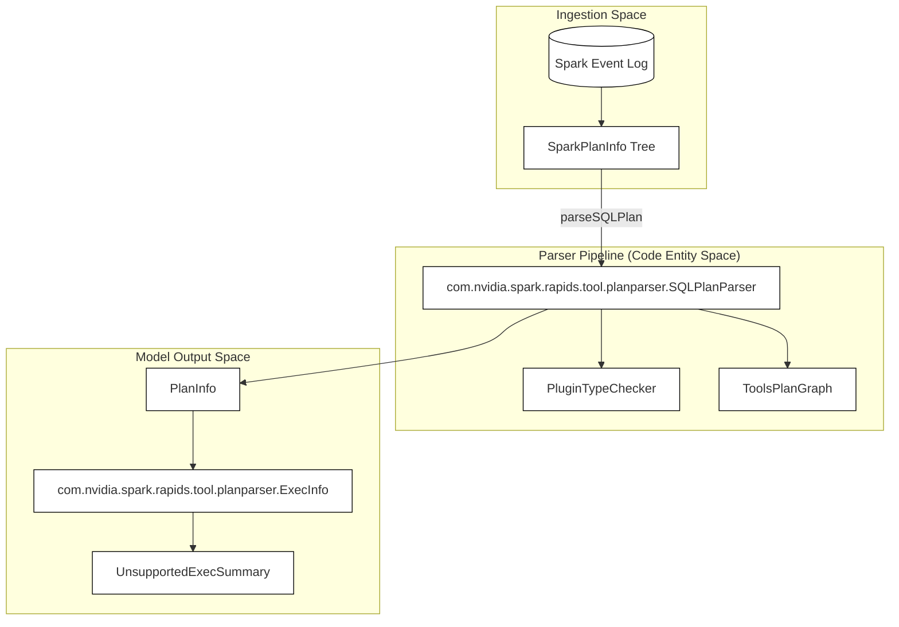
*Sources: `core/src/main/scala/com/nvidia/spark/rapids/tool/planparser/SQLPlanParser.scala`*

---

## 2. Plan Graph Handling and Stage Mapping

To accurately correlate execution plan operators with Spark task and stage metrics, the parsing layer uses `ToolsPlanGraph`, `SparkPlanGraphNode`, and `SparkPlanGraphCluster` [org/apache/spark/sql/rapids/tool/plangraph/ToolsPlanGraph.scala](). These structures mirror Spark's UI execution graph abstractions while adding platform-aware extensions.

The `NodeStageMapper` class manages the binding between SQL plan node IDs and Spark stage IDs, maintaining both raw mappings (`rawNTS`) derived from accumulators and logical mappings (`logicalNTS`) adjusted via heuristics [org/apache/spark/sql/rapids/tool/plangraph/ToolsPlanGraph.scala]().

Title: Figure 2: Plan Graph and Stage Mapping Architecture
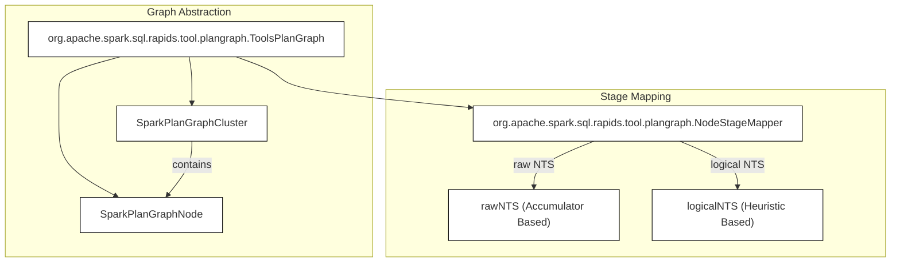
*Sources: `core/src/main/scala/org/apache/spark/sql/rapids/tool/plangraph/ToolsPlanGraph.scala`*

---

## 3. Runtime and Table Format Integration

The SQL plan parser abstracts heterogeneous runtime environments and table formats by leveraging plugin mappers and condition checkers. Runtimes such as Databricks Photon and Auron, alongside table formats like Delta Lake and Apache Iceberg, intercept standard `SparkPlanInfo` nodes and map them to OSS Spark equivalents or platform-specific operator wrappers [core/src/main/scala/com/nvidia/spark/rapids/tool/planparser/auron/AuronParseHelper.scala]().

---

## Child Pages

- **2.2.1 Exec Parsers**: Covers individual execution operator parsers, including generic operators, joins, aggregates, whole-stage codegen blocks, file scans, write commands, and window limits.
- **2.2.2 Table Format and Runtime Plugins (Delta, Iceberg, Photon, Auron)**: Details the plugin architecture supporting alternate runtime engines and table formats, SQLPlanModel versioning, and data-source caching.
- **2.2.3 Operator Support Matrices and Scores**: Documents `supportedExprs.csv`, `supportedExecs.csv`, `supportedDataSource.csv`, and `operatorsScore-*.csv` files, and explains how they synchronize from the underlying accelerator plugin repository.

---

# Page: Exec Parsers

# Exec Parsers

<details>
<summary>Relevant source files</summary>

The following files were used as context for generating this wiki page:

- [core/src/main/scala/com/nvidia/spark/rapids/tool/planparser/BaseSourceScanExecParser.scala](core/src/main/scala/com/nvidia/spark/rapids/tool/planparser/BaseSourceScanExecParser.scala)
- [core/src/main/scala/com/nvidia/spark/rapids/tool/planparser/BatchScanExecParser.scala](core/src/main/scala/com/nvidia/spark/rapids/tool/planparser/BatchScanExecParser.scala)
- [core/src/main/scala/com/nvidia/spark/rapids/tool/planparser/BroadcastExchangeExecParser.scala](core/src/main/scala/com/nvidia/spark/rapids/tool/planparser/BroadcastExchangeExecParser.scala)
- [core/src/main/scala/com/nvidia/spark/rapids/tool/planparser/BroadcastHashJoinExecParser.scala](core/src/main/scala/com/nvidia/spark/rapids/tool/planparser/BroadcastHashJoinExecParser.scala)
- [core/src/main/scala/com/nvidia/spark/rapids/tool/planparser/BroadcastNestedLoopJoinExecParser.scala](core/src/main/scala/com/nvidia/spark/rapids/tool/planparser/BroadcastNestedLoopJoinExecParser.scala)
- [core/src/main/scala/com/nvidia/spark/rapids/tool/planparser/DataWritingCommandExecParser.scala](core/src/main/scala/com/nvidia/spark/rapids/tool/planparser/DataWritingCommandExecParser.scala)
- [core/src/main/scala/com/nvidia/spark/rapids/tool/planparser/ExecParser.scala](core/src/main/scala/com/nvidia/spark/rapids/tool/planparser/ExecParser.scala)
- [core/src/main/scala/com/nvidia/spark/rapids/tool/planparser/FileSourceScanExecParser.scala](core/src/main/scala/com/nvidia/spark/rapids/tool/planparser/FileSourceScanExecParser.scala)
- [core/src/main/scala/com/nvidia/spark/rapids/tool/planparser/GenericExecParser.scala](core/src/main/scala/com/nvidia/spark/rapids/tool/planparser/GenericExecParser.scala)
- [core/src/main/scala/com/nvidia/spark/rapids/tool/planparser/GroupParserTrait.scala](core/src/main/scala/com/nvidia/spark/rapids/tool/planparser/GroupParserTrait.scala)
- [core/src/main/scala/com/nvidia/spark/rapids/tool/planparser/HashAggregateExecParser.scala](core/src/main/scala/com/nvidia/spark/rapids/tool/planparser/HashAggregateExecParser.scala)
- [core/src/main/scala/com/nvidia/spark/rapids/tool/planparser/PhysicalPlanDescHelper.scala](core/src/main/scala/com/nvidia/spark/rapids/tool/planparser/PhysicalPlanDescHelper.scala)
- [core/src/main/scala/com/nvidia/spark/rapids/tool/planparser/ShuffleExchangeExecParser.scala](core/src/main/scala/com/nvidia/spark/rapids/tool/planparser/ShuffleExchangeExecParser.scala)
- [core/src/main/scala/com/nvidia/spark/rapids/tool/planparser/ShuffledHashJoinExecParser.scala](core/src/main/scala/com/nvidia/spark/rapids/tool/planparser/ShuffledHashJoinExecParser.scala)
- [core/src/main/scala/com/nvidia/spark/rapids/tool/planparser/SortMergeJoinExecParser.scala](core/src/main/scala/com/nvidia/spark/rapids/tool/planparser/SortMergeJoinExecParser.scala)
- [core/src/main/scala/com/nvidia/spark/rapids/tool/planparser/SubqueryBroadcastExecParser.scala](core/src/main/scala/com/nvidia/spark/rapids/tool/planparser/SubqueryBroadcastExecParser.scala)
- [core/src/main/scala/com/nvidia/spark/rapids/tool/planparser/SubqueryExecParser.scala](core/src/main/scala/com/nvidia/spark/rapids/tool/planparser/SubqueryExecParser.scala)
- [core/src/main/scala/com/nvidia/spark/rapids/tool/planparser/SupportedBlankExec.scala](core/src/main/scala/com/nvidia/spark/rapids/tool/planparser/SupportedBlankExec.scala)
- [core/src/main/scala/com/nvidia/spark/rapids/tool/planparser/WholeStageExecParser.scala](core/src/main/scala/com/nvidia/spark/rapids/tool/planparser/WholeStageExecParser.scala)
- [core/src/main/scala/com/nvidia/spark/rapids/tool/planparser/WindowGroupLimitParser.scala](core/src/main/scala/com/nvidia/spark/rapids/tool/planparser/WindowGroupLimitParser.scala)
- [core/src/main/scala/com/nvidia/spark/rapids/tool/planparser/WriteOpMetaExtractorTrait.scala](core/src/main/scala/com/nvidia/spark/rapids/tool/planparser/WriteOpMetaExtractorTrait.scala)
- [core/src/main/scala/com/nvidia/spark/rapids/tool/planparser/delta/DeltaLakeBlankExec.scala](core/src/main/scala/com/nvidia/spark/rapids/tool/planparser/delta/DeltaLakeBlankExec.scala)
- [core/src/main/scala/com/nvidia/spark/rapids/tool/planparser/delta/DeltaLakeHelper.scala](core/src/main/scala/com/nvidia/spark/rapids/tool/planparser/delta/DeltaLakeHelper.scala)
- [core/src/main/scala/com/nvidia/spark/rapids/tool/planparser/delta/DeltaLakeOps.scala](core/src/main/scala/com/nvidia/spark/rapids/tool/planparser/delta/DeltaLakeOps.scala)
- [core/src/main/scala/com/nvidia/spark/rapids/tool/planparser/ops/ExprOpRef.scala](core/src/main/scala/com/nvidia/spark/rapids/tool/planparser/ops/ExprOpRef.scala)
- [core/src/main/scala/com/nvidia/spark/rapids/tool/planparser/ops/OpRefWrapperBase.scala](core/src/main/scala/com/nvidia/spark/rapids/tool/planparser/ops/OpRefWrapperBase.scala)
- [core/src/main/scala/com/nvidia/spark/rapids/tool/planparser/ops/OpTypes.scala](core/src/main/scala/com/nvidia/spark/rapids/tool/planparser/ops/OpTypes.scala)
- [core/src/main/scala/com/nvidia/spark/rapids/tool/planparser/ops/OperatorCounter.scala](core/src/main/scala/com/nvidia/spark/rapids/tool/planparser/ops/OperatorCounter.scala)
- [core/src/main/scala/com/nvidia/spark/rapids/tool/planparser/ops/UnsupportedExprOpRef.scala](core/src/main/scala/com/nvidia/spark/rapids/tool/planparser/ops/UnsupportedExprOpRef.scala)
- [core/src/main/scala/com/nvidia/spark/rapids/tool/views/PropertiesView.scala](core/src/main/scala/com/nvidia/spark/rapids/tool/views/PropertiesView.scala)
- [core/src/main/scala/com/nvidia/spark/rapids/tool/views/WriteOpsView.scala](core/src/main/scala/com/nvidia/spark/rapids/tool/views/WriteOpsView.scala)
- [core/src/main/scala/org/apache/spark/sql/rapids/tool/store/WriteOperationStore.scala](core/src/main/scala/org/apache/spark/sql/rapids/tool/store/WriteOperationStore.scala)
- [core/src/main/scala/org/apache/spark/sql/rapids/tool/util/CacheablePropsHandler.scala](core/src/main/scala/org/apache/spark/sql/rapids/tool/util/CacheablePropsHandler.scala)
- [core/src/test/scala/com/nvidia/spark/rapids/tool/EventlogProviderImpl.scala](core/src/test/scala/com/nvidia/spark/rapids/tool/EventlogProviderImpl.scala)
- [core/src/test/scala/com/nvidia/spark/rapids/tool/planparser/PhysicalPlanDescHelperSuite.scala](core/src/test/scala/com/nvidia/spark/rapids/tool/planparser/PhysicalPlanDescHelperSuite.scala)
- [core/src/test/scala/com/nvidia/spark/rapids/tool/planparser/WriteOperationParserSuite.scala](core/src/test/scala/com/nvidia/spark/rapids/tool/planparser/WriteOperationParserSuite.scala)

</details>


## Purpose and Scope
This page details the implementation of individual execution plan parsers (`ExecParser` implementations) within the `rapids-4-spark-tools` core JAR (`core/`). These parsers translate Spark physical execution plan nodes (`SparkPlanGraphNode` and `SparkPlanGraphCluster`) into standardized `ExecInfo` structures used by the Qualification, Profiling, and AutoTuner components to assess GPU compatibility, speedup factors, and performance bottlenecks.

---

## 1. ExecParser Architecture and Generic Parsing
The base trait `ExecParser` defines the contract for parsing individual Spark execution plan nodes. For operators that do not require specialized parsing logic, `GenericExecParser` provides a robust default implementation [core/src/main/scala/com/nvidia/spark/rapids/tool/planparser/GenericExecParser.scala:28-36]().

`GenericExecParser` handles:
- **Node Name Cleanup**: Standardizes node names using `GenericExecParser.cleanupNodeName` [core/src/main/scala/com/nvidia/spark/rapids/tool/planparser/GenericExecParser.scala:37]().
- **Support Checking**: Queries `PluginTypeChecker` to determine if an operator is supported on the GPU plugin [core/src/main/scala/com/nvidia/spark/rapids/tool/planparser/GenericExecParser.scala:66-68]().
- **Speedup Factor Retrieval**: Fetches expected speedup ratios via `checker.getSpeedupFactor` [core/src/main/scala/com/nvidia/spark/rapids/tool/planparser/GenericExecParser.scala:70-72]().
- **Duration Computation**: Sums executor or driver metrics specified in `durationSqlMetrics` [core/src/main/scala/com/nvidia/spark/rapids/tool/planparser/GenericExecParser.scala:64,147-160]().
- **Expression Parsing**: Extracts and validates SQL expressions against unsupported expression registries [core/src/main/scala/com/nvidia/spark/rapids/tool/planparser/GenericExecParser.scala:97-100]().

### Diagram: Exec Parser Hierarchy
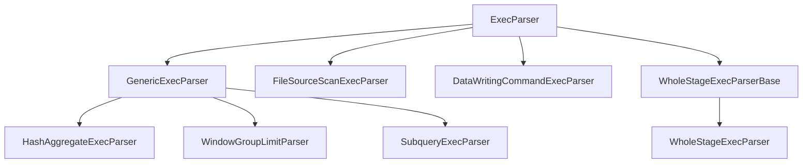
*Sources: [core/src/main/scala/com/nvidia/spark/rapids/tool/planparser/GenericExecParser.scala:28-36](), [core/src/main/scala/com/nvidia/spark/rapids/tool/planparser/HashAggregateExecParser.scala:24-36](), [core/src/main/scala/com/nvidia/spark/rapids/tool/planparser/WindowGroupLimitParser.scala:25-37](), [core/src/main/scala/com/nvidia/spark/rapids/tool/planparser/SubqueryExecParser.scala:29-42](), [core/src/main/scala/com/nvidia/spark/rapids/tool/planparser/FileSourceScanExecParser.scala:30-40](), [core/src/main/scala/com/nvidia/spark/rapids/tool/planparser/DataWritingCommandExecParser.scala:28-31](), [core/src/main/scala/com/nvidia/spark/rapids/tool/planparser/WholeStageExecParser.scala:26-39,158-165]()*

---

## 2. Scan Parsers
Scan operations extract input data characteristics, formats, and filtering predicates.

### FileSourceScanExecParser
`FileSourceScanExecParser` handles file-based data source scans [core/src/main/scala/com/nvidia/spark/rapids/tool/planparser/FileSourceScanExecParser.scala:30-40](). Key responsibilities include:
- **Hive Integration**: Detects Hive scans via `HiveParseHelper` and delegates read parsing accordingly [core/src/main/scala/com/nvidia/spark/rapids/tool/planparser/FileSourceScanExecParser.scala:42-53]().
- **Delta Lake Metadata Scans**: Identifies Delta Lake internal log scans (e.g., `/_delta_log` or `DeltaLogFileIndex`) and flags them as unsupported (`OpTypes.ReadDeltaLog` or `OpTypes.ReadRDDDeltaLog`) [core/src/main/scala/com/nvidia/spark/rapids/tool/planparser/FileSourceScanExecParser.scala:69-147]().
- **Duration Metrics**: Collects "scan time" and "metadata time" accumulators [core/src/main/scala/com/nvidia/spark/rapids/tool/planparser/FileSourceScanExecParser.scala:97-100]().

### BatchScanExtractorHelper
For DataSource V2 and table-based scans (such as Iceberg and Delta Lake), `BatchScanExtractorHelper` parses `BatchScan` and `GpuBatchScan` nodes from `node.desc` [core/src/main/scala/com/nvidia/spark/rapids/tool/planparser/BatchScanExecParser.scala:45-54](). It extracts:
- Table identifiers and catalog paths [core/src/main/scala/com/nvidia/spark/rapids/tool/planparser/BatchScanExecParser.scala:112-114]().
- Static and runtime filters (e.g., dynamic partition pruning expressions) into structured metadata tags [core/src/main/scala/com/nvidia/spark/rapids/tool/planparser/BatchScanExecParser.scala:74-97]().

Sources: [core/src/main/scala/com/nvidia/spark/rapids/tool/planparser/FileSourceScanExecParser.scala:30-182](), [core/src/main/scala/com/nvidia/spark/rapids/tool/planparser/BatchScanExecParser.scala:45-140]()

---

## 3. Write Command Parsers
`DataWritingCommandExecParser` processes data modification and write commands such as `InsertIntoHadoopFsRelationCommand`, `AppendDataExecV1`, and `AtomicCreateTableAsSelect` [core/src/main/scala/com/nvidia/spark/rapids/tool/planparser/DataWritingCommandExecParser.scala:28-146]().

- **Format & Compression Validation**: Uses `DataWritingCmdWrapper` to extract target data formats (Parquet, ORC, Hive formats) and compression codecs (`zstd`, `snappy`, `zlib`, `uncompressed`) [core/src/main/scala/com/nvidia/spark/rapids/tool/planparser/DataWritingCommandExecParser.scala:38-60]().
- **Unsupported Reason Assignment**: Sets `UnsupportedReasonRef.UNSUPPORTED_COMPRESSION` if the compression codec is incompatible with the GPU acceleration plugin [core/src/main/scala/com/nvidia/spark/rapids/tool/planparser/DataWritingCommandExecParser.scala:68-72]().

### Diagram: Write Command Parsing Flow
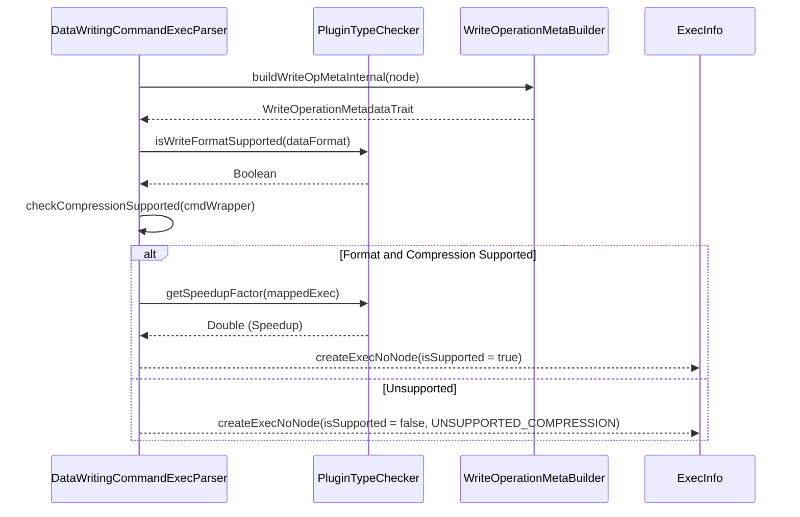
*Sources: [core/src/main/scala/com/nvidia/spark/rapids/tool/planparser/DataWritingCommandExecParser.scala:28-89]() *

---

## 4. Whole-Stage Codegen Parsers
`WholeStageExecParserBase` manages cluster nodes representing whole-stage code generation boundaries (`SparkPlanGraphCluster`) [core/src/main/scala/com/nvidia/spark/rapids/tool/planparser/WholeStageExecParser.scala:26-39]().

- **Agent Delegation**: Instantiates a parser agent via `SQLPlanParser.createParserAgent(appInst)` (such as `OssSQLPlanParser` or `PhotonPlanParser`) to recursively parse operator children within the cluster [core/src/main/scala/com/nvidia/spark/rapids/tool/planparser/WholeStageExecParser.scala:60-62]().
- **Speedup Aggregation**: Calculates the average speedup factor across supported child operators using `SQLPlanParser.averageSpeedup` [core/src/main/scala/com/nvidia/spark/rapids/tool/planparser/WholeStageExecParser.scala:98-102]().
- **Cluster Tagging**: Appends `.withClusterFlag()` to the resulting `ExecInfo` record to designate it as a container grouping node [core/src/main/scala/com/nvidia/spark/rapids/tool/planparser/WholeStageExecParser.scala:153]().

Sources: [core/src/main/scala/com/nvidia/spark/rapids/tool/planparser/WholeStageExecParser.scala:26-156]()

---

## 5. Aggregates, Joins, Window Limits, and Subqueries
Specialized parsers extend `GenericExecParser` to implement operator-specific metrics and validation rules:

- **HashAggregateExecParser**: Overrides `durationSqlMetrics` to target `"time in aggregation build"` [core/src/main/scala/com/nvidia/spark/rapids/tool/planparser/HashAggregateExecParser.scala:24-43]().
- **WindowGroupLimitParser**: Parses `WindowGroupLimitExec` nodes, validating that ranking functions belong to the supported set (`rank`, `dense_rank`, `row_number`) [core/src/main/scala/com/nvidia/spark/rapids/tool/planparser/WindowGroupLimitParser.scala:25-77]().
- **SubqueryExecParser**: Handles subquery execution nodes by marking them as driver-side collect operations (`useDriverMetrics = true`), collecting `"time to collect"` metrics, and setting `isSupported = false` [core/src/main/scala/com/nvidia/spark/rapids/tool/planparser/SubqueryExecParser.scala:29-60]().

Sources: [core/src/main/scala/com/nvidia/spark/rapids/tool/planparser/HashAggregateExecParser.scala:24-43](), [core/src/main/scala/com/nvidia/spark/rapids/tool/planparser/WindowGroupLimitParser.scala:25-77](), [core/src/main/scala/com/nvidia/spark/rapids/tool/planparser/SubqueryExecParser.scala:29-60]()

---

# Page: Table Format and Runtime Plugins (Delta, Iceberg, Photon, Auron)

# Table Format and Runtime Plugins (Delta, Iceberg, Photon, Auron)

<details>
<summary>Relevant source files</summary>

The following files were used as context for generating this wiki page:

- [core/src/main/scala/com/nvidia/spark/rapids/tool/planparser/ReadParser.scala](core/src/main/scala/com/nvidia/spark/rapids/tool/planparser/ReadParser.scala)
- [core/src/main/scala/com/nvidia/spark/rapids/tool/planparser/auron/AuronPlugin.scala](core/src/main/scala/com/nvidia/spark/rapids/tool/planparser/auron/AuronPlugin.scala)
- [core/src/main/scala/com/nvidia/spark/rapids/tool/planparser/delta/DeltaLakeOSSPlugin.scala](core/src/main/scala/com/nvidia/spark/rapids/tool/planparser/delta/DeltaLakeOSSPlugin.scala)
- [core/src/main/scala/com/nvidia/spark/rapids/tool/planparser/iceberg/AppendDataIcebergParser.scala](core/src/main/scala/com/nvidia/spark/rapids/tool/planparser/iceberg/AppendDataIcebergParser.scala)
- [core/src/main/scala/com/nvidia/spark/rapids/tool/planparser/iceberg/IcebergGpuSupport.scala](core/src/main/scala/com/nvidia/spark/rapids/tool/planparser/iceberg/IcebergGpuSupport.scala)
- [core/src/main/scala/com/nvidia/spark/rapids/tool/planparser/iceberg/IcebergHelper.scala](core/src/main/scala/com/nvidia/spark/rapids/tool/planparser/iceberg/IcebergHelper.scala)
- [core/src/main/scala/com/nvidia/spark/rapids/tool/planparser/iceberg/IcebergOps.scala](core/src/main/scala/com/nvidia/spark/rapids/tool/planparser/iceberg/IcebergOps.scala)
- [core/src/main/scala/com/nvidia/spark/rapids/tool/planparser/iceberg/IcebergWriteExtract.scala](core/src/main/scala/com/nvidia/spark/rapids/tool/planparser/iceberg/IcebergWriteExtract.scala)
- [core/src/main/scala/com/nvidia/spark/rapids/tool/planparser/iceberg/MergeRowsIcebergParser.scala](core/src/main/scala/com/nvidia/spark/rapids/tool/planparser/iceberg/MergeRowsIcebergParser.scala)
- [core/src/main/scala/com/nvidia/spark/rapids/tool/planparser/ops/UnsupportedReasonRef.scala](core/src/main/scala/com/nvidia/spark/rapids/tool/planparser/ops/UnsupportedReasonRef.scala)
- [core/src/main/scala/com/nvidia/spark/rapids/tool/plugins/AppPropPlugContainerTrait.scala](core/src/main/scala/com/nvidia/spark/rapids/tool/plugins/AppPropPlugContainerTrait.scala)
- [core/src/main/scala/com/nvidia/spark/rapids/tool/plugins/AppPropPlugTrait.scala](core/src/main/scala/com/nvidia/spark/rapids/tool/plugins/AppPropPlugTrait.scala)
- [core/src/main/scala/com/nvidia/spark/rapids/tool/plugins/BaseAppPropPlug.scala](core/src/main/scala/com/nvidia/spark/rapids/tool/plugins/BaseAppPropPlug.scala)
- [core/src/main/scala/org/apache/spark/sql/rapids/tool/annotation/ToolsReflection.scala](core/src/main/scala/org/apache/spark/sql/rapids/tool/annotation/ToolsReflection.scala)
- [core/src/main/scala/org/apache/spark/sql/rapids/tool/store/SQLPlanModel.scala](core/src/main/scala/org/apache/spark/sql/rapids/tool/store/SQLPlanModel.scala)
- [core/src/main/scala/org/apache/spark/sql/rapids/tool/store/SQLPlanModelManager.scala](core/src/main/scala/org/apache/spark/sql/rapids/tool/store/SQLPlanModelManager.scala)
- [core/src/main/scala/org/apache/spark/sql/rapids/tool/store/SQLPlanModelPrimaryWithDSCaching.scala](core/src/main/scala/org/apache/spark/sql/rapids/tool/store/SQLPlanModelPrimaryWithDSCaching.scala)
- [core/src/main/scala/org/apache/spark/sql/rapids/tool/store/SQLPlanModelWithDSCaching.scala](core/src/main/scala/org/apache/spark/sql/rapids/tool/store/SQLPlanModelWithDSCaching.scala)
- [core/src/main/scala/org/apache/spark/sql/rapids/tool/store/SQLPlanVersion.scala](core/src/main/scala/org/apache/spark/sql/rapids/tool/store/SQLPlanVersion.scala)
- [core/src/main/scala/org/apache/spark/sql/rapids/tool/util/stubs/DefaultGraphReflectionAPI.scala](core/src/main/scala/org/apache/spark/sql/rapids/tool/util/stubs/DefaultGraphReflectionAPI.scala)
- [core/src/main/scala/org/apache/spark/sql/rapids/tool/util/stubs/GraphReflectionAPI.scala](core/src/main/scala/org/apache/spark/sql/rapids/tool/util/stubs/GraphReflectionAPI.scala)
- [core/src/main/scala/org/apache/spark/sql/rapids/tool/util/stubs/GraphReflectionAPIHelper.scala](core/src/main/scala/org/apache/spark/sql/rapids/tool/util/stubs/GraphReflectionAPIHelper.scala)
- [core/src/test/scala/com/nvidia/spark/rapids/BaseNoSparkSuite.scala](core/src/test/scala/com/nvidia/spark/rapids/BaseNoSparkSuite.scala)
- [core/src/test/scala/com/nvidia/spark/rapids/tool/planparser/ReadParserSuite.scala](core/src/test/scala/com/nvidia/spark/rapids/tool/planparser/ReadParserSuite.scala)
- [core/src/test/scala/com/nvidia/spark/rapids/tool/planparser/iceberg/IcebergGpuSupportSuite.scala](core/src/test/scala/com/nvidia/spark/rapids/tool/planparser/iceberg/IcebergGpuSupportSuite.scala)

</details>


## Purpose and Scope

This page documents the plugin architecture within `cudf-spark-tools` (`core` module) designed to handle alternate table formats (such as Apache Iceberg and Delta Lake) and proprietary execution runtimes (such as Databricks Photon and Auron). It details how specialized plan parsers intercept table-format-specific operators, evaluate GPU compatibility gates, and manage versioned query plans (`SQLPlanModel`) alongside memory-efficient data-source caching.

Sources:
- `core/src/main/scala/com/nvidia/spark/rapids/tool/planparser/iceberg/IcebergOps.scala` [core/src/main/scala/com/nvidia/spark/rapids/tool/planparser/iceberg/IcebergOps.scala:1-54]()
- `core/src/main/scala/org/apache/spark/sql/rapids/tool/store/SQLPlanModelManager.scala` [core/src/main/scala/org/apache/spark/sql/rapids/tool/store/SQLPlanModelManager.scala:1-83]()

---

## 1. Plugin Architecture for Alternate Runtimes and Table Formats

The tool uses modular plug-in containers and group parsers to detect non-standard table formats or execution environments from Spark configuration properties (`sparkProperties`) and physical plan nodes. 

### Key Plugin Classes and Dispatch
* **`IcebergHelper`**: Extends `PropConditionOnSparkExtTrait` to detect Iceberg applications by evaluating `spark.sql.extensions` for `IcebergSparkSessionExtensions` and checking for defined Spark catalog configurations (`spark.sql.catalog.*`) [core/src/main/scala/com/nvidia/spark/rapids/tool/planparser/iceberg/IcebergHelper.scala:21-49]().
* **`IcebergOps`**: Implements `GroupParserTrait` to intercept Iceberg-specific operations (`AppendData`, `MergeRows`, `ReplaceData`, `WriteDelta`) based on node names and positive configuration checks (`isIcebergEnabled`) [core/src/main/scala/com/nvidia/spark/rapids/tool/planparser/iceberg/IcebergOps.scala:29-88]().
* **`DeltaLakeOSSPlugin`**: Handles Open Source Delta Lake storage format detection and metadata parsing.
* **`AuronPlugin`**: Manages execution attributes for the Auron runtime environment.

```mermaid
graph TD
    sub "Natural Language to Code Space: Plugin Dispatch"
    AppConfig["Application Spark Properties"] -->|Evaluates| IcebergHelper["IcebergHelper.eval()"]
    IcebergHelper -->|Detects Ext/Catalog| IsIceberg["isIcebergEnabled = true"]
    
    PlanNode["SparkPlanGraphNode"] --> GroupParser["IcebergOps.accepts()"]
    IsIceberg --> GroupParser
    GroupParser -->|Matches Supported Op| CreateParser["IcebergOps.createExecParser()"]
    
    CreateParser -->|AppendData| AppendParser["AppendDataIcebergParser"]
    CreateParser -->|ReplaceData / MergeRows| MergeParser["MergeRowsIcebergParser"]
    
    DeltaReq["Delta Lake Table Scan"] --> DeltaPlugin["DeltaLakeOSSPlugin"]
    AuronReq["Auron Runtime Exec"] --> AuronPlugin["AuronPlugin"]
```
Sources:
- `core/src/main/scala/com/nvidia/spark/rapids/tool/planparser/iceberg/IcebergHelper.scala` [core/src/main/scala/com/nvidia/spark/rapids/tool/planparser/iceberg/IcebergHelper.scala:21-144]()
- `core/src/main/scala/com/nvidia/spark/rapids/tool/planparser/iceberg/IcebergOps.scala` [core/src/main/scala/com/nvidia/spark/rapids/tool/planparser/iceberg/IcebergOps.scala:54-155]()
- `core/src/main/scala/com/nvidia/spark/rapids/tool/planparser/delta/DeltaLakeOSSPlugin.scala` []()
- `core/src/main/scala/com/nvidia/spark/rapids/tool/planparser/auron/AuronPlugin.scala` []()

---

## 2. Iceberg Parser Pipeline and GPU Support Gates

Iceberg write and merge operations require rigorous qualification checks because GPU acceleration depends on specific data file formats (e.g., Parquet), runtime versions (Spark 3.5.x or 4.0.x), catalog types, and field ID configurations.

### Parser Implementations
* **`AppendDataIcebergParser`**: Parses `AppendData` execution nodes, extracts compression codecs, validates file formats via `IcebergGpuSupport`, and builds `WriteOperationMetadataTrait` instances [core/src/main/scala/com/nvidia/spark/rapids/tool/planparser/iceberg/AppendDataIcebergParser.scala:36-75]().
* **`MergeRowsIcebergParser`**: Handles sibling Iceberg execution nodes (`MergeRows`, `ReplaceData`, `WriteDelta`). It parses row-classification expressions for `MergeRows` and checks copy-on-write gates for `ReplaceData` [core/src/main/scala/com/nvidia/spark/rapids/tool/planparser/iceberg/MergeRowsIcebergParser.scala:65-117]().
* **`IcebergWriteExtract`**: Extracts metadata properties from `simpleString` descriptions (for `AppendData`) and `physicalPlanDescription` arguments (for `ReplaceData` and `WriteDelta`) [core/src/main/scala/com/nvidia/spark/rapids/tool/planparser/iceberg/IcebergWriteExtract.scala:50-103]().

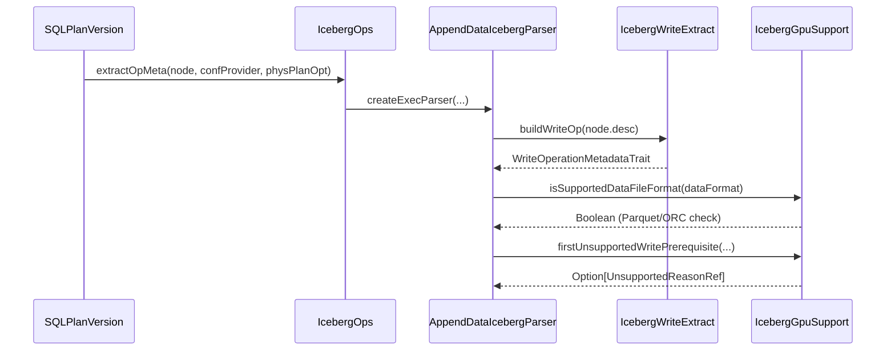
Sources:
- `core/src/main/scala/com/nvidia/spark/rapids/tool/planparser/iceberg/AppendDataIcebergParser.scala` [core/src/main/scala/com/nvidia/spark/rapids/tool/planparser/iceberg/AppendDataIcebergParser.scala:36-150]()
- `core/src/main/scala/com/nvidia/spark/rapids/tool/planparser/iceberg/MergeRowsIcebergParser.scala` [core/src/main/scala/com/nvidia/spark/rapids/tool/planparser/iceberg/MergeRowsIcebergParser.scala:65-147]()
- `core/src/main/scala/com/nvidia/spark/rapids/tool/planparser/iceberg/IcebergWriteExtract.scala` [core/src/main/scala/com/nvidia/spark/rapids/tool/planparser/iceberg/IcebergWriteExtract.scala:50-103]()
- `core/src/main/scala/com/nvidia/spark/rapids/tool/planparser/iceberg/IcebergGpuSupport.scala` []()

---

## 3. SQLPlanModel Versions and Data-Source Caching

Spark applications frequently update query plans at runtime via Adaptive Query Execution (AQE). The `SQLPlanModelManager` and associated storage classes track plan evolution across versions while implementing memory-efficient caching strategies.

### Core Storage Components
* **`SQLPlanModelManager`**: Central registry maintaining sorted maps of `SQLPlanModel` instances indexed by execution ID (`sqlId`). It detects SQL cache operators (`InMemoryRelation`, `GpuInMemoryTableScan`) across plan versions and RDD scopes [core/src/main/scala/org/apache/spark/sql/rapids/tool/store/SQLPlanModelManager.scala:66-111]().
* **`SQLPlanModel`**: Stores a chronological list of `SQLPlanVersion` objects representing initial plans and subsequent AQE updates [core/src/main/scala/org/apache/spark/sql/rapids/tool/store/SQLPlanModel.scala:40-114]().
* **`SQLPlanModelWithDSCaching` / `SQLPlanModelPrimaryWithDSCaching`**: Memory-optimized subclasses that extract and cache only `DataSourceRecord` metadata rather than retaining full `SparkPlanInfo` trees for every historical plan version.
* **`SparkPlanInfo` / `SparkPlanInfoTruncated`**: Lightweight serialization structures that prune unnecessary nodes, retaining only `nodeName`, `simpleString`, and recursive `children` [core/src/main/scala/org/apache/spark/sql/rapids/tool/store/SQLPlanModelManager.scala:30-64]().

```mermaid
graph TD
    sub "Natural Language to Code Space: SQLPlan Model Hierarchy"
    Manager["SQLPlanModelManager"] -->|Manages Map| Model["SQLPlanModel"]
    Model -->|Contains ArrayBuffer| Version["SQLPlanVersion"]
    
    Version -->|Builds on demand| Graph["ToolsPlanGraph"]
    Version -->|Extracts Writes| WriteRec["WriteOperationRecord"]
    
    Model -.->|Memory Optimized Subclass| CacheModel["SQLPlanModelWithDSCaching"]
    CacheModel -->|Extracts & Caches Only| DSRecord["DataSourceRecord"]
    
    PlanInfo["org.apache.spark.sql.execution.SparkPlanInfo"] -->|Truncated by| TruncInfo["SparkPlanInfoTruncated"]
```
Sources:
- `core/src/main/scala/org/apache/spark/sql/rapids/tool/store/SQLPlanModelManager.scala` [core/src/main/scala/org/apache/spark/sql/rapids/tool/store/SQLPlanModelManager.scala:30-174]()
- `core/src/main/scala/org/apache/spark/sql/rapids/tool/store/SQLPlanModel.scala` [core/src/main/scala/org/apache/spark/sql/rapids/tool/store/SQLPlanModel.scala:26-114]()
- `core/src/main/scala/org/apache/spark/sql/rapids/tool/store/SQLPlanVersion.scala` [core/src/main/scala/org/apache/spark/sql/rapids/tool/store/SQLPlanVersion.scala:30-157]()

---

## 4. Read/Write Metadata Extraction and Formats

Scanning data sources and writing results across various table formats requires structured metadata parsing to populate qualification reports.

* **`ReadParser`**: Identifies file scan node prefixes (`Scan`, `NativeScan`) and DataSourceV2 nodes (`BatchScan`, `GpuBatchScan`), extracting read schemas, locations, and filter predicates [core/src/main/scala/com/nvidia/spark/rapids/tool/planparser/ReadParser.scala:89-127]().
* **`ReadMetaData`**: Encapsulates read attributes including pushed filters, data filters, partition filters, and runtime filters [core/src/main/scala/com/nvidia/spark/rapids/tool/planparser/ReadParser.scala:28-87]().

Sources:
- `core/src/main/scala/com/nvidia/spark/rapids/tool/planparser/ReadParser.scala` [core/src/main/scala/com/nvidia/spark/rapids/tool/planparser/ReadParser.scala:28-166]()

---

# Page: Operator Support Matrices and Scores

# Operator Support Matrices and Scores

<details>
<summary>Relevant source files</summary>

The following files were used as context for generating this wiki page:

- [.gitignore](.gitignore)
- [core/src/main/resources/operatorsScore-databricks-aws-a10G.csv](core/src/main/resources/operatorsScore-databricks-aws-a10G.csv)
- [core/src/main/resources/operatorsScore-databricks-aws-t4.csv](core/src/main/resources/operatorsScore-databricks-aws-t4.csv)
- [core/src/main/resources/operatorsScore-databricks-azure-t4.csv](core/src/main/resources/operatorsScore-databricks-azure-t4.csv)
- [core/src/main/resources/operatorsScore-dataproc-gke-l4.csv](core/src/main/resources/operatorsScore-dataproc-gke-l4.csv)
- [core/src/main/resources/operatorsScore-dataproc-gke-t4.csv](core/src/main/resources/operatorsScore-dataproc-gke-t4.csv)
- [core/src/main/resources/operatorsScore-dataproc-l4.csv](core/src/main/resources/operatorsScore-dataproc-l4.csv)
- [core/src/main/resources/operatorsScore-dataproc-serverless-l4.csv](core/src/main/resources/operatorsScore-dataproc-serverless-l4.csv)
- [core/src/main/resources/operatorsScore-dataproc-t4.csv](core/src/main/resources/operatorsScore-dataproc-t4.csv)
- [core/src/main/resources/operatorsScore-emr-a10.csv](core/src/main/resources/operatorsScore-emr-a10.csv)
- [core/src/main/resources/operatorsScore-emr-a10G.csv](core/src/main/resources/operatorsScore-emr-a10G.csv)
- [core/src/main/resources/operatorsScore-emr-t4.csv](core/src/main/resources/operatorsScore-emr-t4.csv)
- [core/src/main/resources/operatorsScore-onprem-a100.csv](core/src/main/resources/operatorsScore-onprem-a100.csv)
- [core/src/main/resources/supportedDataSource.csv](core/src/main/resources/supportedDataSource.csv)
- [core/src/main/resources/supportedExecs.csv](core/src/main/resources/supportedExecs.csv)
- [core/src/main/resources/supportedExprs.csv](core/src/main/resources/supportedExprs.csv)
- [scripts/sync_plugin_files/README.md](scripts/sync_plugin_files/README.md)
- [scripts/sync_plugin_files/override_supported_configs.json](scripts/sync_plugin_files/override_supported_configs.json)
- [scripts/sync_plugin_files/process_supported_files.py](scripts/sync_plugin_files/process_supported_files.py)
- [scripts/sync_plugin_files/sync_operator_scores.py](scripts/sync_plugin_files/sync_operator_scores.py)

</details>


## Purpose and Scope

The `cudf-spark-tools` core module relies on a set of static resource files (`supportedExprs.csv`, `supportedExecs.csv`, `supportedDataSource.csv`, and platform-specific `operatorsScore-*.csv` files) to determine whether Apache Spark expressions, executors, and data sources can be accelerated by the NVIDIA RAPIDS Accelerator for Apache Spark plugin. These matrices drive qualification reporting, speedup estimations, and the AutoTuner recommendation engine without requiring a live Spark cluster during analysis. 

This page details the schema and purpose of each matrix file, how platform-specific operator scoring files are organized, and the synchronization infrastructure (`scripts/sync_plugin_files/`) used to pull these definitions from the upstream RAPIDS Spark plugin repository.

---

## 1. Core Support Matrix Resource Files

The core resource directory contains CSV files defining the compatibility and support levels of Spark constructs against the GPU backend.

### Executable and Expression Support (`supportedExecs.csv` & `supportedExprs.csv`)
* **`supportedExecs.csv`**: Maps Spark physical execution nodes (e.g., `CoalesceExec`, `FileSourceScanExec`, `SortMergeJoinExec`) to support flags (`S` for Supported, `NS` for Not Supported, `TNEW` for experimental/new) along with column-level datatype support matrices (BOOLEAN, BYTE, SHORT, INT, LONG, FLOAT, DOUBLE, DATE, TIMESTAMP, STRING, DECIMAL, NULL, BINARY, CALENDAR, ARRAY, MAP, STRUCT, UDT, DAYTIME, YEARMONTH) `[core/src/main/resources/supportedExecs.csv:1-67]()`.
* **`supportedExprs.csv`**: Specifies expression-level support (`Abs`, `Add`, `Alias`, `And`, etc.) across different contexts (`project`, `AST`) and parameter positions, mapped against input/result datatypes `[core/src/main/resources/supportedExprs.csv:1-74]`.

### Data Source Support (`supportedDataSource.csv`)
* Tracks read and write format compatibility for file formats (Parquet, ORC, CSV, JSON) and table formats (Delta, Iceberg, Hive).

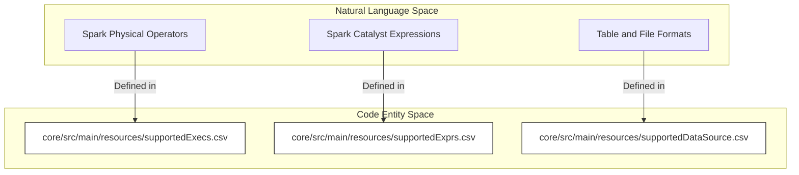

Sources: `[core/src/main/resources/supportedExecs.csv:1-68]`, `[core/src/main/resources/supportedExprs.csv:1-74]()`

---

## 2. Platform-Specific Operator Scores (`operatorsScore-*.csv`)

To estimate potential speedups and evaluate cluster efficiency across different Cloud Service Providers (CSPs) and GPU hardware configurations, the tool maintains platform- and hardware-specific scoring CSV files. Each file maps CPU operators and expressions to a quantified performance score or weight.

### Available Scoring Matrices
* **Dataproc**: `operatorsScore-dataproc-t4.csv`, `operatorsScore-dataproc-l4.csv`, `operatorsScore-dataproc-serverless-l4.csv`, `operatorsScore-dataproc-gke-l4.csv`, `operatorsScore-dataproc-gke-t4.csv` `[core/src/main/resources/operatorsScore-dataproc-t4.csv:1-314]`, `[core/src/main/resources/operatorsScore-dataproc-l4.csv:1-314]`, `[core/src/main/resources/operatorsScore-dataproc-serverless-l4.csv:1-308]`, `[core/src/main/resources/operatorsScore-dataproc-gke-l4.csv:1-308]`, `[core/src/main/resources/operatorsScore-dataproc-gke-t4.csv:1-307]()`.
* **EMR**: `operatorsScore-emr-a10.csv`, `operatorsScore-emr-t4.csv`, `operatorsScore-emr-a10G.csv` `[core/src/main/resources/operatorsScore-emr-a10.csv:1-314]`, `[core/src/main/resources/operatorsScore-emr-t4.csv:1-313]()`.
* **Databricks**: `operatorsScore-databricks-aws-t4.csv`, `operatorsScore-databricks-aws-a10G.csv`, `operatorsScore-databricks-azure-t4.csv` `[core/src/main/resources/operatorsScore-databricks-aws-t4.csv:1-326]`, `[core/src/main/resources/operatorsScore-databricks-azure-t4.csv:1-313]()`.
* **On-Premises**: `operatorsScore-onprem-a100.csv` `[core/src/main/resources/operatorsScore-onprem-a100.csv:1-325]()`.

### CSV Structure
Each score file consists of two columns: `CPUOperator` and `Score`. For example, `SortMergeJoinExec` typically carries a high score reflecting heavy CPU overhead that benefits significantly from GPU acceleration, whereas lightweight operations have lower relative weight scores.

```csv
CPUOperator,Score
CoalesceExec,4.88
SortExec,18.9
HashAggregateExec,8.13
SortMergeJoinExec,52.97
```
*(Excerpt from `operatorsScore-dataproc-t4.csv` [core/src/main/resources/operatorsScore-dataproc-t4.csv:1-36]())*

Sources: `[core/src/main/resources/operatorsScore-dataproc-t4.csv:1-36]`, `[core/src/main/resources/operatorsScore-emr-a10.csv:1-40]`, `[core/src/main/resources/operatorsScore-databricks-aws-t4.csv:1-40]`, `[core/src/main/resources/operatorsScore-onprem-a100.csv:1-40]()`

---

## 3. Synchronization Pipeline and Automation

To keep support matrices and scoring tables aligned with the latest releases of the upstream RAPIDS Accelerator for Apache Spark plugin repo, the tool includes a dedicated automation script suite under `scripts/sync_plugin_files/`.

### Automation Architecture

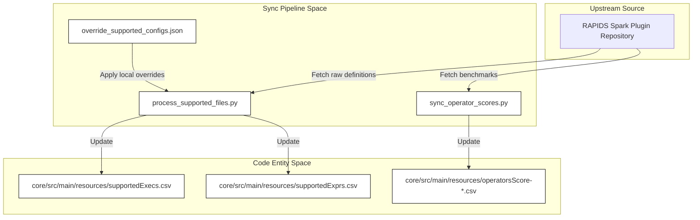

### Key Components in `scripts/sync_plugin_files/`
* **`process_supported_files.py`**: Pulls and validates expression/exec support tables from the upstream plugin source, normalizing them against `override_supported_configs.json` to handle tool-specific adjustments.
* **`sync_operator_scores.py`**: Aggregates benchmark results across instance profiles (e.g., T4, A10, A100) to regenerate the `operatorsScore-*.csv` files.
* **`override_supported_configs.json`**: Provides manual corrections or extensions for operator flags that differ in the tooling context compared to the main runtime plugin.

Sources: `[scripts/sync_plugin_files/process_supported_files.py:1-1]()`, `[scripts/sync_plugin_files/sync_operator_scores.py:1-1]`, `[scripts/sync_plugin_files/override_supported_configs.json:1-1]()`

---

# Page: Qualification Tool

# Qualification Tool

<details>
<summary>Relevant source files</summary>

The following files were used as context for generating this wiki page:

- [core/docs/qual_core_output.md](core/docs/qual_core_output.md)
- [core/src/main/resources/configs/reports/profCoreReport.yaml](core/src/main/resources/configs/reports/profCoreReport.yaml)
- [core/src/main/resources/configs/reports/qualCoreReport.yaml](core/src/main/resources/configs/reports/qualCoreReport.yaml)
- [core/src/main/resources/configs/reports/qualOutputTable.yaml](core/src/main/resources/configs/reports/qualOutputTable.yaml)
- [core/src/main/scala/com/nvidia/spark/rapids/tool/EventLogPathProcessor.scala](core/src/main/scala/com/nvidia/spark/rapids/tool/EventLogPathProcessor.scala)
- [core/src/main/scala/com/nvidia/spark/rapids/tool/planparser/SQLPlanParser.scala](core/src/main/scala/com/nvidia/spark/rapids/tool/planparser/SQLPlanParser.scala)
- [core/src/main/scala/com/nvidia/spark/rapids/tool/profiling/ProfileArgs.scala](core/src/main/scala/com/nvidia/spark/rapids/tool/profiling/ProfileArgs.scala)
- [core/src/main/scala/com/nvidia/spark/rapids/tool/qualification/PluginTypeChecker.scala](core/src/main/scala/com/nvidia/spark/rapids/tool/qualification/PluginTypeChecker.scala)
- [core/src/main/scala/com/nvidia/spark/rapids/tool/qualification/QualOutputWriter.scala](core/src/main/scala/com/nvidia/spark/rapids/tool/qualification/QualOutputWriter.scala)
- [core/src/main/scala/com/nvidia/spark/rapids/tool/qualification/Qualification.scala](core/src/main/scala/com/nvidia/spark/rapids/tool/qualification/Qualification.scala)
- [core/src/main/scala/com/nvidia/spark/rapids/tool/qualification/QualificationArgs.scala](core/src/main/scala/com/nvidia/spark/rapids/tool/qualification/QualificationArgs.scala)
- [core/src/main/scala/com/nvidia/spark/rapids/tool/qualification/QualificationMain.scala](core/src/main/scala/com/nvidia/spark/rapids/tool/qualification/QualificationMain.scala)
- [core/src/main/scala/com/nvidia/spark/rapids/tool/tuning/AutoTunerReportGenerator.scala](core/src/main/scala/com/nvidia/spark/rapids/tool/tuning/AutoTunerReportGenerator.scala)
- [core/src/main/scala/com/nvidia/spark/rapids/tool/views/qualification/QualPerAppReportGenerator.scala](core/src/main/scala/com/nvidia/spark/rapids/tool/views/qualification/QualPerAppReportGenerator.scala)
- [core/src/main/scala/com/nvidia/spark/rapids/tool/views/qualification/QualReportGenConfProvider.scala](core/src/main/scala/com/nvidia/spark/rapids/tool/views/qualification/QualReportGenConfProvider.scala)
- [core/src/main/scala/com/nvidia/spark/rapids/tool/views/qualification/QualToolReportGenerator.scala](core/src/main/scala/com/nvidia/spark/rapids/tool/views/qualification/QualToolReportGenerator.scala)
- [core/src/main/scala/com/nvidia/spark/rapids/tool/views/qualification/UdfReportBuilder.scala](core/src/main/scala/com/nvidia/spark/rapids/tool/views/qualification/UdfReportBuilder.scala)
- [core/src/main/scala/org/apache/spark/sql/rapids/tool/ClassWarehouse.scala](core/src/main/scala/org/apache/spark/sql/rapids/tool/ClassWarehouse.scala)
- [core/src/main/scala/org/apache/spark/sql/rapids/tool/ToolUtils.scala](core/src/main/scala/org/apache/spark/sql/rapids/tool/ToolUtils.scala)
- [core/src/main/scala/org/apache/spark/sql/rapids/tool/qualification/QualificationAppInfo.scala](core/src/main/scala/org/apache/spark/sql/rapids/tool/qualification/QualificationAppInfo.scala)
- [core/src/test/resources/QualificationExpectations/photon_db_17_3/app-20260929185104-0000/execs.csv](core/src/test/resources/QualificationExpectations/photon_db_17_3/app-20260929185104-0000/execs.csv)
- [core/src/test/resources/QualificationExpectations/photon_db_17_3/app-20260929185104-0000/persql.csv](core/src/test/resources/QualificationExpectations/photon_db_17_3/app-20260929185104-0000/persql.csv)
- [core/src/test/resources/QualificationExpectations/photon_db_17_3/app-20260929185104-0000/stages.csv](core/src/test/resources/QualificationExpectations/photon_db_17_3/app-20260929185104-0000/stages.csv)
- [core/src/test/resources/QualificationExpectations/photon_db_17_3/apps_summary.csv](core/src/test/resources/QualificationExpectations/photon_db_17_3/apps_summary.csv)
- [core/src/test/resources/spark-events-profiling/nds_q88_gpu_db_17_3.zstd](core/src/test/resources/spark-events-profiling/nds_q88_gpu_db_17_3.zstd)
- [core/src/test/resources/spark-events-qualification/java_udf_eventlog](core/src/test/resources/spark-events-qualification/java_udf_eventlog)
- [core/src/test/resources/spark-events-qualification/nds_merge_q4_photon_db_17_3.zstd](core/src/test/resources/spark-events-qualification/nds_merge_q4_photon_db_17_3.zstd)
- [core/src/test/resources/spark-events-qualification/python_udf_eventlog](core/src/test/resources/spark-events-qualification/python_udf_eventlog)
- [core/src/test/scala/com/nvidia/spark/rapids/tool/planparser/SqlPlanParserSuite.scala](core/src/test/scala/com/nvidia/spark/rapids/tool/planparser/SqlPlanParserSuite.scala)
- [core/src/test/scala/com/nvidia/spark/rapids/tool/qualification/PluginTypeCheckerSuite.scala](core/src/test/scala/com/nvidia/spark/rapids/tool/qualification/PluginTypeCheckerSuite.scala)
- [core/src/test/scala/com/nvidia/spark/rapids/tool/qualification/QualificationNoSparkSuite.scala](core/src/test/scala/com/nvidia/spark/rapids/tool/qualification/QualificationNoSparkSuite.scala)
- [core/src/test/scala/com/nvidia/spark/rapids/tool/qualification/QualificationSuite.scala](core/src/test/scala/com/nvidia/spark/rapids/tool/qualification/QualificationSuite.scala)
- [core/src/test/scala/com/nvidia/spark/rapids/tool/qualification/checkers/QToolCSVFileContainer.scala](core/src/test/scala/com/nvidia/spark/rapids/tool/qualification/checkers/QToolCSVFileContainer.scala)
- [core/src/test/scala/com/nvidia/spark/rapids/tool/qualification/checkers/QToolOutFileChecker.scala](core/src/test/scala/com/nvidia/spark/rapids/tool/qualification/checkers/QToolOutFileChecker.scala)
- [user_tools/src/spark_rapids_tools/api_v1/core/core_reader.py](user_tools/src/spark_rapids_tools/api_v1/core/core_reader.py)
- [user_tools/src/spark_rapids_tools/api_v1/core/prof_reader.py](user_tools/src/spark_rapids_tools/api_v1/core/prof_reader.py)
- [user_tools/src/spark_rapids_tools/api_v1/core/qual_reader.py](user_tools/src/spark_rapids_tools/api_v1/core/qual_reader.py)

</details>


The Qualification Tool analyzes Apache Spark event logs to assess whether an application is a strong candidate for GPU acceleration using the NVIDIA cuDF plugin. It evaluates SQL plans, data sources, operators, expressions, and task-level execution metrics against operator support matrices and speedup models, generating comprehensive CSV reports, summary logs, and cluster configuration recommendations.

---

## 1. CLI Ingestion and Runner Architecture

The execution of the qualification workflow begins in `QualificationMain`, which parses user-supplied arguments via `QualificationArgs`, discovers and filters event logs using `EventLogPathProcessor`, builds the plugin type checker, and passes execution to the `Qualification` orchestrator class.

```mermaid
graph TD
    UserCLI["QualificationMain.main"] --> Args["QualificationArgs"]
    Args --> PathProc["EventLogPathProcessor.processAllPaths"]
    PathProc --> TC["PluginTypeChecker"]
    TC --> QualRunner["Qualification.qualifyApps"]
    QualRunner --> ThreadPool["ThreadPool Executor"]
    ThreadPool --> AppInfo["QualificationAppInfo.createApp"]
```
*Sources:* `core/src/main/scala/com/nvidia/spark/rapids/tool/qualification/QualificationMain.scala:32-128`, `core/src/main/scala/com/nvidia/spark/rapids/tool/qualification/QualificationArgs.scala:25-33`, `core/src/main/scala/com/nvidia/spark/rapids/tool/qualification/Qualification.scala:34-117`

### Argument Processing and Path Discovery
- **`QualificationArgs`**: Extends Scallop (`org.rogach.scallop.ScallopConf`) to define parameters such as `--output-directory`, `--filter-criteria`, `--application-name`, `--per-sql`, `--ml-functions`, `--auto-tuner`, and trail arguments for event log paths or text files listing paths [core/src/main/scala/com/nvidia/spark/rapids/tool/qualification/QualificationArgs.scala:25-128].
- **`EventLogPathProcessor`**: Resolves local or remote paths (e.g., `s3a://`, `hdfs://`), expands `.txt` file manifests containing path tokens, filters compressed/uncompressed event logs via `eventLogNameFilter`, and applies timestamp or size restrictions [core/src/main/scala/com/nvidia/spark/rapids/tool/EventLogPathProcessor.scala:54-172].

### Thread Pool Orchestration
The `Qualification` class manages concurrent execution of event log analysis across a thread pool configured by `--num-threads`:
```scala
val qual = new Qualification(outputDirectory, hadoopConf, timeout,
  nThreads, pluginTypeChecker, enablePB, reportSqlLevel, maxSQLDescLength, 
  appArgs.connectStatements(), mlOpsEnabled, penalizeTransitions,
  tunerContext, appArgs.clusterReport(), appArgs.platform(),
  appArgs.targetClusterInfo.toOption)
val res = qual.qualifyApps(filteredLogs)
```
*Sources:* `core/src/main/scala/com/nvidia/spark/rapids/tool/qualification/QualificationMain.scala:120-126`, `core/src/main/scala/com/nvidia/spark/rapids/tool/qualification/Qualification.scala:34-117`

---

## 2. Application Ingestion and Processing Model (`QualificationAppInfo`)

`QualificationAppInfo` extends `AppBase` to process Spark listener events for a single application attempt, collecting stage metrics, task summaries, and SQL execution graphs.

```mermaid
classDiagram
    class AppBase {
        <<abstract>>
        +processEvents()
        +cleanupStages()
    }
    class QualificationAppInfo {
        +eventLogInfo: Option[EventLogInfo]
        +perSqlOnly: Boolean
        +getEventListener() SparkListener
        +validateAppEventlogProperties()
        +guestimateAppEndTimeCB()
    }
    AppBase <|-- QualificationAppInfo : extends
    QualificationAppInfo --> QualificationEventProcessor : uses
```
*Sources:* `core/src/main/scala/org/apache/spark/sql/rapids/tool/qualification/QualificationAppInfo.scala:36-64`

### Key Responsibilities and Lifecycle Checks
- **Event Processor**: Registers a `QualificationEventProcessor` listener to capture jobs, stages, tasks, SQL executions, and application start/end boundaries [core/src/main/scala/org/apache/spark/sql/rapids/tool/qualification/QualificationAppInfo.scala:63-83].
- **Event Log Validation**: `validateAppEventlogProperties()` ensures that event logs generated by pre-enabled GPU or Photon environments are handled or rejected properly, throwing a `GpuEventLogException` if the log was run under incompatible execution modes [core/src/main/scala/org/apache/spark/sql/rapids/tool/qualification/QualificationAppInfo.scala:111-115].
- **End Time Estimation**: `guestimateAppEndTimeCB()` estimates application completion time when explicit end markers are missing by taking the maximum of last SQL execution end times and last job end times [core/src/main/scala/org/apache/spark/sql/rapids/tool/qualification/QualificationAppInfo.scala:117-130].

*Sources:* `core/src/main/scala/org/apache/spark/sql/rapids/tool/qualification/QualificationAppInfo.scala:36-130`

---

## 3. Operator Support and Speedup Estimation (`PluginTypeChecker`)

`PluginTypeChecker` acts as the core rules engine that determines whether Spark operators, expressions, and data sources are supported by the cuDF plugin, and assigns speedup multipliers.

```mermaid
graph LR
    PTC["PluginTypeChecker"] --> DS["supportedDataSource.csv"]
    PTC --> Execs["supportedExecs.csv"]
    PTC --> Exprs["supportedExprs.csv"]
    PTC --> Scores["operatorsScore-*.csv"]
    PTC --> OpLvl["OpSuppLevel (S, PS, NS, TOFF...)"]
```
*Sources:* `core/src/main/scala/com/nvidia/spark/rapids/tool/qualification/PluginTypeChecker.scala:31-153`

### Support Levels (`OpSuppLevel`)
The tool categorizes operator compatibility using `OpSuppLevel` enumeration values:
- `S`: Enabled by the plugin (Supported)
- `TON`: Force-enabled by tools
- `PS`: Partially supported
- `NS`: Not supported by the plugin (requires notes)
- `TOFF`: Force-disabled by tools
- `CO`: Configured off by the plugin

### Operator Scoring and Speedup Factors
`readOperatorsScore()` loads performance multipliers from platform-specific resources (such as `operatorsScore-*.csv`) or custom speedup factor files provided via `--speedup-factor-file`, allowing the qualification tool to estimate potential wall-clock time reductions [core/src/main/scala/com/nvidia/spark/rapids/tool/qualification/PluginTypeChecker.scala:117-153].

*Sources:* `core/src/main/scala/com/nvidia/spark/rapids/tool/qualification/PluginTypeChecker.scala:31-164`

---

## 4. Output Writers and Report Configurations

Once all application event logs are processed, the qualification results are synthesized and written out via the output reporting infrastructure.

### Report Generation and File Layout
- **`QualOutputWriter`**: Manages the serialization of raw CSV metrics, per-SQL breakdowns (`perSql.csv`), stage summaries (`stages.csv`), and unsupported operator lists (`unsupportedOps.csv`) [core/src/main/scala/com/nvidia/spark/rapids/tool/qualification/QualOutputWriter.scala:34-77].
- **Configuration Templates**: Uses YAML configuration providers like `qualCoreReport.yaml` and `qualOutputTable.yaml` to define column schemas, formatting rules, and enabled output views [core/src/main/scala/com/nvidia/spark/rapids/tool/qualification/Qualification.scala:56-63].

*Sources:* `core/src/main/scala/com/nvidia/spark/rapids/tool/qualification/QualOutputWriter.scala:34-77`, `core/src/main/scala/com/nvidia/spark/rapids/tool/qualification/Qualification.scala:52-63`

---

# Page: Profiling Tool

# Profiling Tool

<details>
<summary>Relevant source files</summary>

The following files were used as context for generating this wiki page:

- [core/scalastyle-config.xml](core/scalastyle-config.xml)
- [core/src/main/scala/com/nvidia/spark/rapids/tool/ToolTextFileWriter.scala](core/src/main/scala/com/nvidia/spark/rapids/tool/ToolTextFileWriter.scala)
- [core/src/main/scala/com/nvidia/spark/rapids/tool/analysis/AppSQLPlanAnalyzer.scala](core/src/main/scala/com/nvidia/spark/rapids/tool/analysis/AppSQLPlanAnalyzer.scala)
- [core/src/main/scala/com/nvidia/spark/rapids/tool/analysis/SparkSQLPlanInfoVisitor.scala](core/src/main/scala/com/nvidia/spark/rapids/tool/analysis/SparkSQLPlanInfoVisitor.scala)
- [core/src/main/scala/com/nvidia/spark/rapids/tool/profiling/CollectInformation.scala](core/src/main/scala/com/nvidia/spark/rapids/tool/profiling/CollectInformation.scala)
- [core/src/main/scala/com/nvidia/spark/rapids/tool/profiling/DriverLogProcessor.scala](core/src/main/scala/com/nvidia/spark/rapids/tool/profiling/DriverLogProcessor.scala)
- [core/src/main/scala/com/nvidia/spark/rapids/tool/profiling/GenerateDot.scala](core/src/main/scala/com/nvidia/spark/rapids/tool/profiling/GenerateDot.scala)
- [core/src/main/scala/com/nvidia/spark/rapids/tool/profiling/GenerateTimeline.scala](core/src/main/scala/com/nvidia/spark/rapids/tool/profiling/GenerateTimeline.scala)
- [core/src/main/scala/com/nvidia/spark/rapids/tool/profiling/HealthCheck.scala](core/src/main/scala/com/nvidia/spark/rapids/tool/profiling/HealthCheck.scala)
- [core/src/main/scala/com/nvidia/spark/rapids/tool/profiling/ProfSQLPlanClassifier.scala](core/src/main/scala/com/nvidia/spark/rapids/tool/profiling/ProfSQLPlanClassifier.scala)
- [core/src/main/scala/com/nvidia/spark/rapids/tool/profiling/ProfileMain.scala](core/src/main/scala/com/nvidia/spark/rapids/tool/profiling/ProfileMain.scala)
- [core/src/main/scala/com/nvidia/spark/rapids/tool/profiling/ProfileOutputWriter.scala](core/src/main/scala/com/nvidia/spark/rapids/tool/profiling/ProfileOutputWriter.scala)
- [core/src/main/scala/com/nvidia/spark/rapids/tool/profiling/Profiler.scala](core/src/main/scala/com/nvidia/spark/rapids/tool/profiling/Profiler.scala)
- [core/src/main/scala/com/nvidia/spark/rapids/tool/views/JobView.scala](core/src/main/scala/com/nvidia/spark/rapids/tool/views/JobView.scala)
- [core/src/main/scala/com/nvidia/spark/rapids/tool/views/QualRawReportGenerator.scala](core/src/main/scala/com/nvidia/spark/rapids/tool/views/QualRawReportGenerator.scala)
- [core/src/main/scala/com/nvidia/spark/rapids/tool/views/StageView.scala](core/src/main/scala/com/nvidia/spark/rapids/tool/views/StageView.scala)
- [core/src/main/scala/com/nvidia/spark/rapids/tool/views/TaskView.scala](core/src/main/scala/com/nvidia/spark/rapids/tool/views/TaskView.scala)
- [core/src/main/scala/org/apache/spark/sql/rapids/tool/store/StageModelManager.scala](core/src/main/scala/org/apache/spark/sql/rapids/tool/store/StageModelManager.scala)
- [core/src/main/scala/org/apache/spark/sql/rapids/tool/store/TaskModel.scala](core/src/main/scala/org/apache/spark/sql/rapids/tool/store/TaskModel.scala)
- [core/src/main/scala/org/apache/spark/sql/rapids/tool/ui/ConsoleProgressBar.scala](core/src/main/scala/org/apache/spark/sql/rapids/tool/ui/ConsoleProgressBar.scala)
- [core/src/main/scala/org/apache/spark/sql/rapids/tool/util/RapidsToolsConfUtil.scala](core/src/main/scala/org/apache/spark/sql/rapids/tool/util/RapidsToolsConfUtil.scala)
- [core/src/main/scala/org/apache/spark/sql/rapids/tool/util/RuntimeReporter.scala](core/src/main/scala/org/apache/spark/sql/rapids/tool/util/RuntimeReporter.scala)
- [core/src/test/resources/ProfilingExpectations/executors_removed_eventlog_expectation.csv](core/src/test/resources/ProfilingExpectations/executors_removed_eventlog_expectation.csv)
- [core/src/test/resources/ProfilingExpectations/jobs_failure_eventlog_expectation.csv](core/src/test/resources/ProfilingExpectations/jobs_failure_eventlog_expectation.csv)
- [core/src/test/resources/ProfilingExpectations/stages_failure_eventlog_expectation.csv](core/src/test/resources/ProfilingExpectations/stages_failure_eventlog_expectation.csv)
- [core/src/test/resources/ProfilingExpectations/tasks_failure_eventlog_expectation.csv](core/src/test/resources/ProfilingExpectations/tasks_failure_eventlog_expectation.csv)
- [core/src/test/scala/com/nvidia/spark/rapids/tool/profiling/ApplicationInfoSuite.scala](core/src/test/scala/com/nvidia/spark/rapids/tool/profiling/ApplicationInfoSuite.scala)
- [core/src/test/scala/com/nvidia/spark/rapids/tool/profiling/GenerateDotSuite.scala](core/src/test/scala/com/nvidia/spark/rapids/tool/profiling/GenerateDotSuite.scala)
- [core/src/test/scala/com/nvidia/spark/rapids/tool/profiling/GenerateTimelineSuite.scala](core/src/test/scala/com/nvidia/spark/rapids/tool/profiling/GenerateTimelineSuite.scala)
- [core/src/test/scala/com/nvidia/spark/rapids/tool/profiling/HealthCheckSuite.scala](core/src/test/scala/com/nvidia/spark/rapids/tool/profiling/HealthCheckSuite.scala)

</details>


## Purpose and Scope

The Profiling Tool (`Profiler`) is a core component of the `rapids-4-spark-tools` Scala library designed to analyze Spark event logs and driver logs in deep technical detail. Its primary responsibilities include multi-threaded event log ingestion, orchestration of application profiling, running cluster health checks, extracting diagnostic stage and I/O metrics, processing driver logs for unsupported GPU operators, and generating visual artifacts such as graphviz `.dot` plan representations and SVG cluster execution timelines.

Sources: 
- `core/src/main/scala/com/nvidia/spark/rapids/tool/profiling/Profiler.scala`
- `core/src/main/scala/com/nvidia/spark/rapids/tool/profiling/ProfileMain.scala`

---

## Profiler Orchestration and Execution Flow

The profiling execution pipeline is initiated by `ProfileMain` [`core/src/main/scala/com/nvidia/spark/rapids/tool/profiling/ProfileMain.scala:32-37`] which parses command-line arguments via `ProfileArgs`, resolves event log paths using `EventLogPathProcessor`, and initializes a `Profiler` instance `[core/src/main/scala/com/nvidia/spark/rapids/tool/profiling/Profiler.scala:50-51]`.

The `Profiler` class extends `ToolBase` and runs tasks in parallel using a managed thread pool (sized via `getNumThreads`) `[core/src/main/scala/com/nvidia/spark/rapids/tool/profiling/Profiler.scala:91-92]`. For each target application log, `Profiler` instantiates an `ApplicationInfo` object, processes SQL plans, executes health checks, evaluates optional auto-tuning passes via `ProfilingAutoTunerHelper` `[core/src/main/scala/com/nvidia/spark/rapids/tool/profiling/Profiler.scala:26]`, and delegates reporting to `ProfileOutputWriter`.

```mermaid
graph TD
    sub0["ProfileMain"] -->|"mainInternal"| sub1["EventLogPathProcessor"]
    sub1 -->|"Filtered Logs"| sub2["Profiler"]
    sub2 -->|"Parallel Execution"| sub3["ApplicationInfo"]
    sub3 -->|"SQL & Stage Analysis"| sub4["AppSQLPlanAnalyzer"]
    sub2 -->|"ProfileDriver"| sub5["DriverLogProcessor"]
    sub2 -->|"Results"| sub6["ProfileOutputWriter"]
```
Sources: 
- `core/src/main/scala/com/nvidia/spark/rapids/tool/profiling/Profiler.scala`
- `core/src/main/scala/com/nvidia/spark/rapids/tool/profiling/ProfileMain.scala`

---

## Information Collection and View Generation

The `CollectInformation` class aggregates structured insights across one or more `ApplicationInfo` instances `[core/src/main/scala/com/nvidia/spark/rapids/tool/profiling/CollectInformation.scala:34-124]`. It acts as an abstraction layer bridging raw event log data structures to tabular profiling results (`ProfileResult`) consumed by report writers.

Key extraction methods provided by `CollectInformation`:
- `getAppInfo`: Summarizes application metadata via `ProfInformationView` `[core/src/main/scala/com/nvidia/spark/rapids/tool/profiling/CollectInformation.scala:36-38]`.
- `getRapidsJARInfo`: Inpsects classpath entries for `rapids-4-spark` and `cudf` JARs `[core/src/main/scala/com/nvidia/spark/rapids/tool/profiling/CollectInformation.scala:44-47]`.
- `getDataSourceInfo`: Extracts V1/V2 data source read schemas and formats `[core/src/main/scala/com/nvidia/spark/rapids/tool/profiling/CollectInformation.scala:50-57]`.
- `getWholeStageCodeGenMapping`: Maps SQL plans to whole-stage code generation blocks `[core/src/main/scala/com/nvidia/spark/rapids/tool/profiling/CollectInformation.scala:89-91]`.
- `getSQLPlanMetrics`: Extracts granular SQL plan metrics via `ProfSQLPlanMetricsView` `[core/src/main/scala/com/nvidia/spark/rapids/tool/profiling/CollectInformation.scala:94-96]`.
- `getIODiagnosticMetrics`: Gathers I/O stage diagnostic indicators `[core/src/main/scala/com/nvidia/spark/rapids/tool/profiling/CollectInformation.scala:107-109]`.

```mermaid
graph TD
    sub0["ApplicationInfo"] -->|"Provides raw data"| sub1["CollectInformation"]
    sub1 -->|"ProfInformationView"| sub2["AppInfoProfileResults"]
    sub1 -->|"ProfRapidsJarView"| sub3["RapidsJarProfileResult"]
    sub1 -->|"ProfDataSourceView"| sub4["DataSourceProfileResult"]
    sub1 -->|"ProfSQLCodeGenView"| sub5["WholeStageCodeGenResults"]
    sub1 -->|"ProfSQLPlanMetricsView"| sub6["SQLAccumProfileResults"]
    sub1 -->|"ProfIODiagnosticMetricsView"| sub7["IODiagnosticResult"]
```
Sources: 
- `core/src/main/scala/com/nvidia/spark/rapids/tool/profiling/CollectInformation.scala`

---

## Driver Log Processing

When a Spark driver log is supplied alongside or instead of event logs, `ProfileMain` delegates to `Profiler.profileDriver` `[core/src/main/scala/com/nvidia/spark/rapids/tool/profiling/Profiler.scala:127-152]`. 

The underlying log processor, `DriverLogProcessor` (extending `BaseDriverLogInfoProvider`), scans driver stdout/stderr streams via Hadoop FileSystems `[core/src/main/scala/com/nvidia/spark/rapids/tool/profiling/DriverLogProcessor.scala:43-89]`:
1. It opens an `FSDataInputStream` on the specified log path `[core/src/main/scala/com/nvidia/spark/rapids/tool/profiling/DriverLogProcessor.scala:48-54]`.
2. It filters lines containing `"cannot run on GPU"` while excluding expressions that cannot be replaced `[core/src/main/scala/com/nvidia/spark/rapids/tool/profiling/DriverLogProcessor.scala:57-60]`.
3. It parses operator names and failure reasons into a counted frequency map, returning a sequence of `DriverLogUnsupportedOperators` records `[core/src/main/scala/com/nvidia/spark/rapids/tool/profiling/DriverLogProcessor.scala:61-84]`.

Sources: 
- `core/src/main/scala/com/nvidia/spark/rapids/tool/profiling/Profiler.scala`
- `core/src/main/scala/com/nvidia/spark/rapids/tool/profiling/DriverLogProcessor.scala`

---

## Visualizations: Dot and Timeline Generation

The profiling tool includes specialized generators for visual artifacts:
- **Dot Generation (`GenerateDot`)**: Processes query execution plans to output Graphviz `.dot` files representing physical plan graphs and operator compatibility nodes.
- **Timeline Generation (`GenerateTimeline`)**: Computes cluster scheduling layouts for jobs, stages, and tasks (`calcLayoutSlotsNeeded`, `doLayout`, `computeLayout`) `[core/src/main/scala/com/nvidia/spark/rapids/tool/profiling/GenerateTimeline.scala:96-133]` and serializes them into Scalable Vector Graphics (SVG) timelines via `ToolTextFileWriter`. Timings are categorized into execution intervals, serialization, read/write, and task execution durations.

Sources: 
- `core/src/main/scala/com/nvidia/spark/rapids/tool/profiling/GenerateTimeline.scala`

---

## Output Serialization

The `ProfileOutputWriter` class manages the generation of output reports `[core/src/main/scala/com/nvidia/spark/rapids/tool/profiling/ProfileOutputWriter.scala:29-98]`. It wraps a `ToolTextFileWriter` pointing to `profile.log` while providing structured serialization modes:
- **Text Tables**: Formats `ProfileResult` sequences into aligned fixed-width text blocks written directly to the summary log `[core/src/main/scala/com/nvidia/spark/rapids/tool/profiling/ProfileOutputWriter.scala:41-60]`.
- **CSV Tables**: When `outputCSV` is enabled, individual tables are serialized into dedicated comma-separated value files (`.csv`) under the output directory, sanitizing headers into snake-case filenames `[core/src/main/scala/com/nvidia/spark/rapids/tool/profiling/ProfileOutputWriter.scala:104-138]`.
- **JSON / JSONL**: Supports pretty-printed JSON (`writeJson`) and JSON Lines (`writeJsonL`) outputs for downstream tooling integration `[core/src/main/scala/com/nvidia/spark/rapids/tool/profiling/ProfileOutputWriter.scala:80-93]`.

Sources: 
- `core/src/main/scala/com/nvidia/spark/rapids/tool/profiling/ProfileOutputWriter.scala`

---

# Page: Metrics Analysis and Report Views

# Metrics Analysis and Report Views

<details>
<summary>Relevant source files</summary>

The following files were used as context for generating this wiki page:

- [core/src/main/resources/configs/reports/coreRawMetricsReport.yaml](core/src/main/resources/configs/reports/coreRawMetricsReport.yaml)
- [core/src/main/scala/com/nvidia/spark/rapids/tool/analysis/AggRawMetricsResult.scala](core/src/main/scala/com/nvidia/spark/rapids/tool/analysis/AggRawMetricsResult.scala)
- [core/src/main/scala/com/nvidia/spark/rapids/tool/analysis/AppAnalysisBase.scala](core/src/main/scala/com/nvidia/spark/rapids/tool/analysis/AppAnalysisBase.scala)
- [core/src/main/scala/com/nvidia/spark/rapids/tool/analysis/AppSparkMetricsAggTrait.scala](core/src/main/scala/com/nvidia/spark/rapids/tool/analysis/AppSparkMetricsAggTrait.scala)
- [core/src/main/scala/com/nvidia/spark/rapids/tool/analysis/AppSparkMetricsAnalyzer.scala](core/src/main/scala/com/nvidia/spark/rapids/tool/analysis/AppSparkMetricsAnalyzer.scala)
- [core/src/main/scala/com/nvidia/spark/rapids/tool/analysis/MetricCatalog.scala](core/src/main/scala/com/nvidia/spark/rapids/tool/analysis/MetricCatalog.scala)
- [core/src/main/scala/com/nvidia/spark/rapids/tool/analysis/ProfSparkMetricsAggregator.scala](core/src/main/scala/com/nvidia/spark/rapids/tool/analysis/ProfSparkMetricsAggregator.scala)
- [core/src/main/scala/com/nvidia/spark/rapids/tool/analysis/QualSparkMetricsAggregator.scala](core/src/main/scala/com/nvidia/spark/rapids/tool/analysis/QualSparkMetricsAggregator.scala)
- [core/src/main/scala/com/nvidia/spark/rapids/tool/analysis/StatisticsMetrics.scala](core/src/main/scala/com/nvidia/spark/rapids/tool/analysis/StatisticsMetrics.scala)
- [core/src/main/scala/com/nvidia/spark/rapids/tool/analysis/util/AggAccumHelper.scala](core/src/main/scala/com/nvidia/spark/rapids/tool/analysis/util/AggAccumHelper.scala)
- [core/src/main/scala/com/nvidia/spark/rapids/tool/analysis/util/AggAccumPhotonHelper.scala](core/src/main/scala/com/nvidia/spark/rapids/tool/analysis/util/AggAccumPhotonHelper.scala)
- [core/src/main/scala/com/nvidia/spark/rapids/tool/analysis/util/DiagnosticMetrics.scala](core/src/main/scala/com/nvidia/spark/rapids/tool/analysis/util/DiagnosticMetrics.scala)
- [core/src/main/scala/com/nvidia/spark/rapids/tool/analysis/util/JobAggAccum.scala](core/src/main/scala/com/nvidia/spark/rapids/tool/analysis/util/JobAggAccum.scala)
- [core/src/main/scala/com/nvidia/spark/rapids/tool/analysis/util/SQLAggAccum.scala](core/src/main/scala/com/nvidia/spark/rapids/tool/analysis/util/SQLAggAccum.scala)
- [core/src/main/scala/com/nvidia/spark/rapids/tool/analysis/util/StageAggAccum.scala](core/src/main/scala/com/nvidia/spark/rapids/tool/analysis/util/StageAggAccum.scala)
- [core/src/main/scala/com/nvidia/spark/rapids/tool/analysis/util/StageAggPhoton.scala](core/src/main/scala/com/nvidia/spark/rapids/tool/analysis/util/StageAggPhoton.scala)
- [core/src/main/scala/com/nvidia/spark/rapids/tool/analysis/util/TaskMetricsAccumRec.scala](core/src/main/scala/com/nvidia/spark/rapids/tool/analysis/util/TaskMetricsAccumRec.scala)
- [core/src/main/scala/com/nvidia/spark/rapids/tool/profiling/DiagnosticSummaryInfo.scala](core/src/main/scala/com/nvidia/spark/rapids/tool/profiling/DiagnosticSummaryInfo.scala)
- [core/src/main/scala/com/nvidia/spark/rapids/tool/profiling/ProfileClassWarehouse.scala](core/src/main/scala/com/nvidia/spark/rapids/tool/profiling/ProfileClassWarehouse.scala)
- [core/src/main/scala/com/nvidia/spark/rapids/tool/profiling/ProfileUtils.scala](core/src/main/scala/com/nvidia/spark/rapids/tool/profiling/ProfileUtils.scala)
- [core/src/main/scala/com/nvidia/spark/rapids/tool/views/DataSourceView.scala](core/src/main/scala/com/nvidia/spark/rapids/tool/views/DataSourceView.scala)
- [core/src/main/scala/com/nvidia/spark/rapids/tool/views/InformationView.scala](core/src/main/scala/com/nvidia/spark/rapids/tool/views/InformationView.scala)
- [core/src/main/scala/com/nvidia/spark/rapids/tool/views/OutHeaderRegistry.scala](core/src/main/scala/com/nvidia/spark/rapids/tool/views/OutHeaderRegistry.scala)
- [core/src/main/scala/com/nvidia/spark/rapids/tool/views/RawMetricProfView.scala](core/src/main/scala/com/nvidia/spark/rapids/tool/views/RawMetricProfView.scala)
- [core/src/main/scala/com/nvidia/spark/rapids/tool/views/SQLView.scala](core/src/main/scala/com/nvidia/spark/rapids/tool/views/SQLView.scala)
- [core/src/main/scala/com/nvidia/spark/rapids/tool/views/package.scala](core/src/main/scala/com/nvidia/spark/rapids/tool/views/package.scala)
- [core/src/main/scala/org/apache/spark/sql/rapids/tool/AppMetaData.scala](core/src/main/scala/org/apache/spark/sql/rapids/tool/AppMetaData.scala)
- [core/src/main/scala/org/apache/spark/sql/rapids/tool/store/AccumInfo.scala](core/src/main/scala/org/apache/spark/sql/rapids/tool/store/AccumInfo.scala)
- [core/src/main/scala/org/apache/spark/sql/rapids/tool/util/StringUtils.scala](core/src/main/scala/org/apache/spark/sql/rapids/tool/util/StringUtils.scala)
- [core/src/main/scala/org/apache/spark/sql/rapids/tool/util/WebCrawlerUtil.scala](core/src/main/scala/org/apache/spark/sql/rapids/tool/util/WebCrawlerUtil.scala)
- [core/src/main/scala/org/apache/spark/sql/rapids/tool/util/package.scala](core/src/main/scala/org/apache/spark/sql/rapids/tool/util/package.scala)
- [core/src/test/scala/com/nvidia/spark/rapids/tool/analysis/GpuMetricReportSuite.scala](core/src/test/scala/com/nvidia/spark/rapids/tool/analysis/GpuMetricReportSuite.scala)
- [core/src/test/scala/com/nvidia/spark/rapids/tool/profiling/AnalysisSuite.scala](core/src/test/scala/com/nvidia/spark/rapids/tool/profiling/AnalysisSuite.scala)
- [core/src/test/scala/com/nvidia/spark/rapids/tool/util/ToolUtilsSuite.scala](core/src/test/scala/com/nvidia/spark/rapids/tool/util/ToolUtilsSuite.scala)
- [user_tools/src/spark_rapids_pytools/rapids/qualx/qualx_tool.py](user_tools/src/spark_rapids_pytools/rapids/qualx/qualx_tool.py)

</details>


## Purpose and Scope

Section 2.5 covers the metrics analysis and reporting subsystem of the `cudf-spark-tools` Scala core JAR (`rapids-4-spark-tools`). This subsystem is responsible for post-processing task-level and stage-level execution telemetry extracted from Spark event logs, computing statistical metrics (such as min, median, max, sums, and standard deviations via Welford's algorithm), aggregating metrics across SQL queries, stages, and jobs, storing results in structured profile data structures (`ProfileResult`), and formatting them into tabular views governed by a centralized header registry (`OutHeaderRegistry`).

Sources: `core/src/main/scala/com/nvidia/spark/rapids/tool/analysis/AppSparkMetricsAnalyzer.scala:31-51`, `core/src/main/scala/com/nvidia/spark/rapids/tool/profiling/ProfileClassWarehouse.scala:29-38`, `core/src/main/scala/com/nvidia/spark/rapids/tool/views/OutHeaderRegistry.scala:19-30`

---

## MetricCatalog and Statistics Metrics

The analytics engine processes raw Spark accumulators and translates them into statistical metrics using `StatisticsMetrics`. This structure records minimum, median, maximum, sample count, total, and Welford's moving variance ($M_2$ sum of squared deviations from the mean) to compute standard deviations without retaining individual task measurements [core/src/main/scala/com/nvidia/spark/rapids/tool/analysis/StatisticsMetrics.scala:21-38].

```mermaid
graph TD
    subcode["StatisticsMetrics"]
    RawEvent["Spark TaskEnd / StageCompleted"] --> AccumInfo["AccumInfo.scala"]
    AccumInfo --> StatMetrics["StatisticsMetrics.scala"]
    StatMetrics --> Welford["WelfordSumSqDev & Chan's Parallel Form"]
    StatMetrics --> AggResults["StageAggTaskMetricsProfileResult"]

    classDef default fill:#fff,stroke:#000,stroke-width:1px;
```
*Figure 1: Accumulator ingestion and statistical aggregation pipeline mapping natural flow to code entities.*

Sources: `core/src/main/scala/com/nvidia/spark/rapids/tool/analysis/StatisticsMetrics.scala:21-113`, `core/src/main/scala/org/apache/spark/sql/rapids/tool/store/AccumInfo.scala:35-119`

---

## AppSparkMetricsAnalyzer and Aggregation Architecture

`AppSparkMetricsAnalyzer` performs high-performance analysis on Spark application dataframes and object stores (`AppBase`). It avoids redundant scans by caching stage-level metrics (`stageLevelCache`) and deriving job-level and SQL-level aggregates from them [core/src/main/scala/com/nvidia/spark/rapids/tool/analysis/AppSparkMetricsAnalyzer.scala:51-66].

```mermaid
graph TD
    App["AppBase"] --> Analyzer["AppSparkMetricsAnalyzer"]
    Analyzer --> StageCache["stageLevelCache: LinkedHashMap[Int, StageAggTaskMetricsProfileResult]"]
    StageCache -->|Stage Metrics| JobAgg["aggregateSparkMetricsByJob"]
    StageCache -->|Stage Metrics| SkewCheck["shuffleSkewCheck"]
    JobAgg --> AggHelper["AggAccumHelper"]

    classDef default fill:#fff,stroke:#000,stroke-width:1px;
```
*Figure 2: `AppSparkMetricsAnalyzer` execution flow and caching mechanism.*

### Key Aggregation Operations

- **Stage Aggregation (`aggregateSparkMetricsByStage`)**: Computes task-level metrics aggregated per stage ID [core/src/main/scala/com/nvidia/spark/rapids/tool/analysis/AppSparkMetricsAnalyzer.scala:73-75].
- **Job Aggregation (`aggregateSparkMetricsByJob`)**: Combines stage metrics associated with specific job identifiers using `AggAccumHelper` [core/src/main/scala/com/nvidia/spark/rapids/tool/analysis/AppSparkMetricsAnalyzer.scala:82-132].
- **Shuffle Skew Detection (`shuffleSkewCheck`)**: Scans task metrics to detect skew conditions where input size exceeds $3\times$ average shuffle read and $100\text{MB}$ [core/src/main/scala/com/nvidia/spark/rapids/tool/analysis/AppSparkMetricsAnalyzer.scala:142-156].

Sources: `core/src/main/scala/com/nvidia/spark/rapids/tool/analysis/AppSparkMetricsAnalyzer.scala:51-156`, `core/src/main/scala/com/nvidia/spark/rapids/tool/analysis/util/AggAccumHelper.scala`

---

## ProfileResult Warehouse

The `ProfileClassWarehouse.scala` file defines the `ProfileResult` trait and its implementing case classes. These represent individual row schemas for profiling reports, supporting conversion to raw string sequences (`convertToSeq`) and CSV-formatted strings (`convertToCSVSeq`) [core/src/main/scala/com/nvidia/spark/rapids/tool/profiling/ProfileClassWarehouse.scala:29-58].

| ProfileResult Class | Description | Key Fields |
| :--- | :--- | :--- |
| `ExecutorInfoProfileResult` | Executor resource profile metrics | `resourceProfileId`, `numExecutors`, `maxMem`, `taskCpu` [core/src/main/scala/com/nvidia/spark/rapids/tool/profiling/ProfileClassWarehouse.scala:39-43] |
| `JobInfoProfileResult` | Job lifecycle metadata | `jobID`, `stageIds`, `sqlID`, `startTime`, `endTime` [core/src/main/scala/com/nvidia/spark/rapids/tool/profiling/ProfileClassWarehouse.scala:71-76] |
| `SQLPlanGraphProfileResult` | SQL plan graph topological representation | `sqlID`, `planVersion`, `nodeID`, `nodeName`, `sinkNodes` [core/src/main/scala/com/nvidia/spark/rapids/tool/profiling/ProfileClassWarehouse.scala:149-156] |
| `DataSourceProfileResult` | Input/Output data source scan metrics | `sqlID`, `format`, `buffer_time`, `scan_time`, `data_size` [core/src/main/scala/com/nvidia/spark/rapids/tool/views/DataSourceView.scala:90-94] |

Sources: `core/src/main/scala/com/nvidia/spark/rapids/tool/profiling/ProfileClassWarehouse.scala:29-185`

---

## View Layer and OutHeaderRegistry

The view layer (`ViewableTrait`) transforms raw analytics models into reporting output structures. To prevent memory overhead from duplicating header arrays across thousands of profile row objects, `OutHeaderRegistry` maintains a centralized registry of header definitions keyed by literal string identifiers [core/src/main/scala/com/nvidia/spark/rapids/tool/views/OutHeaderRegistry.scala:19-30].

```mermaid
graph TD
    View["ViewableTrait"] --> DataSourceView["QualDataSourceView / ProfDataSourceView"]
    View --> SQLView["ProfSQLPlanGraphViewTrait"]
    DataSourceView --> ProfileRes["DataSourceProfileResult"]
    SQLView --> PlanRes["SQLPlanGraphProfileResult"]
    ProfileRes --> Registry["OutHeaderRegistry.outputHeaders"]
    PlanRes --> Registry

    classDef default fill:#fff,stroke:#000,stroke-width:1px;
```
*Figure 3: View extraction and header registry lookup architecture.*

### Header Registry Implementation
String-based map lookups avoid reflection overhead (`classOf[T].getName`) during row serialization:
```scala
object OutHeaderRegistry {
  val outputHeaders: Map[String, Array[String]] = Map(
    "ExecutorInfoProfileResult" -> Array("resourceProfileId", "numExecutors", ...),
    "JobInfoProfileResult" -> Array("jobID", "stageIds", "sqlID", "startTime", "endTime"),
    "DataSourceProfileResult" -> Array("sqlID", "sql_plan_version", "nodeId", "format", ...)
  )
}
```
Sources: `core/src/main/scala/com/nvidia/spark/rapids/tool/views/OutHeaderRegistry.scala:19-54`, `core/src/main/scala/com/nvidia/spark/rapids/tool/views/DataSourceView.scala:27-108`, `core/src/main/scala/com/nvidia/spark/rapids/tool/views/SQLView.scala:41-67`

---

# Page: AutoTuner and Platform Modeling

# AutoTuner and Platform Modeling

<details>
<summary>Relevant source files</summary>

The following files were used as context for generating this wiki page:

- [core/src/main/resources/bootstrap/tuningConfigs.yaml](core/src/main/resources/bootstrap/tuningConfigs.yaml)
- [core/src/main/resources/bootstrap/tuningTable.yaml](core/src/main/resources/bootstrap/tuningTable.yaml)
- [core/src/main/scala/com/nvidia/spark/rapids/tool/ClusterConfigurationStrategy.scala](core/src/main/scala/com/nvidia/spark/rapids/tool/ClusterConfigurationStrategy.scala)
- [core/src/main/scala/com/nvidia/spark/rapids/tool/Platform.scala](core/src/main/scala/com/nvidia/spark/rapids/tool/Platform.scala)
- [core/src/main/scala/com/nvidia/spark/rapids/tool/tuning/AutoTuner.scala](core/src/main/scala/com/nvidia/spark/rapids/tool/tuning/AutoTuner.scala)
- [core/src/test/scala/com/nvidia/spark/rapids/tool/profiling/ClusterRecommendationSuite.scala](core/src/test/scala/com/nvidia/spark/rapids/tool/profiling/ClusterRecommendationSuite.scala)
- [core/src/test/scala/com/nvidia/spark/rapids/tool/tuning/ProfilingAutoTunerSuite.scala](core/src/test/scala/com/nvidia/spark/rapids/tool/tuning/ProfilingAutoTunerSuite.scala)
- [core/src/test/scala/com/nvidia/spark/rapids/tool/tuning/ProfilingAutoTunerSuiteV2.scala](core/src/test/scala/com/nvidia/spark/rapids/tool/tuning/ProfilingAutoTunerSuiteV2.scala)
- [core/src/test/scala/com/nvidia/spark/rapids/tool/tuning/QualificationAutoTunerSuite.scala](core/src/test/scala/com/nvidia/spark/rapids/tool/tuning/QualificationAutoTunerSuite.scala)

</details>


This section provides an architectural overview of the configuration recommendation engine (`AutoTuner`) and its associated platform and cluster modeling subsystems within `cudf-spark-tools`. These modules ingest Spark execution histories and system properties to synthesize optimal cuDF plugin configurations, tuning overrides, and target cluster topologies across various Cloud Service Providers (CSPs) and on-premise environments [core/src/main/scala/com/nvidia/spark/rapids/tool/tuning/AutoTuner.scala:170-204]().

As a parent page, this document outlines the high-level responsibilities of the recommendation pipeline. For deep technical implementation details, refer to the following child pages:
- [AutoTuner Engine and Tuning Entries](#3.1)
- [Platforms, GPU Devices and Cluster Sizing](#3.2)
- [Tuning Plugins and Rules](#3.3)

Sources: `core/src/main/scala/com/nvidia/spark/rapids/tool/tuning/AutoTuner.scala`, `core/src/main/scala/com/nvidia/spark/rapids/tool/Platform.scala`

---

## AutoTuner and Platform Architecture

```mermaid
graph TD
    subgraph "NaturalLanguageSpace"
      NL_Engine["AutoTuner Recommendation Engine"]
      NL_Platform["Cloud & On-Premise Platform Abstraction"]
      NL_Strategy["Cluster Sizing & Resource Strategy"]
    end

    subgraph "CodeEntitySpace"
      CE_AutoTuner["com.nvidia.spark.rapids.tool.tuning.AutoTuner"]
      CE_Platform["com.nvidia.spark.rapids.tool.Platform"]
      CE_Strategy["com.nvidia.spark.rapids.tool.ClusterSizingStrategy"]
      CE_GpuWorker["com.nvidia.spark.rapids.tool.tuning.GpuWorkerProps"]
    end

    NL_Engine --> CE_AutoTuner
    NL_Platform --> CE_Platform
    NL_Strategy --> CE_Strategy
    CE_AutoTuner --> CE_GpuWorker
    CE_Platform --> CE_Strategy
```

Sources: `core/src/main/scala/com/nvidia/spark/rapids/tool/tuning/AutoTuner.scala`, `core/src/main/scala/com/nvidia/spark/rapids/tool/Platform.scala`, `core/src/main/scala/com/nvidia/spark/rapids/tool/ClusterConfigurationStrategy.scala`

---

## 3.1. AutoTuner Engine and Tuning Entries

The `AutoTuner` engine processes historical event logs and target worker capabilities to generate recommended Spark SQL and cuDF plugin configurations [core/src/main/scala/com/nvidia/spark/rapids/tool/tuning/AutoTuner.scala:170-172](). It relies on declarative YAML metadata files (`tuningTable.yaml` and `tuningConfigs.yaml`) to look up parameter definitions, data types, validation constraints, and calculation rules [core/src/main/resources/bootstrap/tuningTable.yaml:18-30](), [core/src/main/resources/bootstrap/tuningConfigs.yaml:15-22]().

Key aspects covered in the child page include:
- Execution passes for qualification vs. profiling workflows.
- `TuningEntry` and `TuningEntryDefinition` abstractions for tracking configuration states (missing, updated, or persistent) [core/src/test/scala/com/nvidia/spark/rapids/tool/tuning/QualificationAutoTunerSuite.scala:27]().
- Parsing and validation of worker resources via `GpuWorkerProps` [core/src/main/scala/com/nvidia/spark/rapids/tool/tuning/AutoTuner.scala:45-48]().

For details, see [AutoTuner Engine and Tuning Entries](#3.1).

Sources: `core/src/main/scala/com/nvidia/spark/rapids/tool/tuning/AutoTuner.scala`, `core/src/main/resources/bootstrap/tuningTable.yaml`, `core/src/main/resources/bootstrap/tuningConfigs.yaml`

---

## 3.2. Platforms, GPU Devices and Cluster Sizing

The platform subsystem abstracts differences between cloud environments (such as AWS EMR, Databricks, Google Cloud Dataproc) and on-premise deployments [core/src/main/scala/com/nvidia/spark/rapids/tool/Platform.scala:32-40](). It handles instance type resolutions, GPU hardware capabilities (`GpuDevice`), and cluster dimensioning.

```mermaid
graph TD
    subgraph "NaturalLanguageSpace"
      NL_PlatformFactory["Platform Factory"]
      NL_ClusterStrategy["Cluster Sizing Strategy"]
    end

    subgraph "CodeEntitySpace"
      CE_PlatformFactory["com.nvidia.spark.rapids.tool.PlatformFactory"]
      CE_ConstantCores["com.nvidia.spark.rapids.tool.ConstantTotalCoresStrategy"]
      CE_ConstantGpu["com.nvidia.spark.rapids.tool.ConstantGpuCountStrategy"]
      CE_SourcePreserve["com.nvidia.spark.rapids.tool.SourceCoresPreservingStrategy"]
    end

    NL_PlatformFactory --> CE_PlatformFactory
    NL_ClusterStrategy --> CE_ConstantCores
    NL_ClusterStrategy --> CE_ConstantGpu
    NL_ClusterStrategy --> CE_SourcePreserve
```

Core components include:
- `Platform` trait and its CSP-specific implementations [core/src/main/scala/com/nvidia/spark/rapids/tool/Platform.scala]()
- `TargetClusterProps` and `RecommendedClusterConfig` for target cluster shape planning [core/src/main/scala/com/nvidia/spark/rapids/tool/ClusterConfigurationStrategy.scala:30-36]()
- Cluster sizing strategies (`ConstantTotalCoresStrategy`, `ConstantGpuCountStrategy`, `SourceCoresPreservingStrategy`) that govern core-to-executor ratios [core/src/main/scala/com/nvidia/spark/rapids/tool/ClusterConfigurationStrategy.scala:113-160]()

For details, see [Platforms, GPU Devices and Cluster Sizing](#3.2).

Sources: `core/src/main/scala/com/nvidia/spark/rapids/tool/Platform.scala`, `core/src/main/scala/com/nvidia/spark/rapids/tool/ClusterConfigurationStrategy.scala`

---

## 3.3. Tuning Plugins and Rules

To handle environment-specific and format-specific optimizations, the AutoTuner integrates a modular plugin system managed by `TuningPluginManager` [core/src/main/scala/com/nvidia/spark/rapids/tool/tuning/AutoTuner.scala:32](). Rules and condition predicates evaluate runtime context—such as Delta Lake versions, PySpark memory overhead, or cloud-specific kernel configurations (e.g., EMR Transparent Huge Pages)—to inject targeted configuration recommendations [core/src/main/resources/bootstrap/tuningTable.yaml:98-117]().

Key capabilities detailed in the child page:
- Rule registration, prioritization, and condition evaluation.
- Delta OSS acceleration rules.
- PySpark memory tuning policies and process-tree memory evidence handling [core/src/main/resources/bootstrap/tuningConfigs.yaml:123-152]().

For details, see [Tuning Plugins and Rules](#3.3).

Sources: `core/src/main/scala/com/nvidia/spark/rapids/tool/tuning/AutoTuner.scala`, `core/src/main/resources/bootstrap/tuningTable.yaml`, `core/src/main/resources/bootstrap/tuningConfigs.yaml`

---

# Page: AutoTuner Engine and Tuning Entries

# AutoTuner Engine and Tuning Entries

<details>
<summary>Relevant source files</summary>

The following files were used as context for generating this wiki page:

- [core/docs/autotuner/README.md](core/docs/autotuner/README.md)
- [core/docs/autotuner/gpu-concurrency.md](core/docs/autotuner/gpu-concurrency.md)
- [core/src/main/resources/bootstrap/tuningConfigs.yaml](core/src/main/resources/bootstrap/tuningConfigs.yaml)
- [core/src/main/resources/bootstrap/tuningTable.yaml](core/src/main/resources/bootstrap/tuningTable.yaml)
- [core/src/main/scala/com/nvidia/spark/rapids/tool/ClusterConfigurationStrategy.scala](core/src/main/scala/com/nvidia/spark/rapids/tool/ClusterConfigurationStrategy.scala)
- [core/src/main/scala/com/nvidia/spark/rapids/tool/Platform.scala](core/src/main/scala/com/nvidia/spark/rapids/tool/Platform.scala)
- [core/src/main/scala/com/nvidia/spark/rapids/tool/tuning/AutoTuner.scala](core/src/main/scala/com/nvidia/spark/rapids/tool/tuning/AutoTuner.scala)
- [core/src/main/scala/com/nvidia/spark/rapids/tool/tuning/GpuBatchAndConcurrencyKeys.scala](core/src/main/scala/com/nvidia/spark/rapids/tool/tuning/GpuBatchAndConcurrencyKeys.scala)
- [core/src/main/scala/com/nvidia/spark/rapids/tool/tuning/GpuConcurrencySeed.scala](core/src/main/scala/com/nvidia/spark/rapids/tool/tuning/GpuConcurrencySeed.scala)
- [core/src/main/scala/com/nvidia/spark/rapids/tool/tuning/QualificationAutoTuner.scala](core/src/main/scala/com/nvidia/spark/rapids/tool/tuning/QualificationAutoTuner.scala)
- [core/src/main/scala/com/nvidia/spark/rapids/tool/tuning/QualificationAutoTunerRunner.scala](core/src/main/scala/com/nvidia/spark/rapids/tool/tuning/QualificationAutoTunerRunner.scala)
- [core/src/main/scala/com/nvidia/spark/rapids/tool/tuning/TunerContext.scala](core/src/main/scala/com/nvidia/spark/rapids/tool/tuning/TunerContext.scala)
- [core/src/main/scala/com/nvidia/spark/rapids/tool/tuning/TuningEntry.scala](core/src/main/scala/com/nvidia/spark/rapids/tool/tuning/TuningEntry.scala)
- [core/src/main/scala/com/nvidia/spark/rapids/tool/tuning/TuningEntryTrait.scala](core/src/main/scala/com/nvidia/spark/rapids/tool/tuning/TuningEntryTrait.scala)
- [core/src/main/scala/com/nvidia/spark/rapids/tool/tuning/config/TuningConfigProvider.scala](core/src/main/scala/com/nvidia/spark/rapids/tool/tuning/config/TuningConfigProvider.scala)
- [core/src/main/scala/com/nvidia/spark/rapids/tool/tuning/config/TuningEntryDefinition.scala](core/src/main/scala/com/nvidia/spark/rapids/tool/tuning/config/TuningEntryDefinition.scala)
- [core/src/main/scala/com/nvidia/spark/rapids/tool/tuning/plugins/TuningCondPredicates.scala](core/src/main/scala/com/nvidia/spark/rapids/tool/tuning/plugins/TuningCondPredicates.scala)
- [core/src/main/scala/com/nvidia/spark/rapids/tool/tuning/plugins/emr/EmrRules.scala](core/src/main/scala/com/nvidia/spark/rapids/tool/tuning/plugins/emr/EmrRules.scala)
- [core/src/main/scala/com/nvidia/spark/rapids/tool/tuning/plugins/emr/EmrTuningPlugin.scala](core/src/main/scala/com/nvidia/spark/rapids/tool/tuning/plugins/emr/EmrTuningPlugin.scala)
- [core/src/test/scala/com/nvidia/spark/rapids/tool/profiling/ClusterRecommendationSuite.scala](core/src/test/scala/com/nvidia/spark/rapids/tool/profiling/ClusterRecommendationSuite.scala)
- [core/src/test/scala/com/nvidia/spark/rapids/tool/tuning/AppSummaryInfoProviderSuite.scala](core/src/test/scala/com/nvidia/spark/rapids/tool/tuning/AppSummaryInfoProviderSuite.scala)
- [core/src/test/scala/com/nvidia/spark/rapids/tool/tuning/EmrThpTuningPluginSuite.scala](core/src/test/scala/com/nvidia/spark/rapids/tool/tuning/EmrThpTuningPluginSuite.scala)
- [core/src/test/scala/com/nvidia/spark/rapids/tool/tuning/ProfilingAutoTunerSuite.scala](core/src/test/scala/com/nvidia/spark/rapids/tool/tuning/ProfilingAutoTunerSuite.scala)
- [core/src/test/scala/com/nvidia/spark/rapids/tool/tuning/ProfilingAutoTunerSuiteV2.scala](core/src/test/scala/com/nvidia/spark/rapids/tool/tuning/ProfilingAutoTunerSuiteV2.scala)
- [core/src/test/scala/com/nvidia/spark/rapids/tool/tuning/QualificationAutoTunerSuite.scala](core/src/test/scala/com/nvidia/spark/rapids/tool/tuning/QualificationAutoTunerSuite.scala)
- [core/src/test/scala/com/nvidia/spark/rapids/tool/tuning/TuningEntrySuite.scala](core/src/test/scala/com/nvidia/spark/rapids/tool/tuning/TuningEntrySuite.scala)

</details>


The AutoTuner engine is a core recommendation subsystem in `cudf-spark-tools` that inspects Spark event logs, application execution metrics, and hardware profile definitions to automatically recommend optimal Apache Spark configuration properties and cuDF accelerator plugin settings. 

---

## 1. AutoTuner Engine Architecture and Execution Flow

The AutoTuner execution flow starts via `TunerContext` [core/src/main/scala/com/nvidia/spark/rapids/tool/tuning/TunerContext.scala:43-115] which loads user-provided tuning configuration overrides, builds configuration providers, and delegates to runner instances like `QualificationAutoTunerRunner` or profile-mode orchestrators. The base engine logic resides in `AutoTuner` [core/src/main/scala/com/nvidia/spark/rapids/tool/tuning/AutoTuner.scala:17-204], while platform-specific or tool-specific behaviors are handled by subclasses such as `QualificationAutoTuner` [core/src/main/scala/com/nvidia/spark/rapids/tool/tuning/QualificationAutoTuner.scala:27-77].

### AutoTuner Data Flow and Component Bridge

The following diagram bridges natural language configuration workflows with the underlying Scala code entities (`TunerContext`, `QualificationAutoTunerRunner`, `AutoTuner`, and `Platform`).

```mermaid
graph TD
    subgraph NaturalLanguageSpace ["Natural Language Space"]
      A["User Command / CLI Args"] --> B["Tuning YAML File Overrides"]
      B --> C["Cluster Shape & Instance Specs"]
    end

    subgraph CodeEntitySpace ["Code Entity Space"]
      A --> D["TunerContext[core/src/main/scala/com/nvidia/spark/rapids/tool/tuning/TunerContext.scala:43-115]"]
      D --> E["QualificationAutoTunerRunner[core/src/main/scala/com/nvidia/spark/rapids/tool/tuning/QualificationAutoTunerRunner.scala]"]
      E --> F["QualificationAutoTuner[core/src/main/scala/com/nvidia/spark/rapids/tool/tuning/QualificationAutoTuner.scala:27-77]"]
      F --> G["AutoTuner[core/src/main/scala/com/nvidia/spark/rapids/tool/tuning/AutoTuner.scala:17-204]"]
      G --> H["Platform[core/src/main/scala/com/nvidia/spark/rapids/tool/Platform.scala]"]
    end

    style NaturalLanguageSpace fill:none,stroke:#333,stroke-width:2px
    style CodeEntitySpace fill:none,stroke:#333,stroke-width:2px
```
Sources: `core/src/main/scala/com/nvidia/spark/rapids/tool/tuning/TunerContext.scala:43-115`, `core/src/main/scala/com/nvidia/spark/rapids/tool/tuning/QualificationAutoTuner.scala:27-77`, `core/src/main/scala/com/nvidia/spark/rapids/tool/Platform.scala`

---

## 2. Tuning Metadata Definitions: `tuningTable.yaml` and `tuningConfigs.yaml`

The AutoTuner relies heavily on two primary bootstrap resource files located in the core classpath:
1. `tuningTable.yaml`: Defines metadata for Spark configuration properties that can be tuned, such as labels, descriptions, enabled status, scopes (`cluster` vs `job`), categories (`tuning` vs `functionality`), data types (`confType`), and rule bindings (`modifiedBy`) [core/src/main/resources/bootstrap/tuningTable.yaml:97-154].
2. `tuningConfigs.yaml`: Defines tunable configuration constants, tool-specific defaults (qualification vs profiling sections), plugin descriptors (`tuningPlugins`), and execution rules (`tuningRules`) [core/src/main/resources/bootstrap/tuningConfigs.yaml:74-154].

| File Name | Primary Role | Key Configuration Sections |
| :--- | :--- | :--- |
| `tuningTable.yaml` | Property Metadata Registry | `tuningDefinitions` (labels, types, levels, default Spark values, comments) [core/src/main/resources/bootstrap/tuningTable.yaml:97-154] |
| `tuningConfigs.yaml` | Calculation Constants & Rules | `default`, `qualification`, `profiling`, `pluginConfigs` (`tuningPlugins`, `tuningRules`) [core/src/main/resources/bootstrap/tuningConfigs.yaml:74-154] |

Sources: `core/src/main/resources/bootstrap/tuningTable.yaml:97-154`, `core/src/main/resources/bootstrap/tuningConfigs.yaml:74-154`

---

## 3. `TuningEntry` and Representation Models

Tuning entries represent individual Spark configuration recommendations generated during analysis. 

### Core Representation Classes

* `TuningEntryTrait`: Interface defining the core properties of a tuning recommendation [core/src/main/scala/com/nvidia/spark/rapids/tool/tuning/TuningEntryTrait.scala].
* `TuningEntry`: Standard implementation managing original values, tuned values, validation, and comments.
* `RuntimeByteTuningEntry`: Specializes in byte/memory-unit parsing and formatting (e.g. `spark.sql.adaptive.autoBroadcastJoinThreshold`) [core/src/test/scala/com/nvidia/spark/rapids/tool/tuning/TuningEntrySuite.scala:126-154].
* `TuningEntryDefinition`: Loaded from `tuningTable.yaml`, governing expected data types (`ConfTypeEnum`), unit handling, and special value recognition [core/src/test/scala/com/nvidia/spark/rapids/tool/tuning/TuningEntrySuite.scala:31-38].

```mermaid
graph TD
    subgraph Hierarchy ["Tuning Entry Inheritance"]
      A["TuningEntryTrait[core/src/main/scala/com/nvidia/spark/rapids/tool/tuning/TuningEntryTrait.scala]"] --> B["TuningEntry"]
      B --> C["RuntimeByteTuningEntry[core/src/test/scala/com/nvidia/spark/rapids/tool/tuning/TuningEntrySuite.scala:126-154]"]
      D["TuningEntryDefinition[core/src/test/scala/com/nvidia/spark/rapids/tool/tuning/TuningEntrySuite.scala:31-38]"] --> B
    end

    style Hierarchy fill:none,stroke:#333,stroke-width:2px
```
Sources: `core/src/main/scala/com/nvidia/spark/rapids/tool/tuning/TuningEntryTrait.scala`, `core/src/test/scala/com/nvidia/spark/rapids/tool/tuning/TuningEntrySuite.scala:31-154`

---

## 4. Qualification vs. Profiling Tuners

The AutoTuner engine supports distinct tool-mode behaviors driven by `QualificationAutoTuner` and the profiling `AutoTuner`:

* **Qualification Mode (`QualificationAutoTuner`)**: 
  * Targets bootstrapping recommendations for migrating workloads.
  * Injects `spark.plugins` with the cuDF plugin class name while handling user-enforced property preservation [core/src/main/scala/com/nvidia/spark/rapids/tool/tuning/QualificationAutoTuner.scala:60-68].
  * Excludes shuffle manager recommendations since shuffle manager changes are typically validated during profiling [core/src/main/scala/com/nvidia/spark/rapids/tool/tuning/QualificationAutoTuner.scala:74-76].
  * Filters recommendations using `shouldIncludeInFinalRecommendations` to ensure entries are bootstrap-enabled and not removed [core/src/main/scala/com/nvidia/spark/rapids/tool/tuning/QualificationAutoTuner.scala:50-53].
  * Uses `ConstantTotalCoresStrategy` for cluster sizing by default [core/src/main/scala/com/nvidia/spark/rapids/tool/tuning/QualificationAutoTuner.scala:87-88].

* **Profiling Mode (`AutoTuner`)**:
  * Utilizes detailed post-execution metrics from event logs.
  * Recommends specialized configurations such as `RapidsShuffleManager` versions, cache serializers (`com.nvidia.spark.ParquetCachedBatchSerializer`), and granular memory limits based on observed execution behavior [core/src/test/scala/com/nvidia/spark/rapids/tool/tuning/QualificationAutoTunerSuite.scala:83-89, core/src/test/scala/com/nvidia/spark/rapids/tool/tuning/ProfilingAutoTunerSuiteV2.scala:54-73].

Sources: `core/src/main/scala/com/nvidia/spark/rapids/tool/tuning/QualificationAutoTuner.scala:27-100`, `core/src/test/scala/com/nvidia/spark/rapids/tool/tuning/QualificationAutoTunerSuite.scala:43-118`, `core/src/test/scala/com/nvidia/spark/rapids/tool/tuning/ProfilingAutoTunerSuiteV2.scala:47-73`

---

# Page: Platforms, GPU Devices and Cluster Sizing

# Platforms, GPU Devices and Cluster Sizing

<details>
<summary>Relevant source files</summary>

The following files were used as context for generating this wiki page:

- [core/src/main/resources/bootstrap/tuningConfigs.yaml](core/src/main/resources/bootstrap/tuningConfigs.yaml)
- [core/src/main/resources/bootstrap/tuningTable.yaml](core/src/main/resources/bootstrap/tuningTable.yaml)
- [core/src/main/scala/com/nvidia/spark/rapids/tool/AppSummaryInfoBaseProvider.scala](core/src/main/scala/com/nvidia/spark/rapids/tool/AppSummaryInfoBaseProvider.scala)
- [core/src/main/scala/com/nvidia/spark/rapids/tool/ClusterConfigurationStrategy.scala](core/src/main/scala/com/nvidia/spark/rapids/tool/ClusterConfigurationStrategy.scala)
- [core/src/main/scala/com/nvidia/spark/rapids/tool/GpuDevice.scala](core/src/main/scala/com/nvidia/spark/rapids/tool/GpuDevice.scala)
- [core/src/main/scala/com/nvidia/spark/rapids/tool/Platform.scala](core/src/main/scala/com/nvidia/spark/rapids/tool/Platform.scala)
- [core/src/main/scala/com/nvidia/spark/rapids/tool/profiling/ApplicationSummaryInfo.scala](core/src/main/scala/com/nvidia/spark/rapids/tool/profiling/ApplicationSummaryInfo.scala)
- [core/src/main/scala/com/nvidia/spark/rapids/tool/tuning/AutoTuner.scala](core/src/main/scala/com/nvidia/spark/rapids/tool/tuning/AutoTuner.scala)
- [core/src/main/scala/com/nvidia/spark/rapids/tool/tuning/FileScanInputMetrics.scala](core/src/main/scala/com/nvidia/spark/rapids/tool/tuning/FileScanInputMetrics.scala)
- [core/src/main/scala/com/nvidia/spark/rapids/tool/tuning/QualAppSummaryInfoProvider.scala](core/src/main/scala/com/nvidia/spark/rapids/tool/tuning/QualAppSummaryInfoProvider.scala)
- [core/src/main/scala/com/nvidia/spark/rapids/tool/tuning/TargetClusterProps.scala](core/src/main/scala/com/nvidia/spark/rapids/tool/tuning/TargetClusterProps.scala)
- [core/src/main/scala/org/apache/spark/sql/rapids/tool/util/EventLogReaderConf.scala](core/src/main/scala/org/apache/spark/sql/rapids/tool/util/EventLogReaderConf.scala)
- [core/src/main/scala/org/apache/spark/sql/rapids/tool/util/PropertiesLoader.scala](core/src/main/scala/org/apache/spark/sql/rapids/tool/util/PropertiesLoader.scala)
- [core/src/test/scala/com/nvidia/spark/rapids/tool/ToolTestUtils.scala](core/src/test/scala/com/nvidia/spark/rapids/tool/ToolTestUtils.scala)
- [core/src/test/scala/com/nvidia/spark/rapids/tool/profiling/ClusterRecommendationSuite.scala](core/src/test/scala/com/nvidia/spark/rapids/tool/profiling/ClusterRecommendationSuite.scala)
- [core/src/test/scala/com/nvidia/spark/rapids/tool/tuning/BaseAutoTunerSuite.scala](core/src/test/scala/com/nvidia/spark/rapids/tool/tuning/BaseAutoTunerSuite.scala)
- [core/src/test/scala/com/nvidia/spark/rapids/tool/tuning/FileScanInputMetricsSuite.scala](core/src/test/scala/com/nvidia/spark/rapids/tool/tuning/FileScanInputMetricsSuite.scala)
- [core/src/test/scala/com/nvidia/spark/rapids/tool/tuning/ProfilingAutoTunerSuite.scala](core/src/test/scala/com/nvidia/spark/rapids/tool/tuning/ProfilingAutoTunerSuite.scala)
- [core/src/test/scala/com/nvidia/spark/rapids/tool/tuning/ProfilingAutoTunerSuiteV2.scala](core/src/test/scala/com/nvidia/spark/rapids/tool/tuning/ProfilingAutoTunerSuiteV2.scala)
- [core/src/test/scala/com/nvidia/spark/rapids/tool/tuning/QualificationAutoTunerSuite.scala](core/src/test/scala/com/nvidia/spark/rapids/tool/tuning/QualificationAutoTunerSuite.scala)

</details>


This section details the platform abstraction layers, GPU device definitions, cluster sizing configuration strategies, and application summary telemetry providers used across the `cudf-spark-tools` core analysis and AutoTuner engines. These components allow the tooling to target specific Cloud Service Providers (CSPs), evaluate hardware constraints, and recommend appropriate cluster layouts and Spark configurations for GPU acceleration.

---

## 1. Platform Abstraction Layer per CSP

The platform abstraction layer models different Cloud Service Providers and deployment targets (such as Amazon EMR, Google Cloud Dataproc, Databricks on AWS/Azure, and On-Premise environments). The `Platform` base class and its concrete implementations encapsulate platform-specific defaults, instance metadata, and cluster configuration logic [core/src/main/scala/com/nvidia/spark/rapids/tool/Platform.scala]().

`PlatformNames` defines constants for supported platform strings [core/src/main/scala/com/nvidia/spark/rapids/tool/Platform.scala:32-54](), while `PlatformFactory` instantiates the corresponding platform handler based on CLI arguments or configuration inputs.

```mermaid
graph TD
    sub5["Platform Factory & Implementations"]
    PF["PlatformFactory"] -->|creates| P["Platform"]
    P --> EMR["EMRPlatform"]
    P --> DP["DataprocPlatform"]
    P --> DB["DatabricksPlatform"]
    P --> OP["OnPremPlatform"]
    
    style PF fill:none,stroke:#000,stroke-width:2px
    style P fill:none,stroke:#000,stroke-width:2px
```
*Diagram 1: Platform Abstraction Code Entity Map (`PlatformFactory`, `Platform` implementations).*

Sources: [core/src/main/scala/com/nvidia/spark/rapids/tool/Platform.scala]()

---

## 2. GPU Devices and Worker Properties

Hardware acceleration targets are managed via the `GpuDevice` catalog and `GpuWorkerProps` container classes [core/src/main/scala/com/nvidia/spark/rapids/tool/GpuDevice.scala](), [core/src/main/scala/com/nvidia/spark/rapids/tool/tuning/AutoTuner.scala:45-132](). 

`GpuWorkerProps` parses and validates worker GPU attributes (memory capacity, count, and device name) from configuration inputs or cluster metadata:
- **`validate()`**: Resolves the GPU string to a concrete `GpuDevice` instance via `GpuDevice.createInstance(getName)` [core/src/main/scala/com/nvidia/spark/rapids/tool/tuning/AutoTuner.scala:70-78]().
- **Default Fallbacks**: Automatically populates missing GPU counts, names, and memory sizes using platform defaults (such as NVIDIA T4 or A100 device parameters) [core/src/main/scala/com/nvidia/spark/rapids/tool/tuning/AutoTuner.scala:93-128]().
- **Memory Capacities**: `TargetGpuDeviceMemoryCapacitySpec` tracks the provenance of total memory capacity specifications, distinguishing between explicit target configurations and device catalog fallbacks [core/src/main/scala/com/nvidia/spark/rapids/tool/Platform.scala:85-102]().

Sources: [core/src/main/scala/com/nvidia/spark/rapids/tool/GpuDevice.scala](), [core/src/main/scala/com/nvidia/spark/rapids/tool/tuning/AutoTuner.scala:45-132](), [core/src/main/scala/com/nvidia/spark/rapids/tool/Platform.scala:85-102]()

---

## 3. Cluster Configuration Strategies and Target Properties

To compute optimal sizing and configuration adjustments, the AutoTuner relies on `ClusterConfigurationStrategy` and `TargetClusterProps` [core/src/main/scala/com/nvidia/spark/rapids/tool/ClusterConfigurationStrategy.scala](), [core/src/main/scala/com/nvidia/spark/rapids/tool/tuning/TargetClusterProps.scala]().

- **`ClusterConfigurationStrategy`**: Encapsulates the logic for mapping source application telemetry to target cluster shapes (e.g., matching CPU core counts, executor memory overheads, and GPU-to-CPU ratios).
- **`TargetClusterProps`**: Explicitly separates target cluster shape properties (cores, memory, GPU count and device type) from enforced target Spark configuration properties, preventing overlap between source execution environments and target hardware projections [core/test/scala/com/nvidia/spark/rapids/tool/tuning/ProfilingAutoTunerSuiteV2.scala:35-46]().

Sources: [core/src/main/scala/com/nvidia/spark/rapids/tool/ClusterConfigurationStrategy.scala](), [core/src/main/scala/com/nvidia/spark/rapids/tool/tuning/TargetClusterProps.scala](), [core/test/scala/com/nvidia/spark/rapids/tool/tuning/ProfilingAutoTunerSuiteV2.scala:35-46]()

---

## 4. Application Summary Providers

Application summary providers bridge event log parsers and qualification/profiling analyzers with the AutoTuner engine by exposing standardized telemetry interfaces (`AppSummaryInfoBaseProvider`) [core/src/main/scala/com/nvidia/spark/rapids/tool/AppSummaryInfoBaseProvider.scala]()].

```mermaid
graph TD
    sub6["App Summary Providers Data Flow"]
    ASBP["AppSummaryInfoBaseProvider"] -->|extends| SIAS["SingleAppSummaryInfoProvider"]
    ASBP -->|extends| QAS["QualAppSummaryInfoProvider"]
    SIAS -->|supplies metrics| AT["AutoTuner"]
    QAS -->|supplies metrics| AT
    
    style ASBP fill:none,stroke:#000,stroke-width:2px
    style SIAS fill:none,stroke:#000,stroke-width:2px
    style QAS fill:none,stroke:#000,stroke-width:2px
    style AT fill:none,stroke:#000,stroke-width:2px
```
*Diagram 2: Application Summary Providers Data Flow (`AppSummaryInfoBaseProvider`, `QualAppSummaryInfoProvider`, `SingleAppSummaryInfoProvider`, `AutoTuner`).*

- **`SingleAppSummaryInfoProvider`**: Wraps processed single-application profiling telemetry (e.g., `ApplicationSummaryInfo`), data sources, and task execution metrics for the Profiling AutoTuner [core/src/main/scala/com/nvidia/spark/rapids/tool/profiling/ApplicationSummaryInfo.scala:137-140]().
- **`QualAppSummaryInfoProvider`**: Wraps CPU application analysis output from the Qualification tool (`QualificationAppInfo`), aggregating raw Spark properties, JVM GC fractions, shuffle spill metrics, and SQL plan analyzers for pre-acceleration sizing [core/src/main/scala/com/nvidia/spark/rapids/tool/tuning/QualAppSummaryInfoProvider.scala:37-43]().

Sources: [core/src/main/scala/com/nvidia/spark/rapids/tool/AppSummaryInfoBaseProvider.scala](), [core/src/main/scala/com/nvidia/spark/rapids/tool/profiling/ApplicationSummaryInfo.scala:137-176](), [core/src/main/scala/com/nvidia/spark/rapids/tool/tuning/QualAppSummaryInfoProvider.scala:37-171]()

---

# Page: Tuning Plugins and Rules

# Tuning Plugins and Rules

<details>
<summary>Relevant source files</summary>

The following files were used as context for generating this wiki page:

- [core/src/main/scala/com/nvidia/spark/rapids/tool/plugins/ConditionTrait.scala](core/src/main/scala/com/nvidia/spark/rapids/tool/plugins/ConditionTrait.scala)
- [core/src/main/scala/com/nvidia/spark/rapids/tool/plugins/PropConditionTrait.scala](core/src/main/scala/com/nvidia/spark/rapids/tool/plugins/PropConditionTrait.scala)
- [core/src/main/scala/com/nvidia/spark/rapids/tool/profiling/PySparkMemoryEvidence.scala](core/src/main/scala/com/nvidia/spark/rapids/tool/profiling/PySparkMemoryEvidence.scala)
- [core/src/main/scala/com/nvidia/spark/rapids/tool/tuning/TuningEntry.scala](core/src/main/scala/com/nvidia/spark/rapids/tool/tuning/TuningEntry.scala)
- [core/src/main/scala/com/nvidia/spark/rapids/tool/tuning/config/PySparkMemoryTuningPolicy.scala](core/src/main/scala/com/nvidia/spark/rapids/tool/tuning/config/PySparkMemoryTuningPolicy.scala)
- [core/src/main/scala/com/nvidia/spark/rapids/tool/tuning/config/TuningConfigProvider.scala](core/src/main/scala/com/nvidia/spark/rapids/tool/tuning/config/TuningConfigProvider.scala)
- [core/src/main/scala/com/nvidia/spark/rapids/tool/tuning/config/TuningEntryDefinition.scala](core/src/main/scala/com/nvidia/spark/rapids/tool/tuning/config/TuningEntryDefinition.scala)
- [core/src/main/scala/com/nvidia/spark/rapids/tool/tuning/plugins/BaseTuningPlugin.scala](core/src/main/scala/com/nvidia/spark/rapids/tool/tuning/plugins/BaseTuningPlugin.scala)
- [core/src/main/scala/com/nvidia/spark/rapids/tool/tuning/plugins/BaseTuningRule.scala](core/src/main/scala/com/nvidia/spark/rapids/tool/tuning/plugins/BaseTuningRule.scala)
- [core/src/main/scala/com/nvidia/spark/rapids/tool/tuning/plugins/TuningCondPredicates.scala](core/src/main/scala/com/nvidia/spark/rapids/tool/tuning/plugins/TuningCondPredicates.scala)
- [core/src/main/scala/com/nvidia/spark/rapids/tool/tuning/plugins/TuningPluginManager.scala](core/src/main/scala/com/nvidia/spark/rapids/tool/tuning/plugins/TuningPluginManager.scala)
- [core/src/main/scala/com/nvidia/spark/rapids/tool/tuning/plugins/delta/DeltaOSSLakeRules.scala](core/src/main/scala/com/nvidia/spark/rapids/tool/tuning/plugins/delta/DeltaOSSLakeRules.scala)
- [core/src/main/scala/com/nvidia/spark/rapids/tool/tuning/plugins/emr/EmrRules.scala](core/src/main/scala/com/nvidia/spark/rapids/tool/tuning/plugins/emr/EmrRules.scala)
- [core/src/main/scala/com/nvidia/spark/rapids/tool/tuning/plugins/emr/EmrTuningPlugin.scala](core/src/main/scala/com/nvidia/spark/rapids/tool/tuning/plugins/emr/EmrTuningPlugin.scala)
- [core/src/main/scala/org/apache/spark/sql/rapids/tool/store/StageExecutorMetricsManager.scala](core/src/main/scala/org/apache/spark/sql/rapids/tool/store/StageExecutorMetricsManager.scala)
- [core/src/test/scala/com/nvidia/spark/rapids/tool/tuning/AppSummaryInfoProviderSuite.scala](core/src/test/scala/com/nvidia/spark/rapids/tool/tuning/AppSummaryInfoProviderSuite.scala)
- [core/src/test/scala/com/nvidia/spark/rapids/tool/tuning/EmrThpTuningPluginSuite.scala](core/src/test/scala/com/nvidia/spark/rapids/tool/tuning/EmrThpTuningPluginSuite.scala)
- [core/src/test/scala/com/nvidia/spark/rapids/tool/tuning/TuningEntrySuite.scala](core/src/test/scala/com/nvidia/spark/rapids/tool/tuning/TuningEntrySuite.scala)

</details>


## Purpose and Scope
This page details the modular tuning plugin and rule architecture within the `cudf-spark-tools` core Scala library (`com.nvidia.spark.rapids.tool.tuning`). It covers how the `TuningPluginManager` discovers and executes rules, how condition predicates control rule activation, and specific implementations for Amazon EMR Transparent Huge Pages (THP) optimization, Delta OSS lakehouse storage rules, and the PySpark memory policy engine.

---

## 1. Plugin Manager and Architecture

The AutoTuner relies on a pluggable rule architecture defined by `TuningPluginManager`, `BaseTuningPlugin`, and `BaseTuningRule`. Plugins group sets of conditional rules that inspect the `AutoTuner` state, application configuration, and platform properties to emit recommended Spark/cuDF configurations and descriptive comments.

```mermaid
graph TD
    sub5["NaturalLanguageSpace: AutoTuner Execution"]
    sub5 -->|Invokes| sub6["CodeEntitySpace: TuningPluginManager"]
    
    sub6 -->|Loads| sub1["BaseTuningPlugin"]
    sub1 -->|Contains| sub2["BaseTuningRule"]
    sub2 -->|Evaluates| sub3["ConditionTrait[AutoTuner]"]
    sub3 -->|DelegatesTo| sub4["TuningCondPredicates"]

    style sub1 fill:#fff,stroke:#000,stroke-width:1px
    style sub2 fill:#fff,stroke:#000,stroke-width:1px
    style sub3 fill:#fff,stroke:#000,stroke-width:1px
    style sub4 fill:#fff,stroke:#000,stroke-width:1px
    style sub5 fill:#fff,stroke:#000,stroke-width:1px
    style sub6 fill:#fff,stroke:#000,stroke-width:1px
```

*Sources:*
- `core/src/main/scala/com/nvidia/spark/rapids/tool/tuning/plugins/TuningPluginManager.scala`
- `core/src/main/scala/com/nvidia/spark/rapids/tool/tuning/plugins/BaseTuningPlugin.scala`
- `core/src/main/scala/com/nvidia/spark/rapids/tool/tuning/plugins/BaseTuningRule.scala`

---

## 2. Condition Predicates and Evaluation

Tuning rules are guarded by condition predicates implemented as `ConditionTrait[AutoTuner]`. The `TuningCondPredicates` object acts as a factory and registry for common predicates, such as checking minimum Spark versions, verifying GPU enablement, and inspecting whether a property has been explicitly enforced by a user configuration.

```mermaid
graph TD
    sub1["NaturalLanguageSpace: Predicate Evaluation"] -->|Calls| sub2["CodeEntitySpace: TuningCondPredicates"]
    
    sub2 -->|Checks| sub3["sparkVersionAtLeast"]
    sub2 -->|Checks| sub4["gpuEnabled"]
    sub2 -->|Checks| sub5["rawPropertyEnforced"]
    sub2 -->|Checks| sub6["nonEnforcedProperty"]

    style sub1 fill:#fff,stroke:#000,stroke-width:1px
    style sub2 fill:#fff,stroke:#000,stroke-width:1px
    style sub3 fill:#fff,stroke:#000,stroke-width:1px
    style sub4 fill:#fff,stroke:#000,stroke-width:1px
    style sub5 fill:#fff,stroke:#000,stroke-width:1px
    style sub6 fill:#fff,stroke:#000,stroke-width:1px
```

### Key Predicate Functions

| Function Name | Return Type | Description |
| :--- | :--- | :--- |
| `TuningCondPredicates.alwaysTrue` | `ConditionTrait[AutoTuner]` | Unconditionally evaluates to `true` [core/src/main/scala/com/nvidia/spark/rapids/tool/tuning/plugins/TuningCondPredicates.scala:97-97](). |
| `TuningCondPredicates.rawPropertyEnforced` | `Boolean` | Verifies if a configuration key exists in `tuner.platform.userEnforcedRecommendations` [core/src/main/scala/com/nvidia/spark/rapids/tool/tuning/plugins/TuningCondPredicates.scala:110-112](). |
| `TuningCondPredicates.sparkVersionAtLeast` | `Boolean` | Uses Apache Maven `ComparableVersion` to evaluate platform Spark versions (e.g., `-amzn-1`) [core/src/main/scala/com/nvidia/spark/rapids/tool/tuning/plugins/TuningCondPredicates.scala:124-129](). |
| `TuningCondPredicates.gpuEnabled` | `ConditionTrait[AutoTuner]` | Checks that `spark.plugins` includes the SQLPlugin and GPU acceleration is active [core/src/main/scala/com/nvidia/spark/rapids/tool/tuning/plugins/TuningCondPredicates.scala:185-187](). |

*Sources:*
- `core/src/main/scala/com/nvidia/spark/rapids/tool/tuning/plugins/TuningCondPredicates.scala`
- `core/src/main/scala/com/nvidia/spark/rapids/tool/plugins/ConditionTrait.scala`

---

## 3. Platform-Specific and Format Rules (EMR THP & Delta OSS)

### EMR Transparent Huge Pages (THP) Rules
Amazon EMR has Transparent Huge Pages (THP) enabled by default for Spark workloads, which can increase execution time variance. The EMR plugin introduces rules to append `-XX:-UseTransparentHugePages` to both driver and executor Java options if not already present.

*   `EmrThpDriverRule`: Targets `spark.driver.extraJavaOptions` [core/src/main/scala/com/nvidia/spark/rapids/tool/tuning/plugins/emr/EmrRules.scala:92-95]().
*   `EmrThpExecutorRule`: Targets `spark.executor.extraJavaOptions` [core/src/main/scala/com/nvidia/spark/rapids/tool/tuning/plugins/emr/EmrRules.scala:100-103]().

```scala
abstract class BaseEmrThpRule extends BaseTuningRule {
  protected val javaOptionsProp: String
  protected val componentName: String

  override val condition: ConditionTrait[AutoTuner] = (tunerInst: AutoTuner) => {
    if (TuningCondPredicates.rawPropertyEnforced(tunerInst, javaOptionsProp)) {
      false
    } else {
      val disableFlag = tunerInst.configProvider.getEntry("EMR_THP_DISABLE_FLAG").default
      tunerInst.getPropertyValue(javaOptionsProp)
        .forall(value => !value.trim.split("\\s+").exists(_ == disableFlag))
    }
  }
}
```
*(Cited from `core/src/main/scala/com/nvidia/spark/rapids/tool/tuning/plugins/emr/EmrRules.scala:57-74`)*

### Delta OSS Lakehouse Rules
Delta OSS rules inspect table format interactions, validating configurations such as shuffle partitions, file sizes, and optimal reader/writer settings when Delta Lake is detected in the application event logs.

*Sources:*
- `core/src/main/scala/com/nvidia/spark/rapids/tool/tuning/plugins/emr/EmrRules.scala`
- `core/src/main/scala/com/nvidia/spark/rapids/tool/tuning/plugins/delta/DeltaOSSLakeRules.scala`
- `core/src/test/scala/com/nvidia/spark/rapids/tool/tuning/EmrThpTuningPluginSuite.scala`

---

## 4. PySpark Memory Tuning Policy

The `PySparkMemoryTuningPolicy` models memory rebalancing rules, thresholds, and telemetry configurations for PySpark applications running alongside the GPU execution engine.

```scala
case class PySparkMemoryTuningPolicy(
    evidenceHeadroomMultiplier: BigDecimal,
    retryGrowthFactor: BigDecimal,
    recommendTelemetryConfigs: Boolean,
    rebalanceSource: PySparkMemoryRebalanceSource)
```
*(Cited from `core/src/main/scala/com/nvidia/spark/rapids/tool/tuning/config/PySparkMemoryTuningPolicy.scala:41-45`)*

### Policy Configuration Constants

| Configuration Key | Description |
| :--- | :--- |
| `PYSPARK_MEMORY_EVIDENCE_HEADROOM_MULTIPLIER` | Multiplier applied to observed evidence headroom peaks [core/src/main/scala/com/nvidia/spark/rapids/tool/tuning/config/PySparkMemoryTuningPolicy.scala:48-48](). |
| `PYSPARK_MEMORY_RETRY_GROWTH_FACTOR` | Growth factor applied upon PySpark memory limit failures [core/src/main/scala/com/nvidia/spark/rapids/tool/tuning/config/PySparkMemoryTuningPolicy.scala:49-49](). |
| `PYSPARK_MEMORY_REBALANCE_SOURCE` | Rebalance origin source (`HEAP` or `OVERHEAD`) [core/src/main/scala/com/nvidia/spark/rapids/tool/tuning/config/PySparkMemoryTuningPolicy.scala:30-37]() [core/src/main/scala/com/nvidia/spark/rapids/tool/tuning/config/PySparkMemoryTuningPolicy.scala:52-52](). |
| `spark.executor.pyspark.memory` | Target Spark property for managed PySpark worker memory [core/src/main/scala/com/nvidia/spark/rapids/tool/tuning/config/PySparkMemoryTuningPolicy.scala:53-53](). |

*Sources:*
- `core/src/main/scala/com/nvidia/spark/rapids/tool/tuning/config/PySparkMemoryTuningPolicy.scala`
- `core/src/main/scala/com/nvidia/spark/rapids/tool/profiling/PySparkMemoryEvidence.scala`
- `org/apache/spark/sql/rapids/tool/store/StageExecutorMetricsManager.scala`

---

# Page: Python User Tools

# Python User Tools

<details>
<summary>Relevant source files</summary>

The following files were used as context for generating this wiki page:

- [.github/workflows/python-unit-test.yml](.github/workflows/python-unit-test.yml)
- [scripts/prefetch_deps.sh](scripts/prefetch_deps.sh)
- [user_tools/README.md](user_tools/README.md)
- [user_tools/build.sh](user_tools/build.sh)
- [user_tools/pyproject.toml](user_tools/pyproject.toml)
- [user_tools/src/spark_rapids_pytools/common/utilities.py](user_tools/src/spark_rapids_pytools/common/utilities.py)
- [user_tools/src/spark_rapids_pytools/rapids/profiling.py](user_tools/src/spark_rapids_pytools/rapids/profiling.py)
- [user_tools/src/spark_rapids_pytools/rapids/qualification.py](user_tools/src/spark_rapids_pytools/rapids/qualification.py)
- [user_tools/src/spark_rapids_pytools/rapids/rapids_job.py](user_tools/src/spark_rapids_pytools/rapids/rapids_job.py)
- [user_tools/src/spark_rapids_pytools/rapids/rapids_tool.py](user_tools/src/spark_rapids_pytools/rapids/rapids_tool.py)
- [user_tools/src/spark_rapids_pytools/rapids/tool_ctxt.py](user_tools/src/spark_rapids_pytools/rapids/tool_ctxt.py)
- [user_tools/src/spark_rapids_pytools/resources/dev/prepackage_mgr.py](user_tools/src/spark_rapids_pytools/resources/dev/prepackage_mgr.py)
- [user_tools/src/spark_rapids_pytools/resources/profiling-conf.yaml](user_tools/src/spark_rapids_pytools/resources/profiling-conf.yaml)
- [user_tools/src/spark_rapids_pytools/resources/qualification-conf.yaml](user_tools/src/spark_rapids_pytools/resources/qualification-conf.yaml)
- [user_tools/src/spark_rapids_tools/utils/util.py](user_tools/src/spark_rapids_tools/utils/util.py)
- [user_tools/tests/spark_rapids_tools_e2e/resources/scripts/hdfs/setup_hdfs.sh](user_tools/tests/spark_rapids_tools_e2e/resources/scripts/hdfs/setup_hdfs.sh)
- [user_tools/tox.ini](user_tools/tox.ini)

</details>


## Purpose and Scope

This page provides a high-level overview of the Python wrapper layer (`spark-rapids-user-tools`) within the cuDF Spark tools ecosystem [user_tools/pyproject.toml:19-24](). The Python layer orchestrates execution across local environments and Cloud Service Providers (CSPs), manages tool lifecycles, processes user inputs via CLI entrypoints, interacts with cloud platforms, and post-processes output reports generated by the Scala core JAR.

For detailed technical specifications, implementation details, and deep dives into each sub-topic, refer to the child pages:
- [Tool Wrappers and Job Submission](#4.1)
- [CLI and Argument Processing](#4.2)
- [Cloud Platform Abstractions](#4.3)
- [Post-Processing: Heuristics, Cluster Inference and Reports API](#4.4)

---

## Architectural Mapping: User Concepts to Code Entities

The following diagram bridges user-facing execution concepts and command-line entry points to their corresponding Python package structures and core classes in the codebase.

```mermaid
graph TD
    subgraph CLI ["CLI Entry Points (pyproject.toml)"]
        CLI_SR["spark_rapids\nspark_rapids_tools.cmdli.tools_cli:main"]
        CLI_SUT["spark_rapids_user_tools\nspark_rapids_pytools.wrapper:main"]
        CLI_DEV["spark_rapids_dev\nspark_rapids_tools.cmdli.dev_cli:main"]
    end

    subgraph CoreWrappers ["Tool Wrappers (spark_rapids_pytools.rapids)"]
        RT["RapidsTool\n(rapids_tool.py:55)"]
        TC["ToolContext\n(tool_ctxt.py:33)"]
        QUAL["Qualification\n(qualification.py:110)"]
        PROF["Profiling\n(profiling.py:31)"]
    end

    subgraph CloudAPIs ["Cloud Abstractions (spark_rapids_pytools.cloud_api)"]
        PB["PlatformBase\n(sp_types.py)"]
        CB["ClusterBase\n(sp_types.py)"]
    end

    CLI_SR --> RT
    CLI_SUT --> TC
    RT --> TC
    TC --> PB
    PB --> CB
    QUAL --> RT
    PROF --> RT
```
*Sources: [user_tools/pyproject.toml:100-104](), [user_tools/src/spark_rapids_pytools/rapids/rapids_tool.py:55](), [user_tools/src/spark_rapids_pytools/rapids/tool_ctxt.py:33](), [user_tools/src/spark_rapids_pytools/rapids/qualification.py:110](), [user_tools/src/spark_rapids_pytools/rapids/profiling.py:31]() *

---

## 4.1 Tool Wrappers and Job Submission

The Python wrapper layer defines abstract and concrete classes to manage tool lifecycles. The base class `RapidsTool` coordinates execution phases, logging, and interactions with the underlying Scala tools JAR [user_tools/src/spark_rapids_pytools/rapids/rapids_tool.py:55-78](). Execution configuration and state are encapsulated inside `ToolContext`, which manages local caching directories, unique session identifiers (`RUN_ID`), and platform settings [user_tools/src/spark_rapids_pytools/rapids/tool_ctxt.py:33-104](). Jobs can be executed in local or distributed submission modes, utilizing tool-specific configuration YAML files such as `qualification-conf.yaml` and `profiling-conf.yaml`.

For detailed information on tool lifecycle management, `ToolContext`, local versus distributed job execution, and bootstrap or diagnostic tools, see [Tool Wrappers and Job Submission](#4.1).

*Sources: [user_tools/src/spark_rapids_pytools/rapids/rapids_tool.py:55-78](), [user_tools/src/spark_rapids_pytools/rapids/tool_ctxt.py:33-104](), [user_tools/src/spark_rapids_pytools/resources/qualification-conf.yaml:15-127]() *

---

## 4.2 CLI and Argument Processing

Command-line interfaces are exposed via standard entry points defined in `pyproject.toml`: `spark_rapids`, `spark_rapids_user_tools`, and `spark_rapids_dev` [user_tools/pyproject.toml:100-104](). Argument parsing and validation are handled by modular processor components (`tools_cli`, `dev_cli`, and `argprocessor`), which validate options against strict configuration models, enums (e.g., `QualFilterApp`, `SubmissionMode`), and schema definitions.

For detailed information on argument processors, CLI command parsing, validation rules, and configuration models, see [CLI and Argument Processing](#4.2).

*Sources: [user_tools/pyproject.toml:100-104](), [user_tools/src/spark_rapids_pytools/rapids/qualification.py:32-35](), [user_tools/src/spark_rapids_pytools/rapids/tool_ctxt.py:28-30]() *

---

## 4.3 Cloud Platform Abstractions

Cloud integrations are structured around abstract base classes (`PlatformBase`, `ClusterBase`, and `CMDDriverBase`) that implement platform-agnostic contracts for resource management and cluster execution [user_tools/src/spark_rapids_pytools/rapids/tool_ctxt.py:24](). Concrete implementations support major Cloud Service Providers (CSP) including Google Cloud Dataproc, Amazon EMR, Databricks (AWS/Azure), and On-Premises environments. These modules manage storage abstractions (`CspFs`, `LocalPath`) and pricing configuration providers.

For detailed information on CSP driver implementations, cluster provisioning strategies, pricing providers, and storage libraries, see [Cloud Platform Abstractions](#4.3).

*Sources: [user_tools/src/spark_rapids_pytools/rapids/tool_ctxt.py:24](), [user_tools/pyproject.toml:70-77]() *

---

## 4.4 Post-Processing: Heuristics, Cluster Inference and Reports API

Once the Scala core JAR completes execution, the Python layer post-processes output artifacts. This includes applying heuristic rules (`AdditionalHeuristics`, `TopCandidates`), categorizing speedups (`SpeedupCategory`), analyzing unsupported operator stage durations (`UnsupportedOpsStageDuration`), and generating target cluster recommendations (`ClusterConfigRecommender`) [user_tools/src/spark_rapids_pytools/rapids/qualification.py:33-40](). Furthermore, the `api_v1` module provides structured report readers and event log detectors for downstream consumption.

For detailed information on heuristic filters, speedup categories, cluster inference, recommendation engines, and the `api_v1` report API, see [Post-Processing: Heuristics, Cluster Inference and Reports API](#4.4).

*Sources: [user_tools/src/spark_rapids_pytools/rapids/qualification.py:33-40](), [user_tools/src/spark_rapids_pytools/rapids/rapids_tool.py:41-42]() *

---

## Execution Workflow Diagram

The sequence below illustrates how user requests flow from the CLI through tool wrappers, cloud platforms, and core execution layers.

```mermaid
sequenceDiagram
    participant User as "User / CLI"
    participant Tool as "Qualification / Profiling"
    participant Ctxt as "ToolContext"
    participant Plat as "PlatformBase"
    participant Core as "Scala Core JAR"

    User->>Tool: Invoke spark_rapids qualification
    Tool->>Ctxt: Initialize ToolContext & RUN_ID
    Ctxt->>Plat: Connect to CSP / Cluster
    Tool->>Core: Submit job / Execute event log analysis
    Core-->>Tool: Generate raw reports & CSVs
    Tool->>User: Post-process metrics & render CLI summary
```
*Sources: [user_tools/pyproject.toml:100-104](), [user_tools/src/spark_rapids_pytools/rapids/rapids_tool.py:55](), [user_tools/src/spark_rapids_pytools/rapids/tool_ctxt.py:33](), [user_tools/src/spark_rapids_pytools/rapids/qualification.py:110]() *

---

# Page: Tool Wrappers and Job Submission

# Tool Wrappers and Job Submission

<details>
<summary>Relevant source files</summary>

The following files were used as context for generating this wiki page:

- [user_tools/src/spark_rapids_pytools/common/utilities.py](user_tools/src/spark_rapids_pytools/common/utilities.py)
- [user_tools/src/spark_rapids_pytools/rapids/bootstrap.py](user_tools/src/spark_rapids_pytools/rapids/bootstrap.py)
- [user_tools/src/spark_rapids_pytools/rapids/dev/instance_description.py](user_tools/src/spark_rapids_pytools/rapids/dev/instance_description.py)
- [user_tools/src/spark_rapids_pytools/rapids/diagnostic.py](user_tools/src/spark_rapids_pytools/rapids/diagnostic.py)
- [user_tools/src/spark_rapids_pytools/rapids/profiling.py](user_tools/src/spark_rapids_pytools/rapids/profiling.py)
- [user_tools/src/spark_rapids_pytools/rapids/profiling_core.py](user_tools/src/spark_rapids_pytools/rapids/profiling_core.py)
- [user_tools/src/spark_rapids_pytools/rapids/qualification.py](user_tools/src/spark_rapids_pytools/rapids/qualification.py)
- [user_tools/src/spark_rapids_pytools/rapids/qualification_core.py](user_tools/src/spark_rapids_pytools/rapids/qualification_core.py)
- [user_tools/src/spark_rapids_pytools/rapids/qualification_stats.py](user_tools/src/spark_rapids_pytools/rapids/qualification_stats.py)
- [user_tools/src/spark_rapids_pytools/rapids/rapids_job.py](user_tools/src/spark_rapids_pytools/rapids/rapids_job.py)
- [user_tools/src/spark_rapids_pytools/rapids/rapids_tool.py](user_tools/src/spark_rapids_pytools/rapids/rapids_tool.py)
- [user_tools/src/spark_rapids_pytools/rapids/tool_ctxt.py](user_tools/src/spark_rapids_pytools/rapids/tool_ctxt.py)
- [user_tools/src/spark_rapids_pytools/resources/bootstrap-conf.yaml](user_tools/src/spark_rapids_pytools/resources/bootstrap-conf.yaml)
- [user_tools/src/spark_rapids_pytools/resources/cluster-configs.yaml](user_tools/src/spark_rapids_pytools/resources/cluster-configs.yaml)
- [user_tools/src/spark_rapids_pytools/resources/profiling-conf.yaml](user_tools/src/spark_rapids_pytools/resources/profiling-conf.yaml)
- [user_tools/src/spark_rapids_pytools/resources/qualification-conf.yaml](user_tools/src/spark_rapids_pytools/resources/qualification-conf.yaml)
- [user_tools/src/spark_rapids_pytools/wrappers/databricks_aws_wrapper.py](user_tools/src/spark_rapids_pytools/wrappers/databricks_aws_wrapper.py)
- [user_tools/src/spark_rapids_pytools/wrappers/databricks_azure_wrapper.py](user_tools/src/spark_rapids_pytools/wrappers/databricks_azure_wrapper.py)
- [user_tools/src/spark_rapids_pytools/wrappers/dataproc_wrapper.py](user_tools/src/spark_rapids_pytools/wrappers/dataproc_wrapper.py)
- [user_tools/src/spark_rapids_pytools/wrappers/emr_wrapper.py](user_tools/src/spark_rapids_pytools/wrappers/emr_wrapper.py)
- [user_tools/src/spark_rapids_tools/tools/qualification_stats_report.py](user_tools/src/spark_rapids_tools/tools/qualification_stats_report.py)
- [user_tools/src/spark_rapids_tools/utils/util.py](user_tools/src/spark_rapids_tools/utils/util.py)
- [user_tools/tests/mock_cluster.py](user_tools/tests/mock_cluster.py)
- [user_tools/tests/test_diagnostic.py](user_tools/tests/test_diagnostic.py)

</details>


## Purpose and Scope

The Python user tools layer (`spark_rapids_pytools`) provides an object-oriented Python wrapper architecture around the Scala core JAR (`rapids-4-spark-tools`). This page details the lifecycle management of `RapidsTool` and `RapidsJarTool`, execution context tracking via `ToolContext`, job submission models (`RapidsJob` local vs. distributed modes), tool-specific configuration YAML files (`qualification-conf.yaml`, `profiling-conf.yaml`), and infrastructure administrative utilities like `Bootstrap` and `Diagnostic`.

---

## 1. RapidsTool Lifecycle and Architecture

The abstract base class `RapidsTool` orchestrates the execution of cuDF Spark tools [user_tools/src/spark_rapids_pytools/rapids/rapids_tool.py:55-78](). It provides decorators for performance tracking (`timeit`) and error-handled phase execution (`phase_banner`) [user_tools/src/spark_rapids_pytools/rapids/rapids_tool.py:121-151]().

Subclasses such as `Qualification` [user_tools/src/spark_rapids_pytools/rapids/qualification.py:110-115]() and `Profiling` [user_tools/src/spark_rapids_pytools/rapids/profiling.py:31-35]() inherit from core engine wrappers (`QualificationCore`, `ProfilingCore`) to parse CLI arguments, set up migration clusters, load configuration templates, and execute the underlying JAR commands.

```mermaid
graph TD
    sub5 ["Code Entity Space"]
    sub5 --> A["user_tools/src/spark_rapids_pytools/rapids/rapids_tool.py:RapidsTool"]
    sub5 --> B["user_tools/src/spark_rapids_pytools/rapids/tool_ctxt.py:ToolContext"]
    sub5 --> C["user_tools/src/spark_rapids_pytools/rapids/qualification.py:Qualification"]
    sub5 --> D["user_tools/src/spark_rapids_pytools/rapids/profiling.py:Profiling"]

    A -->|"instantiates"| B
    C -->|"inherits"| A
    D -->|"inherits"| A
    C -->|"uses"| B
    D -->|"uses"| B

    classDef default fill:#fff,stroke:#333,stroke-width:2px;
```

*Figure 1: Bridge between Natural Language tool execution concepts and `RapidsTool`/`ToolContext` classes.*

Sources: `user_tools/src/spark_rapids_pytools/rapids/rapids_tool.py:55-151]`, `user_tools/src/spark_rapids_pytools/rapids/qualification.py:110-115]`, `user_tools/src/spark_rapids_pytools/rapids/profiling.py:31-35]`

---

## 2. ToolContext Management and Execution Context

`ToolContext` inherits from `YAMLPropertiesContainer` and manages execution state, CSP connections, temporary cache folders, and wrapper-specific parameters [user_tools/src/spark_rapids_pytools/rapids/tool_ctxt.py:34-51](). 

During initialization (`_init_fields`), `ToolContext` performs the following operations:
1. Connects to the target cloud platform via `platform_cls` [user_tools/src/spark_rapids_pytools/rapids/tool_ctxt.py:56-58,91-93]().
2. Establishes a unique session UUID derived from environment variables or timestamp generation [user_tools/src/spark_rapids_pytools/rapids/tool_ctxt.py:60-78,94]().
3. Sets up local cache directories (`CACHE_FOLDER`) for staging large downloaded artifacts or event logs [user_tools/src/spark_rapids_pytools/rapids/tool_ctxt.py:80-86,103]().
4. Initializes nested property containers for `localCtx`, `remoteCtx`, and `wrapperCtx` (including `rapidsArgs` and `jobArgs`) [user_tools/src/spark_rapids_pytools/rapids/tool_ctxt.py:95-101]().

Sources: `user_tools/src/spark_rapids_pytools/rapids/tool_ctxt.py:34-167]`

---

## 3. RapidsJob Local vs. Distributed Execution

Tools can execute in either `LOCAL` or `DISTRIBUTED` submission modes [user_tools/src/spark_rapids_pytools/rapids/tool_ctxt.py:114-118](). 
- **Local Mode**: The Scala core JAR executes inside a local JVM process or wrapper-managed temporary spark session. Input event logs and output reports are processed directly on the local filesystem or mounted storage.
- **Distributed Mode**: The wrapper stages dependencies (such as the `rapids-4-spark-tools` JAR and configuration files) to cloud storage (e.g., `s3a://`, `gs://`), configures cluster job submission payloads via `DistributedToolsConfig` [user_tools/src/spark_rapids_pytools/rapids/rapids_tool.py:44](), and launches the job asynchronously on the target managed Spark cluster (EMR, Dataproc, Databricks).

Sources: `user_tools/src/spark_rapids_pytools/rapids/tool_ctxt.py:114-118]`, `user_tools/src/spark_rapids_pytools/rapids/rapids_tool.py:44]`

---

## 4. Configuration YAMLs and Tool Metadata

Tool execution behavior is governed by YAML configuration files such as `qualification-conf.yaml` and `profiling-conf.yaml` [user_tools/src/spark_rapids_pytools/resources/qualification-conf.yaml:1-39](), [user_tools/src/spark_rapids_pytools/resources/profiling-conf.yaml:1-62](). These configuration files define:
- **`toolOutput`**: Output subfolders, log file names (`summaryLog`, `log4jFileName`), and CSV report columns (e.g., `Unsupported Operators Report`, `Stages Information`, `Summary Report`) [user_tools/src/spark_rapids_pytools/resources/qualification-conf.yaml:15-51]().
- **`sparkRapids`**: Maven coordinates (`mvnUrl`, `repoUrl`, `toolsJarRegex`), main entrypoint classes (`mainClass`), and supported CLI tool flags [user_tools/src/spark_rapids_pytools/resources/qualification-conf.yaml:78-127](), [user_tools/src/spark_rapids_pytools/resources/profiling-conf.yaml:24-58]().
- **`local`**: Summary table column mapping, cost-saving configuration toggles, and tree directory display formatting [user_tools/src/spark_rapids_pytools/resources/qualification-conf.yaml:127-207](), [user_tools/src/spark_rapids_pytools/resources/profiling-conf.yaml:59-78]().

Sources: `user_tools/src/spark_rapids_pytools/resources/qualification-conf.yaml:1-207]`, `user_tools/src/spark_rapids_pytools/resources/profiling-conf.yaml:1-86]`

---

## 5. Bootstrap and Diagnostic Tools

Administrative wrappers such as `Bootstrap` and `Diagnostic` inspect remote clusters, analyze hardware/software configurations, and update Spark default properties on cluster nodes.

```mermaid
graph TD
    sub1 ["Natural Language Space"]
    sub1 --> sub2 ["Code Entity Space"]
    
    sub2 --> A["user_tools/src/spark_rapids_pytools/wrappers/emr_wrapper.py:EMRWrapper"]
    sub2 --> B["user_tools/src/spark_rapids_pytools/wrappers/dataproc_wrapper.py:DataprocWrapper"]
    sub2 --> C["user_tools/src/spark_rapids_pytools/rapids/bootstrap.py:Bootstrap"]
    sub2 --> D["user_tools/src/spark_rapids_pytools/rapids/diagnostic.py:Diagnostic"]

    A -->|"invokes"| C
    A -->|"invokes"| D
    B -->|"invokes"| C
    B -->|"invokes"| D

    classDef default fill:#fff,stroke:#333,stroke-width:2px;
```

*Figure 2: Mapping platform wrapper classes (`EMRWrapper`, `DataprocWrapper`) to execution engine classes (`Bootstrap`, `Diagnostic`).*

Platform-specific wrappers instantiate these administrative tools with appropriate cloud profile options, ssh configurations, and thread limits:
- **EMR Wrapper**: `EMRWrapper` exposes `CliEmrLocalMode.bootstrap` and `CliEmrLocalMode.diagnostic` which construct `Bootstrap` and `Diagnostic` objects targeting `CspEnv.EMR` [user_tools/src/spark_rapids_pytools/wrappers/emr_wrapper.py:24-112]().
- **Dataproc Wrapper**: `DataprocWrapper` handles Google Cloud Dataproc cluster diagnostics and configuration bootstrapping via `CliDataprocLocalMode` [user_tools/src/spark_rapids_pytools/wrappers/dataproc_wrapper.py:23-90]().
- **Databricks Wrappers**: `DBAzureWrapper` and `DBAWSWrapper` provide SSH-based diagnostic collection for Azure and AWS Databricks clusters [user_tools/src/spark_rapids_pytools/wrappers/databricks_azure_wrapper.py:23-76](), [user_tools/src/spark_rapids_pytools/wrappers/databricks_aws_wrapper.py:23-79]().

Sources: `user_tools/src/spark_rapids_pytools/wrappers/emr_wrapper.py:24-122]`, `user_tools/src/spark_rapids_pytools/wrappers/dataproc_wrapper.py:23-98]`, `user_tools/src/spark_rapids_pytools/wrappers/databricks_azure_wrapper.py:23-86]`, `user_tools/src/spark_rapids_pytools/wrappers/databricks_aws_wrapper.py:23-89]`

---

# Page: CLI and Argument Processing

# CLI and Argument Processing

<details>
<summary>Relevant source files</summary>

The following files were used as context for generating this wiki page:

- [user_tools/src/spark_rapids_tools/cmdli/__init__.py](user_tools/src/spark_rapids_tools/cmdli/__init__.py)
- [user_tools/src/spark_rapids_tools/cmdli/argprocessor.py](user_tools/src/spark_rapids_tools/cmdli/argprocessor.py)
- [user_tools/src/spark_rapids_tools/cmdli/dev_cli.py](user_tools/src/spark_rapids_tools/cmdli/dev_cli.py)
- [user_tools/src/spark_rapids_tools/cmdli/tools_cli.py](user_tools/src/spark_rapids_tools/cmdli/tools_cli.py)
- [user_tools/src/spark_rapids_tools/configuration/common.py](user_tools/src/spark_rapids_tools/configuration/common.py)
- [user_tools/src/spark_rapids_tools/configuration/tools_config.py](user_tools/src/spark_rapids_tools/configuration/tools_config.py)
- [user_tools/src/spark_rapids_tools/enums.py](user_tools/src/spark_rapids_tools/enums.py)
- [user_tools/src/spark_rapids_tools/storagelib/s3/s3fs.py](user_tools/src/spark_rapids_tools/storagelib/s3/s3fs.py)
- [user_tools/tests/spark_rapids_tools_ut/conftest.py](user_tools/tests/spark_rapids_tools_ut/conftest.py)
- [user_tools/tests/spark_rapids_tools_ut/resources/tools_config/valid/tools_config_03.yaml](user_tools/tests/spark_rapids_tools_ut/resources/tools_config/valid/tools_config_03.yaml)
- [user_tools/tests/spark_rapids_tools_ut/resources/worker_info.yaml](user_tools/tests/spark_rapids_tools_ut/resources/worker_info.yaml)
- [user_tools/tests/spark_rapids_tools_ut/test_tool_argprocessor.py](user_tools/tests/spark_rapids_tools_ut/test_tool_argprocessor.py)
- [user_tools/tests/utils/test_net_utils.py](user_tools/tests/utils/test_net_utils.py)

</details>


## Purpose and Scope
This section covers the command-line interface (CLI) entry points, user argument validation frameworks, configuration models, and enumerated types used in the Python wrapper layer (`spark-rapids-tools`). It bridges user inputs from the shell to the internal tool execution flow.

Sources: [user_tools/src/spark_rapids_tools/cmdli/tools_cli.py:15-37](), [user_tools/src/spark_rapids_tools/cmdli/argprocessor.py:15-39]()

---

## CLI Entrypoints (`ToolsCLI` and `DevCLI`)
The user tools expose their capabilities via two primary command-line interfaces built on top of the `fire` library: `ToolsCLI` and `DevCLI`.

- `ToolsCLI` (`user_tools/src/spark_rapids_tools/cmdli/tools_cli.py`): Provides user-facing commands such as `qualification` [user_tools/src/spark_rapids_tools/cmdli/tools_cli.py:32-39](). It accepts parameters such as `eventlogs`, `cluster`, `platform`, `output_folder`, `filter_apps`, `custom_model_file`, `jvm_heap_size`, `jvm_threads`, `verbose`, `tools_config_file`, `submission_mode`, `target_cluster_info`, `tuning_configs`, and `qualx_config` [user_tools/src/spark_rapids_tools/cmdli/tools_cli.py:39-55]().
- `DevCLI` (`user_tools/src/spark_rapids_tools/cmdli/dev_cli.py`): Provides developer-oriented commands and core tool variants like `qualification_core` and `profiling_core` [user_tools/src/spark_rapids_tools/cmdli/dev_cli.py:31-96](). These invoke the core tool JARs directly with minimal wrapper processing [user_tools/src/spark_rapids_tools/cmdli/dev_cli.py:96-100]().

```mermaid
graph TD
    UserInput["User Shell Input"] --> ToolsCLIClass["ToolsCLI (tools_cli.py)"]
    UserInput --> DevCLIClass["DevCLI (dev_cli.py)"]
    ToolsCLIClass --> QualMethod["ToolsCLI.qualification(...)"]
    DevCLIClass --> QualCoreMethod["DevCLI.qualification_core(...)"]
    DevCLIClass --> ProfCoreMethod["DevCLI.profiling_core(...)"]
    QualCoreMethod --> AbsModel["AbsToolUserArgModel.create_tool_args(...)"]
    ProfCoreMethod --> AbsModel
```
*Figure: CLI Entrypoint Routing to Argument Models.*

Sources: [user_tools/src/spark_rapids_tools/cmdli/tools_cli.py:19-55](), [user_tools/src/spark_rapids_tools/cmdli/dev_cli.py:19-96]()

---

## Argument Processing and Validation Framework (`argprocessor.py`)
Argument validation and normalization are managed by `AbsToolUserArgModel` and its registered validators in `user_tools/src/spark_rapids_tools/cmdli/argprocessor.py`.

- `UserArgValidatorImpl`: A metaclass holder tracking registered validator classes in `user_arg_validation_registry` [user_tools/src/spark_rapids_tools/cmdli/argprocessor.py:63-79]().
- `register_tool_arg_validator`: A decorator used to register custom argument validation implementations [user_tools/src/spark_rapids_tools/cmdli/argprocessor.py:82-88]().
- `AbsToolUserArgModel`: An abstract dataclass collecting properties like `cluster`, `platform`, `output_folder`, `tools_jar`, `session_uuid`, `rejected`, `detected`, and `extra` [user_tools/src/spark_rapids_tools/cmdli/argprocessor.py:91-113]().
- `create_tool_args`: Factory method that looks up `user_arg_validation_registry`, initializes the matching validator class, and builds processed tool arguments [user_tools/src/spark_rapids_tools/cmdli/argprocessor.py:114-142]().
- `ArgValueCase`: An `IntEnum` representing status flags for argument inputs (`UNDEFINED`, `VALUE_A`, `VALUE_B`, `VALUE_C`, `IGNORE`) used during conditional validation checks [user_tools/src/spark_rapids_tools/cmdli/argprocessor.py:41-61]().

```mermaid
graph TD
    CLIInvocation["AbsToolUserArgModel.create_tool_args()"] --> RegistryLookup["user_arg_validation_registry.get()"]
    RegistryLookup --> ValidatorClass["AbsToolUserArgModel Subclass"]
    ValidatorClass --> BuildArgs["build_tools_args()"]
    BuildArgs --> ValidationCheck["Pydantic Validation & ArgValueCase Evaluation"]
    ValidationCheck -->|Success| ReturnDict["Processed Arguments Dictionary"]
    ValidationCheck -->|Failure| DumpUsage["dump_tool_usage() & Exit"]
```
*Figure: Argument Processing and Validation Pipeline.*

Sources: [user_tools/src/spark_rapids_tools/cmdli/argprocessor.py:41-142]()

---

## Enums and Constants (`enums.py`)
Enums define standardized domain choices across the python toolkit and are implemented inheriting from `EnumeratedType` [user_tools/src/spark_rapids_tools/enums.py:21-26]().

- `EnumeratedType`: Extends `str` and `Enum`, providing case-insensitive lookups via `_missing_`, string serialization via `tostring`, and reverse lookup via `fromstring` [user_tools/src/spark_rapids_tools/enums.py:21-72]().
- `CspEnv`: Represents cloud service provider environments such as `DATABRICKS_AWS`, `DATABRICKS_AZURE`, `DATAPROC`, `DATAPROC_GKE`, `EMR`, `ONPREM`, and `NONE` [user_tools/src/spark_rapids_tools/enums.py:126-135](). Handles conversions to Java command arguments and pricing map requirements [user_tools/src/spark_rapids_tools/enums.py:159-173]().
- `QualFilterApp`: Defines application filtering modes in qualification reports (`TOP_CANDIDATES`, `ALL`) [user_tools/src/spark_rapids_tools/enums.py:179-186]().
- `HashAlgorithm` and `DependencyType`: Manage file verification algorithms (`MD5`, `SHA1`, `SHA256`, `SHA512`) and dependency types (`JAR`, `ARCHIVE`, `CLASSPATH`) [user_tools/src/spark_rapids_tools/enums.py:79-118]().

Sources: [user_tools/src/spark_rapids_tools/enums.py:21-188]()

---

## Tools Configuration Models (`tools_config.py`, `common.py`)
Custom tools configurations supplied via YAML files are parsed and validated using Pydantic models.

- `BaseConfig`: Inherits from Pydantic `BaseModel` with `extra = 'forbid'` to reject unrecognized keys in configuration schemas [user_tools/src/spark_rapids_tools/configuration/common.py:24-34]().
- `ToolsConfig`: Main container model specifying `api_version` (ge=1.0, le=1.2), optional `runtime` (`ToolsRuntimeConfig`), and `submission` (`SubmissionConfig`) [user_tools/src/spark_rapids_tools/configuration/tools_config.py:29-46](). It provides `load_from_file()` and `get_schema()` methods [user_tools/src/spark_rapids_tools/configuration/tools_config.py:47-62]().
- `RuntimeDependency`: Defines required runtime dependencies with properties `name`, `uri`, `dependency_type`, and `verification` [user_tools/src/spark_rapids_tools/configuration/common.py:66-87](). Includes a model validator (`validate_dependency`) ensuring valid URIs or local file paths [user_tools/src/spark_rapids_tools/configuration/common.py:88-107]().

Sources: [user_tools/src/spark_rapids_tools/configuration/common.py:24-108](), [user_tools/src/spark_rapids_tools/configuration/tools_config.py:29-62]()

---

# Page: Cloud Platform Abstractions

# Cloud Platform Abstractions

<details>
<summary>Relevant source files</summary>

The following files were used as context for generating this wiki page:

- [user_tools/src/spark_rapids_pytools/cloud_api/azurestorage.py](user_tools/src/spark_rapids_pytools/cloud_api/azurestorage.py)
- [user_tools/src/spark_rapids_pytools/cloud_api/databricks_aws.py](user_tools/src/spark_rapids_pytools/cloud_api/databricks_aws.py)
- [user_tools/src/spark_rapids_pytools/cloud_api/databricks_azure.py](user_tools/src/spark_rapids_pytools/cloud_api/databricks_azure.py)
- [user_tools/src/spark_rapids_pytools/cloud_api/databricks_azure_job.py](user_tools/src/spark_rapids_pytools/cloud_api/databricks_azure_job.py)
- [user_tools/src/spark_rapids_pytools/cloud_api/dataproc.py](user_tools/src/spark_rapids_pytools/cloud_api/dataproc.py)
- [user_tools/src/spark_rapids_pytools/cloud_api/dataproc_gke.py](user_tools/src/spark_rapids_pytools/cloud_api/dataproc_gke.py)
- [user_tools/src/spark_rapids_pytools/cloud_api/dataproc_gke_job.py](user_tools/src/spark_rapids_pytools/cloud_api/dataproc_gke_job.py)
- [user_tools/src/spark_rapids_pytools/cloud_api/emr.py](user_tools/src/spark_rapids_pytools/cloud_api/emr.py)
- [user_tools/src/spark_rapids_pytools/cloud_api/onprem.py](user_tools/src/spark_rapids_pytools/cloud_api/onprem.py)
- [user_tools/src/spark_rapids_pytools/cloud_api/sp_types.py](user_tools/src/spark_rapids_pytools/cloud_api/sp_types.py)
- [user_tools/src/spark_rapids_pytools/common/prop_manager.py](user_tools/src/spark_rapids_pytools/common/prop_manager.py)
- [user_tools/src/spark_rapids_pytools/common/sys_storage.py](user_tools/src/spark_rapids_pytools/common/sys_storage.py)
- [user_tools/src/spark_rapids_pytools/pricing/databricks_azure_pricing.py](user_tools/src/spark_rapids_pytools/pricing/databricks_azure_pricing.py)
- [user_tools/src/spark_rapids_pytools/pricing/dataproc_gke_pricing.py](user_tools/src/spark_rapids_pytools/pricing/dataproc_gke_pricing.py)
- [user_tools/src/spark_rapids_pytools/pricing/dataproc_pricing.py](user_tools/src/spark_rapids_pytools/pricing/dataproc_pricing.py)
- [user_tools/src/spark_rapids_pytools/pricing/emr_pricing.py](user_tools/src/spark_rapids_pytools/pricing/emr_pricing.py)
- [user_tools/src/spark_rapids_pytools/pricing/price_provider.py](user_tools/src/spark_rapids_pytools/pricing/price_provider.py)
- [user_tools/src/spark_rapids_pytools/resources/databricks_aws-configs.json](user_tools/src/spark_rapids_pytools/resources/databricks_aws-configs.json)
- [user_tools/src/spark_rapids_pytools/resources/databricks_azure-configs.json](user_tools/src/spark_rapids_pytools/resources/databricks_azure-configs.json)
- [user_tools/src/spark_rapids_pytools/resources/dataproc-configs.json](user_tools/src/spark_rapids_pytools/resources/dataproc-configs.json)
- [user_tools/src/spark_rapids_pytools/resources/dataproc_gke-configs.json](user_tools/src/spark_rapids_pytools/resources/dataproc_gke-configs.json)
- [user_tools/src/spark_rapids_pytools/resources/emr-configs.json](user_tools/src/spark_rapids_pytools/resources/emr-configs.json)
- [user_tools/src/spark_rapids_pytools/resources/onprem-configs.json](user_tools/src/spark_rapids_pytools/resources/onprem-configs.json)
- [user_tools/src/spark_rapids_pytools/resources/premium-databricks-azure-catalog.json](user_tools/src/spark_rapids_pytools/resources/premium-databricks-azure-catalog.json)
- [user_tools/src/spark_rapids_tools/cloud/__init__.py](user_tools/src/spark_rapids_tools/cloud/__init__.py)
- [user_tools/src/spark_rapids_tools/cloud/dataproc/dataproccluster.py](user_tools/src/spark_rapids_tools/cloud/dataproc/dataproccluster.py)
- [user_tools/src/spark_rapids_tools/storagelib/adls/adlspath.py](user_tools/src/spark_rapids_tools/storagelib/adls/adlspath.py)
- [user_tools/src/spark_rapids_tools/storagelib/cspfs.py](user_tools/src/spark_rapids_tools/storagelib/cspfs.py)
- [user_tools/src/spark_rapids_tools/storagelib/csppath.py](user_tools/src/spark_rapids_tools/storagelib/csppath.py)
- [user_tools/src/spark_rapids_tools/utils/net_utils.py](user_tools/src/spark_rapids_tools/utils/net_utils.py)
- [user_tools/tests/spark_rapids_tools_ut/resources/cluster/dataproc_gke/cpu-00.yaml](user_tools/tests/spark_rapids_tools_ut/resources/cluster/dataproc_gke/cpu-00.yaml)
- [user_tools/tests/spark_rapids_tools_ut/test_cluster.py](user_tools/tests/spark_rapids_tools_ut/test_cluster.py)
- [user_tools/tests/spark_rapids_tools_ut/test_csppath.py](user_tools/tests/spark_rapids_tools_ut/test_csppath.py)
- [user_tools/tests/spark_rapids_tools_ut/test_path_boundary.py](user_tools/tests/spark_rapids_tools_ut/test_path_boundary.py)

</details>


## Purpose and Scope

The Cloud Platform Abstractions layer (`spark_rapids_pytools.cloud_api` and `spark_rapids_tools.storagelib`) provides a unified, extensible interface for interacting with different Cloud Service Providers (CSPs), managed Spark services, and on-premises environments [user_tools/src/spark_rapids_pytools/cloud_api/sp_types.py:15-43](). It decouples job submission, cluster configuration inference, hardware discovery, pricing estimation, and object storage operations from the core tool logic.

---

## 1. Core Abstraction Components: `PlatformBase`, `ClusterBase`, and `CMDDriverBase`

The foundation of the cloud platform architecture relies on three primary base classes defined in `sp_types.py` and supporting modules:

* `PlatformBase`: Acts as the central orchestrator for a specific cloud provider or runtime environment (e.g., Dataproc, EMR, Databricks). It manages initialization contexts, loads configuration templates, instantiates CLI drivers, installs storage drivers, and builds saving estimators [user_tools/src/spark_rapids_pytools/cloud_api/dataproc.py:35-138]().
* `ClusterBase`: Models the target Spark cluster topology, including worker/master nodes (`ClusterNode`), hardware configurations (`NodeHWInfo`, `SysInfo`, `GpuHWInfo`), and migration paths from CPU to GPU instance types [user_tools/src/spark_rapids_pytools/cloud_api/sp_types.py:106-201]().
* `CMDDriverBase`: Handles execution of underlying command-line interfaces (e.g., `gcloud`, `aws`, `databricks`), environment validation, SSH/SCP communication prefixes for cluster nodes, and remote property pulling [user_tools/src/spark_rapids_pytools/cloud_api/databricks_aws.py:100-152]().

```mermaid
classDiagram
    class PlatformBase {
        +type_id: CspEnv
        +ctxt: dict
        +configs: JSONPropertiesContainer
        +storage: StorageDriver
        +cli: CMDDriverBase
        +_construct_cli_object() CMDDriverBase
        +_install_storage_driver() void
        +_construct_cluster_from_props() ClusterBase
        +migrate_cluster_to_gpu() ClusterBase
        +create_saving_estimator() SavingsEstimator
    }
    class ClusterBase {
        +platform: PlatformBase
        +nodes: list
        +is_inferred: bool
        +set_connection() ClusterBase
        +migrate_from_cluster() void
    }
    class CMDDriverBase {
        +timeout: int
        +env_vars: dict
        +run_sys_cmd() str
        +pull_cluster_props_by_args() str
        +_build_cmd_ssh_prefix_for_node() str
    }
    class ClusterNode {
        +node_type: SparkNodeType
        +name: str
        +instance_type: str
        +hw_info: NodeHWInfo
        +fetch_and_set_hw_info() void
    }

    PlatformBase --> CMDDriverBase : "instantiates"
    PlatformBase --> ClusterBase : "constructs"
    ClusterBase --> ClusterNode : "contains"
```
*Sources: [user_tools/src/spark_rapids_pytools/cloud_api/sp_types.py:33-194](), [user_tools/src/spark_rapids_pytools/cloud_api/dataproc.py:35-96]()*, [user_tools/src/spark_rapids_pytools/cloud_api/databricks_aws.py:34-110]()*

---

## 2. CSP and Runtime Implementations

The framework implements specific subclasses for each supported platform, handling distinct CLI commands, authentication mechanisms, and cluster property structures.

| Platform / CSP | Platform Class | CLI Driver Class | Storage Driver | Pricing Provider |
| :--- | :--- | :--- | :--- | :--- |
| **Google Cloud Dataproc** | `DataprocPlatform` [user_tools/src/spark_rapids_pytools/cloud_api/dataproc.py:35]() | `DataprocCMDDriver` | `GStorageDriver` [user_tools/src/spark_rapids_pytools/cloud_api/dataproc.py:91]() | `DataprocPriceProvider` [user_tools/src/spark_rapids_pytools/cloud_api/dataproc.py:31]() |
| **AWS EMR** | `EMRPlatform` [user_tools/src/spark_rapids_pytools/cloud_api/emr.py:35]() | `EMRCMDDriver` [user_tools/src/spark_rapids_pytools/cloud_api/emr.py:129]() | `S3StorageDriver` [user_tools/src/spark_rapids_pytools/cloud_api/emr.py:70]() | `EMREc2PriceProvider` [user_tools/src/spark_rapids_pytools/cloud_api/emr.py:30]() |
| **Databricks on AWS** | `DBAWSPlatform` [user_tools/src/spark_rapids_pytools/cloud_api/databricks_aws.py:34]() | `DBAWSCMDDriver` [user_tools/src/spark_rapids_pytools/cloud_api/databricks_aws.py:100]() | `S3StorageDriver` [user_tools/src/spark_rapids_pytools/cloud_api/databricks_aws.py:53]() | `DatabricksAWSPriceProvider` [user_tools/src/spark_rapids_pytools/cloud_api/databricks_aws.py:30]() |
| **Databricks on Azure** | `DBAzurePlatform` [user_tools/src/spark_rapids_pytools/cloud_api/databricks_azure.py:33]() | `DBAzureCMDDriver` [user_tools/src/spark_rapids_pytools/cloud_api/databricks_azure.py:110]() | `AzureStorageDriver` [user_tools/src/spark_rapids_pytools/cloud_api/databricks_azure.py:50]() | `DatabricksAzurePriceProvider` [user_tools/src/spark_rapids_pytools/cloud_api/databricks_azure.py:28]() |
| **On-Premises / Generic** | `OnPremPlatform` [user_tools/src/spark_rapids_pytools/cloud_api/onprem.py:33]() | `CMDDriverBase` [user_tools/src/spark_rapids_pytools/cloud_api/onprem.py:44]() | `OnPremStorageDriver` [user_tools/src/spark_rapids_pytools/cloud_api/onprem.py:47]() | `DataprocPriceProvider` (fallback) [user_tools/src/spark_rapids_pytools/cloud_api/onprem.py:99]() |

```mermaid
flowchart TD
    PlatformBase["PlatformBase"] --> DataprocPlatform["DataprocPlatform\n(dataproc.py)"]
    PlatformBase --> EMRPlatform["EMRPlatform\n(emr.py)"]
    PlatformBase --> DBAWSPlatform["DBAWSPlatform\n(databricks_aws.py)"]
    PlatformBase --> DBAzurePlatform["DBAzurePlatform\n(databricks_azure.py)"]
    PlatformBase --> OnPremPlatform["OnPremPlatform\n(onprem.py)"]

    EMRPlatform --> DBAWSPlatform

    DataprocPlatform --> DataprocCMD["DataprocCMDDriver"]
    EMRPlatform --> EMRCMD["EMRCMDDriver"]
    DBAWSPlatform --> DBAWSCMD["DBAWSCMDDriver"]
    DBAzurePlatform --> DBAzureCMD["DBAzureCMDDriver"]
    OnPremPlatform --> BaseCMD["CMDDriverBase"]
```
*Sources: [user_tools/src/spark_rapids_pytools/cloud_api/dataproc.py:35-89](), [user_tools/src/spark_rapids_pytools/cloud_api/emr.py:35-68](), [user_tools/src/spark_rapids_pytools/cloud_api/databricks_aws.py:34-51](), [user_tools/src/spark_rapids_pytools/cloud_api/databricks_azure.py:33-48](), [user_tools/src/spark_rapids_pytools/cloud_api/onprem.py:33-45]()`

---

## 3. Pricing Providers and Cost Estimation

Cost analysis relies on provider-specific pricing modules extending `SavingsEstimator` and price providers [user_tools/src/spark_rapids_pytools/pricing/price_provider.py](). 

* Each platform implementation defines a `create_saving_estimator()` method that pulls regional pricing configurations and maps source instance types against target GPU instance types [user_tools/src/spark_rapids_pytools/cloud_api/dataproc.py:110-128]() [user_tools/src/spark_rapids_pytools/cloud_api/emr.py:96-113]().
* Price providers fetch or look up hourly rates for virtual machines and managed cluster software fees to compute total cost of ownership (TCO) savings when accelerating workloads with RAPIDS.

*Sources: [user_tools/src/spark_rapids_pytools/cloud_api/dataproc.py:31-32](), [user_tools/src/spark_rapids_pytools/cloud_api/emr.py:30-31](), [user_tools/src/spark_rapids_pytools/cloud_api/databricks_aws.py:30-31]()`

---

## 4. Platform Configuration JSONs

Platform behavior, default Spark versions, artifact download URIs, file hashes, and environment variables are driven by JSON configuration files located under `user_tools/src/spark_rapids_pytools/resources/` [user_tools/src/spark_rapids_pytools/resources/emr-configs.json]():

* **Dependency Management**: Maps Spark versions (e.g., `357`, `350`, `333`) to archive URIs, Spark Connect JARs, and cloud storage connectors (e.g., `GCS Connector Hadoop3` in `dataproc-configs.json`, `Hadoop AWS` in `emr-configs.json`, `Hadoop Azure` in `databricks_azure-configs.json`) [user_tools/src/spark_rapids_pytools/resources/emr-configs.json:1-181]() [user_tools/src/spark_rapids_pytools/resources/dataproc-configs.json:1-152]() [user_tools/src/spark_rapids_pytools/resources/databricks_azure-configs.json:1-152]() [user_tools/src/spark_rapids_pytools/resources/dataproc_gke-configs.json:1-114]() [user_tools/src/spark_rapids_pytools/resources/onprem-configs.json:1-126]().
* **Environment Mapping**: Defines CLI environment variables (`GOOGLE_APPLICATION_CREDENTIALS`, `DATABRICKS_CONFIG_FILE`), initial configuration lookup lists, and property sections parsed by `PlatformBase` [user_tools/src/spark_rapids_pytools/resources/dataproc-configs.json:154-176]() [user_tools/src/spark_rapids_pytools/resources/databricks_azure-configs.json:154-172]().
* **GPU Instance Definitions**: Specifies machine families (`n1-standard`, `n1-highmem`), CPU-to-memory ratios, and GPU count criteria (`gpuPerMachine`) for cluster resizing recommendations [user_tools/src/spark_rapids_pytools/resources/onprem-configs.json:127-196]().

*Sources: [user_tools/src/spark_rapids_pytools/resources/emr-configs.json:1-181](), [user_tools/src/spark_rapids_pytools/resources/dataproc-configs.json:1-176](), [user_tools/src/spark_rapids_pytools/resources/databricks_azure-configs.json:1-172](), [user_tools/src/spark_rapids_pytools/resources/dataproc_gke-configs.json:1-184](), [user_tools/src/spark_rapids_pytools/resources/onprem-configs.json:1-196]()`

---

## 5. Storage Libraries and Path Abstractions

The `spark_rapids_tools.storagelib` package handles filesystem and path abstractions across local and cloud object stores (`gs://`, `s3://`, `abfss://`, file system paths).

* `StorageDriver` and cloud-specific drivers (`GStorageDriver`, `S3StorageDriver`, `AzureStorageDriver`, `OnPremStorageDriver`) execute file transfers, staging operations, and event log detection [user_tools/src/spark_rapids_pytools/cloud_api/dataproc.py:90-92]() [user_tools/src/spark_rapids_pytools/cloud_api/emr.py:69-71]() [user_tools/src/spark_rapids_pytools/cloud_api/databricks_aws.py:52-54]() [user_tools/src/spark_rapids_pytools/cloud_api/databricks_azure.py:49-51]() [user_tools/src/spark_rapids_pytools/cloud_api/onprem.py:46-48]().
* `csppath.py` and `cspfs.py` provide URI parsing, path boundary validation, and abstraction wrappers over native filesystem protocols [user_tools/src/spark_rapids_tools/storagelib/cspfs.py] [user_tools/src/spark_rapids_tools/storagelib/csppath.py].

*Sources: [user_tools/src/spark_rapids_pytools/common/sys_storage.py](), [user_tools/src/spark_rapids_tools/storagelib/cspfs.py](), [user_tools/src/spark_rapids_tools/storagelib/csppath.py]()`

---

# Page: Post-Processing: Heuristics, Cluster Inference and Reports API

# Post-Processing: Heuristics, Cluster Inference and Reports API

<details>
<summary>Relevant source files</summary>

The following files were used as context for generating this wiki page:

- [user_tools/docs/user-tools-reports-api.md](user_tools/docs/user-tools-reports-api.md)
- [user_tools/src/spark_rapids_pytools/common/cluster_inference.py](user_tools/src/spark_rapids_pytools/common/cluster_inference.py)
- [user_tools/src/spark_rapids_pytools/resources/reports/qualWrapperReport.yaml](user_tools/src/spark_rapids_pytools/resources/reports/qualWrapperReport.yaml)
- [user_tools/src/spark_rapids_pytools/resources/templates/cluster_template/databricks_aws.ms](user_tools/src/spark_rapids_pytools/resources/templates/cluster_template/databricks_aws.ms)
- [user_tools/src/spark_rapids_pytools/resources/templates/cluster_template/databricks_azure.ms](user_tools/src/spark_rapids_pytools/resources/templates/cluster_template/databricks_azure.ms)
- [user_tools/src/spark_rapids_pytools/resources/templates/cluster_template/dataproc.ms](user_tools/src/spark_rapids_pytools/resources/templates/cluster_template/dataproc.ms)
- [user_tools/src/spark_rapids_pytools/resources/templates/cluster_template/emr.ms](user_tools/src/spark_rapids_pytools/resources/templates/cluster_template/emr.ms)
- [user_tools/src/spark_rapids_tools/api_v1/__init__.py](user_tools/src/spark_rapids_tools/api_v1/__init__.py)
- [user_tools/src/spark_rapids_tools/api_v1/app_handler.py](user_tools/src/spark_rapids_tools/api_v1/app_handler.py)
- [user_tools/src/spark_rapids_tools/api_v1/builder.py](user_tools/src/spark_rapids_tools/api_v1/builder.py)
- [user_tools/src/spark_rapids_tools/api_v1/common.py](user_tools/src/spark_rapids_tools/api_v1/common.py)
- [user_tools/src/spark_rapids_tools/api_v1/core/prof_handler.py](user_tools/src/spark_rapids_tools/api_v1/core/prof_handler.py)
- [user_tools/src/spark_rapids_tools/api_v1/core/qual_handler.py](user_tools/src/spark_rapids_tools/api_v1/core/qual_handler.py)
- [user_tools/src/spark_rapids_tools/api_v1/report_loader.py](user_tools/src/spark_rapids_tools/api_v1/report_loader.py)
- [user_tools/src/spark_rapids_tools/api_v1/report_reader.py](user_tools/src/spark_rapids_tools/api_v1/report_reader.py)
- [user_tools/src/spark_rapids_tools/api_v1/result_handler.py](user_tools/src/spark_rapids_tools/api_v1/result_handler.py)
- [user_tools/src/spark_rapids_tools/api_v1/table_definition.py](user_tools/src/spark_rapids_tools/api_v1/table_definition.py)
- [user_tools/src/spark_rapids_tools/api_v1/wrapper/prof_handler.py](user_tools/src/spark_rapids_tools/api_v1/wrapper/prof_handler.py)
- [user_tools/src/spark_rapids_tools/api_v1/wrapper/qual_handler.py](user_tools/src/spark_rapids_tools/api_v1/wrapper/qual_handler.py)
- [user_tools/src/spark_rapids_tools/cloud/onprem/onpremcluster.py](user_tools/src/spark_rapids_tools/cloud/onprem/onpremcluster.py)
- [user_tools/src/spark_rapids_tools/configuration/runtime_conf.py](user_tools/src/spark_rapids_tools/configuration/runtime_conf.py)
- [user_tools/src/spark_rapids_tools/tools/additional_heuristics.py](user_tools/src/spark_rapids_tools/tools/additional_heuristics.py)
- [user_tools/src/spark_rapids_tools/tools/cluster_config_recommender.py](user_tools/src/spark_rapids_tools/tools/cluster_config_recommender.py)
- [user_tools/src/spark_rapids_tools/tools/eventlog_detector/README.md](user_tools/src/spark_rapids_tools/tools/eventlog_detector/README.md)
- [user_tools/src/spark_rapids_tools/tools/eventlog_detector/__init__.py](user_tools/src/spark_rapids_tools/tools/eventlog_detector/__init__.py)
- [user_tools/src/spark_rapids_tools/tools/eventlog_detector/classifier.py](user_tools/src/spark_rapids_tools/tools/eventlog_detector/classifier.py)
- [user_tools/src/spark_rapids_tools/tools/eventlog_detector/detector.py](user_tools/src/spark_rapids_tools/tools/eventlog_detector/detector.py)
- [user_tools/src/spark_rapids_tools/tools/eventlog_detector/markers.py](user_tools/src/spark_rapids_tools/tools/eventlog_detector/markers.py)
- [user_tools/src/spark_rapids_tools/tools/eventlog_detector/resolver.py](user_tools/src/spark_rapids_tools/tools/eventlog_detector/resolver.py)
- [user_tools/src/spark_rapids_tools/tools/eventlog_detector/scanner.py](user_tools/src/spark_rapids_tools/tools/eventlog_detector/scanner.py)
- [user_tools/src/spark_rapids_tools/tools/eventlog_detector/stream.py](user_tools/src/spark_rapids_tools/tools/eventlog_detector/stream.py)
- [user_tools/src/spark_rapids_tools/tools/eventlog_detector/types.py](user_tools/src/spark_rapids_tools/tools/eventlog_detector/types.py)
- [user_tools/src/spark_rapids_tools/tools/speedup_category.py](user_tools/src/spark_rapids_tools/tools/speedup_category.py)
- [user_tools/src/spark_rapids_tools/tools/top_candidates.py](user_tools/src/spark_rapids_tools/tools/top_candidates.py)
- [user_tools/src/spark_rapids_tools/tools/unsupported_ops_stage_duration.py](user_tools/src/spark_rapids_tools/tools/unsupported_ops_stage_duration.py)
- [user_tools/src/spark_rapids_tools/utils/data_utils.py](user_tools/src/spark_rapids_tools/utils/data_utils.py)
- [user_tools/src/spark_rapids_tools/utils/propmanager.py](user_tools/src/spark_rapids_tools/utils/propmanager.py)
- [user_tools/tests/spark_rapids_tools_e2e/features/environment.py](user_tools/tests/spark_rapids_tools_e2e/features/environment.py)
- [user_tools/tests/spark_rapids_tools_e2e/features/event_log_processing.feature](user_tools/tests/spark_rapids_tools_e2e/features/event_log_processing.feature)
- [user_tools/tests/spark_rapids_tools_e2e/features/installation_checks.feature](user_tools/tests/spark_rapids_tools_e2e/features/installation_checks.feature)
- [user_tools/tests/spark_rapids_tools_e2e/features/result_handler.feature](user_tools/tests/spark_rapids_tools_e2e/features/result_handler.feature)
- [user_tools/tests/spark_rapids_tools_e2e/features/steps/e2e_utils.py](user_tools/tests/spark_rapids_tools_e2e/features/steps/e2e_utils.py)
- [user_tools/tests/spark_rapids_tools_e2e/features/steps/test_steps.py](user_tools/tests/spark_rapids_tools_e2e/features/steps/test_steps.py)
- [user_tools/tests/spark_rapids_tools_e2e/resources/target_cluster_files/target-cluster-only-spark-props.yaml](user_tools/tests/spark_rapids_tools_e2e/resources/target_cluster_files/target-cluster-only-spark-props.yaml)
- [user_tools/tests/spark_rapids_tools_e2e/resources/target_cluster_files/target-cluster-worker-info-and-spark-props.yaml](user_tools/tests/spark_rapids_tools_e2e/resources/target_cluster_files/target-cluster-worker-info-and-spark-props.yaml)
- [user_tools/tests/spark_rapids_tools_ut/api/__init__.py](user_tools/tests/spark_rapids_tools_ut/api/__init__.py)
- [user_tools/tests/spark_rapids_tools_ut/resources/tools_config/sample-distributed-config-specification.json](user_tools/tests/spark_rapids_tools_ut/resources/tools_config/sample-distributed-config-specification.json)
- [user_tools/tests/spark_rapids_tools_ut/resources/tools_config/sample-local-config-specification.json](user_tools/tests/spark_rapids_tools_ut/resources/tools_config/sample-local-config-specification.json)
- [user_tools/tests/spark_rapids_tools_ut/tools/__init__.py](user_tools/tests/spark_rapids_tools_ut/tools/__init__.py)
- [user_tools/tests/utils/test_data_utils.py](user_tools/tests/utils/test_data_utils.py)

</details>


## Purpose and Scope
This section covers the Python user tools post-processing architecture in `cudf-spark-tools`. Once the core Scala tools execute and generate raw CSV/JSON reports and metrics, the Python wrapper layer (`spark_rapids_tools`) executes sophisticated post-processing tasks. These include applying additional heuristics (such as spill-based filtering), calculating speedup categories and unsupported operator stage durations, distilling top candidate applications, inferring cluster configurations across cloud platforms, and exposing structured reports through the `api_v1` reader/handler framework.

---

## 1. Additional Heuristics and Spill-Based Filtering
The Python post-processing layer applies post-run validation and filtering heuristics to weed out applications that appear accelerated on paper but suffer from performance anti-patterns (such as heavy data spills in non-GPU-accelerated operators). 

The primary class orchestrating this is `AdditionalHeuristics` [user_tools/src/spark_rapids_tools/tools/additional_heuristics.py:30-41] located in `spark_rapids_tools.tools.additional_heuristics`. It scans qualification metric directories and invokes configured heuristic functions [user_tools/src/spark_rapids_tools/tools/additional_heuristics.py:48-53].

```mermaid
graph TD
    A["AdditionalHeuristics._apply_heuristics"] --> B["find_paths(tools_output_dir)"]
    B --> C["heuristics_based_on_spills(app_id_path)"]
    C --> D["pd.read_csv(stageAggMetrics)"]
    C --> E["pd.read_csv(sqlToStageInfo)"]
    D --> F["Check memoryBytesSpilled_sum > spillThresholdBytes"]
    E --> G["Match against allowedExecs (Join, Aggregate, Sort)"]
    F & G --> H["Determine should_skip_overall boolean & reasons"]
    H --> I["Return pd.DataFrame result"]

    classDef default fill:#fff,stroke:#000,stroke-width:1px;
```
*Sources: [user_tools/src/spark_rapids_tools/tools/additional_heuristics.py:48-137]*

---

## 2. Speedup Categories and Thresholds
Applications are classified into speedup tiers based on estimated GPU speedup values and spark runtime constraints. The `SpeedupCategory` and `SpeedupStrategy` classes [user_tools/src/spark_rapids_tools/tools/speedup_category.py:23-48] handle this translation.

- **`SpeedupStrategy`**: Wraps configuration parameters (`categories` and `eligibilityConditions`) per Spark runtime (`spark_runtime`) [user_tools/src/spark_rapids_tools/tools/speedup_category.py:23-39].
- **`SpeedupCategory._build_category_column`**: Computes qualitative buckets (e.g., *Small*, *Medium*, *Large*, *Not Recommended*) by checking lower and upper bounds against calculated speedup ratios [user_tools/src/spark_rapids_tools/tools/speedup_category.py:55-88].
- **`SpeedupCategory._process_category`**: Applies secondary eligibility criteria (e.g., minimum execution requirements, memory bounds). If criteria fail, the category falls back to `Not Recommended` and logs a descriptive skipping reason [user_tools/src/spark_rapids_tools/tools/speedup_category.py:89-130].

```mermaid
graph TD
    A["SpeedupCategory._build_category_column"] --> B["Evaluate sparkRuntimeColumnName"]
    B --> C["Lookup SpeedupStrategy for runtime"]
    C --> D["Check lowerBound <= speedup < upperBound"]
    D --> E["Assign category title e.g. Small / Medium / Large"]
    E --> F["SpeedupCategory._process_category"]
    F --> G["Validate eligibilityConditions rows"]
    G --> H["Mutate category to Not Recommended if out of bounds"]

    classDef default fill:#fff,stroke:#000,stroke-width:1px;
```
*Sources: [user_tools/src/spark_rapids_tools/tools/speedup_category.py:23-130]*

---

## 3. Unsupported Operators Stage Duration
To understand the performance impact of operators that cannot run on the GPU, `UnsupportedOpsStageDuration` [user_tools/src/spark_rapids_tools/tools/unsupported_ops_stage_duration.py:26-30] computes aggregate stage durations and percentage overheads.

- **`prepare_apps_with_unsupported_stages`**: Merges processed app DataFrames with unsupported operator calculations [user_tools/src/spark_rapids_tools/tools/unsupported_ops_stage_duration.py:32-58].
- **`__calculate_unsupported_stages_duration`**: Applies a dynamic mask (filtering via `ConditionOperator` rules) [user_tools/src/spark_rapids_tools/tools/unsupported_ops_stage_duration.py:81-99], de-duplicates by stage ID, and aggregates total stage execution durations for unsupported execution blocks [user_tools/src/spark_rapids_tools/tools/unsupported_ops_stage_duration.py:60-80].

```mermaid
graph TD
    A["UnsupportedOpsStageDuration.prepare_apps_with_unsupported_stages"] --> B["__calculate_unsupported_stages_duration"]
    B --> C["__create_column_mask using ConditionOperator"]
    C --> D["Filter unsupported_ops_df"]
    D --> E["Group by max Stage Duration per stageID"]
    E --> F["Sum unsupported stage durations across application"]
    F --> G["Merge back to processed_apps and compute percentage"]

    classDef default fill:#fff,stroke:#000,stroke-width:1px;
```
*Sources: [user_tools/src/spark_rapids_tools/tools/unsupported_ops_stage_duration.py:26-100]*

---

## 4. Top Candidates Filtering and Summary
The `TopCandidates` class [user_tools/src/spark_rapids_tools/tools/top_candidates.py:28-37] filters qualification results down to high-priority workloads suitable for GPU acceleration.

- **`_filter_apps`**: Filters applications based on eligible categories (e.g., Small, Medium, Large) and total core-seconds thresholds (`totalCoreSecThreshold`) [user_tools/src/spark_rapids_tools/tools/top_candidates.py:60-84].
- **`_generate_output_table_internal`**: Orders rows by speedup category ranking and sorts them by user-configured metrics before rendering summary tables via `tabulate` [user_tools/src/spark_rapids_tools/tools/top_candidates.py:98-116].

```mermaid
graph TD
    A["TopCandidates.__post_init__"] --> B["_filter_apps"]
    B --> C["Filter by eligibleCategories and totalCoreSecThreshold"]
    C --> D["_generate_output_table_internal"]
    D --> E["Map Speedup Category Order"]
    E --> F["Sort values and format output columns"]
    F --> G["_generate_output_table returning psql tabulate string"]

    classDef default fill:#fff,stroke:#000,stroke-width:1px;
```
*Sources: [user_tools/src/spark_rapids_tools/tools/top_candidates.py:28-116]*

---

## 5. Cluster Inference and Configuration Recommendation
Inferring cluster shapes and recommending target GPU instances is managed jointly by `ClusterInference` [user_tools/src/spark_rapids_pytools/common/cluster_inference.py:42-51] and `ClusterConfigRecommender` [user_tools/src/spark_rapids_tools/tools/cluster_config_recommender.py:83-89].

- **`ClusterInference`**: Inspects CPU and GPU cluster characteristics, validates core counts and worker nodes, and populates template arguments (e.g., for Dataproc JSON templates) [user_tools/src/spark_rapids_pytools/common/cluster_inference.py:71-128].
- **`ClusterConfigRecommender`**: Gathers CPU/GPU cluster conversion summaries and generates tuning recommendations combining full cluster configurations and GPU-specific breakdown reports [user_tools/src/spark_rapids_tools/tools/cluster_config_recommender.py:116-154].

```mermaid
graph TD
    A["ClusterInference.infer_cluster"] --> B["_get_cluster_template_args"]
    B --> C["Extract driverNodeType, workerNodeType, worker nodes"]
    C --> D{"Platform is OnPrem?"}
    D -- Yes --> E["Set NUM_WORKER_CORES"]
    D -- No --> F["Lookup matching CSP worker node type"]
    F --> G["If ClusterType.GPU, add GPU_NAME & NUM_GPUS"]
    G --> H["Return ClusterBase instance"]

    classDef default fill:#fff,stroke:#000,stroke-width:1px;
```
*Sources: [user_tools/src/spark_rapids_pytools/common/cluster_inference.py:42-143], [user_tools/src/spark_rapids_tools/tools/cluster_config_recommender.py:83-154]*

---

## 6. API v1 Reports API (Readers and Handlers)
The `api_v1` package provides a structured, programmatically accessible object-oriented interface for interacting with tool outputs.

- **`APIReport`**: Generic base class [user_tools/src/spark_rapids_tools/api_v1/builder.py:43-69] handling table selection, application filtering, context management (`__enter__` [user_tools/src/spark_rapids_tools/api_v1/builder.py:104-110], `__exit__` [user_tools/src/spark_rapids_tools/api_v1/builder.py:112-129]), and validation checks (`_check_args` [user_tools/src/spark_rapids_tools/api_v1/builder.py:89-94]).
- **`ResultHandler`**: Manages underlying `ToolReportReader` instances and application descriptors (`AppHandler`), tracking path globbing via its `Meta` class [user_tools/src/spark_rapids_tools/api_v1/result_handler.py:34-92].

```mermaid
graph TD
    A["ResultHandler"] --> B["alpha_reader / app_loader_reader"]
    B --> C["_propagate_app_descs updates app_handlers"]
    C --> D["APIReport"]
    D --> E["table(label) & app(app_id)"]
    E --> F["Load underlying report data via ToolReportReader"]
    F --> G["Return LoadDFResult / DataFrame structures"]

    classDef default fill:#fff,stroke:#000,stroke-width:1px;
```
*Sources: [user_tools/src/spark_rapids_tools/api_v1/builder.py:43-148], [user_tools/src/spark_rapids_tools/api_v1/result_handler.py:34-126]*

---

## 7. Event Log Detector
The event log detector subsystem (`spark_rapids_tools.tools.eventlog_detector`) inspects raw event logs prior to execution. It classifies logs, detects streaming jobs, flags unsupported platform runtimes (such as `PHOTON` on unsupported targets), and raises appropriate exceptions (`GpuEventLogException`, `StreamingEventLogException`, `IncorrectAppStatusException`) to ensure invalid logs are cleanly skipped [user_tools/tests/spark_rapids_tools_e2e/features/event_log_processing.feature:17-36].

*Sources: [user_tools/tests/spark_rapids_tools_e2e/features/event_log_processing.feature:17-36]*

---

# Page: QualX Machine Learning Subsystem

# QualX Machine Learning Subsystem

<details>
<summary>Relevant source files</summary>

The following files were used as context for generating this wiki page:

- [user_tools/docs/qualx.md](user_tools/docs/qualx.md)
- [user_tools/src/spark_rapids_pytools/rapids/qualx/prediction.py](user_tools/src/spark_rapids_pytools/rapids/qualx/prediction.py)
- [user_tools/src/spark_rapids_pytools/rapids/qualx/train.py](user_tools/src/spark_rapids_pytools/rapids/qualx/train.py)
- [user_tools/src/spark_rapids_pytools/rapids/qualx/train_and_evaluate.py](user_tools/src/spark_rapids_pytools/rapids/qualx/train_and_evaluate.py)
- [user_tools/src/spark_rapids_pytools/resources/qualx-pipeline-conf-example.yaml](user_tools/src/spark_rapids_pytools/resources/qualx-pipeline-conf-example.yaml)
- [user_tools/src/spark_rapids_tools/tools/qualx/model.py](user_tools/src/spark_rapids_tools/tools/qualx/model.py)
- [user_tools/src/spark_rapids_tools/tools/qualx/preprocess.py](user_tools/src/spark_rapids_tools/tools/qualx/preprocess.py)
- [user_tools/src/spark_rapids_tools/tools/qualx/qualx_main.py](user_tools/src/spark_rapids_tools/tools/qualx/qualx_main.py)
- [user_tools/src/spark_rapids_tools/tools/qualx/util.py](user_tools/src/spark_rapids_tools/tools/qualx/util.py)

</details>


The QualX subsystem provides an XGBoost-based machine learning pipeline designed to predict speedups for Apache Spark workloads running on NVIDIA GPUs via the cuDF accelerator plugin. By ingesting outputs from the Spark Rapids Qualification and Profiling tools, QualX forecasts application-level and SQL-level performance gains, aiding cluster operators in determining GPU acceleration viability.

Sources: `user_tools/src/spark_rapids_tools/tools/qualx/qualx_main.py:15-69` (), `user_tools/docs/qualx.md:1-24` ()

```mermaid
graph TD
    subgraph PythonUserTools ["Python User Tools Layer"]
        PredWrapper["Prediction (prediction.py)"]
        TrainWrapper["Train (train.py)"]
        PipeWrapper["TrainAndEvaluate (train_and_evaluate.py)"]
    end

    subgraph QualXCore ["QualX Core Subsystem"]
        QualMain["qualx_main.py"]
        Preproc["preprocess.py"]
        Model["model.py"]
    end

    PredWrapper -->|"predict()"| QualMain
    TrainWrapper -->|"train()"| QualMain
    PipeWrapper -->|"train_and_evaluate()"| QualMain
    QualMain --> Preproc
    QualMain --> Model
```
Sources: `user_tools/src/spark_rapids_tools/tools/qualx/qualx_main.py:28-65` (), `user_tools/src/spark_rapids_pytools/rapids/qualx/prediction.py:27-86` (), `user_tools/src/spark_rapids_pytools/rapids/qualx/train.py:24-65` (), `user_tools/src/spark_rapids_pytools/rapids/qualx/train_and_evaluate.py:24-44` ()

---

## 5.1 Training, Prediction and Evaluation Pipeline

For details, see [Training, Prediction and Evaluation Pipeline](#5.1). 

The pipeline subsystem coordinates data ingestion, feature transformation, hyperparameter optimization, model calibration, and batch inference. Entrypoints like `predict()` and `train()` in `qualx_main.py` handle orchestration, relying on `model.py` for training routines and optimization objectives. CLI wrappers delegate execution from the user-facing CLI to core analytical components.

Sources: `user_tools/src/spark_rapids_tools/tools/qualx/qualx_main.py:72-156` (), `user_tools/src/spark_rapids_pytools/rapids/qualx/prediction.py:27-86` (), `user_tools/src/spark_rapids_pytools/rapids/qualx/train.py:24-65` (), `user_tools/src/spark_rapids_pytools/rapids/qualx/train_and_evaluate.py:24-44` ()

---

## 5.2 Featurizers, Configuration and Hashing

For details, see [Featurizers, Configuration and Hashing](#5.2). 

Feature engineering relies on modular extraction scripts (`default.py` and `hash_plan.py`) defined in configuration files such as `qualx-conf.yaml`. These components ingest raw plan attributes and profiler logs, normalize categorical features, apply hashing strategies for plan structures, and organize datasets into training splits.

Sources: `user_tools/src/spark_rapids_tools/tools/qualx/preprocess.py:45-124` (), `user_tools/src/spark_rapids_pytools/resources/qualx-pipeline-conf-example.yaml:15-45` ()

---

## 5.3 Pretrained Model Artifacts

For details, see [Pretrained Model Artifacts](#5.3). 

QualX includes pre-trained XGBoost models distributed as JSON files, alongside calibration configuration parameters (`_calib.cfg`) and evaluation metrics. The model selection logic identifies matching target platforms (e.g., Databricks AWS/Azure, EMR, Dataproc, On-Premises) and runtime variants (such as Spark SQL or Photon) when executing inference tasks.

Sources: `user_tools/src/spark_rapids_tools/tools/qualx/qualx_main.py:72-122` (), `user_tools/docs/qualx.md:18-32` ()

```mermaid
graph TD
    subgraph DataArtifacts ["Data Artifacts & Execution Flow"]
        EventLogs["Event Logs"]
        Profiler["Profiler Tool (run_profiler_tool)"]
        PreprocDataset["Preprocessed Cache (preprocessed.parquet)"]
        XGBModel["XGBoost Model (json)"]
        PredictionCSV["Prediction Output (prediction.csv)"]
    end

    EventLogs --> Profiler
    Profiler --> PreprocDataset
    PreprocDataset --> XGBModel
    XGBModel --> PredictionCSV
```
Sources: `user_tools/src/spark_rapids_tools/tools/qualx/qualx_main.py:72-156` (), `user_tools/src/spark_rapids_tools/tools/qualx/preprocess.py:125-192` (), `user_tools/src/spark_rapids_pytools/rapids/qualx/prediction.py:61-86` ()

---

# Page: Training, Prediction and Evaluation Pipeline

# Training, Prediction and Evaluation Pipeline

<details>
<summary>Relevant source files</summary>

The following files were used as context for generating this wiki page:

- [user_tools/docs/qualx.md](user_tools/docs/qualx.md)
- [user_tools/src/spark_rapids_pytools/build.py](user_tools/src/spark_rapids_pytools/build.py)
- [user_tools/src/spark_rapids_pytools/rapids/qualx/prediction.py](user_tools/src/spark_rapids_pytools/rapids/qualx/prediction.py)
- [user_tools/src/spark_rapids_pytools/rapids/qualx/train.py](user_tools/src/spark_rapids_pytools/rapids/qualx/train.py)
- [user_tools/src/spark_rapids_pytools/rapids/qualx/train_and_evaluate.py](user_tools/src/spark_rapids_pytools/rapids/qualx/train_and_evaluate.py)
- [user_tools/src/spark_rapids_pytools/resources/qualx-pipeline-conf-example.yaml](user_tools/src/spark_rapids_pytools/resources/qualx-pipeline-conf-example.yaml)
- [user_tools/src/spark_rapids_tools/tools/qualx/model.py](user_tools/src/spark_rapids_tools/tools/qualx/model.py)
- [user_tools/src/spark_rapids_tools/tools/qualx/preprocess.py](user_tools/src/spark_rapids_tools/tools/qualx/preprocess.py)
- [user_tools/src/spark_rapids_tools/tools/qualx/qualx_main.py](user_tools/src/spark_rapids_tools/tools/qualx/qualx_main.py)
- [user_tools/src/spark_rapids_tools/tools/qualx/qualx_pipeline.py](user_tools/src/spark_rapids_tools/tools/qualx/qualx_pipeline.py)
- [user_tools/src/spark_rapids_tools/tools/qualx/split_functions/split_stratified.py](user_tools/src/spark_rapids_tools/tools/qualx/split_functions/split_stratified.py)
- [user_tools/src/spark_rapids_tools/tools/qualx/util.py](user_tools/src/spark_rapids_tools/tools/qualx/util.py)
- [user_tools/tests/spark_rapids_tools_e2e/features/preprocess.feature](user_tools/tests/spark_rapids_tools_e2e/features/preprocess.feature)
- [user_tools/tests/spark_rapids_tools_e2e/features/steps/preprocess_steps.py](user_tools/tests/spark_rapids_tools_e2e/features/steps/preprocess_steps.py)
- [user_tools/tests/spark_rapids_tools_ut/qualx/test_modifiers.py](user_tools/tests/spark_rapids_tools_ut/qualx/test_modifiers.py)
- [user_tools/tests/spark_rapids_tools_ut/qualx/test_preprocess.py](user_tools/tests/spark_rapids_tools_ut/qualx/test_preprocess.py)
- [user_tools/tests/spark_rapids_tools_ut/qualx/test_qualx_config.py](user_tools/tests/spark_rapids_tools_ut/qualx/test_qualx_config.py)
- [user_tools/tests/spark_rapids_tools_ut/qualx/test_split_functions.py](user_tools/tests/spark_rapids_tools_ut/qualx/test_split_functions.py)

</details>


## Purpose and Scope
This page details the implementation of the QualX machine learning subsystem pipeline within `cudf-spark-tools`. It covers the software architecture bridging the user-facing Python CLI wrappers (`Prediction`, `Train`, and `TrainAndEvaluate`) to core execution functions in `qualx_main.py`, preprocessing utilities in `preprocess.py`, XGBoost model training and calibration routines in `model.py`, and automated pipeline orchestration in `qualx_pipeline.py`.

---

## 1. Pipeline Architecture and CLI Wrappers

The QualX ML workflow exposes high-level CLI commands through python tool wrappers. When a user runs a command like `spark_rapids prediction` or `spark_rapids train`, the request is routed through specialized wrapper classes inheriting from `QualXTool`.

* `Prediction` [user_tools/src/spark_rapids_pytools/rapids/qualx/prediction.py:27-42]() extracts the qualification output handler (`QualCore`) and invokes `predict()` from `qualx_main.py` [user_tools/src/spark_rapids_tools/tools/qualx/qualx_main.py:50]().
* `Train` [user_tools/src/spark_rapids_pytools/rapids/qualx/train.py:24-49]() manages dataset definitions, base model paths, and trial counts to call `train()` [user_tools/src/spark_rapids_tools/tools/qualx/qualx_main.py:50]().

```mermaid
graph TD
    UserCLI["CLI User Request"] --> PredClass["Prediction class\n[user_tools/src/spark_rapids_pytools/rapids/qualx/prediction.py:27-42]"]
    UserCLI --> TrainClass["Train class\n[user_tools/src/spark_rapids_pytools/rapids/qualx/train.py:24-49]"]
    PredClass --> RunPred["Prediction._run_rapids_tool()\n[user_tools/src/spark_rapids_pytools/rapids/qualx/prediction.py:61-82]"]
    TrainClass --> RunTrain["Train._run_rapids_tool()\n[user_tools/src/spark_rapids_pytools/rapids/qualx/train.py:51-70]"]
    RunPred --> MainPred["qualx_main.predict()\n[user_tools/src/spark_rapids_tools/tools/qualx/qualx_main.py:50]"]
    RunTrain --> MainTrain["qualx_main.train()\n[user_tools/src/spark_rapids_pytools/tools/qualx/qualx_main.py:50]"]
```
*Sources: [user_tools/src/spark_rapids_pytools/rapids/qualx/prediction.py:27-82](), [user_tools/src/spark_rapids_pytools/rapids/qualx/train.py:24-70](), [user_tools/src/spark_rapids_tools/tools/qualx/qualx_main.py:50]() *

---

## 2. Data Preprocessing Subsystem (`preprocess.py`)

Raw Spark event logs must be preprocessed into tabular feature representations before training or inference. The preprocessing pipeline is managed by functions in `preprocess.py`.

* `load_datasets()` [user_tools/src/spark_rapids_tools/tools/qualx/preprocess.py:125-136]() loads JSON metadata defining datasets, app metadata, and platforms, caching intermediate Parquet results as `preprocessed.parquet` [user_tools/src/spark_rapids_tools/tools/qualx/preprocess.py:41]().
* `get_alignment()` [user_tools/src/spark_rapids_tools/tools/qualx/preprocess.py:49-84]() scans alignment directories to match historical CPU and GPU `appId` and `sqlID` runs.
* `get_featurizers()` [user_tools/src/spark_rapids_tools/tools/qualx/preprocess.py:87-100]() and `get_modifiers()` [user_tools/src/spark_rapids_tools/tools/qualx/preprocess.py:102-117]() lazily load user-specified feature extraction plugins and modifiers.

*Sources: [user_tools/src/spark_rapids_tools/tools/qualx/preprocess.py:41-136]() *

---

## 3. Training and Calibration Engine (`model.py` & `qualx_main.py`)

Model training utilizes XGBoost (`xgb.Booster`) with hyperparameter optimization and sample weighting.

### Key Functions and Data Flow
* `train()` [user_tools/src/spark_rapids_tools/tools/qualx/model.py:82-90]() splits preprocessed data into training, validation, and test partitions, applies log transformations to labels if enabled [user_tools/src/spark_rapids_tools/tools/qualx/model.py:96-98](), and builds `xgb.DMatrix` objects.
* `compute_sample_weights()` [user_tools/src/spark_rapids_tools/tools/qualx/model.py:62-79]() computes positive and negative sample weights automatically based on target thresholds.
* `calibrate()` [user_tools/src/spark_rapids_tools/tools/qualx/model.py:50]() adjusts model outputs using least-squares optimization against validation datasets.

```mermaid
graph TD
    LoadData["load_datasets()\n[user_tools/src/spark_rapids_tools/tools/qualx/preprocess.py:125-136]"] --> PreprocessTable["Preprocessed Table (cpu_aug_tbl)\n[user_tools/src/spark_rapids_tools/tools/qualx/model.py:83]"]
    PreprocessTable --> ComputeWeights["compute_sample_weights()\n[user_tools/src/spark_rapids_tools/tools/qualx/model.py:62-79]"]
    ComputeWeights --> TrainModel["model.train()\n[user_tools/src/spark_rapids_tools/tools/qualx/model.py:82-90]"]
    TrainModel --> CalibrateModel["model.calibrate()\n[user_tools/src/spark_rapids_tools/tools/qualx/model.py:50]"]
    CalibrateModel --> SaveModel["Trained XGBoost Booster Model JSON"]
```
*Sources: [user_tools/src/spark_rapids_tools/tools/qualx/preprocess.py:125-136](), [user_tools/src/spark_rapids_tools/tools/qualx/model.py:50-90]() *

---

## 4. Prediction and Evaluation Flow (`qualx_main.py`)

The prediction pipeline loads pre-trained or custom XGBoost models to estimate speedup metrics on unseen Spark qualification outputs.

* `_get_model()` [user_tools/src/spark_rapids_tools/tools/qualx/qualx_main.py:125-156]() resolves model paths by checking custom file arguments or locating platform-specific resource JSONs (`qualx/models/xgboost/{platform}.json`).
* `predict()` [user_tools/src/spark_rapids_tools/tools/qualx/qualx_main.py:50]() extracts features from qualification data, executes inference, and generates Shapley values via `compute_shapley_values()` [user_tools/src/spark_rapids_tools/tools/qualx/qualx_main.py:48]().
* `evaluate()` [qualx_main.py] computes evaluation metrics comparing predicted vs. actual speedups.

*Sources: [user_tools/src/spark_rapids_tools/tools/qualx/qualx_main.py:46-156]() *

---

## 5. Automated Pipeline Orchestration (`qualx_pipeline.py`)

Continuous integration of models over incoming customer logs is orchestrated by `qualx_pipeline.py` and `train_and_evaluate.py`.

* `_create_dataset_json()` [user_tools/src/spark_rapids_tools/tools/qualx/qualx_pipeline.py:38-47]() dynamically generates dataset JSON configurations from alignment DataFrames and eventlog paths.
* `_unzip_eventlogs()` [user_tools/src/spark_rapids_tools/tools/qualx/qualx_pipeline.py:124-130]() unpacks archived event logs into the structure expected by `QUALX_DATA_DIR`.

*Sources: [user_tools/src/spark_rapids_tools/tools/qualx/qualx_pipeline.py:38-130](), [user_tools/src/spark_rapids_pytools/rapids/qualx/train_and_evaluate.py]() *

---

# Page: Featurizers, Configuration and Hashing

# Featurizers, Configuration and Hashing

<details>
<summary>Relevant source files</summary>

The following files were used as context for generating this wiki page:

- [.pylintrc](.pylintrc)
- [user_tools/src/spark_rapids_pytools/resources/qualx-conf.yaml](user_tools/src/spark_rapids_pytools/resources/qualx-conf.yaml)
- [user_tools/src/spark_rapids_pytools/resources/qualx-hash-conf.yaml](user_tools/src/spark_rapids_pytools/resources/qualx-hash-conf.yaml)
- [user_tools/src/spark_rapids_tools/tools/qualx/config.py](user_tools/src/spark_rapids_tools/tools/qualx/config.py)
- [user_tools/src/spark_rapids_tools/tools/qualx/featurizers/default.py](user_tools/src/spark_rapids_tools/tools/qualx/featurizers/default.py)
- [user_tools/src/spark_rapids_tools/tools/qualx/featurizers/hash_plan.py](user_tools/src/spark_rapids_tools/tools/qualx/featurizers/hash_plan.py)
- [user_tools/src/spark_rapids_tools/tools/qualx/hash_config.py](user_tools/src/spark_rapids_tools/tools/qualx/hash_config.py)
- [user_tools/src/spark_rapids_tools/tools/qualx/hash_util.py](user_tools/src/spark_rapids_tools/tools/qualx/hash_util.py)
- [user_tools/src/spark_rapids_tools/tools/qualx/modifiers/align_sql_id.py](user_tools/src/spark_rapids_tools/tools/qualx/modifiers/align_sql_id.py)
- [user_tools/src/spark_rapids_tools/tools/qualx/plot.py](user_tools/src/spark_rapids_tools/tools/qualx/plot.py)
- [user_tools/src/spark_rapids_tools/tools/qualx/qualx_config.py](user_tools/src/spark_rapids_tools/tools/qualx/qualx_config.py)
- [user_tools/tests/spark_rapids_tools_ut/qualx/test_model.py](user_tools/tests/spark_rapids_tools_ut/qualx/test_model.py)
- [user_tools/tests/spark_rapids_tools_ut/qualx/test_utils.py](user_tools/tests/spark_rapids_tools_ut/qualx/test_utils.py)

</details>


## Purpose and Scope
This page details the implementation of the QualX machine learning subsystem's configuration schemas, featurizer modules, physical plan normalization, and hashing mechanisms. It covers how raw event logs and profiler outputs are transformed into structured model features via `default.py` and `hash_plan.py`, governed by `QualxConfig` and `HashConfig` schemas, and configured through `qualx-conf.yaml` and `qualx-hash-conf.yaml`.

---

## 1. Configuration Management and Schemas
QualX relies on Pydantic-based configuration classes to parse user settings, manage paths, define target prediction labels, and control feature extraction pipelines. The core configuration classes are defined in `user_tools/src/spark_rapids_tools/tools/qualx/qualx_config.py:27-165` and `user_tools/src/spark_rapids_tools/tools/qualx/hash_config.py:24-56`.

The main entry point `QualxConfig` validates parameters such as `cache_dir`, `datasets`, `featurizers`, `modifiers`, `label` (`Duration` or `duration_sum`), `split_functions`, and XGBoost hyperparameters (`user_tools/src/spark_rapids_tools/tools/qualx/qualx_config.py:27-92`). Environment variable overrides (e.g., `QUALX_CACHE_DIR` and `QUALX_LABEL`) are processed inside `QualxConfig.check_env_overrides` (`user_tools/src/spark_rapids_tools/tools/qualx/qualx_config.py:108-125`).

Default parameters are loaded from `user_tools/src/spark_rapids_pytools/resources/qualx-conf.yaml:1-36`.

### Configuration Loading Architecture
```mermaid
graph TD
    A["qualx-conf.yaml"] -->|loaded by| B[AbstractPropContainer]
    B -->|instantiates| C["QualxConfig"]
    C -->|validates via| D["model_validator"]
    D -->|checks| E["check_env_overrides()"]
    E -->|reads| F["QUALX_CACHE_DIR & QUALX_LABEL"]
    C -->|extends into| G["QualxPipelineConfig"]

    sub-graph "Code Entities"
    C
    D
    E
    G
    end
```
*Sources: `user_tools/src/spark_rapids_tools/tools/qualx/qualx_config.py:27-165`, `user_tools/src/spark_rapids_pytools/resources/qualx-conf.yaml:1-36`*

---

## 2. Featurizer Architecture
Featurizers convert intermediate profiling datasets into tabular feature vectors suitable for model training and inference. QualX loads featurizer modules specified in the configuration.

### Default Featurizer (`default.py`)
The `default.py` featurizer extracts application-level metrics, executor attributes, task statistics, and SQL operator frequencies. The expected raw features are enumerated in `user_tools/src/spark_rapids_tools/tools/qualx/featurizers/default.py:31-118`, tracking metrics such as `appDuration`, `cache_hit_ratio`, disk/memory spill ratios, task durations, and `sqlOp_*` execution node counts.

### Hash Plan Featurizer (`hash_plan.py`)
The `hash_plan.py` featurizer reads pre-AQE Spark plan information (`sql_plan_info_pre_aqe`), normalizes the physical plan tree, computes a deterministic hash [user_tools/src/spark_rapids_tools/tools/qualx/featurizers/hash_plan.py:36-81] and records it as a string feature to avoid Spark/Parquet integer overflow limits.

### Featurization Pipeline Flow
```mermaid
graph TD
    A["extract_raw_features()"] -->|reads| B["sql_plan_info_pre_aqe"]
    B -->|parses json| C["normalize_plan()"]
    C -->|calls| D["hash_plan()"]
    D -->|returns dataframe| E["Feature DataFrame (appId, sqlID, hash)"]

    sub-graph "Code Entities"
    A -->|"hash_plan.py:36-81"|
    C -->|"hash_util.py:121-181"|
    D -->|"hash_util.py"|
    end
```
*Sources: `user_tools/src/spark_rapids_tools/tools/qualx/featurizers/hash_plan.py:1-81`, `user_tools/src/spark_rapids_tools/tools/qualx/hash_util.py:121-181`*

---

## 3. Plan Hashing, Normalization, and Hash Configuration
Physical plan comparison across CPU and GPU requires strict normalization to eliminate hardware-specific or transient execution nodes (e.g., columnar conversions, shuffles, adaptation wrappers).

### Hash Configuration (`qualx-hash-conf.yaml` and `HashConfig`)
The hash configuration schema `HashConfig` (`user_tools/src/spark_rapids_tools/tools/qualx/hash_config.py:24-56`) manages three primary collections defined in `user_tools/src/spark_rapids_pytools/resources/qualx-hash-conf.yaml:15-70`:
1. `remove_nodes_exact`: Exact node matches to remove while preserving children (e.g., `Exchange`, `Sort`).
2. `remove_nodes_prefix`: Prefix matches for nodes to drop (e.g., `AdaptiveSparkPlan`, `ColumnarToRow`, `GpuCoalesceBatches`, `VeloxColumnarToRowExec`).
3. `rename_nodes`: Canonical mapping rules to align CPU and GPU operator naming (e.g., `ShuffledHashJoin` -> `SortMergeJoin`, `GpuHashAggregate` -> `HashAggregate`).

### Normalization and Utility Functions (`hash_util.py`)
Core helper functions in `user_tools/src/spark_rapids_tools/tools/qualx/hash_util.py:31-181` include:
* `get_hash_config()`: Loads and caches `HashConfig` from `qualx-hash-conf.yaml` [user_tools/src/spark_rapids_tools/tools/qualx/hash_util.py:31-36].
* `split_fields(s, *, normalize=False)`: Splits comma-separated parameter strings while correctly preserving nested parentheses and normalizing `CASE WHEN` expressions [user_tools/src/spark_rapids_tools/tools/qualx/hash_util.py:53-88].
* `strip_ids(s)`: Removes Spark expression IDs (e.g., `#1234L`) from plan expressions [user_tools/src/spark_rapids_tools/tools/qualx/hash_util.py:91-100].
* `normalize_plan(plan)`: Executes multi-step tree traversals to filter, flatten, and rename plan nodes into a unified signature [user_tools/src/spark_rapids_tools/tools/qualx/hash_util.py:121-181].

### Plan Normalization Subsystem
```mermaid
graph TD
    A["Raw sparkPlanInfo"] -->|passed to| B["normalize_plan()"]
    B -->|removes exact nodes| C["remove_nodes_exact"]
    B -->|removes prefix nodes| D["remove_nodes_prefix"]
    B -->|renames nodes| E["rename_nodes"]
    C & D & E -->|produces canonical tree| F["hash_plan()"]
    F -->|outputs string hash| G["Plan Hash Signature"]

    sub-graph "Code Entities"
    B -->|"hash_util.py:121-181"|
    C -->|"hash_config.py:26-30"|
    D -->|"hash_config.py:31-35"|
    E -->|"hash_config.py:36-44"|
    end
```
*Sources: `user_tools/src/spark_rapids_tools/tools/qualx/hash_util.py:31-181`, `user_tools/src/spark_rapids_tools/tools/qualx/hash_config.py:24-56`, `user_tools/src/spark_rapids_pytools/resources/qualx-hash-conf.yaml:15-70`*

---

## 4. Split Functions and Modifiers
To organize training and testing datasets, QualX uses split functions and optional modifiers.

* **Split Functions**: Defined within `QualxConfig.split_functions` (`user_tools/src/spark_rapids_tools/tools/qualx/qualx_config.py:62-70`), these modules determine how dataset records are partitioned into training, validation, and testing sets (e.g., stratified splits or complete test sets). They are dynamically loaded via `load_plugin` (`user_tools/tests/spark_rapids_tools_ut/qualx/test_model.py:77`).
* **Modifiers**: Optional transformation scripts (such as `align_sql_id.py`) specified under `modifiers` in `qualx-conf.yaml` (`user_tools/src/spark_rapids_pytools/resources/qualx-conf.yaml:20-21`) that preprocess dataframes prior to model training or evaluation.

### Sources
* `user_tools/src/spark_rapids_tools/tools/qualx/qualx_config.py:27-165`
* `user_tools/src/spark_rapids_tools/tools/qualx/hash_config.py:24-56`
* `user_tools/src/spark_rapids_tools/tools/qualx/hash_util.py:31-181`
* `user_tools/src/spark_rapids_tools/tools/qualx/featurizers/default.py:31-118`
* `user_tools/src/spark_rapids_tools/tools/qualx/featurizers/hash_plan.py:36-81`
* `user_tools/src/spark_rapids_pytools/resources/qualx-conf.yaml:1-36`
* `user_tools/src/spark_rapids_pytools/resources/qualx-hash-conf.yaml:15-70`

---

# Page: Pretrained Model Artifacts

# Pretrained Model Artifacts

<details>
<summary>Relevant source files</summary>

The following files were used as context for generating this wiki page:

- [user_tools/src/spark_rapids_pytools/resources/qualx/models/xgboost/combined.cfg](user_tools/src/spark_rapids_pytools/resources/qualx/models/xgboost/combined.cfg)
- [user_tools/src/spark_rapids_pytools/resources/qualx/models/xgboost/combined.json](user_tools/src/spark_rapids_pytools/resources/qualx/models/xgboost/combined.json)
- [user_tools/src/spark_rapids_pytools/resources/qualx/models/xgboost/combined.metrics](user_tools/src/spark_rapids_pytools/resources/qualx/models/xgboost/combined.metrics)
- [user_tools/src/spark_rapids_pytools/resources/qualx/models/xgboost/databricks-aws.cfg](user_tools/src/spark_rapids_pytools/resources/qualx/models/xgboost/databricks-aws.cfg)
- [user_tools/src/spark_rapids_pytools/resources/qualx/models/xgboost/databricks-aws.json](user_tools/src/spark_rapids_pytools/resources/qualx/models/xgboost/databricks-aws.json)
- [user_tools/src/spark_rapids_pytools/resources/qualx/models/xgboost/databricks-aws.metrics](user_tools/src/spark_rapids_pytools/resources/qualx/models/xgboost/databricks-aws.metrics)
- [user_tools/src/spark_rapids_pytools/resources/qualx/models/xgboost/databricks-aws_photon.cfg](user_tools/src/spark_rapids_pytools/resources/qualx/models/xgboost/databricks-aws_photon.cfg)
- [user_tools/src/spark_rapids_pytools/resources/qualx/models/xgboost/databricks-aws_photon.json](user_tools/src/spark_rapids_pytools/resources/qualx/models/xgboost/databricks-aws_photon.json)
- [user_tools/src/spark_rapids_pytools/resources/qualx/models/xgboost/databricks-azure.cfg](user_tools/src/spark_rapids_pytools/resources/qualx/models/xgboost/databricks-azure.cfg)
- [user_tools/src/spark_rapids_pytools/resources/qualx/models/xgboost/databricks-azure.json](user_tools/src/spark_rapids_pytools/resources/qualx/models/xgboost/databricks-azure.json)
- [user_tools/src/spark_rapids_pytools/resources/qualx/models/xgboost/databricks-azure.metrics](user_tools/src/spark_rapids_pytools/resources/qualx/models/xgboost/databricks-azure.metrics)
- [user_tools/src/spark_rapids_pytools/resources/qualx/models/xgboost/databricks-azure_photon.cfg](user_tools/src/spark_rapids_pytools/resources/qualx/models/xgboost/databricks-azure_photon.cfg)
- [user_tools/src/spark_rapids_pytools/resources/qualx/models/xgboost/databricks-azure_photon.json](user_tools/src/spark_rapids_pytools/resources/qualx/models/xgboost/databricks-azure_photon.json)
- [user_tools/src/spark_rapids_pytools/resources/qualx/models/xgboost/databricks-azure_photon.metrics](user_tools/src/spark_rapids_pytools/resources/qualx/models/xgboost/databricks-azure_photon.metrics)
- [user_tools/src/spark_rapids_pytools/resources/qualx/models/xgboost/dataproc.cfg](user_tools/src/spark_rapids_pytools/resources/qualx/models/xgboost/dataproc.cfg)
- [user_tools/src/spark_rapids_pytools/resources/qualx/models/xgboost/dataproc.json](user_tools/src/spark_rapids_pytools/resources/qualx/models/xgboost/dataproc.json)
- [user_tools/src/spark_rapids_pytools/resources/qualx/models/xgboost/dataproc.metrics](user_tools/src/spark_rapids_pytools/resources/qualx/models/xgboost/dataproc.metrics)
- [user_tools/src/spark_rapids_pytools/resources/qualx/models/xgboost/emr.cfg](user_tools/src/spark_rapids_pytools/resources/qualx/models/xgboost/emr.cfg)
- [user_tools/src/spark_rapids_pytools/resources/qualx/models/xgboost/emr.json](user_tools/src/spark_rapids_pytools/resources/qualx/models/xgboost/emr.json)
- [user_tools/src/spark_rapids_pytools/resources/qualx/models/xgboost/emr.metrics](user_tools/src/spark_rapids_pytools/resources/qualx/models/xgboost/emr.metrics)
- [user_tools/src/spark_rapids_pytools/resources/qualx/models/xgboost/onprem.cfg](user_tools/src/spark_rapids_pytools/resources/qualx/models/xgboost/onprem.cfg)
- [user_tools/src/spark_rapids_pytools/resources/qualx/models/xgboost/onprem.json](user_tools/src/spark_rapids_pytools/resources/qualx/models/xgboost/onprem.json)
- [user_tools/src/spark_rapids_pytools/resources/qualx/models/xgboost/onprem.metrics](user_tools/src/spark_rapids_pytools/resources/qualx/models/xgboost/onprem.metrics)

</details>


## Purpose and Scope

This page details the pretrained machine learning model artifacts utilized by the QualX subsystem within `cudf-spark-tools`. Located under `user_tools/src/spark_rapids_pytools/resources/qualx/models/xgboost/`, these artifacts consist of serialized XGBoost models, configurations, and feature metrics tailored for specific cloud platforms, on-premise environments, and specialized runtime engines (such as Databricks Photon). This documentation explains the file structures (`.json`, `.cfg`, `.metrics`), platform coverage, and the selection mechanisms applied during prediction time.

---

## Artifact File Types and Structure

The QualX subsystem packages pretrained models in triplets for each supported deployment environment:
1. **Model JSON (`.json`)**: Contains the complete XGBoost learner representation, including feature names, feature types, gradient booster parameters, node splits, and tree weights. [user_tools/src/spark_rapids_pytools/resources/qualx/models/xgboost/dataproc.json:1-1]()
2. **Configuration (`.cfg`)**: Encapsulates the learning parameters, objective definitions (`reg:squarederror`), evaluation metrics (`mae`, `mape`), and tree method configurations. [user_tools/src/spark_rapids_pytools/resources/qualx/models/xgboost/dataproc.cfg:1-1]()
3. **Metrics (`.metrics`)**: Provides statistical profiling and SHAP value rankings for features used by the model during training and evaluation. [user_tools/src/spark_rapids_pytools/resources/qualx/models/xgboost/combined.metrics:1-64]()

```mermaid
graph TD
    subgraph "QualX Model Resource Directory"
        A["dataproc.json"] --> D["XGBoost Learner / Tree Structure"]
        B["dataproc.cfg"] --> E["Hyperparameters / Objective / Metrics"]
        C["combined.metrics"] --> F["SHAP Values / Feature Statistics"]
    end
```
*Sources: [user_tools/src/spark_rapids_pytools/resources/qualx/models/xgboost/dataproc.json:1-1](), [user_tools/src/spark_rapids_pytools/resources/qualx/models/xgboost/dataproc.cfg:1-1](), [user_tools/src/spark_rapids_pytools/resources/qualx/models/xgboost/combined.metrics:1-64]()*

---

## Platform-Specific Model Coverage

To capture environment-specific performance characteristics (such as IO throughput, shuffle performance, and hardware profile differences), separate models are maintained for major deployment platforms:

| Platform Identifier | Artifact Prefix | Description |
| :--- | :--- | :--- |
| Google Cloud Dataproc | `dataproc` | Optimized for GCP infrastructure patterns [user_tools/src/spark_rapids_pytools/resources/qualx/models/xgboost/dataproc.json:1-1]() |
| AWS EMR | `emr` | Tuned for Amazon EMR cluster execution profiles [user_tools/src/spark_rapids_pytools/resources/qualx/models/xgboost/emr.json:1-1]() |
| Databricks AWS | `databricks-aws` | Targeted at Databricks on AWS [user_tools/src/spark_rapids_pytools/resources/qualx/models/xgboost/databricks-aws.json:1-1]() |
| Databricks Azure | `databricks-azure` | Tailored for Databricks on Microsoft Azure [user_tools/src/spark_rapids_pytools/resources/qualx/models/xgboost/databricks-azure.json:1-1]() |
| Databricks AWS Photon | `databricks-aws_photon` | Specialized for Databricks AWS with the Photon vector engine |
| Databricks Azure Photon | `databricks-azure_photon` | Specialized for Databricks Azure with the Photon vector engine [user_tools/src/spark_rapids_pytools/resources/qualx/models/xgboost/databricks-azure_photon.json:1-1]() |
| On-Premise | `onprem` | General-purpose on-premise cluster configurations [user_tools/src/spark_rapids_pytools/resources/qualx/models/xgboost/onprem.json:1-1]() |
| Fallback Combined | `combined` | Aggregate model used when platform-specific data is absent [user_tools/src/spark_rapids_pytools/resources/qualx/models/xgboost/combined.json:1-1]() |

```mermaid
graph TD
    subgraph "Platform Targets"
        GCP["Dataproc"] --> JP["dataproc.json/cfg/metrics"]
        AWS["EMR"] --> JE["emr.json/cfg/metrics"]
        DBAWS["Databricks AWS"] --> JDA["databricks-aws.json/cfg/metrics"]
        DBAZ["Databricks Azure"] --> JDAZ["databricks-azure.json/cfg/metrics"]
        DBAZP["Databricks Azure Photon"] --> JDAZP["databricks-azure_photon.json/cfg/metrics"]
        ONP["On-Premise"] --> JONP["onprem.json/cfg/metrics"]
        ALL["Fallback"] --> JCOM["combined.json/cfg/metrics"]
    end
```
*Sources: [user_tools/src/spark_rapids_pytools/resources/qualx/models/xgboost/dataproc.json:1-1](), [user_tools/src/spark_rapids_pytools/resources/qualx/models/xgboost/emr.json:1-1](), [user_tools/src/spark_rapids_pytools/resources/qualx/models/xgboost/databricks-aws.json:1-1](), [user_tools/src/spark_rapids_pytools/resources/qualx/models/xgboost/databricks-azure.json:1-1](), [user_tools/src/spark_rapids_pytools/resources/qualx/models/xgboost/onprem.json:1-1](), [user_tools/src/spark_rapids_pytools/resources/qualx/models/xgboost/combined.json:1-1]()*

---

## Selection Mechanism at Prediction Time

During job inference and qualification analysis, the prediction pipeline inspects the target platform metadata and runtime characteristics (such as whether Photon is enabled) to dynamically resolve the appropriate artifact set.

```mermaid
sequenceDiagram
    participant UserTool as "QualxPredictionPipeline"
    participant Meta as "PlatformMetadata"
    participant Storage as "ResourceArtifactManager"
    
    UserTool->>Meta: "Extract Platform & Runtime Flags"
    Meta-->UserTool: "Platform: databricks-azure, Photon: true"
    UserTool->>Storage: "Request Model Files for databricks-azure_photon"
    alt Artifact Exists
        Storage-->UserTool: "Return databricks-azure_photon.json & .cfg"
    else Artifact Missing
        Storage-->UserTool: "Fallback to combined.json & .cfg"
    end
    UserTool->>UserTool: "Execute XGBoost Inference"
```
*Sources: [user_tools/src/spark_rapids_pytools/resources/qualx/models/xgboost/databricks-azure_photon.json:1-1](), [user_tools/src/spark_rapids_pytools/resources/qualx/models/xgboost/combined.json:1-1]()*

---

# Page: Build, Testing and Infrastructure

# Build, Testing and Infrastructure

<details>
<summary>Relevant source files</summary>

The following files were used as context for generating this wiki page:

- [.github/workflows/mvn-verify-check.yml](.github/workflows/mvn-verify-check.yml)
- [.github/workflows/python-unit-test.yml](.github/workflows/python-unit-test.yml)
- [core/README.md](core/README.md)
- [core/pom.xml](core/pom.xml)
- [scripts/prefetch_deps.sh](scripts/prefetch_deps.sh)
- [user_tools/README.md](user_tools/README.md)
- [user_tools/build.sh](user_tools/build.sh)
- [user_tools/pyproject.toml](user_tools/pyproject.toml)
- [user_tools/src/spark_rapids_pytools/__init__.py](user_tools/src/spark_rapids_pytools/__init__.py)
- [user_tools/src/spark_rapids_pytools/resources/dev/prepackage_mgr.py](user_tools/src/spark_rapids_pytools/resources/dev/prepackage_mgr.py)
- [user_tools/tests/spark_rapids_tools_e2e/resources/scripts/hdfs/setup_hdfs.sh](user_tools/tests/spark_rapids_tools_e2e/resources/scripts/hdfs/setup_hdfs.sh)
- [user_tools/tox.ini](user_tools/tox.ini)

</details>


This page outlines the build infrastructure, packaging mechanics, continuous integration workflows, and test suites supporting `cudf-spark-tools`. The repository combines a Scala core module managed via Apache Maven with a Python wrapper and orchestration layer governed by PyPA standards (`pyproject.toml`) and tox environments.

## Overview of Build and Infrastructure Architecture

```mermaid
graph TD
    subgraph "Core Java/Scala"
        A["CorePom [core/pom.xml:1-153]"] -->|maven package| B["ToolsJar [user_tools/build.sh:152-186]"]
    end
    subgraph "Python Packaging"
        C["PyProject [user_tools/pyproject.toml:15-112]"] -->|setuptools wheel| D["WheelPackage"]
        E["PrepackageMgr [user_tools/src/spark_rapids_pytools/resources/dev/prepackage_mgr.py:45-147]"] -->|prefetch| F["CspResources"]
    end
    B -->|copied to generated_files| E
    D -->|distribution| G["EndUser"]
```
Sources: `core/pom.xml:1-153`, `user_tools/pyproject.toml:15-112`, `user_tools/build.sh:152-186`, `user_tools/src/spark_rapids_pytools/resources/dev/prepackage_mgr.py:45-147`

## Maven Build and Spark Shims

The Scala core component (`core/`) relies on Apache Maven to support a matrix of Spark versions, Scala runtimes (2.12 and 2.13), and target shading profiles [core/pom.xml:1-153, core/README.md:26-35]. Dynamic properties via `-Dbuildver` control compatibility shims, allowing developers to target specific Apache Spark releases [core/pom.xml:76-153, core/README.md:37-43].

For details, see [Maven Build and Spark Shims](#6.1).

Sources: `core/pom.xml:1-153`, `core/README.md:26-43`

## Python Packaging and Prepackaging

The Python layer (`user_tools/`) is defined by `pyproject.toml` [user_tools/pyproject.toml:15-112] and built using `build.sh` [user_tools/build.sh:1-197]. It supports both "fat" and "non-fat" modes, bundling prepackaged cloud service provider (CSP) dependencies and core JARs [user_tools/build.sh:69-76, user_tools/src/spark_rapids_pytools/resources/dev/prepackage_mgr.py:45-147]. Prefetch scripts optimize offline cache availability for testing and container environments [scripts/prefetch_deps.sh:30-123].

For details, see [Python Packaging and Prepackaging](#6.2).

Sources: `user_tools/pyproject.toml:15-112`, `user_tools/build.sh:1-197`, `user_tools/src/spark_rapids_pytools/resources/dev/prepackage_mgr.py:45-147`, `scripts/prefetch_deps.sh:30-123`

## CI Workflows and Code Standards

Continuous integration relies on GitHub Actions workflows (`mvn-verify-check.yml`, `python-unit-test.yml`) to validate multi-version Java/Scala builds and Python tox environments [`.github/workflows/mvn-verify-check.yml:16-58`, `.github/workflows/python-unit-test.yml:16-74`]. Code standards are enforced through pylint, flake8, and formatting rules configured in `tox.ini` [user_tools/tox.ini:20-109].

For details, see [CI Workflows and Code Standards](#6.3).

Sources: `.github/workflows/mvn-verify-check.yml:16-58`, `.github/workflows/python-unit-test.yml:16-74`, `user_tools/tox.ini:20-109`

## Test Suites and Fixtures

Testing encompasses Scala suite unit tests, qualification expectation golden sets [core/README.md:65-73], Python pytest units, and behave end-to-end tests featuring HDFS and CSP setup scripts [user_tools/tox.ini:36-53, user_tools/tests/spark_rapids_tools_e2e/resources/scripts/hdfs/setup_hdfs.sh:30-174].

For details, see [Test Suites and Fixtures](#6.4).

Sources: `core/README.md:65-73`, `user_tools/tox.ini:36-53`, `user_tools/tests/spark_rapids_tools_e2e/resources/scripts/hdfs/setup_hdfs.sh:30-174`

```mermaid
graph TD
    subgraph "CI & Testing Pipeline"
        H["MvnVerifyCheck [.github/workflows/mvn-verify-check.yml:16-58]"] -->|verify| I["ScalaCoreTests"]
        J["PythonUnitTest [.github/workflows/python-unit-test.yml:16-74]"] -->|tox| K["ToxEnv [user_tools/tox.ini:20-35]"]
        K -->|run pytest| L["PyTestUnits"]
        K -->|run behave| M["BehaveE2E [user_tools/tests/spark_rapids_tools_e2e/resources/scripts/hdfs/setup_hdfs.sh:30-60]"]
    end
```
Sources: `.github/workflows/mvn-verify-check.yml:16-58`, `.github/workflows/python-unit-test.yml:16-74`, `user_tools/tox.ini:20-35`, `user_tools/tests/spark_rapids_tools_e2e/resources/scripts/hdfs/setup_hdfs.sh:30-60`

---

# Page: Maven Build and Spark Shims

# Maven Build and Spark Shims

<details>
<summary>Relevant source files</summary>

The following files were used as context for generating this wiki page:

- [.github/workflows/mvn-verify-check.yml](.github/workflows/mvn-verify-check.yml)
- [core/README.md](core/README.md)
- [core/pom.xml](core/pom.xml)
- [core/src/main/resources/configs/build.properties](core/src/main/resources/configs/build.properties)
- [core/src/main/scala/com/nvidia/spark/rapids/SparkRapidsBuildInfoEvent.scala](core/src/main/scala/com/nvidia/spark/rapids/SparkRapidsBuildInfoEvent.scala)
- [core/src/main/scala/org/apache/spark/rapids/tool/benchmarks/DevRuntimeCheckpoint.scala](core/src/main/scala/org/apache/spark/rapids/tool/benchmarks/DevRuntimeCheckpoint.scala)
- [core/src/main/scala/org/apache/spark/rapids/tool/benchmarks/NoOpRuntimeCheckpoint.scala](core/src/main/scala/org/apache/spark/rapids/tool/benchmarks/NoOpRuntimeCheckpoint.scala)
- [core/src/main/scala/org/apache/spark/rapids/tool/benchmarks/RuntimeCheckpointTrait.scala](core/src/main/scala/org/apache/spark/rapids/tool/benchmarks/RuntimeCheckpointTrait.scala)
- [core/src/main/scala/org/apache/spark/rapids/tool/benchmarks/RuntimeInjector.scala](core/src/main/scala/org/apache/spark/rapids/tool/benchmarks/RuntimeInjector.scala)
- [core/src/main/scala/org/apache/spark/scheduler/SparkListenerEvent.scala](core/src/main/scala/org/apache/spark/scheduler/SparkListenerEvent.scala)
- [core/src/main/scala/org/apache/spark/scheduler/ToolsListenerEventExtraAPIs.scala](core/src/main/scala/org/apache/spark/scheduler/ToolsListenerEventExtraAPIs.scala)
- [core/src/main/scala/org/apache/spark/sql/rapids/tool/util/RuntimeUtil.scala](core/src/main/scala/org/apache/spark/sql/rapids/tool/util/RuntimeUtil.scala)
- [core/src/main/scala/org/apache/spark/sql/rapids/tool/util/stubs/GraphReflectionEntry.scala](core/src/main/scala/org/apache/spark/sql/rapids/tool/util/stubs/GraphReflectionEntry.scala)
- [core/src/main/scala/org/apache/spark/sql/rapids/tool/util/stubs/StageInfoStub.scala](core/src/main/scala/org/apache/spark/sql/rapids/tool/util/stubs/StageInfoStub.scala)
- [user_tools/src/spark_rapids_pytools/__init__.py](user_tools/src/spark_rapids_pytools/__init__.py)

</details>


## Purpose and Scope
This page details the build architecture, profile configuration, and multi-version Spark shim strategy for the `cudf-spark-tools` core module (`rapids-4-spark-tools`). It covers `core/pom.xml` build profiles [core/pom.xml:1-153](), the `buildver` matrix [core/README.md:37-45](), Scala 2.12 and 2.13 target support [core/README.md:26-28](), CI matrix verification workflows [.github/workflows/mvn-verify-check.yml:22-58](), and runtime/build metadata generation via `RuntimeUtil` [core/src/main/scala/org/apache/spark/sql/rapids/tool/util/RuntimeUtil.scala:37-74]() and `build.properties` [core/src/main/resources/configs/build.properties:1-35]().

---

## 1. Maven Build Configuration and Spark Version Matrix

The core module uses Apache Maven to build artifacts that interface with various Apache Spark versions and Scala runtimes [core/README.md:20-29](). Because Spark internal APIs and binary compatibility shift across minor versions (e.g., Spark 3.2.x through Spark 3.5.x), `core/pom.xml` [core/pom.xml:17-153]() defines an activation matrix driven by the `-Dbuildver=XXX` command-line property [core/README.md:37-45]().

### Build Profiles and Properties
- **`buildver` Profiles**: Activating a specific profile (such as `spark320`, `spark321`, or default Spark 3.5.7) dynamically injects the corresponding Spark artifact versions, Delta Lake core versions, and Iceberg runtime versions into the Maven property scope [core/pom.xml:75-153]().
- **Scala Version Profiles**: By default, builds target Scala 2.12, producing artifacts named `rapids-4-spark-tools_2.12-*.jar` [core/README.md:26-28](). Passing `-Pscala213` switches the Scala dependency and compiler targets to Scala 2.13 (`rapids-4-spark-tools_2.13-*.jar`) [core/README.md:26-28]().
- **JDK 9+ Module System Profile**: The `jdk9-and-above` profile automatically activates on JDK 9 or higher, injecting necessary `--add-opens` JVM arguments into the test and build lifecycle to allow reflection-based access to internal JDK and Spark structures [core/pom.xml:64-74]().

```mermaid
graph TD
  Cmd["mvn clean package -Dbuildver=357 -Pscala213"] --> Pom["core/pom.xml"]
  Pom --> JDKProf["Profile: jdk9-and-above"]
  Pom --> BuildVerProf["Profile: spark357 (buildver=357)"]
  Pom --> ScalaProf["Profile: scala213"]
  JDKProf --> ModArgs["jdk.module.args (--add-opens...)"]
  BuildVerProf --> SparkDeps["spark.version / delta.core.version"]
  ScalaProf --> ScalaDeps["scala.version=2.13"]
  ModArgs --> Artifact["rapids-4-spark-tools_2.13-26.08.3-SNAPSHOT.jar"]
  SparkDeps --> Artifact
  ScalaDeps --> Artifact
```

Sources: `core/pom.xml` [core/pom.xml:1-153](), `core/README.md` [core/README.md:20-54]()

---

## 2. CI Verification Matrix and Workflows

Continuous integration uses GitHub Actions to verify compilation and test suites across combinations of Java versions, Spark build versions, and Scala runtimes [.github/workflows/mvn-verify-check.yml:22-58]().

The verification matrix includes:
- **Java Runtimes**: Temurin JDK 8, 11, and 17 [.github/workflows/mvn-verify-check.yml:29-48]().
- **Spark Build Versions**: Spark `321`, `357`, etc [.github/workflows/mvn-verify-check.yml:30-38]().
- **Scala Versions**: Scala 2.12 (default) and Scala 2.13 (via `-Pscala213`) [.github/workflows/mvn-verify-check.yml:31-57]().

```mermaid
graph TD
  CI["GitHub Actions: Maven verify check"] --> Matrix["Matrix Strategy"]
  Matrix --> J8S321S212["Java 8 / Spark 321 / Scala 2.12"]
  Matrix --> J11S357S212["Java 11 / Spark 357 / Scala 2.12"]
  Matrix --> J17S357S213["Java 17 / Spark 357 / Scala 2.13 (-Pscala213)"]
  J8S321S212 --> MvnRun["mvn verify -Dbuildver=321"]
  J11S357S212 --> MvnRun2["mvn verify -Dbuildver=357"]
  J17S357S213 --> MvnRun3["mvn -Pscala213 verify -Dbuildver=357"]
```

Sources: `.github/workflows/mvn-verify-check.yml` [.github/workflows/mvn-verify-check.yml:1-69]()

---

## 3. Build and Runtime Information Utilities

To assist with troubleshooting and environment auditing, the core module captures build-time properties and combines them with runtime JVM and OS metrics [core/src/main/scala/org/apache/spark/sql/rapids/tool/util/RuntimeUtil.scala:30-37]().

### Build Properties Template
Maven filters `core/src/main/resources/configs/build.properties` during packaging to embed version identifiers [core/src/main/resources/configs/build.properties:1-35]():
- `build.version`: `${project.version}` [core/src/main/resources/configs/build.properties:21]()
- `build.spark.version`: `${spark.version}` [core/src/main/resources/configs/build.properties:22]()
- `build.hadoop.version`: `${hadoop.version}` [core/src/main/resources/configs/build.properties:23]()
- `build.java.version`: `${java.version}` [core/src/main/resources/configs/build.properties:24]()
- `build.scala.version`: `${scala.version}` [core/src/main/resources/configs/build.properties:25]()

### `RuntimeUtil` Implementation
`RuntimeUtil` loads these properties, appends the runtime Spark version (`ToolUtils.sparkRuntimeVersion`), and collects JVM/OS attributes and heap arguments [core/src/main/scala/org/apache/spark/sql/rapids/tool/util/RuntimeUtil.scala:37-74]().

- `getJVMOSInfo`: Inspects `System.getProperty` for JVM name/version and OS name/version [core/src/main/scala/org/apache/spark/sql/rapids/tool/util/RuntimeUtil.scala:80-87]().
- `getJVMHeapArguments`: Uses `ManagementFactory.getRuntimeMXBean` to extract `-Xmx`, `-Xms`, and `-XX:` garbage collection flags [core/src/main/scala/org/apache/spark/sql/rapids/tool/util/RuntimeUtil.scala:89-108]().
- `generateReport`: Serializes these properties into `runtime.properties` within the tool output directory via `ToolTextFileWriter` [core/src/main/scala/org/apache/spark/sql/rapids/tool/util/RuntimeUtil.scala:50-74]().

```mermaid
graph TD
  PropFile["core/src/main/resources/configs/build.properties"] --> RU["RuntimeUtil.generateReport"]
  RU --> LoadProps["RapidsToolsConfUtil.loadBuildProperties"]
  RU --> RuntimeSpark["ToolUtils.sparkRuntimeVersion"]
  RU --> JvmInfo["RuntimeUtil.getJVMOSInfo"]
  RU --> HeapArgs["RuntimeUtil.getJVMHeapArguments"]
  LoadProps --> Writer["ToolTextFileWriter"]
  RuntimeSpark --> Writer
  JvmInfo --> Writer
  HeapArgs --> Writer
  Writer --> OutFile["runtime.properties"]
```

Additionally, `SparkRapidsBuildInfoEvent` represents a Spark listener event used to capture plugin build metadata from event logs [core/src/main/scala/com/nvidia/spark/rapids/SparkRapidsBuildInfoEvent.scala:29-39]().

Sources: `core/src/main/scala/org/apache/spark/sql/rapids/tool/util/RuntimeUtil.scala` [core/src/main/scala/org/apache/spark/sql/rapids/tool/util/RuntimeUtil.scala:1-121](), `core/src/main/resources/configs/build.properties` [core/src/main/resources/configs/build.properties:1-35](), `core/src/main/scala/com/nvidia/spark/rapids/SparkRapidsBuildInfoEvent.scala` [core/src/main/scala/com/nvidia/spark/rapids/SparkRapidsBuildInfoEvent.scala:1-39]()

---

## 4. Benchmark Checkpoints and Runtime Injection

The core build and test framework supports optional runtime benchmarking and memory tracking via `RuntimeInjector` [core/src/main/scala/org/apache/spark/rapids/tool/benchmarks/RuntimeInjector.scala:21-44](). 

- **`RuntimeCheckpointTrait`**: Defines the interface for inserting memory markers and checkpoints during execution [core/src/main/scala/org/apache/spark/rapids/tool/benchmarks/RuntimeCheckpointTrait.scala:23-29]().
- **`NoOpRuntimeCheckpoint`**: The default production implementation that performs no operations when checkpoints are invoked [core/src/main/scala/org/apache/spark/rapids/tool/benchmarks/NoOpRuntimeCheckpoint.scala:21-29]().
- **`DevRuntimeCheckpoint`**: Activated when the build property `build.benchmarks.checkpoints` contains `dev`; logs JVM heap usage statistics via `RuntimeUtil.getJVMHeapInfo` [core/src/main/scala/org/apache/spark/rapids/tool/benchmarks/DevRuntimeCheckpoint.scala:21-37](), [core/src/main/scala/org/apache/spark/rapids/tool/benchmarks/RuntimeInjector.scala:30-38]().

Sources: `core/src/main/scala/org/apache/spark/rapids/tool/benchmarks/RuntimeInjector.scala` [core/src/main/scala/org/apache/spark/rapids/tool/benchmarks/RuntimeInjector.scala:1-44](), `core/src/main/scala/org/apache/spark/rapids/tool/benchmarks/DevRuntimeCheckpoint.scala` [core/src/main/scala/org/apache/spark/rapids/tool/benchmarks/DevRuntimeCheckpoint.scala:1-37](), `core/src/main/scala/org/apache/spark/rapids/tool/benchmarks/NoOpRuntimeCheckpoint.scala` [core/src/main/scala/org/apache/spark/rapids/tool/benchmarks/NoOpRuntimeCheckpoint.scala:1-29]()

---

# Page: Python Packaging and Prepackaging

# Python Packaging and Prepackaging

<details>
<summary>Relevant source files</summary>

The following files were used as context for generating this wiki page:

- [.github/workflows/python-unit-test.yml](.github/workflows/python-unit-test.yml)
- [scripts/prefetch_deps.sh](scripts/prefetch_deps.sh)
- [user_tools/README.md](user_tools/README.md)
- [user_tools/build.sh](user_tools/build.sh)
- [user_tools/pyproject.toml](user_tools/pyproject.toml)
- [user_tools/src/spark_rapids_pytools/build.py](user_tools/src/spark_rapids_pytools/build.py)
- [user_tools/src/spark_rapids_pytools/resources/dev/prepackage_mgr.py](user_tools/src/spark_rapids_pytools/resources/dev/prepackage_mgr.py)
- [user_tools/src/spark_rapids_tools/tools/qualx/qualx_pipeline.py](user_tools/src/spark_rapids_tools/tools/qualx/qualx_pipeline.py)
- [user_tools/src/spark_rapids_tools/tools/qualx/split_functions/split_stratified.py](user_tools/src/spark_rapids_tools/tools/qualx/split_functions/split_stratified.py)
- [user_tools/tests/spark_rapids_tools_e2e/features/preprocess.feature](user_tools/tests/spark_rapids_tools_e2e/features/preprocess.feature)
- [user_tools/tests/spark_rapids_tools_e2e/features/steps/preprocess_steps.py](user_tools/tests/spark_rapids_tools_e2e/features/steps/preprocess_steps.py)
- [user_tools/tests/spark_rapids_tools_e2e/resources/scripts/hdfs/setup_hdfs.sh](user_tools/tests/spark_rapids_tools_e2e/resources/scripts/hdfs/setup_hdfs.sh)
- [user_tools/tests/spark_rapids_tools_ut/qualx/test_modifiers.py](user_tools/tests/spark_rapids_tools_ut/qualx/test_modifiers.py)
- [user_tools/tests/spark_rapids_tools_ut/qualx/test_preprocess.py](user_tools/tests/spark_rapids_tools_ut/qualx/test_preprocess.py)
- [user_tools/tests/spark_rapids_tools_ut/qualx/test_qualx_config.py](user_tools/tests/spark_rapids_tools_ut/qualx/test_qualx_config.py)
- [user_tools/tests/spark_rapids_tools_ut/qualx/test_split_functions.py](user_tools/tests/spark_rapids_tools_ut/qualx/test_split_functions.py)
- [user_tools/tox.ini](user_tools/tox.ini)

</details>


This page documents the Python packaging structure, build pipeline, prepackaging mechanisms, dependency prefetching scripts, and test environment configuration for the `cudf-spark-tools` repository. It focuses on the `spark-rapids-user-tools` Python package (`user_tools/`), its dependency management via `pyproject.toml`, build orchestration through `build.sh`, resource prepackaging via `PrepackageMgr`, and multi-environment testing via `tox` and GitHub Actions.

---

## 1. Project Metadata and Dependencies (`pyproject.toml`)

The Python package `spark-rapids-user-tools` is defined via `user_tools/pyproject.toml` [user_tools/pyproject.toml:19-97](). It uses `setuptools` as the build backend (`[build-system]`) [user_tools/pyproject.toml:15-18]() and targets Python versions `>=3.10,<3.13` [user_tools/pyproject.toml:26]().

### Key Project Components in `pyproject.toml`
- **Dependencies (`[project] dependencies`)**: Includes core runtime libraries required for data processing, cloud interaction, and machine learning prediction, such as `numpy>=2.2.6` [user_tools/pyproject.toml:38](), `pandas==2.3.0` [user_tools/pyproject.toml:46](), `pydantic==2.11.7` [user_tools/pyproject.toml:67](), `pyarrow==23.0.1` [user_tools/pyproject.toml:72](), `xgboost==3.0.2` [user_tools/pyproject.toml:81](), and `pyspark>=3.5.7,<4.0.0` [user_tools/pyproject.toml:91]().
- **Console Entrypoints (`[project.scripts]`)**: Defines CLI wrappers exposed to the user environment [user_tools/pyproject.toml:100-104]():
  - `spark_rapids_user_tools = "spark_rapids_pytools.wrapper:main"` [user_tools/pyproject.toml:101]()
  - `spark_rapids = "spark_rapids_tools.cmdli.tools_cli:main"` [user_tools/pyproject.toml:102]()
  - `spark_rapids_dev = "spark_rapids_tools.cmdli.dev_cli:main"` [user_tools/pyproject.toml:103]()
- **Optional Dependencies (`[project.optional-dependencies]`)**: Modular extras for testing, linting, and model plotting (`test`, `qualx`, `dev-env`) [user_tools/pyproject.toml:115-155]().

Sources: [user_tools/pyproject.toml:1-155]()

---

## 2. Build Script Architecture and Fat vs. Non-Fat Modes (`user_tools/build.sh`)

The shell script `user_tools/build.sh` manages the packaging lifecycle, supporting two distinct compilation modes: **non-fat** and **fat** [user_tools/build.sh:17-25]().

### Build Modes
1. **Non-Fat Mode**: Builds or downloads the Scala tools JAR (`rapids-4-spark-tools_*.jar`) and bundles it inside the wheel package without embedding heavy cloud service provider (CSP) dependencies [user_tools/build.sh:24-25]().
2. **Fat Mode**: Bundles the tools JAR along with pre-downloaded CSP runtime dependencies into a self-contained archive (`csp-resources.tgz`), enabling execution in air-gapped or restricted network environments [user_tools/README.md:69-76](), [user_tools/build.sh:22-23]().

### Build Orchestration Diagram

```mermaid
graph TD
    A["build.sh"] --> B{{"Check build_mode"}}
    B -->|"non-fat"| C["build_jar_from_source"]
    B -->|"fat"| D["build_jar_from_source"]
    C --> E["Copy Jar to generated_files/core/jars"]
    D --> F["PrepackageMgr.run()"]
    F --> G["Download CSP Runtime Dependencies"]
    G --> H["Archive to csp-resources.tgz"]
    E --> I["Build wheel via setuptools"]
    H --> I
```
*Figure 1: Control flow mapping build invocation modes to artifact assembly.*

Sources: [user_tools/build.sh:1-197](), [user_tools/README.md:52-77]()

---

## 3. Prepackaging Management (`PrepackageMgr`)

The class `PrepackageMgr` (located in `user_tools/src/spark_rapids_pytools/resources/dev/prepackage_mgr.py`) automates the discovery, downloading, and archiving of runtime dependencies specified in platform configuration JSON files [user_tools/src/spark_rapids_pytools/resources/dev/prepackage_mgr.py:45-147]().

### Key Methods and Data Flow
- `__init__(resource_dir, dest_dir, tools_jar, archive_enabled, fetch_all_csp)`: Initializes directory pointers, resolving absolute paths via `FSUtil` [user_tools/src/spark_rapids_pytools/resources/dev/prepackage_mgr.py:71-92]().
- `_fetch_resources()`: Inspects platform configuration files (`<platform>-configs.json`) across supported CSPs (`onprem`, `dataproc`, `emr`, `databricks`), extracts dependency lists via `RapidsTool.get_rapids_tools_dependencies()`, and registers target URIs [user_tools/src/spark_rapids_pytools/resources/dev/prepackage_mgr.py:98-140]().
- `_download_resources()`: Iterates through resolved URIs and invokes `DownloadManager` to pull external JARs and resources locally [user_tools/src/spark_rapids_pytools/resources/dev/prepackage_mgr.py:142-147]().

Sources: [user_tools/src/spark_rapids_pytools/resources/dev/prepackage_mgr.py:1-147]()

---

## 4. Dependency Prefetching (`prefetch_deps.sh`)

The script `scripts/prefetch_deps.sh` prefetches heavy runtime artifacts (such as Spark archives, Hadoop distributions, and GCS/Azure connector JARs) into a local cache directory (`RAPIDS_USER_TOOLS_CACHE_FOLDER`) prior to running unit and end-to-end tests [scripts/prefetch_deps.sh:1-122]().

### Prefetch Logic
1. **Config Parsing**: Executes an embedded Python snippet to parse per-platform configuration JSON files (`-configs.json`), identifying the active build version and collecting download URIs [scripts/prefetch_deps.sh:54-95]().
2. **Hadoop Integration**: Automatically appends the Hadoop distribution tarball URL (e.g., Hadoop 3.3.6) to support local HDFS E2E test fixtures [scripts/prefetch_deps.sh:97-101]().
3. **Robust Download**: Iterates through collected URIs, downloading artifacts via `curl` with automatic retries and fallback handling [scripts/prefetch_deps.sh:106-119]().

Sources: [scripts/prefetch_deps.sh:1-122]()

---

## 5. Testing and Isolation Framework (`tox.ini` & CI Workflows)

Python unit tests, static code analysis, and linting are orchestrated using `tox` [user_tools/tox.ini:15-35]() and GitHub Actions workflows [शैand .github/workflows/python-unit-test.yml:1-108]().

### Tox Environments (`tox.ini`)
- `prepare`: Triggers a non-fat build via `build.sh` to compile the Scala tools JAR and stage report configurations into `spark_rapids_pytools/resources/generated_files` [user_tools/tox.ini:113-124]().
- `python3.10`, `python3.11`, `python3.12`: Execute `pytest` with coverage tracking against the built wheel and package resources [user_tools/tox.ini:36-53,125-136]().
- `pylint` / `flake8`: Perform static analysis using custom plugins such as `pylint-pydantic` [user_tools/tox.ini:54-62,84-91]().
- `behave`: Executes behavior-driven end-to-end feature tests [user_tools/tox.ini:100-109]().

### CI Workflow Mapping

```mermaid
graph TD
    A[".github/workflows/python-unit-test.yml"] --> B["prepare-deps"]
    A --> C["prepare-tools"]
    B --> D["prefetch_deps.sh"]
    C --> E["build.sh non-fat"]
    D --> F["build (Matrix: Python 3.10, 3.11, 3.12)"]
    E --> F
    F --> G["tox execution"]
    G --> H["pytest & coverage reporting"]
```
*Figure 2: CI workflow dependency graph connecting workflow jobs to build preparation and test execution.*

Sources: [user_tools/tox.ini:1-139](), [.github/workflows/python-unit-test.yml:1-107]()

---

# Page: CI Workflows and Code Standards

# CI Workflows and Code Standards

<details>
<summary>Relevant source files</summary>

The following files were used as context for generating this wiki page:

- [.github/labeler.yml](.github/labeler.yml)
- [.github/workflows/add-to-project.yml](.github/workflows/add-to-project.yml)
- [.github/workflows/configuration.json](.github/workflows/configuration.json)
- [.github/workflows/labeler.yml](.github/workflows/labeler.yml)
- [.github/workflows/license-header-check.yml](.github/workflows/license-header-check.yml)
- [.github/workflows/markdown-links-check.yml](.github/workflows/markdown-links-check.yml)
- [.github/workflows/markdown-links-check/markdown-links-check-config.json](.github/workflows/markdown-links-check/markdown-links-check-config.json)
- [.github/workflows/release.yml](.github/workflows/release.yml)
- [.github/workflows/shell-check.yml](.github/workflows/shell-check.yml)
- [.github/workflows/signoff-check.yml](.github/workflows/signoff-check.yml)
- [.pre-commit-config.yaml](.pre-commit-config.yaml)
- [.pylintrc](.pylintrc)
- [CHANGELOG.md](CHANGELOG.md)
- [LICENSE](LICENSE)
- [NOTICE](NOTICE)
- [NOTICE-binary](NOTICE-binary)
- [README.md](README.md)
- [scripts/auto-copyrighter.sh](scripts/auto-copyrighter.sh)
- [scripts/header-check.sh](scripts/header-check.sh)
- [scripts/idea-code-style-settings.xml](scripts/idea-code-style-settings.xml)
- [user_tools/LICENSE](user_tools/LICENSE)
- [user_tools/src/spark_rapids_pytools/resources/collect.sh](user_tools/src/spark_rapids_pytools/resources/collect.sh)
- [user_tools/src/spark_rapids_tools/tools/qualx/plot.py](user_tools/src/spark_rapids_tools/tools/qualx/plot.py)

</details>


## Purpose and Scope

This page documents the Continuous Integration (CI) workflows, automated checks, validation pipelines, and code standards enforced across the `cudf-spark-tools` repository. The infrastructure guarantees code quality, correct licensing, dependency tracking, release automation, and consistent style across both the Scala core JAR (`rapids-4-spark-tools`) and the Python user tools (`spark-rapids-user-tools`).

Sources: [`README.md:1-21]()`, `[.github/workflows/release.yml:1-90]()`

---

## GitHub Actions Workflows

The repository uses GitHub Actions to automate pull request validation, security checks, labelling, project board tracking, and release management.

### Release Automation (`release.yml`)
The release workflow (`[.github/workflows/release.yml:15-22]`) triggers automatically on pushed git tags starting with `v` (e.g., `v23.10.0`) or via manual workflow dispatch. 
- **Changelog Generation**: Uses `mikepenz/release-changelog-builder-action` (`[.github/workflows/release.yml:37-45]`) driven by category rules defined in `.github/workflows/configuration.json` (`[.github/workflows/configuration.json:1-79]()`).
- **Changelog Commit**: Automatically updates `CHANGELOG.md` on the `main` branch using authentication tokens (`[.github/workflows/release.yml:46-66]()`).
- **Release Creation**: Publishes a GitHub Release detailing Maven artifacts and PyPI package references (`[.github/workflows/release.yml:74-90]()`).

### PR Sign-Off Check (`signoff-check.yml`)
Enforces that all pull requests contain a DCO (Developer Certificate of Origin) sign-off commit. It runs on `pull_request_target` events (`[.github/workflows/signoff-check.yml:18-32]()`) using `NVIDIA/spark-rapids-common/signoff-check@main`.

### Additional Workflows
- **PR Labeler (`labeler.yml`)**: Automatically assigns PR labels based on file modifications and rules in `.github/labeler.yml` (`[.github/labeler.yml:1-22]()`).
- **Project Board Integration (`add-to-project.yml`)**: Adds newly opened issues and pull requests to NVIDIA project boards (`[.github/workflows/add-to-project.yml:1-33]()`).
- **Core CI Suites**: Standard pipelines (`mvn-verify`, `python-unit-test`, `shellcheck`, and `license-header-check`) validate compilation, test execution across Scala/Python, bash script syntax, and Apache 2.0 license headers.

```mermaid
graph TD
    Trigger["GitHub Event Trigger"] -->|Tag v* or Dispatch| ReleaseWF["Release Workflow .github/workflows/release.yml"]
    Trigger -->|Pull Request Target| SignoffWF["Signoff Check .github/workflows/signoff-check.yml"]
    Trigger -->|Pull Request Open/Sync| LabelerWF["PR Labeler .github/workflows/labeler.yml"]
    Trigger -->|Issue/PR Open| ProjectWF["Add to Project .github/workflows/add-to-project.yml"]

    ReleaseWF -->|Build Changelog| ChangelogBuilder["mikepenz/release-changelog-builder-action"]
    ChangelogBuilder -->|Update| ChangelogFile["CHANGELOG.md"]
    ReleaseWF -->|Publish| GitHubRelease["GitHub Release & Packages"]

    SignoffWF -->|Validate DCO| SignoffCheck["NVIDIA/spark-rapids-common/signoff-check"]
    LabelerWF -->|Apply Labels| LabelerAction["actions/labeler@v6"]

    Sources: [.github/workflows/release.yml:1-90](), [.github/workflows/signoff-check.yml:1-32](), [.github/labeler.yml:1-22](), [.github/workflows/configuration.json:1-79](), [.github/workflows/add-to-project.yml:1-33]()
```

---

## Code Quality Checks and Pre-Commit Hooks

Local development and pre-merge stages rely on `pre-commit` framework hooks and scripts to verify formatting, copyright headers, and large file additions.

### Pre-Commit Configuration (`.pre-commit-config.yaml`)
The pre-commit setup (`[.pre-commit-config.yaml:1-40]()`) enforces:
1. **Header Check (`header-check`)**: Runs `scripts/header-check.sh` to ensure all newly added or staged files contain the current year's NVIDIA copyright header (`[.pre-commit-config.yaml:18-23]()`).
2. **Auto-Copyrighter (`auto-copyrighter`)**: Invokes `scripts/auto-copyrighter.sh` to update copyright year ranges (`[.pre-commit-config.yaml:24-29]()`).
3. **Standard Hooks**: Triggers `check-added-large-files` (max size 4.0 MiB), `trailing-whitespace` trimming, and `end-of-file-fixer` (`[.pre-commit-config.yaml:30-40]()`).

### Copyright Header Validation Script (`scripts/header-check.sh`)
The script identifies newly staged files (`git diff --diff-filter=ACRTU --cached --name-only`) and verifies the presence of `Copyright (c) <CURRENT_YEAR>` (`[scripts/header-check.sh:19-46]()`). It explicitly skips test resources, CSV dumps, documentation assets, and hidden files via `EXCLUDE_PATTERNS` (`[scripts/header-check.sh:25-35]()`).

```mermaid
graph TD
    GitCommit["git commit / pre-commit run"] --> PreCommitConfig[".pre-commit-config.yaml"]
    
    PreCommitConfig -->|Run Hook| HeaderCheckID["header-check hook"]
    HeaderCheckID -->|Execute Script| HeaderCheckScript["scripts/header-check.sh"]
    
    HeaderCheckScript -->|Get Staged Files| GitDiff["git diff --cached --name-only"]
    GitDiff -->|Check Copyright Year| GrepCheck["grep -L Copyright (c) YEAR"]
    GrepCheck -->|Fail if missing| ExitError["Exit 1: Incorrect Headers"]
    GrepCheck -->|Pass if valid| Success["Commit Proceeds"]

    PreCommitConfig -->|Run Hook| StandardHooks["pre-commit-hooks.git"]
    StandardHooks -->|Trim Whitespace| WS["trailing-whitespace"]
    StandardHooks -->|Ensure Newline| EOF["end-of-file-fixer"]
    StandardHooks -->|Check Size| LargeFiles["check-added-large-files"]

    Sources: [.pre-commit-config.yaml:1-40](), [scripts/header-check.sh:1-55]()
```

---

## Linting Standards (`.pylintrc` and Scala Style)

### Python Linting Configuration (`.pylintrc`)
Python code under `user_tools/` adheres to strict linting rules configured in `.pylintrc` (`[.pylintrc:1-185]()`):
- **Line Length**: Maximum line length is set to `120` characters, ignoring long URLs and import statements (`[.pylintrc:4-13]()`).
- **Module Initialization**: Adds root lookup via `init-hook='import sys; sys.path.append(".")'` (`[.pylintrc:31-35]()`).
- **Disabled Warnings**: Explicitly disables specific noise checks such as `missing-function-docstring`, `too-many-arguments`, `too-many-locals`, `cyclic-import`, and `duplicate-code` (`[.pylintrc:53-89]()`).
- **Naming Conventions**: Enforces snake_case for variables/arguments, CamelCase for classes, and SCREAMING_SNAKE_CASE for constants (`[.pylintrc:131-158]()`).

### Scala Style Standards
Scala code within `core/` follows standard Scalastyle definitions, requiring proper indentation, documentation on public APIs, clean imports, and adherence to functional programming best practices as enforced during `mvn-verify` builds.

Sources: `[.pylintrc:1-185]()`, `[README.md:1-20]()`

---

# Page: Test Suites and Fixtures

# Test Suites and Fixtures

<details>
<summary>Relevant source files</summary>

The following files were used as context for generating this wiki page:

- [core/src/main/scala/org/apache/spark/rapids/tool/benchmarks/Benchmark.scala](core/src/main/scala/org/apache/spark/rapids/tool/benchmarks/Benchmark.scala)
- [core/src/main/scala/org/apache/spark/rapids/tool/benchmarks/BenchmarkArgs.scala](core/src/main/scala/org/apache/spark/rapids/tool/benchmarks/BenchmarkArgs.scala)
- [core/src/main/scala/org/apache/spark/rapids/tool/benchmarks/BenchmarkBase.scala](core/src/main/scala/org/apache/spark/rapids/tool/benchmarks/BenchmarkBase.scala)
- [core/src/main/scala/org/apache/spark/rapids/tool/benchmarks/README.md](core/src/main/scala/org/apache/spark/rapids/tool/benchmarks/README.md)
- [core/src/main/scala/org/apache/spark/rapids/tool/benchmarks/SingleThreadedQualToolBenchmark.scala](core/src/main/scala/org/apache/spark/rapids/tool/benchmarks/SingleThreadedQualToolBenchmark.scala)
- [core/src/main/scala/org/apache/spark/sql/rapids/tool/util/MemoryMetricsTracker.scala](core/src/main/scala/org/apache/spark/sql/rapids/tool/util/MemoryMetricsTracker.scala)
- [core/src/main/scala/org/apache/spark/sql/rapids/tool/util/ToolsTimer.scala](core/src/main/scala/org/apache/spark/sql/rapids/tool/util/ToolsTimer.scala)
- [core/src/test/resources/ProfilingExpectations/nds_q88_photon_db_13_3_job_metrics_agg_expectation.csv](core/src/test/resources/ProfilingExpectations/nds_q88_photon_db_13_3_job_metrics_agg_expectation.csv)
- [core/src/test/resources/ProfilingExpectations/nds_q88_photon_db_13_3_sql_metrics_agg_expectation.csv](core/src/test/resources/ProfilingExpectations/nds_q88_photon_db_13_3_sql_metrics_agg_expectation.csv)
- [core/src/test/resources/ProfilingExpectations/nds_q88_photon_db_13_3_stage_metrics_agg_expectation.csv](core/src/test/resources/ProfilingExpectations/nds_q88_photon_db_13_3_stage_metrics_agg_expectation.csv)
- [core/src/test/resources/ProfilingExpectations/rapids_join_eventlog_iodiagnosticmetrics_expectation.csv](core/src/test/resources/ProfilingExpectations/rapids_join_eventlog_iodiagnosticmetrics_expectation.csv)
- [core/src/test/resources/ProfilingExpectations/rapids_join_eventlog_jobmetricsagg2_expectation.csv](core/src/test/resources/ProfilingExpectations/rapids_join_eventlog_jobmetricsagg2_expectation.csv)
- [core/src/test/resources/ProfilingExpectations/rapids_join_eventlog_jobmetricsagg_expectation.csv](core/src/test/resources/ProfilingExpectations/rapids_join_eventlog_jobmetricsagg_expectation.csv)
- [core/src/test/resources/ProfilingExpectations/rapids_join_eventlog_sqlmetrics_expectation.csv](core/src/test/resources/ProfilingExpectations/rapids_join_eventlog_sqlmetrics_expectation.csv)
- [core/src/test/resources/ProfilingExpectations/rapids_join_eventlog_sqlmetricsagg2_expectation.csv](core/src/test/resources/ProfilingExpectations/rapids_join_eventlog_sqlmetricsagg2_expectation.csv)
- [core/src/test/resources/ProfilingExpectations/rapids_join_eventlog_sqlmetricsagg_expectation.csv](core/src/test/resources/ProfilingExpectations/rapids_join_eventlog_sqlmetricsagg_expectation.csv)
- [core/src/test/resources/ProfilingExpectations/rapids_join_eventlog_stagediagnosticmetrics_expectation.csv](core/src/test/resources/ProfilingExpectations/rapids_join_eventlog_stagediagnosticmetrics_expectation.csv)
- [core/src/test/resources/ProfilingExpectations/rapids_join_eventlog_stagemetricsagg2_expectation.csv](core/src/test/resources/ProfilingExpectations/rapids_join_eventlog_stagemetricsagg2_expectation.csv)
- [core/src/test/resources/ProfilingExpectations/rapids_join_eventlog_stagemetricsagg_expectation.csv](core/src/test/resources/ProfilingExpectations/rapids_join_eventlog_stagemetricsagg_expectation.csv)
- [core/src/test/scala/com/nvidia/spark/rapids/BaseTestSuite.scala](core/src/test/scala/com/nvidia/spark/rapids/BaseTestSuite.scala)
- [core/src/test/scala/com/nvidia/spark/rapids/tool/qualification/checkers/QToolExecsInvariantChecker.scala](core/src/test/scala/com/nvidia/spark/rapids/tool/qualification/checkers/QToolExecsInvariantChecker.scala)
- [scripts/qual_validation/qual_validation.py](scripts/qual_validation/qual_validation.py)
- [scripts/sanitize-databricks-eventlog.jq](scripts/sanitize-databricks-eventlog.jq)
- [user_tools/tests/__init__.py](user_tools/tests/__init__.py)
- [user_tools/tests/spark_rapids_tools_e2e/resources/datasets/onprem/nds.json](user_tools/tests/spark_rapids_tools_e2e/resources/datasets/onprem/nds.json)
- [user_tools/tests/spark_rapids_tools_e2e/resources/event_logs/onprem/README.md](user_tools/tests/spark_rapids_tools_e2e/resources/event_logs/onprem/README.md)
- [user_tools/tests/spark_rapids_tools_e2e/resources/event_logs/onprem/nds/power/eventlogs/cpu/app-20231122005806-0064.zstd](user_tools/tests/spark_rapids_tools_e2e/resources/event_logs/onprem/nds/power/eventlogs/cpu/app-20231122005806-0064.zstd)
- [user_tools/tests/spark_rapids_tools_e2e/resources/event_logs/onprem/nds/power/eventlogs/gpu/app-20231114200842-0001.zstd](user_tools/tests/spark_rapids_tools_e2e/resources/event_logs/onprem/nds/power/eventlogs/gpu/app-20231114200842-0001.zstd)
- [user_tools/tests/spark_rapids_tools_ut/__init__.py](user_tools/tests/spark_rapids_tools_ut/__init__.py)
- [user_tools/tests/spark_rapids_tools_ut/qualx/test_config.py](user_tools/tests/spark_rapids_tools_ut/qualx/test_config.py)

</details>


## Purpose and Scope
This page covers the testing, validation, benchmarking, and fixture infrastructure for `cudf-spark-tools`. This encompasses Scala-based unit and integration test suites in the core module, structural output verification checkers (such as `execs.csv` invariant validators), gold-set expectation CSVs, event log sanitization scripts, Python end-to-end validation pipelines, and performance micro-benchmarking harnesses.

---

## 1. Scala Test Base Suites and Lifecycle Management

The Scala core testing framework relies on base test suites that handle Spark session initialization, test isolation, and resource cleanup. `BaseTestSuite` extends `BaseNoSparkSuite` to supply a local Spark context (`SparkSession`) configured with `master("local[*]")` for profiling and qualification unit tests [core/src/test/scala/com/nvidia/spark/rapids/BaseTestSuite.scala:21-41].

Key lifecycle management features include:
- **`beforeEach()`**: Cleans up any residual Spark sessions via `TrampolineUtil.cleanupAnyExistingSession()` and provisions a fresh local session [core/src/test/scala/com/nvidia/spark/rapids/BaseTestSuite.scala:25-28].
- **`afterEach()`**: Invokes session cleanup to prevent resource leaks across test boundaries [core/src/test/scala/com/nvidia/spark/rapids/BaseTestSuite.scala:30-33].
- **`withTable()`**: A utility wrapper that executes a DataFrame block while ensuring temporary Hive/Spark tables are dropped upon completion, regardless of test success or failure [core/src/test/scala/com/nvidia/spark/rapids/BaseTestSuite.scala:43-52].

```mermaid
graph TD
    A["BaseNoSparkSuite"] --> B["BaseTestSuite"]
    B --> C["beforeEach()"]
    B --> D["afterEach()"]
    B --> E["createSparkSession()"]
    B --> F["withTable()"]
    E --> G["SparkSession.builder().master('local[*]').getOrCreate()"]
    C --> G
    D --> H["TrampolineUtil.cleanupAnyExistingSession()"]

    sub:CodeEntitySpace
    style B fill:#fff,stroke:#333,stroke-width:2px
    style E fill:#fff,stroke:#333,stroke-width:2px
    style H fill:#fff,stroke:#333,stroke-width:2px
end
```
*Sources: [core/src/test/scala/com/nvidia/spark/rapids/BaseTestSuite.scala:21-53]*

---

## 2. Qualification Output Checkers and Structural Invariants

To ensure correctness of generated report artifacts, the Scala test suite incorporates result checkers. A prominent example is `QToolExecsInvariantChecker`, which validates structural invariants in per-application `execs.csv` outputs generated by the qualification tool [core/src/test/scala/com/nvidia/spark/rapids/tool/qualification/checkers/QToolExecsInvariantChecker.scala:25-42].

### Verification Logic
`QToolExecsInvariantChecker` inspects CSV rows grouped by SQL ID and Node ID [core/src/test/scala/com/nvidia/spark/rapids/tool/qualification/checkers/QToolExecsInvariantChecker.scala:80-157]. It specifically targets `WholeStageCodegen` clusters and validates:
- **Empty Clusters**: Ensures whole-stage codegen nodes contain non-empty child lists [core/src/test/scala/com/nvidia/spark/rapids/tool/qualification/checkers/QToolExecsInvariantChecker.scala:97-99].
- **Cardinality Mismatches**: Verifies that the count of child names matches the count of child node IDs [core/src/test/scala/com/nvidia/spark/rapids/tool/qualification/checkers/QToolExecsInvariantChecker.scala:100-104].
- **Repeated Child IDs**: Detects duplicate child references within a single cluster [core/src/test/scala/com/nvidia/spark/rapids/tool/qualification/checkers/QToolExecsInvariantChecker.scala:105-111].
- **Unresolved Children**: Confirms that every child node ID resolves to a valid row within the same SQL query graph [core/src/test/scala/com/nvidia/spark/rapids/tool/qualification/checkers/QToolExecsInvariantChecker.scala:113-136].
- **Multiple Owners & Stage-Disjoint Relations**: Flags ambiguous child ownership across multiple clusters and identifies stage-disjoint relations where cluster and child stage sets do not intersect [core/src/test/scala/com/nvidia/spark/rapids/tool/qualification/checkers/QToolExecsInvariantChecker.scala:118-142].

```mermaid
graph TD
    A["QToolExecsInvariantChecker.doFire"] --> B["QToolExecsInvariantChecker.verifyRows"]
    B --> C["Group rows by (SQL ID, Node ID)"]
    B --> D["Filter WholeStageCodegen clusters"]
    D --> E["Verify child ID cardinality & duplicates"]
    D --> F["Check child resolution in query plan"]
    D --> G["Validate stage-disjoint relations"]
    E --> H["Fail test on invariant violation"]
    F --> H
    G --> H

    sub:CodeEntitySpace
    style A fill:#fff,stroke:#333,stroke-width:2px
    style B fill:#fff,stroke:#333,stroke-width:2px
    style H fill:#fff,stroke:#333,stroke-width:2px
end
```
*Sources: [core/src/test/scala/com/nvidia/spark/rapids/tool/qualification/checkers/QToolExecsInvariantChecker.scala:25-157]*

---

## 3. Expectation CSVs and Event Log Sanitization

The testing framework validates output correctness against checked-in golden expectation files under `core/src/test/resources/ProfilingExpectations/` (e.g., `rapids_join_eventlog_sqlmetrics_expectation.csv` and `nds_q88_photon_db_13_3_sql_metrics_agg_expectation.csv`) [core/src/test/resources/ProfilingExpectations/rapids_join_eventlog_sqlmetrics_expectation.csv:1-25, core/src/test/resources/ProfilingExpectations/nds_q88_photon_db_13_3_sql_metrics_agg_expectation.csv:1-3].

### Event Log Sanitization
Because raw Spark event logs may contain sensitive customer or infrastructure data, utility scripts such as `scripts/sanitize-databricks-eventlog.jq` scrub and redact event logs before they are committed as test fixtures [scripts/sanitize-databricks-eventlog.jq:16-44]:
- **String Redaction**: Replaces workspace paths, storage URIs (`abfss://`, `dbfs:/`, `s3://`), IP addresses, and UUIDs with standardized placeholder values [scripts/sanitize-databricks-eventlog.jq:35-44].
- **Property Filtering**: Retains only essential Spark properties (e.g., `spark.app.id`, `spark.app.name`, dynamic allocation settings, and Databricks cluster usage tags) while zeroing out Hadoop, system, and classpath entries [scripts/sanitize-databricks-eventlog.jq:48-81].
- **Event-Specific Patching**: Sanitizes task host addresses, removes volatile accumulator metadata fields to control file sizes, and masks exception stack traces [scripts/sanitize-databricks-eventlog.jq:82-127].

*Sources: [core/src/test/resources/ProfilingExpectations/rapids_join_eventlog_sqlmetrics_expectation.csv:1-25], [scripts/sanitize-databricks-eventlog.jq:1-140]*

---

## 4. Python Unit Tests and E2E Validation Scripts

Python test suites and validation scripts (located in `user_tools/tests/` and `scripts/qual_validation/`) verify end-to-end tool behavior [user_tools/tests/__init__.py:1-16, scripts/qual_validation/qual_validation.py:1-138].

### Qualification Validation Pipeline
The `scripts/qual_validation/qual_validation.py` script serves as an end-to-end integration test harness for the qualification tool:
1. **Profiler Execution**: Invokes `spark_rapids profiling` on both CPU and GPU event logs to establish ground-truth durations [scripts/qual_validation/qual_validation.py:61-74].
2. **Qualification Execution**: Runs `spark_rapids qualification` with the XGBoost estimation model [scripts/qual_validation/qual_validation.py:76-78].
3. **Metric Merging & Classification**: Parses summary CSVs, merges CPU predictions with GPU execution metrics, and computes binary classification metrics (True Positives, False Positives, True Negatives, False Negatives, Accuracy, Precision, and Recall) against a speedup threshold [scripts/qual_validation/qual_validation.py:80-138].

```mermaid
graph TD
    A["qual_validation.py CLI"] --> B["spark_rapids profiling (GPU logs)"]
    A --> C["spark_rapids profiling (CPU logs)"]
    A --> D["spark_rapids qualification (XGBoost model)"]
    B --> E["Extract actual GPU duration"]
    C --> F["Extract CPU duration"]
    D --> G["Extract Estimated GPU Speedup Category"]
    E --> H["Merge CPU & GPU metrics in Pandas"]
    F --> H
    G --> H
    H --> I["Compute TP, FP, TN, FN & Precision/Recall"]

    sub:CodeEntitySpace
    style A fill:#fff,stroke:#333,stroke-width:2px
    style B fill:#fff,stroke:#333,stroke-width:2px
    style C fill:#fff,stroke:#333,stroke-width:2px
    style D fill:#fff,stroke:#333,stroke-width:2px
    style H fill:#fff,stroke:#333,stroke-width:2px
end
```
*Sources: [scripts/qual_validation/qual_validation.py:26-138]*

---

## 5. Benchmarks and Performance Measurement

The Scala core module includes micro-benchmarking infrastructure to measure tool performance and regression overhead [core/src/main/scala/org/apache/spark/rapids/tool/benchmarks/Benchmark.scala:35-161].

### Benchmark Architecture
The `Benchmark` class manages benchmark suites and iteration loops [core/src/main/scala/org/apache/spark/rapids/tool/benchmarks/Benchmark.scala:35-91]:
- **Case Registration**: Test cases are added via `addCase` or `addTimerCase`, accepting functions driven by `ToolsTimer` instances [core/src/main/scala/org/apache/spark/rapids/tool/benchmarks/Benchmark.scala:51-69].
- **Measurement Harness**: The `measure` method forces garbage collection (`System.gc()`) between iterations, runs warm-up iterations, tracks execution time via `ToolsTimer`, monitors JVM garbage collection metrics using `MemoryMetricsTracker`, and computes statistical aggregates (best runtime, average runtime, standard deviation, and GC parameters) [core/src/main/scala/org/apache/spark/rapids/tool/benchmarks/Benchmark.scala:97-151].

*Sources: [core/src/main/scala/org/apache/spark/rapids/tool/benchmarks/Benchmark.scala:35-161]*

---

# Page: Glossary

# Glossary

<details>
<summary>Relevant source files</summary>

The following files were used as context for generating this wiki page:

- [core/src/main/resources/bootstrap/tuningConfigs.yaml](core/src/main/resources/bootstrap/tuningConfigs.yaml)
- [core/src/main/resources/bootstrap/tuningTable.yaml](core/src/main/resources/bootstrap/tuningTable.yaml)
- [core/src/main/scala/com/nvidia/spark/rapids/tool/ClusterConfigurationStrategy.scala](core/src/main/scala/com/nvidia/spark/rapids/tool/ClusterConfigurationStrategy.scala)
- [core/src/main/scala/com/nvidia/spark/rapids/tool/Platform.scala](core/src/main/scala/com/nvidia/spark/rapids/tool/Platform.scala)
- [core/src/main/scala/com/nvidia/spark/rapids/tool/planparser/SQLPlanParser.scala](core/src/main/scala/com/nvidia/spark/rapids/tool/planparser/SQLPlanParser.scala)
- [core/src/main/scala/com/nvidia/spark/rapids/tool/qualification/QualOutputWriter.scala](core/src/main/scala/com/nvidia/spark/rapids/tool/qualification/QualOutputWriter.scala)
- [core/src/main/scala/com/nvidia/spark/rapids/tool/qualification/Qualification.scala](core/src/main/scala/com/nvidia/spark/rapids/tool/qualification/Qualification.scala)
- [core/src/main/scala/com/nvidia/spark/rapids/tool/tuning/AutoTuner.scala](core/src/main/scala/com/nvidia/spark/rapids/tool/tuning/AutoTuner.scala)
- [core/src/main/scala/org/apache/spark/sql/rapids/tool/ClassWarehouse.scala](core/src/main/scala/org/apache/spark/sql/rapids/tool/ClassWarehouse.scala)
- [core/src/main/scala/org/apache/spark/sql/rapids/tool/ToolUtils.scala](core/src/main/scala/org/apache/spark/sql/rapids/tool/ToolUtils.scala)
- [core/src/main/scala/org/apache/spark/sql/rapids/tool/qualification/QualificationAppInfo.scala](core/src/main/scala/org/apache/spark/sql/rapids/tool/qualification/QualificationAppInfo.scala)
- [core/src/test/scala/com/nvidia/spark/rapids/tool/planparser/SqlPlanParserSuite.scala](core/src/test/scala/com/nvidia/spark/rapids/tool/planparser/SqlPlanParserSuite.scala)
- [core/src/test/scala/com/nvidia/spark/rapids/tool/profiling/ClusterRecommendationSuite.scala](core/src/test/scala/com/nvidia/spark/rapids/tool/profiling/ClusterRecommendationSuite.scala)
- [core/src/test/scala/com/nvidia/spark/rapids/tool/qualification/QualificationSuite.scala](core/src/test/scala/com/nvidia/spark/rapids/tool/qualification/QualificationSuite.scala)
- [core/src/test/scala/com/nvidia/spark/rapids/tool/tuning/ProfilingAutoTunerSuite.scala](core/src/test/scala/com/nvidia/spark/rapids/tool/tuning/ProfilingAutoTunerSuite.scala)
- [core/src/test/scala/com/nvidia/spark/rapids/tool/tuning/ProfilingAutoTunerSuiteV2.scala](core/src/test/scala/com/nvidia/spark/rapids/tool/tuning/ProfilingAutoTunerSuiteV2.scala)
- [core/src/test/scala/com/nvidia/spark/rapids/tool/tuning/QualificationAutoTunerSuite.scala](core/src/test/scala/com/nvidia/spark/rapids/tool/tuning/QualificationAutoTunerSuite.scala)
- [user_tools/docs/qualx.md](user_tools/docs/qualx.md)
- [user_tools/src/spark_rapids_pytools/cloud_api/databricks_aws.py](user_tools/src/spark_rapids_pytools/cloud_api/databricks_aws.py)
- [user_tools/src/spark_rapids_pytools/cloud_api/databricks_azure.py](user_tools/src/spark_rapids_pytools/cloud_api/databricks_azure.py)
- [user_tools/src/spark_rapids_pytools/cloud_api/dataproc.py](user_tools/src/spark_rapids_pytools/cloud_api/dataproc.py)
- [user_tools/src/spark_rapids_pytools/cloud_api/emr.py](user_tools/src/spark_rapids_pytools/cloud_api/emr.py)
- [user_tools/src/spark_rapids_pytools/cloud_api/onprem.py](user_tools/src/spark_rapids_pytools/cloud_api/onprem.py)
- [user_tools/src/spark_rapids_pytools/cloud_api/sp_types.py](user_tools/src/spark_rapids_pytools/cloud_api/sp_types.py)
- [user_tools/src/spark_rapids_pytools/pricing/price_provider.py](user_tools/src/spark_rapids_pytools/pricing/price_provider.py)
- [user_tools/src/spark_rapids_pytools/rapids/qualx/prediction.py](user_tools/src/spark_rapids_pytools/rapids/qualx/prediction.py)
- [user_tools/src/spark_rapids_pytools/rapids/qualx/train.py](user_tools/src/spark_rapids_pytools/rapids/qualx/train.py)
- [user_tools/src/spark_rapids_pytools/rapids/qualx/train_and_evaluate.py](user_tools/src/spark_rapids_pytools/rapids/qualx/train_and_evaluate.py)
- [user_tools/src/spark_rapids_pytools/resources/qualx-pipeline-conf-example.yaml](user_tools/src/spark_rapids_pytools/resources/qualx-pipeline-conf-example.yaml)
- [user_tools/src/spark_rapids_tools/tools/qualx/model.py](user_tools/src/spark_rapids_tools/tools/qualx/model.py)
- [user_tools/src/spark_rapids_tools/tools/qualx/preprocess.py](user_tools/src/spark_rapids_tools/tools/qualx/preprocess.py)
- [user_tools/src/spark_rapids_tools/tools/qualx/qualx_main.py](user_tools/src/spark_rapids_tools/tools/qualx/qualx_main.py)
- [user_tools/src/spark_rapids_tools/tools/qualx/util.py](user_tools/src/spark_rapids_tools/tools/qualx/util.py)
- [user_tools/tests/spark_rapids_tools_ut/test_cluster.py](user_tools/tests/spark_rapids_tools_ut/test_cluster.py)

</details>


## Purpose and Scope
This page defines domain-specific terms, architectural concepts, abbreviations, and configuration markers used across the `cudf-spark-tools` codebase. It serves as a technical reference linking natural language terminology directly to underlying Scala classes, Python modules, configuration keys, and evaluation artifacts.

---

## 1. Core Tooling Concepts

### Qualification
An analysis mode and tool (`QualificationMain`) that inspects Spark event logs without executing workloads on GPUs to evaluate the feasibility, estimated speedup, and potential blockers of migrating Apache Spark jobs to NVIDIA cuDF acceleration.
- Sources: [core/src/main/scala/com/nvidia/spark/rapids/tool/qualification/Qualification.scala](), [core/src/main/scala/org/apache/spark/sql/rapids/tool/qualification/QualificationAppInfo.scala:36-45]()

### Profiling
A deep-dive analysis mode (`Profiler`) that processes event logs and driver logs from a Spark application (often already running on GPUs or executed for benchmarking) to generate runtime metrics, hardware utilization summaries, bottleneck identifications, and timeline visualisations.
- Sources: [core/src/main/scala/com/nvidia/spark/rapids/tool/profiling/Profiler.scala]()

### AutoTuner
A recommendation engine (`AutoTuner`) that analyzes event logs, cluster hardware specs, and tuning tables (`tuningTable.yaml`, `tuningConfigs.yaml`) to output optimized Apache Spark and cuDF plugin configuration properties.
- Sources: [core/src/main/scala/com/nvidia/spark/rapids/tool/tuning/AutoTuner.scala:40-108](), [core/src/main/resources/bootstrap/tuningTable.yaml]()

### QualX
An XGBoost-based machine learning subsystem (`qualx_main.py`) that predicts granular speedup factors for Spark SQL queries and operators based on featurized execution metrics and plan structures.
- Sources: [user_tools/src/spark_rapids_tools/tools/qualx/qualx_main.py:1-68]()

Sources: [core/src/main/scala/com/nvidia/spark/rapids/tool/tuning/AutoTuner.scala:40-108](), [user_tools/src/spark_rapids_tools/tools/qualx/qualx_main.py:1-68]()

---

## 2. Plan Parsing and Data Models

### ExecInfo
A core data case class (`ExecInfo`) representing a parsed Spark SQL physical execution operator (`SparkPlan`), tracking its support status, expression lists, associated stages, speedup factor, and execution duration.
- Sources: [core/src/main/scala/com/nvidia/spark/rapids/tool/planparser/SQLPlanParser.scala:57-76]()

### PlanInfo
A container class (`PlanInfo`) aggregating all `ExecInfo` instances, subqueries, and metadata associated with a single Spark SQL execution ID (`sqlID`).
- Sources: [core/src/main/scala/com/nvidia/spark/rapids/tool/planparser/SQLPlanParser.scala]()

### AccumInfo
A telemetry model tracking accumulator values, stage metrics, shuffle inputs/outputs, and task-level resource consumption across Spark tasks.
- Sources: [core/src/main/scala/com/nvidia/spark/rapids/tool/store/StageModel.scala]()

Sources: [core/src/main/scala/com/nvidia/spark/rapids/tool/planparser/SQLPlanParser.scala:57-76]()

---

## 3. Configuration and Platform Abstractions

### TuningEntry
A configuration model object (`TuningEntry`, `TuningEntryDefinition`) representing a specific Spark configuration property recommendation, its recommended value, and explanatory comments or rules.
- Sources: [core/src/main/scala/com/nvidia/spark/rapids/tool/tuning/AutoTuner.scala]()

### Platform
An abstraction representing the target execution environment or cloud runtime (`Platform`), responsible for providing node instance types, GPU capacities, and platform-specific property overrides.
- Sources: [core/src/main/scala/com/nvidia/spark/rapids/tool/Platform.scala:32-54]()

### CSP (Cloud Service Provider)
Cloud-managed infrastructure targets (such as AWS EMR, Google Cloud Dataproc, Databricks AWS/Azure) supported by Python user tools and cloud API command drivers (`cmd_driver`).
- Sources: [user_tools/src/spark_rapids_pytools/cloud_api/sp_types.py:33-43]()

### Photon / Auron
Alternative runtime engines or specialized plugins encountered during plan parsing. Photon is Databricks' native vectorized execution engine; Auron represents specialized acceleration runtimes handled via parser helpers.
- Sources: [core/src/main/scala/com/nvidia/spark/rapids/tool/planparser/db/DatabricksParseHelper.scala]()

Sources: [core/src/main/scala/com/nvidia/spark/rapids/tool/Platform.scala:32-54](), [user_tools/src/spark_rapids_pytools/cloud_api/sp_types.py:33-43]()

---

## 4. Build, Testing and Evaluation Terms

### QX / QXS
Abbreviations referring to **QualX** (`QX`) and **QualX Speedup** (`QXS`), denoting machine learning prediction pipeline components and generated speedup metrics.
- Sources: [user_tools/src/spark_rapids_tools/tools/qualx/qualx_main.py:15-35]()

### fat mode
A packaging mode in `build.sh` where Python wheels or distribution archives bundle all transitive dependencies and binaries, ensuring offline installation capability.
- Sources: [pyproject.toml]()

### golden sets
Known-good baseline output files and expectation CSVs used by test suites (`QToolResultCoreChecker`, `QualificationSuite`) to verify correctness against historical qualification and profiling runs.
- Sources: [core/src/test/scala/com/nvidia/spark/rapids/tool/qualification/QualificationSuite.scala:25-35]()

### speedup category
Classification buckets (e.g., `< 1x`, `1-2x`, `2-5x`, `> 5x`) assigned to SQL queries or applications based on aggregated estimated execution speedups under GPU acceleration.
- Sources: [core/src/main/scala/org/apache/spark/sql/rapids/tool/qualification/QualificationAppInfo.scala:170-177]()

### buildver
The Spark build version profile specifier (e.g., `spark330`, `spark340`, `spark350`) utilized in Maven builds to compile against specific Spark artifact versions and Scala versions (2.12 / 2.13).
- Sources: [core/pom.xml]()

Sources: [core/src/test/scala/com/nvidia/spark/rapids/tool/qualification/QualificationSuite.scala:25-35](), [core/pom.xml]()

---

## 5. Architecture Mapping Diagrams

### Diagram: Natural Language Concepts to Code Entities
The following diagram maps high-level user-facing terminology and tools to their concrete Scala and Python code representations in the repository.

```mermaid
graph TD
    subgraph "NaturalLanguageSpace"
        NL_QUAL["Qualification Tool"]
        NL_PROF["Profiling Tool"]
        NL_TUNER["AutoTuner Engine"]
        NL_QUALX["QualX ML Subsystem"]
    end

    subgraph "CodeEntitySpace"
        CE_QUAL["com.nvidia.spark.rapids.tool.qualification.QualificationMain"]
        CE_PROF["com.nvidia.spark.rapids.tool.profiling.Profiler"]
        CE_TUNER["com.nvidia.spark.rapids.tool.tuning.AutoTuner"]
        CE_QUALX["spark_rapids_tools.tools.qualx.qualx_main"]
    end

    NL_QUAL --> CE_QUAL
    NL_PROF --> CE_PROF
    NL_TUNER --> CE_TUNER
    NL_QUALX --> CE_QUALX
```
Sources: [core/src/main/scala/com/nvidia/spark/rapids/tool/qualification/Qualification.scala](), [core/src/main/scala/com/nvidia/spark/rapids/tool/profiling/Profiler.scala](), [core/src/main/scala/com/nvidia/spark/rapids/tool/tuning/AutoTuner.scala:40-108](), [user_tools/src/spark_rapids_tools/tools/qualx/qualx_main.py:1-68]()

### Diagram: Data Flow and Artifact Processing
The following diagram illustrates how event logs flow through parsers into application models and tuning/ml components.

```mermaid
graph TD
    EL[SparkEventLog] --> EP[EventProcessorBase]
    EP --> APP[ApplicationInfo]
    APP --> SPP[SQLPlanParser]
    SPP --> EI[ExecInfo]
    SPP --> PI[PlanInfo]
    EI --> AT[AutoTuner]
    EI --> QX[qualx_main.py]
    AT --> REC[TuningEntry]
    QX --> XGB[BoosterModel]
```
Sources: [core/src/main/scala/com/nvidia/spark/rapids/tool/planparser/SQLPlanParser.scala:57-76](), [core/src/main/scala/com/nvidia/spark/rapids/tool/tuning/AutoTuner.scala:40-108](), [user_tools/src/spark_rapids_tools/tools/qualx/qualx_main.py:125-156]()