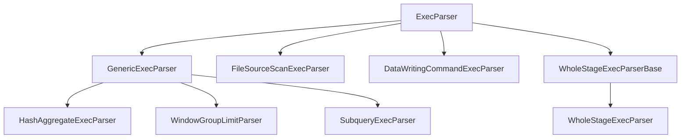
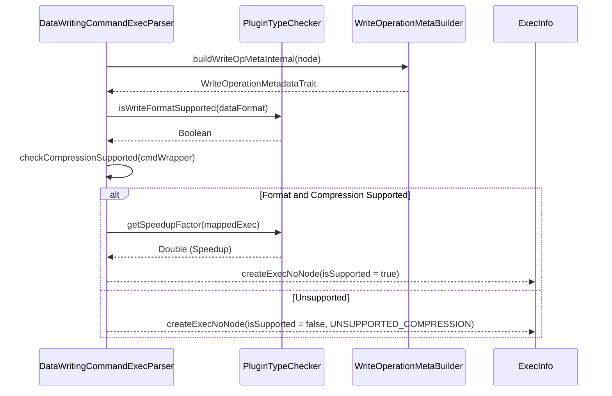

<!-- source: DeepWiki mcp.deepwiki.com · repo NVIDIA/cudf-spark-tools · extra page Exec Parsers · fetched 2026-10-26 -->

# Exec Parsers

Relevant source files

The following files were used as context for generating this wiki page:

- [core/src/main/scala/com/nvidia/spark/rapids/tool/planparser/BaseSourceScanExecParser.scala](core/src/main/scala/com/nvidia/spark/rapids/tool/planparser/BaseSourceScanExecParser.scala)
- [core/src/main/scala/com/nvidia/spark/rapids/tool/planparser/BatchScanExecParser.scala](core/src/main/scala/com/nvidia/spark/rapids/tool/planparser/BatchScanExecParser.scala)
- [core/src/main/scala/com/nvidia/spark/rapids/tool/planparser/BroadcastExchangeExecParser.scala](core/src/main/scala/com/nvidia/spark/rapids/tool/planparser/BroadcastExchangeExecParser.scala)
- [core/src/main/scala/com/nvidia/spark/rapids/tool/planparser/BroadcastHashJoinExecParser.scala](core/src/main/scala/com/nvidia/spark/rapids/tool/planparser/BroadcastHashJoinExecParser.scala)
- [core/src/main/scala/com/nvidia/spark/rapids/tool/planparser/BroadcastNestedLoopJoinExecParser.scala](core/src/main/scala/com/nvidia/spark/rapids/tool/planparser/BroadcastNestedLoopJoinExecParser.scala)
- [core/src/main/scala/com/nvidia/spark/rapids/tool/planparser/DataWritingCommandExecParser.scala](core/src/main/scala/com/nvidia/spark/rapids/tool/planparser/DataWritingCommandExecParser.scala)
- [core/src/main/scala/com/nvidia/spark/rapids/tool/planparser/ExecParser.scala](core/src/main/scala/com/nvidia/spark/rapids/tool/planparser/ExecParser.scala)
- [core/src/main/scala/com/nvidia/spark/rapids/tool/planparser/FileSourceScanExecParser.scala](core/src/main/scala/com/nvidia/spark/rapids/tool/planparser/FileSourceScanExecParser.scala)
- [core/src/main/scala/com/nvidia/spark/rapids/tool/planparser/GenericExecParser.scala](core/src/main/scala/com/nvidia/spark/rapids/tool/planparser/GenericExecParser.scala)
- [core/src/main/scala/com/nvidia/spark/rapids/tool/planparser/GroupParserTrait.scala](core/src/main/scala/com/nvidia/spark/rapids/tool/planparser/GroupParserTrait.scala)
- [core/src/main/scala/com/nvidia/spark/rapids/tool/planparser/HashAggregateExecParser.scala](core/src/main/scala/com/nvidia/spark/rapids/tool/planparser/HashAggregateExecParser.scala)
- [core/src/main/scala/com/nvidia/spark/rapids/tool/planparser/PhysicalPlanDescHelper.scala](core/src/main/scala/com/nvidia/spark/rapids/tool/planparser/PhysicalPlanDescHelper.scala)
- [core/src/main/scala/com/nvidia/spark/rapids/tool/planparser/ShuffleExchangeExecParser.scala](core/src/main/scala/com/nvidia/spark/rapids/tool/planparser/ShuffleExchangeExecParser.scala)
- [core/src/main/scala/com/nvidia/spark/rapids/tool/planparser/ShuffledHashJoinExecParser.scala](core/src/main/scala/com/nvidia/spark/rapids/tool/planparser/ShuffledHashJoinExecParser.scala)
- [core/src/main/scala/com/nvidia/spark/rapids/tool/planparser/SortMergeJoinExecParser.scala](core/src/main/scala/com/nvidia/spark/rapids/tool/planparser/SortMergeJoinExecParser.scala)
- [core/src/main/scala/com/nvidia/spark/rapids/tool/planparser/SubqueryBroadcastExecParser.scala](core/src/main/scala/com/nvidia/spark/rapids/tool/planparser/SubqueryBroadcastExecParser.scala)
- [core/src/main/scala/com/nvidia/spark/rapids/tool/planparser/SubqueryExecParser.scala](core/src/main/scala/com/nvidia/spark/rapids/tool/planparser/SubqueryExecParser.scala)
- [core/src/main/scala/com/nvidia/spark/rapids/tool/planparser/SupportedBlankExec.scala](core/src/main/scala/com/nvidia/spark/rapids/tool/planparser/SupportedBlankExec.scala)
- [core/src/main/scala/com/nvidia/spark/rapids/tool/planparser/WholeStageExecParser.scala](core/src/main/scala/com/nvidia/spark/rapids/tool/planparser/WholeStageExecParser.scala)
- [core/src/main/scala/com/nvidia/spark/rapids/tool/planparser/WindowGroupLimitParser.scala](core/src/main/scala/com/nvidia/spark/rapids/tool/planparser/WindowGroupLimitParser.scala)
- [core/src/main/scala/com/nvidia/spark/rapids/tool/planparser/WriteOpMetaExtractorTrait.scala](core/src/main/scala/com/nvidia/spark/rapids/tool/planparser/WriteOpMetaExtractorTrait.scala)
- [core/src/main/scala/com/nvidia/spark/rapids/tool/planparser/delta/DeltaLakeBlankExec.scala](core/src/main/scala/com/nvidia/spark/rapids/tool/planparser/delta/DeltaLakeBlankExec.scala)
- [core/src/main/scala/com/nvidia/spark/rapids/tool/planparser/delta/DeltaLakeHelper.scala](core/src/main/scala/com/nvidia/spark/rapids/tool/planparser/delta/DeltaLakeHelper.scala)
- [core/src/main/scala/com/nvidia/spark/rapids/tool/planparser/delta/DeltaLakeOps.scala](core/src/main/scala/com/nvidia/spark/rapids/tool/planparser/delta/DeltaLakeOps.scala)
- [core/src/main/scala/com/nvidia/spark/rapids/tool/planparser/ops/ExprOpRef.scala](core/src/main/scala/com/nvidia/spark/rapids/tool/planparser/ops/ExprOpRef.scala)
- [core/src/main/scala/com/nvidia/spark/rapids/tool/planparser/ops/OpRefWrapperBase.scala](core/src/main/scala/com/nvidia/spark/rapids/tool/planparser/ops/OpRefWrapperBase.scala)
- [core/src/main/scala/com/nvidia/spark/rapids/tool/planparser/ops/OpTypes.scala](core/src/main/scala/com/nvidia/spark/rapids/tool/planparser/ops/OpTypes.scala)
- [core/src/main/scala/com/nvidia/spark/rapids/tool/planparser/ops/OperatorCounter.scala](core/src/main/scala/com/nvidia/spark/rapids/tool/planparser/ops/OperatorCounter.scala)
- [core/src/main/scala/com/nvidia/spark/rapids/tool/planparser/ops/UnsupportedExprOpRef.scala](core/src/main/scala/com/nvidia/spark/rapids/tool/planparser/ops/UnsupportedExprOpRef.scala)
- [core/src/main/scala/com/nvidia/spark/rapids/tool/views/PropertiesView.scala](core/src/main/scala/com/nvidia/spark/rapids/tool/views/PropertiesView.scala)
- [core/src/main/scala/com/nvidia/spark/rapids/tool/views/WriteOpsView.scala](core/src/main/scala/com/nvidia/spark/rapids/tool/views/WriteOpsView.scala)
- [core/src/main/scala/org/apache/spark/sql/rapids/tool/store/WriteOperationStore.scala](core/src/main/scala/org/apache/spark/sql/rapids/tool/store/WriteOperationStore.scala)
- [core/src/main/scala/org/apache/spark/sql/rapids/tool/util/CacheablePropsHandler.scala](core/src/main/scala/org/apache/spark/sql/rapids/tool/util/CacheablePropsHandler.scala)
- [core/src/test/scala/com/nvidia/spark/rapids/tool/EventlogProviderImpl.scala](core/src/test/scala/com/nvidia/spark/rapids/tool/EventlogProviderImpl.scala)
- [core/src/test/scala/com/nvidia/spark/rapids/tool/planparser/PhysicalPlanDescHelperSuite.scala](core/src/test/scala/com/nvidia/spark/rapids/tool/planparser/PhysicalPlanDescHelperSuite.scala)
- [core/src/test/scala/com/nvidia/spark/rapids/tool/planparser/WriteOperationParserSuite.scala](core/src/test/scala/com/nvidia/spark/rapids/tool/planparser/WriteOperationParserSuite.scala)

## Purpose and Scope
This page details the implementation of individual execution plan parsers (`ExecParser` implementations) within the `rapids-4-spark-tools` core JAR (`core/`). These parsers translate Spark physical execution plan nodes (`SparkPlanGraphNode` and `SparkPlanGraphCluster`) into standardized `ExecInfo` structures used by the Qualification, Profiling, and AutoTuner components to assess GPU compatibility, speedup factors, and performance bottlenecks.

---

## 1. ExecParser Architecture and Generic Parsing
The base trait `ExecParser` defines the contract for parsing individual Spark execution plan nodes. For operators that do not require specialized parsing logic, `GenericExecParser` provides a robust default implementation [core/src/main/scala/com/nvidia/spark/rapids/tool/planparser/GenericExecParser.scala:28-36]().

`GenericExecParser` handles:
- **Node Name Cleanup**: Standardizes node names using `GenericExecParser.cleanupNodeName` [core/src/main/scala/com/nvidia/spark/rapids/tool/planparser/GenericExecParser.scala:37]().
- **Support Checking**: Queries `PluginTypeChecker` to determine if an operator is supported on the GPU plugin [core/src/main/scala/com/nvidia/spark/rapids/tool/planparser/GenericExecParser.scala:66-68]().
- **Speedup Factor Retrieval**: Fetches expected speedup ratios via `checker.getSpeedupFactor` [core/src/main/scala/com/nvidia/spark/rapids/tool/planparser/GenericExecParser.scala:70-72]().
- **Duration Computation**: Sums executor or driver metrics specified in `durationSqlMetrics` [core/src/main/scala/com/nvidia/spark/rapids/tool/planparser/GenericExecParser.scala:64,147-160]().
- **Expression Parsing**: Extracts and validates SQL expressions against unsupported expression registries [core/src/main/scala/com/nvidia/spark/rapids/tool/planparser/GenericExecParser.scala:97-100]().

### Diagram: Exec Parser Hierarchy

*Sources: [core/src/main/scala/com/nvidia/spark/rapids/tool/planparser/GenericExecParser.scala:28-36](), [core/src/main/scala/com/nvidia/spark/rapids/tool/planparser/HashAggregateExecParser.scala:24-36](), [core/src/main/scala/com/nvidia/spark/rapids/tool/planparser/WindowGroupLimitParser.scala:25-37](), [core/src/main/scala/com/nvidia/spark/rapids/tool/planparser/SubqueryExecParser.scala:29-42](), [core/src/main/scala/com/nvidia/spark/rapids/tool/planparser/FileSourceScanExecParser.scala:30-40](), [core/src/main/scala/com/nvidia/spark/rapids/tool/planparser/DataWritingCommandExecParser.scala:28-31](), [core/src/main/scala/com/nvidia/spark/rapids/tool/planparser/WholeStageExecParser.scala:26-39,158-165]()*

---

## 2. Scan Parsers
Scan operations extract input data characteristics, formats, and filtering predicates.

### FileSourceScanExecParser
`FileSourceScanExecParser` handles file-based data source scans [core/src/main/scala/com/nvidia/spark/rapids/tool/planparser/FileSourceScanExecParser.scala:30-40](). Key responsibilities include:
- **Hive Integration**: Detects Hive scans via `HiveParseHelper` and delegates read parsing accordingly [core/src/main/scala/com/nvidia/spark/rapids/tool/planparser/FileSourceScanExecParser.scala:42-53]().
- **Delta Lake Metadata Scans**: Identifies Delta Lake internal log scans (e.g., `/_delta_log` or `DeltaLogFileIndex`) and flags them as unsupported (`OpTypes.ReadDeltaLog` or `OpTypes.ReadRDDDeltaLog`) [core/src/main/scala/com/nvidia/spark/rapids/tool/planparser/FileSourceScanExecParser.scala:69-147]().
- **Duration Metrics**: Collects "scan time" and "metadata time" accumulators [core/src/main/scala/com/nvidia/spark/rapids/tool/planparser/FileSourceScanExecParser.scala:97-100]().

### BatchScanExtractorHelper
For DataSource V2 and table-based scans (such as Iceberg and Delta Lake), `BatchScanExtractorHelper` parses `BatchScan` and `GpuBatchScan` nodes from `node.desc` [core/src/main/scala/com/nvidia/spark/rapids/tool/planparser/BatchScanExecParser.scala:45-54](). It extracts:
- Table identifiers and catalog paths [core/src/main/scala/com/nvidia/spark/rapids/tool/planparser/BatchScanExecParser.scala:112-114]().
- Static and runtime filters (e.g., dynamic partition pruning expressions) into structured metadata tags [core/src/main/scala/com/nvidia/spark/rapids/tool/planparser/BatchScanExecParser.scala:74-97]().

Sources: [core/src/main/scala/com/nvidia/spark/rapids/tool/planparser/FileSourceScanExecParser.scala:30-182](), [core/src/main/scala/com/nvidia/spark/rapids/tool/planparser/BatchScanExecParser.scala:45-140]()

---

## 3. Write Command Parsers
`DataWritingCommandExecParser` processes data modification and write commands such as `InsertIntoHadoopFsRelationCommand`, `AppendDataExecV1`, and `AtomicCreateTableAsSelect` [core/src/main/scala/com/nvidia/spark/rapids/tool/planparser/DataWritingCommandExecParser.scala:28-146]().

- **Format & Compression Validation**: Uses `DataWritingCmdWrapper` to extract target data formats (Parquet, ORC, Hive formats) and compression codecs (`zstd`, `snappy`, `zlib`, `uncompressed`) [core/src/main/scala/com/nvidia/spark/rapids/tool/planparser/DataWritingCommandExecParser.scala:38-60]().
- **Unsupported Reason Assignment**: Sets `UnsupportedReasonRef.UNSUPPORTED_COMPRESSION` if the compression codec is incompatible with the GPU acceleration plugin [core/src/main/scala/com/nvidia/spark/rapids/tool/planparser/DataWritingCommandExecParser.scala:68-72]().

### Diagram: Write Command Parsing Flow

*Sources: [core/src/main/scala/com/nvidia/spark/rapids/tool/planparser/DataWritingCommandExecParser.scala:28-89]() *

---

## 4. Whole-Stage Codegen Parsers
`WholeStageExecParserBase` manages cluster nodes representing whole-stage code generation boundaries (`SparkPlanGraphCluster`) [core/src/main/scala/com/nvidia/spark/rapids/tool/planparser/WholeStageExecParser.scala:26-39]().

- **Agent Delegation**: Instantiates a parser agent via `SQLPlanParser.createParserAgent(appInst)` (such as `OssSQLPlanParser` or `PhotonPlanParser`) to recursively parse operator children within the cluster [core/src/main/scala/com/nvidia/spark/rapids/tool/planparser/WholeStageExecParser.scala:60-62]().
- **Speedup Aggregation**: Calculates the average speedup factor across supported child operators using `SQLPlanParser.averageSpeedup` [core/src/main/scala/com/nvidia/spark/rapids/tool/planparser/WholeStageExecParser.scala:98-102]().
- **Cluster Tagging**: Appends `.withClusterFlag()` to the resulting `ExecInfo` record to designate it as a container grouping node [core/src/main/scala/com/nvidia/spark/rapids/tool/planparser/WholeStageExecParser.scala:153]().

Sources: [core/src/main/scala/com/nvidia/spark/rapids/tool/planparser/WholeStageExecParser.scala:26-156]()

---

## 5. Aggregates, Joins, Window Limits, and Subqueries
Specialized parsers extend `GenericExecParser` to implement operator-specific metrics and validation rules:

- **HashAggregateExecParser**: Overrides `durationSqlMetrics` to target `"time in aggregation build"` [core/src/main/scala/com/nvidia/spark/rapids/tool/planparser/HashAggregateExecParser.scala:24-43]().
- **WindowGroupLimitParser**: Parses `WindowGroupLimitExec` nodes, validating that ranking functions belong to the supported set (`rank`, `dense_rank`, `row_number`) [core/src/main/scala/com/nvidia/spark/rapids/tool/planparser/WindowGroupLimitParser.scala:25-77]().
- **SubqueryExecParser**: Handles subquery execution nodes by marking them as driver-side collect operations (`useDriverMetrics = true`), collecting `"time to collect"` metrics, and setting `isSupported = false` [core/src/main/scala/com/nvidia/spark/rapids/tool/planparser/SubqueryExecParser.scala:29-60]().

Sources: [core/src/main/scala/com/nvidia/spark/rapids/tool/planparser/HashAggregateExecParser.scala:24-43](), [core/src/main/scala/com/nvidia/spark/rapids/tool/planparser/WindowGroupLimitParser.scala:25-77](), [core/src/main/scala/com/nvidia/spark/rapids/tool/planparser/SubqueryExecParser.scala:29-60]()

---

