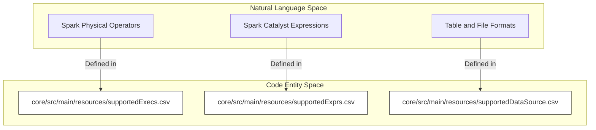
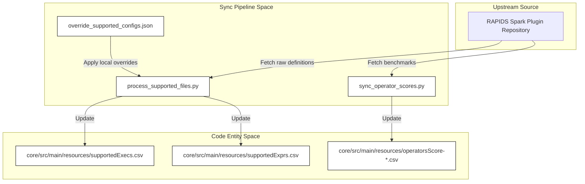

<!-- source: DeepWiki mcp.deepwiki.com · repo NVIDIA/cudf-spark-tools · extra page Operator Support Matrices and Scores · fetched 2026-10-26 -->

# Operator Support Matrices and Scores

<details>
<summary>Relevant source files</summary>

The following files were used as context for generating this wiki page:

- [.gitignore](.gitignore)
- [core/src/main/resources/operatorsScore-databricks-aws-a10G.csv](core/src/main/resources/operatorsScore-databricks-aws-a10G.csv)
- [core/src/main/resources/operatorsScore-databricks-aws-t4.csv](core/src/main/resources/operatorsScore-databricks-aws-t4.csv)
- [core/src/main/resources/operatorsScore-databricks-azure-t4.csv](core/src/main/resources/operatorsScore-databricks-azure-t4.csv)
- [core/src/main/resources/operatorsScore-dataproc-gke-l4.csv](core/src/main/resources/operatorsScore-dataproc-gke-l4.csv)
- [core/src/main/resources/operatorsScore-dataproc-gke-t4.csv](core/src/main/resources/operatorsScore-dataproc-gke-t4.csv)
- [core/src/main/resources/operatorsScore-dataproc-l4.csv](core/src/main/resources/operatorsScore-dataproc-l4.csv)
- [core/src/main/resources/operatorsScore-dataproc-serverless-l4.csv](core/src/main/resources/operatorsScore-dataproc-serverless-l4.csv)
- [core/src/main/resources/operatorsScore-dataproc-t4.csv](core/src/main/resources/operatorsScore-dataproc-t4.csv)
- [core/src/main/resources/operatorsScore-emr-a10.csv](core/src/main/resources/operatorsScore-emr-a10.csv)
- [core/src/main/resources/operatorsScore-emr-a10G.csv](core/src/main/resources/operatorsScore-emr-a10G.csv)
- [core/src/main/resources/operatorsScore-emr-t4.csv](core/src/main/resources/operatorsScore-emr-t4.csv)
- [core/src/main/resources/operatorsScore-onprem-a100.csv](core/src/main/resources/operatorsScore-onprem-a100.csv)
- [core/src/main/resources/supportedDataSource.csv](core/src/main/resources/supportedDataSource.csv)
- [core/src/main/resources/supportedExecs.csv](core/src/main/resources/supportedExecs.csv)
- [core/src/main/resources/supportedExprs.csv](core/src/main/resources/supportedExprs.csv)
- [scripts/sync_plugin_files/README.md](scripts/sync_plugin_files/README.md)
- [scripts/sync_plugin_files/override_supported_configs.json](scripts/sync_plugin_files/override_supported_configs.json)
- [scripts/sync_plugin_files/process_supported_files.py](scripts/sync_plugin_files/process_supported_files.py)
- [scripts/sync_plugin_files/sync_operator_scores.py](scripts/sync_plugin_files/sync_operator_scores.py)

</details>


## Purpose and Scope

The `cudf-spark-tools` core module relies on a set of static resource files (`supportedExprs.csv`, `supportedExecs.csv`, `supportedDataSource.csv`, and platform-specific `operatorsScore-*.csv` files) to determine whether Apache Spark expressions, executors, and data sources can be accelerated by the NVIDIA RAPIDS Accelerator for Apache Spark plugin. These matrices drive qualification reporting, speedup estimations, and the AutoTuner recommendation engine without requiring a live Spark cluster during analysis. 

This page details the schema and purpose of each matrix file, how platform-specific operator scoring files are organized, and the synchronization infrastructure (`scripts/sync_plugin_files/`) used to pull these definitions from the upstream RAPIDS Spark plugin repository.

---

## 1. Core Support Matrix Resource Files

The core resource directory contains CSV files defining the compatibility and support levels of Spark constructs against the GPU backend.

### Executable and Expression Support (`supportedExecs.csv` & `supportedExprs.csv`)
* **`supportedExecs.csv`**: Maps Spark physical execution nodes (e.g., `CoalesceExec`, `FileSourceScanExec`, `SortMergeJoinExec`) to support flags (`S` for Supported, `NS` for Not Supported, `TNEW` for experimental/new) along with column-level datatype support matrices (BOOLEAN, BYTE, SHORT, INT, LONG, FLOAT, DOUBLE, DATE, TIMESTAMP, STRING, DECIMAL, NULL, BINARY, CALENDAR, ARRAY, MAP, STRUCT, UDT, DAYTIME, YEARMONTH) `[core/src/main/resources/supportedExecs.csv:1-67]()`.
* **`supportedExprs.csv`**: Specifies expression-level support (`Abs`, `Add`, `Alias`, `And`, etc.) across different contexts (`project`, `AST`) and parameter positions, mapped against input/result datatypes `[core/src/main/resources/supportedExprs.csv:1-74]`.

### Data Source Support (`supportedDataSource.csv`)
* Tracks read and write format compatibility for file formats (Parquet, ORC, CSV, JSON) and table formats (Delta, Iceberg, Hive).



Sources: `[core/src/main/resources/supportedExecs.csv:1-68]`, `[core/src/main/resources/supportedExprs.csv:1-74]()`

---

## 2. Platform-Specific Operator Scores (`operatorsScore-*.csv`)

To estimate potential speedups and evaluate cluster efficiency across different Cloud Service Providers (CSPs) and GPU hardware configurations, the tool maintains platform- and hardware-specific scoring CSV files. Each file maps CPU operators and expressions to a quantified performance score or weight.

### Available Scoring Matrices
* **Dataproc**: `operatorsScore-dataproc-t4.csv`, `operatorsScore-dataproc-l4.csv`, `operatorsScore-dataproc-serverless-l4.csv`, `operatorsScore-dataproc-gke-l4.csv`, `operatorsScore-dataproc-gke-t4.csv` `[core/src/main/resources/operatorsScore-dataproc-t4.csv:1-314]`, `[core/src/main/resources/operatorsScore-dataproc-l4.csv:1-314]`, `[core/src/main/resources/operatorsScore-dataproc-serverless-l4.csv:1-308]`, `[core/src/main/resources/operatorsScore-dataproc-gke-l4.csv:1-308]`, `[core/src/main/resources/operatorsScore-dataproc-gke-t4.csv:1-307]()`.
* **EMR**: `operatorsScore-emr-a10.csv`, `operatorsScore-emr-t4.csv`, `operatorsScore-emr-a10G.csv` `[core/src/main/resources/operatorsScore-emr-a10.csv:1-314]`, `[core/src/main/resources/operatorsScore-emr-t4.csv:1-313]()`.
* **Databricks**: `operatorsScore-databricks-aws-t4.csv`, `operatorsScore-databricks-aws-a10G.csv`, `operatorsScore-databricks-azure-t4.csv` `[core/src/main/resources/operatorsScore-databricks-aws-t4.csv:1-326]`, `[core/src/main/resources/operatorsScore-databricks-azure-t4.csv:1-313]()`.
* **On-Premises**: `operatorsScore-onprem-a100.csv` `[core/src/main/resources/operatorsScore-onprem-a100.csv:1-325]()`.

### CSV Structure
Each score file consists of two columns: `CPUOperator` and `Score`. For example, `SortMergeJoinExec` typically carries a high score reflecting heavy CPU overhead that benefits significantly from GPU acceleration, whereas lightweight operations have lower relative weight scores.

```csv
CPUOperator,Score
CoalesceExec,4.88
SortExec,18.9
HashAggregateExec,8.13
SortMergeJoinExec,52.97
```
*(Excerpt from `operatorsScore-dataproc-t4.csv` [core/src/main/resources/operatorsScore-dataproc-t4.csv:1-36]())*

Sources: `[core/src/main/resources/operatorsScore-dataproc-t4.csv:1-36]`, `[core/src/main/resources/operatorsScore-emr-a10.csv:1-40]`, `[core/src/main/resources/operatorsScore-databricks-aws-t4.csv:1-40]`, `[core/src/main/resources/operatorsScore-onprem-a100.csv:1-40]()`

---

## 3. Synchronization Pipeline and Automation

To keep support matrices and scoring tables aligned with the latest releases of the upstream RAPIDS Accelerator for Apache Spark plugin repo, the tool includes a dedicated automation script suite under `scripts/sync_plugin_files/`.

### Automation Architecture



### Key Components in `scripts/sync_plugin_files/`
* **`process_supported_files.py`**: Pulls and validates expression/exec support tables from the upstream plugin source, normalizing them against `override_supported_configs.json` to handle tool-specific adjustments.
* **`sync_operator_scores.py`**: Aggregates benchmark results across instance profiles (e.g., T4, A10, A100) to regenerate the `operatorsScore-*.csv` files.
* **`override_supported_configs.json`**: Provides manual corrections or extensions for operator flags that differ in the tooling context compared to the main runtime plugin.

Sources: `[scripts/sync_plugin_files/process_supported_files.py:1-1]()`, `[scripts/sync_plugin_files/sync_operator_scores.py:1-1]`, `[scripts/sync_plugin_files/override_supported_configs.json:1-1]()`

---

