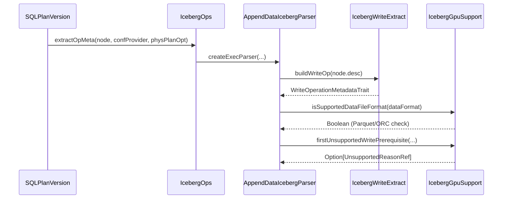

<!-- source: DeepWiki mcp.deepwiki.com · repo NVIDIA/cudf-spark-tools · extra page Table Format and Runtime Plugins (Delta, Iceberg, Photon, Auron) · fetched 2026-10-26 -->

# Table Format and Runtime Plugins (Delta, Iceberg, Photon, Auron)

<details>
<summary>Relevant source files</summary>

The following files were used as context for generating this wiki page:

- [core/src/main/scala/com/nvidia/spark/rapids/tool/planparser/ReadParser.scala](core/src/main/scala/com/nvidia/spark/rapids/tool/planparser/ReadParser.scala)
- [core/src/main/scala/com/nvidia/spark/rapids/tool/planparser/auron/AuronPlugin.scala](core/src/main/scala/com/nvidia/spark/rapids/tool/planparser/auron/AuronPlugin.scala)
- [core/src/main/scala/com/nvidia/spark/rapids/tool/planparser/delta/DeltaLakeOSSPlugin.scala](core/src/main/scala/com/nvidia/spark/rapids/tool/planparser/delta/DeltaLakeOSSPlugin.scala)
- [core/src/main/scala/com/nvidia/spark/rapids/tool/planparser/iceberg/AppendDataIcebergParser.scala](core/src/main/scala/com/nvidia/spark/rapids/tool/planparser/iceberg/AppendDataIcebergParser.scala)
- [core/src/main/scala/com/nvidia/spark/rapids/tool/planparser/iceberg/IcebergGpuSupport.scala](core/src/main/scala/com/nvidia/spark/rapids/tool/planparser/iceberg/IcebergGpuSupport.scala)
- [core/src/main/scala/com/nvidia/spark/rapids/tool/planparser/iceberg/IcebergHelper.scala](core/src/main/scala/com/nvidia/spark/rapids/tool/planparser/iceberg/IcebergHelper.scala)
- [core/src/main/scala/com/nvidia/spark/rapids/tool/planparser/iceberg/IcebergOps.scala](core/src/main/scala/com/nvidia/spark/rapids/tool/planparser/iceberg/IcebergOps.scala)
- [core/src/main/scala/com/nvidia/spark/rapids/tool/planparser/iceberg/IcebergWriteExtract.scala](core/src/main/scala/com/nvidia/spark/rapids/tool/planparser/iceberg/IcebergWriteExtract.scala)
- [core/src/main/scala/com/nvidia/spark/rapids/tool/planparser/iceberg/MergeRowsIcebergParser.scala](core/src/main/scala/com/nvidia/spark/rapids/tool/planparser/iceberg/MergeRowsIcebergParser.scala)
- [core/src/main/scala/com/nvidia/spark/rapids/tool/planparser/ops/UnsupportedReasonRef.scala](core/src/main/scala/com/nvidia/spark/rapids/tool/planparser/ops/UnsupportedReasonRef.scala)
- [core/src/main/scala/com/nvidia/spark/rapids/tool/plugins/AppPropPlugContainerTrait.scala](core/src/main/scala/com/nvidia/spark/rapids/tool/plugins/AppPropPlugContainerTrait.scala)
- [core/src/main/scala/com/nvidia/spark/rapids/tool/plugins/AppPropPlugTrait.scala](core/src/main/scala/com/nvidia/spark/rapids/tool/plugins/AppPropPlugTrait.scala)
- [core/src/main/scala/com/nvidia/spark/rapids/tool/plugins/BaseAppPropPlug.scala](core/src/main/scala/com/nvidia/spark/rapids/tool/plugins/BaseAppPropPlug.scala)
- [core/src/main/scala/org/apache/spark/sql/rapids/tool/annotation/ToolsReflection.scala](core/src/main/scala/org/apache/spark/sql/rapids/tool/annotation/ToolsReflection.scala)
- [core/src/main/scala/org/apache/spark/sql/rapids/tool/store/SQLPlanModel.scala](core/src/main/scala/org/apache/spark/sql/rapids/tool/store/SQLPlanModel.scala)
- [core/src/main/scala/org/apache/spark/sql/rapids/tool/store/SQLPlanModelManager.scala](core/src/main/scala/org/apache/spark/sql/rapids/tool/store/SQLPlanModelManager.scala)
- [core/src/main/scala/org/apache/spark/sql/rapids/tool/store/SQLPlanModelPrimaryWithDSCaching.scala](core/src/main/scala/org/apache/spark/sql/rapids/tool/store/SQLPlanModelPrimaryWithDSCaching.scala)
- [core/src/main/scala/org/apache/spark/sql/rapids/tool/store/SQLPlanModelWithDSCaching.scala](core/src/main/scala/org/apache/spark/sql/rapids/tool/store/SQLPlanModelWithDSCaching.scala)
- [core/src/main/scala/org/apache/spark/sql/rapids/tool/store/SQLPlanVersion.scala](core/src/main/scala/org/apache/spark/sql/rapids/tool/store/SQLPlanVersion.scala)
- [core/src/main/scala/org/apache/spark/sql/rapids/tool/util/stubs/DefaultGraphReflectionAPI.scala](core/src/main/scala/org/apache/spark/sql/rapids/tool/util/stubs/DefaultGraphReflectionAPI.scala)
- [core/src/main/scala/org/apache/spark/sql/rapids/tool/util/stubs/GraphReflectionAPI.scala](core/src/main/scala/org/apache/spark/sql/rapids/tool/util/stubs/GraphReflectionAPI.scala)
- [core/src/main/scala/org/apache/spark/sql/rapids/tool/util/stubs/GraphReflectionAPIHelper.scala](core/src/main/scala/org/apache/spark/sql/rapids/tool/util/stubs/GraphReflectionAPIHelper.scala)
- [core/src/test/scala/com/nvidia/spark/rapids/BaseNoSparkSuite.scala](core/src/test/scala/com/nvidia/spark/rapids/BaseNoSparkSuite.scala)
- [core/src/test/scala/com/nvidia/spark/rapids/tool/planparser/ReadParserSuite.scala](core/src/test/scala/com/nvidia/spark/rapids/tool/planparser/ReadParserSuite.scala)
- [core/src/test/scala/com/nvidia/spark/rapids/tool/planparser/iceberg/IcebergGpuSupportSuite.scala](core/src/test/scala/com/nvidia/spark/rapids/tool/planparser/iceberg/IcebergGpuSupportSuite.scala)

</details>


## Purpose and Scope

This page documents the plugin architecture within `cudf-spark-tools` (`core` module) designed to handle alternate table formats (such as Apache Iceberg and Delta Lake) and proprietary execution runtimes (such as Databricks Photon and Auron). It details how specialized plan parsers intercept table-format-specific operators, evaluate GPU compatibility gates, and manage versioned query plans (`SQLPlanModel`) alongside memory-efficient data-source caching.

Sources:
- `core/src/main/scala/com/nvidia/spark/rapids/tool/planparser/iceberg/IcebergOps.scala` [core/src/main/scala/com/nvidia/spark/rapids/tool/planparser/iceberg/IcebergOps.scala:1-54]()
- `core/src/main/scala/org/apache/spark/sql/rapids/tool/store/SQLPlanModelManager.scala` [core/src/main/scala/org/apache/spark/sql/rapids/tool/store/SQLPlanModelManager.scala:1-83]()

---

## 1. Plugin Architecture for Alternate Runtimes and Table Formats

The tool uses modular plug-in containers and group parsers to detect non-standard table formats or execution environments from Spark configuration properties (`sparkProperties`) and physical plan nodes. 

### Key Plugin Classes and Dispatch
* **`IcebergHelper`**: Extends `PropConditionOnSparkExtTrait` to detect Iceberg applications by evaluating `spark.sql.extensions` for `IcebergSparkSessionExtensions` and checking for defined Spark catalog configurations (`spark.sql.catalog.*`) [core/src/main/scala/com/nvidia/spark/rapids/tool/planparser/iceberg/IcebergHelper.scala:21-49]().
* **`IcebergOps`**: Implements `GroupParserTrait` to intercept Iceberg-specific operations (`AppendData`, `MergeRows`, `ReplaceData`, `WriteDelta`) based on node names and positive configuration checks (`isIcebergEnabled`) [core/src/main/scala/com/nvidia/spark/rapids/tool/planparser/iceberg/IcebergOps.scala:29-88]().
* **`DeltaLakeOSSPlugin`**: Handles Open Source Delta Lake storage format detection and metadata parsing.
* **`AuronPlugin`**: Manages execution attributes for the Auron runtime environment.

```mermaid
graph TD
    sub "Natural Language to Code Space: Plugin Dispatch"
    AppConfig["Application Spark Properties"] -->|Evaluates| IcebergHelper["IcebergHelper.eval()"]
    IcebergHelper -->|Detects Ext/Catalog| IsIceberg["isIcebergEnabled = true"]
    
    PlanNode["SparkPlanGraphNode"] --> GroupParser["IcebergOps.accepts()"]
    IsIceberg --> GroupParser
    GroupParser -->|Matches Supported Op| CreateParser["IcebergOps.createExecParser()"]
    
    CreateParser -->|AppendData| AppendParser["AppendDataIcebergParser"]
    CreateParser -->|ReplaceData / MergeRows| MergeParser["MergeRowsIcebergParser"]
    
    DeltaReq["Delta Lake Table Scan"] --> DeltaPlugin["DeltaLakeOSSPlugin"]
    AuronReq["Auron Runtime Exec"] --> AuronPlugin["AuronPlugin"]
```
Sources:
- `core/src/main/scala/com/nvidia/spark/rapids/tool/planparser/iceberg/IcebergHelper.scala` [core/src/main/scala/com/nvidia/spark/rapids/tool/planparser/iceberg/IcebergHelper.scala:21-144]()
- `core/src/main/scala/com/nvidia/spark/rapids/tool/planparser/iceberg/IcebergOps.scala` [core/src/main/scala/com/nvidia/spark/rapids/tool/planparser/iceberg/IcebergOps.scala:54-155]()
- `core/src/main/scala/com/nvidia/spark/rapids/tool/planparser/delta/DeltaLakeOSSPlugin.scala` []()
- `core/src/main/scala/com/nvidia/spark/rapids/tool/planparser/auron/AuronPlugin.scala` []()

---

## 2. Iceberg Parser Pipeline and GPU Support Gates

Iceberg write and merge operations require rigorous qualification checks because GPU acceleration depends on specific data file formats (e.g., Parquet), runtime versions (Spark 3.5.x or 4.0.x), catalog types, and field ID configurations.

### Parser Implementations
* **`AppendDataIcebergParser`**: Parses `AppendData` execution nodes, extracts compression codecs, validates file formats via `IcebergGpuSupport`, and builds `WriteOperationMetadataTrait` instances [core/src/main/scala/com/nvidia/spark/rapids/tool/planparser/iceberg/AppendDataIcebergParser.scala:36-75]().
* **`MergeRowsIcebergParser`**: Handles sibling Iceberg execution nodes (`MergeRows`, `ReplaceData`, `WriteDelta`). It parses row-classification expressions for `MergeRows` and checks copy-on-write gates for `ReplaceData` [core/src/main/scala/com/nvidia/spark/rapids/tool/planparser/iceberg/MergeRowsIcebergParser.scala:65-117]().
* **`IcebergWriteExtract`**: Extracts metadata properties from `simpleString` descriptions (for `AppendData`) and `physicalPlanDescription` arguments (for `ReplaceData` and `WriteDelta`) [core/src/main/scala/com/nvidia/spark/rapids/tool/planparser/iceberg/IcebergWriteExtract.scala:50-103]().


Sources:
- `core/src/main/scala/com/nvidia/spark/rapids/tool/planparser/iceberg/AppendDataIcebergParser.scala` [core/src/main/scala/com/nvidia/spark/rapids/tool/planparser/iceberg/AppendDataIcebergParser.scala:36-150]()
- `core/src/main/scala/com/nvidia/spark/rapids/tool/planparser/iceberg/MergeRowsIcebergParser.scala` [core/src/main/scala/com/nvidia/spark/rapids/tool/planparser/iceberg/MergeRowsIcebergParser.scala:65-147]()
- `core/src/main/scala/com/nvidia/spark/rapids/tool/planparser/iceberg/IcebergWriteExtract.scala` [core/src/main/scala/com/nvidia/spark/rapids/tool/planparser/iceberg/IcebergWriteExtract.scala:50-103]()
- `core/src/main/scala/com/nvidia/spark/rapids/tool/planparser/iceberg/IcebergGpuSupport.scala` []()

---

## 3. SQLPlanModel Versions and Data-Source Caching

Spark applications frequently update query plans at runtime via Adaptive Query Execution (AQE). The `SQLPlanModelManager` and associated storage classes track plan evolution across versions while implementing memory-efficient caching strategies.

### Core Storage Components
* **`SQLPlanModelManager`**: Central registry maintaining sorted maps of `SQLPlanModel` instances indexed by execution ID (`sqlId`). It detects SQL cache operators (`InMemoryRelation`, `GpuInMemoryTableScan`) across plan versions and RDD scopes [core/src/main/scala/org/apache/spark/sql/rapids/tool/store/SQLPlanModelManager.scala:66-111]().
* **`SQLPlanModel`**: Stores a chronological list of `SQLPlanVersion` objects representing initial plans and subsequent AQE updates [core/src/main/scala/org/apache/spark/sql/rapids/tool/store/SQLPlanModel.scala:40-114]().
* **`SQLPlanModelWithDSCaching` / `SQLPlanModelPrimaryWithDSCaching`**: Memory-optimized subclasses that extract and cache only `DataSourceRecord` metadata rather than retaining full `SparkPlanInfo` trees for every historical plan version.
* **`SparkPlanInfo` / `SparkPlanInfoTruncated`**: Lightweight serialization structures that prune unnecessary nodes, retaining only `nodeName`, `simpleString`, and recursive `children` [core/src/main/scala/org/apache/spark/sql/rapids/tool/store/SQLPlanModelManager.scala:30-64]().

```mermaid
graph TD
    sub "Natural Language to Code Space: SQLPlan Model Hierarchy"
    Manager["SQLPlanModelManager"] -->|Manages Map| Model["SQLPlanModel"]
    Model -->|Contains ArrayBuffer| Version["SQLPlanVersion"]
    
    Version -->|Builds on demand| Graph["ToolsPlanGraph"]
    Version -->|Extracts Writes| WriteRec["WriteOperationRecord"]
    
    Model -.->|Memory Optimized Subclass| CacheModel["SQLPlanModelWithDSCaching"]
    CacheModel -->|Extracts & Caches Only| DSRecord["DataSourceRecord"]
    
    PlanInfo["org.apache.spark.sql.execution.SparkPlanInfo"] -->|Truncated by| TruncInfo["SparkPlanInfoTruncated"]
```
Sources:
- `core/src/main/scala/org/apache/spark/sql/rapids/tool/store/SQLPlanModelManager.scala` [core/src/main/scala/org/apache/spark/sql/rapids/tool/store/SQLPlanModelManager.scala:30-174]()
- `core/src/main/scala/org/apache/spark/sql/rapids/tool/store/SQLPlanModel.scala` [core/src/main/scala/org/apache/spark/sql/rapids/tool/store/SQLPlanModel.scala:26-114]()
- `core/src/main/scala/org/apache/spark/sql/rapids/tool/store/SQLPlanVersion.scala` [core/src/main/scala/org/apache/spark/sql/rapids/tool/store/SQLPlanVersion.scala:30-157]()

---

## 4. Read/Write Metadata Extraction and Formats

Scanning data sources and writing results across various table formats requires structured metadata parsing to populate qualification reports.

* **`ReadParser`**: Identifies file scan node prefixes (`Scan`, `NativeScan`) and DataSourceV2 nodes (`BatchScan`, `GpuBatchScan`), extracting read schemas, locations, and filter predicates [core/src/main/scala/com/nvidia/spark/rapids/tool/planparser/ReadParser.scala:89-127]().
* **`ReadMetaData`**: Encapsulates read attributes including pushed filters, data filters, partition filters, and runtime filters [core/src/main/scala/com/nvidia/spark/rapids/tool/planparser/ReadParser.scala:28-87]().

Sources:
- `core/src/main/scala/com/nvidia/spark/rapids/tool/planparser/ReadParser.scala` [core/src/main/scala/com/nvidia/spark/rapids/tool/planparser/ReadParser.scala:28-166]()

---

