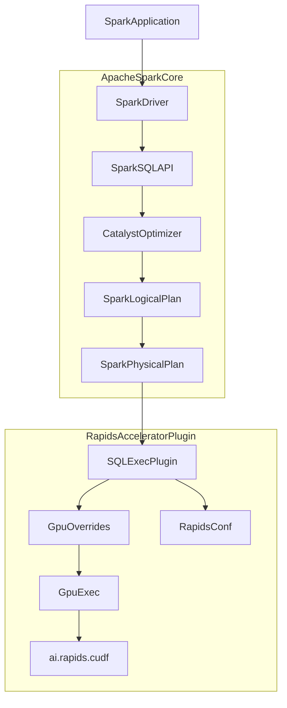
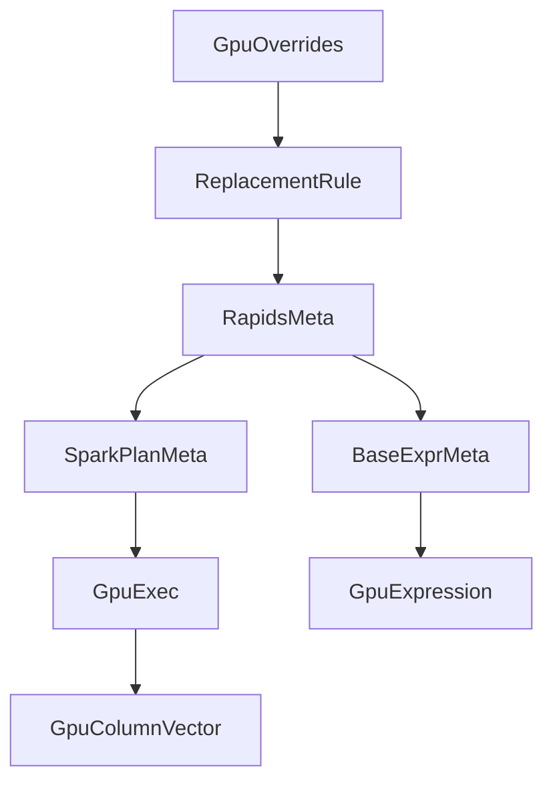
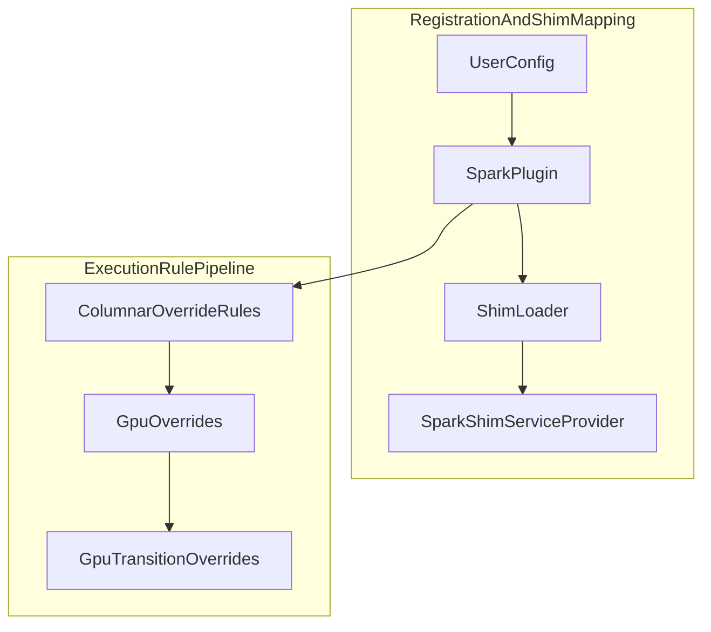

<!-- source: DeepWiki mcp.deepwiki.com · repo NVIDIA/cudf-spark · page 1 RAPIDS Accelerator for Apache Spark — Overview · fetched 2026-10-26 -->

# RAPIDS Accelerator for Apache Spark — Overview

<details>
<summary>Relevant source files</summary>

The following files were used as context for generating this wiki page:

- [LICENSE](LICENSE)
- [NOTICE](NOTICE)
- [NOTICE-binary](NOTICE-binary)
- [aggregator/pom.xml](aggregator/pom.xml)
- [api_validation/pom.xml](api_validation/pom.xml)
- [dist/pom.xml](dist/pom.xml)
- [docs/additional-functionality/advanced_configs.md](docs/additional-functionality/advanced_configs.md)
- [docs/configs.md](docs/configs.md)
- [docs/supported_ops.md](docs/supported_ops.md)
- [integration_tests/pom.xml](integration_tests/pom.xml)
- [integration_tests/src/main/python/data_gen.py](integration_tests/src/main/python/data_gen.py)
- [integration_tests/src/main/python/hash_aggregate_test.py](integration_tests/src/main/python/hash_aggregate_test.py)
- [integration_tests/src/main/python/window_function_test.py](integration_tests/src/main/python/window_function_test.py)
- [jenkins/databricks/init_cudf_udf.sh](jenkins/databricks/init_cudf_udf.sh)
- [jenkins/version-def.sh](jenkins/version-def.sh)
- [pom.xml](pom.xml)
- [scala2.13/aggregator/pom.xml](scala2.13/aggregator/pom.xml)
- [scala2.13/dist/pom.xml](scala2.13/dist/pom.xml)
- [scala2.13/pom.xml](scala2.13/pom.xml)
- [scala2.13/shuffle-plugin/pom.xml](scala2.13/shuffle-plugin/pom.xml)
- [scala2.13/sql-plugin/pom.xml](scala2.13/sql-plugin/pom.xml)
- [scala2.13/tests/pom.xml](scala2.13/tests/pom.xml)
- [scala2.13/udf-compiler/pom.xml](scala2.13/udf-compiler/pom.xml)
- [shuffle-plugin/pom.xml](shuffle-plugin/pom.xml)
- [skills/.gitignore](skills/.gitignore)
- [skills/examples/CalculateRiskUDF.scala](skills/examples/CalculateRiskUDF.scala)
- [skills/examples/FormatPhoneUDF.java](skills/examples/FormatPhoneUDF.java)
- [skills/examples/IntegerMultiplyBy2UDF.java](skills/examples/IntegerMultiplyBy2UDF.java)
- [skills/udf-benchmark/CUDF_MICROBENCHMARKS.md](skills/udf-benchmark/CUDF_MICROBENCHMARKS.md)
- [sql-plugin/pom.xml](sql-plugin/pom.xml)
- [sql-plugin/src/main/scala/com/nvidia/spark/rapids/GpuOverrides.scala](sql-plugin/src/main/scala/com/nvidia/spark/rapids/GpuOverrides.scala)
- [sql-plugin/src/main/scala/com/nvidia/spark/rapids/Plugin.scala](sql-plugin/src/main/scala/com/nvidia/spark/rapids/Plugin.scala)
- [sql-plugin/src/main/scala/com/nvidia/spark/rapids/RapidsConf.scala](sql-plugin/src/main/scala/com/nvidia/spark/rapids/RapidsConf.scala)
- [sql-plugin/src/main/scala/com/nvidia/spark/rapids/RapidsConfEntries.scala](sql-plugin/src/main/scala/com/nvidia/spark/rapids/RapidsConfEntries.scala)
- [tests/pom.xml](tests/pom.xml)
- [udf-compiler/pom.xml](udf-compiler/pom.xml)

</details>


The RAPIDS Accelerator for Apache Spark is an NVIDIA-developed plugin that enables Apache Spark to leverage GPU hardware for accelerating SQL query and DataFrame computations. By offloading suitable operations from CPU to GPU using the RAPIDS `cuDF` library, it delivers significant performance improvements on GPU-enabled clusters. This overview introduces the project’s purpose, high-level architecture, and the major subsystems with references to detailed child pages for further exploration.

Sources:  
- [sql-plugin/src/main/scala/com/nvidia/spark/rapids/Plugin.scala:126-143]()  
- [docs/supported_ops.md:13-17]()

## What it Does and Why it Exists

Apache Spark is a powerful distributed data processing engine traditionally optimized for CPU execution. The RAPIDS Accelerator for Apache Spark addresses the bottleneck of CPU-bound processing by enabling GPU acceleration for a wide range of Spark SQL and DataFrame operations [docs/supported_ops.md:13-17](). This results in reduced query latencies and increased throughput by exploiting the massive parallelism of NVIDIA GPUs.

The accelerator strives to maintain compatibility with Apache Spark’s behavior, aiming for bit-for-bit identical results when possible. It integrates into Spark's execution framework to accelerate operations transparently to users [docs/supported_ops.md:61-66]().

Sources:  
- [docs/supported_ops.md:13-17]()  
- [docs/supported_ops.md:61-66]()

## Key Architectural Concepts

The RAPIDS Accelerator’s architecture is designed to intercept Spark queries at execution time, analyze and modify the execution plans, and replace CPU operators with GPU-enabled counterparts.

- **Plugin Registration**  
  The plugin registers itself with Spark via the `SparkPlugin` interface, hooking into the Spark execution lifecycle through `ColumnarOverrideRules` which manage GPU overrides during query planning [sql-plugin/src/main/scala/com/nvidia/spark/rapids/Plugin.scala:43-81]().

- **Plan Replacement Pipeline**  
  After Spark generates a physical plan, the RAPIDS Accelerator applies a set of `ReplacementRule` instances managed by `GpuOverrides`. These rules identify supported plan nodes and wrap them in specialized `RapidsMeta` metadata wrappers that enable analysis, validation, and conversion to GPU-enabled implementations [sql-plugin/src/main/scala/com/nvidia/spark/rapids/GpuOverrides.scala:69-77]().

- **GPU Expression and Operator Implementations**  
  The accelerator implements GPU variants of Spark expressions and physical operators, centered on the `GpuColumnVector` data structure that resides in GPU memory and provides efficient columnar operations [sql-plugin/src/main/scala/com/nvidia/spark/rapids/GpuOverrides.scala:25-25]().

- **GPU Memory Management**  
  Effective GPU memory management is critical. Configuration settings exposed through `RapidsConf` control memory pool sizing, limit thresholds, spill behavior, and assist in tracking memory usage [sql-plugin/src/main/scala/com/nvidia/spark/rapids/RapidsConf.scala:124-138]().

- **Shuffle & Data Exchange**  
  To support distributed workloads, the accelerator integrates with Spark shuffle mechanisms to efficiently exchange columnar data between executors using GPU-aware shuffle managers and protocols like UCX [sql-plugin/src/main/scala/com/nvidia/spark/rapids/Plugin.scala:57-71]().

- **Shim Layer for Multi-version Spark Support**  
  A shim layer abstracts differences across supported Spark versions. The `ShimLoader` dynamically loads version-specific implementations ensuring seamless support for multiple Spark major and minor versions [sql-plugin/src/main/scala/com/nvidia/spark/rapids/Plugin.scala:69-69]().

### High-Level Architecture Diagram

High-Level Architecture


Sources:  
- [sql-plugin/src/main/scala/com/nvidia/spark/rapids/Plugin.scala:43-81]()  
- [sql-plugin/src/main/scala/com/nvidia/spark/rapids/GpuOverrides.scala:69-77]()  
- [sql-plugin/src/main/scala/com/nvidia/spark/rapids/RapidsConf.scala:124-138]()

## Major Subsystems and Relationships

The RAPIDS Accelerator is modularized into several major subsystems that together enable efficient GPU acceleration of Apache Spark workloads.

| Subsystem                      | Description                                                                                              | Child Page(s)                                |
|-------------------------------|----------------------------------------------------------------------------------------------------------|----------------------------------------------|
| Core Plugin Architecture       | Hooks into Spark via `SparkPlugin` API, manages plan replacements using `GpuOverrides`, and handles shims | [Core Plugin Architecture](#2)               |
| GPU Expression & Operator Impl.| Implements GPU Spark expressions and operators including `GpuColumnVector` and GPU conversions          | [GPU Expression & Operator Implementations](#3) |
| Join Execution on GPU          | Implements GPU join algorithms and GPU OOM-safe iterators                                               | [Join Execution on GPU](#4)                   |
| File Format Support            | Accelerates reading and writing of Parquet, ORC, CSV, JSON, Avro formats                                 | [File Format Support (Reading & Writing)](#5)|
| Shuffle & Data Exchange        | Supports GPU shuffle using `RapidsShuffleManager` and UCX                                               | [Shuffle & Data Exchange](#6)                 |
| GPU Memory Management          | Controls GPU memory allocation and spilling through `GpuSemaphore` and `SpillFramework`                  | [GPU Memory Management](#7)                   |
| Delta Lake Integration         | GPU acceleration for Delta Lake with transaction and deletion vector support                            | [Delta Lake Integration](#8)                  |
| Iceberg Integration           | GPU-accelerated Apache Iceberg support for read/write and DML operations                               | [Iceberg Integration](#9)                     |
| Python UDFs & UDF Compiler     | GPU acceleration of Python UDFs using Arrow and Pandas, plus Scala/Java UDF compilation                  | [Python UDFs & Pandas Integration](#10)      |

Sources:  
- [sql-plugin/src/main/scala/com/nvidia/spark/rapids/GpuOverrides.scala:69-176]()  
- [sql-plugin/src/main/scala/com/nvidia/spark/rapids/Plugin.scala:57-71]()

## Getting Started & Configuration

Users enable the RAPIDS Accelerator by including the `rapids-4-spark` plugin JAR in their Spark classpath and specifying the plugin class via Spark configuration [docs/configs.md:16-22]().

```bash
spark-shell --jars rapids-4-spark_2.12-26.12.0-SNAPSHOT-cuda12.jar \
--conf spark.plugins=com.nvidia.spark.SQLPlugin \
--conf spark.rapids.sql.concurrentGpuTasks=2
```

The plugin’s configuration system is exposed through the `RapidsConf` class, allowing users to tune GPU memory pool sizes, concurrency, shuffle settings, and more via Spark configuration properties prefixed with `spark.rapids.*` [sql-plugin/src/main/scala/com/nvidia/spark/rapids/RapidsConf.scala:124-138]().

For detailed installation, deployment options (standalone, Databricks, EMR, GCP), and full configuration reference, see [Getting Started & Configuration](#1.1).

Sources:  
- [docs/configs.md:16-22]()  
- [sql-plugin/src/main/scala/com/nvidia/spark/rapids/RapidsConf.scala:124-138]()

## Compatibility & Supported Operations

The RAPIDS Accelerator supports a broad set of Spark SQL operations on GPU. However, some features or data types have only partial or limited GPU support and may trigger CPU fallbacks:

- **Timestamp & Timezone Support**: GPU acceleration supports timestamps primarily in UTC timezone only [docs/supported_ops.md:51-55]().
- **Decimal Support**: 128-bit decimal types are supported, but some complex operations or precision promotions may cause fallbacks [docs/supported_ops.md:19-50]().
- **CalendarInterval Type**: Support is limited and partial [docs/supported_ops.md:56-60]().
- **Explain Diagnostics**: The `spark.rapids.sql.explain` property can produce detailed explanations of GPU/CPU query plan placement decisions to facilitate debugging [docs/configs.md:52-52]().

For a comprehensive list and detailed notes on supported expressions, operators, types, and behavioral differences, see [Compatibility & Supported Operations](#1.2).

Sources:  
- [docs/supported_ops.md:19-60]()  
- [docs/configs.md:52-52]()

## Code Entity Space Bridges

### Plugin and Plan Replacement Pipeline

Code Entity Space Bridge Plugin And Plan Replacement


This diagram captures how plugin rules wrap Spark plan nodes and expressions into meta wrappers (`RapidsMeta` subclasses) that then produce GPU-enabled implementations using `GpuExec` and `GpuExpression` operating on `GpuColumnVector` data structures [sql-plugin/src/main/scala/com/nvidia/spark/rapids/GpuOverrides.scala:69-77]().

Sources:  
- [sql-plugin/src/main/scala/com/nvidia/spark/rapids/GpuOverrides.scala:69-77]()

### Plugin Initialization and Shim Layer

Code Entity Space Bridge Plugin Initialization And Shim Layer


This diagram illustrates how user configuration drives plugin registration via `SparkPlugin`, which uses `ShimLoader` and `SparkShimServiceProvider` to manage Spark version differences. The plugin applies execution rules via `ColumnarOverrideRules` and `GpuOverrides` to convert CPU plans to GPU-enabled physical plans [sql-plugin/src/main/scala/com/nvidia/spark/rapids/Plugin.scala:43-81]().

Sources:  
- [sql-plugin/src/main/scala/com/nvidia/spark/rapids/Plugin.scala:43-81]()

---

For detailed coverage of each subsystem, please refer to the child pages:  
- [Getting Started & Configuration](#1.1)  
- [Compatibility & Supported Operations](#1.2)  
- [Core Plugin Architecture](#2)  
- [GPU Expression & Operator Implementations](#3)  
- [Join Execution on GPU](#4)  
- [File Format Support (Reading & Writing)](#5)  
- [Shuffle & Data Exchange](#6)  
- [GPU Memory Management](#7)  
- [Delta Lake Integration](#8)  
- [Iceberg Integration](#9)  
- [Python UDFs & Pandas Integration](#10)

---

