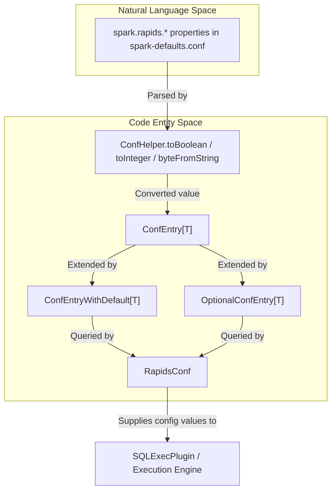
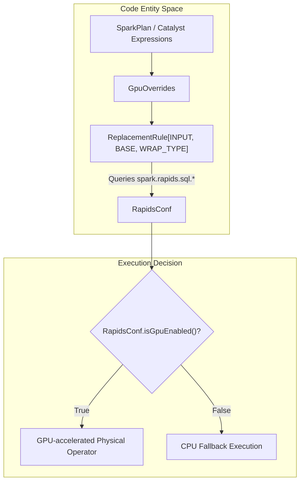

<!-- source: DeepWiki mcp.deepwiki.com · repo NVIDIA/cudf-spark · page 1.1 Getting Started & Configuration · fetched 2026-10-26 -->

# Getting Started & Configuration

<details>
<summary>Relevant source files</summary>

The following files were used as context for generating this wiki page:

- [docs/_config.yml](docs/_config.yml)
- [docs/_includes/analytics.html](docs/_includes/analytics.html)
- [docs/additional-functionality/advanced_configs.md](docs/additional-functionality/advanced_configs.md)
- [docs/archive.md](docs/archive.md)
- [docs/configs.md](docs/configs.md)
- [docs/dev/mem_debug.md](docs/dev/mem_debug.md)
- [docs/dev/testing.md](docs/dev/testing.md)
- [docs/download.md](docs/download.md)
- [docs/img/Databricks/initscript_ucx.png](docs/img/Databricks/initscript_ucx.png)
- [docs/img/Databricks/sparkconfig_ucx.png](docs/img/Databricks/sparkconfig_ucx.png)
- [docs/index.md](docs/index.md)
- [docs/supported_ops.md](docs/supported_ops.md)
- [integration_tests/src/main/python/data_gen.py](integration_tests/src/main/python/data_gen.py)
- [integration_tests/src/main/python/hash_aggregate_test.py](integration_tests/src/main/python/hash_aggregate_test.py)
- [integration_tests/src/main/python/window_function_test.py](integration_tests/src/main/python/window_function_test.py)
- [jenkins/databricks/clusterutils.py](jenkins/databricks/clusterutils.py)
- [jenkins/databricks/init_cuda11_runtime.sh](jenkins/databricks/init_cuda11_runtime.sh)
- [sql-plugin/src/main/scala/com/nvidia/spark/rapids/GpuOverrides.scala](sql-plugin/src/main/scala/com/nvidia/spark/rapids/GpuOverrides.scala)
- [sql-plugin/src/main/scala/com/nvidia/spark/rapids/Plugin.scala](sql-plugin/src/main/scala/com/nvidia/spark/rapids/Plugin.scala)
- [sql-plugin/src/main/scala/com/nvidia/spark/rapids/RapidsConf.scala](sql-plugin/src/main/scala/com/nvidia/spark/rapids/RapidsConf.scala)
- [sql-plugin/src/main/scala/com/nvidia/spark/rapids/RapidsConfEntries.scala](sql-plugin/src/main/scala/com/nvidia/spark/rapids/RapidsConfEntries.scala)

</details>


This page provides comprehensive instructions for installing, downloading, and deploying the RAPIDS Accelerator for Apache Spark (transitioning to the cuDF plugin for Apache Spark). It covers hardware and software requirements, deployment options across various platforms (standalone Spark, Databricks, EMR, GCP), and details the `RapidsConf` configuration framework, including key `spark.rapids.*` properties and their interaction with the GPU plan replacement mechanism.

Sources: [docs/download.md:7-20](), [docs/configs.md:13-33]()

## Installation and Download

The cuDF plugin for Apache Spark leverages GPUs to accelerate DataFrame and SQL processing. It builds upon the RAPIDS `cuDF` project and the `UCX` communication framework. Each worker node in the cluster must be equipped with an NVIDIA GPU and the appropriate NVIDIA driver [docs/download.md:7-14]().

The accelerator ships as a `rapids-4-spark` plugin JAR. This JAR can be pre-installed in each node’s classpath or submitted dynamically with every Spark job requiring GPU acceleration [docs/download.md:16-20]().

### Hardware Requirements

- **GPU Models Supported:** The plugin supports NVIDIA Volta, Turing, Ampere, Ada Lovelace, Hopper, and Blackwell generation GPUs. Tested models include NVIDIA V100, T4, A10, A100, L4, H100, B100, RTX PRO 4500, and RTX PRO 6000 [docs/download.md:28-30]().

### Software Requirements

- **Operating System:** Any Linux distribution with `glibc >= 2.28` (verified on Ubuntu 22.04, 24.04, Rocky Linux 8 and 9) [docs/download.md:34-35]().
- **NVIDIA Driver:** Minimum R525 for CUDA 12, or R580 for CUDA 13 [docs/download.md:37-39]().
- **Runtime:** JVM compatible with the target Spark version, supporting Scala 2.12 and 2.13 [docs/download.md:39-43]().
- **Apache Spark Support:** Apache Spark 3.3.x through 3.5.x, Spark 4.0.x through 4.2.0 [docs/download.md:48-54]().

### Downloading the JAR

Artifacts are published on Maven Central. For example, for Scala 2.12 and CUDA 12:

```xml
<dependency>
    <groupId>com.nvidia</groupId>
    <artifactId>rapids-4-spark_2.12</artifactId>
    <version>26.10.0</version>
</dependency>
```

Sources: [docs/download.md:7-54](), [docs/download.md:126-132]()

## Deployment Options

### 1. Standalone Spark Deployment

To enable the GPU accelerator in a standalone Spark cluster, provide the plugin JAR via `--jars` and configure the plugin loader:

```bash
${SPARK_HOME}/bin/spark-shell --jars rapids-4-spark_2.12-26.10.0.jar \
--conf spark.plugins=com.nvidia.spark.SQLPlugin \
--conf spark.rapids.sql.concurrentGpuTasks=2
```

Here, `spark.plugins` registers `com.nvidia.spark.SQLPlugin` (defined in `Plugin.scala`), and `spark.rapids.sql.concurrentGpuTasks` limits concurrent GPU task execution per executor [docs/configs.md:16-22](), [sql-plugin/src/main/scala/com/nvidia/spark/rapids/Plugin.scala:89]()

Sources: [docs/configs.md:16-22](), [sql-plugin/src/main/scala/com/nvidia/spark/rapids/Plugin.scala:89]()

### 2. Databricks

Databricks runtimes with built-in GPU support are explicitly supported, such as Databricks 14.3 ML LTS (Spark 3.5.0, Scala 2.12) and 17.3 ML LTS (Spark 4.0.0, Scala 2.13) [docs/download.md:87-90](). Ensure the Scala version and CUDA jar variant match the runtime specification [docs/download.md:85-93]().

### 3. Amazon EMR

For EMR deployments, refer to the official FAQ distributions section for cluster bootstrap guidelines and compatible AMIs [docs/download.md:78-79]().

### 4. GCP Dataproc and Serverless

Supported Dataproc environments include versions 2.1, 2.2, and 2.3, along with Dataproc Serverless Spark runtimes 1.2 LTS, 2.2 LTS, 2.3 LTS, and 3.0 [docs/download.md:62-71]().

Sources: [docs/download.md:57-79](), [docs/download.md:85-93]()

## RapidsConf Configuration System

The `RapidsConf` configuration framework (located in `sql-plugin/src/main/scala/com/nvidia/spark/rapids/RapidsConf.scala`) manages properties prefixed with `spark.rapids.*`. It parses, validates, and serves configuration parameters for runtime and startup execution [sql-plugin/src/main/scala/com/nvidia/spark/rapids/RapidsConf.scala:16-122]().

### Key Configuration Properties

| Name | Description | Default Value | Applicable at |
|---|---|---|---|
| `spark.rapids.sql.enabled` | Enables or disables SQL acceleration on GPU [docs/configs.md:51]() | `true` | Runtime |
| `spark.rapids.sql.explain` | Controls detail of query plan GPU placement explanation (`ALL`, `NONE`, `NOT_ON_GPU`) [docs/configs.md:52]() | `NOT_ON_GPU` | Runtime |
| `spark.rapids.memory.gpu.maxAllocFraction` | Max fraction of total GPU memory for RMM pool [docs/configs.md:46]() | `1.0` | Startup |
| `spark.rapids.memory.gpu.minAllocFraction` | Min fraction of total GPU memory for RMM pool [docs/configs.md:47]() | `0.25` | Startup |
| `spark.rapids.memory.pinnedPool.size` | Size in bytes of pinned memory pool for host [docs/configs.md:49]() | `0` | Startup |
| `spark.rapids.sql.batchSizeBytes` | Target byte size for GPU batches [docs/configs.md:50]() | `1073741824` | Runtime |
| `spark.rapids.sql.udfCompiler.enabled` | Enables compilation of Scala UDFs as Catalyst expressions [docs/configs.md:57]() | `false` | Runtime |
| `spark.rapids.filecache.enabled` | Enable caching of input files on local Spark directories [docs/configs.md:45]() | `false` | Startup |
| `spark.rapids.sql.metrics.level` | Verbosity level of GPU metrics (`DEBUG`, `MODERATE`, `ESSENTIAL`) [docs/configs.md:53]() | `MODERATE` | Runtime |

Sources: [docs/configs.md:40-58]()

### RapidsConf Architecture & Parsing

Configuration entries are modeled as subclasses of `ConfEntry[T]`, including `ConfEntryWithDefault[T]` and `OptionalConfEntry[T]`. These classes wrap `SparkConf` or `SQLConf` lookups with type conversion helpers defined in `ConfHelper` [sql-plugin/src/main/scala/com/nvidia/spark/rapids/RapidsConf.scala:37-200]().

Diagram: RapidsConf Configuration Parsing Architecture

Sources: [sql-plugin/src/main/scala/com/nvidia/spark/rapids/RapidsConf.scala:37-200]()

### Configuration in GPU Plan Replacement

The plugin utilizes `GpuOverrides` to evaluate whether physical Spark operators and expressions can run on the GPU. Each override rule consults `RapidsConf` dynamically using keys structured around the operator class names (`spark.rapids.sql.[part].[ClassName]`) [sql-plugin/src/main/scala/com/nvidia/spark/rapids/RapidsConf.scala:124-150]()

Sources: [sql-plugin/src/main/scala/com/nvidia/spark/rapids/RapidsConf.scala:124-150]()

Diagram: GpuOverrides Replacement and Configuration Flow

Sources: [sql-plugin/src/main/scala/com/nvidia/spark/rapids/RapidsConf.scala:124-150]()

---

