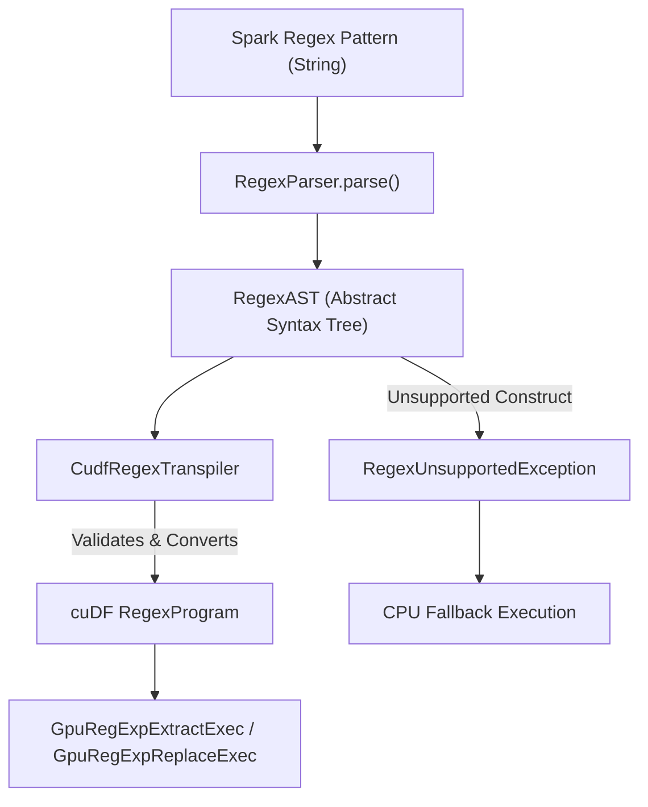
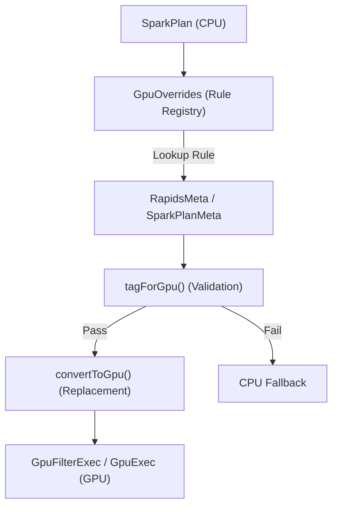

<!-- source: DeepWiki mcp.deepwiki.com · repo NVIDIA/cudf-spark · page 1.2 Compatibility & Supported Operations · fetched 2026-10-26 -->

# Compatibility & Supported Operations

Relevant source files

The following files were used as context for generating this wiki page:

- [docs/compatibility.md](docs/compatibility.md)
- [integration_tests/src/main/python/regexp_test.py](integration_tests/src/main/python/regexp_test.py)
- [integration_tests/src/main/python/string_test.py](integration_tests/src/main/python/string_test.py)
- [scala2.13/tools/pom.xml](scala2.13/tools/pom.xml)
- [sql-plugin/src/main/scala/com/nvidia/spark/rapids/GpuRegExpReplaceMeta.scala](sql-plugin/src/main/scala/com/nvidia/spark/rapids/GpuRegExpReplaceMeta.scala)
- [sql-plugin/src/main/scala/com/nvidia/spark/rapids/RegexParser.scala](sql-plugin/src/main/scala/com/nvidia/spark/rapids/RegexParser.scala)
- [sql-plugin/src/main/scala/org/apache/spark/sql/rapids/stringFunctions.scala](sql-plugin/src/main/scala/org/apache/spark/sql/rapids/stringFunctions.scala)
- [tests/src/test/scala/com/nvidia/spark/rapids/ConditionalsSuite.scala](tests/src/test/scala/com/nvidia/spark/rapids/ConditionalsSuite.scala)
- [tests/src/test/scala/com/nvidia/spark/rapids/RegularExpressionParserSuite.scala](tests/src/test/scala/com/nvidia/spark/rapids/RegularExpressionParserSuite.scala)
- [tests/src/test/scala/com/nvidia/spark/rapids/RegularExpressionRewriteSuite.scala](tests/src/test/scala/com/nvidia/spark/rapids/RegularExpressionRewriteSuite.scala)
- [tests/src/test/scala/com/nvidia/spark/rapids/RegularExpressionSuite.scala](tests/src/test/scala/com/nvidia/spark/rapids/RegularExpressionSuite.scala)
- [tests/src/test/scala/com/nvidia/spark/rapids/RegularExpressionTranspilerSuite.scala](tests/src/test/scala/com/nvidia/spark/rapids/RegularExpressionTranspilerSuite.scala)
- [tests/src/test/scala/com/nvidia/spark/rapids/StringFunctionSuite.scala](tests/src/test/scala/com/nvidia/spark/rapids/StringFunctionSuite.scala)
- [tools/generated_files/330/operatorsScore.csv](tools/generated_files/330/operatorsScore.csv)
- [tools/generated_files/330/supportedExprs.csv](tools/generated_files/330/supportedExprs.csv)
- [tools/generated_files/331/operatorsScore.csv](tools/generated_files/331/operatorsScore.csv)
- [tools/generated_files/331/supportedExprs.csv](tools/generated_files/331/supportedExprs.csv)
- [tools/generated_files/332/operatorsScore.csv](tools/generated_files/332/operatorsScore.csv)
- [tools/generated_files/332/supportedExprs.csv](tools/generated_files/332/supportedExprs.csv)
- [tools/generated_files/333/operatorsScore.csv](tools/generated_files/333/operatorsScore.csv)
- [tools/generated_files/333/supportedExprs.csv](tools/generated_files/333/supportedExprs.csv)
- [tools/generated_files/334/operatorsScore.csv](tools/generated_files/334/operatorsScore.csv)
- [tools/generated_files/334/supportedExprs.csv](tools/generated_files/334/supportedExprs.csv)
- [tools/generated_files/340/operatorsScore.csv](tools/generated_files/340/operatorsScore.csv)
- [tools/generated_files/340/supportedExprs.csv](tools/generated_files/340/supportedExprs.csv)
- [tools/generated_files/341/operatorsScore.csv](tools/generated_files/341/operatorsScore.csv)
- [tools/generated_files/341/supportedExprs.csv](tools/generated_files/341/supportedExprs.csv)
- [tools/generated_files/342/operatorsScore.csv](tools/generated_files/342/operatorsScore.csv)
- [tools/generated_files/342/supportedExprs.csv](tools/generated_files/342/supportedExprs.csv)
- [tools/generated_files/343/operatorsScore.csv](tools/generated_files/343/operatorsScore.csv)
- [tools/generated_files/350/supportedExprs.csv](tools/generated_files/350/supportedExprs.csv)
- [tools/generated_files/351/supportedExprs.csv](tools/generated_files/351/supportedExprs.csv)
- [tools/generated_files/357/supportedDataSource.csv](tools/generated_files/357/supportedDataSource.csv)
- [tools/generated_files/357/supportedExecs.csv](tools/generated_files/357/supportedExecs.csv)
- [tools/generated_files/operatorsScore.csv](tools/generated_files/operatorsScore.csv)
- [tools/generated_files/supportedDataSource.csv](tools/generated_files/supportedDataSource.csv)
- [tools/generated_files/supportedExecs.csv](tools/generated_files/supportedExecs.csv)
- [tools/generated_files/supportedExprs.csv](tools/generated_files/supportedExprs.csv)
- [tools/pom.xml](tools/pom.xml)

## Purpose and Scope

The RAPIDS Accelerator for Apache Spark strives to produce results that are bit-for-bit identical to Apache Spark. However, performance-driven design choices, differences in underlying implementations (JVM vs. C++/cuDF), and parallel aggregation race conditions cause some intentional or inherent behavioral disparities. These differences are managed via configurations and are tracked within the plan-replacement framework to allow users to enable, disable, or control tolerance for differences [docs/compatibility.md:7-16]().

Sources:
- [docs/compatibility.md:7-16]()

---

## General Limitations & Behavioral Differences

### Ordering of Output

Spark itself does not guarantee output order for many distributed operators such as aggregates or joins because these operations rely on hash-based distribution and task parallelism [docs/compatibility.md:20-22](). Accordingly, the RAPIDS plugin also does not guarantee to reproduce the exact output ordering of these operations when running on GPU [docs/compatibility.md:20-25](). For explicit sorting with `ORDER BY`, the plugin produces an ordering compatible with Spark's guarantees, though exact ordering may differ in ambiguous cases [docs/compatibility.md:23-25]().

Further specifics on floating-point ordering include:

- Spark versions before 3.1.0 treat `-0.0` as less than `0.0` during sorting, but from 3.1.0 onwards they consider them equal.
- The RAPIDS plugin treats `-0.0` and `0.0` as equal for sorting across all versions, which can cause ordering differences [docs/compatibility.md:27-28]().
- Spark's sort algorithm is typically stable, but distributed execution cannot guarantee sort stability unless all data is sorted within a single task/partition.
- The plugin uses an unstable out-of-core sort to handle data spilling on the GPU by default.
- Stable sorting can be enabled explicitly with configuration flag `spark.rapids.sql.stableSort.enabled` (which triggers cuDF to sort all data in GPU memory without spilling) [docs/compatibility.md:30-41]().

Sources:
- [docs/compatibility.md:20-42]()

### Floating Point & Decimal Arithmetic Differences

- The GPU plugin matches CPU Spark bit-for-bit for most basic floating-point arithmetic operations like addition, subtraction, multiplication, and division [docs/compatibility.md:43-46]().

- For transcendental math functions such as `sin`, `cos`, results differ within acceptable floating-point rounding error bounds since JVM and cuDF use different implementations and different evaluation orders [docs/compatibility.md:46-50]().

- **`round` and `bround`** behave differently due to Spark's CPU logic converting binary floating-point to decimal before rounding, while GPU operates directly with binary floating-point. For example, `round(1.025, 2)` yields `1.03` on CPU but `1.02` on GPU [docs/compatibility.md:52-60]().

- **`degrees`** function difference depends on JDK versions: Spark CPU’s uses Java 8 `Math.toDegrees` implementation (`angrad * 180.0 / PI`) which can overflow, while the GPU plugin uses Java 9+ style (`angrad * (180d / PI)`), avoiding some overflow cases on large values [docs/compatibility.md:62-64]().

- **Parallel aggregations** on GPU are performed with parallel reductions, which introduce floating-point summation nondeterminism due to race conditions. This can cause slight variations between repeated runs for scalar and array aggregations (e.g. `sum`, `avg`, `aggregate` / `reduce`). This behavior can be disabled via config `spark.rapids.sql.variableFloatAgg.enabled` [docs/compatibility.md:65-74]().

- For large finite floating-point input, standard deviation and variance aggregations (`stddev_*`, `variance_*`) may overflow differently between CPU and GPU due to partial aggregate state merge order changes. This may cause different IEEE sentinels like `NaN` vs `+Infinity`. This only affects extreme input edge cases [docs/compatibility.md:77-84]().

- **`0.0` vs `-0.0`**: The IEEE standard treats `0.0` and `-0.0` as equivalent. While Spark's CPU implementation is inconsistent in normalizing these values (see [SPARK-32110](https://issues.apache.org/jira/browse/SPARK-32110)), the GPU plugin treats them as identical for most processing. This can lead to differences in operations like sorting and distinct counts, especially in Spark versions prior to 3.1.0. Differences can also occur in joins and comparisons even after Spark 3.1.0 [docs/compatibility.md:85-94](). The plugin does not disable operations due to `-0.0` differences, as it's considered a rare occurrence [docs/compatibility.md:96-97]().

- **`NaN` vs `NaN`**: Spark's handling of `NaN` comparisons is inconsistent and has changed across versions. The cuDF plugin aims to match Spark's output, but some operations may differ [docs/compatibility.md:99-104]().

Sources:
- [docs/compatibility.md:43-104]()

---

## String & Regular Expression GPU Support

The RAPIDS Accelerator supports GPU acceleration for many Spark string functions and integrates GPU-based regex via transpilation from Spark regex to cuDF regex programs.

### Key Implementation Elements

- **Regex Parsing (`RegexParser`)**: Located in `RegexParser.scala`, implements a Pratt parser to convert Spark regex pattern strings into a minimal Abstract Syntax Tree (`RegexAST`). This AST validates whether patterns are supported on GPU and is the basis for transpilation. Unsupported features (e.g. possessive quantifiers, certain anchors) raise a `RegexUnsupportedException` [sql-plugin/src/main/scala/com/nvidia/spark/rapids/RegexParser.scala:28-66](). The parser also handles replacement strings, converting them into a sequence of `RegexAST` parts, including backreferences [sql-plugin/src/main/scala/com/nvidia/spark/rapids/RegexParser.scala:73-98]().

- **GPU String Expressions**: GPU-accelerated string functions extend `GpuUnaryExpression` or predicates, directly invoking underlying cuDF APIs on GPU column vectors. Examples include:
  - `GpuUpper`, `GpuLower` for case conversions [sql-plugin/src/main/scala/org/apache/spark/sql/rapids/stringFunctions.scala:53-67]()
  - `GpuLength`, `GpuBitLength`, `GpuOctetLength` for string length measures [sql-plugin/src/main/scala/org/apache/spark/sql/rapids/stringFunctions.scala:70-103]()
  - `GpuStringLocate` for substring index finding [sql-plugin/src/main/scala/org/apache/spark/sql/rapids/stringFunctions.scala:105-163]()
  - `GpuStartsWith` for prefix checks [sql-plugin/src/main/scala/org/apache/spark/sql/rapids/stringFunctions.scala:165-183]()
These are implemented in `stringFunctions.scala` [sql-plugin/src/main/scala/org/apache/spark/sql/rapids/stringFunctions.scala:47-183]().

- **Regex Transpilation & Execution**: The abstract syntax tree output by the parser gets transpiled to a `RegexProgram` suitable for execution on GPU. GPU regex execution operators like `GpuRegExpReplaceExec` or `GpuRegExpExtractExec` use these compiled programs. Unsupported regex patterns cause fallback to CPU execution [tests/src/test/scala/com/nvidia/spark/rapids/RegularExpressionTranspilerSuite.scala:35-89](). The transpiler also detects invalid cuDF patterns that might compile in Java but have inconsistent behavior or are explicitly unsupported by cuDF [tests/src/test/scala/com/nvidia/spark/rapids/RegularExpressionTranspilerSuite.scala:35-89]().

### Regex Transpilation and Execution Pipeline

*Figure 1: Workflow mapping from Spark regex string to GPU regex execution and fallback incorporating `RegexParser` and `RegexProgram`.*

Sources:
- [sql-plugin/src/main/scala/com/nvidia/spark/rapids/RegexParser.scala:28-98]()
- [sql-plugin/src/main/scala/org/apache/spark/sql/rapids/stringFunctions.scala:47-183]()
- [tests/src/test/scala/com/nvidia/spark/rapids/RegularExpressionTranspilerSuite.scala:35-89]()

---

## SparkPlan Replacement and Supported Operations Registry

At runtime, the plugin intercepts Spark SQL physical plans and expressions using the `GpuOverrides` registry, which contains rules that validate support and perform plan replacement for GPU execution.

### Replacement Pipeline

- Input Spark plans (CPU bound) traverse through `GpuOverrides` rules.
- Each operator/expression is mapped to a corresponding metadata wrapper (`RapidsMeta`) which executes `tagForGpu()` validation logic.
- If all checks pass (compatible types, supported features, etc.), `convertToGpu()` replaces the CPU node with a GPU-accelerated equivalent (such as `GpuFilterExec`) in the plan.
- If checks fail, the plan node falls back to execution on CPU [tools/generated_files/operatorsScore.csv:1-46]().

### Plan Replacement and Tagging Pipeline

*Figure 2: Spark physical plan interception, validation, and GPU plan substitution workflow via `GpuOverrides` and `RapidsMeta`.*

Sources:
- [tools/generated_files/operatorsScore.csv:1-46]()

---

## Tools and Generated Supported Operations Reference

The plugin build process generates detailed CSV references used to document, analyze, and score GPU support for expressions and physical operators.

- These references are generated during Maven's package phase by a Java tool `SupportedOpsForTools` executed via the `maven-antrun-plugin` [tools/pom.xml:80-123]().

| File Name                   | Description                                                                                                     | Location / Usage                                             |
|-----------------------------|-----------------------------------------------------------------------------------------------------------------|--------------------------------------------------------------|
| `supportedExprs.csv`         | Lists Spark SQL expressions and their GPU support status by input/output types and compatibility notes         | `tools/generated_files/supportedExprs.csv`                    |
| `operatorsScore.csv`         | Contains CPU Spark operator names with assigned scores used by the Cost-Based Optimizer to assess replacement  | `tools/generated_files/operatorsScore.csv`                    |
| `supportedExecs.csv`         | Physical Spark operator GPU support matrix indicating capabilities and fallback options                         | `tools/generated_files/*/supportedExecs.csv`                  |
| `supportedDataSource.csv`    | Data source and file format support reference mapping                                                         | `tools/generated_files/supportedDataSource.csv`               |

These files empower tooling and documentation to track detailed GPU compatibility coverage and performance impact.

Sources:
- [tools/pom.xml:80-123]()
- [tools/generated_files/supportedExprs.csv:1-53]()
- [tools/generated_files/operatorsScore.csv:1-46]()

---

# Summary

This section outlines which Spark SQL operations the RAPIDS Accelerator for Apache Spark accelerates on GPU, nuances and known behavioral differences from CPU execution (especially around ordering and floating-point precision), and details the generated tooling artifacts that comprehensively catalogue supported expressions and operators. Support for string and regex operations is robust yet gated by transpilation-based validation, ensuring fallbacks preserve correctness when GPU support is not possible.

This technical understanding of compatibility and supported operations is foundational for developers configuring, troubleshooting, or extending the accelerator in complex Spark environments.

---

