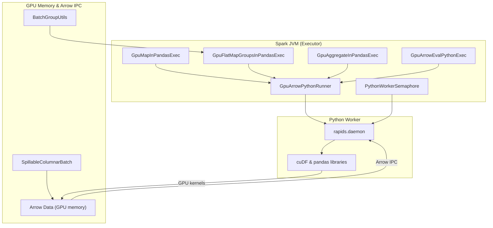
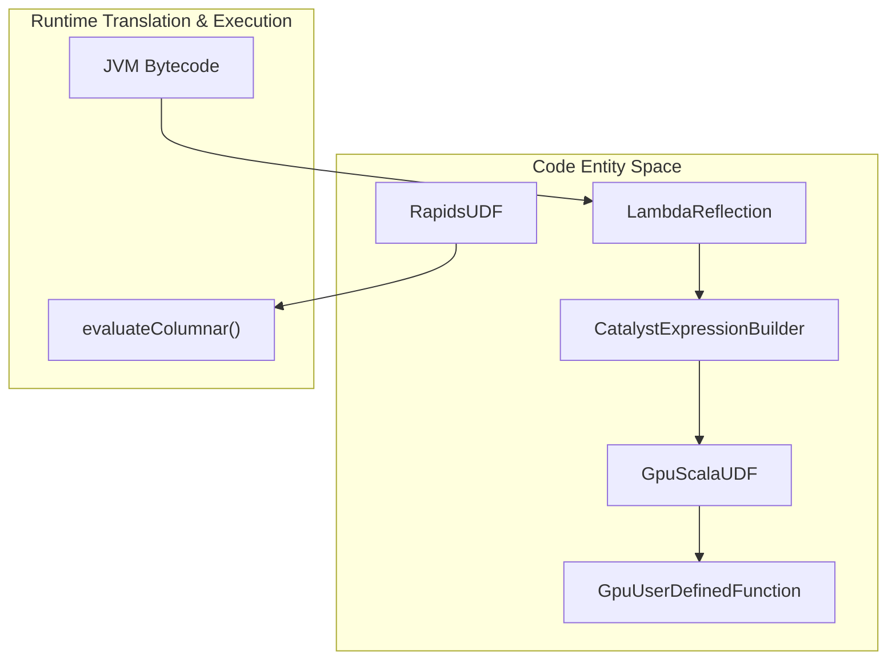

<!-- source: DeepWiki mcp.deepwiki.com · repo NVIDIA/cudf-spark · page 10 Python UDFs & Pandas Integration · fetched 2026-10-26 -->

# Python UDFs & Pandas Integration

Relevant source files

The following files were used as context for generating this wiki page:

- [docs/additional-functionality/rapids-udfs.md](docs/additional-functionality/rapids-udfs.md)
- [integration_tests/src/main/python/udf_cudf_test.py](integration_tests/src/main/python/udf_cudf_test.py)
- [integration_tests/src/main/python/udf_test.py](integration_tests/src/main/python/udf_test.py)
- [sql-plugin/src/main/scala/org/apache/spark/sql/rapids/execution/python/BatchGroupUtils.scala](sql-plugin/src/main/scala/org/apache/spark/sql/rapids/execution/python/BatchGroupUtils.scala)
- [sql-plugin/src/main/scala/org/apache/spark/sql/rapids/execution/python/GpuAggregateInPandasExec.scala](sql-plugin/src/main/scala/org/apache/spark/sql/rapids/execution/python/GpuAggregateInPandasExec.scala)
- [sql-plugin/src/main/scala/org/apache/spark/sql/rapids/execution/python/GpuArrowEvalPythonExec.scala](sql-plugin/src/main/scala/org/apache/spark/sql/rapids/execution/python/GpuArrowEvalPythonExec.scala)
- [sql-plugin/src/main/scala/org/apache/spark/sql/rapids/execution/python/GpuFlatMapCoGroupsInPandasExec.scala](sql-plugin/src/main/scala/org/apache/spark/sql/rapids/execution/python/GpuFlatMapCoGroupsInPandasExec.scala)
- [sql-plugin/src/main/scala/org/apache/spark/sql/rapids/execution/python/GpuFlatMapGroupsInPandasExec.scala](sql-plugin/src/main/scala/org/apache/spark/sql/rapids/execution/python/GpuFlatMapGroupsInPandasExec.scala)
- [sql-plugin/src/main/scala/org/apache/spark/sql/rapids/execution/python/GpuWindowInPandasExecBase.scala](sql-plugin/src/main/scala/org/apache/spark/sql/rapids/execution/python/GpuWindowInPandasExecBase.scala)
- [sql-plugin/src/main/spark330db/scala/org/apache/spark/sql/rapids/execution/python/shims/GpuGroupUDFArrowPythonRunner.scala](sql-plugin/src/main/spark330db/scala/org/apache/spark/sql/rapids/execution/python/shims/GpuGroupUDFArrowPythonRunner.scala)
- [sql-plugin/src/main/spark330db/scala/org/apache/spark/sql/rapids/execution/python/shims/GpuGroupedPythonRunnerFactory.scala](sql-plugin/src/main/spark330db/scala/org/apache/spark/sql/rapids/execution/python/shims/GpuGroupedPythonRunnerFactory.scala)
- [sql-plugin/src/main/spark400/scala/org/apache/spark/sql/rapids/execution/python/shims/WritePythonUDFUtils.scala](sql-plugin/src/main/spark400/scala/org/apache/spark/sql/rapids/execution/python/shims/WritePythonUDFUtils.scala)

This page provides an overview of how the RAPIDS Accelerator for Apache Spark enables GPU acceleration of Python User Defined Functions (UDFs), Pandas-based operations, and compilation of Scala/Java UDFs. It covers the key mechanisms for seamless GPU execution including Apache Arrow data exchange, execution of Pandas UDFs on GPU, bytecode-to-Catalyst compilation for Scala/Java UDFs, and AI-driven workflows for UDF GPU conversion.

Sources:
- [docs/additional-functionality/rapids-udfs.md:1-159]()
- [integration_tests/src/main/python/udf_test.py:51-59]()

## Overview of UDF Acceleration Strategies

The RAPIDS Accelerator employs several strategies to enhance the performance of UDFs which traditionally suffer from costly serialization and CPU/GPU data transfer overheads.

### 1. GPU-Accelerated Python & Pandas UDFs

The plugin supports GPU acceleration for Python and Pandas UDFs by exchanging data using Apache Arrow in a columnar format. This reduces CPU-GPU data transfer latency and takes advantage of GPU parallelism. The integration covers various Pandas UDF evaluation types such as scalar, grouped map, and windowed operations. Key physical execution classes like `GpuMapInPandasExec`, `GpuAggregateInPandasExec`, and `GpuArrowEvalPythonExec` orchestrate the GPU execution and efficient resource scheduling for Python workers that have RAPIDS/cuDF support enabled. Corresponding tests validate the equivalence of GPU and CPU runs across different data types and UDF forms.

Sources:  
- [docs/additional-functionality/rapids-udfs.md:154-159]()  
- [integration_tests/src/main/python/udf_test.py:51-103]()  
- [integration_tests/src/main/python/udf_cudf_test.py:80-196]()  
- [sql-plugin/src/main/scala/org/apache/spark/sql/rapids/execution/python/GpuAggregateInPandasExec.scala:51-58]()

---

### 2. UDF Compiler (Scala/Java → Catalyst)

The UDF Compiler module tackles Scala and Java UDFs by reflecting on the bytecode (using `LambdaReflection`), constructing a Control Flow Graph (CFG), and mapping JVM bytecode opcodes to equivalent Catalyst expressions. This transpilation enables these UDFs to be integrated directly into the Spark Catalyst engine and executed on the GPU as native GPU expressions, avoiding the overhead of a Python bridge or JVM reflection at runtime. Classes such as `CatalystExpressionBuilder`, `GpuScalaUDF`, and `GpuUserDefinedFunction` encapsulate this process.

Sources:  
- [docs/additional-functionality/rapids-udfs.md:35-50]()

---

### 3. Aether Agent Skills for UDF Conversion

For more complex Python UDFs that cannot be directly compiled or accelerated through native mechanisms, the plugin integrates an AI-assisted agent system (`skills/` directory). This system leverages AI workflows to analyze CPU UDFs, generate equivalent GPU-optimized code using Rapids/cuDF APIs, and automate test generation and benchmarking. This helps users to systematically convert and optimize custom UDFs for GPU acceleration, ensuring correctness and performance parity.

Sources:  
- [integration_tests/src/main/python/udf_cudf_test.py:63-78]()

---

## System Architecture: Python UDF & Pandas Integration

The core execution pipeline bridges the JVM Spark executor running on the GPU with the Python runtime via Arrow IPC streams and manages GPU resources for execution of Python UDF and Pandas operations. The diagrams below map the major system components and key code entities involved, bridging natural language concepts to concrete codebase entities.

### Python UDF Execution Flow Diagram

Sources:
- [sql-plugin/src/main/scala/org/apache/spark/sql/rapids/execution/python/GpuFlatMapGroupsInPandasExec.scala:79-110]()
- [sql-plugin/src/main/scala/org/apache/spark/sql/rapids/execution/python/GpuAggregateInPandasExec.scala:51-58]()
- [sql-plugin/src/main/scala/org/apache/spark/sql/rapids/execution/python/GpuArrowEvalPythonExec.scala:52-58]()
- [sql-plugin/src/main/scala/org/apache/spark/sql/rapids/execution/python/BatchGroupUtils.scala:44-55]()

### UDF Processing and Compiler Entity Mapping

Sources:
- [docs/additional-functionality/rapids-udfs.md:53-64]()

---

## Subsystems Overview & Child Pages

For detailed technical coverage of each sub-topic, refer to the respective child pages:

| Child Page | Description |
|------------|-------------|
| [GPU Arrow/Pandas UDF Execution](#10.1) | Covers runtime physical operators like `GpuArrowEvalPythonExec`, `GpuWindowInPandasExecBase`, `GpuAggregateInPandasExec`, `GpuMapInPandasExec`, `GpuFlatMapGroupsInPandasExec` and utilities such as `BatchGroupUtils`. Discusses how Python UDFs execute on GPU using Arrow data exchange, Python worker processes, and batch grouping strategies. |
| [UDF Compiler (Scala/Java UDF → Catalyst)](#10.2) | Describes the `udf-compiler` module that reflects on Scala/Java UDF bytecode using `LambdaReflection`, builds control flow graphs, and transpiles them into GPU-executable Spark Catalyst expressions like `GpuScalaUDF` and `GpuUserDefinedFunction`. |
| [Aether Agent Skills for UDF Conversion](#10.3) | Explains AI-enabled skills under the `skills/` directory for automated UDF conversion workflows, including code generation, benchmarking, optimization, and guidance via `AGENTS.md`. |

Sources:
- [sql-plugin/src/main/scala/org/apache/spark/sql/rapids/execution/python/GpuArrowEvalPythonExec.scala:52-58]()
- [sql-plugin/src/main/scala/org/apache/spark/sql/rapids/execution/python/GpuWindowInPandasExecBase.scala:44-50]()
- [sql-plugin/src/main/scala/org/apache/spark/sql/rapids/execution/python/GpuAggregateInPandasExec.scala:51-58]()
- [sql-plugin/src/main/scala/org/apache/spark/sql/rapids/execution/python/GpuFlatMapGroupsInPandasExec.scala:79-85]()
- [sql-plugin/src/main/scala/org/apache/spark/sql/rapids/execution/python/BatchGroupUtils.scala:44-48]()

---

## Related Child Pages

- [GPU Arrow/Pandas UDF Execution](#10.1)  
- [UDF Compiler (Scala/Java UDF → Catalyst)](#10.2)  
- [Aether Agent Skills for UDF Conversion](#10.3)

---

