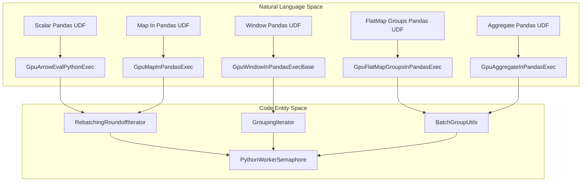
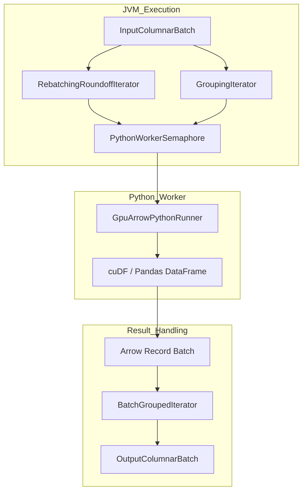

<!-- source: DeepWiki mcp.deepwiki.com · repo NVIDIA/cudf-spark · page 10.1 GPU Arrow/Pandas UDF Execution · fetched 2026-10-26 -->

# GPU Arrow/Pandas UDF Execution

Relevant source files

The following files were used as context for generating this wiki page:

- [.github/404.html](.github/404.html)
- [.github/workflows/blossom-ci.yml](.github/workflows/blossom-ci.yml)
- [.github/workflows/license-header-check.yml](.github/workflows/license-header-check.yml)
- [.github/workflows/markdown-links-check.yml](.github/workflows/markdown-links-check.yml)
- [.github/workflows/markdown-links-check/markdown-links-check-config.json](.github/workflows/markdown-links-check/markdown-links-check-config.json)
- [.github/workflows/mvn-verify-check.yml](.github/workflows/mvn-verify-check.yml)
- [.github/workflows/mvn-verify-check/get-deps-sha1.sh](.github/workflows/mvn-verify-check/get-deps-sha1.sh)
- [docs/dev/idea-code-style-settings.xml](docs/dev/idea-code-style-settings.xml)
- [docs/dev/microk8s.md](docs/dev/microk8s.md)
- [docs/img/Databricks/initscript.png](docs/img/Databricks/initscript.png)
- [integration_tests/src/main/python/udf_cudf_test.py](integration_tests/src/main/python/udf_cudf_test.py)
- [integration_tests/src/main/python/udf_test.py](integration_tests/src/main/python/udf_test.py)
- [python/rapids/daemon.py](python/rapids/daemon.py)
- [python/rapids/daemon_databricks.py](python/rapids/daemon_databricks.py)
- [python/rapids/worker.py](python/rapids/worker.py)
- [sql-plugin/src/main/scala/org/apache/spark/sql/rapids/execution/python/BatchGroupUtils.scala](sql-plugin/src/main/scala/org/apache/spark/sql/rapids/execution/python/BatchGroupUtils.scala)
- [sql-plugin/src/main/scala/org/apache/spark/sql/rapids/execution/python/GpuAggregateInPandasExec.scala](sql-plugin/src/main/scala/org/apache/spark/sql/rapids/execution/python/GpuAggregateInPandasExec.scala)
- [sql-plugin/src/main/scala/org/apache/spark/sql/rapids/execution/python/GpuArrowEvalPythonExec.scala](sql-plugin/src/main/scala/org/apache/spark/sql/rapids/execution/python/GpuArrowEvalPythonExec.scala)
- [sql-plugin/src/main/scala/org/apache/spark/sql/rapids/execution/python/GpuFlatMapCoGroupsInPandasExec.scala](sql-plugin/src/main/scala/org/apache/spark/sql/rapids/execution/python/GpuFlatMapCoGroupsInPandasExec.scala)
- [sql-plugin/src/main/scala/org/apache/spark/sql/rapids/execution/python/GpuFlatMapGroupsInPandasExec.scala](sql-plugin/src/main/scala/org/apache/spark/sql/rapids/execution/python/GpuFlatMapGroupsInPandasExec.scala)
- [sql-plugin/src/main/scala/org/apache/spark/sql/rapids/execution/python/GpuMapInBatchExec.scala](sql-plugin/src/main/scala/org/apache/spark/sql/rapids/execution/python/GpuMapInBatchExec.scala)
- [sql-plugin/src/main/scala/org/apache/spark/sql/rapids/execution/python/GpuMapInPandasExec.scala](sql-plugin/src/main/scala/org/apache/spark/sql/rapids/execution/python/GpuMapInPandasExec.scala)
- [sql-plugin/src/main/scala/org/apache/spark/sql/rapids/execution/python/GpuWindowInPandasExecBase.scala](sql-plugin/src/main/scala/org/apache/spark/sql/rapids/execution/python/GpuWindowInPandasExecBase.scala)
- [sql-plugin/src/main/spark330/scala/com/nvidia/spark/rapids/shims/PythonMapInArrowExecShims.scala](sql-plugin/src/main/spark330/scala/com/nvidia/spark/rapids/shims/PythonMapInArrowExecShims.scala)
- [sql-plugin/src/main/spark330/scala/org/apache/spark/sql/rapids/shims/GpuPythonMapInArrowExec.scala](sql-plugin/src/main/spark330/scala/org/apache/spark/sql/rapids/shims/GpuPythonMapInArrowExec.scala)
- [sql-plugin/src/main/spark330/scala/org/apache/spark/sql/rapids/shims/GpuPythonMapInArrowExecMeta.scala](sql-plugin/src/main/spark330/scala/org/apache/spark/sql/rapids/shims/GpuPythonMapInArrowExecMeta.scala)
- [sql-plugin/src/main/spark330db/scala/org/apache/spark/sql/rapids/execution/python/shims/GpuGroupUDFArrowPythonRunner.scala](sql-plugin/src/main/spark330db/scala/org/apache/spark/sql/rapids/execution/python/shims/GpuGroupUDFArrowPythonRunner.scala)
- [sql-plugin/src/main/spark330db/scala/org/apache/spark/sql/rapids/execution/python/shims/GpuGroupedPythonRunnerFactory.scala](sql-plugin/src/main/spark330db/scala/org/apache/spark/sql/rapids/execution/python/shims/GpuGroupedPythonRunnerFactory.scala)
- [sql-plugin/src/main/spark350/scala/com/nvidia/spark/rapids/shims/PythonMapInArrowExecShims.scala](sql-plugin/src/main/spark350/scala/com/nvidia/spark/rapids/shims/PythonMapInArrowExecShims.scala)
- [sql-plugin/src/main/spark350/scala/org/apache/spark/sql/rapids/shims/GpuMapInPandasExecMeta.scala](sql-plugin/src/main/spark350/scala/org/apache/spark/sql/rapids/shims/GpuMapInPandasExecMeta.scala)
- [sql-plugin/src/main/spark350/scala/org/apache/spark/sql/rapids/shims/GpuPythonMapInArrowExecMeta.scala](sql-plugin/src/main/spark350/scala/org/apache/spark/sql/rapids/shims/GpuPythonMapInArrowExecMeta.scala)
- [sql-plugin/src/main/spark400/scala/org/apache/spark/sql/rapids/execution/python/shims/WritePythonUDFUtils.scala](sql-plugin/src/main/spark400/scala/org/apache/spark/sql/rapids/execution/python/shims/WritePythonUDFUtils.scala)

## Purpose and Scope
This page covers the GPU-accelerated Python UDF execution framework within the RAPIDS Accelerator for Apache Spark. It explains how GPU computation integrates with Spark's Pandas UDFs using Apache Arrow for efficient data interchange. The scope spans core execution nodes such as `GpuArrowEvalPythonExec`, window and aggregate variants like `GpuWindowInPandasExecBase` and `GpuAggregateInPandasExec`, flat-map grouped operators like `GpuFlatMapGroupsInPandasExec`, `GpuMapInPandasExec`, utility classes including `BatchGroupUtils`, and the related Python daemon and worker components facilitating GPU-aware Python execution.

Sources: [integration_tests/src/main/python/udf_test.py:50-58](), [sql-plugin/src/main/scala/org/apache/spark/sql/rapids/execution/python/GpuArrowEvalPythonExec.scala:20-43]()

---

## Architecture Overview & Code Entities

The GPU Python UDF execution framework replaces Spark's CPU operators responsible for Python UDFs with GPU-aware equivalents. These GPU execution nodes optimize batch handling, group-aware partitioning, and scheduling GPU resources forVZ the Python worker processes. They leverage Apache Arrow to exchange columnar data efficiently between JVM and Python, enabling the Python side to work with GPU-resident cuDF or Pandas dataframes.

**Diagram: Python UDF Execution Subsystem - System to Code Mapping**

Sources:  
[sql-plugin/src/main/scala/org/apache/spark/sql/rapids/execution/python/GpuArrowEvalPythonExec.scala:20-58](),  
[sql-plugin/src/main/scala/org/apache/spark/sql/rapids/execution/python/GpuWindowInPandasExecBase.scala:44-93](),  
[sql-plugin/src/main/scala/org/apache/spark/sql/rapids/execution/python/GpuAggregateInPandasExec.scala:51-60](),  
[sql-plugin/src/main/scala/org/apache/spark/sql/rapids/execution/python/GpuFlatMapGroupsInPandasExec.scala:79-84](),  
[sql-plugin/src/main/scala/org/apache/spark/sql/rapids/execution/python/GpuMapInPandasExec.scala:61-68]()

---

## Core Physical Operators

The plugin provides GPU-native replacements of Spark Python UDF execution plans:

| Operator                      | Spark JVM Equivalent            | Description                                                                                                                  |
|-------------------------------|--------------------------------|------------------------------------------------------------------------------------------------------------------------------|
| `GpuArrowEvalPythonExec`       | `ArrowEvalPythonExec`           | Evaluates scalar Pandas UDFs with batch rebatching and GPU-optimized Arrow data exchange.                                     |
| `GpuAggregateInPandasExec`     | `AggregateInPandasExec`         | Executes grouped aggregate Pandas UDFs, projecting minimal input columns and splitting batches per group.                    |
| `GpuFlatMapGroupsInPandasExec` | `FlatMapGroupsInPandasExec`     | Executes grouped map Pandas UDFs (e.g., `groupBy.applyInPandas`), grouping and splitting data accordingly.                   |
| `GpuMapInPandasExec`            | `MapInPandasExec`               | Executes mapInPandas transformations, handling entire partitions with GPU-accelerated Arrow-based data exchange.              |

Sources: [sql-plugin/src/main/scala/org/apache/spark/sql/rapids/execution/python/GpuArrowEvalPythonExec.scala:44-58](), [sql-plugin/src/main/scala/org/apache/spark/sql/rapids/execution/python/GpuAggregateInPandasExec.scala:40-58](), [sql-plugin/src/main/scala/org/apache/spark/sql/rapids/execution/python/GpuFlatMapGroupsInPandasExec.scala:67-84](), [sql-plugin/src/main/scala/org/apache/spark/sql/rapids/execution/python/GpuMapInPandasExec.scala:53-68]()

### GpuArrowEvalPythonExec

`GpuArrowEvalPythonExec` manages scalar Pandas UDF execution on the GPU. It uses a `RebatchingRoundoffIterator` to merge smaller incoming columnar batches into bigger batches aligned to a multiple of `targetRoundoff` rows. This optimizes GPU utilization and reduces overheads of frequent communications with the Python worker process.

The iterator concatenates small batches (including "rows-only" batches) and emits output batches satisfying size constraints before sending to the Python arrow runner. It leverages GPU memory safely by wrapping Apache Arrow and cuDF Table operations.

Sources: [sql-plugin/src/main/scala/org/apache/spark/sql/rapids/execution/python/GpuArrowEvalPythonExec.scala:44-121]()

### GpuFlatMapGroupsInPandasExec

This operator implements GPU acceleration for Spark's `FlatMapGroupsInPandasExec`—used in grouped map Pandas UDFs such as `groupBy().applyInPandas()`. It forces single-batch input (`RequireSingleBatch`) for group integrity and uses helper utilities to project necessary columns and split the input batch into subgroup batches, each corresponding to a grouping key.

The subgroup batches are then sent as Arrow batches to the Python worker, which processes each group independently and returns transformed data. The output batches are coalesced for better downstream performance.

Sources: [sql-plugin/src/main/scala/org/apache/spark/sql/rapids/execution/python/GpuFlatMapGroupsInPandasExec.scala:36-151]()

### GpuAggregateInPandasExec

This implements GPU acceleration for aggregation Pandas UDFs, e.g., group aggregate Pandas UDFs where Python processes grouped data and returns aggregation results.

The operator does the following:
1. Collects the UDFs and their input expressions (grouping + data columns).
2. Projects the child input batches down to only those fields required by the UDFs and grouping keys.
3. Splits the projected batches into group-local batches based on grouping expressions, which are then sent to Python via Arrow.
4. Manages coalescing output batches and schedules Python worker semaphore for safe GPU usage.

Sources: [sql-plugin/src/main/scala/org/apache/spark/sql/rapids/execution/python/GpuAggregateInPandasExec.scala:40-155]()

### GpuMapInPandasExec

`GpuMapInPandasExec` provides a GPU implementation of the Spark `MapInPandasExec` operator, which applies a Pandas UDF that takes an iterator over input Pandas DataFrames and returns an iterator over output Pandas DataFrames.

This operator extends `GpuMapInBatchExec` and sets the `pythonEvalType` to `SQL_MAP_PANDAS_ITER_UDF`.

Sources: [sql-plugin/src/main/scala/org/apache/spark/sql/rapids/execution/python/GpuMapInPandasExec.scala:26-68]()

---

## Batch Management, Grouping, and Synchronization

GPU execution of grouped or windowed Pandas UDFs requires careful batch management to maintain correctness and resource efficiency.

### BatchGroupUtils and Grouping Logic

The batch grouping framework offers helper utilities for handling grouped batches, particularly:
- **`resolveArgOffsets`:** Deduplicates attributes appearing both as grouping keys and data columns, constructing argument offset arrays that tell the Python worker how to separate keys from values.
- **`projectAndGroup`:** Projects input batches on deduplicated attributes and splits batches into sub-batches per group key using grouping offsets to preserve group boundaries during Python execution.

`GroupingIterator` plays a vital role in `GpuWindowInPandasExecBase` by splitting incoming batches such that each batch contains exactly one group partition, necessary for windowed Pandas UDFs. It uses Apache cuDF’s groupBy and aggregation APIs to identify group sizes and compute split indices. The original batch is then split accordingly.

Sources: [sql-plugin/src/main/scala/org/apache/spark/sql/rapids/execution/python/GpuWindowInPandasExecBase.scala:44-147]()

### Python Worker Synchronization & Resource Scheduling

`PythonWorkerSemaphore` is used to prevent memory exhaustion on GPUs by limiting how many Python worker tasks execute concurrently on a given GPU.

Each GPU execution node (`GpuArrowEvalPythonExec`, `GpuWindowInPandasExecBase`, `GpuAggregateInPandasExec`, `GpuFlatMapGroupsInPandasExec`) calls `PythonWorkerSemaphore.acquireIfNecessary(context)` before launching Python workers, coordinating GPU resource use among concurrent tasks.

Sources: [sql-plugin/src/main/scala/org/apache/spark/sql/rapids/execution/python/GpuArrowEvalPythonExec.scala:120-130](), [sql-plugin/src/main/scala/org/apache/spark/sql/rapids/execution/python/GpuFlatMapGroupsInPandasExec.scala:130-135]()

---

**Diagram: Data Flow and Synchronization in GPU Arrow/Pandas UDF Execution**

Sources:  
[sql-plugin/src/main/scala/org/apache/spark/sql/rapids/execution/python/GpuArrowEvalPythonExec.scala:120-130](),  
[sql-plugin/src/main/scala/org/apache/spark/sql/rapids/execution/python/GpuWindowInPandasExecBase.scala:89-129]()

---

## Python Components and cuDF Integration

The Python side contains daemon and worker scripts located under `python/rapids/` (such as `daemon.py`, `worker.py`, and `daemon_databricks.py`).

These scripts manage the Python worker lifecycle and integrate tightly with RAPIDS libraries like cuDF to enable direct GPU processing of Pandas UDF inputs.

When the configuration `spark.rapids.sql.python.gpu.enabled` is set to `true`, Python UDFs can leverage cuDF directly to perform GPU computation before returning results to the JVM in Arrow format.

Sources: [integration_tests/src/main/python/udf_cudf_test.py:40-100]()

---

## Configuration Reference

Key Spark configuration properties impacting GPU Pandas UDF execution include:

| Property                                     | Details                                                                                          |
|----------------------------------------------|-------------------------------------------------------------------------------------------------|
| `spark.rapids.sql.python.gpu.enabled`        | Enables GPU-accelerated Python worker UDF execution.                                            |
| `spark.sql.execution.arrow.pyspark.enabled`  | Must be set to `true` to enable Arrow-based data exchange for Python UDFs.                      |
| `spark.rapids.sql.exec.WindowInPandasExec`  | Enables GPU acceleration for windowed Pandas UDFs. Support varies with Spark version.           |
| `spark.rapids.sql.exec.ArrowWindowPythonExec` | New name for `WindowInPandasExec` in Spark 4.1+, enables GPU usage.                           |
| `spark.rapids.sql.exec.FlatMapCoGroupsInPandasExec` | Enables GPU acceleration for co-grouped Pandas UDFs (`FlatMapCoGroupsInPandasExec`).       |
| `spark.rapids.sql.exec.AggregateInPandasExec` | Enables GPU acceleration for grouped aggregation Pandas UDFs.                                |

Sources: [integration_tests/src/main/python/udf_test.py:50-58](), [integration_tests/src/main/python/udf_cudf_test.py:45-50]()

---

