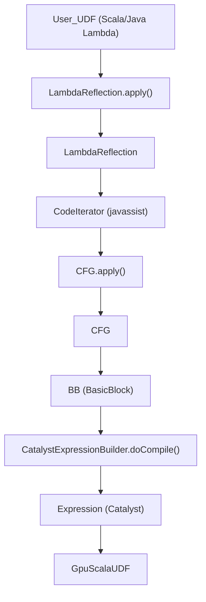
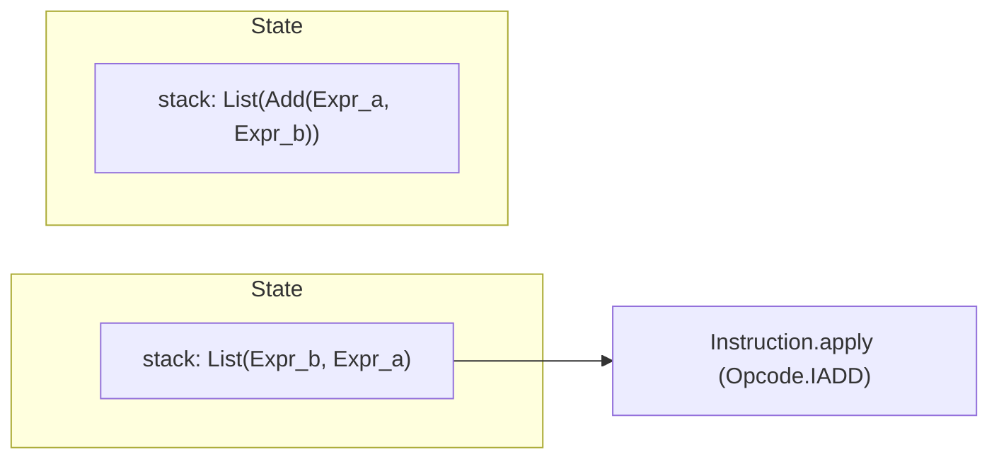

<!-- source: DeepWiki mcp.deepwiki.com · repo NVIDIA/cudf-spark · page 10.2 UDF Compiler (Scala/Java UDF → Catalyst) · fetched 2026-10-26 -->

# UDF Compiler (Scala/Java UDF → Catalyst)

Relevant source files

The following files were used as context for generating this wiki page:

- [docs/additional-functionality/udf-to-catalyst-expressions.md](docs/additional-functionality/udf-to-catalyst-expressions.md)
- [integration_tests/src/main/python/row-based_udf_test.py](integration_tests/src/main/python/row-based_udf_test.py)
- [sql-plugin/src/main/scala/com/nvidia/spark/rapids/GpuUserDefinedFunction.scala](sql-plugin/src/main/scala/com/nvidia/spark/rapids/GpuUserDefinedFunction.scala)
- [sql-plugin/src/main/scala/org/apache/spark/sql/hive/rapids/rowBasedHiveUDFs.scala](sql-plugin/src/main/scala/org/apache/spark/sql/hive/rapids/rowBasedHiveUDFs.scala)
- [sql-plugin/src/main/scala/org/apache/spark/sql/rapids/GpuScalaUDF.scala](sql-plugin/src/main/scala/org/apache/spark/sql/rapids/GpuScalaUDF.scala)
- [sql-plugin/src/main/spark330/scala/org/apache/spark/sql/hive/rapids/shims/GpuRowBasedHiveSimpleUDFShim.scala](sql-plugin/src/main/spark330/scala/org/apache/spark/sql/hive/rapids/shims/GpuRowBasedHiveSimpleUDFShim.scala)
- [sql-plugin/src/main/spark332db/scala/org/apache/spark/sql/hive/rapids/shims/GpuRowBasedHiveGenericUDFShim.scala](sql-plugin/src/main/spark332db/scala/org/apache/spark/sql/hive/rapids/shims/GpuRowBasedHiveGenericUDFShim.scala)
- [sql-plugin/src/main/spark400/scala/org/apache/spark/sql/hive/rapids/shims/GpuRowBasedHiveSimpleUDFShim.scala](sql-plugin/src/main/spark400/scala/org/apache/spark/sql/hive/rapids/shims/GpuRowBasedHiveSimpleUDFShim.scala)
- [tests/src/test/scala/com/nvidia/spark/rapids/RowBasedUDFSuite.scala](tests/src/test/scala/com/nvidia/spark/rapids/RowBasedUDFSuite.scala)
- [udf-compiler/src/main/scala-2.13/com/nvidia/spark/udf/Instruction.scala](udf-compiler/src/main/scala-2.13/com/nvidia/spark/udf/Instruction.scala)
- [udf-compiler/src/main/scala/com/nvidia/spark/udf/CFG.scala](udf-compiler/src/main/scala/com/nvidia/spark/udf/CFG.scala)
- [udf-compiler/src/main/scala/com/nvidia/spark/udf/CatalystExpressionBuilder.scala](udf-compiler/src/main/scala/com/nvidia/spark/udf/CatalystExpressionBuilder.scala)
- [udf-compiler/src/main/scala/com/nvidia/spark/udf/GpuScalaUDF.scala](udf-compiler/src/main/scala/com/nvidia/spark/udf/GpuScalaUDF.scala)
- [udf-compiler/src/main/scala/com/nvidia/spark/udf/LambdaReflection.scala](udf-compiler/src/main/scala/com/nvidia/spark/udf/LambdaReflection.scala)
- [udf-compiler/src/main/scala/com/nvidia/spark/udf/State.scala](udf-compiler/src/main/scala/com/nvidia/spark/udf/State.scala)
- [udf-compiler/src/test/scala/com/nvidia/spark/OpcodeSuite.scala](udf-compiler/src/test/scala/com/nvidia/spark/OpcodeSuite.scala)

## Purpose and Scope
The `udf-compiler` module enables automatic compilation of Scala and Java user-defined functions (UDFs) into native Spark Catalyst expressions. This transformation targets the JVM bytecode of the UDF, converting it into a Catalyst expression tree during query analysis. The resulting Catalyst expressions integrate with the RAPIDS Accelerator framework via `GpuScalaUDF`, allowing GPU native evaluation of the UDF logic. This design avoids costly row-by-row JVM execution and expensive data transfers between JVM and GPU.

Sources: [udf-compiler/src/main/scala/com/nvidia/spark/udf/CatalystExpressionBuilder.scala:28-44]()

---

## Architectural Components

The UDF compiler performs static bytecode analysis combined with symbolic execution to reify UDF bytecode logic as Catalyst expressions. The major components and their roles include:

### 1. LambdaReflection
- Extracts semantic information about the UDF function.
- Internally calls the `writeReplace` method of a lambda to obtain a `java.lang.invoke.SerializedLambda`.
- Uses the `javassist` library to inspect the underlying class (`CtClass`) and method (`CtMethod`) of the UDF's lambda body.
- Provides helper methods like `lookupConstant`, `lookupField`, `lookupBehavior`, and `lookupBootstrapMethod` to analyze bytecode constants and references.

Sources: [udf-compiler/src/main/scala/com/nvidia/spark/udf/LambdaReflection.scala:34-151]()

### 2. Control Flow Graph (CFG)
- The `CFG` class parses bytecode instructions from `LambdaReflection`.
- It partitions instructions into basic blocks (`BB`), each representing a sequence of instructions without jumps [udf-compiler/src/main/scala/com/nvidia/spark/udf/CFG.scala:38-46]().
- Constructs directed edges between basic blocks reflecting control flow successors and predecessors [udf-compiler/src/main/scala/com/nvidia/spark/udf/CFG.scala:132-135]().
- Implements state propagation via `BB.propagateState` for conditional instructions such as `if-else` and `switch` statements [udf-compiler/src/main/scala/com/nvidia/spark/udf/CFG.scala:55-120]().

Sources: [udf-compiler/src/main/scala/com/nvidia/spark/udf/CFG.scala:31-135]()

### 3. CatalystExpressionBuilder
- Coordinates the compilation process over the `CFG` [udf-compiler/src/main/scala/com/nvidia/spark/udf/CatalystExpressionBuilder.scala:45-48]().
- Uses a symbolic execution `State` to track JVM operand stack, local variables, and path conditions as Catalyst expressions [udf-compiler/src/main/scala/com/nvidia/spark/udf/CatalystExpressionBuilder.scala:66-70]().
- Performs depth-first traversal via `doCompile` to recursively compile each basic block into Catalyst expressions [udf-compiler/src/main/scala/com/nvidia/spark/udf/CatalystExpressionBuilder.scala:132-136]().

Sources: [udf-compiler/src/main/scala/com/nvidia/spark/udf/CatalystExpressionBuilder.scala:45-104]()

### Diagram: UDF Transpilation Pipeline Code Entity Mapping

Sources:
[udf-compiler/src/main/scala/com/nvidia/spark/udf/LambdaReflection.scala:34-151]()
[udf-compiler/src/main/scala/com/nvidia/spark/udf/CFG.scala:31-135]()
[udf-compiler/src/main/scala/com/nvidia/spark/udf/CatalystExpressionBuilder.scala:45-104]()
[sql-plugin/src/main/scala/org/apache/spark/sql/rapids/GpuScalaUDF.scala:30-42]()

---

## Data Flow: Symbolic Execution

The UDF compiler performs **symbolic execution** of the bytecode rather than concrete evaluation:
- The JVM operand stack and local variables are represented as Catalyst `Expression` objects.
- For each instruction in a basic block, `Instruction.apply` creates or updates the symbolic state [udf-compiler/src/main/scala/com/nvidia/spark/udf/CatalystExpressionBuilder.scala:162-168]().
- Arithmetic operations pop expressions from the stack, construct a corresponding Catalyst expression (e.g., `Add`, `Multiply`), and push it back.
- Conditional branches update path conditions tracked in `State.cond` [udf-compiler/src/main/scala/com/nvidia/spark/udf/CFG.scala:55-93]().

### Diagram: Symbolic Stack Evolution for Arithmetic Operation

Sources:
[udf-compiler/src/main/scala/com/nvidia/spark/udf/CatalystExpressionBuilder.scala:162-172]()
[udf-compiler/src/main/scala/com/nvidia/spark/udf/State.scala:27-70]()

---

## GPU Execution and Integration

### GpuScalaUDF and GpuRowBasedScalaUDF
- Compiled Catalyst expressions are wrapped inside `GpuScalaUDF`, implementing `RapidsUDF` [sql-plugin/src/main/scala/org/apache/spark/sql/rapids/GpuScalaUDF.scala:30-42]().
- `GpuScalaUDFMeta` coordinates rule matching during physical planning, deciding whether to compile or fallback [sql-plugin/src/main/scala/org/apache/spark/sql/rapids/GpuScalaUDF.scala:44-93]().
- If compilation fails or is disabled, `GpuRowBasedScalaUDF` serves as a fallback, executing row-based evaluation via `ColumnarToRowIterator` when `spark.rapids.sql.rowBasedUDF.enabled` is active [sql-plugin/src/main/scala/org/apache/spark/sql/rapids/GpuScalaUDF.scala:66-91](), [sql-plugin/src/main/scala/com/nvidia/spark/rapids/GpuUserDefinedFunction.scala:93-157]().

Sources:
[sql-plugin/src/main/scala/org/apache/spark/sql/rapids/GpuScalaUDF.scala:30-91]()
[sql-plugin/src/main/scala/com/nvidia/spark/rapids/GpuUserDefinedFunction.scala:33-157]()

### Hive UDFs
The `udf-compiler` also supports row-based Hive UDFs through `GpuRowBasedHiveSimpleUDF` and `GpuRowBasedHiveGenericUDF`. These classes extend `GpuRowBasedHiveUDFBase` and `GpuRowBasedUserDefinedFunction`, providing a mechanism to execute Hive UDFs on the GPU by converting input columns to rows, evaluating the UDF on the CPU, and then building a result column.

- `GpuRowBasedHiveUDFBase`: Provides common functionality for row-based Hive UDFs, including handling `HiveFunctionWrapper` and determining UDF determinism [sql-plugin/src/main/scala/org/apache/spark/sql/hive/rapids/rowBasedHiveUDFs.scala:38-104](). It also includes logic to convert `GpuLiteral` expressions to CPU `Literal`s for better performance with `ConstantObjectInspector` [sql-plugin/src/main/scala/org/apache/spark/sql/hive/rapids/rowBasedHiveUDFs.scala:61-89]().
- `GpuRowBasedHiveSimpleUDF`: Handles simple Hive UDFs by reflecting the `eval` method and using `ConversionHelper` to manage argument conversions [sql-plugin/src/main/scala/org/apache/spark/sql/hive/rapids/rowBasedHiveUDFs.scala:107-153](). The actual invocation is delegated to `GpuRowBasedHiveSimpleUDFShim` [sql-plugin/src/main/scala/org/apache/spark/sql/hive/rapids/rowBasedHiveUDFs.scala:141-144](), [sql-plugin/src/main/spark400/scala/org/apache/spark/sql/hive/rapids/shims/GpuRowBasedHiveSimpleUDFShim.scala:51-53](), [sql-plugin/src/main/spark330/scala/org/apache/spark/sql/hive/rapids/shims/GpuRowBasedHiveSimpleUDFShim.scala:55-57]().
- `GpuRowBasedHiveGenericUDF`: Manages generic Hive UDFs, initializing the `GenericUDF` and its object inspectors [sql-plugin/src/main/scala/org/apache/spark/sql/hive/rapids/rowBasedHiveUDFs.scala:156-165]().

Sources:
[sql-plugin/src/main/scala/org/apache/spark/sql/hive/rapids/rowBasedHiveUDFs.scala:38-165]()
[sql-plugin/src/main/spark400/scala/org/apache/spark/sql/hive/rapids/shims/GpuRowBasedHiveSimpleUDFShim.scala:41-53]()
[sql-plugin/src/main/spark330/scala/org/apache/spark/sql/hive/rapids/shims/GpuRowBasedHiveSimpleUDFShim.scala:43-57]()
[integration_tests/src/main/python/row-based_udf_test.py:32-55]()

---

## Supported Operations by the UDF Compiler

The transpiler supports a curated subset of JVM bytecode opcodes mapping directly to Catalyst expressions:

| Category | Supported Operations | Catalyst Expression / Mapping |
| --- | --- | --- |
| Arithmetic Unary | `+x`, `-x` | `UnaryMinus` |
| Arithmetic Binary | `+`, `-`, `*`, `/`, `%` | `Add`, `Subtract`, `Multiply`, `Divide`, `Remainder` |
| Logical | `&&`, `||`, `!` | `And`, `Or`, `Not` |
| Equality & Relational | `==`, `<`, `<=`, `>`, `>=` | `EqualTo`, `LessThan`, `LessThanOrEqual`, etc. |
| Bitwise | `&`, `|`, `^`, `~`, `<<`, `>>`, `>>>` | Bitwise Catalyst expressions |
| Conditional | `if`, `case`, ternary | `If`, `CaseWhen` |
| Math Functions | `abs()`, `cos()`, `sqrt()`, `ceil()`, etc. | Corresponding Catalyst math functions |
| String Methods | `substring()`, `toUpperCase()`, `trim()`, `concat()` | Corresponding string expressions |

Sources:
[docs/additional-functionality/udf-to-catalyst-expressions.md:21-93]()
[udf-compiler/src/test/scala/com/nvidia/spark/OpcodeSuite.scala:34-114]()

---

# References and Further Reading
- RAPIDS UDF and Compiler documentation: `[docs/additional-functionality/udf-to-catalyst-expressions.md]()`
- Unit test coverage for opcodes: `[udf-compiler/src/test/scala/com/nvidia/spark/OpcodeSuite.scala]()`
- GPU UDF wrappers: `[sql-plugin/src/main/scala/org/apache/spark/sql/rapids/GpuScalaUDF.scala]()`

---

