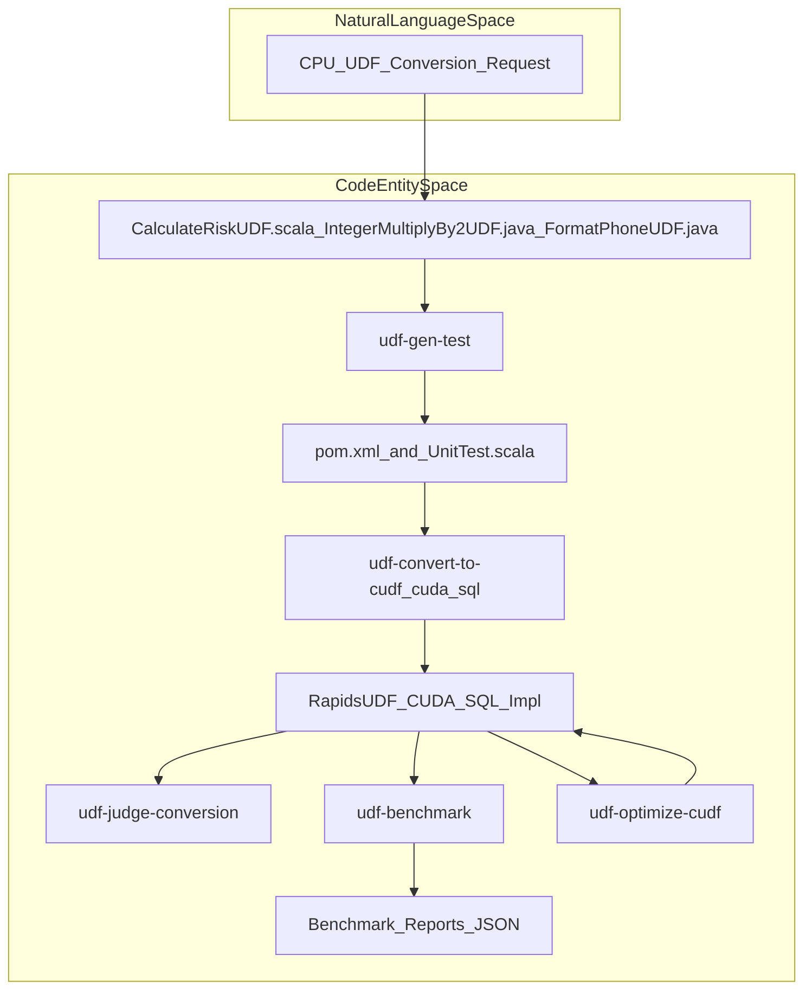
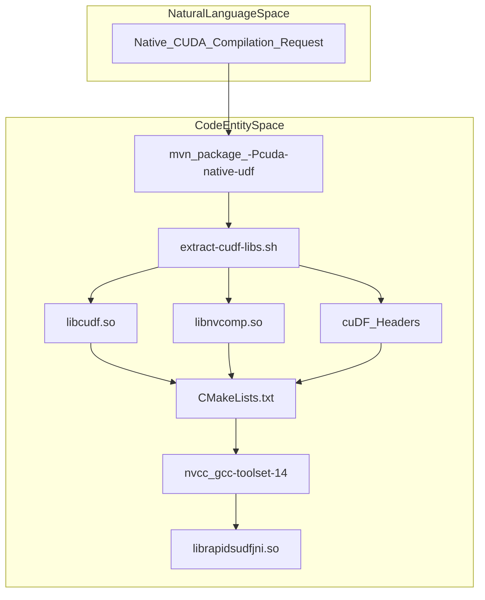
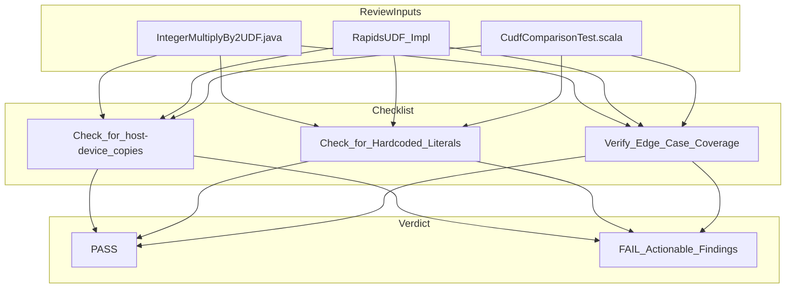

<!-- source: DeepWiki mcp.deepwiki.com · repo NVIDIA/cudf-spark · page 10.3 Aether Agent Skills for UDF Conversion · fetched 2026-10-26 -->

# Aether Agent Skills for UDF Conversion

<details>
<summary>Relevant source files</summary>

The following files were used as context for generating this wiki page:

- [.claude/CLAUDE.md](.claude/CLAUDE.md)
- [.claude/skills/build-and-test.md](.claude/skills/build-and-test.md)
- [.claude/skills/gpu-operator-patterns.md](.claude/skills/gpu-operator-patterns.md)
- [.github/CODEOWNERS](.github/CODEOWNERS)
- [.github/copilot-instructions.md](.github/copilot-instructions.md)
- [.greptile/config.json](.greptile/config.json)
- [.greptile/files.json](.greptile/files.json)
- [.greptile/rules.md](.greptile/rules.md)
- [AGENTS.md](AGENTS.md)
- [LICENSE](LICENSE)
- [NOTICE](NOTICE)
- [NOTICE-binary](NOTICE-binary)
- [skills/.gitignore](skills/.gitignore)
- [skills/examples/CalculateRiskUDF.scala](skills/examples/CalculateRiskUDF.scala)
- [skills/examples/FormatPhoneUDF.java](skills/examples/FormatPhoneUDF.java)
- [skills/examples/IntegerMultiplyBy2UDF.java](skills/examples/IntegerMultiplyBy2UDF.java)
- [skills/udf-benchmark/CUDF_MICROBENCHMARKS.md](skills/udf-benchmark/CUDF_MICROBENCHMARKS.md)

</details>


## Purpose and Scope

The `skills/` directory provides AI-agent skills designed for the RAPIDS Accelerator for Apache Spark (`cudf-spark`) to automate the conversion of CPU-bound User Defined Functions (UDFs) into GPU-accelerated implementations. The primary objective of these skills is to systematically translate row-based CPU UDF logic into columnar GPU operations using cuDF RapidsUDF, native CUDA kernels, or SQL expressions.

This comprehensive automation workflow covers generating test scaffolding, transpiling code, benchmarking, optimization, and automated code review with human-in-the-loop guidance. All agent interactions and outputs strictly adhere to repository-wide policies established in `AGENTS.md` and `.github/copilot-instructions.md`.

Sources: [AGENTS.md:1-27](), [.github/copilot-instructions.md:1-34]()

---

## Aether Agent Workflow

Aether Agent skills operate in a defined pipeline that begins with the input CPU UDF sources and culminates in the generation of optimized GPU-accelerated code artifacts, associated tests, and performance reports.

### Workflow Data Flow



- **Input CPU UDFs**: Representative sources like `CalculateRiskUDF.scala`, `IntegerMultiplyBy2UDF.java`, and `FormatPhoneUDF.java` serve as canonical inputs for conversion [skills/examples/CalculateRiskUDF.scala](), [skills/examples/IntegerMultiplyBy2UDF.java](), [skills/examples/FormatPhoneUDF.java]().

- **Test Generation (`udf-gen-test`)**: Automatically scaffold unit tests and sample data generators for UDF validation.

- **Build Project Structure**: Create a tailored Maven project (`pom.xml`) and Scala test classes to compile and run conversions and benchmarks.

- **GPU Conversion (`udf-convert-to-cudf_cuda_sql`)**: Transpile the CPU UDF business logic into equivalent GPU implementations targeting cuDF RapidsUDF interface, native CUDA, or Spark SQL expressions.

- **Conversion Judging (`udf-judge-conversion`)**: Automated review of generated GPU code for test coverage, CPU fallback risks, and memory efficiency.

- **Benchmarking**: Measure the performance of UDFs on GPUs using microbenchmarks and full Spark job runs, with results logged as structured JSON reports.

- **Optimization (`udf-optimize-cudf`)**: Iteratively improve cuDF-generated implementations for performance and resource usage, feeding back into GPU code generation.

Sources: [skills/examples/IntegerMultiplyBy2UDF.java](), [skills/examples/FormatPhoneUDF.java](), [skills/examples/CalculateRiskUDF.scala]()

---

## Skill Details

### 1. Test Generation (`udf-gen-test`)

This skill constructs a standalone Maven project with unit tests and synthetic data generation seed frameworks. It includes:

- A `pom.xml` template specifying dependencies on RAPIDS Accelerator for Spark, Scala, and Apache Spark versions, facilitating compilation and test execution.

- Code coverage instrumentation via the `jacoco-maven-plugin` and `scoverage-maven-plugin` for both Java and Scala coverage reports.

**Excerpt from** `skills/udf-gen-test/templates/scala/pom.xml`:
```xml
<dependency>
  <groupId>org.apache.spark</groupId>
  <artifactId>spark-core_2.12</artifactId>
  <version>${spark.version}</version>
</dependency>
<plugin>
  <groupId>org.jacoco</groupId>
  <artifactId>jacoco-maven-plugin</artifactId>
  <version>0.8.7</version>
  <executions>...</executions>
</plugin>
```

This structure enables automatic test generation and integration into CI workflows for new UDFs.

Sources: [skills/udf-gen-test/templates/scala/pom.xml:10-102]()

---

### 2. Conversion Skills

The agent supports three GPU implementation targets for UDFs:

- **SQL Expression Transpilation**  
  Converts UDF logic to Catalyst-compatible SQL expressions executed on GPU.

- **cuDF RapidsUDF Implementation**  
  Generates implementations of the RapidsUDF interface. It maps Spark SQL types to cuDF types (e.g., `StringType` → `STRING`, `DecimalType` → `DECIMAL128`). This interface allows columnar batch processing on GPU.

- **Native CUDA Kernel Generation**  
  Emits C++/CUDA code for maximal performance. 

##### Native CUDA Build Environment

Key components enabling native CUDA UDF builds:

- `extract-cudf-libs.sh` script: Extracts GPU shared libraries `libcudf.so`, `libnvcomp.so` from the RAPIDS jar package, and prepares headers from the GitHub cudf repository.

- `CMakeLists.txt`: Defines the build configuration, linking extracted libraries and including cuDF headers.

- `Dockerfile`: Configures the native build environment using specific CUDA and compiler toolset versions.

**Diagram: Native CUDA UDF Build Pipeline**



Sources: [skills/udf-convert-to-cuda/templates/cuda/native/scripts/extract-cudf-libs.sh:21-69](), [skills/udf-convert-to-cuda/templates/cuda/native/src/main/cpp/CMakeLists.txt:4-37](), [skills/udf-convert-to-cuda/templates/cuda/Dockerfile:9-16]()

---

### 3. Conversion Judging (`udf-judge-conversion`)

This skill performs automated code review of generated GPU implementations to ensure:

- **CPU Fallback Risk**: Detects conditions likely to cause fallback to CPU execution.

- **Memory Safety**: Checks for excessive or unnecessary host-device copies and ensures proper resource management.

- **Test Coverage Adequacy**: Verifies presence of edge case tests and reasonable functional validation.

**Diagram: Judge Skill Logic**



Sources: [skills/examples/IntegerMultiplyBy2UDF.java]()

---

### 4. Benchmarking

Benchmarking provides quantitative performance analysis in two modes:

- **SparkBenchRunner**: Executes full Spark cluster jobs measuring end-to-end UDF performance.

- **MicroBenchRunner**: Runs isolated GPU kernel benchmarks directly on/cuDF buffers to assess raw GPU throughput excluding Spark overhead.

The benchmarking system advises using large data (≥1GB) to ensure stable performance measurements and supports generating JSON reports for detailed analysis.

Sources: [skills/udf-benchmark/CUDF_MICROBENCHMARKS.md:1-30]()

---

### 5. Continuous Integration (`ci/`)

The `ci/pre-merge.sh` script automates environment setup, unit test execution, and integration verification in a controlled containerized environment to ensure quality of generated GPU UDF artifacts before merging.

Sources: [skills/ci/pre-merge.sh:21-53]()

---

## Version Management

Consistency in Apache Spark, Scala, and RAPIDS library versions across generated projects is enforced through template variables in:

| File Path | Purpose |
|-----------|---------|
| `skills/udf-gen-test/templates/scala/pom.xml` | Defines Scala and Spark dependencies for test projects. |
| `skills/udf-convert-to-cuda/templates/cuda/Dockerfile` | Specifies CUDA and compiler toolset versions for native builds. |
| `skills/udf-convert-to-cuda/templates/cuda/native/scripts/extract-cudf-libs.sh` | Configures Scala and RAPIDS4Spark versions for library extraction. |

This strict version pinning avoids build conflicts and runtime incompatibilities.

Sources: [skills/udf-gen-test/templates/scala/pom.xml:23-34](), [skills/udf-convert-to-cuda/templates/cuda/Dockerfile:6-15](), [skills/udf-convert-to-cuda/templates/cuda/native/scripts/extract-cudf-libs.sh:14-17]()

---

## Safety and Best Practices for Agents

AI agents operate with strict policies designed to maintain code quality and performance guarantees during automated UDF conversions:

- **Resource Management**:  
  All GPU memory and CUDA resource lifecycles must be managed through `withResource` or `closeOnExcept` wrappers as defined in `Arm.scala`. Bare `.close()` calls on GPU resources are forbidden to prevent leaks [AGENTS.md:20-20]().

- **OOM Retry Pattern**:  
  GPU memory allocations must be enclosed within `withRetry` or `withRetryNoSplit` from the `RmmRapidsRetryIterator.scala` to safely handle out-of-memory conditions with idempotent retries. This is further detailed in the `.greptile/config.json` rules [AGENTS.md:45-48](), [.greptile/config.json:22-25]().

- **Shim Consistency**:  
  Changes to GPU operators or expression implementations must be replicated across all Spark version shim directories under `sql-plugin/src/main/spark*` to maintain compatibility [AGENTS.md:21-21](). The `.greptile/config.json` also enforces this with a high-severity rule [/.greptile/config.json:71-75]().

- **Pull Request Etiquette**:  
  AI-assisted code modifications require human code review and proper PR documentation per repo policies described in `AGENTS.md` and `.github/copilot-instructions.md` [AGENTS.md:13-26](), [.github/copilot-instructions.md:18-34]().

These safeguards ensure the GPU acceleration plugin remains reliable, maintainable, and performant when automated agents contribute code.

Sources: [AGENTS.md:15-27](), [.github/copilot-instructions.md:18-34](), [AGENTS.md:20-21, 45-48](), [.greptile/config.json:22-25, 71-75]()

---

# Appendix: Project Structure for Skills Agent

```
spark-rapids/
├── skills/
│   ├── examples/                 # Sample CPU UDFs for conversion (Java/Scala)
│   │   ├── CalculateRiskUDF.scala
│   │   ├── IntegerMultiplyBy2UDF.java
│   │   └── FormatPhoneUDF.java
│   ├── udf-gen-test/             # Test generation templates & logic
│   ├── udf-convert-to-cuda/      # CUDA native build tooling and templates
│   ├── udf-judge-conversion/     # Automated judge AI skill for review
│   ├── udf-benchmark/            # Benchmarking configs & runners
│   ├── udf-optimize-cudf/        # Optimization pipelines
│   └── ci/                      # Pre-merge verification scripts
│
```

This organization supports modular skill execution and easier extension for future targets and improvements.

---

# Summary

The Aether Agent Skills in the `skills/` directory enable automated, end-to-end conversion of CPU UDFs into performant GPU implementations using RAPIDS Accelerator for Apache Spark. Through coordinated steps of test generation, conversion, judgment, benchmarking, and optimization—while following strict safety and repository policies—these skills accelerate development and validation of GPU-enabled UDFs. The system supports multiple GPU target platforms including cuDF RapidsUDF, native CUDA kernels, and Catalyst SQL expressions, backed by fully automated build and test projects. 

This pipeline enhances developer productivity and assures compliance with the RAPIDS Spark plugin architecture and GPU resource management best practices.

Sources:  
[AGENTS.md:1-27](), [.github/copilot-instructions.md:1-34](),  
[skills/examples/IntegerMultiplyBy2UDF.java](), [skills/examples/CalculateRiskUDF.scala](), [skills/examples/FormatPhoneUDF.java](),  
[skills/udf-gen-test/templates/scala/pom.xml:10-102](), [skills/udf-convert-to-cuda/templates/cuda/native/scripts/extract-cudf-libs.sh:21-69](), [skills/udf-convert-to-cuda/templates/cuda/native/src/main/cpp/CMakeLists.txt:4-37](), [skills/udf-benchmark/CUDF_MICROBENCHMARKS.md:1-30](), [skills/ci/pre-merge.sh:21-53]()

---

