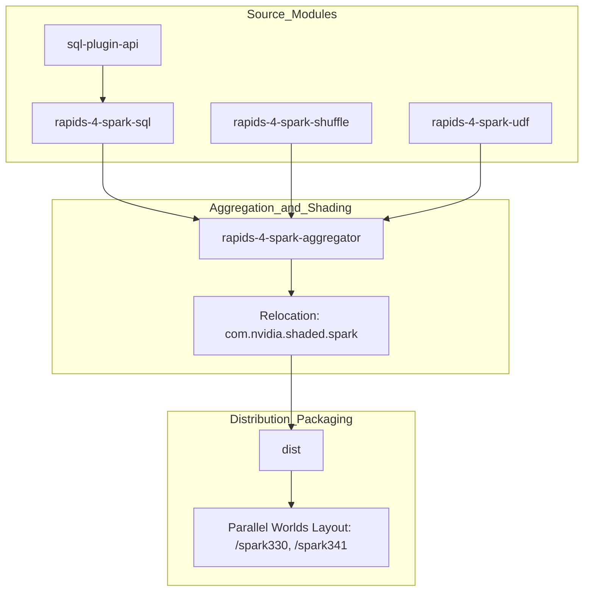
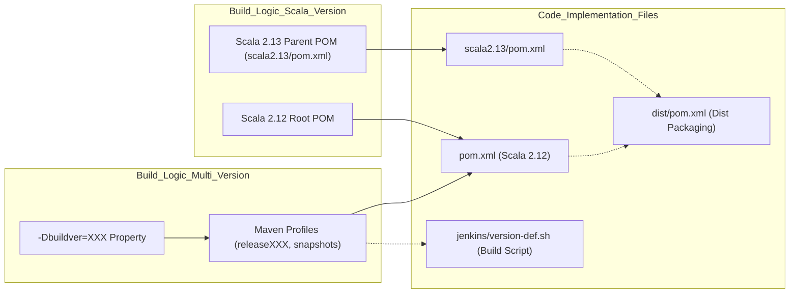

<!-- source: DeepWiki mcp.deepwiki.com · repo NVIDIA/cudf-spark · page 11 Build System & Multi-Version Packaging · fetched 2026-10-26 -->

# Build System & Multi-Version Packaging

Relevant source files

The following files were used as context for generating this wiki page:

- [aggregator/pom.xml](aggregator/pom.xml)
- [api_validation/pom.xml](api_validation/pom.xml)
- [dist/README.md](dist/README.md)
- [dist/build/iceberg_runtime.py](dist/build/iceberg_runtime.py)
- [dist/build/package-parallel-worlds.py](dist/build/package-parallel-worlds.py)
- [dist/maven-antrun/build-parallel-worlds.xml](dist/maven-antrun/build-parallel-worlds.xml)
- [dist/pom.xml](dist/pom.xml)
- [dist/scripts/binary-dedupe.sh](dist/scripts/binary-dedupe.sh)
- [dist/scripts/check-iceberg-package-private-access.py](dist/scripts/check-iceberg-package-private-access.py)
- [dist/scripts/check-shims-revisions.sh](dist/scripts/check-shims-revisions.sh)
- [dist/scripts/tests/test_check_iceberg_package_private_access.py](dist/scripts/tests/test_check_iceberg_package_private_access.py)
- [dist/unshimmed-common-from-single-shim.txt](dist/unshimmed-common-from-single-shim.txt)
- [iceberg-common/pom.xml](iceberg-common/pom.xml)
- [iceberg-common/src/main/java/org/apache/iceberg/spark/source/GpuSparkWriteAccess.java](iceberg-common/src/main/java/org/apache/iceberg/spark/source/GpuSparkWriteAccess.java)
- [iceberg-common/src/main/spark350/scala/com/nvidia/spark/rapids/iceberg/parquet/converter/FromIcebergShaded.scala](iceberg-common/src/main/spark350/scala/com/nvidia/spark/rapids/iceberg/parquet/converter/FromIcebergShaded.scala)
- [iceberg-common/src/main/spark350/scala/com/nvidia/spark/rapids/iceberg/parquet/converter/ToIcebergShaded.scala](iceberg-common/src/main/spark350/scala/com/nvidia/spark/rapids/iceberg/parquet/converter/ToIcebergShaded.scala)
- [iceberg/common/src/main/scala/org/apache/iceberg/spark/source/GpuSparkPositionDeltaWrite.scala](iceberg/common/src/main/scala/org/apache/iceberg/spark/source/GpuSparkPositionDeltaWrite.scala)
- [iceberg/common/src/main/scala/org/apache/iceberg/spark/source/GpuSparkWrite.scala](iceberg/common/src/main/scala/org/apache/iceberg/spark/source/GpuSparkWrite.scala)
- [integration_tests/pom.xml](integration_tests/pom.xml)
- [jenkins/databricks/init_cudf_udf.sh](jenkins/databricks/init_cudf_udf.sh)
- [jenkins/version-def.sh](jenkins/version-def.sh)
- [pom.xml](pom.xml)
- [scala2.13/aggregator/pom.xml](scala2.13/aggregator/pom.xml)
- [scala2.13/dist/pom.xml](scala2.13/dist/pom.xml)
- [scala2.13/iceberg-common/pom.xml](scala2.13/iceberg-common/pom.xml)
- [scala2.13/pom.xml](scala2.13/pom.xml)
- [scala2.13/shuffle-plugin/pom.xml](scala2.13/shuffle-plugin/pom.xml)
- [scala2.13/sql-plugin/pom.xml](scala2.13/sql-plugin/pom.xml)
- [scala2.13/tests/pom.xml](scala2.13/tests/pom.xml)
- [scala2.13/udf-compiler/pom.xml](scala2.13/udf-compiler/pom.xml)
- [shuffle-plugin/pom.xml](shuffle-plugin/pom.xml)
- [sql-plugin/pom.xml](sql-plugin/pom.xml)
- [tests/pom.xml](tests/pom.xml)
- [udf-compiler/pom.xml](udf-compiler/pom.xml)

The purpose of this page is to provide a high-level overview of the Maven-based multi-module build system for the RAPIDS Accelerator for Apache Spark. The build system supports a broad matrix of Spark versions, Scala versions (2.12 and 2.13), and hardware environments by producing a single distribution JAR containing optimized "parallel worlds" for different Spark shims.

For deep technical details, please refer to the child pages:
- [Maven Build Configuration & Profiles](#11.1)
- [CI/CD Pipelines & Jenkins Automation](#11.2)

---

## Multi-Module Architecture

The codebase is organized into modular Maven projects managed by root parent POM files: one for Scala 2.12 in the root `pom.xml`, and one for Scala 2.13 under `scala2.13/pom.xml` [pom.xml:22-82](), [scala2.13/pom.xml:22-82]().

### Key Build Modules
- **`sql-plugin-api`**: Defines the stable public API surface including `ShimLoader` and shared interfaces [pom.xml:71]().
- **`sql-plugin`**: Hosts the main GPU-accelerated Spark SQL plugin implementation [pom.xml:76]().
- **`aggregator`**: Shades third-party dependencies (such as FlatBuffers, RoaringBitmap) and aggregates sub-module artifacts [aggregator/pom.xml:28-31](), [aggregator/pom.xml:39-40]().
- **`dist`**: Assembles the final multi-version distribution JAR with a parallel-worlds layout [dist/pom.xml:28-30]().
- **`shim-deps`**: Contains shared dependencies across Spark distributions [pom.xml:81]().
- **`udf-compiler`**: Supports Scala/Java UDF transpilation [udf-compiler/pom.xml:27-30]().
- **`shuffle-plugin`**: Implements the GPU shuffle manager and UCX integration [shuffle-plugin/pom.xml:27-30]().

*Figure 1: Module dependency and packaging flow from source modules through aggregation/shading into the final multi-version distribution.*

Sources: [pom.xml:64-82](), [aggregator/pom.xml:39-40](), [dist/pom.xml:28-30](), [sql-plugin/pom.xml:59-68]()

---

## Multi-Version Packaging & Parallel Worlds Layout

To support multiple Spark versions simultaneously in a single JAR, the build creates a "parallel worlds" JAR layout:
1. **Version-Specific Builds**: Each Spark version is built separately using Maven profiles triggered by `-Dbuildver=XXX` [pom.xml:85-117]().
2. **Aggregation & Shading**: The `aggregator` module shades third-party packages to prevent classpath collisions [aggregator/pom.xml:39-147]().
3. **Deduplication & Final Packaging**: The `dist` module merges version artifacts into subdirectories like `/spark330/`, removing duplicate `.class` files using helper scripts [dist/pom.xml:28-40](), [tests/pom.xml:78-89]().

For further details on profiles and build scripts, see [Maven Build Configuration & Profiles](#11.1).

Sources: [pom.xml:85-117](), [aggregator/pom.xml:39-147](), [dist/pom.xml:28-40]()

---

## Scala 2.12 and 2.13 Multi-Version Support

The project supports building against both Scala 2.12 and 2.13 via parallel Maven configurations:
- **Scala 2.12** is built from the root `pom.xml` with `_2.12` module artifact suffixes [pom.xml:22-27]().
- **Scala 2.13** is built from `scala2.13/pom.xml` with `_2.13` module artifact suffixes [scala2.13/pom.xml:22-27]().

Each Scala track maintains its own aggregator and distribution modules [scala2.13/aggregator/pom.xml](), [scala2.13/dist/pom.xml:28-31]().

Sources: [pom.xml:22-27](), [scala2.13/pom.xml:22-27](), [scala2.13/aggregator/pom.xml](), [scala2.13/dist/pom.xml:28-31]()

---

## Build Tooling, Profiles & Supporting Scripts

- **Maven Profiles** control module inclusion and set version-specific properties (`release330`, `databricks`, etc.) [pom.xml:83-118](), [dist/pom.xml:58-94]().
- **`jenkins/version-def.sh`** sets environment variables and parses Maven profiles to generate arrays of supported build versions [jenkins/version-def.sh:53-78]().
- **Environment Scripts** like `jenkins/databricks/init_cudf_udf.sh` configure cloud testing environments [jenkins/databricks/init_cudf_udf.sh:23-56]().

For full details, see [Maven Build Configuration & Profiles](#11.1).

Sources: [pom.xml:83-118](), [dist/pom.xml:58-94](), [jenkins/version-def.sh:53-78](), [jenkins/databricks/init_cudf_udf.sh:23-56]()

---

## CI/CD Automation Overview

- **Pre-Merge Pipelines** selectively run unit and integration tests per Spark version profile [dist/pom.xml:95-125]().
- **Nightly Builds** execute comprehensive test suites across all supported shims.

For detailed pipeline steps, see [CI/CD Pipelines & Jenkins Automation](#11.2).

Sources: [dist/pom.xml:58-125]()

---

## Build System to Codebase Mapping

*Figure 2: Mapping build system properties and profiles to root POMs and configuration scripts.*

| Component                 | Responsibility                                               | Main Files & Scripts                         |
|---------------------------|--------------------------------------------------------------|----------------------------------------------|
| **Parent POM (2.12)**     | Defines modules, dependencies, and Spark version profiles    | [pom.xml:22-82]()                             |
| **Scala 2.13 Parent POM** | Mirrors 2.12 for Scala 2.13 support                          | [scala2.13/pom.xml:22-82]()                   |
| **Distribution Module**   | Assembles the final multi-version parallel-worlds JAR        | [dist/pom.xml:28-57]()                         |
| **Aggregator Module**     | Shades and aggregates core modules & dependencies             | [aggregator/pom.xml:28-49]()                   |
| **Build Version Scripts** | Dynamically set Spark shim versions for build and tests       | [jenkins/version-def.sh:53-78]()               |

Sources: [pom.xml:22-82](), [scala2.13/pom.xml:22-82](), [dist/pom.xml:28-57](), [aggregator/pom.xml:28-49](), [jenkins/version-def.sh:53-78]()

---

For comprehensive build instructions and CI setup, consult:
- [Maven Build Configuration & Profiles](#11.1)
- [CI/CD Pipelines & Jenkins Automation](#11.2)

---

