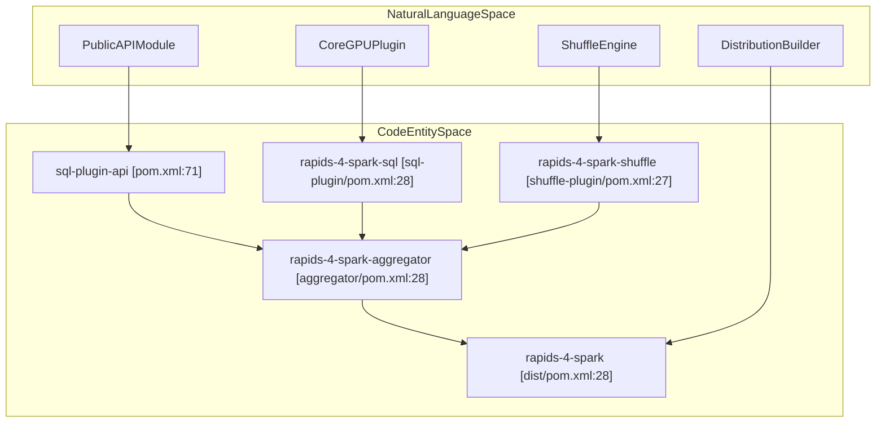
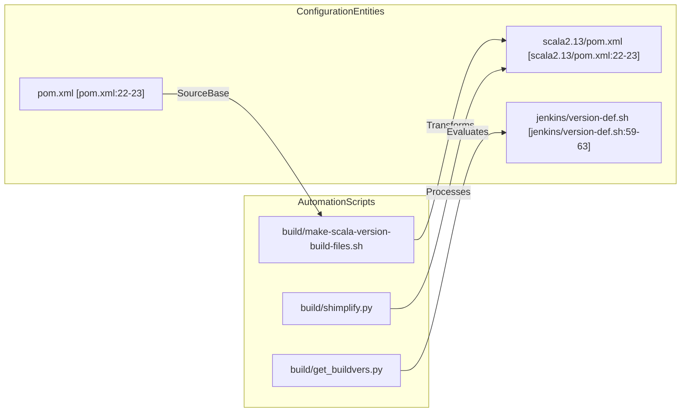
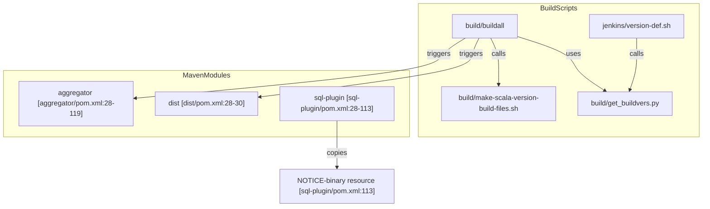

<!-- source: DeepWiki mcp.deepwiki.com · repo NVIDIA/cudf-spark · page 11.1 Maven Build Configuration & Profiles · fetched 2026-10-26 -->

# Maven Build Configuration & Profiles

<details>
<summary>Relevant source files</summary>

The following files were used as context for generating this wiki page:

- [.github/workflows/mvn-verify-check/populate-daily-cache.sh](.github/workflows/mvn-verify-check/populate-daily-cache.sh)
- [.github/workflows/shell-check.yml](.github/workflows/shell-check.yml)
- [.gitignore](.gitignore)
- [aggregator/pom.xml](aggregator/pom.xml)
- [api_validation/pom.xml](api_validation/pom.xml)
- [build/coverage-report](build/coverage-report)
- [build/dyn_shim_detection.py](build/dyn_shim_detection.py)
- [build/get_buildvers.py](build/get_buildvers.py)
- [build/make-scala-version-build-files.sh](build/make-scala-version-build-files.sh)
- [build/shimplify.py](build/shimplify.py)
- [datagen/pom.xml](datagen/pom.xml)
- [dist/keep-in-spark-shared.txt](dist/keep-in-spark-shared.txt)
- [dist/pom.xml](dist/pom.xml)
- [dist/scripts/analyze-parallel-world-deps.py](dist/scripts/analyze-parallel-world-deps.py)
- [docs/dev/README.md](docs/dev/README.md)
- [docs/dev/compute_sanitizer.md](docs/dev/compute_sanitizer.md)
- [docs/dev/nvtx_profiling.md](docs/dev/nvtx_profiling.md)
- [docs/dev/parallel-world-unshimming.md](docs/dev/parallel-world-unshimming.md)
- [docs/dev/shimplify.md](docs/dev/shimplify.md)
- [integration_tests/pom.xml](integration_tests/pom.xml)
- [jenkins/databricks/cudf_udf_test.sh](jenkins/databricks/cudf_udf_test.sh)
- [jenkins/databricks/init_cudf_udf.sh](jenkins/databricks/init_cudf_udf.sh)
- [jenkins/dependency-check.sh](jenkins/dependency-check.sh)
- [jenkins/version-def.sh](jenkins/version-def.sh)
- [pom.xml](pom.xml)
- [scala2.13/aggregator/pom.xml](scala2.13/aggregator/pom.xml)
- [scala2.13/datagen/pom.xml](scala2.13/datagen/pom.xml)
- [scala2.13/dist/pom.xml](scala2.13/dist/pom.xml)
- [scala2.13/integration_tests/pom.xml](scala2.13/integration_tests/pom.xml)
- [scala2.13/pom.xml](scala2.13/pom.xml)
- [scala2.13/shim-deps/databricks/pom.xml](scala2.13/shim-deps/databricks/pom.xml)
- [scala2.13/shim-deps/pom.xml](scala2.13/shim-deps/pom.xml)
- [scala2.13/shuffle-plugin/pom.xml](scala2.13/shuffle-plugin/pom.xml)
- [scala2.13/sql-plugin/pom.xml](scala2.13/sql-plugin/pom.xml)
- [scala2.13/tests/pom.xml](scala2.13/tests/pom.xml)
- [scala2.13/udf-compiler/pom.xml](scala2.13/udf-compiler/pom.xml)
- [scalastyle-config.xml](scalastyle-config.xml)
- [shim-deps/databricks/pom.xml](shim-deps/databricks/pom.xml)
- [shim-deps/pom.xml](shim-deps/pom.xml)
- [shuffle-plugin/pom.xml](shuffle-plugin/pom.xml)
- [sql-plugin/pom.xml](sql-plugin/pom.xml)
- [sql-plugin/src/main/scala/com/nvidia/spark/rapids/dataSourceUtil.scala](sql-plugin/src/main/scala/com/nvidia/spark/rapids/dataSourceUtil.scala)
- [sql-plugin/src/main/scala/com/nvidia/spark/rapids/shims/GpuDataSourceRDD.scala](sql-plugin/src/main/scala/com/nvidia/spark/rapids/shims/GpuDataSourceRDD.scala)
- [sql-plugin/src/main/spark350db143/scala/com/nvidia/spark/rapids/shims/Spark40GpuDataSourceCustomMetrics.scala](sql-plugin/src/main/spark350db143/scala/com/nvidia/spark/rapids/shims/Spark40GpuDataSourceCustomMetrics.scala)
- [sql-plugin/src/main/spark412/scala/com/nvidia/spark/rapids/shims/Spark4GpuDataSourceCustomMetrics.scala](sql-plugin/src/main/spark412/scala/com/nvidia/spark/rapids/shims/Spark4GpuDataSourceCustomMetrics.scala)
- [sql-plugin/src/main/spark420/scala/com/nvidia/spark/rapids/shims/GpuBatchScanExec.scala](sql-plugin/src/main/spark420/scala/com/nvidia/spark/rapids/shims/GpuBatchScanExec.scala)
- [sql-plugin/src/main/spark420/scala/com/nvidia/spark/rapids/shims/Spark42GpuDataSourceCustomMetrics.scala](sql-plugin/src/main/spark420/scala/com/nvidia/spark/rapids/shims/Spark42GpuDataSourceCustomMetrics.scala)
- [sql-plugin/src/main/spark500/scala/com/nvidia/spark/rapids/shims/GpuBatchScanExec.scala](sql-plugin/src/main/spark500/scala/com/nvidia/spark/rapids/shims/GpuBatchScanExec.scala)
- [tests/pom.xml](tests/pom.xml)
- [tests/src/test/scala/com/nvidia/spark/rapids/FileSystemBytesReadTrackerSuite.scala](tests/src/test/scala/com/nvidia/spark/rapids/FileSystemBytesReadTrackerSuite.scala)
- [tests/src/test/spark400/scala/com/nvidia/spark/rapids/MissingFileStructuredErrorSuite.scala](tests/src/test/spark400/scala/com/nvidia/spark/rapids/MissingFileStructuredErrorSuite.scala)
- [tests/src/test/spark500/scala/com/nvidia/spark/rapids/shims/GpuBatchScanExecCanonicalizeSuite.scala](tests/src/test/spark500/scala/com/nvidia/spark/rapids/shims/GpuBatchScanExecCanonicalizeSuite.scala)
- [udf-compiler/pom.xml](udf-compiler/pom.xml)

</details>


This page details the Maven-based build system for the RAPIDS Accelerator for Apache Spark. The project utilizes a multi-module Maven structure designed to support multiple Apache Spark versions, Scala versions (2.12 and 2.13), and various deployment environments (e.g., Databricks) from a single codebase.

## Purpose & Scope
The build infrastructure coordinates cross-version compilation, dependency shading, parallel-worlds packaging, and test orchestration. This page covers the root `pom.xml`, sub-module hierarchies, Maven profiles, the `shim-deps` configuration, build automation scripts (`build/buildall`, `build/make-scala-version-build-files.sh`, `build/shimplify.py`), and static analysis rules (`scalastyle-config.xml`).

Sources: [pom.xml:17-82](), [jenkins/version-def.sh:1-130]()

---

## Project Structure and Modules

The build is centered around a root `pom.xml` that manages shared dependencies, plugin configurations, and the sub-module hierarchy [pom.xml:17-82]().

### Module Hierarchy

| Module | Purpose | Citation |
| :--- | :--- | :--- |
| `sql-plugin-api` | Stable public APIs and shim loader logic | [pom.xml:71]() |
| `sql-plugin` | Core GPU expression and operator implementations | [pom.xml:76]() |
| `shuffle-plugin` | UCX-based and columnar shuffle implementations | [pom.xml:69]() |
| `shim-deps` | Manages Spark-version-specific dependencies for shims | [pom.xml:81]() |
| `aggregator` | Shades and combines internal modules into a single package | [pom.xml:65]() |
| `dist` | Final distribution module that produces the parallel-worlds JAR | [dist/pom.xml:28-30]() |
| `tests` | Scala unit and integration tests | [pom.xml:77]() |
| `integration_tests` | PySpark-based integration tests | [pom.xml:68]() |
| `udf-compiler` | Bytecode transpiler for Scala/Java UDFs | [pom.xml:79]() |
| `tools` | Support for generating configuration documentation and supported operators | [pom.xml:78]() |

### Build Flow Diagram (Natural Language to Code Entity Space)

The following diagram bridges conceptual build steps to specific Maven module entities and POM configuration paths.


Sources: [pom.xml:64-82](), [dist/pom.xml:28-40](), [aggregator/pom.xml:50-119](), [sql-plugin/pom.xml:28-28](), [shuffle-plugin/pom.xml:27-27]()

---

## Maven Profiles and Build Versions

The build system uses the `buildver` property to target specific Spark versions. Each version is associated with a Maven profile in the root POM that sets the `spark.version` and relevant shim dependencies. Profiles activate by setting `-Dbuildver=<version>`.

### Major Profiles in Root POM

* `release330`: Default active profile, setting Spark to 3.3.0, enabling compatible delta-lake and iceberg modules [pom.xml:85-117]()
* `release331`: For Spark 3.3.1 builds [pom.xml:120-142]()
* `release332`: For Spark 3.3.2 builds [pom.xml:144-164]()

Each profile defines:
- `spark.version` and `spark.test.version` properties
- Delta Lake artifact module IDs selected for that build
- Additional Maven modules for the delta-lake and iceberg shims to compile and package with this build [pom.xml:85-117]().

### Distribution Profiles in `dist` Module

The `dist` module uses Maven profiles to select which shim versions to include in the final aggregated parallel-worlds JAR.

| Profile | Description | Included Spark Shim Versions | Citation |
| --------|-------------|------------------------------| -------- |
| `noSnapshotsWithDatabricks` | Includes noSnapshots versions plus Databricks shims | Managed by `dyn.shim.buildver` property | [dist/pom.xml:59-65]() |
| `snapshotsWithDatabricks` | Includes snapshots plus Databricks shims | Managed by `dyn.shim.buildver` property | [dist/pom.xml:66-72]() |
| `noSnapshots` | Only stable, no-snapshot builds | Managed by `dyn.shim.buildver` property | [dist/pom.xml:73-79]() |
| `snapshots` | Snapshot versions only | Managed by `dyn.shim.buildver` property | [dist/pom.xml:80-86]() |
| `databricks` | Special Databricks shim builds | Uses `dyn.shim.buildver=databricks` | [dist/pom.xml:87-93]() |
| `premerge*` profiles | For CI and pre-merge test balancing, dividing builds into subsets | Uses `included_buildvers` properties | [dist/pom.xml:94-130]() |
| `minimumFeatureVersionMix` | A sampled set of Spark shims for minimal build verification | Includes 3.3.0 shim | [dist/pom.xml:165-172]() |

These profiles control which parallel Spark shims and corresponding shim-dependent modules are included in the shaded, aggregated JAR.

Sources: [pom.xml:83-171](), [dist/pom.xml:57-180]()

---

## Shim Dependencies (`shim-deps`)

The `shim-deps` module is designed as an intermediate Maven parent POM managing Spark-version-specific dependencies and repositories. It isolates version-dependent Spark distributions from the common plugin code, enabling clean dependency boundaries for shim builds [sql-plugin/pom.xml:22-27]().

Modules such as `sql-plugin`, `shuffle-plugin`, `udf-compiler`, and `tests` inherit from `rapids-4-spark-shim-deps-parent_2.12` or its Scala 2.13 counterpart, ensuring each module binds against the correct Spark and Scala versions [sql-plugin/pom.xml:22-27](), [shuffle-plugin/pom.xml:21-26](), [udf-compiler/pom.xml:21-26](), [tests/pom.xml:22-27]().

In this configuration, the `shim-deps` POM acts as a virtual boundary where the specific Spark version dependencies are injected via Maven profiles. This modular approach simplifies supporting multiple Spark versions with minimal code changes.

Sources: [sql-plugin/pom.xml:22-27](), [shuffle-plugin/pom.xml:21-26](), [udf-compiler/pom.xml:21-26](), [tests/pom.xml:22-27]()

---

## Scala Multi-Version Support & Translation Tools

Supporting both Scala 2.12 and 2.13 requires parallel source trees and Maven artifact adjustments.

- The root build artifacts default to Scala 2.12 (artifact IDs suffixed `_2.12`) [pom.xml:22-23]().
- Scala 2.13 is supported under the `scala2.13/` directory, with its own root `pom.xml` that adapts artifact suffixes and dependencies [scala2.13/pom.xml:22-23]().

Since Maven cannot seamlessly cross-compile different source root directories, a dedicated tool chain generates Scala 2.13 variant files from the Scala 2.12 definitions.

### `make-scala-version-build-files.sh`

This script automates the creation of Scala 2.13 `pom.xml` files and related build files by transforming Scala 2.12-based files.

- It adjusts artifact suffixes from `_2.12` to `_2.13`.
- Handles version differences and profile conditionals marked with `#if scala-2.12` and `#if scala-2.13` within the POM files.
- Keeps the two Scala version builds in sync without manual duplication.

### `shimplify.py`

This Python script complements the Scala version switch by processing POM files and shim dependency configurations.

- It simplifies or expands shim dependency references based on the target build version.
- Interprets conditional directives to produce finalized POMs suitable for each Scala version and Spark shim combination.

### Translation & Script Entity Mapping



Sources: [scala2.13/pom.xml:23](), [pom.xml:23](), [build/make-scala-version-build-files.sh](), [build/shimplify.py](), [jenkins/version-def.sh:59-63]()

---

## Tooling, Scripts & Aggregation

### `build/buildall`

This script functions as the main developer entry point for building the plugin with all targeted Spark shims.

- It orchestrates the build of individual Spark shims according to profiles.
- Packages and installs each shim JAR into the local Maven repository.
- Finally, it triggers the aggregation and distribution packaging (`dist` module) to build the parallel-worlds JAR with multiple shim support [dist/pom.xml:28-30]().

### Version Metadata & Shim Arrays

The shell script `jenkins/version-def.sh` provides an environment setup for Jenkins CI:

- Defines default CUDA, Scala, and Spark versions.
- Dynamically extracts arrays of supported Spark shim versions by querying Maven profile properties.
- Maps these arrays to environment variables like `SPARK_SHIM_VERSIONS_SNAPSHOTS` and `SPARK_SHIM_VERSIONS_NOSNAPSHOTS` for build orchestration [jenkins/version-def.sh:18-130]().

This mechanization ensures CI workflows and local builds stay consistent with declared versions in POM profiles.

### Aggregation and Shading (`aggregator` module)

The `aggregator` module aggregates code from several submodules:

- It shades internal dependencies (like ASM relocated Spark packages, RoaringBitmap, FlatBuffers).
- It resolves version conflicts and packages all combined classes into a single fat JAR for deployment.
- Aggregated dependencies include all shimmed delta-lake and Iceberg modules, as well as the core SQL plugin and shuffle plugin modules [aggregator/pom.xml:22-119]().

### Build Automation Entity Relationship



Sources: [aggregator/pom.xml:28-119](), [dist/pom.xml:28-30](), [sql-plugin/pom.xml:28-113](), [jenkins/version-def.sh]()

---

## Scalastyle & Code Quality Checks

The project enforces Scala code style rules via `scalastyle-maven-plugin`. The configuration is declared in `scalastyle-config.xml`, covering formatting, naming conventions, and static code quality checks.

- The scalastyle checks are configured as Maven plugin executions during the build lifecycle, typically in the `compile` or `package` phase.
- This ensures consistent code formatting and quality before artifact packaging.

Sources: [scalastyle-config.xml](), [sql-plugin/pom.xml:140-141]()

---

## Build Execution Examples

### Building for a Single Spark Version

To build the plugin targeting Spark 3.3.0 (via profile `release330`):

```bash
mvn -Dbuildver=330 clean verify
```

This builds the plugin and all related modules for Spark 3.3.0 with Scala 2.12.

### Building a Multi-Version Distribution

A typical workflow for generating a distribution JAR that bundles multiple Spark shims:

1. Install each Spark shim version individually:
```bash
mvn -Dbuildver=330 install -DskipTests
mvn -Dbuildver=331 install -DskipTests
```

2. Package the `dist` module with a profile that selects included versions:
```bash
mvn -pl dist -PnoSnapshots package -DskipTests
```

This sequence builds separate shim versions and aggregates them into a single parallel-worlds JAR for deployment.

Sources: [dist/pom.xml:73-85]()

---

