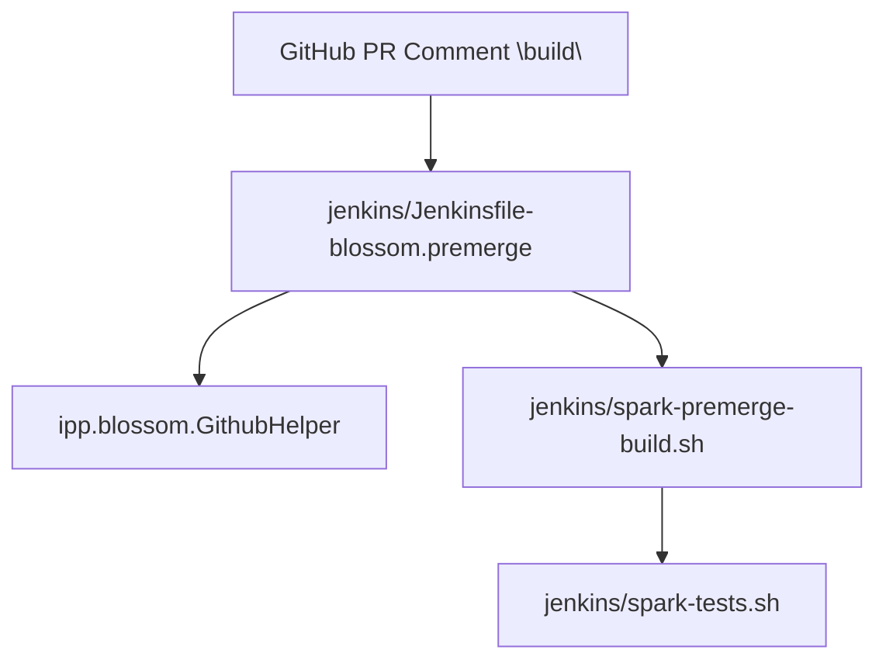
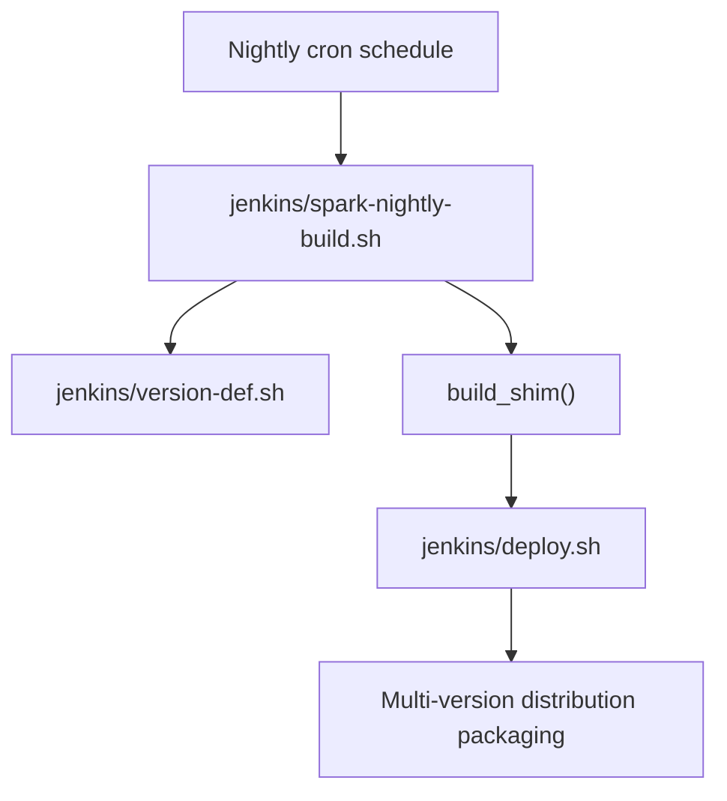
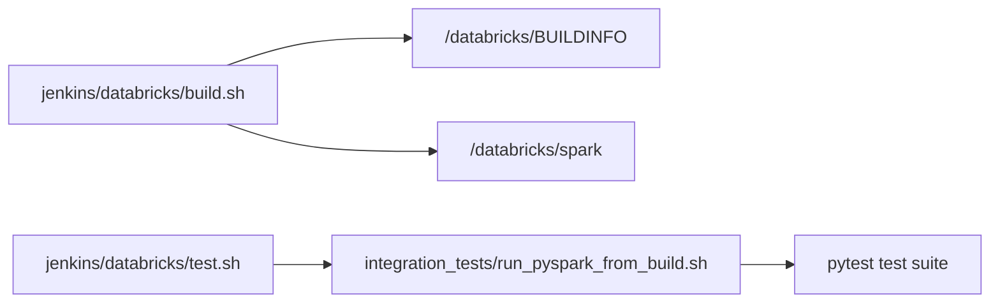
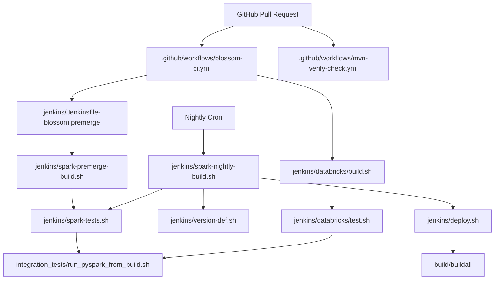

<!-- source: DeepWiki mcp.deepwiki.com · repo NVIDIA/cudf-spark · page 11.2 CI/CD Pipelines & Jenkins Automation · fetched 2026-10-26 -->

# CI/CD Pipelines & Jenkins Automation

Relevant source files

The following files were used as context for generating this wiki page:

- [.github/404.html](.github/404.html)
- [.github/ISSUE_TEMPLATE/bug_report.md](.github/ISSUE_TEMPLATE/bug_report.md)
- [.github/ISSUE_TEMPLATE/documentation-request.md](.github/ISSUE_TEMPLATE/documentation-request.md)
- [.github/ISSUE_TEMPLATE/feature_request.md](.github/ISSUE_TEMPLATE/feature_request.md)
- [.github/ISSUE_TEMPLATE/submit-question.md](.github/ISSUE_TEMPLATE/submit-question.md)
- [.github/PULL_REQUEST_TEMPLATE.md](.github/PULL_REQUEST_TEMPLATE.md)
- [.github/workflows/add-to-project.yml](.github/workflows/add-to-project.yml)
- [.github/workflows/auto-merge.yml](.github/workflows/auto-merge.yml)
- [.github/workflows/blossom-ci.yml](.github/workflows/blossom-ci.yml)
- [.github/workflows/license-header-check.yml](.github/workflows/license-header-check.yml)
- [.github/workflows/markdown-links-check.yml](.github/workflows/markdown-links-check.yml)
- [.github/workflows/markdown-links-check/markdown-links-check-config.json](.github/workflows/markdown-links-check/markdown-links-check-config.json)
- [.github/workflows/mvn-verify-check.yml](.github/workflows/mvn-verify-check.yml)
- [.github/workflows/mvn-verify-check/get-deps-sha1.sh](.github/workflows/mvn-verify-check/get-deps-sha1.sh)
- [.github/workflows/signoff-check.yml](.github/workflows/signoff-check.yml)
- [CHANGELOG.md](CHANGELOG.md)
- [CODE_OF_CONDUCT.md](CODE_OF_CONDUCT.md)
- [CODE_REVIEW_GUIDELINES.md](CODE_REVIEW_GUIDELINES.md)
- [CONTRIBUTING.md](CONTRIBUTING.md)
- [DF_UDF_README.md](DF_UDF_README.md)
- [README.md](README.md)
- [build/buildall](build/buildall)
- [delta-lake/README.md](delta-lake/README.md)
- [docs/additional-functionality/shuffle-docker-examples/Dockerfile.rocky_no_rdma](docs/additional-functionality/shuffle-docker-examples/Dockerfile.rocky_no_rdma)
- [docs/additional-functionality/shuffle-docker-examples/Dockerfile.rocky_rdma](docs/additional-functionality/shuffle-docker-examples/Dockerfile.rocky_rdma)
- [docs/additional-functionality/shuffle-docker-examples/Dockerfile.ubuntu_no_rdma](docs/additional-functionality/shuffle-docker-examples/Dockerfile.ubuntu_no_rdma)
- [docs/additional-functionality/shuffle-docker-examples/Dockerfile.ubuntu_rdma](docs/additional-functionality/shuffle-docker-examples/Dockerfile.ubuntu_rdma)
- [docs/archives/CHANGELOG_0.1_to_0.5.md](docs/archives/CHANGELOG_0.1_to_0.5.md)
- [docs/archives/CHANGELOG_21.06_to_21.12.md](docs/archives/CHANGELOG_21.06_to_21.12.md)
- [docs/archives/CHANGELOG_22.02_to_22.12.md](docs/archives/CHANGELOG_22.02_to_22.12.md)
- [docs/archives/CHANGELOG_24.02-to-24.12.md](docs/archives/CHANGELOG_24.02-to-24.12.md)
- [docs/archives/CHANGELOG_25.02-to-25.12.md](docs/archives/CHANGELOG_25.02-to-25.12.md)
- [docs/archives/CHANGELOG_26.02-to-26.04.md](docs/archives/CHANGELOG_26.02-to-26.04.md)
- [docs/dev/idea-code-style-settings.xml](docs/dev/idea-code-style-settings.xml)
- [docs/dev/microk8s.md](docs/dev/microk8s.md)
- [docs/img/Databricks/initscript.png](docs/img/Databricks/initscript.png)
- [integration_tests/requirements.txt](integration_tests/requirements.txt)
- [integration_tests/src/main/python/fastparquet_compatibility_test.py](integration_tests/src/main/python/fastparquet_compatibility_test.py)
- [jenkins/Dockerfile-blossom.integration.rocky](jenkins/Dockerfile-blossom.integration.rocky)
- [jenkins/Dockerfile-blossom.integration.ubuntu](jenkins/Dockerfile-blossom.integration.ubuntu)
- [jenkins/Dockerfile-blossom.ubuntu](jenkins/Dockerfile-blossom.ubuntu)
- [jenkins/Jenkinsfile-blossom.premerge](jenkins/Jenkinsfile-blossom.premerge)
- [jenkins/Jenkinsfile-blossom.premerge-databricks](jenkins/Jenkinsfile-blossom.premerge-databricks)
- [jenkins/databricks/build.sh](jenkins/databricks/build.sh)
- [jenkins/databricks/cluster_fallback.py](jenkins/databricks/cluster_fallback.py)
- [jenkins/databricks/common_vars.sh](jenkins/databricks/common_vars.sh)
- [jenkins/databricks/create.py](jenkins/databricks/create.py)
- [jenkins/databricks/deploy.sh](jenkins/databricks/deploy.sh)
- [jenkins/databricks/fallback-config.py](jenkins/databricks/fallback-config.py)
- [jenkins/databricks/fallback.groovy](jenkins/databricks/fallback.groovy)
- [jenkins/databricks/run_it.sh](jenkins/databricks/run_it.sh)
- [jenkins/databricks/setup.sh](jenkins/databricks/setup.sh)
- [jenkins/databricks/spark_readiness.sh](jenkins/databricks/spark_readiness.sh)
- [jenkins/databricks/test.sh](jenkins/databricks/test.sh)
- [jenkins/deploy.sh](jenkins/deploy.sh)
- [jenkins/settings.xml](jenkins/settings.xml)
- [jenkins/spark-nightly-build.sh](jenkins/spark-nightly-build.sh)
- [jenkins/spark-premerge-build.sh](jenkins/spark-premerge-build.sh)
- [jenkins/spark-tests.sh](jenkins/spark-tests.sh)
- [python/rapids/daemon.py](python/rapids/daemon.py)
- [python/rapids/daemon_databricks.py](python/rapids/daemon_databricks.py)
- [python/rapids/worker.py](python/rapids/worker.py)
- [scripts/generate-changelog](scripts/generate-changelog)
- [tests/README.md](tests/README.md)

The purpose of this page is to document the Jenkins pre-merge and nightly CI/CD pipelines, the underlying build scripts (`jenkins/spark-premerge-build.sh`, `jenkins/spark-nightly-build.sh`, `jenkins/spark-tests.sh`), Databricks CI integration scripts and cluster creation flows, GitHub Actions workflows, and changelog/release automation for the `cudf-spark` codebase [README.md:1-46](), [jenkins/Jenkinsfile-blossom.premerge:18-54](), [jenkins/spark-premerge-build.sh:1-60](), [jenkins/spark-nightly-build.sh:1-50]().

---

## 1. Jenkins Pre-Merge Pipeline Architecture

The pre-merge build process is orchestrated by the Jenkinsfile `jenkins/Jenkinsfile-blossom.premerge`, which runs on NVIDIA's internal "Blossom" Kubernetes-based infrastructure. It handles pull request (PR) initiations, GitHub commit status tracking, and conditionally triggers builds depending on the PR contents and annotations [jenkins/Jenkinsfile-blossom.premerge:55-146]().

### Pipeline Lifecycle & Key Components

- **GitHub PR Initialization**:
  Using `ipp.blossom.GithubHelper` instantiated with a GitHub token and optional GitHub JSON data, the system reads PR information, including title and modified files. It detects special tags such as `[serial ut]` to disable parallel tests, `[reduced-it]` to run a subset of integration tests, or `[skip ci]` to skip builds entirely [jenkins/Jenkinsfile-blossom.premerge:96-144]().

- **Path-Based Build Decision**:
  The pipeline analyzes file changes via a git diff between HEAD and previous commits. It determines if changes relate solely to the `skills/` directory, triggering specialized AI skills validation builds, or if there are normal code changes that require full plugin builds and tests [jenkins/Jenkinsfile-blossom.premerge:126-137]().

- **Conditional Databricks CI Trigger**:
  If the commit title includes `[databricks]` or typical code changes that require Databricks validation, a flag is set to enable downstream Databricks cluster tests [jenkins/Jenkinsfile-blossom.premerge:139-143]().

- **Docker Image Building** (for normal builds):
  In the build stage, a Docker image is created using a pre-defined NVIDIA CUDA base (`jenkins/Dockerfile-blossom.ubuntu`). This image serves as the test environment for subsequent integration and unit tests [jenkins/Jenkinsfile-blossom.premerge:148-160](), [jenkins/Dockerfile-blossom.ubuntu:30-36]().

- **Build Script Invocation**:
  The core compilation and unit/integration testing logic lives in `jenkins/spark-premerge-build.sh`. This script manages Maven builds, controls the degree of parallelization of unit tests, runs file size checks, executes specialized coverage and UTF-8 related tests, and orchestrates Python integration tests with pytest [jenkins/spark-premerge-build.sh:18-154]().

- **Test Suite Download and Execution**:
  Maven-built jars and integration test tarballs are downloaded and verified to have consistent version metadata before pytest runs are invoked. This is handled by `jenkins/spark-tests.sh`, which also manages Spark environment setup and dependencies for integration testing [jenkins/spark-tests.sh:22-166]().

---

### Pre-Premerge Pipeline Code Entity Mapping

Diagram: Pre-merge Pipeline Code Entity Mapping

Sources: [jenkins/Jenkinsfile-blossom.premerge:55-146](), [jenkins/spark-premerge-build.sh:18-154](), [jenkins/spark-tests.sh:22-166]()

---

## 2. Nightly Build & Multi-Version Packaging Pipeline

The nightly CI job is controlled by `jenkins/spark-nightly-build.sh`. It builds plugin distributions for all supported Spark versions (shims), performs artifact validation, and deploys to artifact repositories with appropriate settings and locking to avoid race conditions [jenkins/spark-nightly-build.sh:1-184]().

### Key Implementation Details

- **Version Definitions**:
  Centralized version lists and profiles are maintained in `jenkins/version-def.sh`, which enumerate supported Spark shim versions (including Databricks shims and snapshots). These variables drive build iteration and profile activation [jenkins/version-def.sh:53-130]().

- **Parallel Shim Building (`build_shim` function)**:
  For each Spark shim version, the build script creates an isolated workspace (`${TMP_PATH}/shim/${SLOT_ID}`), copies the source code, and invokes Maven with `-Dbuildver` corresponding to that version. It uses file locking (`flock`) to synchronize copying of artifacts into the shared local Maven `.m2` repository, minimizing contention during parallel builds [jenkins/spark-nightly-build.sh:98-160]().

- **Maven Artifact Verification**:
  The `jenkins/spark-tests.sh` script inspects properties inside plugin and integration test jars to confirm all artifacts have consistent versions before tests commence [jenkins/spark-tests.sh:130-164]().

- **Artifact Deployment**:
  The `jenkins/deploy.sh` script uploads artifacts to Maven repositories, managing GPG signing and credentials securely, supporting snapshot and release modes. This script performs tasks like uploading distribution jars and POM files with retry and error handling [jenkins/deploy.sh:40-126]().

---

### Nightly Build and Packaging Data Flow

Diagram: Nightly Build and Packaging Data Flow

Sources: [jenkins/version-def.sh:53-130](), [jenkins/spark-nightly-build.sh:73-180](), [jenkins/deploy.sh:40-126]()

---

## 3. Databricks CI Integration

The Databricks CI system includes scripts to build, test, and validate the cuDF plugin within Databricks runtime environments. The automation encompasses cluster configuration, dependency acceleration, and test execution targeting Databricks runtimes [jenkins/databricks/build.sh:18-137](), [jenkins/databricks/test.sh:18-114]().

### Build Script (`jenkins/databricks/build.sh`)

- Installs OpenJDK 17, Maven 3.8.1, and other OS-level dependencies [jenkins/databricks/build.sh:75-103]().
- Fetches and caches required JAR dependencies from Databricks clusters or external repositories [jenkins/databricks/build.sh:78-101]().
- Determines Spark and Scala versions dynamically based on the host runtime [jenkins/databricks/build.sh:113-137]().
- Builds the plugin with appropriate Maven options specializing for Databricks versions (e.g., appending build version suffixes like `db143`) [jenkins/databricks/build.sh:42-154]().

### Test Script (`jenkins/databricks/test.sh`)

- Configures Python environment variables and additional Spark configs for test execution [jenkins/databricks/test.sh:41-50]().
- Determines test mode (`DEFAULT`, `DELTA_LAKE_ONLY`, `MULTITHREADED_SHUFFLE`, `CI_PART1`, `CI_PART2`) to split integration tests across parallel clusters for efficiency [jenkins/databricks/test.sh:43-50]().
- If applicable, untars previously built plugin tarballs to speed up test setup [jenkins/databricks/test.sh:52-56]().
- Launches PySpark integration tests via `integration_tests/run_pyspark_from_build.sh` with appropriate environment variables set, such as indicating Databricks runtime [jenkins/databricks/test.sh:39-114]().

### Test Suite Splitting for Balanced Runtime

The Databricks integration separates tests into two primary partitions:

- `CI_PART1`: Base tests that run first [jenkins/databricks/test.sh:114]().
- `CI_PART2`: More resource-intensive tests like JSON, ORC, Parquet, sort, and window function tests to balance test pod durations [jenkins/databricks/test.sh:110-112]().

---

### Databricks CI Code Flow

Diagram: Databricks CI Code Flow

Sources: [jenkins/databricks/build.sh:42-154](), [jenkins/databricks/test.sh:39-114]()

---

## 4. GitHub Actions Workflows & Gateway

GitHub Actions workflows reside in the `.github/workflows/` directory and provide lightweight continuous integration including:

- **Authorization**: The `blossom-ci.yml` workflow includes an `Authorization` job that checks if the user commenting `build` on a pull request is an authorized contributor. This prevents unauthorized CI runs [jenkins/Jenkinsfile-blossom.premerge:96-109](), [.github/workflows/blossom-ci.yml:29-83]().
- **Vulnerability Scanning**: The `Vulnerability-scan` job in `blossom-ci.yml` performs a vulnerability scan using Black Duck, configuring Maven to scan specific modules and scopes [jenkins/Jenkinsfile-blossom.premerge:148-159](), [.github/workflows/blossom-ci.yml:93-117]().
- **CI Job Triggering**: The `Job-trigger` job in `blossom-ci.yml` dispatches the actual CI job to the Jenkins server after authorization and vulnerability scanning are complete [jenkins/Jenkinsfile-blossom.premerge:148-159](), [.github/workflows/blossom-ci.yml:128-139]().
- **Maven Verify Check**: The `mvn-verify-check.yml` workflow runs `mvn verify` for various Spark versions and Scala versions (2.12 and 2.13) to ensure compilation, RAT (Release Audit Tool) checks, Scalastyle, and documentation generation pass. It uses caching for Maven dependencies to speed up builds [CONTRIBUTING.md:40-49](), [.github/workflows/mvn-verify-check.yml:16-109]().
- **Auto-Merge**: The `auto-merge.yml` workflow automatically merges pull requests that meet specific criteria, such as passing all required checks [.github/workflows/auto-merge.yml]().
- **Markdown Link Check**: The `markdown-links-check.yml` workflow validates internal and external links within markdown files to prevent broken links [.github/workflows/markdown-links-check.yml]().
- **License Header Check**: The `license-header-check.yml` workflow ensures all source files have the correct license headers [.github/workflows/license-header-check.yml]().
- **Signoff Check**: The `signoff-check.yml` workflow verifies that commits are signed off, enforcing DCO (Developer Certificate of Origin) compliance [.github/workflows/signoff-check.yml]().

Sources: [.github/workflows/blossom-ci.yml:29-139](), [.github/workflows/mvn-verify-check.yml:16-109]()

---

## 5. Release Automation & Changelog Generation

### Changelog Generation (`scripts/generate-changelog`)

- Automates building the `CHANGELOG.md` by extracting PR references and commit messages from Git history.
- Groups changelog entries under "Features" and "Bugs Fixed" headers.
- Uses linked GitHub issue references for easy navigation in release notes [CHANGELOG.md:1-23]().

### Build Distribution Management (`build/buildall`)

- Utility script for developers to orchestrate parallel builds of multiple Spark shim versions.
- Supports enabling/disabling snapshot builds and selecting Scala versions.
- Simplifies verifying multi-version builds locally before publishing [build/buildall:49-86]().

| Automation Script                  | Role                                        | Key Inputs and Flags                        |
|----------------------------------|---------------------------------------------|--------------------------------------------|
| `scripts/generate-changelog`     | Aggregates PRs and commit history into changelog | Output to `CHANGELOG.md` with GitHub issue links |
| `build/buildall`                 | Orchestrates multi-version local builds    | `DIST_PROFILE`, `BUILD_PARALLEL`, `SCALA213`   |
| `integration_tests/run_pyspark_from_build.sh` | Runs Python integration tests       | `SPARK_HOME`, `PLUGIN_JAR`, `TEST_TAGS`          |

Sources: [CHANGELOG.md:1-23](), [build/buildall:49-86]()

---

## Overall CI/CD System Architecture

Diagram: Overall CI/CD System Architecture

Sources: All files cited above.

---

