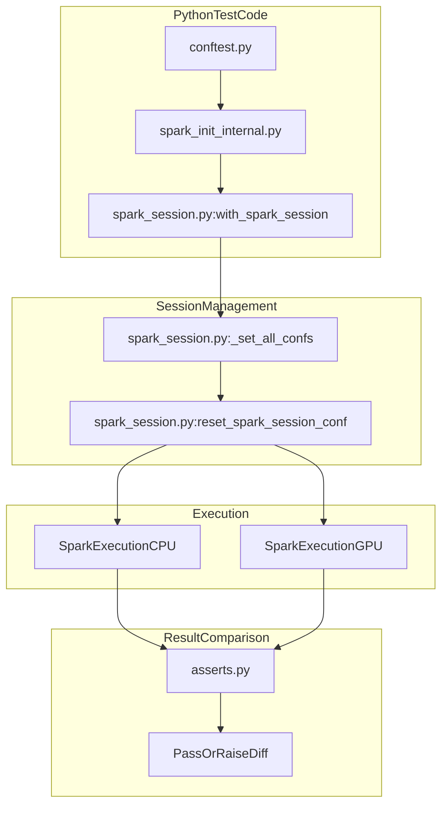
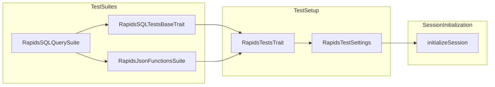

<!-- source: DeepWiki mcp.deepwiki.com · repo NVIDIA/cudf-spark · page 12 Testing Infrastructure · fetched 2026-10-26 -->

# Testing Infrastructure

Relevant source files

The following files were used as context for generating this wiki page:

- [integration_tests/README.md](integration_tests/README.md)
- [integration_tests/conftest.py](integration_tests/conftest.py)
- [integration_tests/pytest.ini](integration_tests/pytest.ini)
- [integration_tests/run_pyspark_from_build.sh](integration_tests/run_pyspark_from_build.sh)
- [integration_tests/src/main/python/conftest.py](integration_tests/src/main/python/conftest.py)
- [integration_tests/src/main/python/marks.py](integration_tests/src/main/python/marks.py)
- [integration_tests/src/main/python/spark_session.py](integration_tests/src/main/python/spark_session.py)

The purpose of this page is to provide a high-level overview of the testing strategy for the RAPIDS Accelerator for Apache Spark, encompassing integration tests, Scala unit tests, test utilities, and the LORE replay framework. This multi-level testing infrastructure ensures correctness, robustness, and performance across diverse Spark versions and hardware configurations. 

This is a parent page; for deep technical details and implementation guidance, please refer to the child pages:
- [Python Integration Test Framework](#12.1)
- [Scala Unit & Integration Tests](#12.2)
- [LORE: Local Replay Framework](#12.3)
- [Metrics, NVTX Profiling & Observability](#12.4)

---

## Overview of Testing Strategy

The testing infrastructure balances end-to-end validation with fine-grained internal correctness checks:

| Testing Tier | Technology | Role & Purpose |
|---|---|---|
| **Integration Tests** | Python, `pytest`, PySpark | Validate correctness by executing SQL queries on both CPU and GPU and asserting result equality or expected fallback behaviors. |
| **Unit & Integration Tests** | Scala, ScalaTest | Validate internal plugin mechanisms including operator implementations, plan transformations, and memory management. |
| **Test Utilities** | Scala & Python | Provide reusable helpers for generating data, asserting results, managing Spark sessions, and comparing GPU/CPU outputs at batch and column levels. |
| **LORE Replay Framework** | Scala | Debugging aid that captures execution state of GPU operators to allow reproducible local replay and diagnosis of failures. |
| **Metrics & Profiling** | Metrics, NVTX | Tests validating the collection and accuracy of runtime metrics including GPU profiling and task-level events. |

Sources: [integration_tests/src/main/python/spark_session.py:125-135](), [integration_tests/pytest.ini:15-44]()

---

## Integration Tests: Pytest-Based Framework

The core validation for RAPIDS Accelerator GPU SQL correctness leverages a Pytest-driven Python integration test framework. This framework executes Spark SQL workloads end-to-end, comparing CPU and GPU execution results for equivalence or known fallback behavior:

- **Spark Session Lifecycle & Configuration:** The `integration_tests/src/main/python/spark_session.py` module manages creation, configuration, and teardown of Spark sessions per test [integration_tests/src/main/python/spark_session.py:72-135](). Initialization bootstrap is handled via `spark_init_internal.py` and `integration_tests/src/main/python/conftest.py` [integration_tests/src/main/python/conftest.py:28-30](), [integration_tests/src/main/python/conftest.py:15-68](), while `integration_tests/run_pyspark_from_build.sh` orchestrates test execution in build pipelines [integration_tests/run_pyspark_from_build.sh:21-48]().
- **Result Validation & Test Robustness:** Helpers assert equality of DataFrame results, handle approximate floating-point comparisons, and protect against long-running queries or hangs via pytest configurations and test hooks.
- **Test Markers & Configuration Management:** The framework uses a rich set of Pytest markers defined declaratively in `integration_tests/pytest.ini` and exposed via `integration_tests/src/main/python/marks.py`. These markers control behavior such as allowing non-GPU fallbacks, injecting out-of-memory conditions, and ignoring order sensitivity [integration_tests/pytest.ini:15-44](), [integration_tests/src/main/python/marks.py:15-45]().

For details, see [Python Integration Test Framework](#12.1).

Sources: [integration_tests/src/main/python/spark_session.py:72-135](), [integration_tests/run_pyspark_from_build.sh:21-48](), [integration_tests/pytest.ini:15-44](), [integration_tests/src/main/python/marks.py:15-45](), [integration_tests/src/main/python/conftest.py:28-30](), [integration_tests/src/main/python/conftest.py:15-68]()

---

## Scala Unit & Integration Tests

Complementing the Python integration level, Scala-based tests validate the internal correctness of the RAPIDS Accelerator plugin components, ensuring that plan replacement, expression implementations, and operator behavior are correct:

- **Configurable Test Suites:** The `RapidsTestSettings` class controls enabling/disabling of specific suites and manages known issue exclusions.
- **Test Traits for Session and Harness Setup:** Traits such as `RapidsTestsTrait` and `RapidsSQLTestsBaseTrait` manage Spark session initialization with RAPIDS enabled, enforce time zone settings, and provide helper methods to simplify writing GPU-enabled test cases.
- **Adapted Core Spark SQL Suites:** Original Spark SQL test suites have GPU-enabled variants (e.g., `RapidsSQLQuerySuite`, `RapidsJsonFunctionsSuite`) which run full test coverage on the GPU.

For details, see [Scala Unit & Integration Tests](#12.2).

Sources: [integration_tests/README.md:7-8]()

---

## LORE: Local Replay Framework

The LORE framework (Local Replay) serves as an advanced debugging and repro infrastructure for the GPU operators:

- When operators fail or produce incorrect results at runtime, LORE can capture the full execution state, including input columnar batches and configuration, as dump files using components like `GpuLore`, `dump.scala`, and `DumpUtils`.
- These dumps can be replayed locally via `replay.scala`, outside of the full Spark environment, to isolate and debug the exact failure conditions efficiently.
- LORE integrates deeply with GPU operators and provides configurable behaviors through `spark.rapids.sql.lore.*` properties for dump file management, replay toggling, and debugging aid.

For details, see [LORE: Local Replay Framework](#12.3).

Sources: [integration_tests/README.md:7-8]()

---

## Metrics, NVTX Profiling & Observability

Robust observability is crucial for performance tuning and validation of GPU workloads. Testing and validation covers:

- **Runtime Metrics:** The codebase defines classes such as `GpuMetrics` and `GpuBatchScanExecMetrics` to capture details like kernel runtime, memory usage, spill events, and batch statistics.
- **NVTX Profiling:** NVTX range annotations are emitted during execution using helpers like `NvtxWithMetrics` and `NvtxRangeWithDoc`, enabling rich profiling data for performance analysis tools.
- **Validation Suites:** Specific test suites such as `MetricsEventLogValidationSuite` validate proper metric emission and correctness, supporting continuous monitoring and performance regression detection.

For details, see [Metrics, NVTX Profiling & Observability](#12.4).

Sources: [integration_tests/README.md:7-8]()

---

## System Flow Illustrations

### Python Integration Test Flow

Title: Python Integration Test Flow Execution Diagram
Sources: [integration_tests/src/main/python/spark_session.py:72-135](), [integration_tests/src/main/python/conftest.py:28-30]()

---

### Scala Unit Test Infrastructure

Title: Scala Unit Test Infrastructure Component Relationship
Sources: [integration_tests/README.md:7-8]()

---

## Summary of Key Testing Utilities

| Utility Component | Code Location & Entity | Purpose |
|---|---|---|
| Python Session Manager | `integration_tests/src/main/python/spark_session.py`: `with_spark_session` | Manages Spark session configs, job descriptions, cleanup to isolate tests [integration_tests/src/main/python/spark_session.py:125-135]() |
| Scala Test Harness | `RapidsTestsTrait.scala`: `RapidsTestsTrait` | Initializes Spark with RAPIDS plugin for unit tests, manages setup and teardown |
| SQL Test Base Trait | `RapidsSQLTestsBaseTrait.scala`: `RapidsSQLTestsBaseTrait` | Provides common helpers, test resource expansion, and GPU test wrappers |
| Test Settings Registry | `RapidsTestSettings.scala`: `RapidsTestSettings` | Controls enabled test suites and known issue exclusions for backend tests |

Sources: [integration_tests/src/main/python/spark_session.py:125-135]()

---

