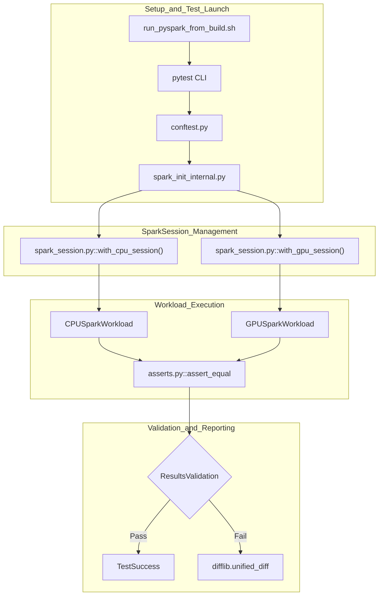
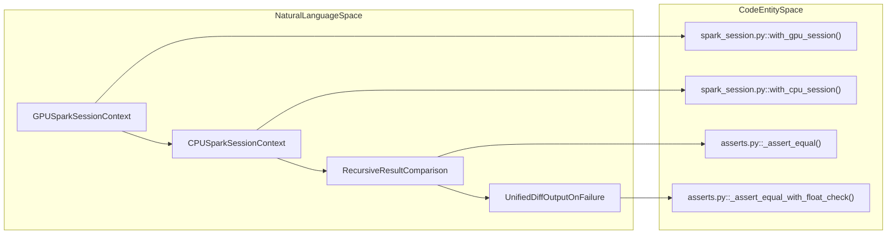
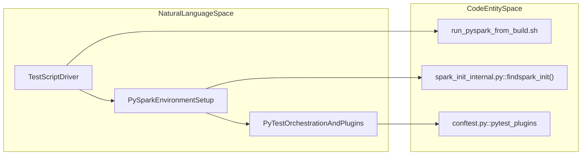

<!-- source: DeepWiki mcp.deepwiki.com · repo NVIDIA/cudf-spark · page 12.1 Python Integration Test Framework · fetched 2026-10-26 -->

# Python Integration Test Framework

Relevant source files

The following files were used as context for generating this wiki page:

- [delta-lake/common/src/main/databricks/scala/com/databricks/sql/transaction/tahoe/rapids/GpuDeltaLog.scala](delta-lake/common/src/main/databricks/scala/com/databricks/sql/transaction/tahoe/rapids/GpuDeltaLog.scala)
- [delta-lake/common/src/main/scala/com/nvidia/spark/rapids/delta/GpuRapidsProcessDeltaMergeJoinExec.scala](delta-lake/common/src/main/scala/com/nvidia/spark/rapids/delta/GpuRapidsProcessDeltaMergeJoinExec.scala)
- [delta-lake/delta-spark400db173/src/main/scala/com/databricks/sql/transaction/tahoe/rapids/GpuMergeIntoCommand.scala](delta-lake/delta-spark400db173/src/main/scala/com/databricks/sql/transaction/tahoe/rapids/GpuMergeIntoCommand.scala)
- [delta-lake/delta-spark400db173/src/main/scala/com/nvidia/spark/rapids/delta/shims/MergeIntoCommandMetaShim.scala](delta-lake/delta-spark400db173/src/main/scala/com/nvidia/spark/rapids/delta/shims/MergeIntoCommandMetaShim.scala)
- [integration_tests/README.md](integration_tests/README.md)
- [integration_tests/conftest.py](integration_tests/conftest.py)
- [integration_tests/pytest.ini](integration_tests/pytest.ini)
- [integration_tests/run_pyspark_from_build.sh](integration_tests/run_pyspark_from_build.sh)
- [integration_tests/src/main/java/org/apache/spark/rapids/tests/TimeoutSparkListener.java](integration_tests/src/main/java/org/apache/spark/rapids/tests/TimeoutSparkListener.java)
- [integration_tests/src/main/python/asserts.py](integration_tests/src/main/python/asserts.py)
- [integration_tests/src/main/python/conftest.py](integration_tests/src/main/python/conftest.py)
- [integration_tests/src/main/python/delta_lake_auto_compact_test.py](integration_tests/src/main/python/delta_lake_auto_compact_test.py)
- [integration_tests/src/main/python/delta_lake_delete_test.py](integration_tests/src/main/python/delta_lake_delete_test.py)
- [integration_tests/src/main/python/delta_lake_liquid_clustering_test.py](integration_tests/src/main/python/delta_lake_liquid_clustering_test.py)
- [integration_tests/src/main/python/delta_lake_merge_common.py](integration_tests/src/main/python/delta_lake_merge_common.py)
- [integration_tests/src/main/python/delta_lake_merge_test.py](integration_tests/src/main/python/delta_lake_merge_test.py)
- [integration_tests/src/main/python/delta_lake_update_test.py](integration_tests/src/main/python/delta_lake_update_test.py)
- [integration_tests/src/main/python/delta_lake_utils.py](integration_tests/src/main/python/delta_lake_utils.py)
- [integration_tests/src/main/python/delta_lake_write_test.py](integration_tests/src/main/python/delta_lake_write_test.py)
- [integration_tests/src/main/python/marks.py](integration_tests/src/main/python/marks.py)
- [integration_tests/src/main/python/py4j_workaround_test.py](integration_tests/src/main/python/py4j_workaround_test.py)
- [integration_tests/src/main/python/spark_init_internal.py](integration_tests/src/main/python/spark_init_internal.py)
- [integration_tests/src/main/python/spark_session.py](integration_tests/src/main/python/spark_session.py)
- [jenkins/databricks/params.py](jenkins/databricks/params.py)
- [jenkins/databricks/run-build.py](jenkins/databricks/run-build.py)
- [jenkins/databricks/run-tests.py](jenkins/databricks/run-tests.py)

The purpose of this page is to document the pytest-based Python integration test framework used by the RAPIDS Accelerator for Apache Spark. This framework is designed to validate correctness and GPU acceleration feature parity by executing equivalent Spark SQL and DataFrame operations in both CPU and GPU modes. It performs deep recursive assertions comparing CPU and GPU outputs to ensure semantic equivalence, monitors query plans using callback listeners, and catches hanging tests or discrepancies.

---

## Framework Architecture and Lifecycle

The integration test framework is composed of multiple components that cooperate to manage Spark sessions, configure runtime environments, execute GPU/CPU Spark workloads, and validate outputs. Test execution begins with the shell script driver, flows through pytest and its plugins, manages Spark sessions with configurable parameters, and compares results with customized assertion utilities.

Sources:  
`integration_tests/run_pyspark_from_build.sh` [1-168](),  
`integration_tests/src/main/python/conftest.py` [28-30](),  
`integration_tests/src/main/python/spark_init_internal.py` [80-189](),  
`integration_tests/src/main/python/spark_session.py` [124-147](),  
`integration_tests/src/main/python/asserts.py` [132-135]()

---

## Core Modules and Implementation Details

### Spark Session Management (`spark_session.py`)

This module manages the lifecycle and configuration of Spark sessions used for integration tests. Sessions are carefully orchestrated to isolate GPU-enabled and CPU-only configurations, ensuring reproducibility and configuration consistency across tests.

**Key Features:**

- **`with_gpu_session(func, conf={})`:**  
  Runs the callable `func` with a SparkSession configured for GPU acceleration. Applies default settings including enabling RAPIDS (`spark.rapids.sql.mode=executeongpu`) and other baseline configs for integration tests. Supports overriding via optional `conf`.  
  Ensures PySpark compatibility patches for date/time internal representation during the session lifetime.  
  Throws a runtime error if `func` incorrectly returns a `DataFrame` directly, as this produces unexpected results.  
  [integration_tests/src/main/python/spark_session.py:124-136]()

- **`with_cpu_session(func, conf={})`:**  
  Runs `func` with SparkSession explicitly configured to run on CPU (GPU disabled). Starts from baseline configs and disables the RAPIDS plugin.  
  Facilitates comparative testing and fallback scenarios.  
  [integration_tests/src/main/python/spark_session.py:145-147]()

- **`reset_spark_session_conf()`:**  
  Resets Spark configurations to original state captured at test start, clears cache and unsets any new config keys set during tests. Critical to isolate test cases so they do not leak config state.  
  [integration_tests/src/main/python/spark_session.py:72-82]()

- **`pyspark_compatibility_fixes()`:**  
  Context manager patching the internal conversion functions of PySpark’s `TimestampType`, `TimestampNTZType`, and `DateType` to internal integral representations. This stabilizes comparison logic across PySpark versions in test assertions.  
  Implemented using Python `unittest.mock.patch`.  
  [integration_tests/src/main/python/spark_session.py:88-123]()

- **`_default_conf`:**  
  A dictionary of baseline Spark configs applied to all test sessions, overriding environment or cluster defaults to ensure a controlled test environment. Covers float casting optimizations, retry mechanisms, extended year handling, and disables some problematic optimizations during tests.  
  [integration_tests/src/main/python/spark_session.py:43-59]()

**Internal Helper Functions:**

- `_set_all_confs(conf)`: merges default and user configs, includes optional OOM injection config, and applies them via the internal SparkConf.  
- `_check_for_proper_return_values()` ensures that no `DataFrame` is returned from session wrapper functions to avoid test misuse.  
- `_add_job_description(conf)`: labels Spark job descriptions with test names and whether GPU or CPU mode.  
  [integration_tests/src/main/python/spark_session.py:138-143]()

Sources:  
`integration_tests/src/main/python/spark_session.py` [1-147]()

---

### Initialization, Pytest Hooks, and Timeouts (`spark_init_internal.py`, `conftest.py`, and `TimeoutSparkListener.java`)

These modules perform initialization tasks, implement pytest hooks and fixtures, configure runtime environment properties, and supervise job progress.

- **`spark_init_internal.py`:**  
  - Implements `pytest_sessionstart` to do global setup, including creating scratch directories for Hive and applying workarounds for Py4J lifecycle issues that may cause missing Java gateway targets during tests.  
  - Loads dependencies via `findspark` and configures jars and packages as environment variables.  
  [integration_tests/src/main/python/spark_init_internal.py:80-189]()

- **`conftest.py`:**  
  - Declares pytest fixtures and plugins (`pytest_plugins`) such as `spark_init_internal` for deferred Spark session setup.  
  [integration_tests/src/main/python/conftest.py:28-30]()
  - Contains global runtime environment flags (`_runtime_env`) to differentiate between Apache, Databricks, EMR, and Dataproc testing environments.  
  [integration_tests/src/main/python/conftest.py:91-110]()
  - Supplies flags and functions to query test execution contexts like nightly/precommit runs, non-GPU allowances, and ANSI mode control.  
  [integration_tests/src/main/python/conftest.py:58-89](), [integration_tests/src/main/python/conftest.py:155-171]()
  - Provides timezone support detection and caching for consistency of timezone-sensitive tests.  
  [integration_tests/src/main/python/conftest.py:138-154]()

- **`TimeoutSparkListener.java`:**  
  - Implements a Spark listener to monitor actions taking longer than expected. Stuck Spark actions are killed with diagnostic messages, driver thread dumps, and executor thread dumps to prevent CI hangs.  
  [integration_tests/src/main/java/org/apache/spark/rapids/tests/TimeoutSparkListener.java]()

Sources:  
`integration_tests/src/main/python/spark_init_internal.py` [80-189](),  
`integration_tests/src/main/python/conftest.py` [28-236](),  
`integration_tests/src/main/java/org/apache/spark/rapids/tests/TimeoutSparkListener.java`

---

### Assertion and Execution Plan Validation (`asserts.py` and `ExecutionPlanCaptureCallback.scala`)

This module implements deep recursive equality assertions between CPU and GPU outputs, alongside execution plan validation via callback hooks.

- **`assert_equal(cpu, gpu)`:**  
  Entry point that performs recursive comparison of CPU and GPU results, supporting complex nested data structures including rows, lists, tuples, generators, dictionaries, and all common Spark SQL data types.  
  Uses a helper float-check function for approximate float equality where configured.  
  [integration_tests/src/main/python/asserts.py:132-135]()

- **`_assert_equal(cpu, gpu, float_check, path)`:**  
  Detailed recursive function comparing each element with path tracking for precise error localization.  
  [integration_tests/src/main/python/asserts.py:31-107]()

- **`_assert_equal_with_float_check(...)`:**  
  Catches assertion failures and generates a unified diff between CPU and GPU outputs for diagnostic clarity.  
  [integration_tests/src/main/python/asserts.py:113-131]()

- **`ExecutionPlanCaptureCallback`:**  
  Scala query execution listener (`ExecutionPlanCaptureCallback.scala` and `ShimmedExecutionPlanCaptureCallbackImpl.scala`) used by Python tests to verify that specific plans contain or do not contain expected GPU classes, handle fallbacks, and match expected schemata.  
  [sql-plugin/src/main/scala/org/apache/spark/sql/rapids/ExecutionPlanCaptureCallback.scala:25-63]()

Sources:  
`integration_tests/src/main/python/asserts.py` [1-152](),  
`sql-plugin/src/main/scala/org/apache/spark/sql/rapids/ExecutionPlanCaptureCallback.scala` [25-63]()

---

### Test Data Generation (`data_gen.py`)

The `data_gen.py` module provides extensible data generators used across integration tests to generate randomized or edge-case datasets matching specific Spark data types (e.g., `byte_gen`, `short_gen`, `int_gen`, `long_gen`, `StringGen`, `boolean_gen`, `date_gen`, `timestamp_gen`). These generators feed parameterized test suites such as Delta Lake writes and joins to ensure robust coverage over diverse data distributions and nullability patterns.

Sources:  
`integration_tests/src/main/python/delta_lake_write_test.py` [31-44]()

---

### Test Markers and Configuration (`marks.py` and `pytest.ini`)

- **Markers (`marks.py` and `pytest.ini`):**  
  Defines pytest marker objects and configuration for test scenarios controlling GPU enforcement, float accuracy, fallback allowance (`allow_non_gpu`), data formats, and suite categorization (nightly, fuzz, shuffle tests, delta lake, iceberg, spark job timeouts).  
  [integration_tests/src/main/python/marks.py:1-45](),  
  [integration_tests/pytest.ini:15-44]()

Sources:  
`integration_tests/src/main/python/marks.py` [1-46](),  
`integration_tests/pytest.ini` [15-44]()

---

### Test Execution Automation (`run_pyspark_from_build.sh`)

This shell script automates running the Python integration test suite in a configured environment.

**Functionality:**
- Detects Spark and Scala versions from `SPARK_HOME` to set test compatibility flags.  
- Assembles the classpath with all required JARs, including the RAPIDS plugin, integration test JAR, and third-party dependencies such as Avro and Protobuf.  
- Sets `PYTHONPATH` to the integration test source directory.  
- Launches pytest from the local build environment with appropriate arguments forwarded.  
[integration_tests/run_pyspark_from_build.sh:1-168]()

Sources:  
`integration_tests/run_pyspark_from_build.sh` [1-168]()

---

## Natural Language Space to Code Entity Space Mappings

### Diagram: Test Session Management and Validation Mapping

Sources:  
`integration_tests/src/main/python/spark_session.py` [124-147](),  
`integration_tests/src/main/python/asserts.py` [31-135]()

---

### Diagram: Test Execution Setup and Plugin Hook Mapping

Sources:  
`integration_tests/run_pyspark_from_build.sh` [1-168](),  
`integration_tests/src/main/python/spark_init_internal.py` [119-174](),  
`integration_tests/src/main/python/conftest.py` [28-30]()

---

