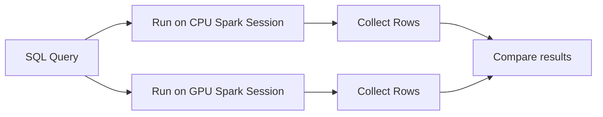
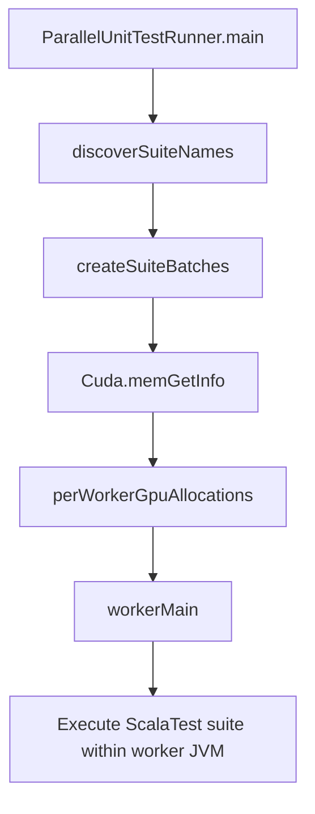
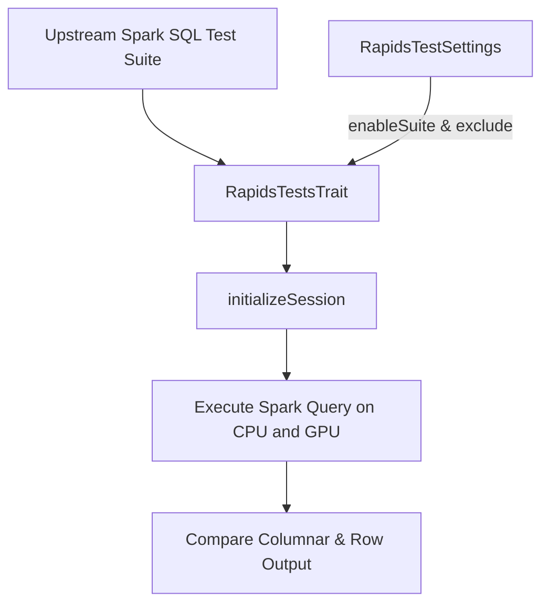
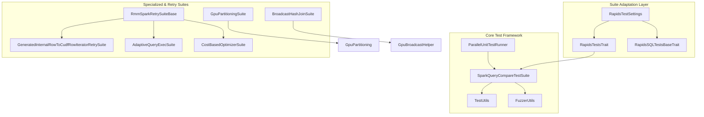

<!-- source: DeepWiki mcp.deepwiki.com · repo NVIDIA/cudf-spark · page 12.2 Scala Unit & Integration Tests · fetched 2026-10-26 -->

# Scala Unit & Integration Tests

Relevant source files

The following files were used as context for generating this wiki page:

- [integration_tests/src/main/python/datasourcev2_read_test.py](integration_tests/src/main/python/datasourcev2_read_test.py)
- [integration_tests/src/main/python/higher_order_functions_test.py](integration_tests/src/main/python/higher_order_functions_test.py)
- [integration_tests/src/main/scala/com/nvidia/spark/rapids/tests/datasourcev2/parquet/TestingV2Source.scala](integration_tests/src/main/scala/com/nvidia/spark/rapids/tests/datasourcev2/parquet/TestingV2Source.scala)
- [integration_tests/src/test/scala/com/nvidia/spark/rapids/tests/mortgage/MortgageAdaptiveSparkSuite.scala](integration_tests/src/test/scala/com/nvidia/spark/rapids/tests/mortgage/MortgageAdaptiveSparkSuite.scala)
- [integration_tests/src/test/scala/com/nvidia/spark/rapids/tests/mortgage/MortgageSparkSuite.scala](integration_tests/src/test/scala/com/nvidia/spark/rapids/tests/mortgage/MortgageSparkSuite.scala)
- [sql-plugin-api/src/main/scala/org/apache/spark/sql/rapids/ProxyRapidsShuffleInternalManagerBase.scala](sql-plugin-api/src/main/scala/org/apache/spark/sql/rapids/ProxyRapidsShuffleInternalManagerBase.scala)
- [sql-plugin/src/main/scala/com/nvidia/spark/rapids/GpuDeviceManager.scala](sql-plugin/src/main/scala/com/nvidia/spark/rapids/GpuDeviceManager.scala)
- [sql-plugin/src/main/scala/com/nvidia/spark/rapids/GpuProjectAstExpression.scala](sql-plugin/src/main/scala/com/nvidia/spark/rapids/GpuProjectAstExpression.scala)
- [sql-plugin/src/main/scala/com/nvidia/spark/rapids/RapidsConfResourceEntries.scala](sql-plugin/src/main/scala/com/nvidia/spark/rapids/RapidsConfResourceEntries.scala)
- [sql-plugin/src/main/scala/org/apache/spark/sql/rapids/execution/GpuBroadcastHelper.scala](sql-plugin/src/main/scala/org/apache/spark/sql/rapids/execution/GpuBroadcastHelper.scala)
- [sql-plugin/src/main/scala/org/apache/spark/sql/rapids/execution/GpuBroadcastToRowExec.scala](sql-plugin/src/main/scala/org/apache/spark/sql/rapids/execution/GpuBroadcastToRowExec.scala)
- [tests/src/test/java/com/nvidia/spark/rapids/TestStats.java](tests/src/test/java/com/nvidia/spark/rapids/TestStats.java)
- [tests/src/test/scala/com/nvidia/spark/rapids/FuzzerUtils.scala](tests/src/test/scala/com/nvidia/spark/rapids/FuzzerUtils.scala)
- [tests/src/test/scala/com/nvidia/spark/rapids/GpuArrayHofFusionSuite.scala](tests/src/test/scala/com/nvidia/spark/rapids/GpuArrayHofFusionSuite.scala)
- [tests/src/test/scala/com/nvidia/spark/rapids/GpuDeviceManagerSuite.scala](tests/src/test/scala/com/nvidia/spark/rapids/GpuDeviceManagerSuite.scala)
- [tests/src/test/scala/com/nvidia/spark/rapids/HostByteBufferIteratorSuite.scala](tests/src/test/scala/com/nvidia/spark/rapids/HostByteBufferIteratorSuite.scala)
- [tests/src/test/scala/com/nvidia/spark/rapids/ParallelUnitTestRunner.scala](tests/src/test/scala/com/nvidia/spark/rapids/ParallelUnitTestRunner.scala)
- [tests/src/test/scala/com/nvidia/spark/rapids/ParallelUnitTestRunnerSuite.scala](tests/src/test/scala/com/nvidia/spark/rapids/ParallelUnitTestRunnerSuite.scala)
- [tests/src/test/scala/com/nvidia/spark/rapids/SerializationSuite.scala](tests/src/test/scala/com/nvidia/spark/rapids/SerializationSuite.scala)
- [tests/src/test/scala/com/nvidia/spark/rapids/shuffle/RapidsShuffleHeartbeatManagerSuite.scala](tests/src/test/scala/com/nvidia/spark/rapids/shuffle/RapidsShuffleHeartbeatManagerSuite.scala)
- [tests/src/test/scala/org/apache/spark/sql/rapids/ProjectExprSuite.scala](tests/src/test/scala/org/apache/spark/sql/rapids/ProjectExprSuite.scala)
- [tests/src/test/scala/org/apache/spark/sql/rapids/execution/CoalescedBatchPartitionerSuite.scala](tests/src/test/scala/org/apache/spark/sql/rapids/execution/CoalescedBatchPartitionerSuite.scala)
- [tests/src/test/spark330/scala/com/nvidia/spark/rapids/IntervalArithmeticSuite.scala](tests/src/test/spark330/scala/com/nvidia/spark/rapids/IntervalArithmeticSuite.scala)
- [tests/src/test/spark330/scala/org/apache/spark/sql/rapids/suites/RapidsCastSuite.scala](tests/src/test/spark330/scala/org/apache/spark/sql/rapids/suites/RapidsCastSuite.scala)
- [tests/src/test/spark330/scala/org/apache/spark/sql/rapids/suites/RapidsDataFrameAggregateSuite.scala](tests/src/test/spark330/scala/org/apache/spark/sql/rapids/suites/RapidsDataFrameAggregateSuite.scala)
- [tests/src/test/spark330/scala/org/apache/spark/sql/rapids/suites/RapidsJsonExpressionsSuite.scala](tests/src/test/spark330/scala/org/apache/spark/sql/rapids/suites/RapidsJsonExpressionsSuite.scala)
- [tests/src/test/spark330/scala/org/apache/spark/sql/rapids/suites/RapidsJsonFunctionsSuite.scala](tests/src/test/spark330/scala/org/apache/spark/sql/rapids/suites/RapidsJsonFunctionsSuite.scala)
- [tests/src/test/spark330/scala/org/apache/spark/sql/rapids/suites/RapidsJsonSuite.scala](tests/src/test/spark330/scala/org/apache/spark/sql/rapids/suites/RapidsJsonSuite.scala)
- [tests/src/test/spark330/scala/org/apache/spark/sql/rapids/suites/RapidsMathFunctionsSuite.scala](tests/src/test/spark330/scala/org/apache/spark/sql/rapids/suites/RapidsMathFunctionsSuite.scala)
- [tests/src/test/spark330/scala/org/apache/spark/sql/rapids/suites/RapidsParquetInteroperabilitySuite.scala](tests/src/test/spark330/scala/org/apache/spark/sql/rapids/suites/RapidsParquetInteroperabilitySuite.scala)
- [tests/src/test/spark330/scala/org/apache/spark/sql/rapids/suites/RapidsParquetRebaseDatetimeSuite.scala](tests/src/test/spark330/scala/org/apache/spark/sql/rapids/suites/RapidsParquetRebaseDatetimeSuite.scala)
- [tests/src/test/spark330/scala/org/apache/spark/sql/rapids/suites/RapidsSQLQuerySuite.scala](tests/src/test/spark330/scala/org/apache/spark/sql/rapids/suites/RapidsSQLQuerySuite.scala)
- [tests/src/test/spark330/scala/org/apache/spark/sql/rapids/utils/BackendTestSettings.scala](tests/src/test/spark330/scala/org/apache/spark/sql/rapids/utils/BackendTestSettings.scala)
- [tests/src/test/spark330/scala/org/apache/spark/sql/rapids/utils/RapidsSQLTestsBaseTrait.scala](tests/src/test/spark330/scala/org/apache/spark/sql/rapids/utils/RapidsSQLTestsBaseTrait.scala)
- [tests/src/test/spark330/scala/org/apache/spark/sql/rapids/utils/RapidsTestSettings.scala](tests/src/test/spark330/scala/org/apache/spark/sql/rapids/utils/RapidsTestSettings.scala)
- [tests/src/test/spark330/scala/org/apache/spark/sql/rapids/utils/RapidsTestsBaseTrait.scala](tests/src/test/spark330/scala/org/apache/spark/sql/rapids/utils/RapidsTestsBaseTrait.scala)
- [tests/src/test/spark330/scala/org/apache/spark/sql/rapids/utils/RapidsTestsCommonTrait.scala](tests/src/test/spark330/scala/org/apache/spark/sql/rapids/utils/RapidsTestsCommonTrait.scala)
- [tests/src/test/spark330/scala/org/apache/spark/sql/rapids/utils/RapidsTestsTrait.scala](tests/src/test/spark330/scala/org/apache/spark/sql/rapids/utils/RapidsTestsTrait.scala)
- [tests/src/test/spark350/scala/org/apache/iceberg/spark/functions/GpuBucketExpressionSuite.scala](tests/src/test/spark350/scala/org/apache/iceberg/spark/functions/GpuBucketExpressionSuite.scala)
- [tests/src/test/spark420/scala/com/nvidia/spark/rapids/GpuBroadcastToRowExecSuite.scala](tests/src/test/spark420/scala/com/nvidia/spark/rapids/GpuBroadcastToRowExecSuite.scala)

The RAPIDS Accelerator for Apache Spark employs a comprehensive Scala unit and integration testing infrastructure located under the `tests` directory. Its purpose is to validate GPU-accelerated operators, expressions, shuffles, and memory management against CPU Spark behavior, ensuring feature parity, correctness, and robust OOM recovery.

---

## Core Testing Infrastructure

### SparkQueryCompareTestSuite

`SparkQueryCompareTestSuite` is the foundational trait for query comparison integration tests [tests/src/test/scala/com/nvidia/spark/rapids/SparkQueryCompareTestSuite.scala:163](). It creates and caches a `SparkSession` configured to use the RAPIDS GPU plugin [tests/src/test/scala/com/nvidia/spark/rapids/SparkQueryCompareTestSuite.scala:62-158](). Each test runs the same query twice: once on CPU Spark and once with the GPU plugin enabled. The outputs are collected as arrays of `Row` and then compared for equality or approximate numerical equivalence.

- **Session Config:** Ensures consistent timezone and locale configuration for reproducible tests [tests/src/test/scala/com/nvidia/spark/rapids/SparkQueryCompareTestSuite.scala:78-80]().
- **Plan Validation:** Uses `ExecutionPlanCaptureCallback` to intercept and verify GPU operator usage in the physical plan [tests/src/test/scala/com/nvidia/spark/rapids/SparkQueryCompareTestSuite.scala:88-89]().
- **Numeric Tolerance:** Supports floating-point tolerance, NaN and Infinity equivalency to handle GPU-CPU numeric discrepancies [tests/src/test/scala/com/nvidia/spark/rapids/SparkQueryCompareTestSuite.scala:182-200]().

This trait encapsulates the main data flow:

Sources: [tests/src/test/scala/com/nvidia/spark/rapids/SparkQueryCompareTestSuite.scala:16-2344]()

---

### TestUtils

`TestUtils` provides helper methods essential for low-level verification of GPU-accelerated columnar data structures.

- **`compareBatches`**: Compares two `ColumnarBatch` instances for equality in row count, column count, and content [tests/src/test/scala/com/nvidia/spark/rapids/TestUtils.scala:68-83]().
- **`compareColumns`**: Recursively compares GPU `ColumnVector` data, handling complex nested types like `LIST`, `MAP`, and `STRUCT` [tests/src/test/scala/com/nvidia/spark/rapids/TestUtils.scala:99-139]().
- **Spark Session Management**: Utility to create temporary Spark sessions with GPU-enabled configurations [tests/src/test/scala/com/nvidia/spark/rapids/TestUtils.scala:141-159]().
- **`isBatchPacked`**: Checks if a `ColumnarBatch` is packed into a `GpuPackedTableColumn` [tests/src/test/scala/com/nvidia/spark/rapids/TestUtils.scala:43-44]().

Internal operations rely on `GpuColumnVector` and `RapidsHostColumnVector` to verify column data.

Sources: [tests/src/test/scala/com/nvidia/spark/rapids/TestUtils.scala:35-159]()

---

### FuzzerUtils

`FuzzerUtils` facilitates creation of randomized test inputs for unit testing, enabling broad coverage across Catalyst types:

- Generates schemas and random data rows with nullable fields [tests/src/test/scala/com/nvidia/spark/rapids/FuzzerUtils.scala:49-60]().
- Supports both primitive types (via efficient `GpuColumnarBatchBuilder`) [tests/src/test/scala/com/nvidia/spark/rapids/FuzzerUtils.scala:91-179]() and nested types like arrays, maps, and structs (via fallback row-based generation) [tests/src/test/scala/com/nvidia/spark/rapids/FuzzerUtils.scala:181-185]().
- Allows seeding for reproducibility [tests/src/test/scala/com/nvidia/spark/rapids/FuzzerUtils.scala:69]().

This utility enables fuzzing-based robustness testing of GPU operators.

Sources: [tests/src/test/scala/com/nvidia/spark/rapids/FuzzerUtils.scala:39-185]()

---

### ParallelUnitTestRunner

This component orchestrates concurrent execution of ScalaTest suites in isolated child JVMs with strict GPU memory budgeting:

- **Suite Batching:** Groups suites dynamically into `SuiteBatch` objects. Suites marked as dynamic partition pruning (DPP) run separately to avoid interference.
- **Memory Budgeting:** Queries GPU memory via `Cuda.memGetInfo()`, computing a per-worker GPU memory allocation fraction to reduce multi-fork OOM risks.
- **Worker Launch:** Spawns JVM child processes with isolated memory constraints and specific test suite arguments.

The runtime flow bridging system tasks to code entities:

Sources: [tests/src/test/scala/com/nvidia/spark/rapids/ParallelUnitTestRunner.scala:38-147]()

---

## Spark SQL Test Suite Adaptation

### RapidsTestSettings & BackendTestSettings

To leverage existing upstream Spark SQL test suites, the plugin uses `BackendTestSettings` and subclasses like `RapidsTestSettings` to manage suite enablement and test exclusions.

- **Suite Enabling:** `enableSuite[T]` registers Spark SQL test classes for GPU validation [tests/src/test/spark330/scala/org/apache/spark/sql/rapids/utils/RapidsTestSettings.scala:30]().
- **Test Exclusions:** Specific tests are blacklisted with categories like `KNOWN_ISSUE`, `ADJUST_UT` (adapted tests), and `WONT_FIX_ISSUE` [tests/src/test/spark330/scala/org/apache/spark/sql/rapids/utils/RapidsTestSettings.scala:31-65]().
- Integrates known issue URLs and rationale for exclusions as metadata [tests/src/test/spark330/scala/org/apache/spark/sql/rapids/utils/RapidsTestSettings.scala:31-65]().

This enables controlled ingestion of upstream test suites while acknowledging current plugin constraints.

Sources: [tests/src/test/spark330/scala/org/apache/spark/sql/rapids/utils/RapidsTestSettings.scala:28-66](), [tests/src/test/spark330/scala/org/apache/spark/sql/rapids/utils/BackendTestSettings.scala:31-178]()

---

### RapidsTestsTrait & RapidsSQLTestsBaseTrait

These traits extend Spark test base classes to decorate and alter behavior for GPU tests:

- Replace or augment the Spark session setup with the RAPIDS SQL plugin enabled (`spark.plugins` configured) [tests/src/test/spark330/scala/org/apache/spark/sql/rapids/utils/RapidsTestsTrait.scala:93-149]().
- Install `ExecutionPlanCaptureCallback` to intercept GPU operator plans [tests/src/test/spark330/scala/org/apache/spark/sql/rapids/utils/RapidsTestsTrait.scala:103-104]().
- Override Spark SQL configuration to maintain correctness and stability during GPU tests [tests/src/test/spark330/scala/org/apache/spark/sql/rapids/utils/RapidsTestsTrait.scala:97-143]().
- Provide helper methods like `rapidsCheckExpression` to validate GPU expression behaviors [tests/src/test/spark330/scala/org/apache/spark/sql/rapids/utils/RapidsTestsTrait.scala:161]().
- Override test execution to selectively ignore unsupported or flaky tests based on settings.

They serve as a key integration layer for adapting Spark SQL upstream suites into RAPIDS executable tests.

Sources: [tests/src/test/spark330/scala/org/apache/spark/sql/rapids/utils/RapidsTestsTrait.scala:43-149](), [tests/src/test/spark330/scala/org/apache/spark/sql/rapids/utils/RapidsSQLTestsBaseTrait.scala:41-184]()

---

### Adapted Spark Suite Testing Pipeline

Sources: [tests/src/test/spark330/scala/org/apache/spark/sql/rapids/utils/RapidsTestSettings.scala:28-66](), [tests/src/test/spark330/scala/org/apache/spark/sql/rapids/utils/RapidsTestsTrait.scala:43-149]()

---

## Specialized & Retry Test Suites

### Adaptive Query Execution (AQE) & Cost-Based Optimizer (CBO) Suites

- **AdaptiveQueryExecSuite:** Validates the runtime re-optimization steps in AQE ensuring valid GPU stages remain after plan adaptation [tests/src/test/scala/com/nvidia/spark/rapids/AdaptiveQueryExecSuite.scala:49-148](). For example, it tests that GPU cache scans preserve cached RDD partition counts when AQE partitioning is unknown [tests/src/test/scala/com/nvidia/spark/rapids/AdaptiveQueryExecSuite.scala:125-148]().
- **CostBasedOptimizerSuite:** Tests the GPU and CPU cost models for proper cost calculations and offload decision logic [tests/src/test/scala/com/nvidia/spark/rapids/CostBasedOptimizerSuite.scala:37-172](). It includes tests for memory cost algorithms and data size estimation [tests/src/test/scala/com/nvidia/spark/rapids/CostBasedOptimizerSuite.scala:61-76]().

Sources: [tests/src/test/scala/com/nvidia/spark/rapids/AdaptiveQueryExecSuite.scala:49-148](), [tests/src/test/scala/com/nvidia/spark/rapids/CostBasedOptimizerSuite.scala:37-172]()

---

### Retry Test Suites

These test suites simulate out-of-memory (OOM) GPU conditions to verify spill and retry logic correctness.

- **RmmSparkRetrySuiteBase:** Base class providing utilities to inject RMM GPU allocation failures and simulate OOM [tests/src/test/scala/com/nvidia/spark/rapids/RmmSparkRetrySuiteBase.scala:1-75]().
- **GeneratedInternalRowToCudfRowIteratorRetrySuite:** Tests robustness of row-to-columnar batch conversion with retries during device memory copy and table creation [tests/src/test/scala/com/nvidia/spark/rapids/GeneratedInternalRowToCudfRowIteratorRetrySuite.scala:1-152](). The underlying component tested is `InternalRowToColumnarBatchIterator` [sql-plugin/src/main/java/com/nvidia/spark/rapids/InternalRowToColumnarBatchIterator.java:50-170]().
- Other dedicated suites test retry logic for hash aggregates, window operations, and joins, including `HashAggregateRetrySuite`, `WindowRetrySuite`, `BroadcastHashJoinSuite` [tests/src/test/scala/com/nvidia/spark/rapids/BroadcastHashJoinSuite.scala:1-227](), and `BroadcastNestedLoopJoinSuite`. These ensure operators like `GpuAggregateExec` [sql-plugin/src/main/scala/com/nvidia/spark/rapids/GpuAggregateExec.scala:1-2387]() and `GpuWindowExec` handle OOM conditions gracefully.

Sources: [tests/src/test/scala/com/nvidia/spark/rapids/GeneratedInternalRowToCudfRowIteratorRetrySuite.scala:1-152](), [sql-plugin/src/main/java/com/nvidia/spark/rapids/InternalRowToColumnarBatchIterator.java:50-170](), [tests/src/test/scala/com/nvidia/spark/rapids/BroadcastHashJoinSuite.scala:1-227](), [sql-plugin/src/main/scala/com/nvidia/spark/rapids/GpuAggregateExec.scala:1-2387]()

---

### Serialization & Device Manager Test Suites

- **SerializationSuite:** Validates serialization and deserialization correctness of host and GPU batches, including broadcast batch cloning and driver-executor round-trips [tests/src/test/scala/com/nvidia/spark/rapids/SerializationSuite.scala:36-181]().
- **GpuDeviceManagerSuite:** Tests RMM memory pool allocation fractions, reserve memory configuration, and host memory limit calculations [tests/src/test/scala/com/nvidia/spark/rapids/GpuDeviceManagerSuite.scala:50-518]().

Sources: [tests/src/test/scala/com/nvidia/spark/rapids/SerializationSuite.scala:36-181](), [tests/src/test/scala/com/nvidia/spark/rapids/GpuDeviceManagerSuite.scala:50-518]()

---

### Partitioning & Broadcast Test Suites

- **GpuPartitioningSuite & GpuSinglePartitioningSuite:** Validate `GpuPartitioning` traits [sql-plugin/src/main/scala/com/nvidia/spark/rapids/GpuPartitioning.scala:33]() across different compression codecs and single-partition layouts [tests/src/test/scala/com/nvidia/spark/rapids/GpuPartitioningSuite.scala:114-160](), [tests/src/test/scala/com/nvidia/spark/rapids/GpuSinglePartitioningSuite.scala:44-78]().
- **GpuBroadcastToRowExecSuite & BroadcastHashJoinSuite:** Validate broadcast operations and the conversion logic in `GpuBroadcastToRowExec` [sql-plugin/src/main/scala/org/apache/spark/sql/rapids/execution/GpuBroadcastToRowExec.scala:45-49]() using helpers like `GpuBroadcastHelper` [sql-plugin/src/main/scala/org/apache/spark/sql/rapids/execution/GpuBroadcastHelper.scala:43-51]().

Sources: [sql-plugin/src/main/scala/com/nvidia/spark/rapids/GpuPartitioning.scala:33](), [tests/src/test/scala/com/nvidia/spark/rapids/GpuPartitioningSuite.scala:114-160](), [tests/src/test/scala/com/nvidia/spark/rapids/GpuSinglePartitioningSuite.scala:44-78](), [sql-plugin/src/main/scala/org/apache/spark/sql/rapids/execution/GpuBroadcastToRowExec.scala:45-49](), [sql-plugin/src/main/scala/org/apache/spark/sql/rapids/execution/GpuBroadcastHelper.scala:43-51]()

---

## Summary Diagram: Testing Entities and Code Map

Sources: [tests/src/test/scala/com/nvidia/spark/rapids/SparkQueryCompareTestSuite.scala:163](), [tests/src/test/scala/com/nvidia/spark/rapids/ParallelUnitTestRunner.scala:38](), [tests/src/test/spark330/scala/org/apache/spark/sql/rapids/utils/RapidsTestSettings.scala:28]()

---

## References

- `tests/src/test/scala/com/nvidia/spark/rapids/SparkQueryCompareTestSuite.scala`
- `tests/src/test/scala/com/nvidia/spark/rapids/TestUtils.scala`
- `tests/src/test/scala/com/nvidia/spark/rapids/FuzzerUtils.scala`
- `tests/src/test/scala/com/nvidia/spark/rapids/ParallelUnitTestRunner.scala`
- `tests/src/test/spark330/scala/org/apache/spark/sql/rapids/utils/RapidsTestSettings.scala`
- `tests/src/test/spark330/scala/org/apache/spark/sql/rapids/utils/RapidsTestsTrait.scala`
- `tests/src/test/spark330/scala/org/apache/spark/sql/rapids/utils/RapidsSQLTestsBaseTrait.scala`
- `tests/src/test/scala/com/nvidia/spark/rapids/GeneratedInternalRowToCudfRowIteratorRetrySuite.scala`
- `tests/src/test/scala/com/nvidia/spark/rapids/RmmSparkRetrySuiteBase.scala`
- `tests/src/test/scala/com/nvidia/spark/rapids/SerializationSuite.scala`
- `tests/src/test/scala/com/nvidia/spark/rapids/AdaptiveQueryExecSuite.scala`
- `tests/src/test/scala/com/nvidia/spark/rapids/CostBasedOptimizerSuite.scala`
- `tests/src/test/scala/com/nvidia/spark/rapids/GpuPartitioningSuite.scala`
- `tests/src/test/scala/com/nvidia/spark/rapids/GpuSinglePartitioningSuite.scala`
- `tests/src/test/scala/com/nvidia/spark/rapids/GpuBatchUtilsSuite.scala`
- `sql-plugin/src/main/scala/com/nvidia/spark/rapids/GpuPartitioning.scala`
- `sql-plugin/src/main/scala/org/apache/spark/sql/rapids/execution/GpuBroadcastToRowExec.scala`
- `sql-plugin/src/main/scala/org/apache/spark/sql/rapids/execution/GpuBroadcastHelper.scala`

---

