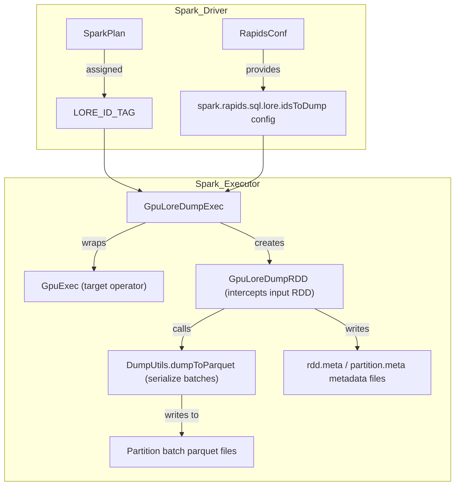
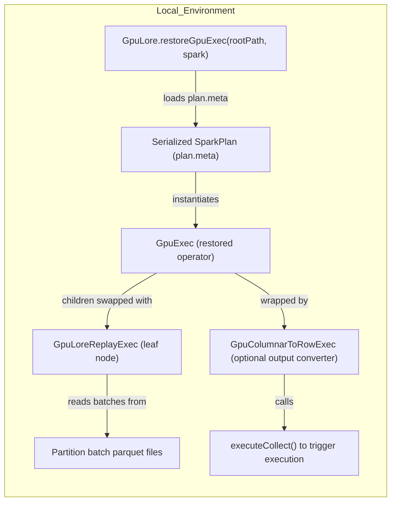

<!-- source: DeepWiki mcp.deepwiki.com · repo NVIDIA/cudf-spark · page 12.3 LORE: Local Replay Framework · fetched 2026-10-26 -->

# LORE: Local Replay Framework

<details>
<summary>Relevant source files</summary>

The following files were used as context for generating this wiki page:

- [docs/dev/lore.md](docs/dev/lore.md)
- [sql-plugin/src/main/scala/com/nvidia/spark/rapids/DumpUtils.scala](sql-plugin/src/main/scala/com/nvidia/spark/rapids/DumpUtils.scala)
- [sql-plugin/src/main/scala/com/nvidia/spark/rapids/lore/GpuLore.scala](sql-plugin/src/main/scala/com/nvidia/spark/rapids/lore/GpuLore.scala)
- [sql-plugin/src/main/scala/com/nvidia/spark/rapids/lore/dump.scala](sql-plugin/src/main/scala/com/nvidia/spark/rapids/lore/dump.scala)
- [sql-plugin/src/main/scala/com/nvidia/spark/rapids/lore/replay.scala](sql-plugin/src/main/scala/com/nvidia/spark/rapids/lore/replay.scala)
- [tests/src/test/scala/com/nvidia/spark/rapids/DumpUtilsSuite.scala](tests/src/test/scala/com/nvidia/spark/rapids/DumpUtilsSuite.scala)
- [tests/src/test/scala/com/nvidia/spark/rapids/lore/GpuLoreSuite.scala](tests/src/test/scala/com/nvidia/spark/rapids/lore/GpuLoreSuite.scala)

</details>


## Purpose and Scope

The LORE (Local Replay) framework is a debugging and profiling utility designed to capture the input data, metadata, and physical execution context of specific GPU operators during a Spark SQL query execution [docs/dev/lore.md:12-14](). By serializing input `ColumnarBatch` streams and operator definitions to persistent storage, LORE allows developers to isolate and "replay" GPU operators locally or in test environments without needing the original distributed cluster or full dataset [docs/dev/lore.md:12-24](). This page documents the core architecture, key components, configuration options, usage workflows, and current limitations of the LORE subsystem.

Sources: [docs/dev/lore.md:12-24]()

## Architecture and Data Flow

LORE operates in two distinct phases: a **capture phase** during distributed execution on a Spark cluster, and a **replay phase** for local debugging and performance analysis [docs/dev/lore.md:12-24]().

### Natural Language to Code Entity Mapping: Capture Phase

During execution, `GpuLore` tags physical `SparkPlan` nodes with unique identifiers (`LORE_ID_TAG`) [sql-plugin/src/main/scala/com/nvidia/spark/rapids/lore/GpuLore.scala:71](). When an operator matches the configured dump path and ID criteria, `GpuLoreDumpExec` wraps the operator's input or command execution, instantiating a `GpuLoreDumpRDD` to intercept partitions and dump batches via `DumpUtils.dumpToParquet` [sql-plugin/src/main/scala/com/nvidia/spark/rapids/lore/dump.scala:65-117](), [sql-plugin/src/main/scala/com/nvidia/spark/rapids/lore/dump.scala:161-175]().

**LORE Capture Pipeline**

Sources: [sql-plugin/src/main/scala/com/nvidia/spark/rapids/lore/GpuLore.scala:67-90, 96-119](), [sql-plugin/src/main/scala/com/nvidia/spark/rapids/lore/dump.scala:48-124, 161-181]()

### Natural Language to Code Entity Mapping: Replay Phase

In the local environment, `GpuLore.restoreGpuExec` loads the serialized `SparkPlan` (`plan.meta`) and replaces child inputs with `GpuLoreReplayExec` nodes [sql-plugin/src/main/scala/com/nvidia/spark/rapids/lore/GpuLore.scala:125-158](). These execution nodes instantiate `GpuLoreReplayRDD` instances to read back the dumped Parquet files and reconstruct `ColumnarBatch` inputs for the target operator [sql-plugin/src/main/scala/com/nvidia/spark/rapids/lore/replay.scala:34-99]().

**LORE Replay Pipeline**

Sources: [sql-plugin/src/main/scala/com/nvidia/spark/rapids/lore/GpuLore.scala:125-144, 149-158](), [docs/dev/lore.md:103-110](), [sql-plugin/src/main/scala/com/nvidia/spark/rapids/lore/replay.scala:34-49]()

Sources: [docs/dev/lore.md:12-24](), [sql-plugin/src/main/scala/com/nvidia/spark/rapids/lore/GpuLore.scala:67-158](), [sql-plugin/src/main/scala/com/nvidia/spark/rapids/lore/dump.scala:48-175](), [sql-plugin/src/main/scala/com/nvidia/spark/rapids/lore/replay.scala:34-99]()

## Key Components

### GpuLore Object

`GpuLore` is the central singleton managing LORE tag definitions, serialization, and operator restoration:

- **Tags:**
  - `LORE_ID_TAG`: attaches a unique string ID to GPU operator plan nodes, ensuring consistent identification across query executions [sql-plugin/src/main/scala/com/nvidia/spark/rapids/lore/GpuLore.scala:71]().
  - `LORE_DUMP_PATH_TAG`: marks a root node for dump output directory path [sql-plugin/src/main/scala/com/nvidia/spark/rapids/lore/GpuLore.scala:76]().
  - `LORE_DUMP_RDD_TAG`: stores `LoreDumpRDDInfo` instances for child RDD data dumping metadata [sql-plugin/src/main/scala/com/nvidia/spark/rapids/lore/GpuLore.scala:81-82]().

- **Serialization Utilities:**
  - `dumpPlan` / `dumpObject` / `loadObject` store and load serialized SparkPlans or metadata objects using Spark's internal `Serializer` and Hadoop filesystem [sql-plugin/src/main/scala/com/nvidia/spark/rapids/lore/GpuLore.scala:96-119]().
  
- **Replay Restoration:**
  - `restoreGpuExec` reads dumped plan metadata, and reconstructs a GPU execution plan by replacing children with `GpuLoreReplayExec` nodes to replay operator inputs from Parquet dumps [sql-plugin/src/main/scala/com/nvidia/spark/rapids/lore/GpuLore.scala:125-168]().

Sources: [sql-plugin/src/main/scala/com/nvidia/spark/rapids/lore/GpuLore.scala:67-168]()

### DumpUtils

`DumpUtils` provides core methods to serialize GPU columnar data for LORE dumps:

- `dumpToParquet` methods convert GPU `ColumnarBatch` or cuDF `Table` instances into Parquet file streams, supporting columnar batches that include serialized tables like `SerializedTableColumn` or `KudoSerializedTableColumn` [sql-plugin/src/main/scala/com/nvidia/spark/rapids/DumpUtils.scala:90-150](), [tests/src/test/scala/com/nvidia/spark/rapids/DumpUtilsSuite.scala:49-147]().

- Supports option to preserve original Spark schema names (column and nested field names) during Parquet serialization for more readable and Spark-compatible dumps [sql-plugin/src/main/scala/com/nvidia/spark/rapids/DumpUtils.scala:135-150]().

Sources: [sql-plugin/src/main/scala/com/nvidia/spark/rapids/DumpUtils.scala:34-190](), [tests/src/test/scala/com/nvidia/spark/rapids/DumpUtilsSuite.scala:35-147]()

### GpuLoreDumpRDD and GpuLoreDumpExec

These classes implement the dump capture phase on executors:

- **GpuLoreDumpExec**: A unary GPU execution node wrapper which intercepts execution of a child `GpuExec` operator to enable LORE dumping. Invokes dumping of input RDD via a `GpuLoreDumpRDD` [sql-plugin/src/main/scala/com/nvidia/spark/rapids/lore/dump.scala:161-175]().

- **GpuLoreDumpRDD**: Wraps the input RDD, intercepts partitions and batches. For each batch, it calls `DumpUtils.dumpToParquet` to serialize the columnar batch to Parquet files. On batch completion per partition, writes `LoreRDDPartitionMeta` with batch count and data types [sql-plugin/src/main/scala/com/nvidia/spark/rapids/lore/dump.scala:48-124]().

Sources: [sql-plugin/src/main/scala/com/nvidia/spark/rapids/lore/dump.scala:40-175]()

### GpuLoreReplayExec and GpuLoreReplayRDD

These components implement replay of dumped data locally:

- **GpuLoreReplayExec**: A leaf physical execution node that acts as a stub replacing original operator children during replay. It creates `GpuLoreReplayRDD` which reads persisted data [sql-plugin/src/main/scala/com/nvidia/spark/rapids/lore/replay.scala:34-49]().
  
- **GpuLoreReplayRDD**: Reads the partition and batch metadata from `rdd.meta` and `partition.meta` files, then loads batch Parquet files into GPU `ColumnarBatch` using cuDF's `Table.readParquet`. Provides an iterator to replay batches sequentially as if they were the operator input [sql-plugin/src/main/scala/com/nvidia/spark/rapids/lore/replay.scala:51-99]().

Sources: [sql-plugin/src/main/scala/com/nvidia/spark/rapids/lore/replay.scala:34-101]()

Sources: [sql-plugin/src/main/scala/com/nvidia/spark/rapids/lore/GpuLore.scala:67-168](), [sql-plugin/src/main/scala/com/nvidia/spark/rapids/DumpUtils.scala:34-190](), [sql-plugin/src/main/scala/com/nvidia/spark/rapids/lore/dump.scala:40-175](), [sql-plugin/src/main/scala/com/nvidia/spark/rapids/lore/replay.scala:34-101]()

## Configuration and LORE IDs

LORE behavior is controlled via `spark.rapids.sql.lore.*` properties:

| Configuration | Description | Default |
|---|---|---|
| `spark.rapids.sql.lore.tag.enabled` | Enables or disables LORE ID tag generation on physical plan nodes. | `true` |
| `spark.rapids.sql.lore.idsToDump` | Comma-separated list of LORE IDs and partition selectors to capture (e.g., `1[*], 2[0-2]`). | (None) |
| `spark.rapids.sql.lore.dumpPath` | Filesystem directory path where LORE dumps are written. Must be empty or non-existent unless `nonStrictMode` is enabled. | (None) |
| `spark.rapids.sql.lore.nonStrictMode.enabled` | If true, skips failed dumps with warnings and tolerates pre-existing files in `dumpPath`. | `false` |
| `spark.rapids.sql.lore.parquet.useOriginalSchemaNames` | Preserves original Spark column names and nested field names in dumped Parquet files. | `true` |

Sources: [docs/dev/lore.md:28-61](), [sql-plugin/src/main/scala/com/nvidia/spark/rapids/lore/GpuLore.scala:26-28]()

### LORE ID Selection Format

The `idsToDump` configuration accepts flexible partition filter expressions:

- `1[*]`: Dumps all partitions for operator ID 1 [docs/dev/lore.md:32-33]().
- `1[0 4-6 7]`: Dumps specific partitions 0, 4, 5, 6, and 7 (ranges upper bound exclusive) for operator ID 1. Operator 2 dumps all partitions in `2[*]` [docs/dev/lore.md:34-37]().

Sources: [docs/dev/lore.md:31-37]()

## Usage Workflow

1. **Identify Operator**: Run the query with `spark.rapids.sql.lore.tag.enabled=true`. Use Spark UI to find `loreId` for the target GPU operator in operator arguments [docs/dev/lore.md:19-20]().
2. **Capture Data**: Re-run the query configuring `spark.rapids.sql.lore.dumpPath` and `spark.rapids.sql.lore.idsToDump` for the desired operators to collect dumped input data [docs/dev/lore.md:21-22]().
3. **Local Replay**: Use `GpuLore.restoreGpuExec` in a local Spark session or test to load the dumped operator and replay it, typically wrapped with `GpuColumnarToRowExec` for output inspection [docs/dev/lore.md:100-110]().

### Example Replay Code

```scala
val loreId = "10"
val dumpPath = new Path(s"${TEST_FILES_ROOT.getAbsolutePath}/loreId-$loreId")
val restoredExec = GpuLore.restoreGpuExec(dumpPath, spark)

GpuColumnarToRowExec(restoredExec)
  .executeCollect()
  .foreach(println)
```

Sources: [docs/dev/lore.md:103-110](), [sql-plugin/src/main/scala/com/nvidia/spark/rapids/lore/GpuLore.scala:125-128](), [tests/src/test/scala/com/nvidia/spark/rapids/lore/GpuLoreSuite.scala:198-203]()

## Directory Structure

LORE organizes dumped artifacts into a deterministic directory hierarchy under the configured `dumpPath`:

```
+ loreId-N/                                   # Directory for operator with loreId = N
  - plan.meta                                # Serialized SparkPlan metadata (root operator plan)
  + input-0/                                 # Data for 0-th child input
    - rdd.meta                               # LoreRDDMeta for underlying RDD (numPartitions, attrs)
    + partition-0/                           # Partition index 0 data
      - partition.meta                       # LoreRDDPartitionMeta (number of batches, data types)
      - batch-0.parquet                      # Parquet file for batch 0
      - batch-1.parquet                      # Parquet file for batch 1
    + partition-1/
      - partition.meta
      - batch-0.parquet
  + input-1/
    - rdd.meta
    + partition-0/
      - partition.meta
      - batch-0.parquet
```

Each `loreId-N` directory contains a serialized version of the GPU operator's Spark plan (`plan.meta`) and one subdirectory per child input RDD. Each child input directory contains metadata files and one directory per Spark partition. Each partition directory contains the Parquet files corresponding to individual batches of columnar data.

Sources: [docs/dev/lore.md:68-96](), [sql-plugin/src/main/scala/com/nvidia/spark/rapids/lore/GpuLore.scala:52-93, 121-122]()

## Limitations

- **Unsupported Operators**: Shuffle-related operators (e.g., `GpuShuffleExchangeExec`) and leaf scan operators (e.g., `GpuFileSourceScanExec`) are not supported for dump and replay directly [docs/dev/lore.md:120-121]().
- **GpuDataWritingCommandExec Compatibility**: Dumping operations involving `GpuDataWritingCommandExec` are disabled on Spark versions with `GpuWriteFiles` enabled (Spark 3.4.x and above, several Databricks Spark versions). Attempting such dumps throws `UnsupportedOperationException` with an explicit message [docs/dev/lore.md:122-143](), [tests/src/test/scala/com/nvidia/spark/rapids/lore/GpuLoreSuite.scala:35-41]().
- **RDD Direct Access**: LORE IDs are not attached if Spark SQL's DataFrame RDDs are accessed and executed outside of the plan framework, limiting replay in such cases [docs/dev/lore.md:119]().

Sources: [docs/dev/lore.md:117-143](), [sql-plugin/src/main/scala/com/nvidia/spark/rapids/lore/GpuLore.scala:129-144](), [tests/src/test/scala/com/nvidia/spark/rapids/lore/GpuLoreSuite.scala:35-41]()

---

This concludes the detailed technical documentation for the LORE Local Replay Framework subsystem in the RAPIDS Accelerator for Apache Spark codebase.

---

