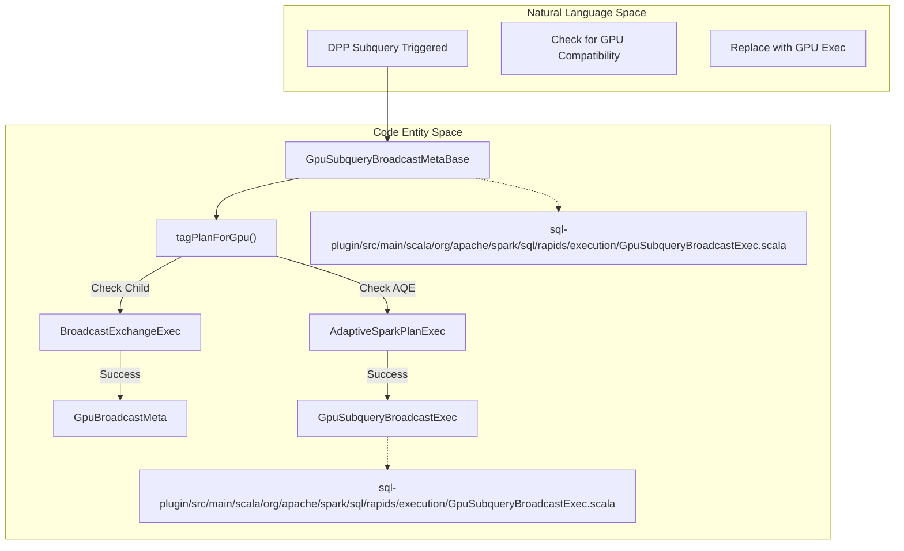
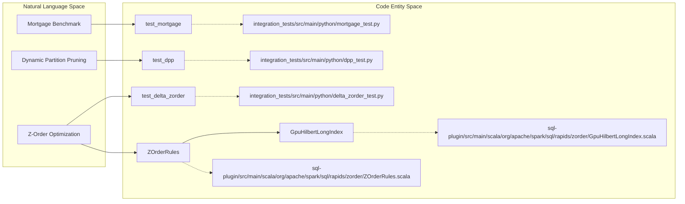

<!-- source: DeepWiki mcp.deepwiki.com · repo NVIDIA/cudf-spark · page 13 Advanced & Experimental Features · fetched 2026-10-26 -->

# Advanced & Experimental Features

Relevant source files

The following files were used as context for generating this wiki page:

- [integration_tests/src/main/python/delta_zorder_test.py](integration_tests/src/main/python/delta_zorder_test.py)
- [integration_tests/src/main/python/dpp_test.py](integration_tests/src/main/python/dpp_test.py)
- [integration_tests/src/main/python/grouping_sets_test.py](integration_tests/src/main/python/grouping_sets_test.py)
- [integration_tests/src/main/python/kudo_dump_test.py](integration_tests/src/main/python/kudo_dump_test.py)
- [integration_tests/src/main/python/mortgage_test.py](integration_tests/src/main/python/mortgage_test.py)
- [sql-plugin/src/main/scala/org/apache/spark/sql/rapids/execution/GpuSubqueryBroadcastExec.scala](sql-plugin/src/main/scala/org/apache/spark/sql/rapids/execution/GpuSubqueryBroadcastExec.scala)
- [sql-plugin/src/main/scala/org/apache/spark/sql/rapids/zorder/GpuHilbertLongIndex.scala](sql-plugin/src/main/scala/org/apache/spark/sql/rapids/zorder/GpuHilbertLongIndex.scala)
- [sql-plugin/src/main/scala/org/apache/spark/sql/rapids/zorder/ZOrderRules.scala](sql-plugin/src/main/scala/org/apache/spark/sql/rapids/zorder/ZOrderRules.scala)

This page provides an overview of advanced and experimental capabilities within the RAPIDS Accelerator for Apache Spark. These features often involve deeper integration with CPU/GPU hybrid execution engines, dynamic runtime optimizations, or specialized tools for performance validation at scale. As a parent page, it introduces each sub-topic with a high-level summary and links to corresponding child pages for comprehensive technical details.

---

## Hybrid CPU/GPU Execution & CPU Bridge

Hybrid CPU/GPU execution is an experimental feature designed to enable accelerated Spark execution by combining GPU and CPU processing within the same query plan. This is particularly useful for workloads where the native GPU Parquet reader does not yet support certain complex data types or nested structures effectively.

The hybrid execution support leverages the Gluten/Velox framework to push Parquet scanning operations to the CPU while enabling the rest of the query plan to run on GPUs. This approach also employs a host-to-GPU batch conversion mechanism to pass data between CPU and GPU execution stages seamlessly.

Key components include:

- `HybridExecutionUtils`: Performs prerequisite and compatibility checks for hybrid execution activation.
- `HybridFileSourceScanExec`: Replaces the standard file scan physical operator to execute Parquet scanning on CPU.
- `HostBatchProducer` & `CoalesceConvertIterator`: Manage production and conversion of CPU-based data batches into GPU columnar batches.
- Integration with Gluten and Velox for efficient CPU-side execution.

This experimental framework expands the plugin’s capabilities while the native GPU Parquet reader continues to develop support for challenging types and formats.

For details, see [Hybrid CPU/GPU Execution & CPU Bridge](#13.1).

Sources: 

---

## Dynamic Partition Pruning & Subquery Broadcast

Dynamic Partition Pruning (DPP) is a runtime optimization in Spark that uses join keys from a broadcasted subquery to filter partitions of another table during a join, reducing scan I/O and improving query performance.

The RAPIDS Accelerator accelerates this feature by GPU-enabling the broadcast of subquery results for pruning purposes. Specifically:

- It replaces Spark's `SubqueryBroadcastExec` with `GpuSubqueryBroadcastExec` [sql-plugin/src/main/scala/org/apache/spark/sql/rapids/execution/GpuSubqueryBroadcastExec.scala:168](), allowing the broadcasted subquery data to remain in GPU memory.
- This avoids costly host-to-GPU data transfers during join execution.
- The plugin’s `GpuSubqueryBroadcastMetaBase` class [sql-plugin/src/main/scala/org/apache/spark/sql/rapids/execution/GpuSubqueryBroadcastExec.scala:44]() contains the metadata logic that inspects the child plans—handling both normal and adaptive query execution (AQE) cases—to confirm if GPU execution is feasible [sql-plugin/src/main/scala/org/apache/spark/sql/rapids/execution/GpuSubqueryBroadcastExec.scala:57-137]().
- If conditions are met, the subquery broadcast is converted entirely to GPU operators.
- The integration supports reuse of broadcast exchanges and works in harmony with AQE’s dynamic pruning insertion [integration_tests/src/main/python/dpp_test.py:67-70]().

This streamlined GPU implementation improves join execution latency in complex workloads, especially where partition pruning is expressively triggered by broadcast subqueries.

### Dynamic Partition Pruning GPU Replacement Diagram

For details, see [Dynamic Partition Pruning & Subquery Broadcast](#13.2).

Sources: [sql-plugin/src/main/scala/org/apache/spark/sql/rapids/execution/GpuSubqueryBroadcastExec.scala:57-137](), [sql-plugin/src/main/scala/org/apache/spark/sql/rapids/execution/GpuSubqueryBroadcastExec.scala:44](), [integration_tests/src/main/python/dpp_test.py:66-168]()

---

## Scale Testing & Data Generation

This feature area addresses the framework for generating large-scale datasets, running benchmark SQL queries, and conducting stress testing on the RAPIDS Accelerator to validate correctness and measure performance at scale.

The key elements are:

- **Datagen module (`bigDataGen.scala`)**: A Scala-based data generation tool producing synthetic datasets with configurable scale factors, complexity, and output format. This utility enables reproducible large-scale data creation for benchmarking.
- **Scale Test Framework**: A suite of complex SQL query sets designed to put the accelerator through real-world-like large data joins, aggregations, and window functions across various join types and data patterns.
- **Mortgage Benchmark Tests (`mortgage_test.py`)**: Integration tests employing synthetic mortgage-style data workloads to assert GPU vs CPU correctness and measure accelerated performance [integration_tests/src/main/python/mortgage_test.py:27-35]().
- **Z-Ordering Optimizations Support**: GPU implementations and tests for Delta Lake Z-Ordering operators such as `InterleaveBits` and `HilbertLongIndex` [sql-plugin/src/main/scala/org/apache/spark/sql/rapids/zorder/GpuHilbertLongIndex.scala:33-56]() for improved data skipping and pruning in queries [sql-plugin/src/main/scala/org/apache/spark/sql/rapids/zorder/ZOrderRules.scala:90-142]().

### Scale Test Framework Mapping Diagram

| Component          | Description                                                       | File Pointer                                                                    |
|--------------------|-------------------------------------------------------------------|---------------------------------------------------------------------------------|
| `ZOrderRules`          | Rules replacing Delta Lake zorder operators with GPU equivalents | [sql-plugin/src/main/scala/org/apache/spark/sql/rapids/zorder/ZOrderRules.scala:31-158]() |
| `GpuHilbertLongIndex`  | GPU expression implementing Databricks HilbertLongIndex zorder  | [sql-plugin/src/main/scala/org/apache/spark/sql/rapids/zorder/GpuHilbertLongIndex.scala:33-56]() |
| `datagen.bigDataGen`   | Big data generation Scala tool for creating large test datasets  |  |
| `mortgage_test.py`     | Mortgage benchmark integration test                              | [integration_tests/src/main/python/mortgage_test.py:27-35]()                   |
| `dpp_test.py`          | Dynamic Partition Pruning test suite with various broadcast reuse settings | [integration_tests/src/main/python/dpp_test.py:66-168]()                       |
| `delta_zorder_test.py` | Delta Lake Z-order and dynamic file pruning tests               | [integration_tests/src/main/python/delta_zorder_test.py:123-142]()             |

For details, see [Scale Testing & Data Generation](#13.3).

Sources: [integration_tests/src/main/python/mortgage_test.py:27-35](), [integration_tests/src/main/python/dpp_test.py:66-168](), [integration_tests/src/main/python/delta_zorder_test.py:123-142](), [sql-plugin/src/main/scala/org/apache/spark/sql/rapids/zorder/ZOrderRules.scala:31-158](), [sql-plugin/src/main/scala/org/apache/spark/sql/rapids/zorder/GpuHilbertLongIndex.scala:33-56]()

---

This page outlines advanced and experimental features that push the boundaries of GPU acceleration in Apache Spark. For in-depth technical details, implementation discussions, and usage instructions, refer to the linked child pages:

- [Hybrid CPU/GPU Execution & CPU Bridge](#13.1)
- [Dynamic Partition Pruning & Subquery Broadcast](#13.2)
- [Scale Testing & Data Generation](#13.3)

---

