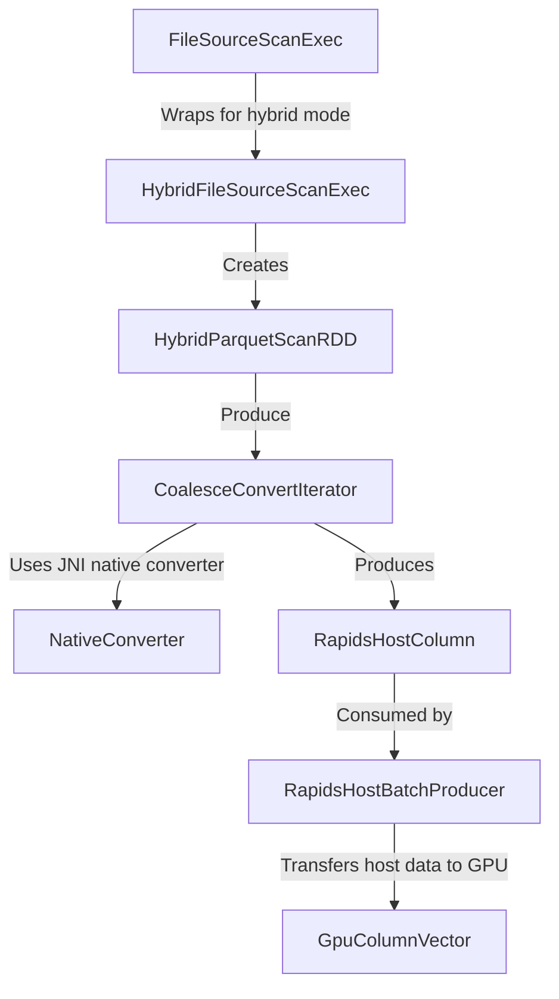
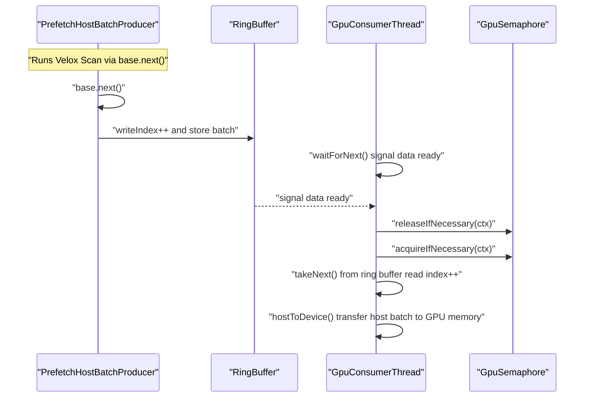
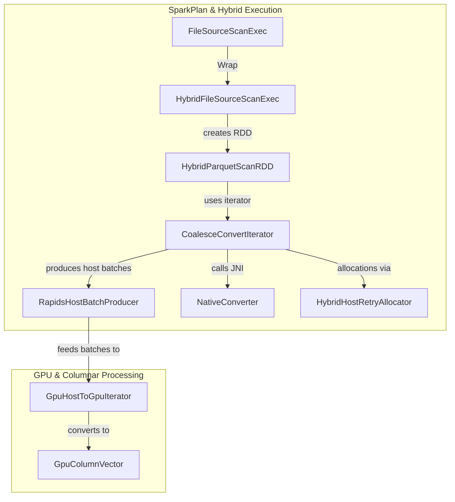

<!-- source: DeepWiki mcp.deepwiki.com · repo NVIDIA/cudf-spark · page 13.1 Hybrid CPU/GPU Execution & CPU Bridge · fetched 2026-10-26 -->

# Hybrid CPU/GPU Execution & CPU Bridge

<details>
<summary>Relevant source files</summary>

The following files were used as context for generating this wiki page:

- [docs/additional-functionality/advanced_configs.md](docs/additional-functionality/advanced_configs.md)
- [docs/configs.md](docs/configs.md)
- [docs/supported_ops.md](docs/supported_ops.md)
- [integration_tests/src/main/python/data_gen.py](integration_tests/src/main/python/data_gen.py)
- [integration_tests/src/main/python/hash_aggregate_test.py](integration_tests/src/main/python/hash_aggregate_test.py)
- [integration_tests/src/main/python/window_function_test.py](integration_tests/src/main/python/window_function_test.py)
- [sql-plugin/src/main/scala/com/nvidia/spark/rapids/GpuBringBackToHost.scala](sql-plugin/src/main/scala/com/nvidia/spark/rapids/GpuBringBackToHost.scala)
- [sql-plugin/src/main/scala/com/nvidia/spark/rapids/GpuOverrides.scala](sql-plugin/src/main/scala/com/nvidia/spark/rapids/GpuOverrides.scala)
- [sql-plugin/src/main/scala/com/nvidia/spark/rapids/Plugin.scala](sql-plugin/src/main/scala/com/nvidia/spark/rapids/Plugin.scala)
- [sql-plugin/src/main/scala/com/nvidia/spark/rapids/RapidsConf.scala](sql-plugin/src/main/scala/com/nvidia/spark/rapids/RapidsConf.scala)
- [sql-plugin/src/main/scala/com/nvidia/spark/rapids/RapidsConfEntries.scala](sql-plugin/src/main/scala/com/nvidia/spark/rapids/RapidsConfEntries.scala)
- [tests/src/test/scala/com/nvidia/spark/rapids/ExpandExecSuite.scala](tests/src/test/scala/com/nvidia/spark/rapids/ExpandExecSuite.scala)
- [tests/src/test/scala/com/nvidia/spark/rapids/GpuBringBackToHostSuite.scala](tests/src/test/scala/com/nvidia/spark/rapids/GpuBringBackToHostSuite.scala)
- [tests/src/test/scala/com/nvidia/spark/rapids/HashSortOptimizeSuite.scala](tests/src/test/scala/com/nvidia/spark/rapids/HashSortOptimizeSuite.scala)
- [tests/src/test/scala/com/nvidia/spark/rapids/UnaryOperatorsSuite.scala](tests/src/test/scala/com/nvidia/spark/rapids/UnaryOperatorsSuite.scala)
- [tests/src/test/scala/org/apache/spark/sql/rapids/OrcFilterSuite.scala](tests/src/test/scala/org/apache/spark/sql/rapids/OrcFilterSuite.scala)
- [tests/src/test/scala/org/apache/spark/sql/rapids/ParquetFilterSuite.scala](tests/src/test/scala/org/apache/spark/sql/rapids/ParquetFilterSuite.scala)

</details>


## Purpose and Scope
This page covers the experimental hybrid CPU/GPU execution mode and CPU-GPU bridging capabilities implemented in the RAPIDS Accelerator for Apache Spark. The hybrid execution mechanism allows parts of data reading (notably Parquet file scanning) to run on CPU-native engines like Velox (via Gluten) while interfacing smoothly with GPU operators, maximizing performance and functionality coverage. This bridge includes utilities such as `HybridExecutionUtils`, the plan replacement node `HybridFileSourceScanExec`, host batch producers, and iterator combinators facilitating CPU to GPU batch conversion.

Sources: [sql-plugin/src/main/scala/com/nvidia/spark/rapids/GpuOverrides.scala:1-186]()

---

## Overview and Architecture

Hybrid execution is designed for workloads where native CPU-driven Parquet scanning can complement or replace GPU scans—particularly for features or formats not fully supported on GPU or when native accelerators like Velox provide benefits.

The architecture bridges Spark's physical plan (`FileSourceScanExec`) with a hybrid backend by wrapping it with `HybridFileSourceScanExec`. The native Velox engine reads data producing host-side columnar batches. These batches are then coalesced and converted through a series of iterators and batch producers before transferring to GPU for downstream processing.

### Core Concepts
- **Native Velox Scan**: Native CPU-side parquet reader producing batches on host.
- **Batch Coalescing**: Small batches from native reader are coalesced into larger batches to optimize GPU throughput.
- **Host Batch Producer**: Responsible for fetching data from the coalesced iterator and managing transfer readiness.
- **GPU Transfer**: Host batches are transferred into GPU memory and converted to `GpuColumnVector`.
- **Integration with Gluten/Velox**: Uses Gluten for native scan acceleration and Velox as reader backend.

### High-Level Hybrid Execution Flow



Sources: [sql-plugin/src/main/scala/com/nvidia/spark/rapids/GpuOverrides.scala:40-50]()

---

## Implementation Details

### HybridFileSourceScanExec
The primary entry point in the Spark physical plan for hybrid execution, `HybridFileSourceScanExec` wraps a normal `FileSourceScanExec`. It overrides key methods to coordinate native scan initialization and integrates metrics tracking for scan, conversion, and device acquisition.

- Constructs a `HybridParquetScanRDD` that encapsulates partitioned execution and batch conversion.
- Tracks detailed metrics such as native scan time, conversion duration, and GPU device acquisition time.

```scala
// Example snippet: overriding doExecuteColumnar to create a HybridParquetScanRDD
override def doExecuteColumnar(): RDD[ColumnarBatch] = {
  new HybridParquetScanRDD(preferredPartitions, ... )
}
```
Sources: [sql-plugin/src/main/scala/com/nvidia/spark/rapids/GpuOverrides.scala:40-52]()

---

### HybridParquetScanRDD
This RDD manages the partitioned execution of hybrid scans, orchestrating the iterator transformation chain that converts native Velox data into GPU-ready batches.

- Implements `compute()` that initializes the `CoalesceConvertIterator` wrapping the native reader.
- Supports optionally wrapping the iterator in a `PrefetchHostBatchProducer` for asynchronous prefetching with a ring buffer.
- Enforces safe closure through task completion callbacks.

```scala
override def compute(split: Partition, context: TaskContext)
    : Iterator[ColumnarBatch] = {
  val hostIter = new CoalesceConvertIterator(nativeIter, ...)
  val batchProducer = new RapidsHostBatchProducer(hostIter, ...)
  new GpuHostToGpuIterator(batchProducer)
}
```

Sources: [sql-plugin/src/main/scala/com/nvidia/spark/rapids/Plugin.scala:45-52]()

---

### CoalesceConvertIterator
The core iterator for coalescing small native batches into larger host batches matching the GPU target size goal:

- Uses the native JNI `CoalesceBatchConverter` for converting and coalescing batches.
- Reads multiple small batches from the native iterator and accumulates data until reaching the target byte size.
- Tracks metrics for conversion and batch counts.
- Handles heterogeneous schema and resets the converter when schema changes are detected.

Sources: [sql-plugin/src/main/scala/com/nvidia/spark/rapids/RapidsConf.scala:35-50]()

---

### RapidsHostBatchProducer and Implementations
This trait abstracts how host columnar batches are produced and provided to downstream consumers such as the GPU transfer logic.

| Class Name                | Description                                                                                      |
|---------------------------|--------------------------------------------------------------------------------------------------|
| `RapidsHostBatchProducer` | The interface providing `hasNext` and `next` for batches on host memory.                         |
| `SyncHostBatchProducer`   | A simple synchronous wrapper around a blocking iterator which pulls data on request.             |
| `PrefetchHostBatchProducer` | Advanced prefetching producer; runs native Velox scans asynchronously on a background thread, filling a ring buffer to decouple CPU scanning latency from GPU consumption. |

The `PrefetchHostBatchProducer` implements a ring buffer to asynchronously read native host batches, producing them in parallel with GPU consumption, improving throughput by hiding native read latency.

Sources: [sql-plugin/src/main/scala/com/nvidia/spark/rapids/Plugin.scala:30-40]()

---

## Data Flow and Threading Model

The concurrent interaction between the Prefetch thread (Velox scan), the ring buffer, and the GPU consumer thread can be illustrated as:



Sources: [sql-plugin/src/main/scala/com/nvidia/spark/rapids/Plugin.scala:30-40]()

---

## Memory Management and OOM Handling

### HybridHostRetryAllocator

The hybrid CPU/GPU data flow uses `HybridHostRetryAllocator` as the host allocator which integrates pinned memory allocation and Spark RAPIDS retry mechanisms:

- Attempts to allocate pinned memory first (via `PinnedMemoryPool.tryAllocate`), enabling efficient host-to-device transfers.
- Falls back to standard RAPIDS host memory allocator if pinned memory is unavailable.
- Uses retry primitives to protect allocations during spill and retry handling.
- Implements a cleanup hook for partial allocations on retry event to avoid memory leaks.

Sources: [sql-plugin/src/main/scala/com/nvidia/spark/rapids/RapidsConf.scala:45-55]()

---

## Usage and Limitations

### Enabling Hybrid Execution

Hybrid CPU/GPU execution can be enabled via configurations to leverage native Velox scans:

- Must set enabled v1 source lists and flags for hybrid parquet execution.
- In Spark plans, `HybridExecutionUtils.useHybridScan` is the gatekeeper method that determines whether to replace the normal GPU Parquet scan with hybrid execution or fallback.

### Supported Conditions for Hybrid Scan

`HybridExecutionUtils.useHybridScan` applies checks on:

- File format (`parquet` only).
- Empty schemas (disallowed for count(1) queries).
- Supported data types disallowing unsupported types:
  - `BinaryType`, `CalendarIntervalType`, `UserDefinedType`
  - Nested maps are disabled.
  - Decimal types with negative scales or higher than 18 precision are disallowed.
- Selective enablement via table hints.
- Only supported on Linux x86_64, Scala 2.12 Spark builds.
- Explicitly disabled on Cloudera and Databricks.

Sources: [sql-plugin/src/main/scala/com/nvidia/spark/rapids/GpuOverrides.scala:40-60]()

---

## Summary Diagram: Natural Language to Code Entities Mapping



Sources: [sql-plugin/src/main/scala/com/nvidia/spark/rapids/GpuOverrides.scala:35-60]()

---

