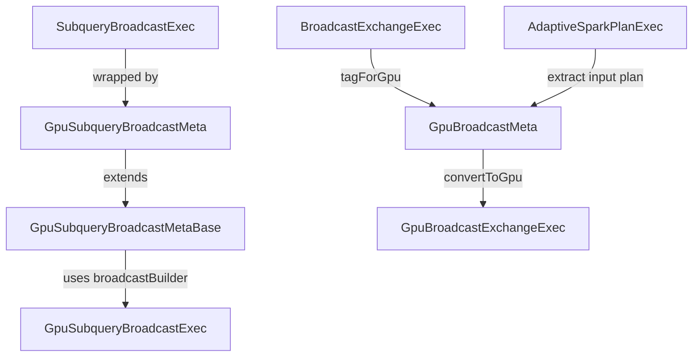
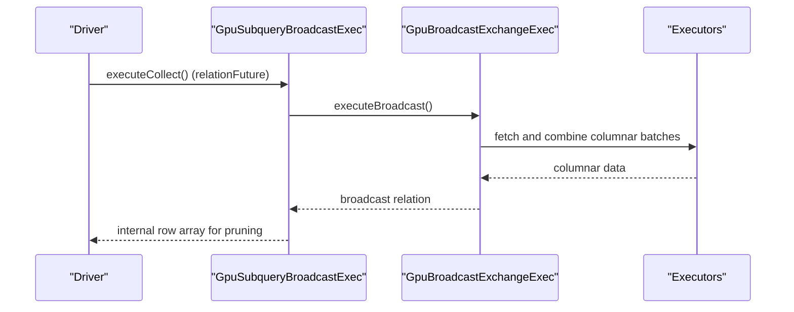
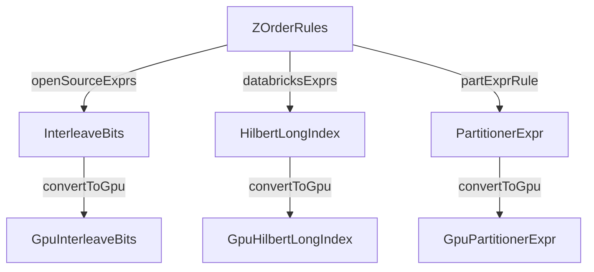

<!-- source: DeepWiki mcp.deepwiki.com · repo NVIDIA/cudf-spark · page 13.2 Dynamic Partition Pruning & Subquery Broadcast · fetched 2026-10-26 -->

# Dynamic Partition Pruning & Subquery Broadcast

Relevant source files

The following files were used as context for generating this wiki page:

- [integration_tests/src/main/python/delta_zorder_test.py](integration_tests/src/main/python/delta_zorder_test.py)
- [integration_tests/src/main/python/dpp_test.py](integration_tests/src/main/python/dpp_test.py)
- [integration_tests/src/main/python/grouping_sets_test.py](integration_tests/src/main/python/grouping_sets_test.py)
- [integration_tests/src/main/python/kudo_dump_test.py](integration_tests/src/main/python/kudo_dump_test.py)
- [integration_tests/src/main/python/mortgage_test.py](integration_tests/src/main/python/mortgage_test.py)
- [sql-plugin/src/main/scala/org/apache/spark/sql/rapids/execution/GpuSubqueryBroadcastExec.scala](sql-plugin/src/main/scala/org/apache/spark/sql/rapids/execution/GpuSubqueryBroadcastExec.scala)
- [sql-plugin/src/main/scala/org/apache/spark/sql/rapids/zorder/GpuHilbertLongIndex.scala](sql-plugin/src/main/scala/org/apache/spark/sql/rapids/zorder/GpuHilbertLongIndex.scala)
- [sql-plugin/src/main/scala/org/apache/spark/sql/rapids/zorder/ZOrderRules.scala](sql-plugin/src/main/scala/org/apache/spark/sql/rapids/zorder/ZOrderRules.scala)
- [sql-plugin/src/main/spark330db/scala/com/nvidia/spark/rapids/shims/Spark321PlusDBShims.scala](sql-plugin/src/main/spark330db/scala/com/nvidia/spark/rapids/shims/Spark321PlusDBShims.scala)
- [sql-plugin/src/main/spark330db/scala/org/apache/spark/rapids/execution/GpuSubqueryBroadcastMeta.scala](sql-plugin/src/main/spark330db/scala/org/apache/spark/rapids/execution/GpuSubqueryBroadcastMeta.scala)
- [sql-plugin/src/main/spark330db/scala/org/apache/spark/rapids/execution/GpuSubqueryBroadcastMeta330DBBase.scala](sql-plugin/src/main/spark330db/scala/org/apache/spark/rapids/execution/GpuSubqueryBroadcastMeta330DBBase.scala)
- [sql-plugin/src/main/spark332db/scala/com/nvidia/spark/rapids/shims/Spark332PlusDBShims.scala](sql-plugin/src/main/spark332db/scala/com/nvidia/spark/rapids/shims/Spark332PlusDBShims.scala)
- [sql-plugin/src/main/spark340/scala/com/nvidia/spark/rapids/shims/Spark340PlusNonDBShims.scala](sql-plugin/src/main/spark340/scala/com/nvidia/spark/rapids/shims/Spark340PlusNonDBShims.scala)
- [sql-plugin/src/main/spark350db143/scala/com/nvidia/spark/rapids/shims/Spark341PlusDBShims.scala](sql-plugin/src/main/spark350db143/scala/com/nvidia/spark/rapids/shims/Spark341PlusDBShims.scala)
- [sql-plugin/src/main/spark350db143/scala/com/nvidia/spark/rapids/shims/Spark350db143Shims.scala](sql-plugin/src/main/spark350db143/scala/com/nvidia/spark/rapids/shims/Spark350db143Shims.scala)
- [sql-plugin/src/main/spark350db143/scala/org/apache/spark/sql/rapids/execution/GpuSubqueryBroadcastMeta.scala](sql-plugin/src/main/spark350db143/scala/org/apache/spark/sql/rapids/execution/GpuSubqueryBroadcastMeta.scala)
- [sql-plugin/src/main/spark400/scala/org/apache/spark/sql/rapids/execution/GpuSubqueryBroadcastMeta.scala](sql-plugin/src/main/spark400/scala/org/apache/spark/sql/rapids/execution/GpuSubqueryBroadcastMeta.scala)
- [sql-plugin/src/test/scala/com/nvidia/spark/rapids/ClassInitializationSuite.scala](sql-plugin/src/test/scala/com/nvidia/spark/rapids/ClassInitializationSuite.scala)

Dynamic Partition Pruning (DPP) and Subquery Broadcast are key optimizations in Apache Spark to improve join query performance. The RAPIDS Accelerator for Apache Spark implements GPU-accelerated counterparts of these features to preserve columnar data processing and avoid costly CPU-GPU transitions.

This page explains the GPU integration of DPP via `GpuSubqueryBroadcastExec`, its metadata handling, related Z-order rules, and associated integration tests validating GPU acceleration of dynamic partition pruning and subquery broadcast.

---

## Overview and Purpose

Dynamic Partition Pruning speeds up join execution by using the join filtering side to prune partitions dynamically on the fact side during runtime. This relies on broadcasting the set of join keys from the filtering side to the build side.

In Spark, this is orchestrated by the physical plan operator `SubqueryBroadcastExec`, which wraps a broadcast exchange of the filtering subquery results. The RAPIDS Accelerator replaces `SubqueryBroadcastExec` with a GPU-native implementation, `GpuSubqueryBroadcastExec`, to achieve:

- Seamless GPU execution of DPP subqueries with efficient broadcast plan handling.
- Compatibility with Spark’s Adaptive Query Execution (AQE) and non-AQE modes.
- Integration with broadcast reuse and complex queries involving reused broadcasts.
- GPU acceleration of DPP scanning for partition pruning, including Delta Lake dynamic file pruning (DFP) with Z-order support.

The accelerator meta rules ensure `SubqueryBroadcastExec` plans are converted and tagged properly to GPU-compatible `GpuSubqueryBroadcastExec` and associated plans.

Sources: [sql-plugin/src/main/scala/org/apache/spark/sql/rapids/execution/GpuSubqueryBroadcastExec.scala:57-137]()

---

## Data Flow and Implementation Details

### Subquery Broadcast Execution Pattern

The key GPU execution class is `GpuSubqueryBroadcastExec` which encapsulates a subquery broadcast plan with GPU broadcast exchange underneath.

- It tracks a future (`relationFuture`) running asynchronously to execute the broadcast subquery and produce a broadcast relation.
- On execution, it calls `broadcast.executeBroadcast()` to materialize broadcast columnar batches across executors.
- The broadcast output is converted and cached for dynamic partition pruning filtering use, returning an internal row array representing keys filtered on the GPU.

This enables executing the entire subquery broadcast on GPU in columnar format, avoiding expensive columnar-to-row conversions and CPU fallback.

### Metadata Class: GpuSubqueryBroadcastMetaBase

The GPU meta class `GpuSubqueryBroadcastMetaBase` analyzes the child's plan of `SubqueryBroadcastExec` to decide GPU compatibility and plan replacement:

- If the child is a `BroadcastExchangeExec` wrapping a `GpuColumnarToRowExec`, it converts this chain to `GpuBroadcastExchange` directly. [sql-plugin/src/main/scala/org/apache/spark/sql/rapids/execution/GpuSubqueryBroadcastExec.scala:82-88]()
- For AQE-enabled scenarios, where `AdaptiveSparkPlanExec` is present, it detects the inner broadcast exchange in the adaptive plan and replaces it with a GPU version. [sql-plugin/src/main/scala/org/apache/spark/sql/rapids/execution/GpuSubqueryBroadcastExec.scala:117-126]()
- It sets up a broadcast builder function to lazily build the GPU broadcast plan when needed. [sql-plugin/src/main/scala/org/apache/spark/sql/rapids/execution/GpuSubqueryBroadcastExec.scala:51](), [sql-plugin/src/main/scala/org/apache/spark/sql/rapids/execution/GpuSubqueryBroadcastExec.scala:86](), [sql-plugin/src/main/scala/org/apache/spark/sql/rapids/execution/GpuSubqueryBroadcastExec.scala:124]()
- If the underlying broadcast exchange cannot be run on GPU, it rejects converting the subquery broadcast. [sql-plugin/src/main/scala/org/apache/spark/sql/rapids/execution/GpuSubqueryBroadcastExec.scala:88-89](), [sql-plugin/src/main/scala/org/apache/spark/sql/rapids/execution/GpuSubqueryBroadcastExec.scala:126-127]()
- Extracts the broadcast mode key expressions for use by the dynamic partition pruning filter. [sql-plugin/src/main/scala/org/apache/spark/sql/rapids/execution/GpuSubqueryBroadcastExec.scala:145-163]()

Sources: [sql-plugin/src/main/scala/org/apache/spark/sql/rapids/execution/GpuSubqueryBroadcastExec.scala:51-163]()

### GPU Plan Replacement Sequence

Diagram: Code Entity Mapping for Subquery Broadcast Plan Replacement

Sources: [sql-plugin/src/main/scala/org/apache/spark/sql/rapids/execution/GpuSubqueryBroadcastExec.scala:44-137](), [sql-plugin/src/main/spark400/scala/org/apache/spark/sql/rapids/execution/GpuSubqueryBroadcastMeta.scala:35-45]()

### GpuSubqueryBroadcastExec Execution Flow

Diagram: Sequence of `GpuSubqueryBroadcastExec` Execution and Data Retrieval

Sources: [sql-plugin/src/main/scala/org/apache/spark/sql/rapids/execution/GpuSubqueryBroadcastExec.scala:168-257]()

---

## Key Classes and Components

### `GpuSubqueryBroadcastExec`
- GPU physical operator for executing subquery broadcasts optimized for GPU. [sql-plugin/src/main/scala/org/apache/spark/sql/rapids/execution/GpuSubqueryBroadcastExec.scala:168-173]()
- Holds a `relationFuture` that lazily executes and caches the broadcast relation asynchronously. [sql-plugin/src/main/scala/org/apache/spark/sql/rapids/execution/GpuSubqueryBroadcastExec.scala:200-201]()
- Overrides `doExecute()` returning empty RDD because actual data is pushed via broadcast. [sql-plugin/src/main/scala/org/apache/spark/sql/rapids/execution/GpuSubqueryBroadcastExec.scala:203-205]()
- Executes `broadcast.executeBroadcast()` to trigger broadcast data fetching in GPU columnar format. [sql-plugin/src/main/scala/org/apache/spark/sql/rapids/execution/GpuSubqueryBroadcastExec.scala:210]()
- Converts broadcast data to an internal row array compatible with Spark's dynamic partition pruning filter. [sql-plugin/src/main/scala/org/apache/spark/sql/rapids/execution/GpuSubqueryBroadcastExec.scala:216-220]()

### `GpuSubqueryBroadcastMetaBase`
- Abstract metadata class tagging subquery broadcast plans for GPU compatibility. [sql-plugin/src/main/scala/org/apache/spark/sql/rapids/execution/GpuSubqueryBroadcastExec.scala:44-49]()
- Detects whether underlying broadcast exchange can be run on GPU. [sql-plugin/src/main/scala/org/apache/spark/sql/rapids/execution/GpuSubqueryBroadcastExec.scala:88-89](), [sql-plugin/src/main/scala/org/apache/spark/sql/rapids/execution/GpuSubqueryBroadcastExec.scala:126-127]()
- Supports both AQE and non-AQE scenarios by handling `BroadcastExchangeExec` and `AdaptiveSparkPlanExec`. [sql-plugin/src/main/scala/org/apache/spark/sql/rapids/execution/GpuSubqueryBroadcastExec.scala:57-137]()
- Provides lazy builder (`broadcastBuilder`) to create GPU broadcast exchange plan. [sql-plugin/src/main/scala/org/apache/spark/sql/rapids/execution/GpuSubqueryBroadcastExec.scala:51](), [sql-plugin/src/main/scala/org/apache/spark/sql/rapids/execution/GpuSubqueryBroadcastExec.scala:86](), [sql-plugin/src/main/scala/org/apache/spark/sql/rapids/execution/GpuSubqueryBroadcastExec.scala:124]()
- Extracts broadcast mode keys used in partition pruning. [sql-plugin/src/main/scala/org/apache/spark/sql/rapids/execution/GpuSubqueryBroadcastExec.scala:145-163]()

### `GpuSubqueryBroadcastMeta`
- Extends `GpuSubqueryBroadcastMetaBase`. [sql-plugin/src/main/spark400/scala/org/apache/spark/sql/rapids/execution/GpuSubqueryBroadcastMeta.scala:35-44]()
- Implements `convertToGpu()` to produce a `GpuSubqueryBroadcastExec` physical plan. [sql-plugin/src/main/spark400/scala/org/apache/spark/sql/rapids/execution/GpuSubqueryBroadcastMeta.scala:41-43]()
- Different shim implementations exist for various Spark versions (Apache Spark 4.x, Databricks, etc.) adapting to version-specific plan shapes and APIs. [sql-plugin/src/main/spark400/scala/org/apache/spark/sql/rapids/execution/GpuSubqueryBroadcastMeta.scala:35-44](), [sql-plugin/src/main/spark330db/scala/com/nvidia/spark/rapids/shims/Spark321PlusDBShims.scala:116-119]()

Sources: [sql-plugin/src/main/scala/org/apache/spark/sql/rapids/execution/GpuSubqueryBroadcastExec.scala:44-257](), [sql-plugin/src/main/spark400/scala/org/apache/spark/sql/rapids/execution/GpuSubqueryBroadcastMeta.scala:35-44]()

---

## Shim Layer Variants and Version Adaptation

Multiple shim variants customize the meta classes to Spark versions and distributions:

| Spark Version / Env | Meta Class | Notes |
|----------------|------------|-------|
| Apache Spark 4.x | `GpuSubqueryBroadcastMeta` | Uses `indices`, `buildKeys` from `SubqueryBroadcastExec` directly. [sql-plugin/src/main/spark400/scala/org/apache/spark/sql/rapids/execution/GpuSubqueryBroadcastMeta.scala:41-43]() |
| Databricks 3.3.x & 3.3.x DB | `GpuSubqueryBroadcastMeta330DBBase` (base) with derived `GpuSubqueryBroadcastMeta` | Handles AQE with `BroadcastQueryStageExec` and reuse via `ReusedExchangeExec`. [sql-plugin/src/main/spark330db/scala/com/nvidia/spark/rapids/shims/Spark321PlusDBShims.scala:116-119]() |
| Databricks 14.3+ (3.5.x-ish) | `GpuSubqueryBroadcastMeta350DBBase` derived `GpuSubqueryBroadcastMeta` | Similar to above, uses updated APIs and indices. [sql-plugin/src/main/spark350db143/scala/org/apache/spark/sql/rapids/execution/GpuSubqueryBroadcastMeta.scala:26-36]() |

The shim classes inspect broadcast child plans including reused broadcast exchanges and adaptive broadcast query stages ensuring GPU compatibility.

Sources:
- [sql-plugin/src/main/spark400/scala/org/apache/spark/sql/rapids/execution/GpuSubqueryBroadcastMeta.scala:35-44]()
- [sql-plugin/src/main/spark330db/scala/com/nvidia/spark/rapids/shims/Spark321PlusDBShims.scala:116-119]()

---

## Integration Tests for Dynamic Partition Pruning (DPP)

The integration tests extensively validate GPU DPP and subquery broadcast behavior under various conditions, including broadcast reuse and partition pruning.

- The `dpp_test.py` in `integration_tests/src/main/python/` defines tests using synthetic dimension and fact tables with join filters on partition columns [integration_tests/src/main/python/dpp_test.py:25-178]().
- Queries include single and multi-key joins, struct-typed keys, and complex predicates verifying GPU-CPU result equality. [integration_tests/src/main/python/dpp_test.py:87-166]()
- Tests cover varying Spark configs for dynamic partition pruning enabling, broadcast reuse, and exchange reuse flags. [integration_tests/src/main/python/dpp_test.py:66-78]()
- Special tests handle reused broadcast subqueries validating that reused broadcast in UNION ALL queries work correctly on GPU [integration_tests/src/main/python/dpp_test.py:119-137]().

### Important Test Configurations:

| Config Property | Purpose |
|---|---|
| `spark.sql.optimizer.dynamicPartitionPruning.enabled=true` | Enable DPP |
| `spark.sql.optimizer.dynamicPartitionPruning.reuseBroadcastOnly` | Control broadcast reuse in DPP |
| `spark.sql.exchange.reuse` | Enable or disable exchange reuse |
| `spark.sql.optimizer.dynamicPartitionPruning.useStats` | Use stats for pruning filtering |
| `spark.sql.optimizer.dynamicPartitionPruning.fallbackFilterRatio` | Determines fallback thresholds |

### Fallback for Databricks 14.3+

- Due to the presence of `CollectLimitExec` in some filtered plans, the tests allow CPU fallback for this exec while verifying GPU execution for the rest [integration_tests/src/main/python/dpp_test.py:170-174]().

Sources: [integration_tests/src/main/python/dpp_test.py:25-178]()

---

## Z-Order Rules and Dynamic File Pruning (DFP)

Z-ordering is a data layout optimization that improves locality and pruning for high-cardinality columns, heavily used in Delta Lake with Dynamic File Pruning.

### GPU Acceleration of Z-Order Expressions

The plugin includes GPU replacements for key Z-order expressions used in dynamic file pruning:

- `GpuInterleaveBits` replaces `InterleaveBits` (Delta Lake open-source) [sql-plugin/src/main/scala/org/apache/spark/sql/rapids/zorder/ZOrderRules.scala:91-106]()
- `GpuHilbertLongIndex` replaces Databricks's `HilbertLongIndex` [sql-plugin/src/main/scala/org/apache/spark/sql/rapids/zorder/ZOrderRules.scala:123-142]()
- `GpuPartitionerExpr` replaces `PartitionerExpr` [sql-plugin/src/main/scala/org/apache/spark/sql/rapids/zorder/ZOrderRules.scala:40-86]()

These replacements are registered in `ZOrderRules` via reflection to support various versions and distributions dynamically. [sql-plugin/src/main/scala/org/apache/spark/sql/rapids/zorder/ZOrderRules.scala:89-158]()

Diagram: Mapping Z-Order Expressions in `ZOrderRules`

Sources: [sql-plugin/src/main/scala/org/apache/spark/sql/rapids/zorder/ZOrderRules.scala:31-158]()

### Dynamic File Pruning Tests with Z-Order

- The test suite for Delta Lake DFP is in `delta_zorder_test.py` and exercises joins on Z-ordered columns with various combinations of partition and Z-order keys [integration_tests/src/main/python/delta_zorder_test.py:110-123]().
- It verifies that DFP works with column pruning, broadcast reuse, and deletion vectors across Databricks runtime versions. [integration_tests/src/main/python/delta_zorder_test.py:123]()
- GPU-CPU result parity is asserted for queries that leverage the GPU-accelerated zorder operators. [integration_tests/src/main/python/delta_zorder_test.py:123]()

Sources: [integration_tests/src/main/python/delta_zorder_test.py:110-123]()

---

# References

| File Path | Lines Covered | Description |
| --- | --- | --- |
| sql-plugin/src/main/scala/org/apache/spark/sql/rapids/execution/GpuSubqueryBroadcastExec.scala | 44-137, 168-257 | Core GPU Subquery Broadcast Exec and Meta logic |
| sql-plugin/src/main/spark400/scala/org/apache/spark/sql/rapids/execution/GpuSubqueryBroadcastMeta.scala | 35-44 | Spark 4.x GPU Subquery Broadcast Meta |
| sql-plugin/src/main/spark330db/scala/com/nvidia/spark/rapids/shims/Spark321PlusDBShims.scala | 116-119 | Databricks 3.3.x DB Base Meta adaptation |
| sql-plugin/src/main/spark350db143/scala/org/apache/spark/sql/rapids/execution/GpuSubqueryBroadcastMeta.scala | 26-36 | Databricks 14.3+ Meta class |
| integration_tests/src/main/python/dpp_test.py | 25-178, 170-174 | Integration tests for dynamic partition pruning and subquery broadcast |
| integration_tests/src/main/python/delta_zorder_test.py | 110-123 | Integration tests for delta dynamic file pruning and zorder acceleration |
| sql-plugin/src/main/scala/org/apache/spark/sql/rapids/zorder/ZOrderRules.scala | 31-158 | GPU expression rules for Z-Order expressions |

---

